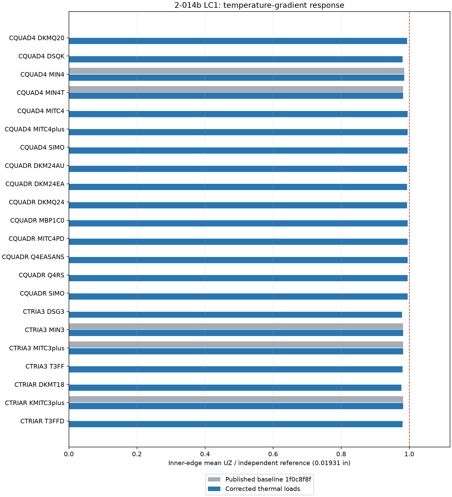

# Discussion case 12: thermal-gradient load support completed, 25 October 2026

**Status: fixed and verified; owner approved publication.** All 22 current linear shell formulations now produce nonzero 2-014b responses. This replaces the previous 17/22 zero-response result from published commit `1f0c8f8f`. Removed MITC3+HB is not restored; KMITC3+ is used in its place.

## Changes

The 15 affected element files now assemble the through-thickness equivalent thermal bending load using their existing bending operators and `SHELL_DALP`, scaled by `DT(ELGP+1,subcase)`. Continuum MITC4-family kernels integrate the corresponding thermal strain through thickness. The five previously responding selectors remain controls. Existing Lee + Spin, KMITC3+, DSQK/DSG3 consistent-spin operators, selector defaults, pressure, elastic/geometric stiffness and mass remain unchanged.

A reproducible mean-temperature DKMQ24 regression exposed uninitialized polynomial-fit metadata in the direct corner-recovery branch. That branch does no fit. Initializing only `STRESS_OUT_PCT_ERR` and `STRESS_OUT_ERR_INDEX` removes the F06 out-of-bounds failure without altering recovered stress values, fitting algorithms or the eigensolver. The correction applies inside the existing direct-recovery branch only. Initial failure evidence is preserved locally; the complete suite was rerun with the final successful build.

Thermal-only hunks are applied to both the publication checkout and the main source tree. Main-tree unrelated changes, including the separate local DSG3 Kg-z edit, are retained. No case-13 geometric-stiffness change is included in this patch.

## Verification

- **396/396 principal runs complete; 440/440 numerical assertions pass.**
- Annulus baseline, reversed gradient, zero gradient, doubled gradient, pure mean temperature and combined mean/gradient: 132 runs across all 22 formulations.
- Restrained mean, gradient, combined, reversed and zero temperature patches: 110 candidate runs, with 22 baseline zero-load controls.
- 132 before/after regression runs cover 2-013a, 2-013b and 2-005 simply supported n6 (uniform and concentrated loads).
- All 22 small-element KGG matrices are unchanged to the asserted relative tolerance 1e-14. All compared mechanical and mean-temperature displacement arrays are unchanged within 1e-10 absolute tolerance.
- Restrained fiber stresses match the existing linear MYSTRAN convention `sigma_m - z*sigma_b`; all tested force-table moments match the integral of the recovered fiber stresses. Sign reversal, zero response, amplitude scaling and superposition are checked with F06 print precision allowances.
- **22 additional two-element/two-subcase checks pass**, with different gradient and mean temperatures per element and nonzero TREF. This checks thermal-load-set indexing and avoids validating only one uniform gradient.
- **22 additional F06/OP2 checks pass**, comparing thermal fiber stresses and engineering forces. The former failing DKMQ24 center/corner thermal deck also completes in a dedicated reproduction.

The final validation comprises 441 solver invocations (396 principal + 22 multi-gradient + 22 OP2 + one dedicated corner regression). Completion counts are distinct from accuracy assertions.

## 2-014b annulus

Reference: inner-edge mean UZ = 0.01931 in, tangent rotation = 0.00352 rad. Geometry, materials, load, supports and mesh are unchanged. No coefficient fitting was introduced.

| Formulation | UZ (in) | UZ error (%) | Tangent rotation (rad) |
|---|---:|---:|---:|
| CQUAD4_DKMQ20 | 0.01918460 | 0.6494 | 0.003501417 |
| CQUAD4_DSQK | 0.01892245 | 2.0070 | 0.003481752 |
| CQUAD4_MIN4 | 0.01902983 | 1.4509 | 0.003498613 |
| CQUAD4_MIN4T | 0.01896548 | 1.7842 | 0.003491069 |
| CQUAD4_MITC4 | 0.01921166 | 0.5093 | 0.003500820 |
| CQUAD4_MITC4plus | 0.01921166 | 0.5093 | 0.003500820 |
| CQUAD4_SIMO | 0.01921166 | 0.5093 | 0.003500820 |
| CQUADR_DKM24AU | 0.01918460 | 0.6494 | 0.003501417 |
| CQUADR_DKM24EA | 0.01918460 | 0.6494 | 0.003501417 |
| CQUADR_DKMQ24 | 0.01918460 | 0.6494 | 0.003501417 |
| CQUADR_MBP1C0 | 0.01921166 | 0.5093 | 0.003500820 |
| CQUADR_MITC4PD | 0.01921166 | 0.5093 | 0.003500820 |
| CQUADR_Q4EASANS | 0.01921166 | 0.5093 | 0.003500820 |
| CQUADR_Q4RS | 0.01921166 | 0.5093 | 0.003500820 |
| CQUADR_SIMO | 0.01921166 | 0.5093 | 0.003500820 |
| CTRIA3_DSG3 | 0.01889332 | 2.1578 | 0.003484891 |
| CTRIA3_MIN3 | 0.01896571 | 1.7830 | 0.003491105 |
| CTRIA3_MITC3plus | 0.01896263 | 1.7989 | 0.003491959 |
| CTRIA3_T3FF | 0.01892881 | 1.9741 | 0.003486881 |
| CTRIAR_DKMT18 | 0.01886758 | 2.2911 | 0.003475732 |
| CTRIAR_KMITC3plus | 0.01896611 | 1.7809 | 0.003492384 |
| CTRIAR_T3FFD | 0.01892881 | 1.9741 | 0.003486881 |

## Scope and remaining limits

Case 12's omitted thermal-gradient loading and the tested flat isotropic recovery paths are resolved in this working-source build. Exact edge/corner stress accuracy on the curved annular boundary, arbitrary nodal thickness/directors, laminates and alternative DEBUG176 SE/STE paths are not certified by these tests. Adjacent element-center values are not relabeled as exact boundary stresses. General formulation limitations remain separate from this fix.

Case 2 remains a DKMT18 baseline torsion known failure. Case 13 remains open in the published implementation; this thermal patch does not silently include its geometric-stiffness fix.

## Reproduction and artifacts

[Annulus CSV](validation_case12_20261025/annulus_comparison.csv), [validation assertions](validation_case12_20261025/validation.json), [multi-gradient checks](validation_case12_20261025/multi_gradient_checks.json), [F06/OP2 checks](validation_case12_20261025/op2_checks.json), [build/source provenance](validation_case12_20261025/provenance.json).

The local workspace `H:/Projects/MYSTRAN/codex_mod/case12_completion_20261025` contains `validate.py`, `evaluate.py`, `check_multi_gradient.py`, `check_op2.py`, `corner_regression.json`, raw DAT/F06/OP2, baseline snapshots and both build logs. Thermal patches were ported with exact-context checks instead of replacing outdated complete kernels.

Build: `cmake --build H:/Projects/MYSTRAN/codex_mod/discussion_retest_20261025/build --parallel 6`. This rebuilds the changed files in the preceding fresh full build of the publication checkout, with its external SuperLU/OpenBLAS/MUMPS/FEAST configuration. It is not described as another clean build of the unrelated dirty main checkout.

Tested executable: `H:/Projects/MYSTRAN/codex_mod/case12_completion_20261025/bin/mystran.exe`. The standard `source/Binaries/mystran.exe` remains unchanged. Source and executable hashes are recorded in provenance.
