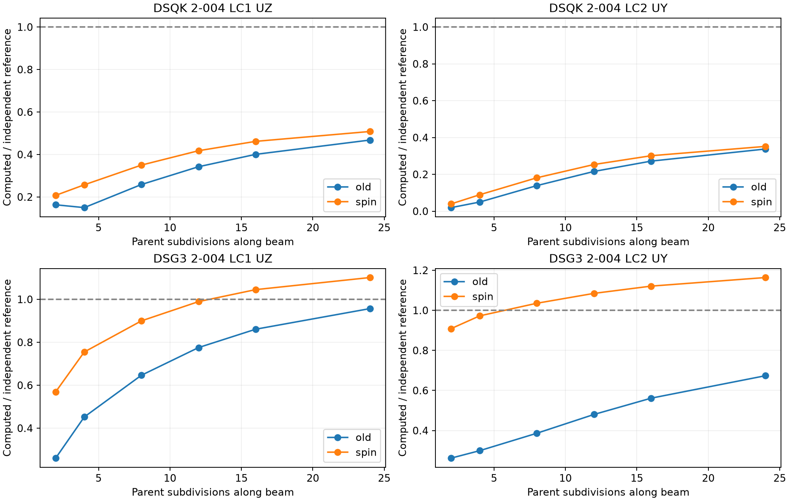
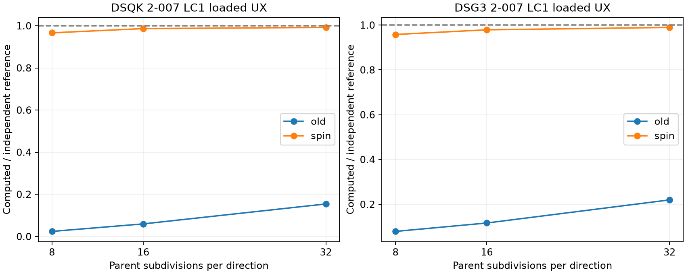

# DSG3 / DSQK consistent-spin candidate: static verification, 25 October 2026

The existing local experimental drilling operators were verified against the supplied handoff. Both retain native coefficients: CTRIA3 `PARAM,TRIA3TYP,DSG3` uses 0.001 and three Hammer points; CQUAD4 `PARAM,QUAD4TYP,DSQK` uses 0.03 and 2x2 quadrature. Selectors and family defaults are unchanged. The owner approved committing these selected-kernel changes after reviewing the static trade-offs. Family selector defaults and the standard binary are unchanged.

## Verification

- Fresh CMake build from the current source tree completed, using an isolated output/module directory. Existing unrelated local changes remain part of that tree; this is not described as a clean Git checkout.
- Paired baseline changes only the two local drilling operators back to absolute-rotation springs. Thermal, pressure, mass, recovery and geometric-stiffness code is identical between the paired builds.
- **264/264 SOL 101 runs completed**: 66 cases per formulation per revision. This includes retained static manifest cases plus hemisphere n16/n32; no SOL 105 or DARPACK work was performed. Completion is distinct from accuracy acceptance.
- 28 native/Python checks passed. Maximum stiffness relative difference 5.168e-16; maximum printed displacement relative difference 1.941e-07. Exact deck coordinates, connectivity, SPCs and output coordinate systems were used. Invalid overlong SPC1 lists were split into at most six GRID IDs per line identically in both revisions.
- Skew, rotated, cyclic and reversed single-element matrices agree. Both candidates have six rigid modes and no negative eigenvalues outside the relative rank tolerance.
- F06/OP2 membrane-plus-bending stress and engineering-force checks passed for both families, within output rounding.
- Shared global K6ROT is already skipped for these two selected kernels; no duplicate spring was introduced.

## Trade-offs (absolute percent error)

| Benchmark | DSQK old | DSQK spin | DSG3 old | DSG3 spin |
|---|---:|---:|---:|---:|
| 2-007 hemisphere n32, UX | 84.563 | 0.786 | 78.043 | 1.047 |
| 2-004 LC1 n24, UZ | 53.198 | 49.171 | 4.304 | 10.161 |
| 2-004 LC2 n24, UY | 66.231 | 64.809 | 32.633 | 16.389 |

DSQK twisted beam remains a known accuracy failure. DSG3 twisted LC1 regresses and is not classified as solved. Coarse roof trade-offs also remain; the full CSV preserves every observable rather than selecting improvements.

## Thermal preservation

2-014b is unchanged between the paired builds. In this source snapshot DSQK still produces zero gradient displacement (existing unsupported path); DSG3 gives inner-edge mean UZ 0.01889332 in both revisions. Zero is retained as an existing limitation, not marked an accuracy pass. The drilling candidate introduces no thermal-load or thermal-recovery change.

## Evidence and reproduction

[Static ZIP](validation_dsqk_dsg3_20261025/static_comparison.zip), [Python/native parity CSV](validation_dsqk_dsg3_20261025/python_native_parity.csv), [build provenance](validation_dsqk_dsg3_20261025/build_provenance.json), [F06/OP2 checks](validation_dsqk_dsg3_20261025/output_parity.json), and the two `*_drilling_only.patch` files are included. Python formulations are unchanged from the handoff. Raw DAT/F06/OP2 and per-run executable/input hashes are under `runs/`, `parity/`, and `output_check/` in the local investigation workspace.

Clean-build command: `cmake --build clean_build --parallel 6`, after configuration recorded in `clean_build/CMakeCache.txt` and `configure.log`. `GIT_SUBMODULE=OFF` avoids changing submodules. The build uses external OpenBLAS, sequential MUMPS and FEAST already configured for the project.

Candidate executable: `H:/Projects/MYSTRAN/codex_mod/dsqk_dsg3_handoff_20261025/bin/mystran.exe`. The standard `source/Binaries/mystran.exe` was not replaced. The source tree already contained the experimental operators; no unrelated source changes were overwritten. Source hashes and both executable hashes are recorded in build provenance.

## Publication scope

The publication commit applies only the drilling operators and required local declarations to the latest remote kernels. The 264-run evidence above was generated from the explicitly hashed local source snapshot. That snapshot includes a separate uncommitted DSG3 thermal-gradient load correction; it is not included in this drilling commit. Consequently the recorded nonzero DSG3 2-014b response describes that local snapshot, not a thermal-support claim for the published kernel. Geometric stiffness and all other non-drilling paths are preserved from the remote version.

Publication-kernel follow-up: **132/132 SOL 101 runs completed** after compiling the exact publication kernels into the fresh-build archive. [Publication ZIP](validation_dsqk_dsg3_20261025/publication_static_comparison.zip) and [publication build provenance](validation_dsqk_dsg3_20261025/publication_build_provenance.json) are retained separately. This is a two-object publication verification relink, not a claim of a second full clean build from the remote checkout.
