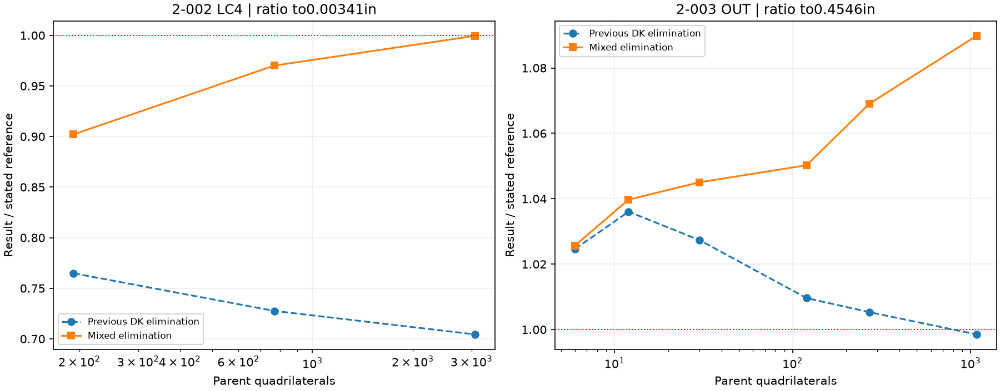

# DSQK mixed-strain elimination: native update and regression

26 October 2026. Isolated branch `research/dsqk-mixed-20261026`. Selector `PARAM,QUAD4TYP,DSQK` now uses the mixed An elimination for physical isotropic shear properties in this build. No shared solver defaults or tolerance were changed. This source update does not replace the published binary or historical benchmark measurements. See the [27 October MacNeal patch audit](DSQK_MacNeal_Patch_Audit_20261027.md) for additional validation.

## Implementation

Port the supplied Python mixed elimination: `(A_gamma-A_delta) An=Au`, solved by existing LAPACK DGESV with20 right-hand sides. Use the inverse mapping Jacobian in the mixed derivative products, and effective Db/Ds from the element property matrices. Retain covariant nodal shear tying, consistent-spin drilling alpha=.03, local bases, membrane and inherited bending energy `Kb=Kbu+An.T KbDelta An`. The same An is used for bending recovery and thermal equivalent loads, keeping those operators consistent with the new stiffness. Pressure, mass and geometric-stiffness code are unchanged.

This is the supplied controlled hybrid, not a claim to implement every aspect of the original published mixed-strain formulation. Isotropic MAT1/PSHELL cases are validated here; no new anisotropic/composite certification is asserted. If the shared property routine explicitly substitutes artificial shear stiffness (`SHELL_T_MOD=Y`), retain the legacy elimination. A blank MID3 in the diagnostic input defaults to the same effective operator as explicit MID3=1; it is not a zero-shear test. An explicitMID3=0 probe is rejected by the existing property parser and is excluded from acceptance.

The build also retains the two element-local source deltas already used in the prior linear release: DKMT18 SF candidate and corrected DSG3 local-z Kg. These are recorded separately in the inherited patch and were not redeveloped here.

## Native benchmark results

All83 DSQK configurations and4 unchanged MITC4 controls completed. Controls are exactly equal at recorded metric precision. All220 extracted metrics, including absolute patch residuals and both2-003 references, are retained in the comparison CSV. Completion is separate from physical accuracy.

| Case / observable | Previous result/reference | Mixed result/reference |
|---|---:|---:|
| 2-002 LC4 48x4 | 0.76480587 | 0.90209472 |
| 2-002 LC4 96x8 | 0.72761613 | 0.97007302 |
| 2-002 LC4 192x16 | 0.70440293 | 0.99948680 |
| 2-003 OUT 180x6, beam reference | 0.90713699 | 0.99006275 |
| 2-003 OUT 180x6, shell reference | 0.99852915 | 1.08980950 |
| 2-004 Fz, n24 | 0.50828613 | 0.50840269 |
| 2-004 Fy, n24 | 0.35191288 | 0.35214398 |
| 2-007 n32 UX | 0.99218553 | 0.99218617 |
| 2-008 frequency mode5 | 0.98600052 | 0.97317451 |
| 2-016c BEND critical stress | 0.99861974 | 0.99861974 |
| 2-016c SHEAR critical stress | 1.00040894 | 1.00040894 |
| 2-017 4x24 critical load | 1.04227347 | 1.04227347 |

## Trade-offs and known failures

The2-002 two-axis torsion deficit is reduced on the finest tested mesh (this is not an asymptotic convergence claim): error29.56% becomes0.0513%. However,2-003 OUT loses its previous near-agreement with the shell-torsion reference: signed error -0.1471% becomes +8.9810% at180x6. Against the distinct0.5004in beam reference, the same new displacement looks better. Both targets must remain visible; the target is not changed to make the candidate look better.

The2-004 twisted-beam underprediction remains large (about49.16% for Fz and64.79% for Fy atn24). The fifth2-008 frequency error grows from1.40% to2.68%. Thus mixed elimination is a targeted2-002 improvement, not a universal DSQK remedy.

The supplied constant-shear energy diagnosis is reproduced natively on the trapezoid: energy/reference1.20470576 at t=.1, while constant-curvature energy/reference is1 to roundoff. At t=.001 the shear ratio is1.00031550; at t=1 it is1.00436634. This imposed state includes additional enrichment bending energy; the ratio is total energy, not excess shear energy alone. It is a diagnostic rather than a definitive assembled patch failure. The subsequent [MacNeal audit](DSQK_MacNeal_Patch_Audit_20261027.md) separates these interpretations.

## Python/native parity and numerical checks

Twelve element KGG checks (skew, rotated, cyclic and reversed; thickness .001,.1,1) have maximum relative difference 8.408e-16. All have six numerical rigid modes at the stated relative threshold; small negative eigenvalues are roundoff-scale. Fifteen full-displacement checks on exact2-002,2-003,2-004,2-006 and2-007 DATs have maximum relative difference 1.748e-07, consistent with F06 precision. The hemisphere Python residual reaches about8e-9, as reported rather than rounded to zero.

SOL105 uses the same per-deck ARP_TOL=1e-10 and unchanged1e-6 eigenpair residual acceptance. The tested DSQK2-016/2-017 runs completed; no iterative-refinement or Jacobi solver prototype was introduced.

The first rejected port trial used the forward Jacobian where the Python formula uses its inverse; its parity failure was detected, the port corrected and all acceptance runs rebuilt and repeated. Rejected trial data are isolated and not counted in the final results.

## Files

[Full comparison CSV](validation_dsqk_mixed_20261026/comparison_mixed_vs_DK.csv) · [Source/build provenance](validation_dsqk_mixed_20261026/provenance.json) · [Matrix parity](validation_dsqk_mixed_20261026/native_python_matrix_parity.json) · [Response parity](validation_dsqk_mixed_20261026/native_python_response_parity.json) · [Native energy diagnostic](validation_dsqk_mixed_20261026/native_patch_energy_diagnostic.json)

