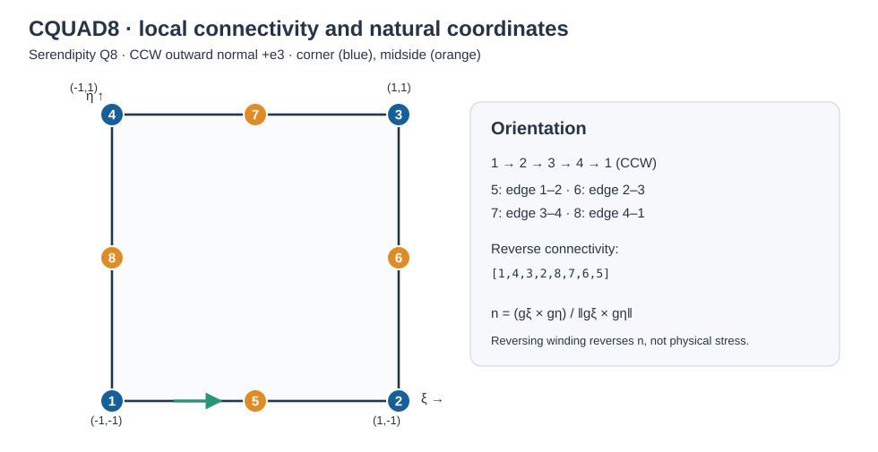
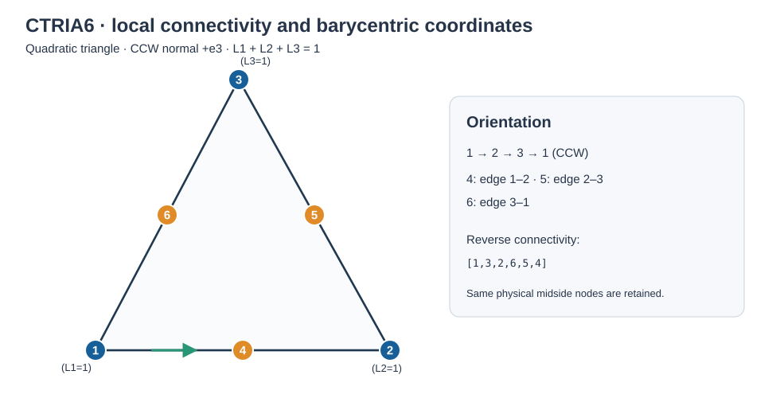
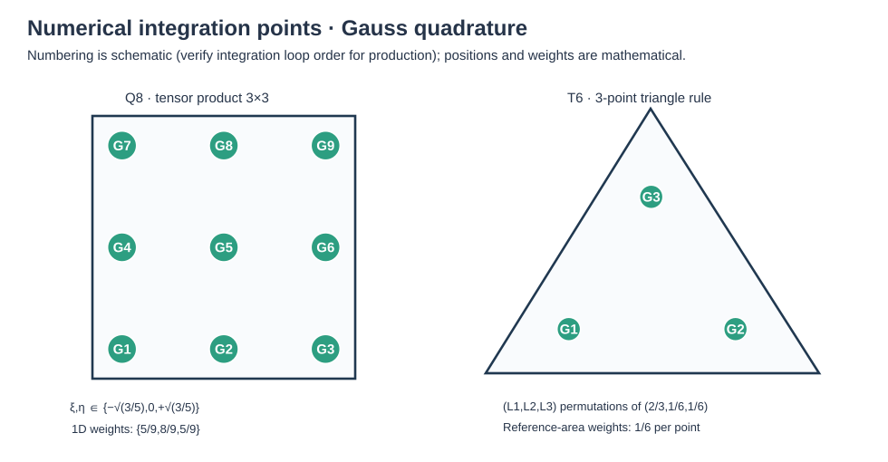

# CQUAD8 Quadratic Serendipity and CTRIA6 Quadratic Shell

**Ary · Independent Researcher · Personal Research**<br>
**Technical manuscript · Revision 3.1 · 18 October 2026**<br>
**Implementation baseline:** `v18.00.a`, commit `5acbd00e` (original manuscript); **validation checkout:** `c90cf1383b025df24d820bd4ec16c5b037b5e898` (18 October 2026 delivery; verify current checkout before publication)<br>
**Benchmark archive:** 17 October 2026

## Abstract

This manuscript documents the mathematical basis and bounded validation evidence of five eight-node serendipity quadrilateral and four six-node quadratic triangular shell formulations for MYSTRAN. It distinguishes original published mechanics from research adaptations, including assumed-strain projections, drilling stabilization, pointwise tensor recovery, and linearized initial-stress stiffness. Equations, shape functions, quadrature and tying diagrams are accompanied by independent verification tables whose unavailable numerical fields remain blank. Element selection is conditional on analysis class; no overall ranking is assigned.


## 1. Scope and conventions

This document describes finite-element formulations, **not the programming interface**. A named element identifies a reproducible mathematical model rather than a software class. All elements use $\mathbf q_I=(u_x,u_y,u_z,\theta_x,\theta_y,\theta_z)_I$. Local stress/resultant components are compared only after applying the appropriate tensor transformation. CW and CCW windings are both admissible when the geometric mapping is regular and the normal orientation is used consistently. Most material and buckling evidence is for isotropic small-strain shell response; it does not imply the complete finite-rotation nonlinear theory of the cited papers.

## 2. Coordinates, kinematics and global DOFs

### 2.1 Geometry and winding

For an isoparametric midsurface with natural coordinates $(r,s)$,

```math
\mathbf x(r,s)=\sum_{I=1}^{n}N_I(r,s)\mathbf x_I,\quad
\mathbf g_r=\frac{\partial\mathbf x}{\partial r},\quad
\mathbf g_s=\frac{\partial\mathbf x}{\partial s},\quad
J_A=\|\mathbf g_r\times\mathbf g_s\|,\quad
\mathbf n=\frac{\mathbf g_r\times\mathbf g_s}{J_A}.
```


Winding controls the oriented normal and, consequently, sign of oriented pressures and local bending/shear results. A CW element is not invalid merely because it is CW; an implementation may support both if mapping and sign conventions are consistent. The current DUEL3A CW deck is retained as a reference, while DUEL3B isolates quadratic elements. Use the oriented normal; **do not force +Z on general curved geometry**. For planar XY audit use $J_{xy}=x_{,r}y_{,s}-x_{,s}y_{,r}$: positive implies CCW relative to global +Z.





## 2.2 Displacements and rotations

Each node has six global degrees of freedom, with the nodal vector

```math
\mathbf q_I=\begin{bmatrix}u_I&v_I&w_I&\theta_{xI}&\theta_{yI}&\theta_{zI}\end{bmatrix}^{T}.
```

Consequently, the Q8 and T6 element stiffness matrices have dimensions 48 × 48 and 36 × 36, respectively. Let `t1`, `t2`, and `n` be an orthonormal right-handed local triad. In the linear Reissner–Mindlin approximation about a flat reference surface,

```math
\mathbf u(r,s,z)=\mathbf u_0(r,s)+z\left(\boldsymbol\theta(r,s)\times\mathbf n\right)
```

```math
\mathbf u_0(r,s)=\sum_{I=1}^{n}N_I(r,s)\mathbf u_I,
\qquad
\boldsymbol\theta(r,s)=\sum_{I=1}^{n}N_I(r,s)\boldsymbol\theta_I.
```

Here `z` is the signed physical distance from the reference midsurface, and `n` is constant for the flat-surface baseline. With varying nodal directors a curved-shell element requires the appropriate director interpolation and covariant strain construction; this simplified expression is not a complete curved-shell formulation.

Classical degenerated-director formulations generally use five physical nodal DOFs, whereas the present six-DOF representation includes a separate drilling constraint. This is an implementation adaptation, not an exact reproduction of every cited reference.

## 2.3 Local physical membrane, curvature, shear operators

For a flat element, let `(x,y,z)` denote the local orthonormal coordinates, with the director along the positive local `z` axis and the rotational convention

```math
\boldsymbol\theta\times\mathbf n=
\begin{bmatrix}\theta_y&-\theta_x&0\end{bmatrix}^{T}.
```

The linear membrane engineering-strain vector is

```math
\boldsymbol\varepsilon_m=
\begin{bmatrix}
u_{,x}\\v_{,y}\\u_{,y}+v_{,x}\end{bmatrix}
=\mathbf B_m\mathbf q.
```

The curvature vector, in engineering twisting-curvature convention, is

```math
\boldsymbol\kappa=
\begin{bmatrix}
\theta_{y,x}\\
-\theta_{x,y}\\
\theta_{y,y}-\theta_{x,x}
\end{bmatrix}
=\mathbf B_b\mathbf q.
```

The transverse engineering-shear strain vector is

```math
\boldsymbol\gamma=
\begin{bmatrix}
w_{,x}+\theta_y\\
w_{,y}-\theta_x
\end{bmatrix}
=\mathbf B_s\mathbf q.
```

For the local nodal ordering `[u,v,w,theta_x,theta_y,theta_z]`, direct-gradient 3 × 6 and 2 × 6 blocks are

```math
\mathbf B_m^I=
\begin{bmatrix}
N_{I,x}&0&0&0&0&0\\
0&N_{I,y}&0&0&0&0\\
N_{I,y}&N_{I,x}&0&0&0&0
\end{bmatrix}.
```

```math
\mathbf B_b^I=
\begin{bmatrix}
0&0&0&0&N_{I,x}&0\\
0&0&0&-N_{I,y}&0&0\\
0&0&0&-N_{I,x}&N_{I,y}&0
\end{bmatrix}.
```

```math
\mathbf B_s^I=
\begin{bmatrix}
0&0&N_{I,x}&0&N_I&0\\
0&0&N_{I,y}&-N_I&0&0
\end{bmatrix}.
```

These blocks are the **baseline flat-shell operators** only. MITC8, ANS8, MITC6, Rezaiee, and MacNeal-family elements replace or project selected strain rows. They must not be represented as having identical strain-displacement operators.

## 2.4 Drilling rotation and objective rigid motion

For the local drilling rotation about `n`, a common weak drilling constraint is

```math
\gamma_d=\theta_z-\frac{1}{2}(v_{,x}-u_{,y})=\mathbf B_d\mathbf q.
```

The corresponding penalty stiffness is

```math
\mathbf K_d=\int_A\alpha_d\mathbf B_d^T\mathbf B_d\,\mathrm dA.
```

Here `alpha_d` must have dimensions of force per length and should be specified for each formulation. A conventional choice scales it with `Gh` and a dimensionless drilling factor; other implementation-specific scalings must be stated explicitly. Changing the overall sign of **the entire drilling row** does not alter its quadratic energy; changing only selected terms does.

Rigid-body objectivity requires the discrete field for

```math
\mathbf u(\mathbf x)=\boldsymbol\omega\times\mathbf x,
\qquad
\boldsymbol\theta=\boldsymbol\omega
```

to produce zero strain energy, within numerical tolerance:

```math
\mathbf q_{\mathrm{RBM}}^T\mathbf K\mathbf q_{\mathrm{RBM}}\approx0.
```

## 2.5 Constitutive blocks, thickness and units

For an isotropic, homogeneous, linearly elastic plane-stress shell, the membrane/bending constitutive matrix is

```math
\mathbf D_p=\frac{E}{1-\nu^2}
\begin{bmatrix}
1&\nu&0\\
\nu&1&0\\
0&0&\frac{1-\nu}{2}
\end{bmatrix}.
```

The transverse-shear constitutive matrix and shear modulus are

```math
\mathbf D_s=\kappa_sG\mathbf I_2,
\qquad G=\frac{E}{2(1+\nu)}.
```

For constant, symmetric thickness `h` measured about the midsurface,

```math
\mathbf A=h\mathbf D_p,
\qquad
\mathbf D=\frac{h^3}{12}\mathbf D_p,
\qquad
\mathbf S=h\mathbf D_s.
```

The corresponding material-plus-drilling stiffness is

```math
\mathbf K_e=\int_A\left(
\mathbf B_m^T\mathbf A\mathbf B_m
+\mathbf B_b^T\mathbf D\mathbf B_b
+\mathbf B_s^T\mathbf S\mathbf B_s
+\alpha_d\mathbf B_d^T\mathbf B_d
\right)\,\mathrm dA.
```

A general laminate or eccentric reference surface instead uses the laminate resultant relationship

```math
\begin{bmatrix}\mathbf N\\\mathbf M\end{bmatrix}=
\begin{bmatrix}\mathbf A&\mathbf B\\\mathbf B&\mathbf D\end{bmatrix}
\begin{bmatrix}\boldsymbol\varepsilon_m\\\boldsymbol\kappa\end{bmatrix}.
```

Here, for symmetric constitutive tensors with reciprocal coupling,

```math
\mathbf A=\int\mathbf C(z)\,\mathrm dz,\qquad
\mathbf B=\int z\mathbf C(z)\,\mathrm dz,\qquad
\mathbf D=\int z^2\mathbf C(z)\,\mathrm dz.
```

This general ABD expression is theoretical context **only**. It does not imply that a composite-laminate ABD implementation is available or validated in the documented quadratic shell elements.

## 3. Shape functions: independent Q8 and T6 definitions

### 3.1 Eight-node serendipity Q8

The four corners use the natural coordinates `(-1,-1)`, `(1,-1)`, `(1,1)`, and `(-1,1)`. For corner nodes `I=1,...,4`, with corresponding coordinate signs `r_I, s_I`,

```math
N_I(r,s)=\frac14(1+r_Ir)(1+s_Is)(r_Ir+s_Is-1).
```

For midside nodes numbered successively along edges 1–2, 2–3, 3–4, and 4–1,

```math
N_5=\frac12(1-r^2)(1-s),
\qquad
N_6=\frac12(1+r)(1-s^2).
```

```math
N_7=\frac12(1-r^2)(1+s),
\qquad
N_8=\frac12(1-r)(1-s^2).
```

Two analytical derivatives used to audit the interpolation are

```math
N_{5,r}=-r(1-s),
\qquad
N_{5,s}=-\frac12(1-r^2).
```

For a planar map, define

```math
\mathbf J=\begin{bmatrix}x_{,r}&y_{,r}\\x_{,s}&y_{,s}\end{bmatrix}.
```

Then physical derivatives follow from

```math
\begin{bmatrix}N_{I,x}\\N_{I,y}\end{bmatrix}
=\mathbf J^{-1}
\begin{bmatrix}N_{I,r}\\N_{I,s}\end{bmatrix}.
```

The Jacobian convention is stated explicitly so that transpose conventions are not inadvertently interchanged. For curved midsurfaces, use surface tangent and dual bases rather than a frozen planar Jacobian.

### 3.2 Six-node quadratic triangle T6

Define barycentric coordinates on the reference triangle:

```math
L_1=1-r-s,\qquad L_2=r,\qquad L_3=s.
```

The reference domain satisfies `r >= 0`, `s >= 0`, and `r+s <= 1`. The vertex shape functions are

```math
N_1=L_1(2L_1-1),\quad
N_2=L_2(2L_2-1),\quad
N_3=L_3(2L_3-1).
```

The midside shape functions are

```math
N_4=4L_1L_2,\quad
N_5=4L_2L_3,\quad
N_6=4L_3L_1.
```

Analytical derivative checks include

```math
N_{1,r}=1-4L_1,\quad
N_{4,r}=4(L_1-L_2),\quad
N_{6,s}=4(L_1-L_3).
```

The reference triangle has area **1/2**, not 1. A quadrature rule must therefore integrate the constant function to 1/2 in the reference domain. All six translational and rotational nodal fields participate in the quadratic interpolation.

### 3.3 Curvilinear strain transformation

With covariant tangents $g_\alpha=\partial x/\partial\xi^\alpha$ and dual basis $g^\alpha$, natural linear membrane strains are

```math
\varepsilon_{\alpha\beta}=\frac12\sum_I\left[(g_\alpha\cdot\mathbf u_I)N_{I,\beta}+(g_\beta\cdot\mathbf u_I)N_{I,\alpha}\right].
```

The physical tensor is $\boldsymbol\varepsilon=\varepsilon_{\alpha\beta}\,\mathbf g^\alpha\otimes\mathbf g^\beta$, expressed in an orthonormal physical basis before multiplying the isotropic constitutive matrix. **Do not directly average covariant components from different tangent bases.** This is central to Jung-inspired and curved MITC operator audits.

## 4. Gauss quadrature and tying diagrams



For Q8 standard 3×3 Gauss–Legendre quadrature in $[-1,1]^2$: abscissae $\{-b,0,+b\}$, $b=\sqrt{3/5}$, one-dimensional weights $\{5/9,8/9,5/9\}$. Integrate as

```math
K_e\approx\sum_{i=1}^3\sum_{j=1}^3 w_iw_j\,J_A(r_i,s_j)\,\mathcal B(r_i,s_j).
```

For T6, a Duffy map of $[0,1]^2$ can be used: $r=a,s=(1-a)b$, $\mathrm dr\mathrm ds=(1-a)\mathrm da\mathrm db$; if transformed from $[-1,1]^2$, both factors $1/2$ must be applied correctly. Alternative exact symmetric triangle quadrature is acceptable if it integrates the target polynomial degree and geometric variation accurately.

**Tying points are not Gauss integration points.** Interpolation samples are selected to construct assumed $\bar B_m$ or $\bar B_s$, then the resulting energy is integrated at quadrature points. A formula such as

```math
\bar B_\alpha(r,s)=\sum_{k=1}^{n_t}L_k^{(\alpha)}(r,s)\,B_\alpha(r_k,s_k)
```

requires explicit sample coordinates, interpolation weights, covariant/physical transformation and row ordering. The number and location $n_t$ differ by element and by operator. A 6-point shear fit does not automatically pass a distorted patch test; do not swap it into a published element without revalidation.

## 5. General element construction: reproducible algorithm

1. Read node coordinates (Q8 eight, T6 six), material $E,\nu,\rho,h$, element options and requested coordinate systems; check node/edge mapping and nondegeneracy.
2. Construct nominal frame and—when the formulation uses them—nodal directors and Gauss-point tangent bases; enforce consistent handedness, not a global +Z shortcut.
3. Evaluate geometric standard $N^g,dN^g$ at Gauss points. Distinguish geometry interpolation from modified displacement/strain fields $N^f,dN^f$.
4. Build direct physical strain rows and/or natural covariant rows; evaluate tying-point rows, interpolate assumed strains, transform consistently to physical frame.
5. Build $B_m,B_b,B_s,B_d$, integration weight $w_qJ_A$; assemble material and drilling parts independently so each energy contribution can be audited.
6. Construct 6n×6n transformation $T=\mathrm{blockdiag}(R^T,R^T,\ldots)$ for fixed-frame elements. Verify $K_g=T^TK_lT$ and the code's actual vector convention; some global-coordinate formulations use $T=I$.
7. Independently assemble equivalent nodal pressure/traction forces, thermal eigenstrains and mass; do not reuse modified shape fields as geometric Jacobians unless that is a deliberate, documented choice.
8. Check symmetry, six null eigenvectors, positivity on the constrained subspace, finite conditioning, rigid-body invariance, patch consistency and load resultant/first moment.
9. Solve, recover resultants and stresses at documented locations in documented axes, and export source-identified CSV rows. Record solver failures rather than silently skipping negative-Jacobian integration points.

## 6. Mass, thermal, pressure and initial-stress buckling

### 6.1 Mass

With $\mathbf N_u=[N_1I_3\ \cdots\ N_nI_3]$, consistent translational mass is

```math
M_{uu}=\rho h\int_A\mathbf N_u^T\mathbf N_u\,dA,\qquad M_{rr}=\rho h^3/12\int_A\mathbf N_r^T\mathbf N_r\,dA
```

for available rotary inertia channels. Drilling rotary inertia is frequently zero. Row-sum lumping of Q8 shape-function mass matrices may create unacceptable or zero/negative nodal masses; **check total mass, positive diagonal and modal stability**, not just mass sum. Eigen regularization is not independent evidence that every the corresponding mathematical operator works.

### 6.2 Thermal eigenstrain and consistent load

With linear through-thickness temperature $\Delta T(z)=\Delta T_0+z\Delta T_1$ and isotropic expansion $\alpha$:

```math
\varepsilon_T(z)=\alpha\Delta T(z)[1,1,0]^T,\quad
N_T=\int_{-h/2}^{h/2}D_p\varepsilon_T(z)\,dz= hD_p\alpha\Delta T_0[1,1,0]^T,
```


```math
M_T=\int_{-h/2}^{h/2}zD_p\varepsilon_T(z)\,dz=\frac{h^3}{12}D_p\alpha\Delta T_1[1,1,0]^T,
\quad f_T=\int_A(B_m^TN_T+B_b^TM_T)\,dA.
```

If input instead supplies top-minus-bottom $\Delta T_{tb}$, then $\Delta T_1=\Delta T_{tb}/h$. This distinction prevents a hidden factor of thickness in thermal comparisons. Thermal resultants must be subtracted in stress recovery: $N=A\varepsilon_m-N_T$, $M=D\kappa-M_T$.

### 6.3 Pressure and work conjugacy

For pressure $p$ in oriented normal direction, consistent nodal load is

```math
\mathbf f_p=\int_{\Omega_{nat}}\mathbf N_u^{T}\,p(r,s)[\mathbf g_r\times\mathbf g_s] \,dr\,ds.
```

For a specified global traction direction $\hat{\mathbf d}$, replace the oriented vector by $J_A\hat{\mathbf d}$. In both cases check $\sum_I\mathbf f_I=\int_A\mathbf t\,dA$, $\sum_I\mathbf x_I\times\mathbf f_I=\int_A\mathbf x\times\mathbf t\,dA$. CW normal-pressure sign reverses relative to CCW; prescribed global force direction must not reverse automatically.

### 6.4 Initial-stress stiffness: documented **restricted** scope

For a *flat*, prestressed surface with tension-positive local membrane Cauchy stress $S=[\sigma_{11},\sigma_{22},\tau_{12}]$, a translational initial-stress operator is

```math
K_G^{(ab)}=h\int_A \nabla N_a^T\begin{bmatrix}\sigma_{11}&\tau_{12}\\\tau_{12}&\sigma_{22}\end{bmatrix}\nabla N_b\,dA\ I_3.
```

This integrates membrane Cauchy stress, **not** force resultants; multiplying resultant $N=hS$ by thickness again is wrong. The buckling eigenproblem is $(K+\lambda K_G)\phi=0$, with compressive stress giving negative energy directions and positive critical $\lambda$. Compute $\|K\phi+\lambda K_G\phi\|/(\|K\phi\|+|\lambda|\|K_G\phi\|)$, confirm mode-shape physics and load normalization.

The uploaded the corresponding mathematical operator explicitly rejects curved/warped geometry and excludes director/rotation stress terms, nonlinear prebuckling and follower loads. Thus none of our historical 2-016/2-017 results certify full nonlinear curved-shell tangents. This restriction must be disclosed even if the underlying journal references include nonlinear shell derivations.


## 7. Nine independent formulations

### 7.1 SIMOQ8 v13 — eight-node serendipity shell

The surface uses the Q8 serendipity functions of §3.1. Nodal directors $\mathbf d_I$ define the rotation-induced through-thickness displacement $\mathbf u(z)=\sum_I N_I[\mathbf u_I+z(\boldsymbol\theta_I\times\mathbf d_I)]$. The physical strain operators follow the covariant surface map $\mathbf g_\alpha=\mathbf x_{,\alpha}$, with tensor transformation to an orthonormal tangent frame. The material stiffness is

```math
K^{\mathrm{SIMOQ8}}=\int_A\!\left[h\bar B_m^TC_m\bar B_m+\frac{h^3}{12}B_b^TC_mB_b+h\bar B_s^TC_s\bar B_s+h\,c_dB_d^TB_d\right]dA.
```

An optional assumed-strain branch replaces directly computed membrane or shear strain rows by projected rows $\bar B_\alpha=\sum_j L_j^{(\alpha)} B_\alpha(\xi_j)$, whereas bending and drilling are treated separately. An optional incompatible/enhanced strain contributes an internal field $\varepsilon^{E}=G\alpha$, with the condensed stiffness $K_{qq}^{\star}=K_{qq}-K_{q\alpha}K_{\alpha\alpha}^{-1}K_{\alpha q}$ **only when that branch is active and nonsingular**. This is not a claim that the entire nonlinear Simo–Fox–Rifai algorithm is reproduced. **Adopted:** director kinematics, stress-resultant decomposition, local covariance. **Modified:** Q8 shape basis, conditional assumed/enhanced strains and drilling penalty. **Not reproduced:** full geometrically exact time integration, finite rotational tangent, large-strain plasticity and thickness stretching.

### 7.2 SIMOT6 v2 — six-node triangular shell

Using the P2 triangle basis $N_I(L_1,L_2,L_3)$ of §3.2 and $\Omega_\triangle=\{r\ge0,s\ge0,r+s\le1\}$, construct directors independently for six nodes and the covariant surface gradient $\mathbf g_r,\mathbf g_s$. The strain–rotation operators are evaluated in the moving physical tangent basis and the triangular stiffness is

```math
K^{\mathrm{SIMOT6}}=\int_{\Omega_\triangle}\left[hB_m^TC_mB_m+\frac{h^3}{12}B_b^TC_mB_b+hB_s^TC_sB_s+h c_dB_d^TB_d\right]J_A\,dr\,ds.
```

Where projected rows are selected, they must use a *triangular* polynomial space and triangle sample positions; Q8 tensor-product tying is not transferable. **Adopted:** stress-resultant director theory and objective frame requirements. **Modified:** P2 triangle interpolation, six-DOF representation and drilling constraint. **Not reproduced:** exact finite-rotation geometric Simo tangent. SIMOT6 is an independent formulation, not a corner-reduced SIMOQ8.

### 7.3 MITC8 v4 — mixed covariant tensorial interpolation

The covariant in-layer strain is $\varepsilon_{\alpha\beta}=\tfrac12(\mathbf g_\alpha\cdot\mathbf u_{,\beta}+\mathbf g_\beta\cdot\mathbf u_{,\alpha})$, with separate assumed membrane and transverse shear tensors. Curved surfaces use a metric-aware conversion into physical components rather than treating covariant strains as Cartesian strains. For membrane normal rows, define $b=\sqrt{3/5}$, $P_\pm(x)=(1\pm x)/2$, and $Q_j(x)$, the quadratic cardinal functions at $(-b,0,b)$. Then

```math
\bar\varepsilon_{rr}(r,s)=\sum_{i\in\{-1,1\}}\sum_{j\in\{-b,0,b\}}P_i(r)Q_j(s)\varepsilon_{rr}(i,j),\quad
\bar\varepsilon_{ss}(r,s)=\sum_{i\in\{-1,1\}}\sum_{j\in\{-b,0,b\}}Q_j(r)P_i(s)\varepsilon_{ss}(j,i).
```

For $a=1/\sqrt3$, the mixed in-plane shear is $\bar\varepsilon_{rs}=\sum_{i,j\in\{-a,a\}}L_i(r)L_j(s)\varepsilon_{rs}(i,j)$, with $L_{\pm a}(x)=(a\pm x)/(2a)$. This membrane tying is activated on curved/warped geometry and otherwise the direct membrane interpolation is retained. The transverse shear operator is given by §8. Drilling stabilization and optional locally modified displacement fields are research adaptations. **Adopted:** MITC covariant component interpolation and physical strain transformation (Bathe–Dvorkin; Dvorkin). **Modified:** curvature-conditioned membrane tying, the slenderness-dependent shear blend and six-DOF drilling. **Not reproduced:** original five-DOF complete nonlinear tangent and unmodified historical MITC8 operators.

### 7.4 ANS8BDG6 v4 — enhanced ANS quadrilateral

The normal-strain components employ two longitudinal sides and three points per side (six per component). Thus $\bar\varepsilon_{rr}$ and $\bar\varepsilon_{ss}$ use the $P_iQ_j$ interpolation above, while in-plane shear uses four $(\pm1/\sqrt3,\pm1/\sqrt3)$ samples and bilinear reconstruction. Curvature and midside deviation determine whether the membrane projection is active; a flat straight-sided element retains direct membrane strains. Transverse shear uses the alternative four- and six-point fields of §8.

The drilling variable is weakly constrained by the physical in-plane spin:

```math
\Pi_d=\frac12\int_A k_tGh\left(\theta_n-\tfrac12(v_{,x}-u_{,y})\right)^2dA,\quad k_t=0.1\ \text{(selected reference parameter)}.
```

**Adopted:** β/δ sampling philosophy and enhanced transverse shear collocation from Jung–Han (2013), plus the drilling-spin energy idea. **Modified:** modified-field shape interpolation, conditional membrane tying, blended shear and six-DOF small-strain implementation. **Not reproduced:** a proven exact implementation of the paper's full $\beta\delta\gamma^*_6$ interpolation or its nonlinear solution history.

### 7.5 HBQ8 Kikuchi v3 — modified-field hybrid quadrilateral

The adopted field interpolation $\widetilde N_I(r,s;\mathbf x)$ is geometry-sensitive (Kikuchi-type variant), giving physical surface gradients $\nabla_\Gamma\widetilde N_I$; however surface area is integrated from the standard Q8 geometric map. Membrane, bending and drilling energies are evaluated from separate differential rows, with the selected shear assumed field from §8. Its total stiffness retains the four mechanical energies of §5 and the drilling energy of §7.4, with its own drilling coefficient. The geometry switch is

```math
\chi_c=\begin{cases}1,&\theta_{\max}>0.01\ \mathrm{rad}\quad\text{or}\quad\delta_{mid}>10^{-3},\\0,&\text{otherwise},\end{cases}
\quad\delta_{mid}=\max_e\frac{\left\|\mathbf x_{m_e}-\tfrac12(\mathbf x_{a_e}+\mathbf x_{b_e})\right\|}{\|\mathbf x_{b_e}-\mathbf x_{a_e}\|}.
```

Here $\theta_{\max}=\max_I\arccos(\mathbf d_I\cdot\bar{\mathbf d})$ with normalized average director $\bar{\mathbf d}$. For $\chi_c=0$, direct membrane field; for $\chi_c=1$, covariantly tied membrane field. This is a **formulation criterion**, not a programming routine. **Adopted:** HBQ8 shell-energy decomposition and Kikuchi-type modified interpolation. **Modified:** switching and shear blending. **Not reproduced:** full geometrically nonlinear shell tangent.

### 7.6 MacNeal Q8 v3 — eight-node modified interpolation with drilling

A geometry-dependent interpolation $\widetilde N_I$ replaces the standard Q8 field for the displacement/strain approximation while preserving the eight external nodes. The surface geometry is still reconstructed from the physical Q8 nodal positions. From the modified interpolation form $\widetilde B_m,\widetilde B_b,\widetilde B_s$ and independent drilling penalty $\widetilde B_d$, assemble

```math
K^{\mathrm{MN8}}=\int_A h\widetilde B_m^TC_m\widetilde B_m+\frac{h^3}{12}\widetilde B_b^TC_m\widetilde B_b+h\widetilde B_s^TC_s\widetilde B_s+h c_d\widetilde B_d^T\widetilde B_d\,dA.
```

**Adopted:** MacNeal–Harder (1992) motivation for improved eight-node field interpolation. **Modified:** separate drilling constraint and six-DOF shell extension. **Not reproduced:** claim of equivalence to all original nine-node formulations or general nonlinear constitutive theory.

### 7.7 MITC6 v5e — enhanced six-node triangular mixed element

On the reference triangle, form the covariant membrane matrix $B^n_m(r,s)$, and covariant transverse shear matrix $B^n_s(r,s)$. A projection of a sampled scalar strain row $b$ to an affine field is determined from $\mathbf p=(1,r,s)^T$:

```math
\mathbf A_{j,:}=[1,r_j,s_j],\qquad \mathbf C=(A^TWA)^{-1}A^TW\begin{bmatrix}b(r_1,s_1)\\\vdots\\b(r_m,s_m)\end{bmatrix},\qquad \bar b(r,s)=\mathbf p^T\mathbf C.
```

The enhanced tying configuration changes selected internal sampling locations relative to the preceding research version; the operator must be checked on the triangle itself and cannot be inferred from a quadrilateral MITC rule. Compute physical membrane and transverse shear tensors using the surface metric; bending and drilling are separately integrated. **Adopted:** Kim–Bathe triangular MITC motivation and strain tying. **Modified:** affine reconstruction, particular tying positions and six-DOF drilling. **Not reproduced:** a claim that the research v5e sample selection was published unchanged in Kim–Bathe (2009).

### 7.8 MH6T v4 — triangular modified-field MacNeal family

Using P2 geometry, form direct bending from interpolated rotations and reconstruct in-layer/shear strains by a weighted projection over separately specified triangular sample points:

```math
\bar B_\alpha(r,s)=\sum_{j=1}^{m}H_j(r,s)B^{n}_\alpha(r_j,s_j),\qquad K=\int_{\Omega_\triangle}(h\bar B_m^TC_m\bar B_m+\tfrac{h^3}{12}B_b^TC_mB_b+h\bar B_s^TC_s\bar B_s+h c_dB_d^TB_d)J_A\,dr\,ds.
```

**Adopted:** modified/assumed-strain treatment of thin-shell locking. **Modified:** triangular tying and six-DOF drilling. **Not reproduced:** equivalence of this research interpolation to any single unmodified published MH6T element.

### 7.9 Rezaiee T6 v3 — modified assumed-strain triangular shell

The independent T6 shell uses six quadratic interpolation nodes and nodal director kinematics. The natural membrane and transverse shear rows are evaluated at collocation points and projected to polynomial assumed fields $\bar\varepsilon_m=\mathcal P_m\varepsilon_m$, $\bar\gamma=\mathcal P_s\gamma$; the physical tensor conversion employs $\mathbf g^\alpha$, the dual tangent vectors. Its weak-form contributions are integrated on the triangle, with separate drilling stabilization. **Adopted:** Rezaiee–Pajand triangular assumed-strain and director concepts. **Modified:** linear six-DOF version and drilling. **Not reproduced:** original five-DOF finite-rotation nonlinear formulation and consistent nonlinear tangent.

## 8. Explicit shear interpolation: BDG4, tensor6 and direct

Let $a=1/\sqrt3$, $b=\sqrt{3/5}$, and $\gamma_{rt},\gamma_{st}$ denote **covariant** transverse shear strains. Define

```math
L_-(x)=\frac{a-x}{2a},\quad L_+(x)=\frac{a+x}{2a},\qquad
H_-(x)=\frac{1-x}{2},\quad H_+(x)=\frac{1+x}{2},
```


```math
Q_{-b}(x)=\frac{x(x-b)}{2b^2},\qquad Q_0(x)=1-\frac{x^2}{b^2},\qquad Q_{+b}(x)=\frac{x(x+b)}{2b^2}.
```


**BDG4 (four-point transverse-shear tying per component)** samples $\gamma_{rt}$ at $(r_i,s_j)=(\pm a,\pm1)$ and $\gamma_{st}$ at $(\pm1,\pm a)$:

```math
\bar\gamma_{rt}^{(4)}(r,s)=\sum_{i=\pm}\sum_{j=\pm}L_i(r)H_j(s)\gamma_{rt}(r_i,s_j),\quad
\bar\gamma_{st}^{(4)}(r,s)=\sum_{i=\pm}\sum_{j=\pm}H_i(r)L_j(s)\gamma_{st}(r_i,s_j).
```


**Tensor6 (six-point transverse-shear tying per component)** instead uses 2×3 samples:

```math
\bar\gamma_{rt}^{(6)}(r,s)=\sum_{i=\pm}\sum_{j\in\{-b,0,b\}}L_i(r)Q_j(s)\gamma_{rt}(r_i,s_j),\quad
\bar\gamma_{st}^{(6)}(r,s)=\sum_{i\in\{-b,0,b\}}\sum_{j=\pm}Q_i(r)L_j(s)\gamma_{st}(r_i,s_j).
```


**Direct** shear means no tying projection, $\bar\gamma_{rt}^{(d)}(r,s)=\gamma_{rt}(r,s)$, $\bar\gamma_{st}^{(d)}(r,s)=\gamma_{st}(r,s)$. Each covariant component is converted to a physical tangent shear vector via the inverse surface metric. These options do **not** mean that a six-point Gauss integration rule is used: collocation and quadrature play different roles.

For the selected automatic shear treatment define slenderness $s_A=\sqrt A/h$, transition $s_0=15$ and mixing coefficient

```math
\omega=\min\left(1,\max\left(0,1-\frac{s_0}{s_A}\right)\right),\quad
\bar B_s=(1-\omega)\bar B_s^{(6)}+\omega\bar B_s^{(4)}.
```

The **operator is blended before the quadratic strain energy** $K_s=h\int\bar B_s^TC_s\bar B_s\,dA$. Consequently $K_s\ne(1-\omega)K_s^{(6)}+\omega K_s^{(4)}$ in general. For $s_A\le15$, tensor6 dominates; as $s_A\rightarrow\infty$, BDG4 dominates. The name “BDG6” denotes this research ANS8 family, not proof that every selected shear interpolation employs six samples.


## 9. Relation to the primary papers: adopted, modified and excluded

| Research element | Adopted theoretical ingredient | Research change/formulation decision | Not adopted as a complete model |
|---|---|---|---|
| SIMOQ8 | Simo–Fox–Rifai stress resultants; directors and shell covariance | Q8 interpolation, conditional assumed strains, separate drilling | Fully nonlinear finite-rotation/plasticity tangents |
| SIMOT6 | Simo director shell theory | P2 triangular kinematics; independent triangular operators | Reuse of Q8 tying or full nonlinear integration |
| MITC8 | Bathe–Dvorkin covariant mixed strain fields | Conditional membrane tying, modified Q8 field, BDG4/tensor6 blend | Original element reproduced unchanged |
| ANS8BDG6 | Jung–Han β/δ and shear sampling philosophy | Geometry switch, four/six shear blend, modified-field metric | Exact βδγ*6 nonlinear formulation |
| HBQ8 Kikuchi | HBQ8 energy splitting, Kikuchi interpolation | Explicit $\chi_c$ membrane switch; shear blend | Published full nonlinear HBQ8 theory |
| MacNeal Q8 | MacNeal–Harder interpolation motivation | Drilling stabilization in six-DOF shell | Nine-node equivalence in all settings |
| MITC6 v5e | Kim–Bathe triangular tying | Enhanced tie placement and affine projection | Claim that v5e is a published variant |
| MH6T | Modified assumed-strain framework | Independent triangular projection | Exact reproduction of a named publication |
| Rezaiee T6 | Rezaiee–Pajand triangular assumed strain | Linear 6-DOF adaptation | Published nonlinear 5-DOF tangent |

Internal project documents and software method names are not cited as research literature. The references below support theory and the limitations above; they do not by themselves validate the research adaptations.


The CSI verification PDFs are the primary benchmark definitions. The online PDF endpoints could not be retrieved during this revision. Accordingly, parameters available from traceable research decks are explicitly identified as such, while parameters not independently checked against the official documents remain blank. No missing model description, material or boundary condition has been inferred. Each linked PDF remains the authoritative source for eventual reconciliation.

## 10. CSI shell verification reference table

The following benchmark names are **working descriptions** where the official title has not been independently checked. They are not claims of numerical validation.

| Test and official PDF | Physical problem / working description |
|:---|:---|
| [2-001](https://docs.csiamerica.com/manuals/csibridge/Verification/Analysis/Shells/Problem%202-001.pdf) | Patch test — prescribed membrane and bending displacements |
| [2-002](https://docs.csiamerica.com/manuals/csibridge/Verification/Analysis/Shells/Problem%202-002.pdf) | Clamped shell/beam verification |
| [2-003](https://docs.csiamerica.com/manuals/csibridge/Verification/Analysis/Shells/Problem%202-003.pdf) | Combined shell response |
| [2-004](https://docs.csiamerica.com/manuals/csibridge/Verification/Analysis/Shells/Problem%202-004.pdf) | Twisted beam |
| [2-005](https://docs.csiamerica.com/manuals/csibridge/Verification/Analysis/Shells/Problem%202-005.pdf) | Plate bending / pressure |
| [2-006](https://docs.csiamerica.com/manuals/csibridge/Verification/Analysis/Shells/Problem%202-006.pdf) | Cylindrical roof / Scordelis–Lo |
| [2-007](https://docs.csiamerica.com/manuals/csibridge/Verification/Analysis/Shells/Problem%202-007.pdf) | Pinched hemisphere / curved shell |
| [2-008](https://docs.csiamerica.com/manuals/csibridge/Verification/Analysis/Shells/Problem%202-008.pdf) | Modal / eigenfrequency |
| [2-009](https://docs.csiamerica.com/manuals/csibridge/Verification/Analysis/Shells/Problem%202-009.pdf) | Verification case 2-009 — official title unverified |
| [2-010](https://docs.csiamerica.com/manuals/csibridge/Verification/Analysis/Shells/Problem%202-010.pdf) | Pipe / curved shell |
| [2-012](https://docs.csiamerica.com/manuals/csibridge/Verification/Analysis/Shells/Problem%202-012.pdf) | Verification case 2-012 — official title unverified |
| [2-013](https://docs.csiamerica.com/manuals/csibridge/Verification/Analysis/Shells/Problem%202-013.pdf) | Thermal response — working classification |
| [2-014](https://docs.csiamerica.com/manuals/csibridge/Verification/Analysis/Shells/Problem%202-014.pdf) | Thermal / annular-shell response — working classification |
| [2-015](https://docs.csiamerica.com/manuals/csibridge/Verification/Analysis/Shells/Problem%202-015.pdf) | Verification case 2-015 — official title unverified |
| [2-016](https://docs.csiamerica.com/manuals/csibridge/Verification/Analysis/Shells/Problem%202-016.pdf) | Plate out-of-plane buckling |
| [2-017](https://docs.csiamerica.com/manuals/csibridge/Verification/Analysis/Shells/Problem%202-017.pdf) | In-plane column buckling |

Will be updated in here : https://github.com/realbabilu/MYSTRAN/blob/v18.00.a/update/shell_benchmark/comparison_all.md

### Problem Plate bending / pressure


### Problem Shell Thermal Patch Test


### Problem Shell Mass Mode Shape


### Problem Shell Buckling


## 11. Validation status and case-dependent element guidance (18 October 2026)

The validation deliveries are **evidence, not a universal element ranking**. Q8 production contains 91 thick physical models and 455 successful MYSTRAN runs across five formulations; executable coverage is 15/16 eligible benchmark IDs (2-015 pending). T6 production contains 70 thick physical models across 11 benchmark IDs and four formulations. These counts indicate execution/availability, **not numerical accuracy or full CSI verification**. Both campaigns use independently matched Nastran/MYSTRAN output only when physical model, observable, sampling location, and coordinate frame are consistent. Curved-shell force/stress frame comparison remains pending for many rows.

For 2-001, all four T6 formulations pass analytical flat membrane, bending and zero-transverse-shear patch checks at supported sampling locations. The repaired SIMOQ8 pointwise membrane/moment recovery also passes the flat analytical checks, but **SIMOQ8 still exhibits nonuniform midside transverse shear in LC2** (reported approximately $Q_y=0.02666667$ at GRID 510/EID 24). Do not claim complete patch-test success based on displacement or moment alone. The Q8 Nastran LC2 bending-resultant discrepancy relative to the analytical reference remains unresolved; compare actual basic-coordinate tensors and thickness/fiber conventions before interpreting it as element failure.

| Analysis condition | Conditional formulation guidance | Validation restriction |
|---|---|---|
| Flat membrane or bending patch | Any Q8/T6 formulation may be considered **only after its own** same-frame force/moment patch checks pass. T6 candidates have documented flat patch passes. | SIMOQ8 midside transverse-shear LC2 still fails uniformity. |
| Thin plate in bending | Examine SIMOQ8, MITC8, ANS8BDG6, HBQ8, MacNeal Q8 for locking and distortion sensitivity; triangulated meshes may examine MITC6/SIMOT6. | No general best element follows from one plate case; confirm convergence and moment recovery. |
| Thick plate/shell | Favor elements with verified active transverse-shear stiffness and sample-point recovery, including MITC/ANS variants as research candidates. | MID3 activation, thickness, shear factor, and solver conventions must match. |
| Curved cylindrical or spherical shell | Compare MITC8/ANS8BDG6 and triangular MITC6/SIMOT6 with curved-frame-aware processing, alongside other candidates for sensitivity. | Basic-coordinate displacement may be compared now; element stress/resultant agreement is still frame-QA-pending. |
| Distorted or twisted shell | Test each modified-field formulation on the **same physical distorted mesh** and compare convergence, rigid-body objectivity, and recovery. | Recommendations are exploratory until same-frame, same-load benchmarks are verified. |
| Linear modal analysis | Use any candidate with an independently validated mass model and mode matching by MAC. | 2-008 production uses diagonal CONM2 only; low-MAC pairings must be withheld. |
| Linear eigen buckling | Use elements whose prestress, geometric stiffness and eigenmode match have been audited at the selected thickness. | Linearized buckling only; 2-016 thin Nastran cases have unresolved solver failures and T6 pivot recoveries require qualification. |

### 11.1 Reproducible reporting and release criteria

Report the **physical model and thickness** before reporting numerical agreement. For every measured observable provide problem ID, element family and formulation, thin/thick flag, winding, independent reference (if verified), solver, point and fiber, local/basic-coordinate convention, results, difference/error and source checksum. Preserve analytical zero targets using absolute error rather than division by zero. **No missing result shall be represented by numerical zero**. For public repository delivery, keep source and generated benchmark DAT traceable separately and store bulky OP2/F06 outside the documentation ZIP.

The included with this document assigns **all DAT selection, thin/thick MID3 verification, Q8/T6 extraction, winding CCW normalization and DAT ZIP construction *. The Markdown/HTML package itself contains no benchmark DAT.

## References — primary journal literature (no citations to project Markdown)

1. Simo, J.C., Fox, D.D., Rifai, M.S. (1989–1990). *On a stress resultant geometrically exact shell model*, Parts I–IV, **Computer Methods in Applied Mechanics and Engineering**. Consult the respective articles for exact part titles/pages.
2. Bathe, K.J., Dvorkin, E.N. (1986). *A formulation of general shell elements—the use of mixed interpolation of tensorial components*, **International Journal for Numerical Methods in Engineering**, 22, 697–722.
3. Dvorkin, E.N. (1995). *Nonlinear analysis of shells using the MITC formulation*, **Archives of Computational Methods in Engineering**, 2, 1–50.
4. Bucalem, M.L., Bathe, K.J. (1993). *Higher-order MITC general shell elements*, **International Journal for Numerical Methods in Engineering**, 36, 3729–3754. Background MITC9/16 **only**, not evidence for an exact MITC8 v4 operator.
5. Jung, W.-Y., Han, S.-C. (2013). *An 8-node shell element for nonlinear analysis of shells using the refined combination of membrane and shear interpolation functions*, **Mathematical Problems in Engineering**, Article 276304, doi:10.1155/2013/276304.
6. MacNeal, R.H., Harder, R.L. (1992). *Eight nodes or nine?*, **International Journal for Numerical Methods in Engineering**, 33, 1049–1058.
7. Kim, K.-D. and Bathe, K.-J. (2009). MITC6 triangular shell research. Verify final bibliographic article title, author list and DOI from the provided primary PDF before submission.
8. Darılmaz, K., Kumbasar, N. (2006). HBQ8 quadrilateral shell research, **Computers & Structures**, 84, 1990–2000. Verify exact title and DOI from primary source.
9. Rezaiee-Pajand et al. (2017). Triangular shell research. Verify exact bibliographic record and DOF count against supplied primary PDF before submission.
10. Ko, Y., Bathe, K.-J. (2018). *A new 8-node element for analysis of three-dimensional solids*, **Computers & Structures**, 202, 85–104. **Not a primary quadratic shell element source:** belongs to CHEXA8/3D-MITC8 research.


## 12. Reference-anchored validation (19 October 2026)

See [shell benchmark](../../shell_benchmark/comparison_all.md) and the separate nine formulation pages. The CSI 2-005 C/D reference replaces invalid A/B overlays. Buckling 2-016 signed eigenvalues remain conditional on baseline prestress normalization and corresponding mode identity. Do not report a universal element ranking.


## Current checkout recovery note — 19 October 2026

Commit1f97ea99 makes SIMOQ8 same-point tensor recovery explicit while preserving the OP2 center basis, and corrects basic/local basis handling in quadratic GPFORCE. Stiffness and pressure kernels are unchanged; applied loads and displacements remain unchanged. This does not remove transverse-shear, curved-shell or buckling-normalization limitations. See [reference comparison](../../shell_benchmark/comparison_all.md).
