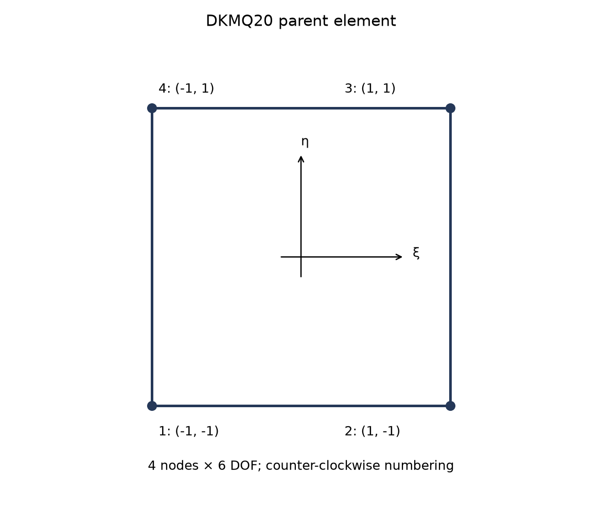
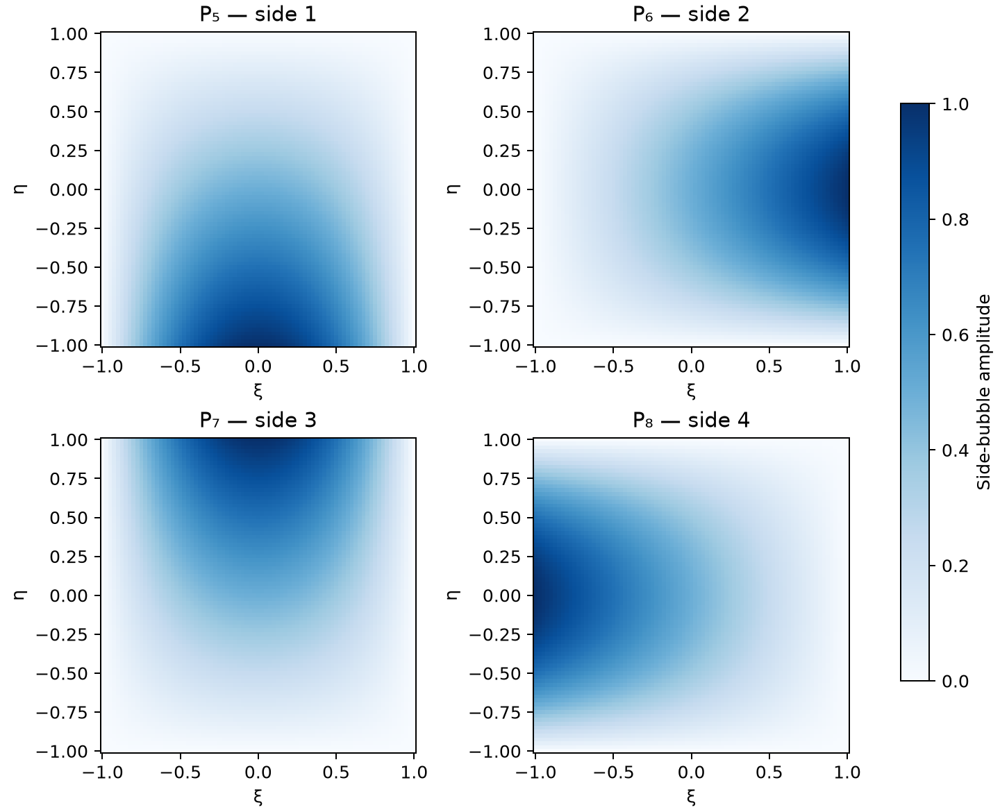
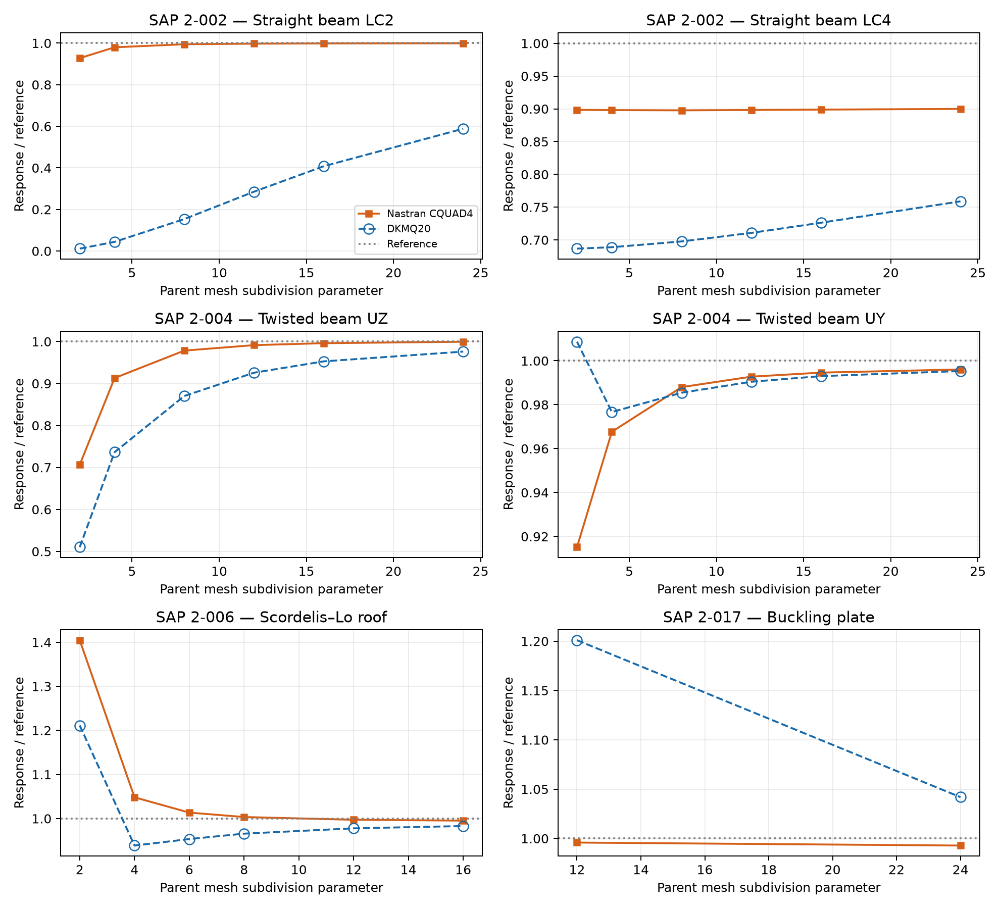

# DKMQ20 Shell: Director-Based Kinematics, Discrete Shear Constraints and Mystran Benchmark

**Ary — 26 October 2026**

## Abstract

DKMQ20 uses a four-node quadrilateral with three translations and two director-tangent rotations per node. The physical five-component formulation has no independent drilling variable. This report distinguishes that 20-component parent from the 24-component regularised extension used in the selected numerical assessment. The mathematical construction includes incomplete-quadratic side rotations, discrete shear constraints, compatible membrane strains and director-gradient curvature coupling. Static and linear-buckling results are compared with Nastran CQUAD4. Case-dependent discrepancies are retained explicitly rather than inferred from historical benchmark summaries.

## 1. Scope and formulation lineage

Irpanni, Katili and Maknun [1] developed a five-degree-of-freedom DKMQ shell in the discrete Kirchhoff–Mindlin family [2,3]. Its defining kinematic choice is to represent director rotation in a local tangent plane, eliminating the independent rotation about the director. The absence of that variable in the parent must not be confused with adding a small drilling penalty in a six-component representation.

The benchmark tables below report the assessed **24-component DKMQ20 extension**. They are not a separate numerical validation of the original 20-component parent. No EAS membrane enrichment is included in the assessed model. Neither universal locking freedom nor complete nonlinear behavior follows from this selected linear assessment.

## 2. Step 1: geometry and director frames

The reference surface and shape functions are

$$
\boldsymbol\phi_0(\xi,\eta)=\sum_{I=1}^{4}N_I\mathbf{X}_I,\qquad N_I=\frac14(1+\xi_I\xi)(1+\eta_I\eta).
$$

Corner coordinates are $(-1,-1),(1,-1),(1,1),(-1,1)$ in counter-clockwise order. Define

$$
\mathbf{g}_1=\boldsymbol\phi_{0,\xi},\qquad \mathbf{g}_2=\boldsymbol\phi_{0,\eta},\qquad J_s=\|\mathbf{g}_1\times\mathbf{g}_2\|.
$$

The pointwise normal is $\mathbf{e}_3=(\mathbf{g}_1\times\mathbf{g}_2)/J_s$. An orthonormal pair $\mathbf{e}_1,\mathbf{e}_2$ spans its tangent plane. The frame is evaluated pointwise; it is not a single fixed centroid plane.

At each node choose a unit reference director $\mathbf{n}_I$ and tangent pair $\mathbf{v}_{1I},\mathbf{v}_{2I}$ satisfying $\mathbf{v}_{2I}=\mathbf{n}_I\times\mathbf{v}_{1I}$. Smooth-shell directors and directors across physical creases require geometrically appropriate assignments.



*Figure 1. Corner numbering and oriented sides. The physical 20-component parent has five unknowns per node; the assessed extension has six.*

## 3. Step 2: physical rotations and the six-component extension

### 3.1 Five physical components

A local rotation pair gives

$$
\boldsymbol\theta_I=\alpha_I\mathbf{v}_{1I}+\beta_I\mathbf{v}_{2I},\qquad \delta\mathbf{n}_I=\boldsymbol\theta_I\times\mathbf{n}_I=-\alpha_I\mathbf{v}_{2I}+\beta_I\mathbf{v}_{1I}.
$$

Thus $\mathbf{d}_I^{(5)}=[u_I,v_I,w_I,\alpha_I,\beta_I]^{\mathrm{T}}$ and the parent element has 20 unknowns [1]. There is no independent drilling coordinate in this space.

Two local tangent components remain sufficient under arbitrary orientation. Restricting external rotations instead to two fixed global axes can produce a singular map when those axes do not span the director's tangent motion. This is a coordinate restriction, not an intrinsic failure of five-component shell kinematics.

### 3.2 Six-component representation

The assessed extension uses

$$
\mathbf{d}_I^{(6)}=[u_I,v_I,w_I,\theta_{XI},\theta_{YI},\theta_{ZI}]^{\mathrm{T}},\qquad \mathbf{d}_e\in\mathbb{R}^{24}.
$$

Its tangent and normal rotation components are

$$
\alpha_I=\boldsymbol\theta_I\cdot\mathbf{v}_{1I},\qquad \beta_I=\boldsymbol\theta_I\cdot\mathbf{v}_{2I},\qquad \theta_{dI}=\boldsymbol\theta_I\cdot\mathbf{n}_I.
$$

The first two rotate the director. The last leaves the director unchanged and is regularised separately in Section 7. A full nodal rotation map does not by itself establish shell accuracy or rank sufficiency.

## 4. Step 3: discrete side constraints

For the oriented side $k=(i,j)$, let

$$
L_k=\|\mathbf{X}_j-\mathbf{X}_i\|,\qquad \mathbf{t}_{sk}=\frac{\mathbf{X}_j-\mathbf{X}_i}{L_k},\qquad \mathbf{n}_k=\frac{\mathbf{n}_i+\mathbf{n}_j}{\|\mathbf{n}_i+\mathbf{n}_j\|}.
$$

The averaged normal requires a nonzero sum. Opposed directors or degenerate edges do not define admissible side data.

For isotropic thickness $h$, define $D_b=Eh^3/[12(1-\nu^2)]$, $D_s=\kappa_sGh$, $\kappa_s=5/6$, and

$$
\phi_k=\frac{12D_b}{D_sL_k^2}=\frac{2}{\kappa_s(1-\nu)}\left(\frac{h}{L_k}\right)^2.
$$

The side kinematic quantity combines transverse displacement difference and tangent director increments:

$$
q_k=\frac{\mathbf{n}_k\cdot(\mathbf{u}_j-\mathbf{u}_i)}{L_k}+\frac12\mathbf{t}_{sk}\cdot(\delta\mathbf{n}_i+\delta\mathbf{n}_j).
$$

Writing $\mathbf{q}=\mathbf{A}_u\mathbf{d}_e$, the DKM constraint eliminates the four side-rotation increments [1–3]:

$$
\frac23(1+\phi_k)\Delta\beta_k=-q_k,\qquad \Delta\boldsymbol\beta=\mathbf{A}_n\mathbf{d}_e,\qquad \mathbf{A}_n=-\mathbf{A}_{\Delta}^{-1}\mathbf{A}_u.
$$

Here $\mathbf{A}_{\Delta}$ is diagonal with entries $2(1+\phi_k)/3$. The assumed tangential shear is

$$
\bar\gamma_{sk}=-\frac23\phi_k\Delta\beta_k=\frac{\phi_k}{1+\phi_k}q_k.
$$

The thickness dependence is therefore built into the side constraint. It does not require selective under-integration of the shear energy.

## 5. Step 4: enriched rotations, membrane and curvature

The side functions are

$$
P_5=\frac12(1-\xi^2)(1-\eta),\qquad P_6=\frac12(1+\xi)(1-\eta^2),
$$

$$
P_7=\frac12(1-\xi^2)(1+\eta),\qquad P_8=\frac12(1-\xi)(1-\eta^2).
$$

They enrich the director-increment field through $\sum_kP_{k+4}\mathbf{t}_{sk}\Delta\beta_k$. The indices 5–8 identify side functions, not additional nodes or global unknowns [1,2].



*Figure 2. Natural-coordinate side bubbles. Each associated edge-midpoint amplitude is unity and all corner values are zero.*

The compatible membrane strains use the physical tangent gradients of the bilinear displacement field. No enhanced membrane parameters are condensed. The bending operator has the structure

$$
\mathbf{B}_b=\mathbf{B}_{\beta}+\mathbf{B}_{\Delta\beta}\mathbf{A}_n+\mathbf{B}_c.
$$

The first term comes from nodal tangent rotations, the second from eliminated side increments, and the third represents the displacement–director-gradient curvature coupling retained in the assessed extension [3]. Its geometric origin is the displacement part of the director-based curvature variation,

$$
\delta\rho_{\alpha\beta}=\mathbf{u}_{,\alpha}\cdot\widehat{\mathbf{n}}_{,\beta}+\mathbf{g}_\alpha\cdot\delta\mathbf{n}_{,\beta},\qquad \widehat{\mathbf{n}}=\sum_I N_I\mathbf{n}_I.
$$

For constant nodal directors $\widehat{\mathbf{n}}_{,\beta}=0$. The coupling can remain active on curved or warped elements. The selected results are therefore not assigned to the historical curvature approximation in which this contribution was omitted.

## 6. Step 5: natural-coordinate assumed shear

The assumed natural shear components use the four oriented side values:

$$
\bar\gamma_\xi=\frac{1-\eta}{2}\frac{L_1}{2}\bar\gamma_{s1}-\frac{1+\eta}{2}\frac{L_3}{2}\bar\gamma_{s3},
$$

$$
\bar\gamma_\eta=\frac{1+\xi}{2}\frac{L_2}{2}\bar\gamma_{s2}-\frac{1-\xi}{2}\frac{L_4}{2}\bar\gamma_{s4}.
$$

The minus signs account for the reversed natural-coordinate directions of sides 3 and 4. Physical components follow from the dual surface basis $\mathbf{g}^{\alpha}$ and $C_{\alpha a}=\mathbf{g}^{\alpha}\cdot\mathbf{e}_a$:

$$
\bar\gamma_a=C_{\xi a}\bar\gamma_\xi+C_{\eta a}\bar\gamma_\eta=\left(\mathbf{B}_s\mathbf{d}_e\right)_a.
$$

All side orientations, rotation signs and normal directions must be consistent. A pointwise frame does not justify dropping metric factors.


*Figure 3. Side-midpoint locations for assumed shear and four Gauss integration points. The edge locations define the shear field; the interior locations integrate stiffness.*

## 7. Step 6: drilling regularisation of the assessed extension

The five-component parent has no drilling energy [1]. For the assessed six-component extension, define the rotation–spin constraint [4]

$$
\gamma_d=\frac12(v_{,1}-u_{,2})-\sum_I N_I\boldsymbol\theta_I\cdot\mathbf{n}_I.
$$

Its quadratic energy and stiffness are

$$
\Pi_d=\frac12\int_A\beta_dGh\gamma_d^2\,\mathrm{d}A,\qquad \mathbf{K}_d=\int_A\mathbf{B}_d^{\mathrm{T}}\beta_dGh\mathbf{B}_d\,\mathrm{d}A,\qquad \beta_d=10^{-4}.
$$

This normal-rotation regularisation is additional to the five-component DKMQ20 kinematics. It must not be described as preserving the parent's absence of fictitious drilling rigidity. Rigid-body energy, complete rank and coefficient sensitivity require their own checks; the selected benchmark displacements do not prove them for every mesh.

## 8. Step 7: stiffness, integration and buckling

For isotropic plane stress, set $\mathbf{D}_m=h\mathbf{C}_{ps}$, $\mathbf{D}_b=h^3\mathbf{C}_{ps}/12$ and $\mathbf{D}_s=\kappa_sGh\mathbf{I}_2$. The stiffness is

$$
\mathbf{K}_e=\int_A\left(\mathbf{B}_m^{\mathrm{T}}\mathbf{D}_m\mathbf{B}_m+\mathbf{B}_b^{\mathrm{T}}\mathbf{D}_b\mathbf{B}_b+\mathbf{B}_s^{\mathrm{T}}\mathbf{D}_s\mathbf{B}_s\right)\,\mathrm{d}A+\mathbf{K}_d.
$$

Thickness factors occur once through the integrated constitutive matrices. All stiffness blocks use $2\times2$ Gauss quadrature at $\xi,\eta=\pm1/\sqrt3$ with unit weights and $\mathrm{d}A=J_s\,\mathrm{d}\xi\,\mathrm{d}\eta$.

For selected linear buckling, the membrane resultant field supplies a translational initial-stress term

$$
\mathbf{K}_{g,ij}^{uu}=\int_A N_{ab}N_{i,a}N_{j,b}\mathbf{I}_3\,\mathrm{d}A.
$$

The eigenproblem $(\mathbf{K}_e+\lambda\mathbf{K}_g)\boldsymbol\varphi=\mathbf{0}$ uses a consistent compression sign convention. It is not a complete finite-rotation tangent or post-buckling formulation.

## 9. Mystran Benchmark: DKMQ20 versus Nastran CQUAD4

The selected SAP verification cases [5] compare the assessed 24-component extension with Nastran CQUAD4. Responses are matched by case, load case, unit and mesh sequence. Accuracy is assessed separately for each solver against its independent reference.

For each matched physical response, the two accuracy measures use the independent reference for that case, load, component and unit:

```math
\mathrm{Nastran\_error}=100\frac{|q_{\mathrm{Nastran}}-q_{\mathrm{ref,Nastran}}|}{|q_{\mathrm{ref,Nastran}}|},
\qquad
\mathrm{Mystran\_error}=100\frac{|q_{\mathrm{Mystran}}-q_{\mathrm{ref,Mystran}}|}{|q_{\mathrm{ref,Mystran}}|}.
```

For matched responses with the same physical reference, $q_{\mathrm{ref,Nastran}}=q_{\mathrm{ref,Mystran}}=q_{\mathrm{ref}}$ as listed in the table. Both errors are nonnegative percentages. Nastran is not the error denominator. For a zero reference, report the absolute residual in the response unit; if no independent reference is available, report the percentage error as unavailable. Reference-normalized response plots retain unity as the target. The reported solver responses and existing meshes are unchanged.


The plotted reference is independent of the Nastran comparison; element-to-element agreement and reference accuracy are different checks.



*Figure 4. Normalised displacement and buckling responses. Open blue circles and dashed lines identify DKMQ20. Beam abscissae are longitudinal subdivisions, the roof uses equal subdivisions in both directions, and buckling uses the longitudinal counts of 2 × 12 and 4 × 24 parent meshes.*

### 9.1 Selected numerical results

Beam results use longitudinal subdivision count 24, the roof uses 16 × 16 parent panels and the buckling plate uses 4 × 24 panels. The curved beam and thick-plate models use their benchmark meshes. Units are given per row.

| SAP case | LC / model | Response | Unit | DKMQ20 | Nastran CQUAD4 | Reference | Nastran_error (%) | Mystran_error (%) |
| --- | --- | --- | --- | --- | --- | --- | --- | --- |
| 2-002 | 1 | tip UX | in | 3e-05 | 3e-05 | 3e-05 | 0.0000 | 0.0000 |
| 2-002 | 2 | tip UZ | in | 0.06358443 | 0.1080129 | 0.1081 | 0.0806 | 41.1800 |
| 2-002 | 3 | tip UY | in | 0.4320889 | 0.4320603 | 0.4321 | 0.0092 | 0.0026 |
| 2-002 | 4 | tip abs UY | in | 0.002587678 | 0.003068753 | 0.00341 | 10.0072 | 24.1150 |
| 2-002 | 5 | tip abs UX | in | 0.00052945 | 0.0008998445 | 0.0009 | 0.0173 | 41.1722 |
| 2-002 | 6 | tip RZ | rad | 0.036 | 0.036 | 0.036 | 0.0000 | 0.0000 |
| 2-003 | 1 | tip UY | in | 0.083372925 | 0.088511855 | 0.0886 | 0.0995 | 5.8996 |
| 2-003 | 2 | tip UZ | in | 0.48628625 | 0.4954054 | 0.5004 | 0.9981 | 2.8205 |
| 2-004 | 1 | tip UZ | in | 0.00170717 | 0.0017482317 | 0.001749 | 0.0439 | 2.3917 |
| 2-004 | 2 | tip UY | in | 0.0054036313 | 0.0054075113 | 0.005429 | 0.3958 | 0.4673 |
| 2-006 | 1 | free edge midpoint UZ | ft | -0.3033576 | -0.3071547 | -0.3086 | 0.4683 | 1.6988 |
| 2-012 | A | outer edge mean UZ | in | -0.0053394348 | -0.0053452112 | -0.00534 | 0.0976 | 0.0106 |
| 2-012 | B | outer edge mean UZ | in | -0.0052170217 | -0.0052199879 | -0.00521 | 0.1917 | 0.1348 |
| 2-017 | 2 | critical load | kip | 133.2703 | 126.9939 | 127.91 | 0.7162 | 4.1907 |

### 9.2 Interpretation

- **2-002, 2, tip UZ:** reference 0.1081 in; Nastran_error=0.0806%; DKMQ20 Mystran_error=41.1800%.
- **2-002, 4, tip abs UY:** reference 0.00341 in; Nastran_error=10.0072%; DKMQ20 Mystran_error=24.1150%.
- **2-002, 5, tip abs UX:** reference 0.0009 in; Nastran_error=0.0173%; DKMQ20 Mystran_error=41.1722%.
- **2-004, 1, tip UZ:** reference 0.001749 in; Nastran_error=0.0439%; DKMQ20 Mystran_error=2.3917%.
- **2-004, 2, tip UY:** reference 0.005429 in; Nastran_error=0.3958%; DKMQ20 Mystran_error=0.4673%.
- **2-006, 1, free edge midpoint UZ:** reference -0.3086 ft; Nastran_error=0.4683%; DKMQ20 Mystran_error=1.6988%.
- **2-017, 2, critical load:** reference 127.91 kip; Nastran_error=0.7162%; DKMQ20 Mystran_error=4.1907%.


Straight-beam LC2 and LC5 retain substantial under-response at the selected mesh. The absence of EAS membrane relaxation is relevant to bending-dominated membrane deformation, but it does not establish a unique cause without a controlled strain-energy assessment. LC4 and the curved beam must be considered separately rather than assigned a common error magnitude.

The refined twisted-beam results are much closer to CQUAD4 than the historical warped-beam values quoted in the early note. The current table is therefore not mixed with that historical approximation. The roof difference is smaller at the selected refinement, while the buckling load remains higher. Two buckling levels do not establish the limiting critical load.

## 10. Conclusions

1. DKMQ20's physical parent uses three translations and two director-tangent rotations per node, with no independent drilling variable [1].
2. The assessed benchmark variant has 24 nodal components and an explicitly stated drilling regularisation. Its results are not labelled as a separate validation of the 20-component parent.
3. Four side increments are eliminated through DKM constraints; side bubbles enrich rotations without adding global unknowns. The assessed curvature includes director-gradient coupling.
4. Nastran CQUAD4 comparisons show case-dependent differences, including substantial selected beam discrepancies and closer agreement for several curved and thick-plate responses.
5. Neither rank sufficiency, universal shear-locking freedom nor full nonlinear performance is inferred from these selected results.

## 11. References

[1] Irpanni, H., Katili, I., & Maknun, I.J. (2017). Development DKMQ shell element with five degrees of freedom per nodal. *International Journal of Mechanical Engineering and Robotics Research*, 6(3), 248–252. [Publisher article](https://www.ijmerr.com/show-149-843-1.html).

[2] Katili, I. (1993). A new discrete Kirchhoff–Mindlin element based on Mindlin–Reissner plate theory and assumed shear strain fields — Part II: An extended DKQ element for thick-plate bending analysis. *International Journal for Numerical Methods in Engineering*, 36, 1885–1908.

[3] Katili, I., Batoz, J.-L., Maknun, I.J., Hamdouni, A., & Millet, O. (2015). The development of DKMQ plate bending element for thick to thin shell analysis based on the Naghdi/Reissner/Mindlin shell theory. *Finite Elements in Analysis and Design*, 100, 12–27.

[4] Hughes, T.J.R., & Brezzi, F. (1989). On drilling degrees of freedom. *Computer Methods in Applied Mechanics and Engineering*, 72, 105–121.

[5] Computers & Structures, Inc. *SAP2000 Verification Examples*, Problems 2-002, 2-003, 2-004, 2-006, 2-012 and 2-017.
