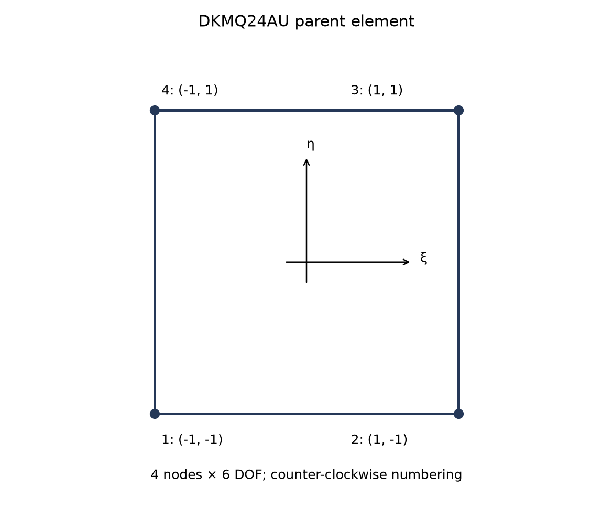
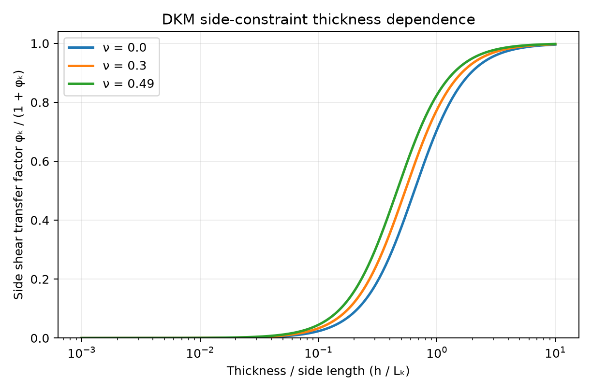
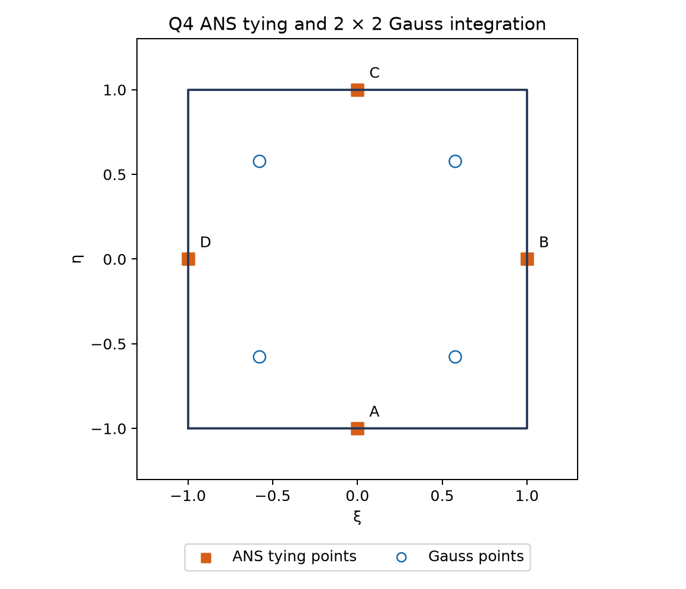
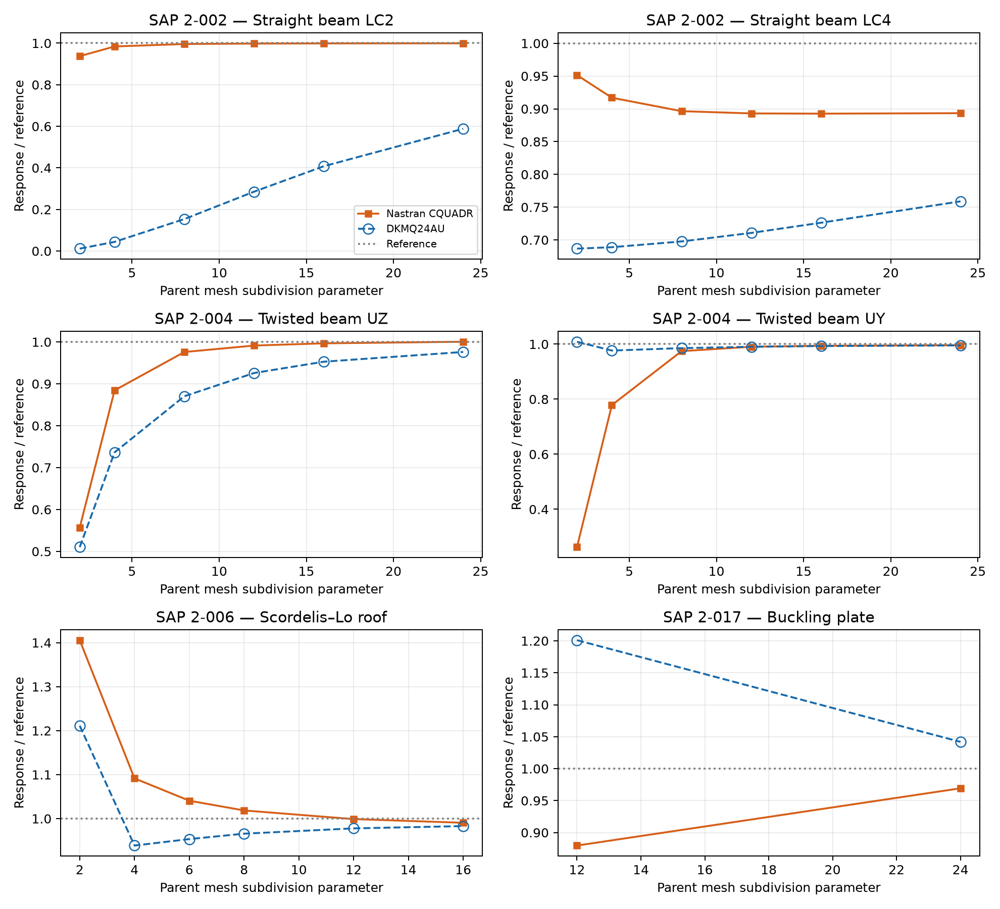

# DKMQ24AU Shell: Side-Constraint Elimination, Director-Gradient Bending and Mystran Benchmark

**Ary — 26 October 2026**

## Abstract

DKMQ24AU is presented as a four-node quadrilateral shell with six degrees of freedom per node, compatible membrane strains, enriched director rotations and a discrete Kirchhoff–Mindlin transverse-shear field. Its defining algebraic construction uses an explicit side-kinematic operator $\mathbf{A}_u$ to eliminate four internal side-rotation increments. The resulting bending and shear operators act on 24 nodal unknowns, with a separate rotation–spin drilling regularisation. This report develops the mathematical construction and compares selected static and linear-buckling responses with Nastran CQUADR. Membrane-bending, torsion, warped-shell and critical-load responses are reported separately; no universal accuracy or best-element claim is inferred.

## 1. Scope and formulation identity

The underlying shell and assumed-shear ideas belong to the DKMQ family developed by Katili and co-authors [1,2]. In this report, **AU** identifies the assessed variant organised around the explicit side-kinematic matrix $\mathbf{A}_u$. It is a variant designation, not a separate continuum shell theory or an enhanced assumed membrane-strain field.

The formulation contains no EAS membrane condensation. Four side increments are eliminated by the DKM constraints, while six nodal components remain at each corner. This distinguishes it from the five-component DKMQ20 parent [5] and from the membrane-enhanced DKMQ24EAS model. The numerical assessment concerns linear isotropic shell response and selected linear-buckling loads, not a full geometrically nonlinear tangent or post-buckling path.

## 2. Step 1: geometry, local frames and nodal directors

On the parent square $[-1,1]^2$,

$$
\mathbf{x}(\xi,\eta)=\sum_{I=1}^{4}N_I\mathbf{X}_I,\qquad N_I=\frac14(1+\xi_I\xi)(1+\eta_I\eta).
$$

The counter-clockwise corner coordinates are $(-1,-1),(1,-1),(1,1),(-1,1)$. Covariant tangents, the surface metric and its dual basis are

$$
\mathbf{g}_1=\mathbf{x}_{,\xi},\qquad \mathbf{g}_2=\mathbf{x}_{,\eta},\qquad a_{\alpha\beta}=\mathbf{g}_\alpha\cdot\mathbf{g}_\beta,\qquad \mathbf{g}^{\alpha}=a^{\alpha\beta}\mathbf{g}_\beta.
$$

Here $a^{\alpha\beta}$ is the inverse metric. The integration measure and local normal are

$$
J_s=\|\mathbf{g}_1\times\mathbf{g}_2\|,\qquad \mathbf{e}_3=\frac{\mathbf{g}_1\times\mathbf{g}_2}{J_s},\qquad \mathrm{d}A=J_s\,\mathrm{d}\xi\,\mathrm{d}\eta.
$$

An orthonormal tangent pair $\mathbf{e}_1,\mathbf{e}_2$ spans the physical tangent plane at the evaluation point. A nonparallel reference direction can set $\mathbf{e}_1$, with $\mathbf{e}_2=\mathbf{e}_3\times\mathbf{e}_1$. The frame is evaluated pointwise rather than retained as a fixed centroid plane.

For the assessed element-level geometric director convention,

$$
\mathbf{n}_I=\frac{(\mathbf{X}_{I+1}-\mathbf{X}_I)\times(\mathbf{X}_{I-1}-\mathbf{X}_I)}{\|(\mathbf{X}_{I+1}-\mathbf{X}_I)\times(\mathbf{X}_{I-1}-\mathbf{X}_I)\|}.
$$

Indices are cyclic. Nondegenerate corner geometry and consistent normal orientation are required. A different smooth-surface nodal-normal assignment is a change of director data and must be assessed separately, particularly on curved meshes.

*Figure 1. Corner nodes, natural-coordinate signs and oriented sides. Side k joins node k to node k+1 cyclically.*

## 3. Step 2: nodal unknowns and constitutive rigidities

Each corner carries a global translation vector and a right-hand-rule rotation vector,

$$
\mathbf{d}_I=[u_I,v_I,w_I,\theta_{XI},\theta_{YI},\theta_{ZI}]^{\mathrm{T}},\qquad \mathbf{d}_e\in\mathbb{R}^{24}.
$$

The director increment is $\delta\mathbf{n}_I=\boldsymbol\theta_I\times\mathbf{n}_I$. Rotation parallel to $\mathbf{n}_I$ leaves that director unchanged and is the drilling component. It is regularised separately in Section 7.

For isotropic plane stress, let $\mathbf{C}_{ps}$ have normal coefficients $E/(1-\nu^2)$, normal coupling $\nu E/(1-\nu^2)$ and engineering-shear coefficient $G=E/[2(1+\nu)]$. The integrated matrices are

$$
\mathbf{D}_m=h\mathbf{C}_{ps},\qquad \mathbf{D}_b=\frac{h^3}{12}\mathbf{C}_{ps},\qquad \mathbf{D}_s=\kappa_sGh\mathbf{I}_2,\qquad \kappa_s=\frac56.
$$

The compatible membrane operator uses bilinear displacement gradients in the physical tangent frame. No incompatible or enhanced membrane parameters are introduced.

## 4. Step 3: the explicit side-kinematic operator

For oriented side $k=(i,j)$, define

$$
L_k=\|\mathbf{X}_j-\mathbf{X}_i\|,\qquad \mathbf{t}_{sk}=\frac{\mathbf{X}_j-\mathbf{X}_i}{L_k},\qquad \mathbf{n}_k=\frac{\mathbf{n}_i+\mathbf{n}_j}{\|\mathbf{n}_i+\mathbf{n}_j\|}.
$$

Let $\mathbf{R}_I$ be the linear map $\mathbf{R}_I\boldsymbol\theta_I=\boldsymbol\theta_I\times\mathbf{n}_I$. The scalar side-kinematic quantity is

$$
q_k=\frac{\mathbf{n}_k\cdot(\mathbf{u}_j-\mathbf{u}_i)}{L_k}+\frac12\mathbf{t}_{sk}\cdot(\mathbf{R}_i\boldsymbol\theta_i+\mathbf{R}_j\boldsymbol\theta_j).
$$

Collecting the four side quantities gives $\mathbf{q}=\mathbf{A}_u\mathbf{d}_e$, where $\mathbf{A}_u\in\mathbb{R}^{4\times24}$. Row k has only two nonzero nodal blocks:

$$
\left.\mathbf{A}_{u,k}\right|_i=\left[-\frac{\mathbf{n}_k^{\mathrm{T}}}{L_k},\frac12\mathbf{t}_{sk}^{\mathrm{T}}\mathbf{R}_i\right],\qquad \left.\mathbf{A}_{u,k}\right|_j=\left[\frac{\mathbf{n}_k^{\mathrm{T}}}{L_k},\frac12\mathbf{t}_{sk}^{\mathrm{T}}\mathbf{R}_j\right].
$$

This explicit translational/rotational side relation is the organising operator of the AU construction. It also makes the normal and edge-orientation conventions visible rather than hiding them in a local slope notation.

### 4.1 Side influence factor and elimination

The discrete Kirchhoff–Mindlin factor is [1,2]

$$
\phi_k=\frac{12D_b}{D_sL_k^2}=\frac{2}{\kappa_s(1-\nu)}\left(\frac{h}{L_k}\right)^2.
$$

For the chosen side-rotation sign convention,

$$
\frac23(1+\phi_k)\Delta\beta_k=-q_k.
$$

Let $\mathbf{A}_{\Delta}$ be diagonal with entries $2(1+\phi_k)/3$. Then

$$
\Delta\boldsymbol\beta=\mathbf{A}_n\mathbf{d}_e,\qquad \mathbf{A}_n=-\mathbf{A}_{\Delta}^{-1}\mathbf{A}_u.
$$

The four increments are eliminated locally; they are not additional globally assembled unknowns. A simultaneous sign reversal of a side-increment variable and its associated enrichment operator leaves the physical interpolation unchanged. Mixing conventions between constraint and enrichment does not.

The assumed tangential shear is

$$
\bar\gamma_{sk}=-\frac23\phi_k\Delta\beta_k=\frac{\phi_k}{1+\phi_k}q_k.
$$

*Figure 2. The DKM side transfer factor as a function of thickness-to-side-length ratio for selected Poisson ratios. These are mathematical factors, not benchmark curves.*

## 5. Step 4: side-rotation enrichment and bending

The incomplete-quadratic side functions are

$$
P_5=\frac12(1-\xi^2)(1-\eta),\qquad P_6=\frac12(1+\xi)(1-\eta^2),
$$

$$
P_7=\frac12(1-\xi^2)(1+\eta),\qquad P_8=\frac12(1-\xi)(1-\eta^2).
$$

They vanish at the four corner nodes and enrich director-tangent motion along the four sides [1,2]. A representative increment field is

$$
\delta\mathbf{n}^{h}=\sum_I N_I\mathbf{R}_I\boldsymbol\theta_I+\sum_{k=1}^{4}P_{k+4}\mathbf{t}_{sk}\Delta\beta_k.
$$

*Figure 3. Four side bubbles. Each reaches unity at the associated edge midpoint; their indices do not identify extra corner or midside connectivity nodes.*

The bending operator is organised as

$$
\mathbf{B}_b=\mathbf{B}_{\beta}+\mathbf{B}_{\Delta\beta}\mathbf{A}_n+\mathbf{B}_c.
$$

The first term differentiates nodal director rotations, the second differentiates the side enrichment after elimination, and $\mathbf{B}_c$ contains displacement coupling to the reference-director gradient [1]. With $\widehat{\mathbf{n}}=\sum_I N_I\mathbf{n}_I$, the geometric origin of that coupling is

$$
\delta\rho_{\alpha\beta}=\mathbf{u}_{,\alpha}\cdot\widehat{\mathbf{n}}_{,\beta}+\mathbf{g}_\alpha\cdot\delta\mathbf{n}_{,\beta}.
$$

For identical nodal directors, $\widehat{\mathbf{n}}_{,\beta}=0$ and the displacement–director-gradient contribution vanishes. It can remain active on warped elements. Keeping this contribution does not by itself guarantee accurate curved-shell response; the side field, metric projection and director assignment also matter.

## 6. Step 5: assumed shear and physical components

The four oriented edge samples define the natural-coordinate shear field:

$$
\bar\gamma_\xi=\frac{1-\eta}{2}\frac{L_1}{2}\bar\gamma_{s1}-\frac{1+\eta}{2}\frac{L_3}{2}\bar\gamma_{s3},
$$

$$
\bar\gamma_\eta=\frac{1+\xi}{2}\frac{L_2}{2}\bar\gamma_{s2}-\frac{1-\xi}{2}\frac{L_4}{2}\bar\gamma_{s4}.
$$

Sides 3 and 4 have opposite orientation to the increasing natural coordinates, producing the minus signs. Set $C_{\alpha a}=\mathbf{g}^{\alpha}\cdot\mathbf{e}_a$. The physical shear components are

$$
\bar\gamma_a=C_{\xi a}\bar\gamma_\xi+C_{\eta a}\bar\gamma_\eta=\left(\mathbf{B}_s\mathbf{d}_e\right)_a.
$$

All metric factors, side orientations and rotation signs must use a consistent convention. DKM interpolation and quadrature are different operations; the side constraints do not call for reduced integration.

*Figure 4. Edge-midpoint locations for the assumed side field and the four interior Gauss integration points. The edge points do not replace stiffness integration points.*

## 7. Step 6: normal-rotation regularisation

The assessed 24-component model adds a Hughes–Brezzi-type spin constraint [3]:

$$
\omega=\frac12(v_{,1}-u_{,2}),\qquad \theta_d=\sum_I N_I\boldsymbol\theta_I\cdot\mathbf{n}_I,\qquad \gamma_d=\omega-\theta_d.
$$

With $\beta_d=10^{-4}$,

$$
\Pi_d=\frac12\int_A\beta_dGh\gamma_d^2\,\mathrm{d}A,\qquad \mathbf{K}_d=\int_A\mathbf{B}_d^{\mathrm{T}}\beta_dGh\mathbf{B}_d\,\mathrm{d}A.
$$

A per-node global-coordinate row is

$$
\mathbf{b}_{d,I}=\left[\frac12(N_{I,1}\mathbf{e}_2-N_{I,2}\mathbf{e}_1)^{\mathrm{T}},-N_I\mathbf{n}_I^{\mathrm{T}}\right].
$$

Planar rigid spin gives zero rotation–spin residual when displacement and drilling rotation are consistent. This property of the constraint is not a proof of the complete shell's rank or objectivity on every warped mesh. For a free nondegenerate 24-component element, the target is six physical rigid-body modes and positive deformational stiffness; additional mechanisms and coefficient sensitivity need separate checks.

## 8. Step 7: stiffness, integration and linear buckling

The total stiffness is

$$
\mathbf{K}_e=\int_A\left(\mathbf{B}_m^{\mathrm{T}}\mathbf{D}_m\mathbf{B}_m+\mathbf{B}_b^{\mathrm{T}}\mathbf{D}_b\mathbf{B}_b+\mathbf{B}_s^{\mathrm{T}}\mathbf{D}_s\mathbf{B}_s\right)\,\mathrm{d}A+\mathbf{K}_d.
$$

The membrane, bending, shear and drilling terms use $2\times2$ Gauss quadrature at $\xi,\eta=\pm1/\sqrt3$, with unit weights. Constitutive matrices already contain their thickness factors. Four side increments are eliminated through $\mathbf{A}_{\Delta}$, not through an EAS Schur complement.

A translational initial-stress approximation for selected linear buckling is

$$
\mathbf{K}_{g,ij}^{uu}=\int_A N_{ab}N_{i,a}N_{j,b}\mathbf{I}_3\,\mathrm{d}A.
$$

The eigenproblem $(\mathbf{K}_e+\lambda\mathbf{K}_g)\boldsymbol\varphi=\mathbf{0}$ uses the matching compression sign convention. The selected critical loads do not establish a full nonlinear tangent, complete higher-mode agreement or a post-buckling path.

### 8.1 Relationship to other DKMQ variants

| Feature | DKMQ24AU assessed here | DKMQ20 physical parent | DKMQ24EAS |
|---|---|---|---|
| Nodal components | 24 | 20 | 24 |
| Explicit side constraints | $\mathbf{A}_u$ and eliminated side rotations | DKM side constraints | DKM side constraints plus membrane enhancement |
| Independent drilling variable | Present, regularised | Absent | Present, regularised |
| Membrane EAS | None | None in the basic description | Four internal parameters |
| Source of local elimination | Four side constraints | Four side constraints | Side constraints and separate EAS condensation |

The five-component parent removes drilling kinematically [5]; it is not the same mathematical space as this regularised 24-component variant. Likewise, calling a model AU does not mean that it has the membrane relaxation of DKMQ24EAS. A subset of coincident displacement results does not establish universal stiffness identity.

Related reports: [DKMQ20](DKMQ20_Formulation.md), [DKMQ24](DKMQ24_formulation.md) and [DKMQ24EAS](DKMQ24EAS_Formulation_and_Benchmarks.md).

## 9. Mystran Benchmark: DKMQ24AU versus Nastran CQUADR

The selected SAP verification cases [4] are compared using matching case, response component, load case, unit and mesh sequence. The signed difference is

$$
\Delta_q=100\frac{q_{\mathrm{DKMQ24AU}}-q_{\mathrm{CQUADR}}}{q_{\mathrm{CQUADR}}}.
$$

The reference in the plots is independent of Nastran CQUADR. Agreement between elements and agreement with the reference are separate assessments.

*Figure 5. Normalised displacement and buckling responses. Blue dashed curves with open circles identify DKMQ24AU. Beam abscissae use longitudinal subdivisions, the roof uses equal subdivisions in both directions, and buckling uses longitudinal counts for the 2 × 12 and 4 × 24 parent meshes.*

### 9.1 Selected numerical responses

Beam results use longitudinal subdivision count 24, the roof uses 16 × 16 parent panels and the buckling plate uses 4 × 24 parent panels. The curved-beam and thick-plate cases use their benchmark meshes. Units are stated per row.

| SAP case | LC / model | Response | Unit | DKMQ24AU | Nastran CQUADR | Difference |
|---|---|---|---|---:|---:|---:|
| 2-002 | 1 | tip UX | in | 3e-05 | 3.438168e-05 | -12.744% |
| 2-002 | 2 | tip UZ | in | 0.06358443 | 0.1080311 | -41.142% |
| 2-002 | 3 | tip UY | in | 0.4320889 | 0.432016 | +0.017% |
| 2-002 | 4 | tip abs UY | in | 0.002587678 | 0.003046425 | -15.059% |
| 2-002 | 5 | tip abs UX | in | 0.00052945 | 0.0009 | -41.172% |
| 2-002 | 6 | tip RZ | rad | 0.036 | 0.036 | +0.000% |
| 2-003 | 1 | tip UY | in | 0.083372925 | 0.08892159 | -6.240% |
| 2-003 | 2 | tip UZ | in | 0.48628625 | 0.4942291 | -1.607% |
| 2-004 | 1 | tip UZ | in | 0.00170717 | 0.001749793 | -2.436% |
| 2-004 | 2 | tip UY | in | 0.0054036313 | 0.005407034 | -0.063% |
| 2-006 | 1 | free edge midpoint UZ | ft | -0.3033576 | -0.3056915 | -0.763% |
| 2-012 | A | outer edge mean UZ | in | -0.0053394348 | -0.0053445732 | -0.096% |
| 2-012 | B | outer edge mean UZ | in | -0.0052170217 | -0.0052193496 | -0.045% |
| 2-017 | 2 | critical load | kip | 133.2703 | 123.9762 | +7.497% |

### 9.2 Discussion

- **SAP 2-002, LC2, tip UZ:** signed difference -41.142% relative to CQUADR.
- **SAP 2-002, LC4, tip abs UY:** signed difference -15.059% relative to CQUADR.
- **SAP 2-002, LC5, tip abs UX:** signed difference -41.172% relative to CQUADR.
- **SAP 2-004, LC1, tip UZ:** signed difference -2.436% relative to CQUADR.
- **SAP 2-004, LC2, tip UY:** signed difference -0.063% relative to CQUADR.
- **SAP 2-006, LC1, free edge midpoint UZ:** signed difference -0.763% relative to CQUADR.
- **SAP 2-017, LC2, critical load:** signed difference +7.497% relative to CQUADR.

The selected straight-beam LC2 and LC5 responses remain substantially below CQUADR. The compatible membrane field has no EAS relaxation, which is relevant to membrane-bending-dominated coarse meshes, but a unique error mechanism cannot be established from displacement alone. LC4 remains a separate torsion-sensitive response and should not be assigned the LC2/LC5 error magnitude.

The two twisted-beam directions show closer agreement at the selected refinement, particularly UY. The roof and thick-plate comparisons are also closer than the most discrepant straight-beam responses. The selected buckling load remains higher than CQUADR; only two buckling mesh levels are shown, so the limiting critical load is not established.

## 10. Conclusions

1. DKMQ24AU is described through an explicit $\mathbf{A}_u$ side-kinematic operator and local elimination of four side-rotation increments, within the DKMQ family [1,2].
2. The model retains 24 nodal components, compatible membrane strains, enriched bending, assumed DKM shear and a separately stated rotation–spin regularisation.
3. Director-gradient curvature coupling and consistent natural-coordinate side orientations are important on warped surfaces. Their inclusion is not a universal accuracy guarantee.
4. The selected CQUADR comparisons show case-dependent behavior, with substantial straight-beam differences and closer agreement in several curved and thick-plate responses.
5. The AU variant must not be conflated with the drilling-free DKMQ20 parent or with an EAS-enhanced membrane model.

## 11. References

[1] Katili, I., Batoz, J.-L., Maknun, I.J., Hamdouni, A., & Millet, O. (2015). The development of DKMQ plate bending element for thick to thin shell analysis based on the Naghdi/Reissner/Mindlin shell theory. *Finite Elements in Analysis and Design*, 100, 12–27. [DOI](https://doi.org/10.1016/j.finel.2015.02.005).

[2] Katili, I. (1993). A new discrete Kirchhoff–Mindlin element based on Mindlin–Reissner plate theory and assumed shear strain fields — Part II: An extended DKQ element for thick-plate bending analysis. *International Journal for Numerical Methods in Engineering*, 36, 1885–1908.

[3] Hughes, T.J.R., & Brezzi, F. (1989). On drilling degrees of freedom. *Computer Methods in Applied Mechanics and Engineering*, 72, 105–121.

[4] Computers & Structures, Inc. *SAP2000 Verification Examples*, Problems 2-002, 2-003, 2-004, 2-006, 2-012 and 2-017.

[5] Irpanni, H., Katili, I., & Maknun, I.J. (2017). Development DKMQ shell element with five degrees of freedom per nodal. *International Journal of Mechanical Engineering and Robotics Research*, 6(3), 248–252.
