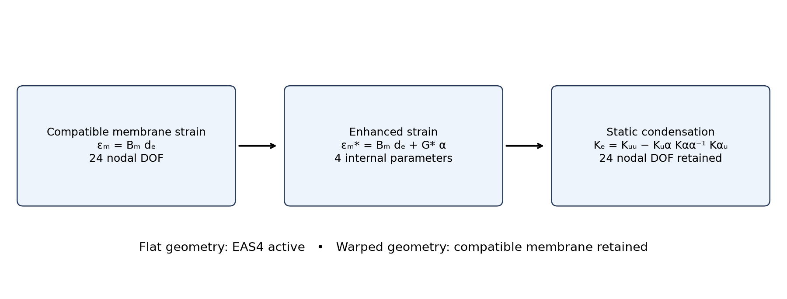
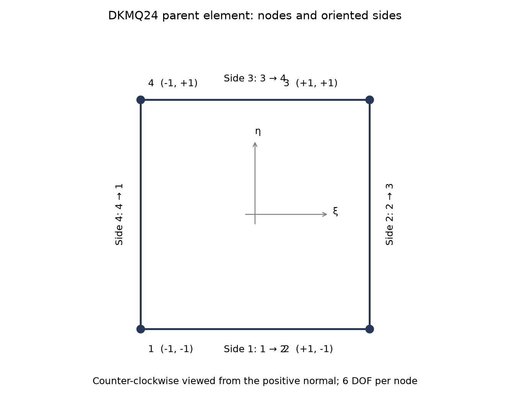
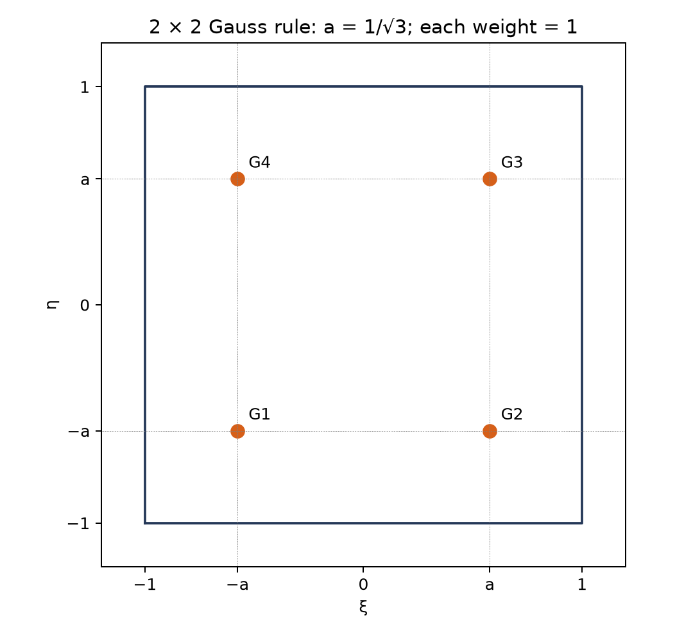
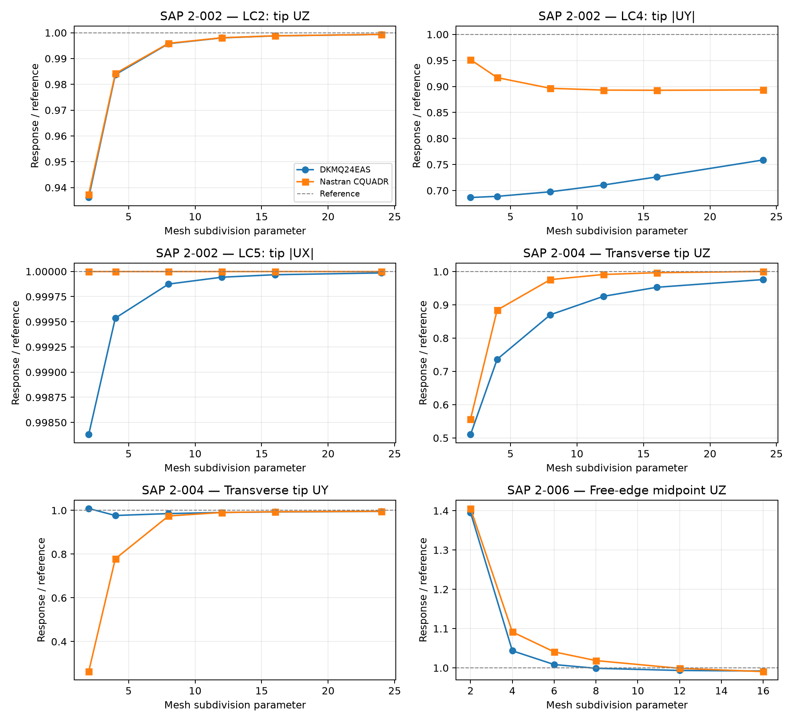
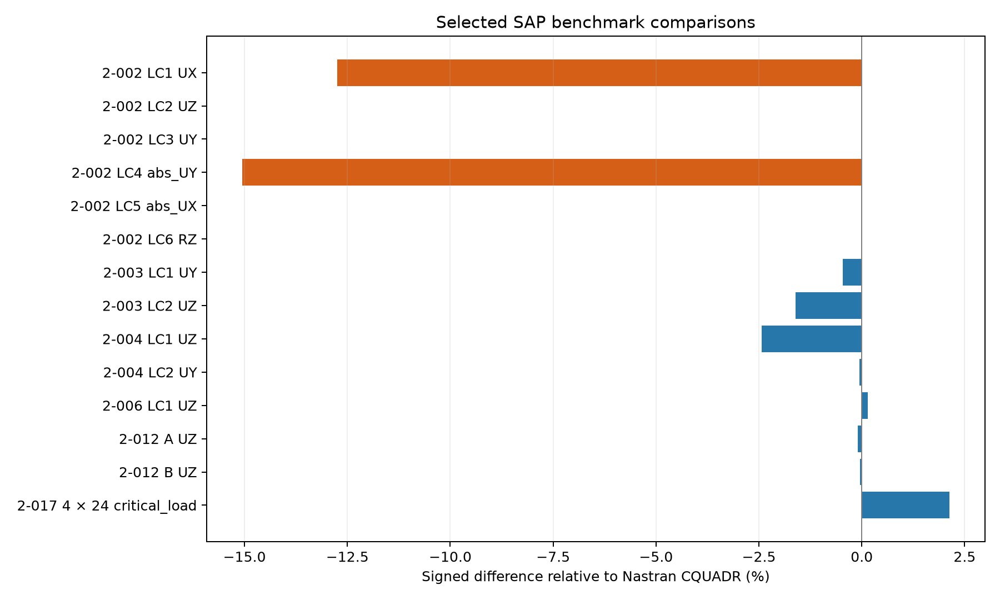

# DKMQ24EAS Shell Element: Enhanced Assumed Membrane Strains for Improved Bending Response and Shell Benchmark Assessment

**Ary — Personal — 25 October 2026**

## Abstract

DKMQ24EAS is a four-node quadrilateral shell with six degrees of freedom per node and a four-parameter enhanced assumed strain enrichment of the membrane field. The enhanced parameters are condensed at element level, retaining 24 nodal degrees of freedom. The formulation combines Discrete Kirchhoff–Mindlin shear constraints, enriched rotations, drilling stabilisation, and a geometry-dependent membrane enhancement. This report presents the formulation and compares selected SAP benchmark results with Nastran CQUADR, covering static bending, curved and warped shells, thick plates, and buckling.

## 1. Introduction

The enhanced assumed strain method relaxes restrictions imposed by compatible bilinear membrane strains. This is particularly relevant when a quadrilateral shell must represent bending-dominated membrane deformation. DKMQ24EAS retains the DKMQ shear treatment while adding four internal membrane parameters. The compatible and enhanced membrane strains share a common physical frame on flat elements; the enhancement is suppressed on warped elements.

The comparisons in this report treat DKMQ24EAS as a single formulation. All benchmark tables and plots use Nastran CQUADR as the comparison element.

## 2. Element Formulation

### 2.1 Geometry and Local Coordinate System

The element is a four-node bilinear quadrilateral defined by nodal position vectors $\mathbf X_I \in \mathbb R^3$. The mid-surface is

$$
\boldsymbol\phi(\xi,\eta) = \sum_{I=1}^{4} N_I(\xi,\eta)\,\mathbf X_I,
$$

with bilinear shape functions

$$
N_1 = \tfrac14(1-\xi)(1-\eta), \qquad N_2 = \tfrac14(1+\xi)(1-\eta),
$$

$$
N_3 = \tfrac14(1+\xi)(1+\eta), \qquad N_4 = \tfrac14(1-\xi)(1+\eta).
$$

Covariant tangent vectors are $\mathbf g_1 = \boldsymbol\phi_{,\xi}$ and $\mathbf g_2 = \boldsymbol\phi_{,\eta}$. The orthonormal physical frame follows:

$$
\mathbf e_3 = \frac{\mathbf g_1 \times \mathbf g_2}{\|\mathbf g_1 \times \mathbf g_2\|},
\qquad
\mathbf e_1 = \frac{\mathbf g_2 \times \mathbf e_3}{\|\mathbf g_2 \times \mathbf e_3\|},
\qquad
\mathbf e_2 = \mathbf e_3 \times \mathbf e_1 .
$$

For a flat element, the physical frame at the centroid is retained for both compatible and enhanced membrane strains. For a warped element, the physical frame follows the surface at each integration point and the membrane enrichment is suppressed.

### 2.2 Nodal Director Frame

Each node carries its own orthonormal director triad $\{\mathbf V_{1i}, \mathbf V_{2i}, \mathbf V_{ni}\}$, defined by the nodal geometry:

$$
\mathbf V_{ni} = \frac{(\mathbf X_{i+1}-\mathbf X_i) \times (\mathbf X_{i-1}-\mathbf X_i)}{\|\cdot\|},
\qquad
\mathbf V_{1i} = \frac{\mathbf e_Y \times \mathbf V_{ni}}{\|\mathbf e_Y \times \mathbf V_{ni}\|},
\qquad
\mathbf V_{2i} = \mathbf V_{ni} \times \mathbf V_{1i},
$$

with a fallback to $\mathbf e_X$ when $\mathbf V_{ni}$ is within $\sim6°$ of global $Y$.

### 2.3 Degrees of Freedom

$$
\mathbf d_I = [U_I,\ V_I,\ W_I,\ \theta_{X_I},\ \theta_{Y_I},\ \theta_{Z_I}]^{\mathrm T},
\qquad
\mathbf d_e \in \mathbb R^{24}.
$$

The rotations follow the right-hand rule about the global axes. Their components in the nodal director frame are $\alpha = \boldsymbol\theta\cdot\mathbf V_1$, $\beta = \boldsymbol\theta\cdot\mathbf V_2$, and $\theta_z = \boldsymbol\theta\cdot\mathbf V_n$.

### 2.4 Constitutive Matrices

Membrane and bending (isotropic plane stress):

$$
\mathbf C_m = D_m\begin{bmatrix}1&\nu&0\\ \nu&1&0\\ 0&0&\frac{1-\nu}{2}\end{bmatrix},
\quad D_m = \frac{Eh}{1-\nu^2};
\qquad
\mathbf C_b = D_b\begin{bmatrix}1&\nu&0\\ \nu&1&0\\ 0&0&\frac{1-\nu}{2}\end{bmatrix},
\quad D_b = \frac{Eh^3}{12(1-\nu^2)}.
$$

Transverse shear: $\mathbf C_s = D_s\mathbf I_2$, $D_s = \kappa G h$, $\kappa = 5/6$, $G = E/[2(1+\nu)]$.

Drilling: $C_{\mathrm{drill}} = \gamma_{\mathrm{drill}}\,h$ with $\gamma_{\mathrm{drill}} = 10^{-4}G$.

---

## 3. Discrete Kirchhoff–Mindlin Shear Treatment

The side-based shear influence factor and tangential assumed shear are

$$
\phi_k=\frac{D_b}{D_s}\frac{12}{L_k^2},
\qquad \bar\gamma_{s_k}=-\frac23\phi_k\Delta\beta_{s_k}.
$$

Four side constraints express the side-rotation increments in terms of the element degrees of freedom:

$$
\Delta\boldsymbol\beta=\mathbf A_n\mathbf d_e.
$$

The rotation field combines bilinear nodal functions with the side enrichment functions

$$
P_5=\tfrac12(1-\xi^2)(1-\eta),\quad
P_6=\tfrac12(1+\xi)(1-\eta^2),
$$
$$
P_7=\tfrac12(1-\xi^2)(1+\eta),\quad
P_8=\tfrac12(1-\xi)(1-\eta^2).
$$

The indices 5–8 denote side functions rather than additional connectivity nodes. The bending operator combines the nodal rotation contribution and the side-rotation contribution; warping coupling relates changes in the shell director to the surface geometry.

## 4. Four-Parameter Enhanced Membrane Strain

### 4.1 Enhanced strain field

The membrane strain is enriched as

$$
\boldsymbol\varepsilon_m=\mathbf B_m\mathbf d_e+\mathbf G^*\boldsymbol\alpha,
\qquad \boldsymbol\alpha=[\alpha_1,\alpha_2,\alpha_3,\alpha_4]^{\mathsf T}.
$$

Two bubble functions generate the four internal modes:

$$
H_1=1-\xi^2,\qquad H_2=1-\eta^2.
$$

Using in-plane physical derivatives evaluated with the  mapping,

$$
\mathbf G=
\begin{bmatrix}
H_{1,x}&0&H_{2,x}&0\\
0&H_{1,y}&0&H_{2,y}\\
H_{1,y}&H_{1,x}&H_{2,y}&H_{2,x}
\end{bmatrix}.
$$

Define the centroid mapping by

$$
\mathbf{J}_0 =
\left.
\frac{\partial(x,y)}{\partial(\xi,\eta)}
\right|_{(0,0)}.
$$

The bubble gradients follow from

$$
\begin{bmatrix}
H_{a,x} \\
H_{a,y}
\end{bmatrix}
=
\mathbf{J}_0^{-\mathrm{T}}
\begin{bmatrix}
H_{a,\xi} \\
H_{a,\eta}
\end{bmatrix},
\qquad a=1,2.
$$

The determinant-ratio correction gives

$$
\mathbf G^*(\xi,\eta)=\frac{\det\mathbf J_0}{\det\mathbf J(\xi,\eta)}\mathbf G(\xi,\eta).
$$

### 4.2 Static condensation

The coupled element equations have the block form

$$
\begin{bmatrix}
\mathbf K_{uu}&\mathbf K_{u\alpha}\\
\mathbf K_{\alpha u}&\mathbf K_{\alpha\alpha}
\end{bmatrix}
\begin{bmatrix}\mathbf d_e\\\boldsymbol\alpha\end{bmatrix}
=\begin{bmatrix}\mathbf f_e\\\mathbf 0\end{bmatrix}.
$$

With the thickness-integrated membrane constitutive matrix $\mathbf{C}_m$ of Section 2,
```
$$
\mathbf{K}_{u\alpha}
=
\int_{\Omega_e}
\mathbf{B}_m^{\mathrm{T}}
\mathbf{C}_m
\mathbf{G}^{\ast}
\,\mathrm{d}A.
$$

$$
\mathbf{K}_{\alpha\alpha}
=
\int_{\Omega_e}
\left(\mathbf{G}^{\ast}\right)^{\mathrm{T}}
\mathbf{C}_m
\mathbf{G}^{\ast}
\,\mathrm{d}A.
$$
```

Elimination of the internal parameters yields

$$
\boldsymbol\alpha=-\mathbf K_{\alpha\alpha}^{-1}\mathbf K_{\alpha u}\mathbf d_e,
$$
$$
\mathbf K_e=\mathbf K_{uu}-\mathbf K_{u\alpha}\mathbf K_{\alpha\alpha}^{-1}\mathbf K_{\alpha u}.
$$

For a positive-definite internal block, the condensation correction is negative semidefinite and relaxes the compatible stiffness. This property alone does not establish element stability; the condensed stiffness must also retain the appropriate rigid-body modes and positive deformational energy.



*Figure 1. Four internal membrane parameters enrich the strain field and are eliminated locally. The global nodal degrees of freedom remain unchanged.*

### 4.3 Flat and warped geometry

| Contribution | Flat element | Warped element |
|---|---|---|
| Compatible membrane strain | Fixed centroid frame | Surface frame at each integration point |
| Enhanced membrane strain | Four EAS parameters active | Suppressed |
| Bending and transverse shear | DKM shell terms retained | DKM shell terms retained, with surface geometry |
| Drilling stabilisation | Retained | Retained |

This geometry-dependent treatment avoids applying a flat-frame membrane enhancement to a surface whose normal varies within the element. It does not guarantee a particular benchmark accuracy on warped meshes.

## 5. Nodal Numbering and Numerical Integration



*Figure 2. Parent coordinates and counter-clockwise corner numbering. Side bubbles 5–8 belong to sides 1–4; they are internal enrichment locations, not additional connectivity nodes.*



*Figure 3. G1 = (−a,−a), G2 = (a,−a), G3 = (a,a), G4 = (−a,a), with a = 1/√3.*

Nodes $1\ldots4$ counter-clockwise; side $k$ joins node $k$ to node $k+1 \pmod 4$. Per-side quantities:

| Quantity | Symbol | Formula | Scope |
|---|---|---|---|
| Side length | $L_k$ | $\|\mathbf X_{k+1}-\mathbf X_k\|$ | Per side |
| Unit tangent | $\mathbf t_k$ | $(\mathbf X_{k+1}-\mathbf X_k)/L_k$ | Per side |
| Edge-averaged normal | $\mathbf n_k$ | $(\mathbf V_{ni}+\mathbf V_{nj})/\|\cdot\|$ | Per side, after director construction |
| Shear factor | $\phi_k$ | $(D_b/D_s)(12/L_k^2)$ | Per side, thickness-dependent |
| Constraint coefficient | $C_k$ | $-1.5/(1+\phi_k)$ | Per side |

**Quadrature.** Every stiffness term — membrane, bending, shear, drilling — uses $2\times2$ Gauss quadrature at $\xi,\eta = \pm1/\sqrt3$ with unit weights. No selective or reduced integration is used anywhere. Locking control comes entirely from the DKM assumed-shear field, which is a displacement-independent interpolation of the transverse shear and therefore does not require under-integration to relieve shear locking.

| Term | Quadrature | Integration measure |
|---|---|---|
| Membrane $K_m$ | $2\times2$ Gauss | $\det J\,\mathrm d\xi\,\mathrm d\eta$ |
| Bending $K_b$ | $2\times2$ Gauss | $\det J\,\mathrm d\xi\,\mathrm d\eta$ |
| Shear $K_s$ | $2\times2$ Gauss | $\det J\,\mathrm d\xi\,\mathrm d\eta$ |
| Drilling $K_d$ | $2\times2$ Gauss | $\det J\,\mathrm d\xi\,\mathrm d\eta$ |
| Geometric $K_g$ | $2\times2$ Gauss | $\det J\,\mathrm d\xi\,\mathrm d\eta$ |
| Mass $M$ | $2\times2$ Gauss | $\det J\,\mathrm d\xi\,\mathrm d\eta$ |

Thickness factors are already included in the constitutive matrices of Section 2.4 and must not be applied twice.

The surface integration measure is

$$
\mathrm dA = J_s\,\mathrm d\xi\,\mathrm d\eta,
\qquad J_s = \|\mathbf g_1\times\mathbf g_2\|.
$$

## 6. Selected SAP Benchmark Results

The signed difference relative to Nastran CQUADR is

$$
\Delta_q=100\frac{q_{\mathrm{DKMQ24EAS}}-q_{\mathrm{CQUADR}}}{q_{\mathrm{CQUADR}}}.
$$

It measures the difference between the two element responses. Agreement with the benchmark reference is assessed separately in the convergence plots.

### 6.1 Mesh-refinement comparisons



*Figure 4. Normalized responses for straight-beam LC2, LC4, and LC5; twisted-beam UZ and UY; and Scordelis–Lo roof UZ. Unity denotes the benchmark reference. The mesh parameter is the longitudinal subdivision count for the beams and the equal subdivision count in both roof directions.*

### 6.2 Selected numerical results

The straight and twisted beams use longitudinal subdivision count 24; the roof uses subdivision count 16 in each direction. The curved beam and thick-plate cases use their benchmark meshes. The buckling plate uses a 4 × 24 mesh. Translational responses are in inches, rotations in radians, and critical load in kip.

| SAP case | Load case / mesh | Response | Unit | DKMQ24EAS | Nastran CQUADR | Difference |
|---|---|---|---|---:|---:|---:|
| 2-002 | LC1 | tip UX | in | 3e-05 | 3.438168e-05 | -12.7442% |
| 2-002 | LC2 | tip UZ | in | 0.1080296 | 0.1080311 | -0.0014% |
| 2-002 | LC3 | tip UY | in | 0.4320889 | 0.432016 | +0.0169% |
| 2-002 | LC4 | tip absolute UY | in | 0.002587678 | 0.003046425 | -15.0585% |
| 2-002 | LC5 | tip absolute UX | in | 0.0008999868 | 0.0009 | -0.0015% |
| 2-002 | LC6 | tip RZ | rad | 0.036 | 0.036 | +0.0000% |
| 2-003 | LC1 | tip UY | in | 0.08851299 | 0.08892159 | -0.4595% |
| 2-003 | LC2 | tip UZ | in | 0.48628625 | 0.4942291 | -1.6071% |
| 2-004 | LC1 | tip UZ | in | 0.00170717 | 0.001749793 | -2.4359% |
| 2-004 | LC2 | tip UY | in | 0.0054036313 | 0.005407034 | -0.0629% |
| 2-006 | LC1 | free edge midpoint UZ | ft | -0.3061547 | -0.3056915 | +0.1515% |
| 2-012 | A | outer edge mean UZ | in | -0.0053394348 | -0.0053445732 | -0.0961% |
| 2-012 | B | outer edge mean UZ | in | -0.0052170217 | -0.0052193496 | -0.0446% |
| 2-017 | 4 × 24 | critical load | kip | 126.6229 | 123.9762 | +2.1348% |



*Figure 5. Signed differences for the results in Section 6.2. Large relative differences should be interpreted together with the response component and benchmark reference.*

### 6.3 Discussion

- **SAP 2-002, LC2, tip UZ:** DKMQ24EAS gives 0.1080296 against 0.1080311 for Nastran CQUADR, a signed difference of -0.0014%.
- **SAP 2-002, LC4, tip abs UY:** DKMQ24EAS gives 0.002587678 against 0.003046425 for Nastran CQUADR, a signed difference of -15.0585%.
- **SAP 2-004, LC1, tip UZ:** DKMQ24EAS gives 0.00170717 against 0.001749793 for Nastran CQUADR, a signed difference of -2.4359%.
- **SAP 2-004, LC2, tip UY:** DKMQ24EAS gives 0.0054036313 against 0.005407034 for Nastran CQUADR, a signed difference of -0.0629%.
- **SAP 2-006, LC1, free edge midpoint UZ:** DKMQ24EAS gives -0.3061547 against -0.3056915 for Nastran CQUADR, a signed difference of +0.1515%.
- **SAP 2-017, 4 × 24, critical load:** DKMQ24EAS gives 126.6229 against 123.9762 for Nastran CQUADR, a signed difference of +2.1348%.

The straight-beam results show close agreement for LC2 and LC5, while LC4 retains a larger difference over the mesh sequence. The axial LC1 difference also remains visible in the selected results and should be assessed independently of the bending cases. For the twisted beam, the UY responses approach one another more closely than the UZ responses at the finest common mesh. The roof and thick-plate cases show close agreement, while the buckling comparison remains sensitive to mesh refinement. These observations apply to the selected cases and do not establish universal accuracy.

## 7. Conclusions

DKMQ24EAS enriches the membrane strain with four internal parameters while retaining the 24 nodal degrees of freedom of a four-node shell. Static condensation provides the membrane relaxation, and the geometry-dependent treatment restricts that enhancement to flat elements. The benchmark comparisons show close agreement with Nastran CQUADR for several bending, roof, and thick-plate responses, together with larger differences in selected straight-beam and buckling responses. The figures and tables identify these differences explicitly.

## 8. References

Katili, I. (1993). A new discrete Kirchhoff–Mindlin element based on Mindlin–Reissner plate theory and assumed shear strain fields — Part II: An extended DKQ element for thick-plate bending analysis. *International Journal for Numerical Methods in Engineering*, 36, 1885–1908.

Katili, I., Batoz, J.-L., Maknun, I.J., Hamdouni, A., & Millet, O. (2015). The development of DKMQ plate bending element for thick to thin shell analysis based on the Naghdi/Reissner/Mindlin shell theory. *Finite Elements in Analysis and Design*, 100, 12–27.

Simo, J.C., & Rifai, M.S. (1990). A class of mixed assumed strain methods and the method of incompatible modes. *International Journal for Numerical Methods in Engineering*, 29, 1595–1638.

Taylor, R.L., Beresford, P.J., & Wilson, E.L. (1976). A non-conforming element for stress analysis. *International Journal for Numerical Methods in Engineering*, 10, 1211–1219.

Andelfinger, U., & Ramm, E. (1993). EAS-elements for two-dimensional, three-dimensional, plate and shell structures and their equivalence to HR-elements. *International Journal for Numerical Methods in Engineering*, 36, 1311–1337.

Computers & Structures, Inc. *SAP2000 Verification Examples, Group 2: Shells*, Problems 2-002, 2-003, 2-004, 2-006, 2-012, and 2-017.
