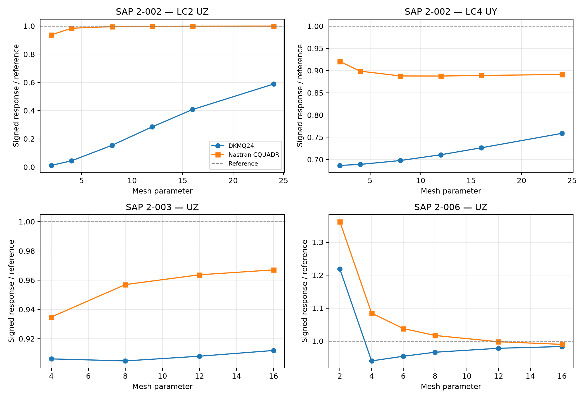

# DKMQ24 Shell Element: Formulation and Implementation in MYSTRAN

**Ary — Personal — revised 25 October 2026**

## Abstract

This report presents the geometry, kinematics, constitutive relations, discrete shear constraints, drilling stabilisation, and numerical integration of a four-node DKMQ24 shell element with six degrees of freedom per node. Figures define the corner-node numbering, oriented sides, and Gauss-point locations. Displacement and mesh-convergence results are compared with Nastran CQUADR for selected SAP benchmark cases: the straight beam (2-002), curved beam (2-003), and Scordelis–Lo roof (2-006). The results show case-dependent agreement, with the smallest difference at the finest common mesh occurring for the Scordelis–Lo roof.

## 1. Introduction

The Discrete Kirchhoff–Mindlin quadrilateral shell combines membrane deformation, bending, and transverse shear in a four-node element. Each node carries three translations and three rotations, giving 24 element degrees of freedom. Side constraints relate an assumed transverse-shear field to nodal displacements and rotations. A drilling penalty controls the rotation about the shell normal.

The report treats DKMQ24 as a single formulation throughout. Its numerical performance is assessed against Nastran CQUADR using displacement responses and mesh-refinement trends for three selected SAP cases.

## 2. Element Formulation

### 2.1 Geometry and Local Coordinate System

The element is a four-node bilinear quadrilateral defined by nodal position vectors $\mathbf X_I \in \mathbb R^3$. The mid-surface is

$$
\boldsymbol\phi(\xi,\eta) = \sum_{I=1}^{4} N_I(\xi,\eta)\,\mathbf X_I,
$$

with bilinear shape functions

$$
N_1 = \tfrac14(1-\xi)(1-\eta), \qquad N_2 = \tfrac14(1+\xi)(1-\eta),
$$

$$
N_3 = \tfrac14(1+\xi)(1+\eta), \qquad N_4 = \tfrac14(1-\xi)(1+\eta).
$$

Covariant tangent vectors are $\mathbf g_1 = \boldsymbol\phi_{,\xi}$ and $\mathbf g_2 = \boldsymbol\phi_{,\eta}$. The orthonormal physical frame is evaluated at each Gauss point:

$$
\mathbf e_3 = \frac{\mathbf g_1 \times \mathbf g_2}{\|\mathbf g_1 \times \mathbf g_2\|},
\qquad
\mathbf e_1 = \frac{\mathbf g_2 \times \mathbf e_3}{\|\mathbf g_2 \times \mathbf e_3\|},
\qquad
\mathbf e_2 = \mathbf e_3 \times \mathbf e_1 .
$$

### 2.2 Nodal Director Frame

Each node carries its own orthonormal director triad $\{\mathbf V_{1i}, \mathbf V_{2i}, \mathbf V_{ni}\}$, defined by the nodal geometry:

$$
\mathbf V_{ni} = \frac{(\mathbf X_{i+1}-\mathbf X_i) \times (\mathbf X_{i-1}-\mathbf X_i)}{\|\cdot\|},
\qquad
\mathbf V_{1i} = \frac{\mathbf e_Y \times \mathbf V_{ni}}{\|\mathbf e_Y \times \mathbf V_{ni}\|},
\qquad
\mathbf V_{2i} = \mathbf V_{ni} \times \mathbf V_{1i},
$$

with a fallback to $\mathbf e_X$ when $\mathbf V_{ni}$ is within $\sim6°$ of global $Y$.

### 2.3 Degrees of Freedom

$$
\mathbf d_I = [U_I,\ V_I,\ W_I,\ \theta_{X_I},\ \theta_{Y_I},\ \theta_{Z_I}]^{\mathrm T},
\qquad
\mathbf d_e \in \mathbb R^{24}.
$$

The rotations follow the right-hand rule about the global axes. Their components in the nodal director frame are $\alpha = \boldsymbol\theta\cdot\mathbf V_1$, $\beta = \boldsymbol\theta\cdot\mathbf V_2$, and $\theta_z = \boldsymbol\theta\cdot\mathbf V_n$.

### 2.4 Constitutive Matrices

Membrane and bending (isotropic plane stress):

$$
\mathbf C_m = D_m\begin{bmatrix}1&\nu&0\\ \nu&1&0\\ 0&0&\frac{1-\nu}{2}\end{bmatrix},
\quad D_m = \frac{Eh}{1-\nu^2};
\qquad
\mathbf C_b = D_b\begin{bmatrix}1&\nu&0\\ \nu&1&0\\ 0&0&\frac{1-\nu}{2}\end{bmatrix},
\quad D_b = \frac{Eh^3}{12(1-\nu^2)}.
$$

Transverse shear: $\mathbf C_s = D_s\mathbf I_2$, $D_s = \kappa G h$, $\kappa = 5/6$, $G = E/[2(1+\nu)]$.

Drilling: $C_{\mathrm{drill}} = \gamma_{\mathrm{drill}}\,h$ with $\gamma_{\mathrm{drill}} = 10^{-4}G$.

---

## 3. Discrete Shear Constraints and Rotation Enrichment

For side $k$, with length $L_k$, define the shear influence factor

$$
\phi_k = \frac{D_b}{D_s}\frac{12}{L_k^2},
\qquad
\bar\gamma_{s_k} = -\frac23\phi_k\Delta\beta_{s_k}.
$$

The four side constraints relate the rotation increments to the nodal degrees of freedom:

$$
\Delta\boldsymbol\beta = \mathbf A_n\mathbf d_e,
\qquad \mathbf A_n\in\mathbb R^{4\times24},
\qquad C_k=-\frac{3}{2(1+\phi_k)}.
$$

Incomplete-quadratic side functions enrich the rotation field:

$$
P_5=\tfrac12(1-\xi^2)(1-\eta),\qquad
P_6=\tfrac12(1+\xi)(1-\eta^2),
$$
$$
P_7=\tfrac12(1-\xi^2)(1+\eta),\qquad
P_8=\tfrac12(1-\xi)(1-\eta^2).
$$

The indices 5–8 identify enrichment functions associated with sides 1–4. They do not add external nodes or nodal degrees of freedom.

## 4. Element Stiffness and Coordinate Transformation

The element stiffness comprises membrane, bending, shear, and drilling contributions:

$$
\mathbf K_e = \int_{\Omega_e}
\left(\mathbf B_m^{\mathsf T}\mathbf C_m\mathbf B_m
+\mathbf B_b^{\mathsf T}\mathbf C_b\mathbf B_b
+\mathbf B_s^{\mathsf T}\mathbf C_s\mathbf B_s
+\mathbf B_d^{\mathsf T}C_{\mathrm{drill}}\mathbf B_d\right)\,\mathrm dA.
$$

Here $\mathbf B_m$, $\mathbf B_b$, and $\mathbf B_s$ map nodal degrees of freedom to membrane strains, curvatures, and transverse-shear strains. The drilling operator penalises the difference between the in-plane continuum rotation and the interpolated drilling rotation. The penalty scale is $\gamma_{\mathrm{drill}}=10^{-4}G$.

Nodal rotations are resolved into the director frame using

$$
\mathbf T_k^{\mathrm{rot}}=
\begin{bmatrix}
\mathbf V_{1k}^{\mathsf T}\\
\mathbf V_{2k}^{\mathsf T}\\
\mathbf V_{nk}^{\mathsf T}
\end{bmatrix}.
$$

With translations expressed in the global frame, the nodal transformation is
$\mathrm{diag}\left(\mathbf{I}_3,\mathbf{T}_k^{\mathrm{rot}}\right)$

The element stiffness in global coordinates follows from the congruence transformation $\mathbf K_e^{g}=\mathbf T^{\mathsf T}\mathbf K_e\mathbf T$.

## 5. Nodal Numbering and Numerical Integration

*Figure 1. Parent coordinates and counter-clockwise corner numbering. Side bubbles 5–8 belong to sides 1–4; they are internal enrichment locations, not additional connectivity nodes.*

*Figure 2. G1 = (−a,−a), G2 = (a,−a), G3 = (a,a), G4 = (−a,a), with a = 1/√3.*

Nodes $1\ldots4$ counter-clockwise; side $k$ joins node $k$ to node $k+1 \pmod 4$. Per-side quantities:

| Quantity | Symbol | Formula | Scope |
|---|---|---|---|
| Side length | $L_k$ | $\|\mathbf X_{k+1}-\mathbf X_k\|$ | Per side |
| Unit tangent | $\mathbf t_k$ | $(\mathbf X_{k+1}-\mathbf X_k)/L_k$ | Per side |
| Edge-averaged normal | $\mathbf n_k$ | $(\mathbf V_{ni}+\mathbf V_{nj})/\|\cdot\|$ | Per side, after director construction |
| Shear factor | $\phi_k$ | $(D_b/D_s)(12/L_k^2)$ | Per side, thickness-dependent |
| Constraint coefficient | $C_k$ | $-1.5/(1+\phi_k)$ | Per side |

**Quadrature.** Every stiffness term — membrane, bending, shear, drilling — uses $2\times2$ Gauss quadrature at $\xi,\eta = \pm1/\sqrt3$ with unit weights. No selective or reduced integration is used anywhere. Locking control comes entirely from the DKM assumed-shear field, which is a displacement-independent interpolation of the transverse shear and therefore does not require under-integration to relieve shear locking.

| Term | Quadrature | Integration measure |
|---|---|---|
| Membrane $K_m$ | $2\times2$ Gauss | $\det J\,\mathrm d\xi\,\mathrm d\eta$ |
| Bending $K_b$ | $2\times2$ Gauss | $\det J\,\mathrm d\xi\,\mathrm d\eta$ |
| Shear $K_s$ | $2\times2$ Gauss | $\det J\,\mathrm d\xi\,\mathrm d\eta$ |
| Drilling $K_d$ | $2\times2$ Gauss | $\det J\,\mathrm d\xi\,\mathrm d\eta$ |
| Geometric $K_g$ | $2\times2$ Gauss | $\det J\,\mathrm d\xi\,\mathrm d\eta$ |
| Mass $M$ | $2\times2$ Gauss | $\det J\,\mathrm d\xi\,\mathrm d\eta$ |

Thickness factors are already included in the constitutive matrices of Section 2.4 and must not be applied twice.

The surface integration measure is

$$
\mathrm dA = J_s\,\mathrm d\xi\,\mathrm d\eta,
\qquad J_s = \|\mathbf g_1\times\mathbf g_2\|.
$$

## 6. Selected SAP Cases: DKMQ24 versus Nastran CQUADR

The comparison is restricted to DKMQ24 and Nastran CQUADR. Results are presented on the same comparison basis, using corresponding load cases, response components, and mesh-refinement levels.

*Figure 3. Normalized displacement versus mesh refinement for SAP 2-002, 2-003, and 2-006. The dashed line denotes the benchmark reference. The mesh parameter is the longitudinal subdivision count for 2-002, the refinement parameter for 2-003, and the equal subdivision count in both directions for 2-006.*

### 6.1 Results at the finest common mesh

The signed difference is $100(q_{DKMQ24}-q_{CQUADR})/q_{CQUADR}$. It measures agreement with CQUADR, not error against an exact solution. Displacements are reported without unit conversion.

| SAP case | Response | Mesh parameter | DKMQ24 | Nastran CQUADR | Difference vs CQUADR |
|---|---|---:|---:|---:|---:|
| 2-002 | LC2 UZ | 24 | 0.06358492 | 0.1080311 | -41.142% |
| 2-002 | LC4 UY | 24 | 0.002587678 | 0.003039094 | -14.854% |
| 2-003 | UZ | 16 | 0.4579961 | 0.4856408 | -5.692% |
| 2-006 | UZ | 16 | -0.3034907 | -0.3055189 | -0.664% |

### 6.2 Discussion of results

For SAP 2-002, the DKMQ24 displacement is lower than the Nastran CQUADR result by 41.142% for LC2 and 14.854% for LC4 at the finest common mesh. LC2 shows a pronounced increase with mesh refinement, indicating that further refinement is needed to assess the limiting response.

For SAP 2-003, the DKMQ24 transverse displacement is 5.692% lower than the Nastran CQUADR result. Both responses remain below the benchmark reference over the mesh sequence shown.

For SAP 2-006, the two responses approach one another with refinement. At the finest common mesh, the displacement magnitude differs by 0.664%, giving the closest agreement among the selected comparisons.

These comparisons describe displacement accuracy and convergence for the selected cases. They do not establish performance for other geometries or loading conditions.

## 7. Conclusions

The selected benchmarks show that DKMQ24 agreement with Nastran CQUADR depends on the deformation mode and mesh refinement. The straight-beam cases show the largest differences, the curved-beam case shows an intermediate difference, and the Scordelis–Lo roof shows close agreement at the finest common mesh. Further refinement is particularly relevant to the straight-beam LC2 response.

## 8. References

Cook, R.D., & Young, W.C. (1985). *Advanced Mechanics of Materials*. Macmillan, New York.

Hughes, T.J.R., & Brezzi, F. (1989). On drilling degrees of freedom. *Computer Methods in Applied Mechanics and Engineering*, 72, 105–121.

Irpanni, H., Katili, I., & Maknun, I.J. (2017). Development DKMQ shell element with five degrees of freedom per nodal. *International Journal of Mechanical Engineering and Robotics Research*, 6(3), 248–252. https://doi.org/10.18178/ijmerr.6.3.248-252

Katili, I. (1993). A new discrete Kirchhoff–Mindlin element based on Mindlin–Reissner plate theory and assumed shear strain fields — Part I: An extended DKT element for thick-plate bending analysis. *International Journal for Numerical Methods in Engineering*, 36, 1859–1883.

Katili, I. (1993). A new discrete Kirchhoff–Mindlin element based on Mindlin–Reissner plate theory and assumed shear strain fields — Part II: An extended DKQ element for thick-plate bending analysis. *International Journal for Numerical Methods in Engineering*, 36, 1885–1908.

Katili, I., Batoz, J.-L., Maknun, I.J., Hamdouni, A., & Millet, O. (2015). The development of DKMQ plate bending element for thick to thin shell analysis based on the Naghdi/Reissner/Mindlin shell theory. *Finite Elements in Analysis and Design*, 100, 12–27. https://doi.org/10.1016/j.finel.2015.02.005

Ko, Y., Lee, P.-S., & Bathe, K.-J. (2017). A new MITC4+ shell element. *Computers & Structures*, 182, 404–418.

MacNeal, R.H. (1978). A simple quadrilateral shell element. *Computers & Structures*, 8, 175–183.

MacNeal, R.H., & Harder, R.L. (1985). A proposed standard set of problems to test finite element accuracy. *Finite Elements in Analysis and Design*, 1, 3–20.

Simo, J.C., & Rifai, M.S. (1990). A class of mixed assumed strain methods and the method of incompatible modes. *International Journal for Numerical Methods in Engineering*, 29, 1595–1638.

Taylor, R.L., Beresford, P.J., & Wilson, E.L. (1976). A non-conforming element for stress analysis. *International Journal for Numerical Methods in Engineering*, 10, 1211–1219.

Computers & Structures, Inc. (2024). *SAP2000 Verification Problem 2-001: Patch Test With Prescribed Displacements*. CSI documentation. https://docs.csiamerica.com/manuals/csibridge/Verification/Analysis/Shells/Problem%202-001.pdf

Computers & Structures, Inc. (2024). *SAP2000 Verification Problem 2-002: Straight Beam with Static Loads*. CSI documentation. https://docs.csiamerica.com/manuals/csibridge/Verification/Analysis/Shells/Problem%202-002.pdf

Computers & Structures, Inc. (2024). *SAP2000 Verification Problem 2-003: Curved Beam with Static Loads*. CSI documentation. https://docs.csiamerica.com/manuals/csibridge/Verification/Analysis/Shells/Problem%202-003.pdf

Computers & Structures, Inc. (2024). *SAP2000 Verification Problem 2-004: Twisted Beam with Static Loads*. CSI documentation. https://docs.csiamerica.com/manuals/csibridge/Verification/Analysis/Shells/Problem%202-004.pdf
