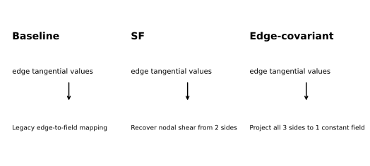
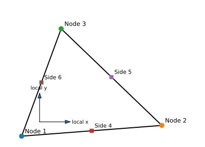
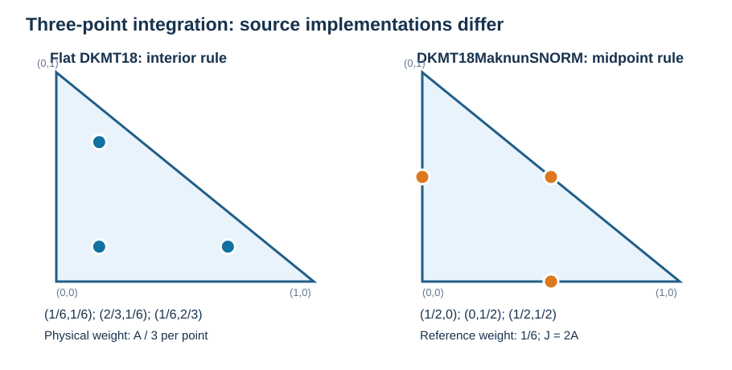
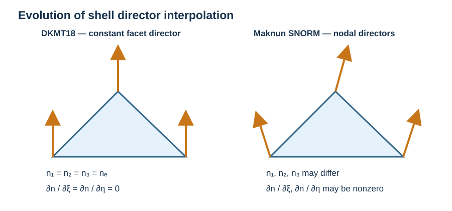
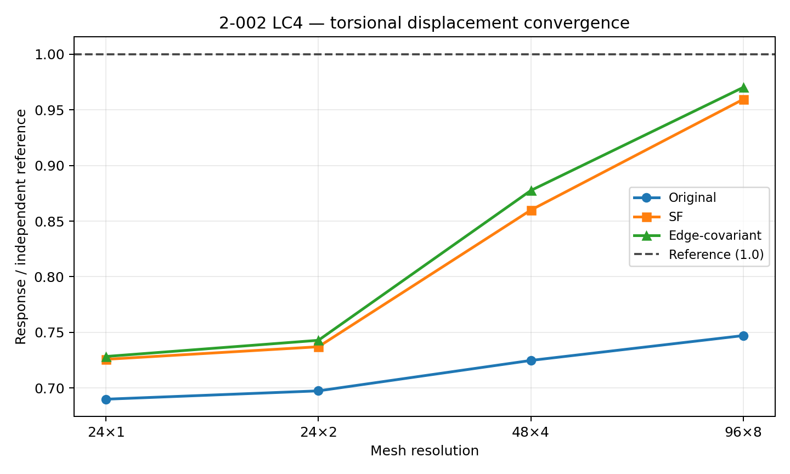
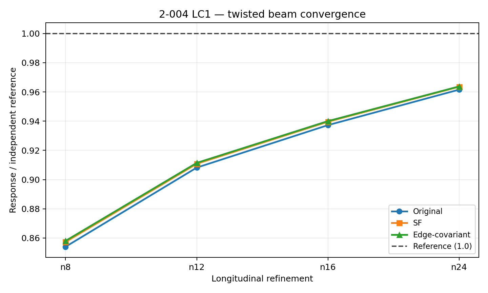
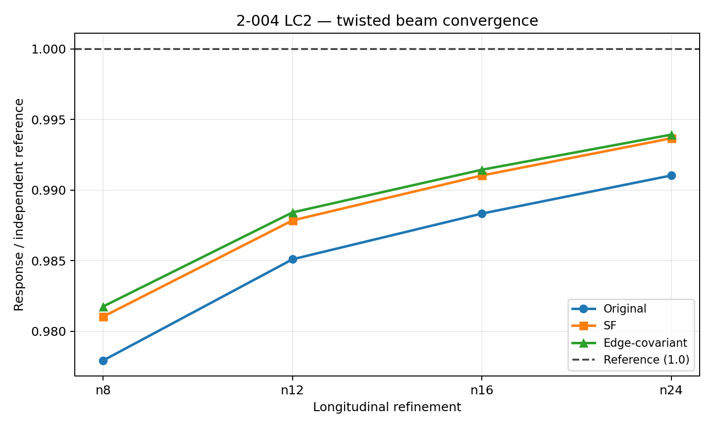
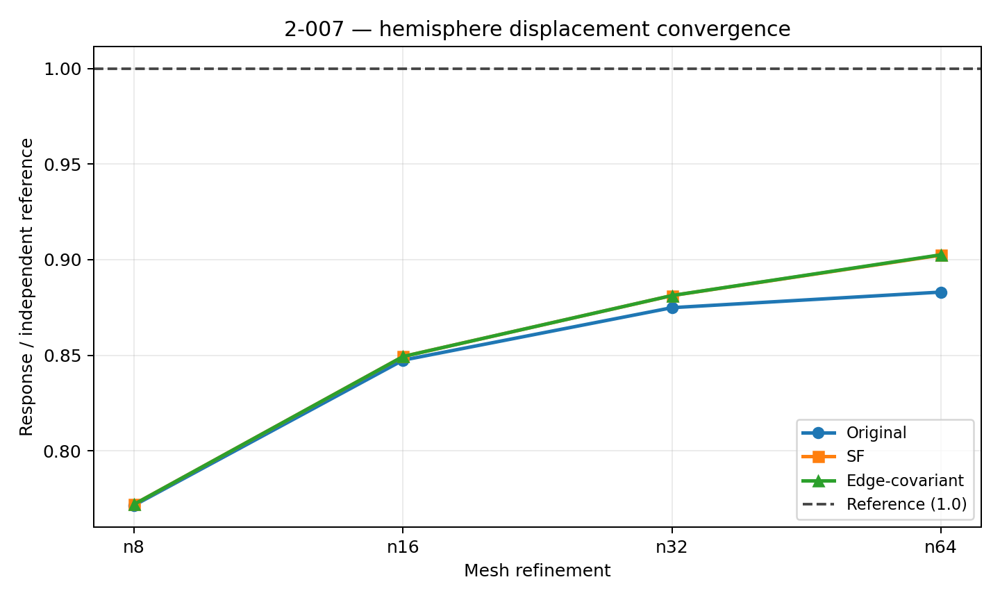
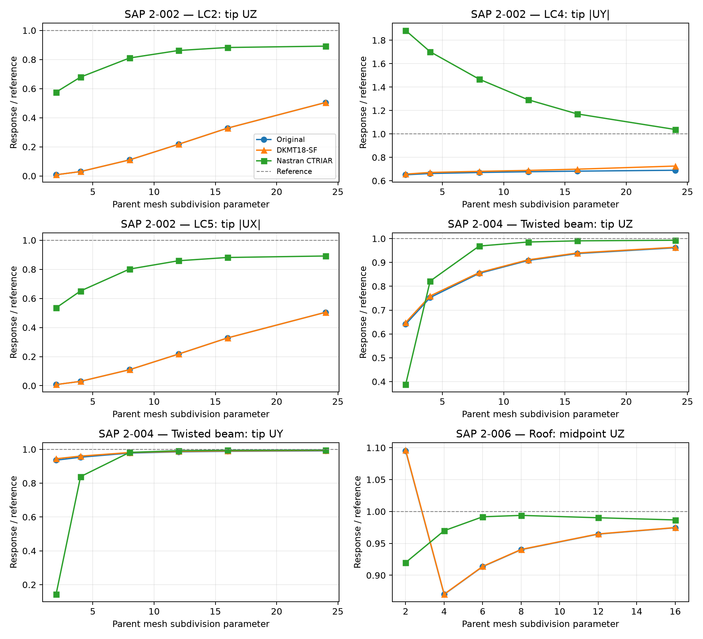

# DKMT18: Evolution from the Maknun–Katili Triangular Shell to Consistent Shear-Field Reconstruction and a Three-Edge Covariant Alternative

**Ary**  
**25 October 2026**  
*Mathematical formulation, shear-field consistency and comparative numerical assessment*

## Abstract

This study examines the evolution of an 18-degree-of-freedom three-node discrete Kirchhoff–Mindlin triangular shell (DKMT18), rooted in the DKMT plate theory of Katili and the curved-shell extension of Maknun *et al.* Three related shear representations are compared: the original Maknun-oriented reconstruction (denoted **Original**), a **shear-field-consistent reconstruction** (**DKMT18-SF**), and a **three-edge covariant projection** (**DKMT18-EC**). All share the same triangular shell kinematics, membrane–bending construction, side-rotation elimination and drilling treatment; the investigation isolates transverse shear recovery. A constant-shear reproduction test exposes a scaling/sign inconsistency in the original reconstruction that is eliminated by SF and EC. In the SAP2000 verification problem 2-002 LC4, the normalized torsional displacement at a 48×4 panel discretization increases from 0.72484 (Original) to 0.85991 (SF) and 0.87751 (EC). At 96×8 the respective ratios are 0.74715, 0.95943 and 0.97015. Comparisons with twisted-beam, plate, Scordelis roof, hemisphere and pipe responses show that EC generally offers only marginal improvement over SF outside this torsion benchmark. The study therefore identifies SF as the preferred research formulation, while retaining EC as an alternative for probing shear reconstruction. Selected direct comparisons with Nastran CTRIAR are added for static response and a buckling load. Remaining stress-reference and full three-formulation buckling comparisons are identified explicitly rather than inferred from stiffness-level diagnostics.

**Keywords:** DKMT18; Reissner–Mindlin shell; discrete shear constraints; transverse shear locking; triangular shell; covariant shear; torsion; convergence.

## 1. Introduction and formulation lineage

Katili's discrete Kirchhoff–Mindlin triangle (DKMT) provides a three-node bending element based on assumed shear strains and elimination of side-rotation parameters [1]. Maknun *et al.* extended this line to an 18-DOF triangular shell with a continuously interpolated director field and geometric membrane–bending coupling for curved surfaces [2]. The present study distinguishes this geometric description from the shear recovery operator: **the notation “Maknun–SNORM” identifies the original curved-shell/director lineage, not a reason to discard physically meaningful nodal director information.**

The research evolution is:

1. **Original:** DKMT18 with Maknun-type director-based coupling, side shear influence factors and the initially adopted edge-to-shear reconstruction.
2. **DKMT18-SF:** identical shell formulation except for consistent recovery of physical shear components from the two edge-tangential values incident on each triangle node.
3. **DKMT18-EC:** retains the SF side shear values but replaces the nodal interpolation by a three-edge least-squares projection onto a **constant** physical shear vector. This trial is not represented as the published MITC3 or MITC3+ formulation.

## 2. Geometry, degrees of freedom and constitutive equations

Let the corner position vectors be $\mathbf{x}_1,\mathbf{x}_2,\mathbf{x}_3$. The facet area and normal are

$$
A_e=\frac12\left\|(\mathbf{x}_2-\mathbf{x}_1)\times(\mathbf{x}_3-\mathbf{x}_1)\right\|, \qquad \mathbf{n}_e=\frac{(\mathbf{x}_2-\mathbf{x}_1)\times(\mathbf{x}_3-\mathbf{x}_1)}{2A_e}.
$$

The nodal vector contains six degrees of freedom, giving $3\times6=18$:

$$
\mathbf{d}_e=\begin{bmatrix}\mathbf{d}_1^T&\mathbf{d}_2^T&\mathbf{d}_3^T\end{bmatrix}^T, \qquad \mathbf{d}_i=\begin{bmatrix}u_i&v_i&w_i&\theta_{xi}&\theta_{yi}&\theta_{zi}\end{bmatrix}^T.
$$

For isotropic linear elasticity, the integrated constitutive matrices are

$$
\mathbf{D}_m=\frac{Eh}{1-\nu^2}\begin{bmatrix}1&\nu&0\\\nu&1&0\\0&0&(1-\nu)/2\end{bmatrix}, \qquad \mathbf{D}_b=\frac{Eh^3}{12(1-\nu^2)}\begin{bmatrix}1&\nu&0\\\nu&1&0\\0&0&(1-\nu)/2\end{bmatrix},
$$

$$
\mathbf{D}_s=\kappa Gh\mathbf{I}_2, \qquad G=\frac{E}{2(1+\nu)},\qquad\kappa=\frac56.
$$

The element's energetic decomposition is

$$
\mathbf{K}_e=\int_{A_e}\left(\mathbf{B}_m^T\mathbf{D}_m\mathbf{B}_m+\mathbf{B}_b^T\mathbf{D}_b\mathbf{B}_b+\widehat{\mathbf{B}}_s^T\mathbf{D}_s\widehat{\mathbf{B}}_s\right)\,dA+\mathbf{K}_d.
$$

The constitutive and curved-director coupling terms are common to the three variants. In the underlying DKMT construction the eliminated side-rotation variables are condensed before building the final transverse-shear operator.

### 2.1 Director field for curved shells

The surface normal may vary between nodes. A continuous director approximation is

$$
\mathbf{n}(r,s)=\sum_{i=1}^3N_i(r,s)\,\mathbf{n}_i, \quad N_1=1-r-s,\ N_2=r,\ N_3=s.
$$

The director gradient contributes to geometric membrane–bending coupling. On a planar facet with constant director, the corresponding curvature-coupling term vanishes. For curved or twisted surfaces, using a facet normal as though it were a varying nodal director can alter the response significantly. In this work the geometry/director description is held common to all three shear variants.

## 3. Discrete edge shear and condensed side parameters

Number the edges $4=(1,2)$, $5=(2,3)$ and $6=(3,1)$, with unit tangents

$$
\mathbf{t}_k=\begin{bmatrix}c_k\\s_k\end{bmatrix},\qquad k=4,5,6.
$$

For the physical transverse shear vector $\boldsymbol\gamma=(\gamma_x,\gamma_y)^T$, the edge-tangential sample is

$$
\gamma_{s,k}=\mathbf{t}_k^T\boldsymbol\gamma=c_k\gamma_x+s_k\gamma_y.
$$

Let $\mathbf{A}_u$ map the element degrees of freedom into the DKMT side kinematic quantities and let $\phi_k$ be the dimensionless DKMT side shear influence parameter. Retaining the side scaling used throughout the comparison,

$$
\boldsymbol\gamma_s=\mathbf{H}_{\phi}\mathbf{A}_u\mathbf{d}_e, \qquad \mathbf{H}_{\phi}=\mathrm{diag}\left(\frac{\phi_4}{1+\phi_4},\frac{\phi_5}{1+\phi_5},\frac{\phi_6}{1+\phi_6}\right).
$$

Equivalently, with condensed side rotations $\Delta\boldsymbol\beta$,

$$
\gamma_{s,k}=-\frac{2}{3}\phi_k\Delta\beta_k.
$$

These expressions describe the side-shear quantities **shared** by SF and EC. The precise $\phi_k$ definition follows the DKMT–Maknun formulation and is not refitted to the torsion response [1,2].

## 4. Original reconstruction and constant-shear inconsistency

In the investigated Original reconstruction, imposing uniform physical shear $\boldsymbol\gamma_0$ and therefore exact edge values $\gamma_{s,k}=\mathbf{t}_k^T\boldsymbol\gamma_0$ produces

$$
\widehat{\boldsymbol\gamma}_{\mathrm{Original}}=-2\boldsymbol\gamma_0,
$$

whereas a first-order consistent assumed-shear operator must satisfy

$$
\widehat{\boldsymbol\gamma}(\boldsymbol\gamma_s)=\boldsymbol\gamma_0 \quad\text{when}\quad \gamma_{s,k}=\mathbf{t}_k^T\boldsymbol\gamma_0.
$$

For the illustrative field $\boldsymbol\gamma_0=(0.7,-0.4)^T$, the Original mapping returns $(-1.4,0.8)^T$, versus $(0.7,-0.4)^T$ for consistent SF/EC recovery. This is an **operator reproduction diagnostic**; the complete shell energy also contains bending, membrane and geometric coupling, so this observation must not be interpreted as a universal scaling factor for every benchmark or an instruction to multiply stiffness by a constant.

## 5. DKMT18-SF: two-edge nodal shear reconstruction

At each vertex $i$, choose its two incident edges $a_i,b_i$. Define

$$
\mathbf{E}_i=\begin{bmatrix}c_{a_i}&s_{a_i}\\c_{b_i}&s_{b_i}\end{bmatrix}, \qquad \boldsymbol\gamma_i=\mathbf{E}_i^{-1} \begin{bmatrix}\gamma_{s,a_i}\\\gamma_{s,b_i}\end{bmatrix}.
$$

The pairings are $(4,6)$ at node 1, $(4,5)$ at node 2, and $(5,6)$ at node 3. The recovered shear is interpolated with triangle shape functions:

$$
\widehat{\boldsymbol\gamma}_{\mathrm{SF}}(r,s)=\sum_{i=1}^3N_i(r,s)\boldsymbol\gamma_i.
$$

Thus, the assumed shear matrix may be written

$$
\widehat{\mathbf{B}}_{s,\mathrm{SF}}(r,s) =\left[\sum_{i=1}^3 N_i(r,s)\mathbf{R}_i\right] \mathbf{H}_{\phi}\mathbf{A}_u,
$$

where the $2\times3$ matrix $\mathbf{R}_i$ has nonzero columns $a_i,b_i$ corresponding to the two columns of $\mathbf E_i^{-1}$. For any constant physical shear field,

$$
\boldsymbol\gamma_s=\mathbf{E}\boldsymbol\gamma_0 \Longrightarrow \boldsymbol\gamma_i=\boldsymbol\gamma_0 \Longrightarrow \widehat{\boldsymbol\gamma}_{\mathrm{SF}}=\boldsymbol\gamma_0,
$$

provided the triangle is nondegenerate. This reproducing property motivates moving beyond the Original mapping without altering membrane or bending kinematics.

## 6. DKMT18-EC: a three-edge covariant projection alternative

Collect the three unit edge directions in

$$
\mathbf E=\begin{bmatrix}c_4&s_4\\c_5&s_5\\c_6&s_6\end{bmatrix}, \qquad \boldsymbol\gamma_s=\begin{bmatrix}\gamma_{s,4}\\\gamma_{s,5}\\\gamma_{s,6}\end{bmatrix}.
$$

The least-squares projection onto a constant physical shear field is

$$
\widehat{\boldsymbol\gamma}_{\mathrm{EC}} =\underset{\boldsymbol\gamma\in\mathbb R^2}{\mathrm{arg\,min}} \|\mathbf E\boldsymbol\gamma-\boldsymbol\gamma_s\|_2^2 =(\mathbf E^T\mathbf E)^{-1}\mathbf E^T\boldsymbol\gamma_s.
$$

Accordingly,

$$
\widehat{\mathbf B}_{s,\mathrm{EC}} =(\mathbf E^T\mathbf E)^{-1}\mathbf E^T \mathbf H_{\phi}\mathbf A_u.
$$

For $\mathrm{rank}(\mathbf E)=2$, this reconstruction reproduces any constant shear field. The trade-off is that it retains only the best-fit **constant** field within a triangle; SF retains linear variation through its nodal shear interpolation. The name *edge-covariant* describes projection from edge-tangential components; it does **not** imply a full covariant MITC3 or MITC3+ tying formulation [3].

## 7. Comparative numerical verification

Define the normalized response $R=u/u_{\mathrm{ref}}$ for displacement problems, with $R=1$ representing the independent reference. The three columns represent distinct shear formulations but identical benchmark definitions. Numerical values are rounded for presentation.

### 7.1 Problem 2-002, LC4: the principal motivation for SF

The benchmark represents torsion of a narrow rectangular strip. The width is 0.2 in, thickness is 0.1 in, and the applied end couple is 1 lb-in. The independent reference tip displacement is **0.00341 in**, taken as the average absolute displacement of the two tip-edge points. Meshes are specified by longitudinal and width subdivisions before each panel is divided into four triangles.

| Parent mesh | Original | DKMT18-SF | DKMT18-EC |
|---|---:|---:|---:|
| 24×1 | 0.69001 | 0.72583 | **0.72840** |
| 24×2 | 0.69749 | 0.73711 | **0.74292** |
| 48×4 | 0.72484 | 0.85991 | **0.87751** |
| 96×8 | 0.74715 | 0.95943 | **0.97015** |
| 192×16 | 0.75815 | **0.99610** | Not assessed |

The Original formulation remains substantially too stiff even with substantial refinement, whereas SF approaches the reference under two-direction refinement. EC improves the intermediate-mesh result further but has no demonstrated advantage at the finest SF mesh. Hence 2-002 LC4 is direct numerical evidence for **promoting SF over the Original**, not for declaring the edge-covariant alternative generally superior. The 192×16 Original/SF row belongs to the extended refinement series; it is not included in the figure because no corresponding EC result was established.

### 7.2 Problem 2-004: twisted beam

The transverse displacement ratios for LC1 (out-of-plane) and LC2 (in-plane), respectively, are:

| Mesh | Original LC1 | SF LC1 | EC LC1 | Original LC2 | SF LC2 | EC LC2 |
|---|---:|---:|---:|---:|---:|---:|
| n8 | 0.85403 | 0.85734 | 0.85807 | 0.97793 | 0.98104 | 0.98176 |
| n12 | 0.90819 | 0.91085 | 0.91144 | 0.98510 | 0.98785 | 0.98842 |
| n24 | 0.96157 | 0.96357 | **0.96378** | 0.99103 | 0.99367 | **0.99393** |

The three formulations converge toward the same displacement targets, with small differences at each mesh resolution. Correct geometric directors are essential for interpreting twisted-shell response; this is a geometry requirement independent of the choice of shear recovery.

### 7.3 Problem 2-005: square plate

At 8×8 parent panels, the response ratios are essentially indistinguishable:

| Boundary and load | Original | SF | EC |
|---|---:|---:|---:|
| Simply supported, uniform | 1.004606 | 1.004606 | 1.004606 |
| Simply supported, concentrated | 1.013649 | 1.013649 | 1.013649 |
| Clamped, uniform | 1.034167 | 1.034167 | 1.034167 |
| Clamped, concentrated | 1.038968 | 1.038969 | 1.038969 |

Thus, the proposed shear changes do not produce a practically meaningful change in these square-plate displacement checks.

### 7.4 Problem 2-006: Scordelis–Lo roof

| Parent mesh | Original | SF | EC |
|---|---:|---:|---:|
| 2×2 | 0.646705 | 0.648095 | 0.648095 |
| 4×4 | 0.779518 | 0.780312 | 0.780310 |
| 8×8 | 0.921502 | 0.922101 | 0.922100 |

The reconstructed shear operators are nearly equivalent for this curved-shell displacement measure, and all three show a refinement trend toward the independent reference.

### 7.5 Problem 2-007: hemisphere

The displacement ratio at physical observation point 1 follows:

| Mesh | Number of triangles | Original | SF | EC |
|---|---:|---:|---:|---:|
| n8 | 128 | 0.77151 | 0.77205 | 0.77205 |
| n16 | 512 | 0.84743 | 0.84934 | 0.84934 |
| n32 | 2,048 | 0.87489 | 0.88123 | 0.88125 |
| n64 | 8,192 | 0.88305 | 0.90237 | **0.90256** |

SF and EC reduce the coarse-mesh under-response only modestly. At n64 the response remains approximately 9.7–9.8% below the independent reference, so the numerical trend **does not establish exact convergence to that reference**. Geometric approximation and director-field sensitivity must be distinguished from shear locking before drawing a stronger conclusion.

### 7.6 Problem 2-010: cylindrical shell and stress-recovery trade-off

For the common 12×24 discretization the maximum absolute element-local stress-component envelopes (ksi) are:

| Stress envelope | Original | SF | EC |
|---|---:|---:|---:|
| Membrane | 65.413 | 65.328 | 65.326 |
| Bending | 43.253 | 47.120 | 47.130 |

At 24×48, the membrane envelopes become 62.384, 62.354 and 62.353 ksi, while bending envelopes become 12.640, 14.807 and 14.809 ksi, respectively. **An envelope is not a fixed-location independent-reference stress comparison.** Its controlling element and stress component may change with refinement. Accordingly, these data do not establish which shear formulation gives the best reference-point pipe stress. A separate earlier reference-metric comparison indicated a possible stress regression of SF relative to the Original; this concern remains unresolved and motivates retaining the pipe stress check as an acceptance criterion.

### 7.7 Problem 2-001: distorted bending, shear and twisting patch diagnostic

For a prescribed-boundary kinematic patch, the normalized interior transverse displacement is:

| Field | Original | SF | EC |
|---|---:|---:|---:|
| Constant bending | 1.000000 | 1.000000 | 1.000000 |
| Constant shear | 1.015612 | 1.014845 | 1.014846 |
| Constant twist | 1.000000 | 1.000000 | 1.000000 |

This is a **kinematic patch response**, not complete verification of constant membrane stress, bending moment resultants, transverse shear resultant recovery, or equilibrated internal forces. SF and EC have a small and nearly identical advantage for the shear-displacement diagnostic.

### 7.8 Problems 2-016 and 2-017: geometric stiffness and eigen-buckling

For a fixed membrane prestress state, the three variants give identical geometric-stiffness matrices in a representative planar triangle, with $\|\mathbf K_g\|_F=2.423539797$, zero observed symmetry error and translational rigid-body residual $5.40\times10^{-17}$. This local identity follows because only the shear-recovery operator is varied. It does not establish equal eigenvalues, because the elastic matrices differ and a coupled preload calculation can also change stress resultants.

The general stability equation is

$$
\left(\mathbf K+\lambda\mathbf K_g\right)\boldsymbol\varphi=\mathbf0.
$$

For 2-016c Model C the independent critical stress references are 0.0425 ksi (SHEAR) and 0.1165 ksi (BEND), with applied-edge stress normalization

$$
\sigma_{\mathrm{cr}}=\lambda_1\frac{q_{\max}}{h}.
$$

The critical load reference for 2-017 is 127.91 kip. **A three-formulation full-structure eigenvalue and mesh-convergence dataset is not part of the assessed results**, so no buckling pass/fail ranking is claimed here. The six-mode residual acceptance threshold $10^{-6}$ is an additional eigen-solution quality measure, not an explicit requirement of the CSI first-critical-load benchmark.

### 7.9 Direct comparison with Nastran CTRIAR

Nastran CTRIAR provides an external triangular-shell comparison for the Original and DKMT18-SF formulations. The comparisons below use corresponding benchmark cases, mesh subdivision levels, load cases, response components and units. These mesh sequences are distinct from the two-direction torsion refinement series in Section 7.1; values from the two series must not be interchanged. No corresponding EC–CTRIAR comparison is claimed.

*Direct comparison of normalized responses for SAP 2-002, 2-004 and 2-006. The dashed line denotes the independent reference. Original, SF and CTRIAR use the matched parent-mesh sequence shown in each panel.*

#### 7.9.1 Selected numerical responses

The beam comparisons use parent longitudinal subdivision count 24, the roof uses 16 × 16 parent panels, and the buckling plate uses 4 × 24 parent panels. Translational responses are in inches, rotation in radians, and critical load in kip. Differences are computed relative to Nastran CTRIAR:

$$
\Delta_q=100\frac{q-q_{\mathrm{CTRIAR}}}{q_{\mathrm{CTRIAR}}}.
$$

| SAP case | LC | Response | Unit | Original | DKMT18-SF | Nastran CTRIAR | Original difference | SF difference |
|---|---|---|---|---:|---:|---:|---:|---:|
| 2-002 | 1 | tip UX | in | 3e-05 | 3e-05 | 3.090472e-05 | -2.927% | -2.927% |
| 2-002 | 2 | tip UZ | in | 0.05457731 | 0.05457731 | 0.09643454 | -43.405% | -43.405% |
| 2-002 | 3 | tip UY | in | 0.4319951 | 0.4321397 | 0.4321313 | -0.032% | +0.002% |
| 2-002 | 4 | tip abs UY | in | 0.002352926 | 0.002475087 | 0.003539409 | -33.522% | -30.071% |
| 2-002 | 5 | tip abs UX | in | 0.0004543581 | 0.0004543581 | 0.0008025134 | -43.383% | -43.383% |
| 2-002 | 6 | tip RZ | rad | 0.036 | 0.036 | 0.036 | +0.000% | +0.000% |
| 2-004 | 1 | tip UZ | in | 0.001681829 | 0.0016853257 | 0.001736926 | -3.172% | -2.971% |
| 2-004 | 2 | tip UY | in | 0.005380313 | 0.0053946143 | 0.005405563 | -0.467% | -0.203% |
| 2-006 | 1 | free edge midpoint UZ | ft | -0.3007388 | -0.3008229 | -0.3045089 | -1.238% | -1.210% |
| 2-017 | 2 | critical load | kip | 136.843 | 136.843 | 126.2154 | +8.420% | +8.420% |

#### 7.9.2 Interpretation

The external comparison exposes limitations that are not removed by changing shear recovery alone. In straight-beam LC2 and LC5, Original and SF give the same response at the selected mesh and remain substantially below CTRIAR. SF changes LC4 and LC3, but the LC4 difference remains material on this mesh sequence. This does not conflict with the improved SF torsion response in Section 7.1, which uses refinement in both panel directions.

For the twisted beam, SF slightly increases the displacement toward CTRIAR, with closer agreement for UY than for UZ. For the roof, the SF change is small relative to the remaining difference from CTRIAR. The selected buckling load is unchanged between Original and SF and remains above CTRIAR. This is a selected global eigenvalue comparison; it does not establish an EC ranking, a complete buckling convergence study, or eigenmode-residual acceptance.

The results therefore support SF as a shear-consistent successor while showing that agreement with an external triangular shell also depends on membrane/bending response, geometry and mesh refinement.

## 8. Discussion

The mechanistic and benchmark evidence favor **DKMT18-SF as the principal successor** to the Original. Its two-edge reconstruction restores constant-shear reproduction and its torsion convergence improves markedly. The three-edge projection EC is also constant-shear consistent and can improve an intermediate torsion mesh, but suppresses within-element linear shear variation and has not established a broad numerical advantage over SF. For the cases considered, the extra distinction between SF and EC is small compared with the Original-to-SF change.

**Mesh convergence must be interpreted relative to the correct solution.** A stable numerical limit is not necessarily the independent reference; the Original 2-002 response and the still-low n64 hemisphere response are explicit reasons to assess both convergence rate and asymptotic accuracy. Similarly, a local geometric-stiffness identity is not a substitute for six physically meaningful buckling eigenpairs.

The Nastran CTRIAR comparisons in Section 7.9 provide an external check in addition to the Original/SF/EC comparison. They show that a consistent shear reconstruction does not, by itself, eliminate the straight-beam bending discrepancies or the selected buckling-load difference.

## 9. Conclusions

1. The investigated Original edge-to-field mapping fails the constant physical-shear reproduction diagnostic, motivating a replacement of that recovery operator.
2. SF restores the constant-field property with two-edge nodal reconstruction and improves the principal torsion benchmark 2-002 LC4 from 0.72484 to 0.85991 at mesh 48×4; at 192×16 SF reaches 0.99610 of the reference.
3. EC offers a modest further improvement for intermediate torsion meshes, but is almost indistinguishable from SF on the tested plate, roof, hemisphere and pipe response measures.
4. Correct nodal director descriptions remain important for curved and twisted geometries regardless of the shear formulation.
5. Selected Original/SF comparisons with Nastran CTRIAR are reported directly. Full stress-reference comparisons, complete patch stress/resultant consistency and a full three-formulation buckling study remain unestablished and should not be inferred from displacement plots.

## References

[1] Katili, I. (1993). A new discrete Kirchhoff–Mindlin element based on Mindlin–Reissner plate theory and assumed shear strain fields—Part I: An extended DKT element for thick-plate bending analysis. *International Journal for Numerical Methods in Engineering*, **36**, 1859–1883.

[2] Maknun, I. J., Katili, I., Ibrahimbegovic, A., & Katili, A. M. (2020). A new triangular shell element for composites accounting for shear deformation. *Composite Structures*, **243**, 112214. https://doi.org/10.1016/j.compstruct.2020.112214

[3] Lee, P.-S., & Bathe, K.-J. (2004). Development of MITC isotropic triangular shell finite elements. *Computers & Structures*, **82**, 945–962. (Cited for assumed-shear context; EC is not claimed to reproduce their element.)

[4] Computers and Structures, Inc. (CSI). *SAP2000 Verification Examples*, Problems 2-001, 2-002, 2-004, 2-005, 2-006, 2-007, 2-010, 2-016 and 2-017. Independent comparison values as stated in the applicable problem definitions.
