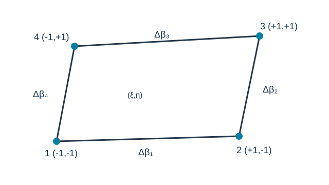
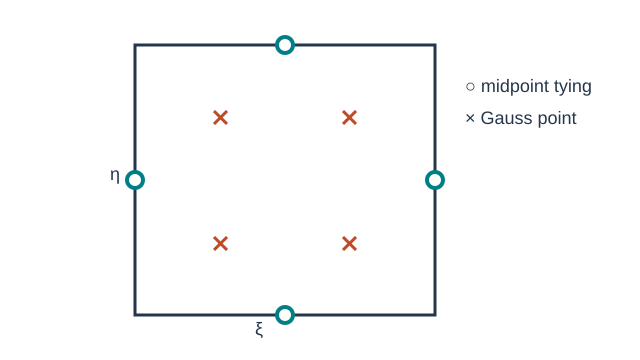
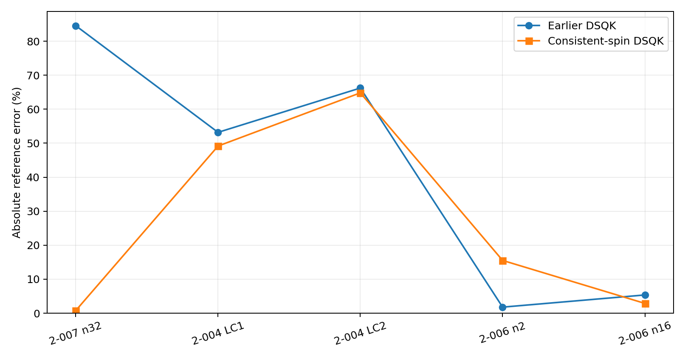

# DSQK: A Four-Node Discrete-Shear Quadrilateral Shell with Assumed-Orthogonality Bending and Consistent-Spin Drilling

**Ary | 25 October 2026 | Mathematical formulation and numerical assessment**

## Abstract

This article presents the adopted DSQK four-node Reissner–Mindlin shell formulation and its recent consistent-spin refinement. The element combines a conventional bilinear quadrilateral membrane, an assumed-orthogonality discrete-Kirchhoff bending enhancement using four eliminated side-rotation parameters, and midpoint-tied transverse shear. Twenty physical tangent-space degrees of freedom are embedded in a six-degree-of-freedom-per-node shell description. The principal update is the replacement of a penalty on absolute normal rotation with a **consistent-spin constraint** penalizing the difference between the local continuum spin and interpolated drilling rotation. The adopted nondimensional coefficient is $\alpha_s=0.03$. Matched benchmark results demonstrate a marked improvement in the hemispherical shell response (absolute error 84.563% to 0.786% on the reported n32 mesh), negligible changes to plate cases, but residual limitations in twisted beams and coarse Scordelis–Lo shells. Differences between direct local stress recovery and stresses reconstructed into a common surface frame are distinguished rather than presented as an unconditional patch-test pass.

**Keywords:** DSQK; quadrilateral shell; assumed orthogonality; transverse shear tying; consistent-spin drilling; Reissner–Mindlin; rank stability; curved shells.

## 1. Formulation lineage and main changes

The DSQK formulation is distinct from the DKMQ family even though both employ quadrilateral shell kinematics and side-related rotational enrichment. In DSQK, the side increments are eliminated through a discrete-Kirchhoff relation and bending is assembled using an **assumed-orthogonality** split. The latest adopted formulation preserves this physical kernel while replacing the earlier absolute normal-rotation drilling penalty with a compatible continuum-spin constraint.

| Contribution | Earlier DSQK formulation | Adopted DSQK formulation |
|---|---|---|
| Membrane | Bilinear Q4 | Unchanged |
| Basic bending | Bilinear rotations | Unchanged |
| Side rotations | Four increments eliminated by discrete-Kirchhoff relations | Unchanged |
| Bending stiffness | Assumed-orthogonality split | Unchanged |
| Transverse shear | Four midpoint tying locations | Unchanged |
| External rotations | Tangential rotations plus artificial normal penalty | Tangential rotations plus consistent-spin constraint |
| Drilling energy | Penalizes absolute normal rotation | Penalizes spin mismatch; vanishes in rigid-body motion |
| Coefficient | $0.03$ in the earlier penalty convention | $\alpha_s=0.03$ in the new constraint; **not** an equivalent stiffness |

The historical mixed-shear side-elimination route discussed alongside DSQK is not substituted for the **discrete-Kirchhoff elimination** in the numerical formulation assessed here. Thus results below cannot be interpreted as validating the full alternative mixed-shear route.

## 2. Geometry, local coordinates and degrees of freedom

Let $\Omega_e$ be the four-node parent quadrilateral $-1\le\xi,\eta\le1$. The bilinear shape functions are

$$
\begin{aligned}
N_1 &= \tfrac14(1-\xi)(1-\eta), & N_2 &= \tfrac14(1+\xi)(1-\eta),\\
N_3 &= \tfrac14(1+\xi)(1+\eta), & N_4 &= \tfrac14(1-\xi)(1+\eta).
\end{aligned}
$$

The physical midsurface and Jacobian are

$$
\mathbf{x}(\xi,\eta)=\sum_{i=1}^{4}N_i\mathbf{x}_i,
\qquad
\mathbf{J}=\frac{\partial(x,y)}{\partial(\xi,\eta)}.
$$

An orthonormal right-handed facet basis $\{\mathbf t_1,\mathbf t_2,\mathbf n\}$ defines local displacement and rotation components. The tangent-shell kinematic vector at node $i$ is

$$
\mathbf q_i^{(5)}=
\begin{bmatrix}u_i & v_i & w_i & \theta_{1i} & \theta_{2i}\end{bmatrix}^{T},
$$

with twenty physical unknowns in the four-node kernel. The assembled shell also admits drilling $\theta_{ni}=\boldsymbol\theta_i\cdot\mathbf n$, giving $24$ external DOFs. For right-hand-rule rotations, the bending variables used in the parent formulation may be written $\beta_x=\theta_2$ and $\beta_y=-\theta_1$; care is required not to interchange these rotation conventions.

*Figure 1. Four corner nodes, local parent coordinates and four side-related rotational parameters.*

## 3. Constitutive laws

For an isotropic, linearly elastic shell,

$$
\mathbf C_0=\frac{E}{1-\nu^2}
\begin{bmatrix}
1 & \nu & 0 \\
\nu & 1 & 0 \\
0 & 0 & \dfrac{1-\nu}{2}
\end{bmatrix}.
$$

$$
\begin{aligned}
\mathbf D_m &= h\mathbf C_0,\\
\mathbf D_b &= \frac{h^3}{12}\mathbf C_0,\\
\mathbf D_s &= \kappa_s Gh\mathbf I_2,\\
G &= \frac{E}{2(1+\nu)}.
\end{aligned}
$$

Here $h$ is thickness and $\kappa_s$ is the transverse-shear correction factor. The constitutive factors are included **once** in the stiffness integrals below.

## 4. Membrane interpolation — step by step

**Step 1.** Differentiate the bilinear shape functions in the physical tangent plane:

$$
\begin{bmatrix}N_{i,x}\\N_{i,y}\end{bmatrix}
=\mathbf J^{-T}
\begin{bmatrix}N_{i,\xi}\\N_{i,\eta}\end{bmatrix}.
$$

**Step 2.** Form the engineering membrane strain vector

$$
\boldsymbol\varepsilon_m=
\begin{bmatrix}u_{,x}\\v_{,y}\\u_{,y}+v_{,x}\end{bmatrix}
=\mathbf B_m\mathbf q^{(5)}.
$$

The columns for nodal membrane translations are

$$
\mathbf B_m^{(i)}=
\begin{bmatrix}
N_{i,x} & 0\\
0 & N_{i,y}\\
N_{i,y} & N_{i,x}
\end{bmatrix}.
$$

**Step 3.** Integrate membrane energy using the $2\times2$ Gaussian rule:

$$
\mathbf K_m=\int_{\Omega_e}\mathbf B_m^T\mathbf D_m\mathbf B_m\,dA.
$$

This is a bilinear membrane, **not** an Allman or EAS membrane enhancement. Consequently, in-plane bending sensitivity is a distinct limitation of this element family.

## 5. Bending: assumed orthogonality and side-rotation elimination

**Step 1 — bilinear curvature.** With $\beta_x=\theta_2$ and $\beta_y=-\theta_1$, adopt the bending strain convention

$$
\boldsymbol\kappa=
\begin{bmatrix}
\beta_{x,x}\\\beta_{y,y}\\\beta_{x,y}+\beta_{y,x}
\end{bmatrix}.
$$

The basic curvature field is $\boldsymbol\kappa_u=\mathbf B_{bu}\mathbf q^{(5)}$.

**Step 2 — enhanced side rotations.** Introduce four side-associated quadratic rotational functions $P_k(\xi,\eta)$ and four incremental edge rotations $\Delta\beta_k$:

$$
\boldsymbol\kappa_\Delta=\mathbf B_{b\Delta}\boldsymbol\Delta,
\qquad
\boldsymbol\Delta=\begin{bmatrix}\Delta\beta_1&\Delta\beta_2&\Delta\beta_3&\Delta\beta_4\end{bmatrix}^T.
$$

**Step 3 — discrete-Kirchhoff constraint on each side.** For side $k=(i,j)$ of length $L_k$ and direction cosines $(c_k,s_k)$, let the tangential rotation be $\beta_{t,k}=c_k\beta_x+s_k\beta_y$. The adopted elimination relation is

$$
\Delta\beta_k=-\frac32\left[
\frac{w_j-w_i}{L_k}+
\frac{\beta_{t,i}+\beta_{t,j}}{2}
\right].
$$

With the chosen rotation convention and side orientation, this defines a geometry-dependent $4\times20$ map

$$
\boldsymbol\Delta=\mathbf A_n\mathbf q^{(5)}.
$$

**Step 4 — substitute the eliminated increments.** The compatible enhanced curvature field is

$$
\boldsymbol\kappa=
\left(\mathbf B_{bu}+\mathbf B_{b\Delta}\mathbf A_n\right)\mathbf q^{(5)}.
$$

**Step 5 — assumed orthogonality.** The adopted discrete bending energy suppresses the cross block between the basic and enhanced contributions. Its stiffness is therefore

$$
\boxed{
\mathbf K_b=\mathbf K_{bu}+\mathbf A_n^T\mathbf K_{b\Delta}\mathbf A_n
}
$$

where

$$
\begin{aligned}
\mathbf K_{bu}&=\int_{\Omega_e}\mathbf B_{bu}^T\mathbf D_b\mathbf B_{bu}\,dA,\\
\mathbf K_{b\Delta}&=\int_{\Omega_e}\mathbf B_{b\Delta}^T\mathbf D_b\mathbf B_{b\Delta}\,dA.
\end{aligned}
$$

**Important distinction:** expanding the square of $\mathbf B_{bu}+\mathbf B_{b\Delta}\mathbf A_n$ would also create mixed terms. The stated DSQK stiffness is an *assumed-orthogonality energy*, not a claim that these coupling integrals necessarily vanish pointwise.

## 6. Assumed transverse shear — four tying sides

The Reissner–Mindlin transverse shear is expressed, with the same bending-rotation convention, as

$$
\boldsymbol\gamma=
\begin{bmatrix}w_{,x}+\beta_x\\w_{,y}+\beta_y\end{bmatrix}.
$$

Instead of integrating a fully compatible bilinear shear field, an assumed strain $\widetilde{\boldsymbol\gamma}=\widetilde{\mathbf B}_s\mathbf q^{(5)}$ is reconstructed from shear values tied at the four edge midpoints. The assumed shear energy is

$$
\mathbf K_s=\int_{\Omega_e}\widetilde{\mathbf B}_s^T\mathbf D_s\widetilde{\mathbf B}_s\,dA.
$$

This tying block controls transverse shear locking. Its role is distinct from the four side-rotation increments eliminated in Section 5, although both involve edge data.

*Figure 2. Four edge-midpoint shear tying locations (circles) and four Gaussian integration locations (crosses). Tying and quadrature points are not interchangeable.*

## 7. New formulation: consistent-spin drilling

### 7.1 Limitation of the earlier absolute-rotation penalty

The earlier drilling stabilization penalized nodal normal rotation directly:

$$
\mathbf K_d^{\mathrm{old}}=k_d\sum_{i=1}^4\mathbf e_{ni}\mathbf e_{ni}^T,
\qquad k_d=0.03\,GhA,
$$

where $\mathbf e_{ni}$ selects the normal rotational degree of freedom of node $i$. Since $\theta_{ni}$ is nonzero during an arbitrary rigid-body rotation, this artificial term may contribute positive energy to a rigid motion. Its coupling to the physical membrane spin is missing.

### 7.2 Continuum spin and interpolated drilling rotation

The local continuum infinitesimal spin is

$$
\omega_n=\frac12(v_{,x}-u_{,y}).
$$

The independent drilling rotation is interpolated as

$$
\theta_n^h(\xi,\eta)=\sum_{i=1}^4 N_i(\xi,\eta)\theta_{ni}.
$$

The objective mismatch constraint is

$$
\boxed{c_d(\xi,\eta)=\omega_n-\theta_n^h.}
$$

### 7.3 Operator derivation

Let the $24$-component shell displacement vector collect translations $\mathbf u_i$ and rotation vectors $\boldsymbol\theta_i$ in a common Cartesian system. Define $\mathbf t_1$, $\mathbf t_2$, and $\mathbf n$ as the local tangent and normal unit vectors. The nodal row of the spin operator has translation and rotation parts

$$
\boxed{
\begin{aligned}
\mathbf b_{d,u_i}&=-\frac12 N_{i,y}\mathbf t_1^T+\frac12 N_{i,x}\mathbf t_2^T,\\
\mathbf b_{d,\theta_i}&=-N_i\mathbf n^T.
\end{aligned}
}
$$

Thus $c_d=\mathbf B_d\mathbf d$ and the adopted drilling energy is

$$
\Pi_d=\frac12\alpha_s Gh\int_{\Omega_e}c_d^2\,dA,
\qquad\alpha_s=0.03.
$$

The stiffness contribution follows by differentiation:

$$
\boxed{
\mathbf K_d=\alpha_s Gh\int_{\Omega_e}\mathbf B_d^T\mathbf B_d\,dA.
}
$$

For the four-point quadrature, let $a=1/\sqrt3$. The integration points are written **individually** to avoid ambiguous multiline delimiters:

$$
\begin{aligned}
(\xi_1,\eta_1)&=(-a,-a),\\
(\xi_2,\eta_2)&=( a,-a),\\
(\xi_3,\eta_3)&=( a, a),\\
(\xi_4,\eta_4)&=(-a, a).
\end{aligned}
$$

All weights equal unity on the parent square, with the physical Jacobian included in the integrand.

### 7.4 Rigid-body objectivity

For a rigid-body rotation $\boldsymbol\omega$, nodal translations satisfy $\mathbf u_i=\boldsymbol\omega\times\mathbf x_i$ and independent nodal rotations satisfy $\boldsymbol\theta_i=\boldsymbol\omega$. On an individual flat facet,

$$
\omega_n=\boldsymbol\omega\cdot\mathbf n,
\qquad
\theta_n^h=\boldsymbol\omega\cdot\mathbf n,
\qquad
c_d=0.
$$

Therefore $\Pi_d=0$ for an infinitesimal rigid rotation. In addition to invariance of the underlying physical kernel, this is a principal mathematical benefit of the revised drilling term. It does **not** imply that all twisted-shell convergence difficulties disappear.

### 7.5 Coupling to physical stiffness

The assembled shell elastic stiffness is

$$
\boxed{\mathbf K_e=\mathbf T^T\left(\mathbf K_m+\mathbf K_b+\mathbf K_s\right)\mathbf T+\mathbf K_d.}
$$

Here $\mathbf T$ projects the physical six-component nodal kinematics onto the tangent-shell physical coordinates. The consistent-spin term acts in the full global shell displacement space and is evaluated with the same facet basis. Unlike an independent absolute-rotation spring, $\mathbf K_d$ contains translation–rotation coupling terms.

## 8. Rank and frame consistency

The physical shell must admit **six rigid-body modes** without parasitic drilling energy. In the matched element tests, six rigid-body null modes were obtained and coordinate/numbering invariance discrepancies remained on the order of floating-point roundoff. Representative checks include coordinate rotation $7.07\times10^{-16}$ and cyclic numbering $1.58\times10^{-16}$. These are element-level tests, not proof of global patch convergence.

The six external DOFs per node do **not** imply that independent physical membrane stiffness is supplied by drilling: it is a stabilization of the mismatch $\omega_n-\theta_n^h$. It is therefore not equivalent to an Allman membrane enrichment.

## 9. Numerical assessment: former drilling versus consistent-spin

The comparison uses identical models within the DSQK family and reports **absolute percentage error relative to the stored benchmark reference**. Results are representative static benchmarks; they do not constitute a complete independent rerun of every test in the retained suite.

| Benchmark | Earlier DSQK (%) | Consistent-spin DSQK (%) | Observation |
|---|---:|---:|---|
| 2-007 hemisphere n32 | 84.563 | **0.786** | Large improvement |
| 2-004 twisted beam n24, LC1 | 53.198 | **49.171** | Still a known failure |
| 2-004 twisted beam n24, LC2 | 66.231 | **64.809** | Still a known failure |
| 2-005 simply supported, uniform | 0.052 | 0.052 | No measurable change |
| 2-005 simply supported, point | 0.273 | 0.273 | No measurable change |
| 2-005 clamped, uniform | 0.014 | 0.014 | No measurable change |
| 2-005 clamped, point | 0.914 | 0.914 | No measurable change |
| 2-006 Scordelis–Lo n2 | **1.788** | 15.527 | Coarse-mesh regression |
| 2-006 Scordelis–Lo n16 | 5.370 | **2.888** | Refinement benefit |
| 2-010 cylinder radial | 0.216 | 0.216 | Unchanged |
| 2-010 cylinder axial | 0.216 | 0.216 | Unchanged |

*Figure 3. Static response trade-offs after introducing consistent-spin drilling. Smaller error indicates closer agreement with the retained reference.*

### 9.1 Hemisphere and coarse-shell behavior

The 2-007 result indicates that the original absolute drilling penalty substantially contaminated the curved-shell response. The consistent-spin constraint restores the rigid-rotation property and reduces the n32 hemisphere error to 0.786%. A separate n8 verification produced a loaded response/reference ratio of 0.96654; the n8 and n32 observations are **different mesh resolutions** and must not be interchanged.

### 9.2 Twisted beam: a documented limitation

For 2-004 at n24, LC1 still has 49.171% error and LC2 has 64.809% error. This is a **known limitation** of the selected DSQK variant, not a passing benchmark. The large residual error indicates that stabilizing rigid spin alone does not cure its membrane–bending/twist coupling limitations on this geometry.

### 9.3 Plate response and Scordelis–Lo roof

All four reported plate loading/support combinations show essentially unchanged error after the drilling update, which is consistent with a correction whose primary effect is shell-orientation-related. In Scordelis–Lo, the revised formulation becomes substantially worse on the coarsest n2 mesh but improves on n16. This refinement-dependent trade-off must remain visible in any assessment of general curved-shell applicability.

## 10. Stress/resultant interpretation in patch benchmarks

A shell stress tensor evaluated in local tangent axes cannot be compared directly with a field reported in a different common surface/basic frame. For a planar or locally planar shell, components should first be transformed through the appropriate tensor rotation:

$$
\boldsymbol\sigma^{(g)}=\mathbf R\boldsymbol\sigma^{(l)}\mathbf R^T,
$$

with $\mathbf R$ consistent with the tangent directions and reported surface frame. On the audited 2-001 membrane case, the **surface-reconstructed** benchmark field was uniform:

$$
\begin{aligned}
\sigma_{xx}&=1333.333,\\
\sigma_{yy}&=1333.333,\\
\tau_{xy}&=400.000.
\end{aligned}
$$

However, direct element-point recovery on selected distorted elements remained nonuniform; examples include element-local $(\sigma_{xx},\sigma_{yy},\tau_{xy})=(1175.766,1490.901,367.658)$ and $(1411.780,1254.887,392.232)$. These are **different recovery representations**, and matching surface reconstruction alone cannot establish pointwise strain/stress patch exactness. Accordingly, the original bending/twist patch discrepancies should not be silently relabeled as solved by the drilling revision.

## 11. Comparison with DKMQ20 and DKMQ24

| Characteristic | DSQK, current formulation | DKMQ20 | DKMQ24 |
|---|---|---|---|
| Main bending principle | Assumed orthogonality; side increments eliminated by discrete-Kirchhoff constraint | DKMQ-type director/edge enrichment | DKMQ-type side rotation enrichment |
| Membrane | Bilinear Q4 | Family-specific shell membrane operator | Bilinear membrane in baseline |
| Shear | Midpoint assumed transverse shear | Edge-related DKMQ shear | DKMQ shear interpolation |
| Drilling | Consistent continuum-spin mismatch, $\alpha_s=0.03$ | Distinct family treatment | Distinct family treatment |
| Special limitation here | Twisted beam 2-004 and coarse Scordelis | Not inferred from DSQK tests | Not inferred from DSQK tests |

The distinction is substantive: **DSQK is not DKMQ20 with a different drilling coefficient**. Its bending split and side-parameter elimination define an independent mathematical formulation.

## 12. Discussion and conclusions

1. The adopted DSQK combines a bilinear membrane, assumed-orthogonality bending and midpoint-tied shear, with 20 underlying physical tangent DOFs and 24 external shell DOFs.
2. The principal latest change is a **consistent-spin drilling energy** based on $\omega_n-\theta_n^h$ rather than a penalty on the absolute drilling angle. Its coefficient $\alpha_s=0.03$ is retained from the studied variant; its stiffness is *not* algebraically equivalent to the old penalty at the same number.
3. The revised drilling term is zero under an infinitesimal rigid-body rotation and produced marked improvement on the hemispherical benchmark without changing the main plate responses.
4. The large residual errors in the twisted-beam cases remain known limitations; Scordelis–Lo on a very coarse mesh also deteriorates markedly.
5. Membrane/stress patch consistency must be interpreted in a common output frame, with surface reconstruction distinguished from direct element-point recovery. The revised formulation should not be described as universally patch-exact on the available evidence.
6. This evidence supports continued use of DSQK as a separate quadrilateral-shell formulation, without claiming superiority over DKMQ elements or over all geometric regimes.

## References

1. Katili, I., Abdel Wahab, M., and Widyatmoko, I. *DSQK formulation for plate and shell analysis*, source study cited in the original DSQK formulation notes. Full bibliographic metadata should be checked against the original paper before journal submission.
2. Bathe, K. J., and Dvorkin, E. N. (1985). A four-node plate bending element based on Mindlin/Reissner plate theory and a mixed interpolation. *International Journal for Numerical Methods in Engineering*, **21**, 367–383.
3. Hughes, T. J. R., and Brezzi, F. (1989). On drilling degrees of freedom. *Computer Methods in Applied Mechanics and Engineering*, **72**, 105–121. https://doi.org/10.1016/0045-7825(89)90177-1
4. Johan, P. B., and Maknun, I. J. (2025). Convergence Behavior of DSQ and DSQK Elements for Composite Plates. *Quality in Research Conference proceedings*. https://doi.org/10.2991/978-94-6239-717-0_7
5. Computers and Structures, Inc. SAP2000 / CSiBridge verification examples, Shell Problems 2-001, 2-004, 2-005, 2-006, 2-007 and 2-010. https://docs.csiamerica.com/manuals/csibridge/Verification/Analysis/Shells/
