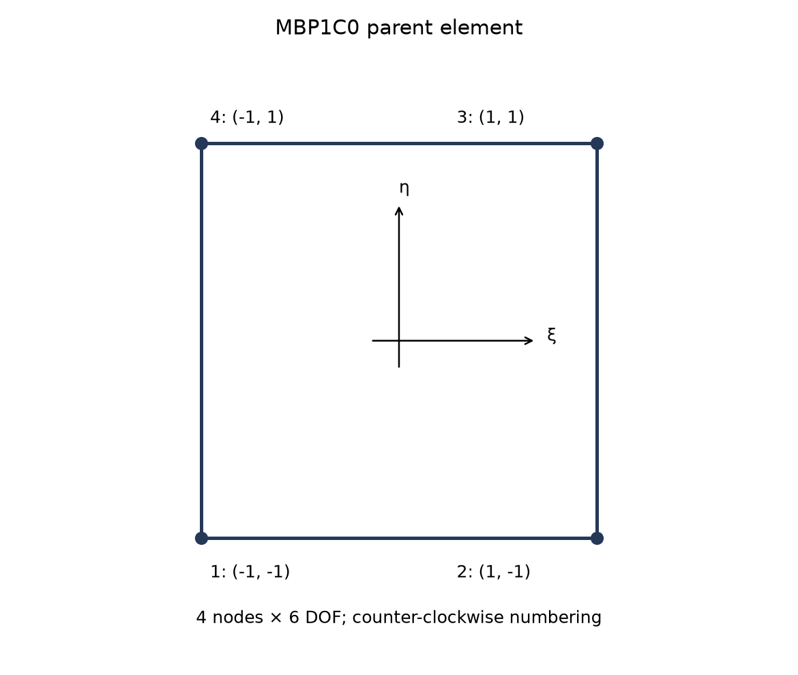
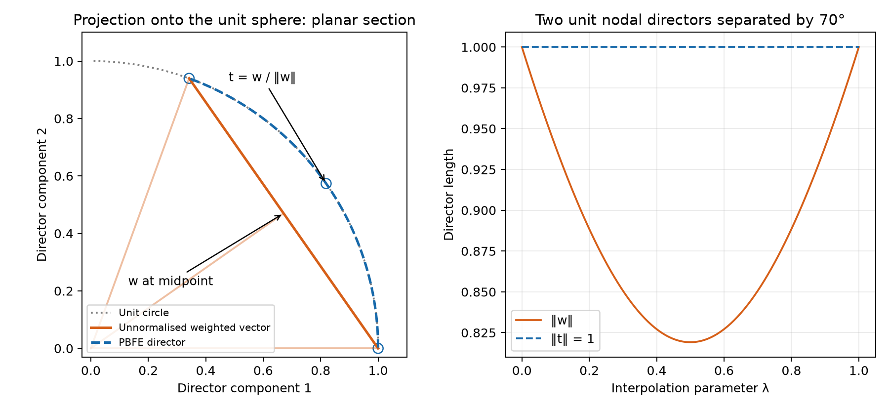
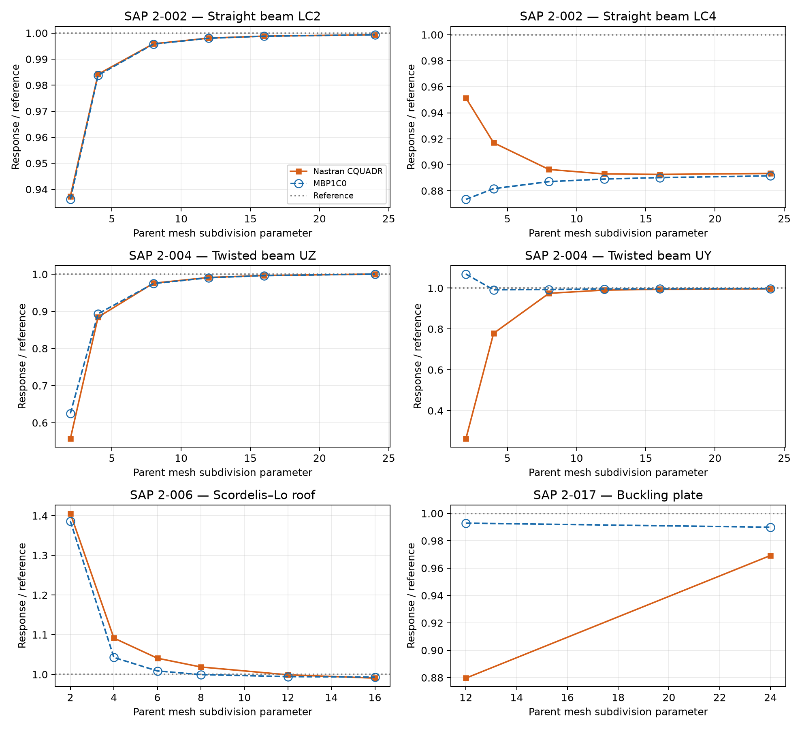

# MBP1C0 Shell: Projection-Based Director Interpolation, Enhanced Strains and Mystran Benchmark

**Ary — 26 October 2026**

## Abstract

MBP1C0 is a four-node bilinear shell combining projection-based finite element director interpolation, covariant membrane and bending measures, enhanced membrane strains, assumed natural transverse shear, and normal-rotation regularisation. The interpolated director is normalised within the element; its consistent first and spatial derivatives enter both bending and shear. Four internal membrane parameters are condensed without adding nodal unknowns. Selected static and linear-buckling responses are compared with Nastran CQUADR on six SAP benchmark cases. The results distinguish close element-to-element agreement from agreement with the independent problem reference.

## 1. Scope and formulation identity

The name refers to the Müller–Bischoff projection-based director construction at the lowest-order P1C0 setting [1]. For the quadrilateral considered here, the geometric basis is bilinear Q1 with inter-element $C^0$ continuity. The physical director has two independent tangent components. The assessed 24-component shell representation additionally carries normal rotation, whose regularisation is specified separately.

This report covers a small-strain, small-rotation isotropic assessment. Unit director interpolation is a geometric property; it does not by itself validate a full finite-rotation tangent, post-buckling path or nonlinear material model. The membrane EAS, ANS shear and drilling treatment described here are identified explicitly rather than attributed wholesale to the original geometrically nonlinear theory.

## 2. Step 1: geometry, directors and degrees of freedom

The bilinear reference surface is

$$
\boldsymbol\phi_0(\xi,\eta)=\sum_{I=1}^{4}N_I\mathbf{X}_I,\qquad N_I=\frac14(1+\xi_I\xi)(1+\eta_I\eta).
$$

Corner coordinates are $(-1,-1),(1,-1),(1,1),(-1,1)$ in counter-clockwise order. Define

$$
\mathbf{g}_\alpha=\boldsymbol\phi_{0,\alpha},\qquad a_{\alpha\beta}=\mathbf{g}_\alpha\cdot\mathbf{g}_\beta,\qquad \mathbf{g}^{\alpha}=a^{\alpha\beta}\mathbf{g}_\beta,\qquad J_s=\|\mathbf{g}_1\times\mathbf{g}_2\|.
$$

Here $a^{\alpha\beta}$ is the inverse surface metric. Each unit nodal director $\mathbf{n}_I$ is associated with a tangent plane. It may be defined by a consistent shell-normal field on a smooth surface; discontinuities at physical creases must be treated according to the intended shell geometry.

The assessed element carries

$$
\mathbf{d}_I=[u_I,v_I,w_I,\theta_{XI},\theta_{YI},\theta_{ZI}]^{\mathrm{T}},\qquad \mathbf{d}_e\in\mathbb{R}^{24}.
$$

A small global nodal rotation changes the unit director through $\delta\mathbf{n}_I=\boldsymbol\theta_I\times\mathbf{n}_I$. This increment is tangential because $\delta\mathbf{n}_I\cdot\mathbf{n}_I=0$. Rotation parallel to $\mathbf{n}_I$ leaves the physical director unchanged and is the drilling component.



*Figure 1. Corner numbering and oriented element sides. The geometry is bilinear and may be warped.*

## 3. Step 2: projection-based director interpolation

The normalisation and tangent operators below follow the projection-based director construction [1].

### 3.1 Normalised director

Form the compatible weighted vector and its length,

$$
\mathbf{w}=\sum_I N_I\mathbf{n}_I,\qquad r=\|\mathbf{w}\|,\qquad \mathbf{t}=\frac{\mathbf{w}}{r}.
$$

The construction requires $r>0$. For admissible nodal director fields it gives $\mathbf{t}\cdot\mathbf{t}=1$ at every evaluation point. Opposing nodal directors can make $r$ small or zero, so normalisation is not globally nonsingular for arbitrary director data.

For a constant nodal director, $\mathbf{w}=\mathbf{t}=\mathbf{n}$ and the spatial director gradient vanishes. For varying nodal directors, the normalised field generally differs from the unnormalised bilinear vector. A fixed rigid rotation commutes with this normalisation, which establishes the interpolation's rotational equivariance when $r>0$.



*Figure 2. Illustrative two-director section of the interpolation. The weighted vector lies on the chord, while normalisation projects it onto the unit circle. The right panel shows its length before and after projection. This is a geometric illustration, not benchmark data.*

### 3.2 First derivative and spatial derivative

The derivative of the normalisation map is

$$
\mathbf{P}=\frac{\mathbf{I}-\mathbf{t}\otimes\mathbf{t}}{r},\qquad \delta\mathbf{t}=\mathbf{P}\,\delta\mathbf{w},\qquad \mathbf{t}_{,\alpha}=\mathbf{P}\mathbf{w}_{,\alpha}.
$$

Here $\mathbf{I}-\mathbf{t}\otimes\mathbf{t}$ is an orthogonal tangent projector; $\mathbf{P}$ additionally includes the factor $1/r$ and is not generally an idempotent projector.

Let $\mathbf{Q}_\alpha=\mathbf{P}_{,\alpha}$. Differentiation gives

$$
\mathbf{Q}_\alpha=\frac{1}{r^2}\left[(\mathbf{t}\cdot\mathbf{w}_{,\alpha})(3\mathbf{t}\otimes\mathbf{t}-\mathbf{I})-\mathbf{w}_{,\alpha}\otimes\mathbf{t}-\mathbf{t}\otimes\mathbf{w}_{,\alpha}\right].
$$

Define the nodal derivative operators

$$
\mathbf{W}_{\alpha I}=N_I\mathbf{Q}_\alpha+N_{I,\alpha}\mathbf{P}.
$$

Then

$$
\delta\mathbf{t}=\sum_I N_I\mathbf{P}\,\delta\mathbf{n}_I,\qquad \delta\mathbf{t}_{,\alpha}=\sum_I\mathbf{W}_{\alpha I}\,\delta\mathbf{n}_I.
$$

These relations keep bending and shear consistent with the same normalised director. Replacing them with derivatives of the unnormalised nodal interpolation would define a different strain approximation.

## 4. Step 3: membrane, bending and PBFE shear measures

The covariant linear membrane tensor is

$$
\varepsilon_{\alpha\beta}=\frac12(\mathbf{u}_{,\alpha}\cdot\mathbf{g}_\beta+\mathbf{g}_\alpha\cdot\mathbf{u}_{,\beta}).
$$

For the symmetric curvature measure, retain the displacement and director-variation contributions:

$$
\delta\kappa_{\alpha\beta}=\frac12\left(\mathbf{u}_{,\alpha}\cdot\mathbf{t}_{,\beta}+\mathbf{u}_{,\beta}\cdot\mathbf{t}_{,\alpha}+\mathbf{g}_\alpha\cdot\delta\mathbf{t}_{,\beta}+\mathbf{g}_\beta\cdot\delta\mathbf{t}_{,\alpha}\right).
$$

The first two terms couple displacement gradients to the spatial variation of the normalised director. They vanish for a constant reference director. The last two terms use the $\mathbf{W}_{\alpha I}$ operators and the nodal tangent increments. This distinguishes displacement-induced curvature from rotation-induced curvature without omitting either on a curved or warped surface.

The linear transverse shear is

$$
\gamma_\alpha=\mathbf{u}_{,\alpha}\cdot\mathbf{t}+\mathbf{g}_\alpha\cdot\delta\mathbf{t}.
$$

For each node its rotational coefficient can be expressed as

$$
\mathbf{b}^{\mathrm{rot}}_{s,\alpha I}=N_I\left(\mathbf{n}_I\times\mathbf{P}\mathbf{g}_\alpha\right)^{\mathrm{T}}.
$$

This follows from $\delta\mathbf{n}_I=\boldsymbol\theta_I\times\mathbf{n}_I$ and the symmetry of $\mathbf{P}$. It explicitly includes the derivative of the PBFE normalisation.

Physical strain components are expressed relative to a fixed centroid frame using the dual surface basis. Define $p_a^{\alpha}=\mathbf{E}_a\cdot\mathbf{g}^{\alpha}$. The chosen projected components are

$$
\varepsilon_{ab}^{p}=p_a^{\alpha}\varepsilon_{\alpha\beta}p_b^{\beta},\qquad \kappa_{ab}^{p}=p_a^{\alpha}\delta\kappa_{\alpha\beta}p_b^{\beta},\qquad \gamma_a^p=p_a^{\alpha}\gamma_\alpha.
$$

Engineering shear uses twice the symmetric tensor off-diagonal component. On warped geometry the fixed centroid axes are reference axes rather than the local tangent plane everywhere.

## 5. Step 4: PBFE-projected ANS transverse shear

The edge-midpoint assumed-shear interpolation follows the classical four-node shell construction [4], evaluated with the PBFE director.

The edge-midpoint tying points are $A=(0,-1)$, $B=(1,0)$, $C=(0,1)$ and $D=(-1,0)$. Interpolation must recover its own tying-point values:

$$
\widehat\gamma_\xi(\xi,\eta)=\frac{1-\eta}{2}\gamma_\xi(A)+\frac{1+\eta}{2}\gamma_\xi(C),
$$

$$
\widehat\gamma_\eta(\xi,\eta)=\frac{1-\xi}{2}\gamma_\eta(D)+\frac{1+\xi}{2}\gamma_\eta(B).
$$

The raw shear samples use the normalised PBFE director and its projected variation at each tying point. The assumed covariant components are then mapped to the physical strain frame at the integration point. ANS interpolation changes the transverse-shear field; PBFE normalisation changes the underlying director and its derivatives. These are distinct operations.


*Figure 3. Four edge-midpoint shear samples and four interior Gauss points. All Gauss weights equal one.*

## 6. Step 5: enhanced membrane strain and condensation

For isotropic elasticity, let $\mathbf{C}_0$ denote the plane-stress matrix with normal coefficients $E/(1-\nu^2)$, Poisson coupling $\nu E/(1-\nu^2)$ and engineering-shear coefficient $G=E/[2(1+\nu)]$. The integrated matrices are

$$
\mathbf{D}_m=h\mathbf{C}_0,\qquad \mathbf{D}_b=\frac{h^3}{12}\mathbf{C}_0,\qquad \mathbf{D}_s=\frac56Gh\mathbf{I}_2.
$$

Four internal parameters enrich the membrane strain using the EAS framework [2,3]:

$$
\boldsymbol\varepsilon_m=\mathbf{B}_m\mathbf{d}_e+\mathbf{M}\boldsymbol\alpha,\qquad \boldsymbol\alpha\in\mathbb{R}^{4}.
$$

The natural-coordinate enhanced operator has columns $(\xi,0,0)^{\mathrm{T}}$, $(0,\eta,0)^{\mathrm{T}}$, $(0,0,\xi)^{\mathrm{T}}$ and $(0,0,\eta)^{\mathrm{T}}$. With centroid strain transformation $\mathbf{T}_0$ and the corresponding planar mapping determinant $j_p$,

$$
\mathbf{M}(\xi,\eta)=\frac{j_p(0,0)}{j_p(\xi,\eta)}\mathbf{T}_0\widehat{\mathbf{M}}(\xi,\eta).
$$

On regular planar mappings, determinant-ratio scaling supports zero-mean enhanced modes. It does not by itself prove every warped-surface patch property. Define

$$
\mathbf{K}_{u\alpha}=\int_A\mathbf{B}_m^{\mathrm{T}}\mathbf{D}_m\mathbf{M}\,\mathrm{d}A,
$$

$$
\mathbf{K}_{\alpha\alpha}=\int_A\mathbf{M}^{\mathrm{T}}\mathbf{D}_m\mathbf{M}\,\mathrm{d}A.
$$

After internal equilibrium,

$$
\boldsymbol\alpha=-\mathbf{K}_{\alpha\alpha}^{-1}\mathbf{K}_{\alpha u}\mathbf{d}_e,\qquad \mathbf{K}_{\mathrm{cond}}=\mathbf{K}_{uu}-\mathbf{K}_{u\alpha}\mathbf{K}_{\alpha\alpha}^{-1}\mathbf{K}_{\alpha u}.
$$

The total compatible stiffness includes membrane, bending and ANS shear. The EAS correction affects the membrane field; drilling is added as described separately below. Thickness factors are already contained in the integrated constitutive matrices.

## 7. Step 6: normal-rotation regularisation

The assessed six-component representation uses a Hughes–Brezzi-type rotation–spin penalty [5], separate from the physical two-component director kinematics.

The membrane continuum spin and interpolated normal rotation are

$$
\omega=\frac12(v_{,x}-u_{,y}),\qquad \theta_d=\sum_I N_I(\boldsymbol\theta_I\cdot\mathbf{n}_I),\qquad \gamma_d=\omega-\theta_d.
$$

The rotational projection uses each node's director. A corresponding per-node operator in global translation and rotation components is

$$
\mathbf{b}_{d,I}=\left[\frac12(N_{I,x}\mathbf{e}_2-N_{I,y}\mathbf{e}_1)^{\mathrm{T}},-N_I\mathbf{n}_I^{\mathrm{T}}\right].
$$

With $\beta_d=10^{-4}$ for the assessed isotropic setting,

$$
\Pi_d=\frac12\int_A\beta_dGh\gamma_d^2\,\mathrm{d}A,\qquad \mathbf{K}_d=\int_A\mathbf{B}_d^{\mathrm{T}}\beta_dGh\mathbf{B}_d\,\mathrm{d}A.
$$

For planar rigid spin, continuum spin and normal rotation coincide and the drilling energy vanishes. On a general warped element the full projected operator must be checked against physical rigid motions. A positive coefficient supplies a positive-semidefinite drilling term; it does not alone prove rank sufficiency or that arbitrary penalty magnitudes leave every physical response unchanged.

### 7.1 Stability and parameter interpretation

The drilling scale $\beta_d=10^{-4}$ is part of the assessed formulation. A smaller penalty does not automatically improve accuracy, and a positive penalty does not prove the absence of all spurious modes. For a nondegenerate unconstrained 24-component shell, the desired nullspace contains six physical rigid-body motions and no additional mechanisms. Rank, rigid-motion energy and conditioning require separate checks.

Likewise, the negative-semidefinite EAS condensation correction relaxes compatible membrane stiffness when the internal block is positive definite. It does not, by itself, guarantee that the complete condensed shell has positive deformational energy on every distorted mesh.

## 8. Step 7: total energy and numerical integration

The common isotropic energy is

$$
\Pi_e=\frac12\int_A\left(\boldsymbol\varepsilon_m^{\mathrm{T}}\mathbf{D}_m\boldsymbol\varepsilon_m+\boldsymbol\kappa^{\mathrm{T}}\mathbf{D}_b\boldsymbol\kappa+\widehat{\boldsymbol\gamma}^{\mathrm{T}}\mathbf{D}_s\widehat{\boldsymbol\gamma}+\beta_dGh\gamma_d^2\right)\,\mathrm{d}A-\mathbf{d}_e^{\mathrm{T}}\mathbf{f}_e.
$$

Membrane, bending, shear, drilling and EAS blocks use $2\times2$ Gauss integration at $\xi,\eta=\pm1/\sqrt3$, with unit weights and $\mathrm{d}A=J_s\,\mathrm{d}\xi\,\mathrm{d}\eta$. ANS tying points define the shear field; they are not the stiffness integration points.

The four natural enhanced modes are illustrated below. A unit value of one internal parameter activates one natural-coordinate mode before physical transformation and determinant-ratio scaling.


*Figure 4. Natural-coordinate EAS4 mode amplitudes. The physical modes additionally contain the centroid strain transformation and mapping correction. These panels describe strain fields, not additional nodes or displacement modes.*

### 8.1 Relationship to Q4EASANS and Simo 1993 Q4

| Ingredient | MBP1C0 | Q4EASANS / Simo 1993 Q4 |
|---|---|---|
| Reference director inside element | Normalised bilinear vector $\mathbf{w}/\|\mathbf{w}\|$ | Compatible bilinear director interpolation in the assessed descriptions |
| Director variation | Contains $\mathbf{P}$ | Compatible interpolated nodal variation |
| Director-gradient variation | Contains $\mathbf{Q}_\alpha$ and $\mathbf{W}_{\alpha I}$ | Compatible nodal director-gradient terms |
| Membrane enhancement | EAS4 | EAS4 |
| Transverse shear | Four-point ANS with PBFE-projected samples | Four-point ANS with compatible samples |
| Assessed drilling scale | $10^{-4}$ | $10^{-4}$ for Q4EASANS; $0.02$ for Simo 1993 Q4 |

Normalisation becomes inactive for identical nodal directors. The overlap of several flat-case results is therefore consistent with the shared membrane, EAS and ANS ingredients. Curved-case differences do not by themselves isolate PBFE as the sole cause: the reference director field and the rest of the mathematical model must also be controlled.

Related reports: [Q4EASANS](Q4EASANS_Formulation.md) and [Simo 1993 Q4](Simo1993_Q4_Formulation.md).

## 9. Mystran Benchmark: MBP1C0 versus Nastran CQUADR

The benchmark cases follow the SAP verification definitions [6]. Results are matched by benchmark case, load case, response component and unit. Accuracy is assessed separately for each solver against its independent reference.

For each matched physical response, the two accuracy measures use the independent reference for that case, load, component and unit:

```math
\mathrm{Nastran\_error}=100\frac{|q_{\mathrm{Nastran}}-q_{\mathrm{ref,Nastran}}|}{|q_{\mathrm{ref,Nastran}}|},
\qquad
\mathrm{Mystran\_error}=100\frac{|q_{\mathrm{Mystran}}-q_{\mathrm{ref,Mystran}}|}{|q_{\mathrm{ref,Mystran}}|}.
```

For matched responses with the same physical reference, $q_{\mathrm{ref,Nastran}}=q_{\mathrm{ref,Mystran}}=q_{\mathrm{ref}}$ as listed in the table. Both errors are nonnegative percentages. Nastran is not the error denominator. For a zero reference, report the absolute residual in the response unit; if no independent reference is available, report the percentage error as unavailable. Reference-normalized response plots retain unity as the target. The reported solver responses and existing meshes are unchanged.


The independent reference used in the plots is distinct from the Nastran comparison. Close agreement with CQUADR and closeness to the reference are separate observations.



*Figure 5. Normalised static displacement and buckling responses. Open blue circles and dashed lines identify MBP1C0, including where curves overlap. Beam abscissae are longitudinal subdivisions; roof abscissae are equal subdivisions in both directions; buckling uses the longitudinal counts of the 2 × 12 and 4 × 24 meshes.*

### 9.1 Selected numerical responses

The beam cases use longitudinal subdivision count 24, the roof uses 16 × 16 parent panels, and the buckling plate uses 4 × 24 parent panels. The curved beam and thick-plate cases use their benchmark meshes. Units are specified per row.

| SAP case | LC / model | Response | Unit | MBP1C0 | Nastran CQUADR | Reference | Nastran_error (%) | Mystran_error (%) |
| --- | --- | --- | --- | --- | --- | --- | --- | --- |
| 2-002 | 1 | tip UX | in | 3e-05 | 3.438168e-05 | 3e-05 | 14.6056 | 0.0000 |
| 2-002 | 2 | tip UZ | in | 0.1080296 | 0.1080311 | 0.1081 | 0.0637 | 0.0651 |
| 2-002 | 3 | tip UY | in | 0.431884 | 0.432016 | 0.4321 | 0.0194 | 0.0500 |
| 2-002 | 4 | tip abs UY | in | 0.003040183 | 0.003046425 | 0.00341 | 10.6620 | 10.8451 |
| 2-002 | 5 | tip abs UX | in | 0.0008999868 | 0.0009 | 0.0009 | 0.0000 | 0.0015 |
| 2-002 | 6 | tip RZ | rad | 0.036 | 0.036 | 0.036 | 0.0000 | 0.0000 |
| 2-003 | 1 | tip UY | in | 0.08851299 | 0.08892159 | 0.0886 | 0.3630 | 0.0982 |
| 2-003 | 2 | tip UZ | in | 0.49073815 | 0.4942291 | 0.5004 | 1.2332 | 1.9308 |
| 2-004 | 1 | tip UZ | in | 0.0017496633 | 0.001749793 | 0.001749 | 0.0453 | 0.0379 |
| 2-004 | 2 | tip UY | in | 0.0054160927 | 0.005407034 | 0.005429 | 0.4046 | 0.2377 |
| 2-006 | 1 | free edge midpoint UZ | ft | -0.3064674 | -0.3056915 | -0.3086 | 0.9425 | 0.6911 |
| 2-012 | A | outer edge mean UZ | in | -0.0053422448 | -0.0053445732 | -0.00534 | 0.0856 | 0.0420 |
| 2-012 | B | outer edge mean UZ | in | -0.005217023 | -0.0052193496 | -0.00521 | 0.1795 | 0.1348 |
| 2-017 | 2 | critical load | kip | 126.6229 | 123.9762 | 127.91 | 3.0754 | 1.0063 |

### 9.2 Interpretation of selected cases


The twisted-beam responses are close to the independent references and to CQUADR at the selected refinement. Straight-beam LC2 and LC5 also show close agreement with CQUADR. LC4 is close to CQUADR but both remain below the independent displacement reference in the plotted sequence, illustrating why inter-element agreement is not an exactness test. The axial LC1 difference is retained explicitly in the table rather than hidden by the bending comparisons.

The roof response changes with refinement and its magnitude is slightly higher than CQUADR at the selected mesh. The two buckling levels do not establish a limiting critical load, and the selected difference cannot be interpreted as proof that either element gives the exact eigenvalue. The thick-plate results supply additional checks of transverse-shear-sensitive response but do not cover every thickness ratio or distortion regime.

## 10. Conclusions

1. MBP1C0 uses a normalised projection-based director within a bilinear Q4 geometry. The interpolation remains on the unit sphere when its weighted vector is nonzero.
2. Both bending and shear must contain the derivative of normalisation. The curvature variation includes displacement–director-gradient coupling and the complete projected director-gradient variation.
3. EAS4 membrane enrichment and four-point ANS shear supplement the director construction. Their functions are distinct from the drilling regularisation of the 24-component representation.
4. The selected Nastran CQUADR comparisons show close agreement in several bending, twisted-beam and thick-plate responses, together with case-dependent axial, roof and buckling differences.
5. These linear results do not establish complete nonlinear PBFE behavior, universal rank sufficiency or a best-element ranking.

## 11. References

[1] Müller, A., & Bischoff, M. (2022). A consistent finite element formulation of the geometrically non-linear Reissner–Mindlin shell model. *Archives of Computational Methods in Engineering*, 29, 3387–3434. [Publisher article](https://link.springer.com/article/10.1007/s11831-021-09702-7).

[2] Simo, J.C., & Rifai, M.S. (1990). A class of mixed assumed strain methods and the method of incompatible modes. *International Journal for Numerical Methods in Engineering*, 29, 1595–1638.

[3] Andelfinger, U., & Ramm, E. (1993). EAS-elements for two-dimensional, three-dimensional, plate and shell structures and their equivalence to HR-elements. *International Journal for Numerical Methods in Engineering*, 36, 1311–1337.

[4] Dvorkin, E.N., & Bathe, K.-J. (1984). A continuum mechanics based four-node shell element for general nonlinear analysis. *Engineering Computations*, 1, 77–88.

[5] Hughes, T.J.R., & Brezzi, F. (1989). On drilling degrees of freedom. *Computer Methods in Applied Mechanics and Engineering*, 72, 105–121.

[6] Computers & Structures, Inc. *SAP2000 Verification Examples*, Problems 2-002, 2-003, 2-004, 2-006, 2-012 and 2-017.
