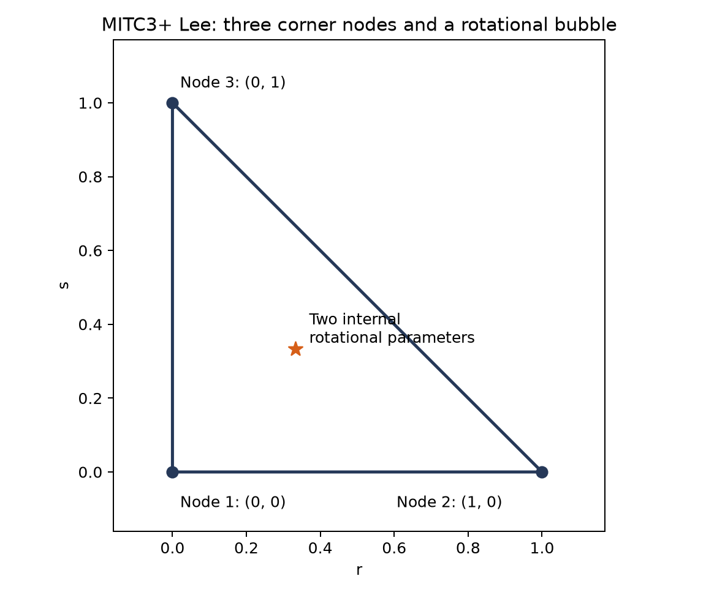
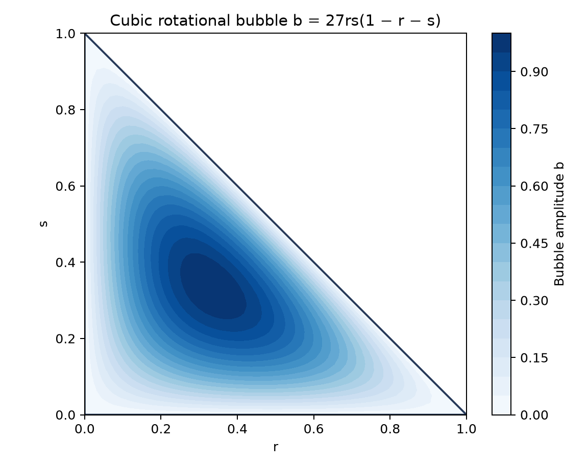
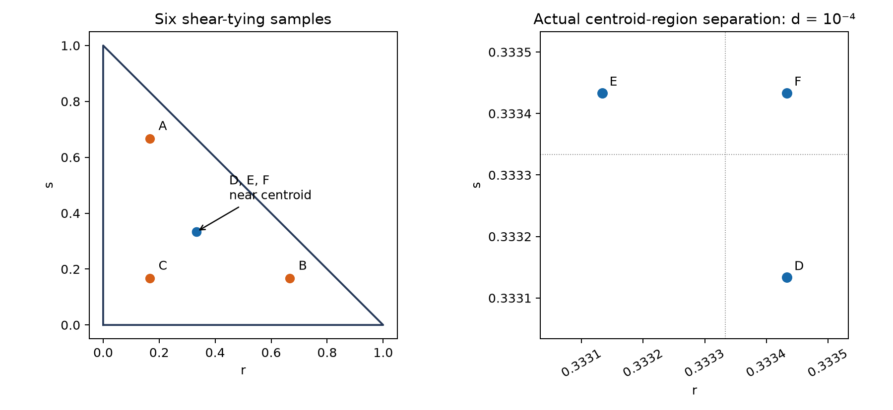
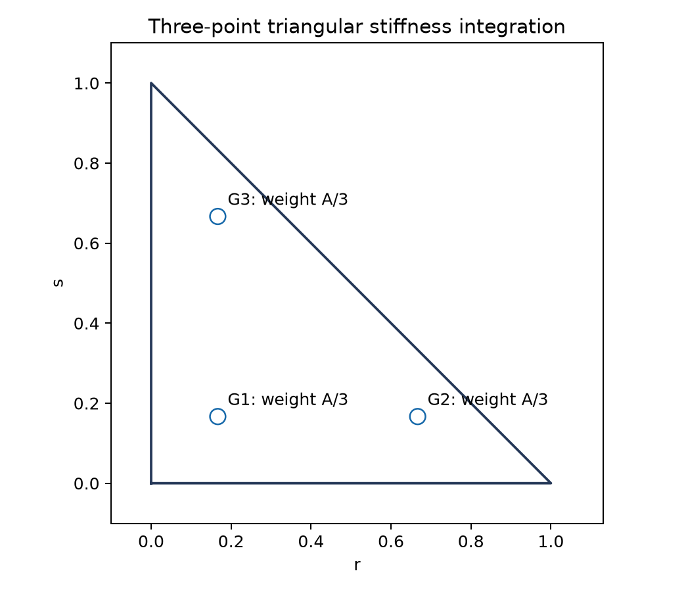
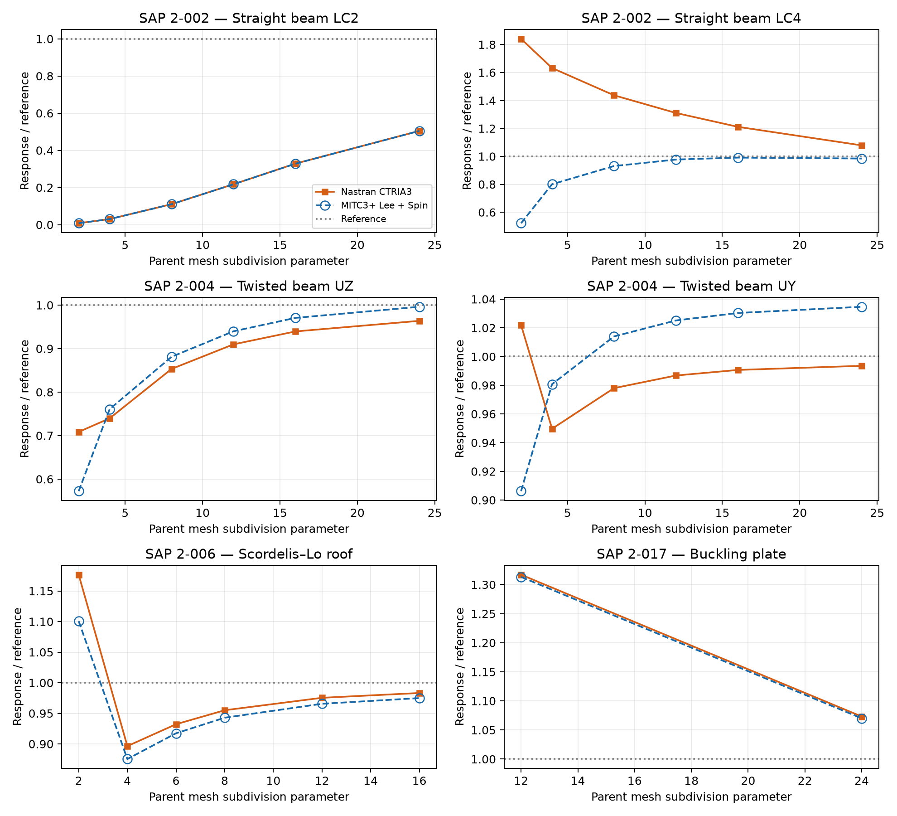

# MITC3+ Lee Shell: Interior Shear Tying, Condensed Rotational Bubbles and Mystran Benchmark

**Ary — 26 October 2026**

## Abstract

The assessed MITC3+ Lee shell combines a three-node constant-strain membrane, two internal rotational bubble parameters, six interior shear-tying samples, and a consistent-spin drilling penalty. Static condensation removes the internal parameters, leaving 18 nodal degrees of freedom. This report presents the mathematical construction and compares selected static and linear-buckling responses with Nastran CTRIA3. It also distinguishes pointwise shear reproduction, a prescribed-displacement shear diagnostic, and a force-equilibrated patch assessment. The selected Lee-style model is not identified as a complete reproduction of all continuum-shell features of the published MITC3+ element.

## 1. Scope and attribution

Lee, Lee and Bathe [1] introduced the rotational-bubble enrichment and assumed transverse-shear field associated with MITC3+. The model assessed here uses the Lee-style six-interior-point shear reconstruction with a constant-strain triangular membrane and an independently selected rotation–spin penalty. The tying distance is $d=10^{-4}$ and the spin coefficient is $\alpha_s=0.01$.

Seven-point integration, suppression of the shear bubble, a mean-free shear-bubble projection, and the separate KMITC3+ membrane/curvature family are different mathematical choices. They are not substituted into the results below. The main purpose is a clear formulation-level assessment of the selected Lee interior-tying model.

## 2. Step 1: triangle geometry and nodal variables

For the right-handed facet frame,

$$
\mathbf{e}_x=\frac{\mathbf{X}_2-\mathbf{X}_1}{\|\mathbf{X}_2-\mathbf{X}_1\|},\qquad \mathbf{e}_z=\frac{(\mathbf{X}_2-\mathbf{X}_1)\times(\mathbf{X}_3-\mathbf{X}_1)}{2A},\qquad \mathbf{e}_y=\mathbf{e}_z\times\mathbf{e}_x.
$$

The area is positive for the chosen local orientation. With $N_1=1-r-s$, $N_2=r$, $N_3=s$, define the geometric mapping $\mathbf{x}(r,s)=\sum_iN_i\mathbf{x}_i$ and

$$
\mathbf{J}=\frac{\partial(x,y)}{\partial(r,s)},\qquad \det\mathbf{J}=2A,\qquad \nabla_{x,y}N_i=\mathbf{J}^{-\mathrm{T}}\nabla_{r,s}N_i.
$$

Each corner carries

$$
\mathbf{d}_i=[u_i,v_i,w_i,\theta_{xi},\theta_{yi},\theta_{zi}]^{\mathrm{T}},\qquad \mathbf{d}_c\in\mathbb{R}^{18}.
$$

Two internal rotations $\mathbf{d}_b=[\beta_{x4},\beta_{y4}]^{\mathrm{T}}$ give a 20-component uncondensed vector. They are element-internal parameters rather than a fourth connectivity node.



*Figure 1. Corner nodes and centroid bubble parameters. Only the three corners contribute global nodal unknowns.*

## 3. Step 2: membrane and enriched rotational kinematics

The translations are linear: $u=\sum_iN_i u_i$, $v=\sum_iN_i v_i$, and $w=\sum_iN_i w_i$. The membrane strain is the constant-strain-triangle field,

$$
\boldsymbol\varepsilon_m=[u_{,x},v_{,y},u_{,y}+v_{,x}]^{\mathrm{T}}=\mathbf{B}_m\mathbf{d}_{20}.
$$

It is not changed by interior shear tying. In particular, an improved shear field does not automatically cure membrane-bending deficiencies.

The cubic rotational bubble and its derivatives are [1]

$$
b=27rs(1-r-s),\qquad b_{,r}=27s(1-2r-s),\qquad b_{,s}=27r(1-r-2s).
$$

The selected relative-bubble representation is

$$
\theta_x=\sum_iN_i\theta_{xi}+b\beta_{x4},\qquad \theta_y=\sum_iN_i\theta_{yi}+b\beta_{y4}.
$$

The alternative basis $f_i=N_i-b/3$ with a physical internal rotation is related by $\boldsymbol\beta_4=\boldsymbol\theta_4-\frac13\sum_i\boldsymbol\theta_i$. Consistent coordinate transformation gives the same interpolation space; it is not evidence that every other shell ingredient is identical.

Using right-hand-rule rotations,

$$
\boldsymbol\kappa=[\theta_{y,x},-\theta_{x,y},\theta_{y,y}-\theta_{x,x}]^{\mathrm{T}}=\mathbf{B}_b(r,s)\mathbf{d}_{20}.
$$

The bubble gradients use the full physical Jacobian. They must not be treated as unchanged natural derivatives on skew triangles.



*Figure 2. Bubble amplitude vanishes on all edges and equals one at the centroid. Rotational enrichment introduces curvature and shear contributions, not a transverse-displacement bubble.*

## 4. Step 3: six-point interior assumed shear

### 4.1 Engineering shear and natural components

The compatible facet shear is

$$
\gamma_x=w_{,x}+\theta_y,\qquad \gamma_y=w_{,y}-\theta_x.
$$

Its natural components are $[e_r,e_s]^{\mathrm{T}}=\mathbf{J}^{\mathrm{T}}[\gamma_x,\gamma_y]^{\mathrm{T}}$. This report consistently uses engineering shear; a tensorial half-shear convention would require the matching constitutive conversion.

### 4.2 Tying locations

Evaluate the full corner-plus-bubble field at six interior points [1]:

| Point | r | s |
|---|---|---|
| A | $1/6$ | $2/3$ |
| B | $2/3$ | $1/6$ |
| C | $1/6$ | $1/6$ |
| D | $1/3+d$ | $1/3-2d$ |
| E | $1/3-2d$ | $1/3+d$ |
| F | $1/3+d$ | $1/3+d$ |

Here $d=10^{-4}$. The six samples include the internal rotational bubble. Adding a separate shear-bubble term after tying would change this construction.



*Figure 3. Interior points A–F. The right panel resolves the actual small separation of D–F; the tying distance is not replaced by the displayed zoom scale.*

### 4.3 Constant and linear shear reconstruction

Define the constant natural components

$$
\widehat e_r^{0}=\frac{2e_r(B)-e_s(B)+e_r(C)+e_s(C)}{3},
$$

$$
\widehat e_s^{0}=\frac{2e_s(A)-e_r(A)+e_r(C)+e_s(C)}{3}.
$$

The interior difference supplies a linear/twisting contribution,

$$
\widehat c=[e_r(F)-e_r(D)]-[e_s(F)-e_s(E)].
$$

The selected assumed field is

$$
\widehat e_r(r,s)=\widehat e_r^{0}+\frac{\widehat c}{3}(3s-1),\qquad \widehat e_s(r,s)=\widehat e_s^{0}+\frac{\widehat c}{3}(1-3r).
$$

Return to physical engineering shear through

$$
\widehat{\boldsymbol\gamma}=\mathbf{J}^{-\mathrm{T}}[\widehat e_r,\widehat e_s]^{\mathrm{T}}=\mathbf{B}_s(r,s)\mathbf{d}_{20}.
$$

A uniform compatible shear with zero bubble parameters is reproduced by this reconstruction. That pointwise identity is different from the response after the internal rotations equilibrate.

## 5. Step 4: constitutive energy and consistent-spin drilling

For isotropic plane stress, let $\mathbf{C}_0$ be the plane-stress elasticity matrix and $G=E/[2(1+\nu)]$. The thickness-integrated rigidities are

$$
\mathbf{D}_m=h\mathbf{C}_0,\qquad \mathbf{D}_b=\frac{h^3}{12}\mathbf{C}_0,\qquad \mathbf{D}_s=\frac56Gh\mathbf{I}_2.
$$

The selected consistent-spin residual is of Hughes–Brezzi type [2]:

$$
\omega_z=\frac12(v_{,x}-u_{,y}),\qquad \theta_z=\sum_iN_i\theta_{zi},\qquad \psi=\omega_z-\theta_z.
$$

With $\alpha_s=0.01$, its quadratic energy is

$$
\Pi_{\mathrm{spin}}=\frac12\alpha_sGh\int_A\psi^2\,\mathrm{d}A.
$$

The coefficient is part of the assessed model, not a universal calibration prescribed by Lee et al. Its nodal row is

$$
\mathbf{b}_{\mathrm{spin},i}=[-N_{i,y}/2,N_{i,x}/2,0,0,0,-N_i].
$$

A planar rigid spin $u=-\Omega y$, $v=\Omega x$, $\theta_z=\Omega$ gives $\psi=0$. This establishes the constraint's planar rigid-spin consistency; complete element rank is assessed separately.

## 6. Step 5: quadrature, condensation and recovery

The three stiffness points are $(1/6,1/6)$, $(2/3,1/6)$ and $(1/6,2/3)$, each with physical-area weight $A/3$. Although they coincide geometrically with A–C, quadrature and shear tying have distinct mathematical roles.

$$
\mathbf{K}_{20}=\sum_{g=1}^{3}\frac{A}{3}\left(\mathbf{B}_m^{\mathrm{T}}\mathbf{D}_m\mathbf{B}_m+\mathbf{B}_b(G_g)^{\mathrm{T}}\mathbf{D}_b\mathbf{B}_b(G_g)+\mathbf{B}_s(G_g)^{\mathrm{T}}\mathbf{D}_s\mathbf{B}_s(G_g)\right)+\mathbf{K}_{\mathrm{spin}}.
$$

This is the assessed discrete quadrature. The bubble-gradient bending products need not be integrated exactly by a degree-two three-point rule. A seven-point replacement changes the element and cannot be assumed to improve every response [3].



*Figure 4. Three numerical integration points. The area factor is included once, through the weights A/3.*

Partition corner and bubble components. Their equilibrium equations are

$$
\mathbf{K}_{cc}\mathbf{d}_c+\mathbf{K}_{cb}\mathbf{d}_b=\mathbf{f}_c,\qquad \mathbf{K}_{bc}\mathbf{d}_c+\mathbf{K}_{bb}\mathbf{d}_b=\mathbf{f}_b.
$$

For an invertible internal block,

$$
\mathbf{K}_{18}=\mathbf{K}_{cc}-\mathbf{K}_{cb}\mathbf{K}_{bb}^{-1}\mathbf{K}_{bc},\qquad \bar{\mathbf{f}}_c=\mathbf{f}_c-\mathbf{K}_{cb}\mathbf{K}_{bb}^{-1}\mathbf{f}_b.
$$

The recovered internal rotations are

$$
\mathbf{d}_b=\mathbf{K}_{bb}^{-1}(\mathbf{f}_b-\mathbf{K}_{bc}\mathbf{d}_c).
$$

Curvature and shear recovery use the reconstructed 20-component field. Discarding the bubble columns after condensation would not recover the condensed element's internal strains. Nonzero distributed internal couples must also enter load condensation; assuming $\mathbf{f}_b=0$ in that case changes the problem.

## 7. Consistency evidence and separate research alternatives

### 7.1 Three distinct shear checks

The supplied force-equilibrium and quadrature assessments [3] distinguish:

| Check | Reported result | Meaning |
|---|---|---|
| Uniform compatible shear, bubble parameters fixed to zero | Constant field reproduced | Pointwise reconstruction identity |
| Constrained-displacement shear diagnostic | Interior displacement/reference $\approx1.134082$ | Non-unit equilibrated bubble response in that diagnostic |
| Manufactured shear field, balancing couples and the same three-point load rule | Regular and distorted ratios $1.000000$ | Consistency for that discrete load/quadrature pairing |
| Manufactured shear field with exact cubic bubble-load integral | Distorted ratio $\approx4.724014$ | Significant sensitivity to the changed load integration |

For $b=27rs(1-r-s)$, the exact integral is $\int_A b\,\mathrm{d}A=0.45A$, while the three-point rule gives $0.50A$. A load convention must therefore be stated when interpreting the internal bubble's equilibrium. The discrete manufactured-field result does not establish an exact traction/moment patch test for all loading and quadrature choices, nor does the non-unit displacement diagnostic alone prove failure of the published MITC3+ element.

### 7.2 Alternatives retained separately

| Alternative | Change from the assessed model | Assessment |
|---|---|---|
| Bubble-free shear control | Suppresses bubble shear while retaining curvature enrichment | Different shear field |
| Mean-free bubble shear | Subtracts the centroid bubble-shear contribution | Restores one displacement diagnostic but loses gains in other cases |
| Seven-point integration | Changes bending/shear quadrature | Sensitivity study, not an automatic upgrade |
| KMITC3+ Nguyen family | Changes membrane and composite-curvature treatment | Separate formulation and numerical assessment |

These alternatives are not blended into the benchmark rows. See the [separate KMITC3+ report](KMITC3Plus_Nguyen2024_Formulation.md) for that family.

## 8. Mystran Benchmark: MITC3+ Lee versus Nastran CTRIA3

The selected SAP verification cases [4] are paired by response component, case, load case, mesh sequence and unit. Accuracy is assessed separately for each solver against its independent reference.

For each matched physical response, the two accuracy measures use the independent reference for that case, load, component and unit:

```math
\mathrm{Nastran\_error}=100\frac{|q_{\mathrm{Nastran}}-q_{\mathrm{ref,Nastran}}|}{|q_{\mathrm{ref,Nastran}}|},
\qquad
\mathrm{Mystran\_error}=100\frac{|q_{\mathrm{Mystran}}-q_{\mathrm{ref,Mystran}}|}{|q_{\mathrm{ref,Mystran}}|}.
```

For matched responses with the same physical reference, $q_{\mathrm{ref,Nastran}}=q_{\mathrm{ref,Mystran}}=q_{\mathrm{ref}}$ as listed in the table. Both errors are nonnegative percentages. Nastran is not the error denominator. For a zero reference, report the absolute residual in the response unit; if no independent reference is available, report the percentage error as unavailable. Reference-normalized response plots retain unity as the target. The reported solver responses and existing meshes are unchanged.


The independent reference in the plots is distinct from the Nastran comparison. Close agreement between two elements is not a proof that either gives the reference solution.



*Figure 5. Normalised static and selected buckling responses. Beam abscissae use longitudinal subdivisions; the roof uses equal subdivisions in both directions; buckling uses the longitudinal counts of 2 × 12 and 4 × 24 parent meshes. Dashed blue curves with open circles identify the Lee-style plus consistent-spin model.*

### 8.1 Selected numerical results

The beams use longitudinal subdivision count 24, the roof uses 16 × 16 parent panels, and the buckling plate uses 4 × 24 panels. The curved beam and thick plates use their benchmark meshes. Units are stated per row.

| SAP case | LC / model | Response | Unit | MITC3+ Lee + Spin | Nastran CTRIA3 | Reference | Nastran_error (%) | Mystran_error (%) |
| --- | --- | --- | --- | --- | --- | --- | --- | --- |
| 2-002 | 1 | tip UX | in | 3e-05 | 3e-05 | 3e-05 | 0.0000 | 0.0000 |
| 2-002 | 2 | tip UZ | in | 0.05452335 | 0.05456462 | 0.1081 | 49.5239 | 49.5621 |
| 2-002 | 3 | tip UY | in | 0.4321014 | 0.4321559 | 0.4321 | 0.0129 | 0.0003 |
| 2-002 | 4 | tip abs UY | in | 0.003356999 | 0.003678172 | 0.00341 | 7.8643 | 1.5543 |
| 2-002 | 5 | tip abs UX | in | 0.0004539053 | 0.0004542509 | 0.0009 | 49.5277 | 49.5661 |
| 2-002 | 6 | tip RZ | rad | 0.036 | 0.036 | 0.036 | 0.0000 | 0.0000 |
| 2-003 | 1 | tip UY | in | 0.080824855 | 0.080835205 | 0.0886 | 8.7639 | 8.7756 |
| 2-003 | 2 | tip UZ | in | 0.4937396 | 0.4948982 | 0.5004 | 1.0995 | 1.3310 |
| 2-004 | 1 | tip UZ | in | 0.0017421893 | 0.0016856563 | 0.001749 | 3.6217 | 0.3894 |
| 2-004 | 2 | tip UY | in | 0.0056171453 | 0.0053938653 | 0.005429 | 0.6472 | 3.4656 |
| 2-006 | 1 | free edge midpoint UZ | ft | -0.3008579 | -0.3034232 | -0.3086 | 1.6775 | 2.5088 |
| 2-012 | A | outer edge mean UZ | in | -0.0053358049 | -0.0053357017 | -0.00534 | 0.0805 | 0.0786 |
| 2-012 | B | outer edge mean UZ | in | -0.0052078568 | -0.0052071391 | -0.00521 | 0.0549 | 0.0411 |
| 2-017 | 2 | critical load | kip | 136.864 | 137.259 | 127.91 | 7.3090 | 7.0002 |

### 8.2 Interpretation

- **2-002, 2, tip UZ:** reference 0.1081 in; Nastran_error=49.5239%; MITC3+ Lee + Spin Mystran_error=49.5621%.
- **2-002, 4, tip abs UY:** reference 0.00341 in; Nastran_error=7.8643%; MITC3+ Lee + Spin Mystran_error=1.5543%.
- **2-002, 5, tip abs UX:** reference 0.0009 in; Nastran_error=49.5277%; MITC3+ Lee + Spin Mystran_error=49.5661%.
- **2-004, 1, tip UZ:** reference 0.001749 in; Nastran_error=3.6217%; MITC3+ Lee + Spin Mystran_error=0.3894%.
- **2-004, 2, tip UY:** reference 0.005429 in; Nastran_error=0.6472%; MITC3+ Lee + Spin Mystran_error=3.4656%.
- **2-006, 1, free edge midpoint UZ:** reference -0.3086 ft; Nastran_error=1.6775%; MITC3+ Lee + Spin Mystran_error=2.5088%.
- **2-017, 2, critical load:** reference 127.91 kip; Nastran_error=7.3090%; MITC3+ Lee + Spin Mystran_error=7.0002%.


The CST membrane remains relevant to the straight-beam LC2/LC5 under-response relative to the independent reference, even where a comparison displacement happens to be close to CTRIA3. LC4 torsion benefits from the enriched shear/bubble field but is not equivalent to the membrane-bending cases.

The two twisted-beam directions behave differently and should not be assigned a single accuracy label. Roof convergence and the selected buckling load remain separate checks. Only two buckling mesh levels are shown, so a limiting critical load or agreement of a complete higher-mode spectrum is not established.

## 9. Conclusions

1. The selected model combines Lee-style six-point interior shear tying, a CST membrane, two rotational bubble parameters and an independently stated consistent-spin penalty.
2. The bubble contributes to bending and to the sampled shear. Condensation removes its global unknowns but does not remove its contribution to internal strain recovery.
3. Pointwise shear reproduction, constrained-displacement diagnostics and equilibrated traction/couple patches are different tests. The supplied quadrature-sensitive shear evidence remains qualified explicitly.
4. The Nastran CTRIA3 comparisons retain the distinct membrane, torsion, curved-shell and buckling behavior rather than claim universal superiority.
5. Seven-point, mean-free-bubble and KMITC3+ alternatives require separate assessments; their results are not relabelled as the selected Lee model.

## 10. References

[1] Lee, Y., Lee, P.-S., & Bathe, K.-J. (2014). The MITC3+ shell element and its performance. *Computers & Structures*, 138, 12–23. [Publisher article](https://www.sciencedirect.com/science/article/pii/S0045794914000595).

[2] Hughes, T.J.R., & Brezzi, F. (1989). On drilling degrees of freedom. *Computer Methods in Applied Mechanics and Engineering*, 72, 105–121.

[3] Ary (2026). MITC3+ shear-force/equilibrium assessment, interior-tying quadrature study, and mean-free bubble trade-off assessment. Technical assessment notes, 24–25 October 2026.

[4] Computers & Structures, Inc. *SAP2000 Verification Examples*, Problems 2-001, 2-002, 2-003, 2-004, 2-006, 2-012 and 2-017.
