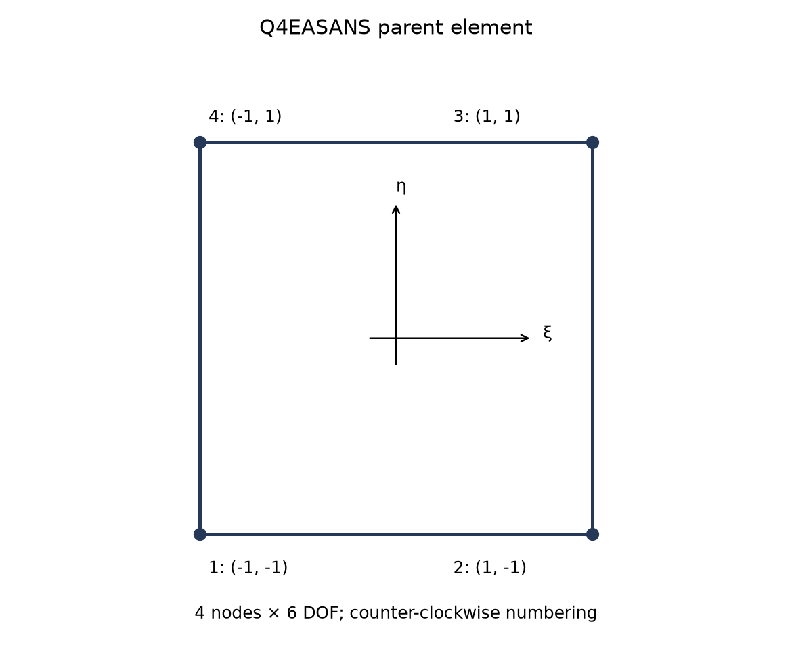
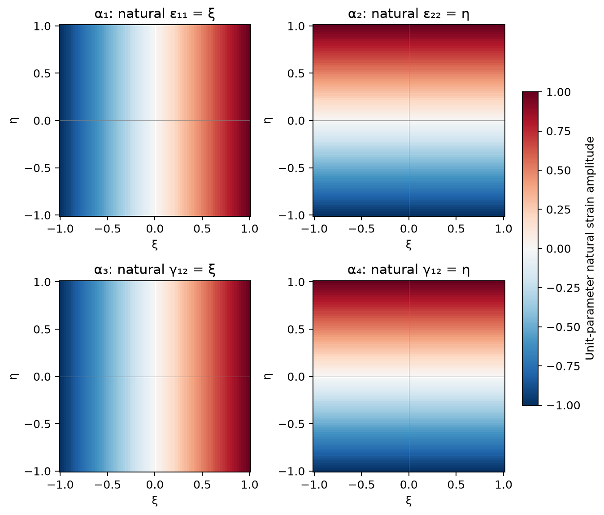
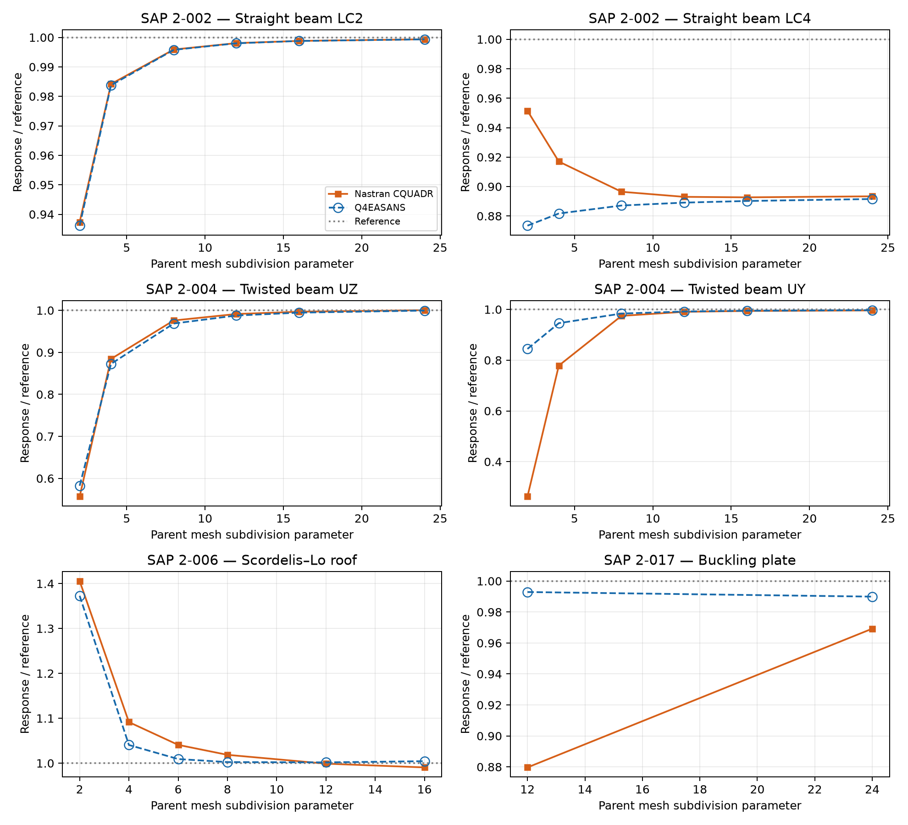

# Q4EASANS Shell: Enhanced Membrane Strains, Assumed Natural Shear and Hughes–Brezzi Drilling with Mystran Benchmark

**Ary — 25 October 2026**

## Abstract

Q4EASANS combines a bilinear four-node shell geometry with covariant membrane and warping-aware bending measures, four enhanced membrane-strain parameters, classical four-point assumed natural shear, and Hughes–Brezzi-type drilling stabilisation. The internal membrane parameters are condensed at element level, retaining 24 nodal components. This report presents the mathematical construction and compares selected static and linear-buckling responses with Nastran CQUADR. The results show close agreement in several bending and twisted-shell responses, together with case-dependent axial, roof and critical-load differences. No universal performance ranking follows from the selected benchmarks.

## 1. Scope and formulation identity

The name identifies three complementary strain treatments:

- **EAS:** four internal enhanced assumed membrane-strain parameters;
- **ANS:** transverse shear sampled at four edge midpoints;
- **HB:** a penalty on the difference between continuum membrane spin and nodal drilling rotation.

The compatible membrane field is bilinear and covariant. The EAS membrane field is not the five-point MITC4+ assumed membrane interpolation. The bending measure retains displacement coupling to the reference-director gradient. The assessment concerns linear isotropic shell response and linearised buckling, not a full finite-rotation or post-buckling theory.

## 2. Step 1: geometry, directors and degrees of freedom

The bilinear reference surface is

$$
\boldsymbol\phi_0(\xi,\eta)=\sum_{I=1}^{4}N_I\mathbf{X}_I,\qquad N_I=\frac14(1+\xi_I\xi)(1+\eta_I\eta).
$$

Corner coordinates are $(-1,-1),(1,-1),(1,1),(-1,1)$ in counter-clockwise order. Define

$$
\mathbf{g}_\alpha=\boldsymbol\phi_{0,\alpha},\qquad a_{\alpha\beta}=\mathbf{g}_\alpha\cdot\mathbf{g}_\beta,\qquad \mathbf{g}^{\alpha}=a^{\alpha\beta}\mathbf{g}_\beta,\qquad J_s=\|\mathbf{g}_1\times\mathbf{g}_2\|.
$$

Here $a^{\alpha\beta}$ is the inverse surface metric. Each unit nodal director $\mathbf{t}_{0I}$ is associated with a two-dimensional tangent plane. The reference director interpolation and small rotation variation are

$$
\mathbf{t}_0=\sum_I N_I\mathbf{t}_{0I},\qquad \delta\mathbf{t}=\sum_I N_I(\boldsymbol\theta_I\times\mathbf{t}_{0I}).
$$

The interpolated director is used consistently in the strain definitions; unit nodal directors do not imply that their bilinear interpolation has unit length everywhere. The Q4EASANS element has 24 nodal components,

$$
\mathbf{d}_I=[u_I,v_I,w_I,\theta_{XI},\theta_{YI},\theta_{ZI}]^{\mathrm{T}}.
$$

*Figure 1. Corner numbering and oriented element sides. The geometry is bilinear and may be warped.*

## 3. Step 2: covariant membrane, bending and shear measures

The linear membrane tensor is

$$
\varepsilon_{\alpha\beta}=\frac12(\mathbf{u}_{,\alpha}\cdot\mathbf{g}_\beta+\mathbf{g}_\alpha\cdot\mathbf{u}_{,\beta}).
$$

For the director-based curvature measure, retain both linearised contributions:

$$
\delta\rho_{\alpha\beta}=\mathbf{u}_{,\alpha}\cdot\mathbf{t}_{0,\beta}+\mathbf{g}_\alpha\cdot\delta\mathbf{t}_{,\beta}.
$$

The first term is displacement–director-gradient coupling; the second is the rotation contribution. The first vanishes when the reference director is constant. It can remain active on curved or warped geometry and must not be omitted merely because the element has four corners.

The covariant transverse shear is

$$
\gamma_\alpha=\mathbf{u}_{,\alpha}\cdot\mathbf{t}_0+\mathbf{g}_\alpha\cdot\delta\mathbf{t}.
$$

For a physical reference frame $\mathbf{E}_1,\mathbf{E}_2$, define $p_a^{\alpha}=\mathbf{E}_a\cdot\mathbf{g}^{\alpha}$. Tensor and shear components are projected consistently:

$$
\varepsilon_{ab}^{p}=p_a^{\alpha}\varepsilon_{\alpha\beta}p_b^{\beta},\qquad \rho_{ab}^{p}=p_a^{\alpha}\delta\rho_{\alpha\beta}p_b^{\beta},\qquad \gamma_a^p=p_a^{\alpha}\gamma_\alpha.
$$

A fixed centroid frame supplies the common reference axes. On warped surfaces these equations define the chosen projected strain representation; they are not a claim that the centroid plane coincides with every local tangent plane. Engineering shear components use twice the symmetric tensor off-diagonal component.

## 4. Step 3: four-point ANS transverse shear

The edge-midpoint tying points are $A=(0,-1)$, $B=(1,0)$, $C=(0,1)$ and $D=(-1,0)$. Interpolation must recover its own tying-point values:

$$
\widehat\gamma_\xi(\xi,\eta)=\frac{1-\eta}{2}\gamma_\xi(A)+\frac{1+\eta}{2}\gamma_\xi(C),
$$

$$
\widehat\gamma_\eta(\xi,\eta)=\frac{1-\xi}{2}\gamma_\eta(D)+\frac{1+\xi}{2}\gamma_\eta(B).
$$

The covariant assumed components are mapped to the physical strain frame at each integration point. This construction is distinct from a DKM edge field with eliminated side-rotation increments.

*Figure 2. Four edge-midpoint shear samples and four interior Gauss points. All Gauss weights equal one.*

## 5. Step 4: enhanced membrane strain and condensation

For isotropic elasticity, let $\mathbf{C}_0$ denote the plane-stress matrix with normal coefficients $E/(1-\nu^2)$, Poisson coupling $\nu E/(1-\nu^2)$ and engineering-shear coefficient $G=E/[2(1+\nu)]$. The integrated matrices are

$$
\mathbf{D}_m=h\mathbf{C}_0,\qquad \mathbf{D}_b=\frac{h^3}{12}\mathbf{C}_0,\qquad \mathbf{D}_s=\frac56Gh\mathbf{I}_2.
$$

Four internal parameters enrich the membrane strain:

$$
\boldsymbol\varepsilon_m=\mathbf{B}_m\mathbf{d}_e+\mathbf{M}\boldsymbol\alpha,\qquad \boldsymbol\alpha\in\mathbb{R}^{4}.
$$

The natural-coordinate enhanced operator has columns $(\xi,0,0)^{\mathrm{T}}$, $(0,\eta,0)^{\mathrm{T}}$, $(0,0,\xi)^{\mathrm{T}}$ and $(0,0,\eta)^{\mathrm{T}}$. With centroid strain transformation $\mathbf{T}_0$ and the corresponding planar mapping determinant $j_p$,

$$
\mathbf{M}(\xi,\eta)=\frac{j_p(0,0)}{j_p(\xi,\eta)}\mathbf{T}_0\widehat{\mathbf{M}}(\xi,\eta).
$$

On regular planar mappings, determinant-ratio scaling supports zero-mean enhanced modes. It does not by itself prove every warped-surface patch property. Define

$$
\mathbf{K}_{u\alpha}=\int_A\mathbf{B}_m^{\mathrm{T}}\mathbf{D}_m\mathbf{M}\,\mathrm{d}A,
$$

$$
\mathbf{K}_{\alpha\alpha}=\int_A\mathbf{M}^{\mathrm{T}}\mathbf{D}_m\mathbf{M}\,\mathrm{d}A.
$$

After internal equilibrium,

$$
\boldsymbol\alpha=-\mathbf{K}_{\alpha\alpha}^{-1}\mathbf{K}_{\alpha u}\mathbf{d}_e,\qquad \mathbf{K}_{\mathrm{cond}}=\mathbf{K}_{uu}-\mathbf{K}_{u\alpha}\mathbf{K}_{\alpha\alpha}^{-1}\mathbf{K}_{\alpha u}.
$$

The total compatible stiffness includes membrane, bending and ANS shear. The EAS correction affects the membrane field; drilling is added as described separately below. Thickness factors are already contained in the integrated constitutive matrices.

## 6. Step 5: Hughes–Brezzi-type drilling constraint

The membrane continuum spin and interpolated normal rotation are

$$
\omega=\frac12(v_{,x}-u_{,y}),\qquad \theta_d=\sum_I N_I(\boldsymbol\theta_I\cdot\mathbf{t}_{0I}),\qquad \gamma_d=\omega-\theta_d.
$$

The rotational projection uses each node's director. A corresponding per-node operator in global translation and rotation components is

$$
\mathbf{b}_{d,I}=\left[\frac12(N_{I,x}\mathbf{e}_2-N_{I,y}\mathbf{e}_1)^{\mathrm{T}},-N_I\mathbf{t}_{0I}^{\mathrm{T}}\right].
$$

With $\beta_d=10^{-4}$ for the assessed isotropic setting,

$$
\Pi_d=\frac12\int_A\beta_dGh\gamma_d^2\,\mathrm{d}A,\qquad \mathbf{K}_d=\int_A\mathbf{B}_d^{\mathrm{T}}\beta_dGh\mathbf{B}_d\,\mathrm{d}A.
$$

For planar rigid spin, continuum spin and normal rotation coincide and the drilling energy vanishes. On a general warped element the full projected operator must be checked against physical rigid motions. A positive coefficient supplies a positive-semidefinite drilling term; it does not alone prove rank sufficiency or that arbitrary penalty magnitudes leave every physical response unchanged.

### 6.1 Stability and parameter interpretation

The drilling scale $\beta_d=10^{-4}$ is part of the assessed formulation. A smaller penalty does not automatically improve accuracy, and a positive penalty does not prove the absence of all spurious modes. For a nondegenerate unconstrained 24-component shell, the desired nullspace contains six physical rigid-body motions and no additional mechanisms. Rank, rigid-motion energy and conditioning require separate checks.

Likewise, the negative-semidefinite EAS condensation correction relaxes compatible membrane stiffness when the internal block is positive definite. It does not, by itself, guarantee that the complete condensed shell has positive deformational energy on every distorted mesh.

## 7. Step 6: total energy and numerical integration

The common isotropic energy is

$$
\Pi_e=\frac12\int_A\left(\boldsymbol\varepsilon_m^{\mathrm{T}}\mathbf{D}_m\boldsymbol\varepsilon_m+\boldsymbol\kappa^{\mathrm{T}}\mathbf{D}_b\boldsymbol\kappa+\widehat{\boldsymbol\gamma}^{\mathrm{T}}\mathbf{D}_s\widehat{\boldsymbol\gamma}+\beta_dGh\gamma_d^2\right)\,\mathrm{d}A-\mathbf{d}_e^{\mathrm{T}}\mathbf{f}_e.
$$

Membrane, bending, shear, drilling and EAS blocks use $2\times2$ Gauss integration at $\xi,\eta=\pm1/\sqrt3$, with unit weights and $\mathrm{d}A=J_s\,\mathrm{d}\xi\,\mathrm{d}\eta$. ANS tying points define the shear field; they are not the stiffness integration points.

The four natural enhanced modes are illustrated below. A unit value of one internal parameter activates one natural-coordinate mode before physical transformation and determinant-ratio scaling.

*Figure 3. Natural-coordinate EAS4 mode amplitudes. The physical modes additionally contain the centroid strain transformation and mapping correction. These panels describe strain fields, not additional nodes or displacement modes.*

### 7.1 Relationship to Simo 1993 Q4

The two assessed models share the covariant membrane and bending construction, ANS shear and EAS4 enrichment. Both retain the director-gradient contribution to bending. Their assessed drilling scales differ:

| Feature | Q4EASANS | Simo 1993 Q4 |
|---|---|---|
| Membrane enhancement | EAS4 | EAS4 |
| Transverse shear | Four edge-midpoint ANS samples | Four edge-midpoint ANS samples |
| Bending | Covariant, with director-gradient coupling | Covariant, with director-gradient coupling |
| Drilling strain | Continuum spin minus projected nodal rotation | Same strain type |
| Assessed dimensionless drilling scale | $10^{-4}$ | $0.02$ |

The shared strain ingredients do not establish equal solutions for different drilling scales or all meshes. A direct sensitivity study with all other settings fixed would be needed to isolate the contribution of that scale alone. See the [Simo 1993 Q4 report](Simo1993_Q4_Formulation.md) for its separate numerical assessment.

## 8. Mystran Benchmark: Q4EASANS versus Nastran CQUADR

Results are matched by benchmark case, load case, response component and unit. The signed difference is

$$
\Delta_q=100\frac{q_{\mathrm{Q4EASANS}}-q_{\mathrm{CQUADR}}}{q_{\mathrm{CQUADR}}}.
$$

The independent reference used in the plots is distinct from the Nastran comparison. Close agreement with CQUADR and closeness to the reference are separate observations.

*Figure 4. Normalised static displacement and buckling responses. Open blue circles and dashed lines identify Q4EASANS, including where curves overlap. Beam abscissae are longitudinal subdivisions; roof abscissae are equal subdivisions in both directions; buckling uses the longitudinal counts of the 2 × 12 and 4 × 24 meshes.*

### 8.1 Selected numerical responses

The beam cases use longitudinal subdivision count 24, the roof uses 16 × 16 parent panels, and the buckling plate uses 4 × 24 parent panels. The curved beam and thick-plate cases use their benchmark meshes. Units are specified per row.

| SAP case | LC / model | Response | Unit | Q4EASANS | Nastran CQUADR | Difference |
|---|---|---|---|---:|---:|---:|
| 2-002 | 1 | tip UX | in | 3e-05 | 3.438168e-05 | -12.744% |
| 2-002 | 2 | tip UZ | in | 0.1080296 | 0.1080311 | -0.001% |
| 2-002 | 3 | tip UY | in | 0.431884 | 0.432016 | -0.031% |
| 2-002 | 4 | tip abs UY | in | 0.003040183 | 0.003046425 | -0.205% |
| 2-002 | 5 | tip abs UX | in | 0.0008999868 | 0.0009 | -0.001% |
| 2-002 | 6 | tip RZ | rad | 0.036 | 0.036 | +0.000% |
| 2-003 | 1 | tip UY | in | 0.08851299 | 0.08892159 | -0.460% |
| 2-003 | 2 | tip UZ | in | 0.49073815 | 0.4942291 | -0.706% |
| 2-004 | 1 | tip UZ | in | 0.0017481347 | 0.001749793 | -0.095% |
| 2-004 | 2 | tip UY | in | 0.0054126393 | 0.005407034 | +0.104% |
| 2-006 | 1 | free edge midpoint UZ | ft | -0.3099727 | -0.3056915 | +1.400% |
| 2-012 | A | outer edge mean UZ | in | -0.0053422448 | -0.0053445732 | -0.044% |
| 2-012 | B | outer edge mean UZ | in | -0.005217023 | -0.0052193496 | -0.045% |
| 2-017 | 2 | critical load | kip | 126.6229 | 123.9762 | +2.135% |

### 8.2 Interpretation of selected cases

- **SAP 2-002, LC1, tip UX:** 3e-05 for Q4EASANS against 3.438168e-05 for CQUADR, a signed difference of -12.744%.
- **SAP 2-002, LC2, tip UZ:** 0.1080296 for Q4EASANS against 0.1080311 for CQUADR, a signed difference of -0.001%.
- **SAP 2-002, LC4, tip abs UY:** 0.003040183 for Q4EASANS against 0.003046425 for CQUADR, a signed difference of -0.205%.
- **SAP 2-004, LC1, tip UZ:** 0.0017481347 for Q4EASANS against 0.001749793 for CQUADR, a signed difference of -0.095%.
- **SAP 2-004, LC2, tip UY:** 0.0054126393 for Q4EASANS against 0.005407034 for CQUADR, a signed difference of +0.104%.
- **SAP 2-006, LC1, free edge midpoint UZ:** -0.3099727 for Q4EASANS against -0.3056915 for CQUADR, a signed difference of +1.400%.
- **SAP 2-017, LC2, critical load:** 126.6229 for Q4EASANS against 123.9762 for CQUADR, a signed difference of +2.135%.

The twisted-beam responses are close to the independent references and to CQUADR at the selected refinement. Straight-beam LC2 and LC5 also show close agreement with CQUADR. LC4 is close to CQUADR but both remain below the independent displacement reference in the plotted sequence, illustrating why inter-element agreement is not an exactness test. The axial LC1 difference is retained explicitly in the table rather than hidden by the bending comparisons.

The roof response changes with refinement and its magnitude is higher than CQUADR at the selected mesh. The two buckling levels do not establish a limiting critical load, and the selected difference cannot be interpreted as proof that either element gives the exact eigenvalue. The thick-plate results supply additional checks of transverse-shear-sensitive response but do not cover every thickness ratio or distortion regime.

## 9. Conclusions

1. Q4EASANS combines compatible covariant kinematics with membrane EAS4, four-point ANS shear and a Hughes–Brezzi-type drilling penalty.
2. The bending measure retains the displacement–director-gradient term, which vanishes for constant reference directors and can remain active on warped geometry.
3. Four internal membrane parameters are condensed without adding nodal unknowns. ANS shear tying and numerical integration play different roles.
4. The selected Nastran CQUADR comparisons show close agreement for several bending and twisted-shell responses, while axial, roof and buckling differences remain case dependent.
5. No overall best-element claim or universal rank/patch-test guarantee is inferred from these selected results.

## 10. References

Simo, J.C., & Rifai, M.S. (1990). A class of mixed assumed strain methods and the method of incompatible modes. *International Journal for Numerical Methods in Engineering*, 29, 1595–1638.

Andelfinger, U., & Ramm, E. (1993). EAS-elements for two-dimensional, three-dimensional, plate and shell structures and their equivalence to HR-elements. *International Journal for Numerical Methods in Engineering*, 36, 1311–1337.

Dvorkin, E.N., & Bathe, K.-J. (1984). A continuum mechanics based four-node shell element for general nonlinear analysis. *Engineering Computations*, 1, 77–88.

Hughes, T.J.R., & Brezzi, F. (1989). On drilling degrees of freedom. *Computer Methods in Applied Mechanics and Engineering*, 72, 105–121.

Fox, D.D., & Simo, J.C. (1992). A drill rotation formulation for geometrically exact shells. *Computer Methods in Applied Mechanics and Engineering*, 98, 329–343.

Computers & Structures, Inc. *SAP2000 Verification Examples*, Problems 2-002, 2-003, 2-004, 2-006, 2-012 and 2-017.
