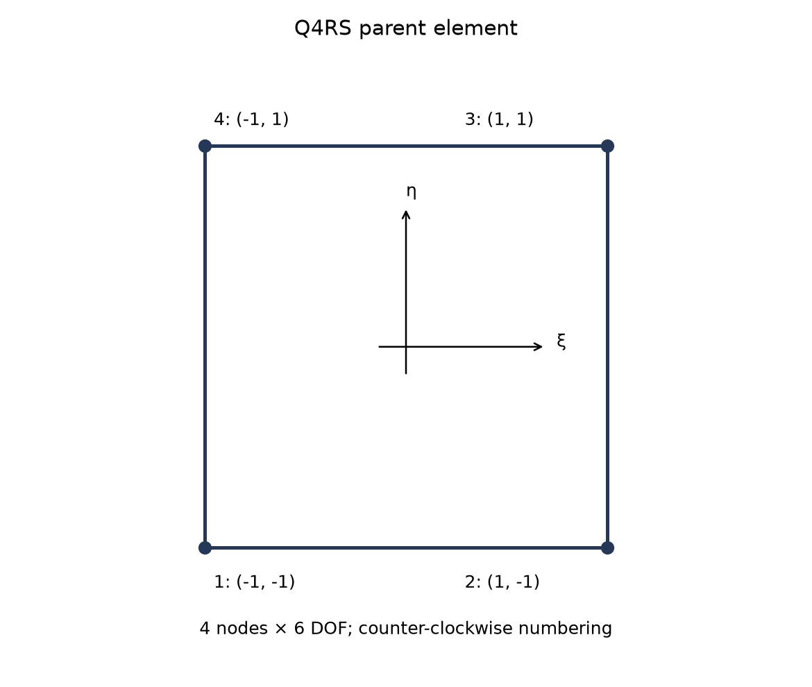
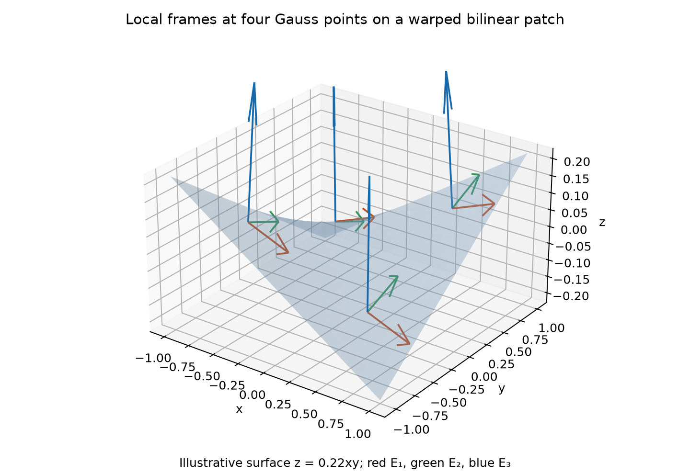
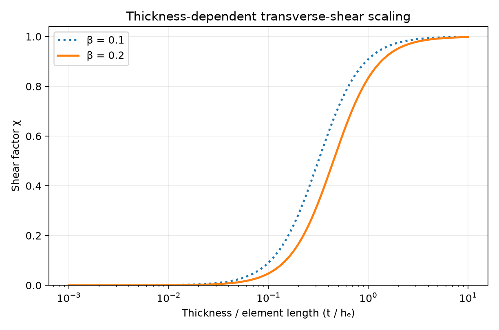
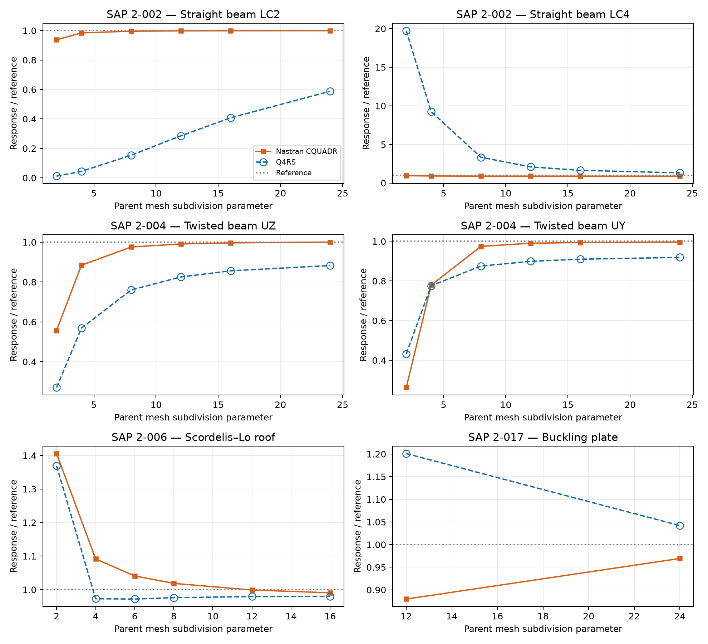

# Q4RS Shell: Nodal-Frame Drilling Decoupling, Mixed Shear Interpolation and Mystran Benchmark

**Ary — 26 October 2026**

## Abstract

Q4RS is a four-node quadrilateral Reissner–Mindlin shell with six nodal degrees of freedom. It combines compatible bilinear membrane and bending operators, mixed transverse-shear interpolation, thickness-dependent shear scaling, and nodal-frame transformations that separate drilling from flexural kinematics. A stiffness-derived normal-rotation regularisation supplements the transformed mechanical stiffness. This report presents the mathematical construction and selected static and linear-buckling comparisons with Nastran CQUADR. The results show case-dependent differences, including substantial discrepancies in selected straight-beam responses. They do not establish a universal accuracy ranking.

## 1. Scope and formulation identity

Q4RS follows the nodal-frame quadrilateral shell family of Castellazzi and Krysl [1], related to the T3FF triangular shell [2]. The assessed formulation contains a compatible membrane field without EAS enhancement. It therefore differs fundamentally from Q4EASANS even though both use four corner nodes, mixed shear technology and 24 nodal components.

The assessment concerns linear isotropic shell response and selected linear-buckling loads. The thickness-scaling parameter is stated explicitly. Published formulation claims and the bounded numerical assessment should not be conflated: satisfactory results in selected cases do not prove rank sufficiency, objectivity or penalty insensitivity for every geometry.

## 2. Step 1: surface interpolation and nodal unknowns

With $(\xi,\eta)\in[-1,1]^2$, define

$$
\mathbf{x}(\xi,\eta)=\sum_{i=1}^{4}N_i\mathbf{x}_i,\qquad N_i=\frac14(1+\xi_i\xi)(1+\eta_i\eta).
$$

The corner coordinates are $(-1,-1),(1,-1),(1,1),(-1,1)$. Each nodal vector contains three translations and three right-hand-rule rotations:

$$
\mathbf{d}_i=[u_i,v_i,w_i,\theta_{Xi},\theta_{Yi},\theta_{Zi}]^{\mathrm{T}},\qquad \mathbf{d}_e\in\mathbb{R}^{24}.
$$

The surface tangents and integration measure are

$$
\mathbf{g}_1=\mathbf{x}_{,\xi},\qquad \mathbf{g}_2=\mathbf{x}_{,\eta},\qquad J_s=\|\mathbf{g}_1\times\mathbf{g}_2\|,\qquad \mathrm{d}A=J_s\,\mathrm{d}\xi\,\mathrm{d}\eta.
$$

*Figure 1. Q4RS natural-coordinate corner numbering. Normal orientation follows the ordered surface tangents.*

## 3. Step 2: integration-point frame and nodal normals

At each integration point, form the orthonormal element frame

$$
\mathbf{E}_1=\frac{\mathbf{g}_1}{\|\mathbf{g}_1\|},\qquad \mathbf{E}_3=\frac{\mathbf{g}_1\times\mathbf{g}_2}{\|\mathbf{g}_1\times\mathbf{g}_2\|},\qquad \mathbf{E}_2=\mathbf{E}_3\times\mathbf{E}_1.
$$

Let $\mathbf{E}=[\mathbf{E}_1,\mathbf{E}_2,\mathbf{E}_3]$. This frame varies across a warped or distorted surface. It is distinct from a fixed centroid frame.

For smooth connected surfaces, a nodal normal may be constructed from a consistent area-weighted normal sum,

$$
\mathbf{n}_i=\frac{\sum_{e\ni}A_e\mathbf{n}_{e,i}}{\left\|\sum_{e\ni}A_e\mathbf{n}_{e,i}\right\|}.
$$

Averaging across an actual crease or branch would impose an unintended common director. Such geometry requires a crease-aware normal assignment, as in the nodal-frame family [1,2]. The local integration-point normal and the nodal normal serve different roles and need not coincide.

*Figure 2. Illustrative warped bilinear patch with local triads at the four Gauss points. This schematic is not a benchmark mesh or measured response.*

Using the inverse surface metric $a^{\alpha\beta}$, the dual basis and physical shape gradients are

$$
\mathbf{g}^{\alpha}=a^{\alpha\beta}\mathbf{g}_\beta,\qquad a_{\alpha\beta}=\mathbf{g}_\alpha\cdot\mathbf{g}_\beta,\qquad N_{i,a}=\mathbf{E}_a\cdot\left(N_{i,\alpha}\mathbf{g}^{\alpha}\right),\quad a=1,2.
$$

## 4. Step 3: global–nodal–element transformation

For each node, construct an orthogonal nodal triad $\mathbf{A}_i$ in the current element frame, with its third axis directed along $\mathbf{E}^{\mathrm{T}}\mathbf{n}_i$. A minimal rotation from the element normal defines the other two axes away from the antiparallel case [1,2].

The global-to-nodal rotation is

$$
\mathbf{R}_{i}^{GA}=\mathbf{A}_i^{\mathrm{T}}\mathbf{E}^{\mathrm{T}}.
$$

It acts on both translations and rotations. The full nodal transform is block diagonal with copies of $\mathbf{R}_{i}^{GA}$. A second transform maps nodal unknowns into the element strain representation:

$$
\mathbf{d}_A=\mathbf{T}_{GA}\mathbf{d}_G,\qquad \mathbf{d}_E=\mathbf{T}_{AE}\mathbf{d}_A,\qquad \mathbf{T}=\mathbf{T}_{AE}\mathbf{T}_{GA}.
$$

The second transform is not merely a rigid rotation. Its flexural rotation block contains the drilling-decoupling correction

$$
H_{i,ab}=A_{i,ab}-\frac{A_{i,a3}A_{i,b3}}{A_{i,33}},\qquad a,b\in\{1,2\}.
$$

It also contains displacement-gradient coupling associated with the discrete membrane spin, weighted by $A_{i,13}/A_{i,33}$ and $A_{i,23}/A_{i,33}$. Thus the transformed flexural rotations have the form

$$
\boldsymbol\vartheta_{E,i}=\mathbf{H}_i\boldsymbol\theta_{A,i}^{\mathrm{tan}}+\sum_j\mathbf{C}_{ij}\mathbf{u}_{A,j}.
$$

The coefficients $\mathbf{C}_{ij}$ are the linear spin-gradient coupling terms. Omitting them would change the drilling-decoupling construction. The regular expressions require a nonvanishing $A_{i,33}$; extreme normal misalignment must be handled by the admissible nodal-frame/crease treatment rather than assuming the division is harmless.

For membrane, bending and shear, the operators acting on global unknowns are

$$
\widehat{\mathbf{B}}_m=\mathbf{B}_m\mathbf{T},\qquad \widehat{\mathbf{B}}_b=\mathbf{B}_b\mathbf{T},\qquad \widehat{\mathbf{B}}_s=\mathbf{B}_s\mathbf{T}.
$$

All quantities are evaluated in the same integration-point frame. This is the formulation's main distinction from simply appending drilling resistance to otherwise unchanged facet operators [1].

## 5. Step 4: membrane, bending and mixed shear fields

### 5.1 Compatible membrane and bending

In the current element frame, the membrane engineering strains are

$$
\boldsymbol\varepsilon_m=[u_{,1},v_{,2},u_{,2}+v_{,1}]^{\mathrm{T}}=\mathbf{B}_m\mathbf{d}_E.
$$

The compatible curvature vector is

$$
\boldsymbol\kappa=[\theta_{2,1},-\theta_{1,2},\theta_{2,2}-\theta_{1,1}]^{\mathrm{T}}=\mathbf{B}_b\mathbf{d}_E.
$$

The untransformed flexural operator has no independent drilling column. The transformation determines how the nodal director frame and displacement gradients enter these element-frame strains. No EAS internal membrane parameters are condensed in the assessed Q4RS model.

### 5.2 Mixed transverse-shear interpolation

Mixed tensorial shear interpolation uses edge information rather than the fully compatible shear field [1,3]. With tying points $A=(0,-1)$, $B=(1,0)$, $C=(0,1)$, and $D=(-1,0)$, the natural shear construction is represented by

$$
\widehat\gamma_{\xi}(\xi,\eta)=\frac{1-\eta}{2}\gamma_\xi(A)+\frac{1+\eta}{2}\gamma_\xi(C),
$$

$$
\widehat\gamma_{\eta}(\xi,\eta)=\frac{1-\xi}{2}\gamma_\eta(D)+\frac{1+\xi}{2}\gamma_\eta(B).
$$

The directional shear samples and their conversion to physical components use the projected edge geometry and its Jacobian. The resulting element-frame shear operator is combined with the nodal transform at the integration point; replacing it by a raw compatible $w_{,a}+\theta$ field would define a different model.

*Figure 3. Four mixed-shear sample locations and four stiffness integration points. These point sets have different purposes.*

### 5.3 Thickness-dependent shear scaling

Let $t$ denote thickness and $h_e$ the characteristic length. The assessed convention takes the maximum distance from the first corner to the other corners. Define

$$
\chi=\frac{t^2}{t^2+\beta h_e^2},\qquad \beta=0.2.
$$

The isotropic integrated matrices are

$$
\mathbf{D}_m=t\mathbf{C}_{ps},\qquad \mathbf{D}_b=\frac{t^3}{12}\mathbf{C}_{ps},\qquad \mathbf{D}_s^{\mathrm{eff}}=\chi\kappa_sGt\mathbf{I}_2,\qquad \kappa_s=\frac56.
$$

Here $\mathbf{C}_{ps}$ is the plane-stress matrix and $G=E/[2(1+\nu)]$. Thickness-dependent scaling follows the stabilised Reissner–Mindlin plate approach [4]. The chosen length and $\beta$ are part of the assessed model, not universal material constants. The same rule must be maintained throughout a refinement sequence.

*Figure 4. Mathematical shear factors for $\beta=0.1$ and $0.2$. The benchmark formulation uses $0.2$; the other curve illustrates parameter sensitivity and is not a second set of benchmark results.*

## 6. Step 5: stiffness-derived drilling regularisation

Integrate the transformed mechanical terms first:

$$
\mathbf{K}_0=\int_A\left(\widehat{\mathbf{B}}_m^{\mathrm{T}}\mathbf{D}_m\widehat{\mathbf{B}}_m+\widehat{\mathbf{B}}_b^{\mathrm{T}}\mathbf{D}_b\widehat{\mathbf{B}}_b+\widehat{\mathbf{B}}_s^{\mathrm{T}}\mathbf{D}_s^{\mathrm{eff}}\widehat{\mathbf{B}}_s\right)\,\mathrm{d}A.
$$

At node $i$, let $\mathbf{K}_{rr,i}$ denote the three-by-three rotational block of $\mathbf{K}_0$ and define the tangent projector

$$
\mathbf{P}_i=\mathbf{I}-\mathbf{n}_i\otimes\mathbf{n}_i,\qquad k_i=\frac12\mathrm{tr}\left(\mathbf{P}_i\mathbf{K}_{rr,i}\mathbf{P}_i\right).
$$

The factor $1/2$ averages the two tangential rotational stiffness directions. For the admissible nodal set $\mathcal{V}$, the assessed normal-rotation scale is

$$
\bar{k}_d=\frac{1}{|\mathcal{V}|}\sum_{i\in\mathcal{V}}\max(0,k_i).
$$

Add the rotational blocks

$$
\mathbf{K}_{d,i}=\bar{k}_d\mathbf{n}_i\otimes\mathbf{n}_i,\qquad \mathbf{K}_e=\mathbf{K}_0+\mathbf{K}_d.
$$

This uses a stiffness-derived scale rather than a prescribed $\beta_dGt$ rotation–spin penalty [1]. It is not the Hughes–Brezzi constraint used by Q4EASANS. A positive normal-rotation block can contribute energy to an imposed rigid-spin vector; the full transformed formulation's physical rigid modes and sensitivity must therefore be checked rather than inferred from the scale definition alone. No arbitrary change in the drilling multiplier is claimed to leave every response unchanged.

## 7. Step 6: integration and linear buckling

Membrane, bending and mixed shear terms use the four $2\times2$ Gauss points

$$
(\xi_g,\eta_g)\in\{(\pm1/\sqrt3,\pm1/\sqrt3)\},\qquad w_g=1.
$$

The local frame, metric gradients and transformation are reevaluated at each point. The drilling blocks are formed after integration of $\mathbf{K}_0$. The formulation contains no membrane EAS condensation.

For a prescribed membrane resultant field $N_{ab}$, a translational initial-stress approximation is

$$
\mathbf{K}_{g,ij}^{uu}=\int_A N_{ab}N_{i,a}N_{j,b}\mathbf{I}_3\,\mathrm{d}A.
$$

The selected linear-buckling load solves $(\mathbf{K}_e+\lambda\mathbf{K}_g)\boldsymbol\varphi=\mathbf{0}$ under a consistent compression sign convention. This bounded eigenvalue assessment is not a full finite-rotation tangent or nonlinear post-buckling analysis.

### 7.1 Difference from Q4EASANS

| Feature | Q4RS | Q4EASANS |
|---|---|---|
| Physical reference frame | Reconstructed at each Gauss point | Fixed centroid reference for covariant projections |
| Membrane interpolation | Compatible bilinear field | Compatible field plus EAS4 |
| Shear treatment | Mixed shear with thickness-dependent scaling | Four-point ANS shear |
| Drilling treatment | Nodal-frame decoupling plus stiffness-derived normal resistance | Rotation–spin penalty |
| Internal enhanced membrane parameters | None | Four, condensed locally |

These differences prevent assigning the Q4EASANS response to Q4RS merely because both have 24 nodal components. The absence of EAS is especially relevant to membrane-bending-dominated coarse meshes; the separate roles of shear scaling and drilling still require controlled assessment. See the [Q4EASANS report](Q4EASANS_Formulation.md).

## 8. Mystran Benchmark: Q4RS versus Nastran CQUADR

The selected cases follow the SAP verification definitions [5]. Results are matched by case, mesh sequence, load case, response component and unit. Signed differences relative to Nastran CQUADR are

$$
\Delta_q=100\frac{q_{\mathrm{Q4RS}}-q_{\mathrm{CQUADR}}}{q_{\mathrm{CQUADR}}}.
$$

An independent reference is used for normalisation in the convergence plots. Agreement with the comparison element and agreement with the independent reference are separate checks.

*Figure 5. Normalised static displacements and buckling loads. Dashed lines with open circles identify Q4RS. Beam abscissae are longitudinal subdivisions; the roof uses equal subdivisions in both directions; buckling uses longitudinal counts for 2 × 12 and 4 × 24 parent meshes.*

### 8.1 Selected numerical responses

Beam results use longitudinal subdivision count 24, the roof uses 16 × 16 parent panels and the buckling plate uses 4 × 24 panels. The curved beam and thick plates use their benchmark meshes. Units are stated per row.

| SAP case | LC / model | Response | Unit | Q4RS | Nastran CQUADR | Difference |
|---|---|---|---|---:|---:|---:|
| 2-002 | 1 | tip UX | in | 3e-05 | 3.438168e-05 | -12.744% |
| 2-002 | 2 | tip UZ | in | 0.06358497 | 0.1080311 | -41.142% |
| 2-002 | 3 | tip UY | in | 0.4320759 | 0.432016 | +0.014% |
| 2-002 | 4 | tip abs UY | in | 0.00451102 | 0.003046425 | +48.076% |
| 2-002 | 5 | tip abs UX | in | 0.0005294545 | 0.0009 | -41.172% |
| 2-002 | 6 | tip RZ | rad | 0.036 | 0.036 | +0.000% |
| 2-003 | 1 | tip UY | in | 0.083373035 | 0.08892159 | -6.240% |
| 2-003 | 2 | tip UZ | in | 0.49759685 | 0.4942291 | +0.681% |
| 2-004 | 1 | tip UZ | in | 0.0015442997 | 0.001749793 | -11.744% |
| 2-004 | 2 | tip UY | in | 0.0049898893 | 0.005407034 | -7.715% |
| 2-006 | 1 | free edge midpoint UZ | ft | -0.3024264 | -0.3056915 | -1.068% |
| 2-012 | A | outer edge mean UZ | in | -0.0053441705 | -0.0053445732 | -0.008% |
| 2-012 | B | outer edge mean UZ | in | -0.0052170249 | -0.0052193496 | -0.045% |
| 2-017 | 2 | critical load | kip | 133.2701 | 123.9762 | +7.497% |

### 8.2 Discussion

- **SAP 2-002, LC2, tip UZ:** the signed difference from CQUADR is -41.142%.
- **SAP 2-002, LC4, tip abs UY:** the signed difference from CQUADR is +48.076%.
- **SAP 2-002, LC5, tip abs UX:** the signed difference from CQUADR is -41.172%.
- **SAP 2-004, LC1, tip UZ:** the signed difference from CQUADR is -11.744%.
- **SAP 2-004, LC2, tip UY:** the signed difference from CQUADR is -7.715%.
- **SAP 2-006, LC1, free edge midpoint UZ:** the signed difference from CQUADR is -1.068%.
- **SAP 2-017, LC2, critical load:** the signed difference from CQUADR is +7.497%.

Straight-beam LC2 and LC5 remain substantially below CQUADR at the selected mesh; the compatible membrane field does not receive the EAS relaxation present in Q4EASANS. LC4 is higher than CQUADR, so a single blanket description of Q4RS as uniformly too stiff would be misleading. These components must be assessed independently.

The twisted-beam responses are lower than CQUADR over the refined sequence shown. The roof comparison is closer at the selected mesh, while the buckling load remains higher. Two buckling mesh levels do not establish a limiting critical load. The thick-plate cases provide additional transverse-shear-sensitive checks without validating every thickness ratio or distorted-mesh family.

## 9. Conclusions

1. Q4RS combines pointwise element frames, nodal-normal transformations, mixed transverse shear and stiffness-derived drilling regularisation [1].
2. The assessed model uses compatible membrane strains without EAS condensation. It should not be presented as an EAS-enhanced alternative with merely a different name.
3. The thickness-scaling parameter and characteristic length are part of the stated mathematical model; changing them requires a separate numerical assessment.
4. Nastran CQUADR comparisons show case-dependent behavior, including substantial differences in selected beam responses. No overall best-element conclusion follows.
5. Physical rigid-body modes, rank, stress recovery and nonlinear behavior require their own evidence beyond the displacement and selected eigenvalue results shown here.

## 10. References

[1] Castellazzi, G., & Krysl, P. (2026). A robust quadrilateral Reissner–Mindlin shell element with six degrees of freedom per node. *Finite Elements in Analysis and Design*, 259, 104574. [Publisher article](https://www.sciencedirect.com/science/article/pii/S0168874X26000648).

[2] Krysl, P. (2022). Robust flat-facet triangular shell finite element. *International Journal for Numerical Methods in Engineering*, 123(10), 2399–2423.

[3] Bathe, K.-J., & Dvorkin, E.N. (1985). A four-node plate bending element based on Mindlin/Reissner plate theory and a mixed interpolation. *International Journal for Numerical Methods in Engineering*, 21(2), 367–383.

[4] Lyly, M., Stenberg, R., & Vihinen, T. (1993). A stable bilinear element for the Reissner–Mindlin plate model. *Computer Methods in Applied Mechanics and Engineering*, 110, 343–357.

[5] Computers & Structures, Inc. *SAP2000 Verification Examples*, Problems 2-002, 2-003, 2-004, 2-006, 2-012 and 2-017.
