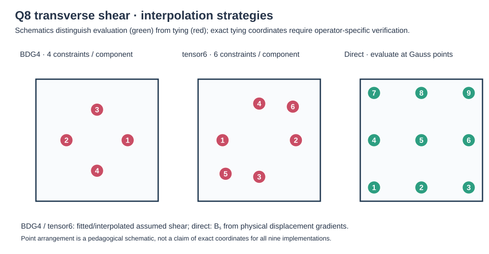
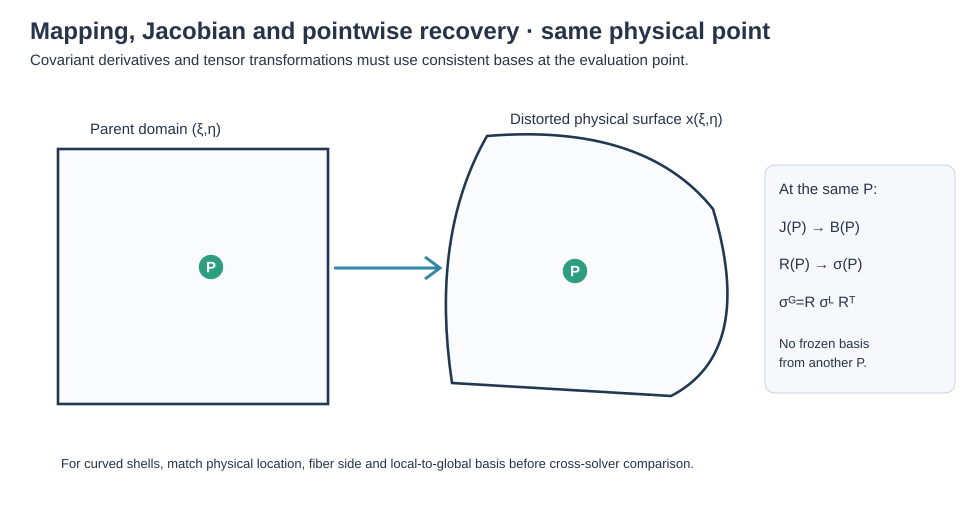
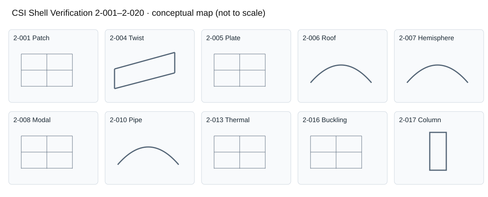

# REZAIEE v3 — CTRIA6 quadratic shell

**Ary · Independent Researcher · Personal Research** · MYSTRAN v18.00.a · 19 October 2026

> Research documentation. Full derivation and primary references: [master formulation](CQUAD8_CTRIA6_QUADRATIC_SHELL_FORMULATIONS.md). Exact Fortran source selection, sign conventions and validation branch must be checked before asserting implementation identity.

## Element-specific formulation (preserved from earlier research manuscript)

### 7.9 Rezaiee T6 v3 — modified assumed-strain triangular shell

The independent T6 shell uses six quadratic interpolation nodes and nodal director kinematics. The natural membrane and transverse shear rows are evaluated at collocation points and projected to polynomial assumed fields \(\bar\varepsilon_m=\mathcal P_m\varepsilon_m\), \(\bar\gamma=\mathcal P_s\gamma\); the physical tensor conversion employs \(\mathbf g^\alpha\), the dual tangent vectors. Its weak-form contributions are integrated on the triangle, with separate drilling stabilization. **Adopted:** Rezaiee–Pajand triangular assumed-strain and director concepts. **Modified:** linear six-DOF version and drilling. **Not reproduced:** original five-DOF finite-rotation nonlinear formulation and consistent nonlinear tangent.

## 8. Explicit shear interpolation: BDG4, tensor6 and direct

Let \(a=1/\sqrt3\), \(b=\sqrt{3/5}\), and \(\gamma_{rt},\gamma_{st}\) denote **covariant** transverse shear strains. Define
\[
L_-(x)=\frac{a-x}{2a},\quad L_+(x)=\frac{a+x}{2a},\qquad
H_-(x)=\frac{1-x}{2},\quad H_+(x)=\frac{1+x}{2},
\]
\[
Q_{-b}(x)=\frac{x(x-b)}{2b^2},\qquad Q_0(x)=1-\frac{x^2}{b^2},\qquad Q_{+b}(x)=\frac{x(x+b)}{2b^2}.
\]

**BDG4 (four-point transverse-shear tying per component)** samples \(\gamma_{rt}\) at \((r_i,s_j)=(\pm a,\pm1)\) and \(\gamma_{st}\) at \((\pm1,\pm a)\):
\[
\bar\gamma_{rt}^{(4)}(r,s)=\sum_{i=\pm}\sum_{j=\pm}L_i(r)H_j(s)\gamma_{rt}(r_i,s_j),\quad
\bar\gamma_{st}^{(4)}(r,s)=\sum_{i=\pm}\sum_{j=\pm}H_i(r)L_j(s)\gamma_{st}(r_i,s_j).
\]

**Tensor6 (six-point transverse-shear tying per component)** instead uses 2×3 samples:
\[
\bar\gamma_{rt}^{(6)}(r,s)=\sum_{i=\pm}\sum_{j\in\{-b,0,b\}}L_i(r)Q_j(s)\gamma_{rt}(r_i,s_j),\quad
\bar\gamma_{st}^{(6)}(r,s)=\sum_{i\in\{-b,0,b\}}\sum_{j=\pm}Q_i(r)L_j(s)\gamma_{st}(r_i,s_j).
\]

**Direct** shear means no tying projection, \(\bar\gamma_{rt}^{(d)}(r,s)=\gamma_{rt}(r,s)\), \(\bar\gamma_{st}^{(d)}(r,s)=\gamma_{st}(r,s)\). Each covariant component is converted to a physical tangent shear vector via the inverse surface metric. These options do **not** mean that a six-point Gauss integration rule is used: collocation and quadrature play different roles.

For the selected automatic shear treatment define slenderness \(s_A=\sqrt A/h\), transition \(s_0=15\) and mixing coefficient
\[
\omega=\operatorname{clip}\left(1-\frac{s_0}{s_A},0,1\right),\quad
\bar B_s=(1-\omega)\bar B_s^{(6)}+\omega\bar B_s^{(4)}.
\]
The **operator is blended before the quadratic strain energy** \(K_s=h\int\bar B_s^TC_s\bar B_s\,dA\). Consequently \(K_s\ne(1-\omega)K_s^{(6)}+\omega K_s^{(4)}\) in general. For \(s_A\le15\), tensor6 dominates; as \(s_A\rightarrow\infty\), BDG4 dominates. The name “BDG6” denotes this research ANS8 family, not proof that every selected shear interpolation employs six samples.

## 9. Relation to the primary papers: adopted, modified and excluded

| Research element | Adopted theoretical ingredient | Research change/formulation decision | Not adopted as a complete model |
|---|---|---|---|
| SIMOQ8 | Simo–Fox–Rifai stress resultants; directors and shell covariance | Q8 interpolation, conditional assumed strains, separate drilling | Fully nonlinear finite-rotation/plasticity tangents |
| SIMOT6 | Simo director shell theory | P2 triangular kinematics; independent triangular operators | Reuse of Q8 tying or full nonlinear integration |
| MITC8 | Bathe–Dvorkin covariant mixed strain fields | Conditional membrane tying, modified Q8 field, BDG4/tensor6 blend | Original element reproduced unchanged |
| ANS8BDG6 | Jung–Han β/δ and shear sampling philosophy | Geometry switch, four/six shear blend, modified-field metric | Exact βδγ*6 nonlinear formulation |
| HBQ8 Kikuchi | HBQ8 energy splitting, Kikuchi interpolation | Explicit \(\chi_c\) membrane switch; shear blend | Published full nonlinear HBQ8 theory |
| MacNeal Q8 | MacNeal–Harder interpolation motivation | Drilling stabilization in six-DOF shell | Nine-node equivalence in all settings |
| MITC6 v5e | Kim–Bathe triangular tying | Enhanced tie placement and affine projection | Claim that v5e is a published variant |
| MH6T | Modified assumed-strain framework | Independent triangular projection | Exact reproduction of a named publication |
| Rezaiee T6 | Rezaiee–Pajand triangular assumed strain | Linear 6-DOF adaptation | Published nonlinear 5-DOF tangent |

Internal project documents and software method names are not cited as research literature. The references below support theory and the limitations above; they do not by themselves validate the research adaptations.

The CSI verification PDFs are the primary benchmark definitions. The online PDF endpoints could not be retrieved during this revision. Accordingly, parameters available from traceable research decks are explicitly identified as such, while parameters not independently checked against the official documents remain blank. No missing model description, material or boundary condition has been inferred. Each linked PDF remains the authoritative source for eventual reconciliation.

| Test and reference | Physical problem and schematic | Material \(E,\nu\) | Thickness \(h\) | Boundary and loading statement |
|---|---|---|---|---|
| [2-001](https://docs.csiamerica.com/manuals/csibridge/Verification/Analysis/Shells/Problem%202-001.pdf) | Patch test — prescribed membrane and bending displacements | 1,000,000 psi; 0.25 | 0.001 in | Edges: prescribed \(U_x,U_y\) or \(U_z,R_x,R_y\); patch test (original CSI model) |
| [2-002](https://docs.csiamerica.com/manuals/csibridge/Verification/Analysis/Shells/Problem%202-002.pdf) | Clamped shell/beam verification |  |  |  |
| [2-003](https://docs.csiamerica.com/manuals/csibridge/Verification/Analysis/Shells/Problem%202-003.pdf) | Combined shell response |  |  |  |
| [2-004](https://docs.csiamerica.com/manuals/csibridge/Verification/Analysis/Shells/Problem%202-004.pdf) | Twisted beam |  |  |  |
| [2-005](https://docs.csiamerica.com/manuals/csibridge/Verification/Analysis/Shells/Problem%202-005.pdf) | Plate bending / pressure |  |  |  |
| [2-006](https://docs.csiamerica.com/manuals/csibridge/Verification/Analysis/Shells/Problem%202-006.pdf) | Cylindrical roof / Scordelis–Lo |  |  |  |
| [2-007](https://docs.csiamerica.com/manuals/csibridge/Verification/Analysis/Shells/Problem%202-007.pdf) | Pinched hemisphere / curved shell |  |  |  |
| [2-008](https://docs.csiamerica.com/manuals/csibridge/Verification/Analysis/Shells/Problem%202-008.pdf) | Modal / eigenfrequency |  |  |  |
| [2-009](https://docs.csiamerica.com/manuals/csibridge/Verification/Analysis/Shells/Problem%202-009.pdf) | Shell verification case 2-009 (official title not yet verified) |  |  |  |
| [2-010](https://docs.csiamerica.com/manuals/csibridge/Verification/Analysis/Shells/Problem%202-010.pdf) | Pipe / curved shell |  |  |  |
| [2-012](https://docs.csiamerica.com/manuals/csibridge/Verification/Analysis/Shells/Problem%202-012.pdf) | Shell verification case 2-012 (official title not yet verified) |  |  |  |
| [2-013](https://docs.csiamerica.com/manuals/csibridge/Verification/Analysis/Shells/Problem%202-013.pdf) | Thermal response (working classification; official test definition pending) |  |  |  |
| [2-014](https://docs.csiamerica.com/manuals/csibridge/Verification/Analysis/Shells/Problem%202-014.pdf) | Thermal/annular-shell response (working classification; official test definition pending) |  |  |  |
| [2-015](https://docs.csiamerica.com/manuals/csibridge/Verification/Analysis/Shells/Problem%202-015.pdf) | Shell verification case 2-015 (official title not yet verified) |  |  |  |
| [2-016](https://docs.csiamerica.com/manuals/csibridge/Verification/Analysis/Shells/Problem%202-016.pdf) | Plate out-of-plane buckling | 29,000; 0.30 (research deck) | 0.01 / 1 (research deck) | Quadratic research model: 24×24 plate; shear/bending traction; supported edges; confirm official CSI case separately |
| [2-017](https://docs.csiamerica.com/manuals/csibridge/Verification/Analysis/Shells/Problem%202-017.pdf) | In-plane column buckling | 3,600; 0.20 (research deck) | 1 (research deck) | Quadratic research model: 12×100 column; pinned/roller base; unit top compression; confirm official CSI case separately |

### 10.1 Per-formulation comparison tables

Each independent row represents **one specific problem, output component, load case, mesh, and matching coordinate frame**. Where multiple components or load cases exist, add rows; do not collapse them into a single numerical value. No unverified number has been inserted below. The columns “Nastran error” and “MYSTRAN error” are relative to the same independently selected reference, not relative to each other:
\[
 e_{N}(\%)=100\frac{v_N-v_{ref}}{v_{ref}},\qquad e_M(\%)=100\frac{v_M-v_{ref}}{v_{ref}},\qquad v_{ref}\ne0.
\]
For reference values near zero use a separately declared absolute-error criterion. Blank cells are intentional pending Codex comparison outputs.

#### SIMOQ8 v13

| CSI problem | Response / component | Independent reference | Nastran result | MYSTRAN result | Nastran error (%) | MYSTRAN error (%) |
|---|---|---:|---:|---:|---:|---:|
| 2-001 |  |  |  |  |  |  |
| 2-002 |  |  |  |  |  |  |
| 2-003 |  |  |  |  |  |  |
| 2-004 |  |  |  |  |  |  |
| 2-005 |  |  |  |  |  |  |
| 2-006 |  |  |  |  |  |  |
| 2-007 |  |  |  |  |  |  |
| 2-008 |  |  |  |  |  |  |
| 2-009 |  |  |  |  |  |  |
| 2-010 |  |  |  |  |  |  |
| 2-012 |  |  |  |  |  |  |
| 2-013 |  |  |  |  |  |  |
| 2-014 |  |  |  |  |  |  |
| 2-015 |  |  |  |  |  |  |
| 2-016 |  |  |  |  |  |  |
| 2-017 |  |  |  |  |  |  |

#### SIMOT6 v2

| CSI problem | Response / component | Independent reference | Nastran result | MYSTRAN result | Nastran error (%) | MYSTRAN error (%) |
|---|---|---:|---:|---:|---:|---:|
| 2-001 |  |  |  |  |  |  |
| 2-002 |  |  |  |  |  |  |
| 2-003 |  |  |  |  |  |  |
| 2-004 |  |  |  |  |  |  |
| 2-005 |  |  |  |  |  |  |
| 2-006 |  |  |  |  |  |  |
| 2-007 |  |  |  |  |  |  |
| 2-008 |  |  |  |  |  |  |
| 2-009 |  |  |  |  |  |  |
| 2-010 |  |  |  |  |  |  |
| 2-012 |  |  |  |  |  |  |
| 2-013 |  |  |  |  |  |  |
| 2-014 |  |  |  |  |  |  |
| 2-015 |  |  |  |  |  |  |
| 2-016 |  |  |  |  |  |  |
| 2-017 |  |  |  |  |  |  |

#### MITC8 v4

| CSI problem | Response / component | Independent reference | Nastran result | MYSTRAN result | Nastran error (%) | MYSTRAN error (%) |
|---|---|---:|---:|---:|---:|---:|
| 2-001 |  |  |  |  |  |  |
| 2-002 |  |  |  |  |  |  |
| 2-003 |  |  |  |  |  |  |
| 2-004 |  |  |  |  |  |  |
| 2-005 |  |  |  |  |  |  |
| 2-006 |  |  |  |  |  |  |
| 2-007 |  |  |  |  |  |  |
| 2-008 |  |  |  |  |  |  |
| 2-009 |  |  |  |  |  |  |
| 2-010 |  |  |  |  |  |  |
| 2-012 |  |  |  |  |  |  |
| 2-013 |  |  |  |  |  |  |
| 2-014 |  |  |  |  |  |  |
| 2-015 |  |  |  |  |  |  |
| 2-016 |  |  |  |  |  |  |
| 2-017 |  |  |  |  |  |  |

#### ANS8BDG6 v4

| CSI problem | Response / component | Independent reference | Nastran result | MYSTRAN result | Nastran error (%) | MYSTRAN error (%) |
|---|---|---:|---:|---:|---:|---:|
| 2-001 |  |  |  |  |  |  |
| 2-002 |  |  |  |  |  |  |
| 2-003 |  |  |  |  |  |  |
| 2-004 |  |  |  |  |  |  |
| 2-005 |  |  |  |  |  |  |
| 2-006 |  |  |  |  |  |  |
| 2-007 |  |  |  |  |  |  |
| 2-008 |  |  |  |  |  |  |
| 2-009 |  |  |  |  |  |  |
| 2-010 |  |  |  |  |  |  |
| 2-012 |  |  |  |  |  |  |
| 2-013 |  |  |  |  |  |  |
| 2-014 |  |  |  |  |  |  |
| 2-015 |  |  |  |  |  |  |
| 2-016 |  |  |  |  |  |  |
| 2-017 |  |  |  |  |  |  |

#### HBQ8 Kikuchi v3

| CSI problem | Response / component | Independent reference | Nastran result | MYSTRAN result | Nastran error (%) | MYSTRAN error (%) |
|---|---|---:|---:|---:|---:|---:|
| 2-001 |  |  |  |  |  |  |
| 2-002 |  |  |  |  |  |  |
| 2-003 |  |  |  |  |  |  |
| 2-004 |  |  |  |  |  |  |
| 2-005 |  |  |  |  |  |  |
| 2-006 |  |  |  |  |  |  |
| 2-007 |  |  |  |  |  |  |
| 2-008 |  |  |  |  |  |  |
| 2-009 |  |  |  |  |  |  |
| 2-010 |  |  |  |  |  |  |
| 2-012 |  |  |  |  |  |  |
| 2-013 |  |  |  |  |  |  |
| 2-014 |  |  |  |  |  |  |
| 2-015 |  |  |  |  |  |  |
| 2-016 |  |  |  |  |  |  |
| 2-017 |  |  |  |  |  |  |

#### MacNeal Q8 v3

| CSI problem | Response / component | Independent reference | Nastran result | MYSTRAN result | Nastran error (%) | MYSTRAN error (%) |
|---|---|---:|---:|---:|---:|---:|
| 2-001 |  |  |  |  |  |  |
| 2-002 |  |  |  |  |  |  |
| 2-003 |  |  |  |  |  |  |
| 2-004 |  |  |  |  |  |  |
| 2-005 |  |  |  |  |  |  |
| 2-006 |  |  |  |  |  |  |
| 2-007 |  |  |  |  |  |  |
| 2-008 |  |  |  |  |  |  |
| 2-009 |  |  |  |  |  |  |
| 2-010 |  |  |  |  |  |  |
| 2-012 |  |  |  |  |  |  |
| 2-013 |  |  |  |  |  |  |
| 2-014 |  |  |  |  |  |  |
| 2-015 |  |  |  |  |  |  |
| 2-016 |  |  |  |  |  |  |
| 2-017 |  |  |  |  |  |  |

#### MITC6 v5e

| CSI problem | Response / component | Independent reference | Nastran result | MYSTRAN result | Nastran error (%) | MYSTRAN error (%) |
|---|---|---:|---:|---:|---:|---:|
| 2-001 |  |  |  |  |  |  |
| 2-002 |  |  |  |  |  |  |
| 2-003 |  |  |  |  |  |  |
| 2-004 |  |  |  |  |  |  |
| 2-005 |  |  |  |  |  |  |
| 2-006 |  |  |  |  |  |  |
| 2-007 |  |  |  |  |  |  |
| 2-008 |  |  |  |  |  |  |
| 2-009 |  |  |  |  |  |  |
| 2-010 |  |  |  |  |  |  |
| 2-012 |  |  |  |  |  |  |
| 2-013 |  |  |  |  |  |  |
| 2-014 |  |  |  |  |  |  |
| 2-015 |  |  |  |  |  |  |
| 2-016 |  |  |  |  |  |  |
| 2-017 |  |  |  |  |  |  |

#### MH6T v4

| CSI problem | Response / component | Independent reference | Nastran result | MYSTRAN result | Nastran error (%) | MYSTRAN error (%) |
|---|---|---:|---:|---:|---:|---:|
| 2-001 |  |  |  |  |  |  |
| 2-002 |  |  |  |  |  |  |
| 2-003 |  |  |  |  |  |  |
| 2-004 |  |  |  |  |  |  |
| 2-005 |  |  |  |  |  |  |
| 2-006 |  |  |  |  |  |  |
| 2-007 |  |  |  |  |  |  |
| 2-008 |  |  |  |  |  |  |
| 2-009 |  |  |  |  |  |  |
| 2-010 |  |  |  |  |  |  |
| 2-012 |  |  |  |  |  |  |
| 2-013 |  |  |  |  |  |  |
| 2-014 |  |  |  |  |  |  |
| 2-015 |  |  |  |  |  |  |
| 2-016 |  |  |  |  |  |  |
| 2-017 |  |  |  |  |  |  |

#### Rezaiee T6 v3

| CSI problem | Response / component | Independent reference | Nastran result | MYSTRAN result | Nastran error (%) | MYSTRAN error (%) |
|---|---|---:|---:|---:|---:|---:|
| 2-001 |  |  |  |  |  |  |
| 2-002 |  |  |  |  |  |  |
| 2-003 |  |  |  |  |  |  |
| 2-004 |  |  |  |  |  |  |
| 2-005 |  |  |  |  |  |  |
| 2-006 |  |  |  |  |  |  |
| 2-007 |  |  |  |  |  |  |
| 2-008 |  |  |  |  |  |  |
| 2-009 |  |  |  |  |  |  |
| 2-010 |  |  |  |  |  |  |
| 2-012 |  |  |  |  |  |  |
| 2-013 |  |  |  |  |  |  |
| 2-014 |  |  |  |  |  |  |
| 2-015 |  |  |  |  |  |  |
| 2-016 |  |  |  |  |  |  |
| 2-017 |  |  |  |  |  |  |

### 10.2 Comparison interpretation

The selected winding (CW or CCW), reference axis and loading definition must be recorded with the table at the time the result is inserted. A sign difference in local moments or transverse shear is not an error percentage until all components are transformed into a common physical basis. Nastran OP2 or Codex-derived CSV may populate the table once element IDs, node IDs, units, output station and solver subcases are matched. The 2-001 published independent values are \(\sigma_{xx}=\sigma_{yy}=1333\,\mathrm{psi}\), \(\tau_{xy}=400\,\mathrm{psi}\), \(M_{xx}=M_{yy}=1.111\times10^{-7}\) and \(M_{xy}=3.333\times10^{-8}\,\mathrm{lb\,in/in}\), for the official model's respective membrane and bending cases; they must not be copied blindly into the distinct DUEL3B mesh or a formulation row before load and units are matched.

## 11. Validation status and case-dependent element guidance (18 October 2026)

The validation deliveries are **evidence, not a universal element ranking**. Q8 production contains 91 thick physical models and 455 successful MYSTRAN runs across five formulations; executable coverage is 15/16 eligible benchmark IDs (2-015 pending). T6 production contains 70 thick physical models across 11 benchmark IDs and four formulations. These counts indicate execution/availability, **not numerical accuracy or full CSI verification**. Both campaigns use independently matched Nastran/MYSTRAN output only when physical model, observable, sampling location, and coordinate frame are consistent. Curved-shell force/stress frame comparison remains pending for many rows.

For 2-001, all four T6 formulations pass analytical flat membrane, bending and zero-transverse-shear patch checks at supported sampling locations. The repaired SIMOQ8 pointwise membrane/moment recovery also passes the flat analytical checks, but **SIMOQ8 still exhibits nonuniform midside transverse shear in LC2** (reported approximately \(Q_y=0.02666667\) at GRID 510/EID 24). Do not claim complete patch-test success based on displacement or moment alone. The Q8 Nastran LC2 bending-resultant discrepancy relative to the analytical reference remains unresolved; compare actual basic-coordinate tensors and thickness/fiber conventions before interpreting it as element failure.

| Analysis condition | Conditional formulation guidance | Validation restriction |
|---|---|---|
| Flat membrane or bending patch | Any Q8/T6 formulation may be considered **only after its own** same-frame force/moment patch checks pass. T6 candidates have documented flat patch passes. | SIMOQ8 midside transverse-shear LC2 still fails uniformity. |
| Thin plate in bending | Examine SIMOQ8, MITC8, ANS8BDG6, HBQ8, MacNeal Q8 for locking and distortion sensitivity; triangulated meshes may examine MITC6/SIMOT6. | No general best element follows from one plate case; confirm convergence and moment recovery. |
| Thick plate/shell | Favor elements with verified active transverse-shear stiffness and sample-point recovery, including MITC/ANS variants as research candidates. | MID3 activation, thickness, shear factor, and solver conventions must match. |
| Curved cylindrical or spherical shell | Compare MITC8/ANS8BDG6 and triangular MITC6/SIMOT6 with curved-frame-aware processing, alongside other candidates for sensitivity. | Basic-coordinate displacement may be compared now; element stress/resultant agreement is still frame-QA-pending. |
| Distorted or twisted shell | Test each modified-field formulation on the **same physical distorted mesh** and compare convergence, rigid-body objectivity, and recovery. | Recommendations are exploratory until same-frame, same-load benchmarks are verified. |
| Linear modal analysis | Use any candidate with an independently validated mass model and mode matching by MAC. | 2-008 production uses diagonal CONM2 only; low-MAC pairings must be withheld. |
| Linear eigen buckling | Use elements whose prestress, geometric stiffness and eigenmode match have been audited at the selected thickness. | Linearized buckling only; 2-016 thin Nastran cases have unresolved solver failures and T6 pivot recoveries require qualification. |

### 11.1 Reproducible reporting and release criteria

Report the **physical model and thickness** before reporting numerical agreement. For every measured observable provide problem ID, element family and formulation, thin/thick flag, winding, independent reference (if verified), solver, point and fiber, local/basic-coordinate convention, results, difference/error and source checksum. Preserve analytical zero targets using absolute error rather than division by zero. **No missing result shall be represented by numerical zero**. For public repository delivery, keep source and generated benchmark DAT traceable separately and store bulky OP2/F06 outside the documentation ZIP.

The CODEx handoff included with this document assigns **all DAT selection, thin/thick MID3 verification, Q8/T6 extraction, winding CCW normalization and DAT ZIP construction to Codex**. The Markdown/HTML package itself contains no benchmark DAT.

## References — primary journal literature (no citations to project Markdown)

1. Simo, J.C., Fox, D.D., Rifai, M.S. (1989–1990). *On a stress resultant geometrically exact shell model*, Parts I–IV, **Computer Methods in Applied Mechanics and Engineering**. Consult the respective articles for exact part titles/pages.
2. Bathe, K.J., Dvorkin, E.N. (1986). *A formulation of general shell elements—the use of mixed interpolation of tensorial components*, **International Journal for Numerical Methods in Engineering**, 22, 697–722.
3. Dvorkin, E.N. (1995). *Nonlinear analysis of shells using the MITC formulation*, **Archives of Computational Methods in Engineering**, 2, 1–50.
4. Bucalem, M.L., Bathe, K.J. (1993). *Higher-order MITC general shell elements*, **International Journal for Numerical Methods in Engineering**, 36, 3729–3754. Background MITC9/16 **only**, not evidence for an exact MITC8 v4 operator.
5. Jung, W.-Y., Han, S.-C. (2013). *An 8-node shell element for nonlinear analysis of shells using the refined combination of membrane and shear interpolation functions*, **Mathematical Problems in Engineering**, Article 276304, doi:10.1155/2013/276304.
6. MacNeal, R.H., Harder, R.L. (1992). *Eight nodes or nine?*, **International Journal for Numerical Methods in Engineering**, 33, 1049–1058.
7. Kim, K.-D. and Bathe, K.-J. (2009). MITC6 triangular shell research. Verify final bibliographic article title, author list and DOI from the provided primary PDF before submission.
8. Darılmaz, K., Kumbasar, N. (2006). HBQ8 quadrilateral shell research, **Computers & Structures**, 84, 1990–2000. Verify exact title and DOI from primary source.
9. Rezaiee-Pajand et al. (2017). Triangular shell research. Verify exact bibliographic record and DOF count against supplied primary PDF before submission.
10. Ko, Y., Bathe, K.-J. (2018). *A new 8-node element for analysis of three-dimensional solids*, **Computers & Structures**, 202, 85–104. **Not a primary quadratic shell element source:** belongs to CHEXA8/3D-MITC8 research.

## Applicable verification and limitations

See [reference-anchored comparison](../../shell_benchmark/comparison_all.md), including 2-001 patch checks, 2-005 C/D convergence, 2-008 modal, 2-013 thermal stress, 2-014 thermal bending, 2-016 and 2-017 buckling. A solver pairing is not a reference accuracy proof. `2-009` foundation remains excluded.

- **Modal:** frequency reference is `1 / period`; compare ratio `f_solver/f_ref` and absolute frequency errors separately.
- **Thermal:** local radial–tangential axes and resultants must match CSI definitions.
- **Buckling:** preserve signed eigenvalues, prestress load basis and mode pairing; do not assume mode indices are interchangeable.
- **Solver caveats:** report AUTOSPC/BAILOUT conditions where present.

## Current checkout recovery note — 19 October 2026

Commit1f97ea99 makes SIMOQ8 same-point tensor recovery explicit while preserving the OP2 center basis, and corrects basic/local basis handling in quadratic GPFORCE. Stiffness and pressure kernels are unchanged; applied loads and displacements remain unchanged. This does not remove transverse-shear, curved-shell or buckling-normalization limitations. See [reference comparison](../../shell_benchmark/comparison_all.md).
