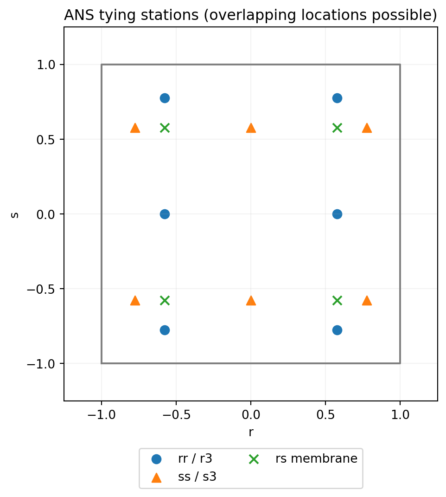
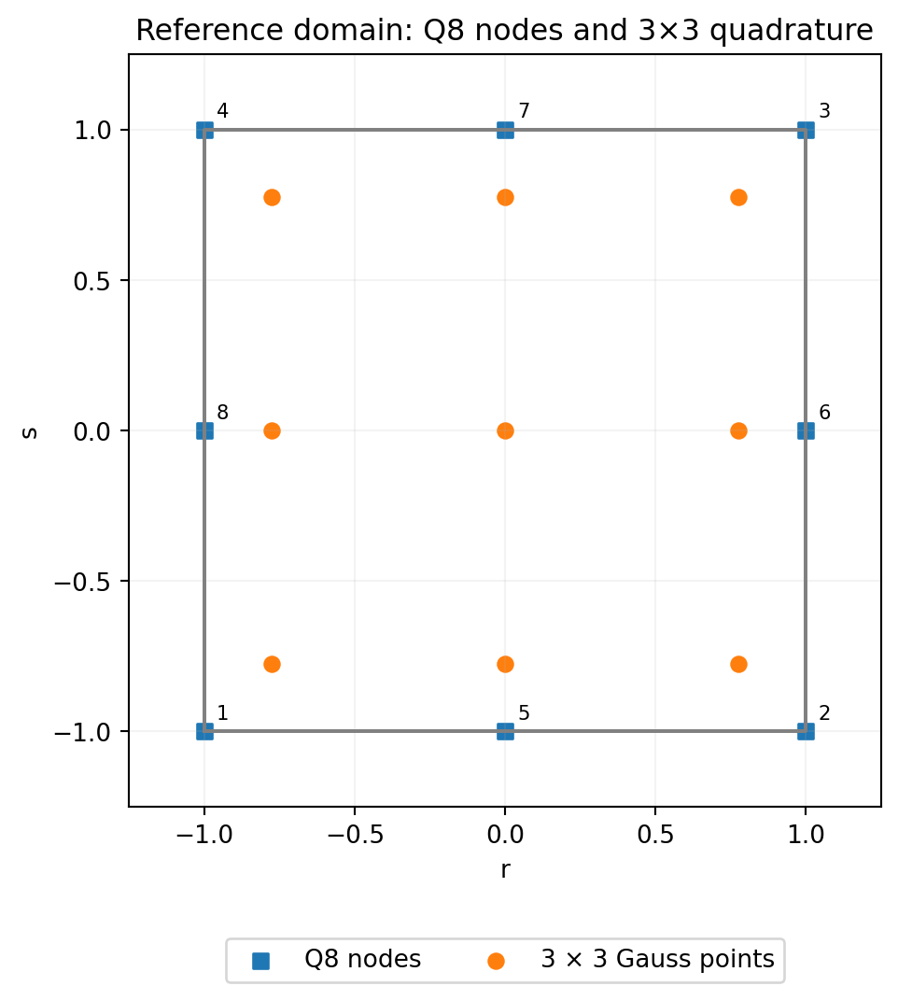
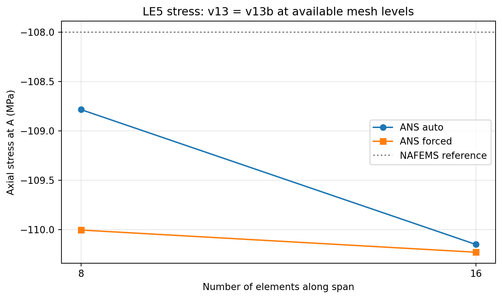

# SIMOQ8 v13: a quadratic serendipity CQUAD8 degenerated shell with selective assumed-natural-strain interpolation and condensed transverse-shear enhancement
**Ary · Independent Researcher · Personal Research** · MYSTRAN v18.00.a · 19 October 2026

**Technical formulation and verification note — MYSTRAN NEWSHELL / CQUAD8**  
**Revision:** 19 October 2026  
**Status:** research formulation; numerical tables distinguish reported historical verification from recent comparative evaluations. Not an assertion of peer review or complete independent Nastran certification.

## Abstract

A quadratic eight-node degenerated shell is presented for linear analysis of thin and moderately thick curved structures. The formulation retains conventional isoparametric serendipity geometry, six nodal global degrees of freedom, a continuously interpolated reference director, point-consistent covariant-to-physical strain transformations, a regularized drilling term, and a geometry-triggered selection of assumed-natural-strain (ANS) interpolation or a locally condensed enhanced-assumed-strain (EAS) shear mode. The development from early implementations through version 13 corrects inconsistent bending/shear kinematics and director orientation, while version 13 revises translational initial-stress geometric stiffness. The central numerical trade-off is explicit: ANS improves curved-shell performance but may violate the distorted flat-patch response; compatible shear with EAS retains the flat-patch behavior but does not guarantee absence of locking in every regime. Recovery of the eliminated EAS parameter is needed to reconstruct the strain field that is consistent with the condensed stiffness. Historical 2-001 patch and Pinched Cylinder Test convergence results, together with comparative NAFEMS LE5 stress recovery, are documented without conflating equivalent recovery-frame changes with improvements in stiffness or accuracy.

**Keywords:** quadratic shell; Q8; assumed natural strain; enhanced assumed strain; static condensation; drilling rotation; stress recovery; geometric stiffness; patch consistency.

## 1. Kinematics and reference geometry

Consider the midsurface parameterized by $(r,s)\in[-1,1]^2$, with ordered corners $1\ldots4$ and midside nodes $5\ldots8$. The scalar serendipity interpolation is

$$
\begin{aligned}
N_1&=\tfrac14(1-r)(1-s)(-1-r-s),&N_2&=\tfrac14(1+r)(1-s)(-1+r-s),\\
N_3&=\tfrac14(1+r)(1+s)(-1+r+s),&N_4&=\tfrac14(1-r)(1+s)(-1-r+s),\\
N_5&=\tfrac12(1-r^2)(1-s),&N_6&=\tfrac12(1+r)(1-s^2),\\
N_7&=\tfrac12(1-r^2)(1+s),&N_8&=\tfrac12(1-r)(1-s^2).
\end{aligned}
$$

The midsurface, translational displacement, and director are approximated by

$$
\mathbf x(r,s)=\sum_{I=1}^{8}N_I\mathbf x_I,\qquad
\mathbf u(r,s)=\sum_{I=1}^{8}N_I\mathbf u_I,\qquad
\mathbf t_0(r,s)=\sum_{I=1}^{8}N_I\mathbf t_I.
$$

The nodal directors $\mathbf t_I$ are unit normals constructed at node positions. Their **sign is determined once per element**, avoiding arbitrary changes when normal components approach zero. The *interpolated* director $\mathbf t_0$ is **not renormalized** in the transverse-shear operator. Each node carries $\mathbf d_I=(u_x,u_y,u_z,\theta_x,\theta_y,\theta_z)^T$; hence $\mathbf d_e\in\mathbb R^{48}$. The unit normal at an evaluation point is formed consistently from the oriented surface tangents, distinct from the unnormalized interpolated director.

Define $\mathbf g_r=\mathbf x_{,r}$ and $\mathbf g_s=\mathbf x_{,s}$. For a pointwise orthonormal basis $\{\mathbf e_1,\mathbf e_2,\mathbf n\}$, the reciprocal tangent vectors are $\mathbf g^\alpha=a^{\alpha\beta}\mathbf g_\beta$, where $[a^{\alpha\beta}]=[\mathbf g_\alpha\cdot\mathbf g_\beta]^{-1}$. Covariant tensor components are projected to physical components with $\mathbf g^\alpha\cdot\mathbf e_i$. All tensor outputs must declare the basis in which they are reported.

## 2. Compatible strain operators

The linear shell strain field is represented as

$$\boldsymbol\varepsilon_m=\mathbf B_m\mathbf d_e,\quad
\boldsymbol\kappa=\mathbf B_b\mathbf d_e,\quad
\boldsymbol\gamma=\mathbf B_s\mathbf d_e.$$

The membrane operator is obtained by projecting the covariant metric variation

$$\varepsilon_{\alpha\beta}=\tfrac12\left(\mathbf g_\alpha\cdot\mathbf u_{,\beta}+\mathbf g_\beta\cdot\mathbf u_{,\alpha}\right)$$

to the local orthonormal tangent plane. The bending operator retains both rotational/director and director-gradient/translation contributions, assembled coherently in the pointwise frame. For the raw covariant transverse-shear rows, the contribution from node $I$ is

$$
\widehat{\mathbf B}_{s,\alpha I}^{(u)}=N_{I,\alpha}\mathbf t_0^T,\qquad
\widehat{\mathbf B}_{s,\alpha I}^{(\theta)}=N_I(\mathbf t_I\times\mathbf g_\alpha)^T,\quad\alpha\in\{r,s\}.
$$

The physical $2\times48$ shear operator is obtained by reciprocal-basis projection. **The cross-product order is essential**: $\mathbf t_I\times\mathbf g_\alpha$ is not interchangeable with $\mathbf g_\alpha\times\mathbf t_I$. The sign of the translational director-gradient terms of $\mathbf B_b$ is fixed consistently with rigid-body rotations and the chosen curvature sign convention. Relative sign changes to an entire bending operator can leave $\mathbf B_b^T\mathbf D_b\mathbf B_b$ unchanged while reversing reported bending moments; accordingly, stiffness agreement alone is insufficient for recovery verification.

For isotropic plane stress,

$$
\mathbf C=\frac{E}{1-\nu^2}\begin{bmatrix}1&\nu&0\\\nu&1&0\\0&0&(1-\nu)/2\end{bmatrix},\quad
\mathbf D_m=h\mathbf C,\quad\mathbf D_b=\frac{h^3}{12}\mathbf C,\quad
\mathbf D_s=\kappa_sGh\mathbf I_2,
\quad G=\frac{E}{2(1+\nu)},\quad\kappa_s=5/6.
$$

Engineering shear ordering is $(\gamma_{12},\gamma_{13})$ as appropriate for the respective membrane and transverse-shear operators. Membrane, bending and shear are kept distinct when forming force and moment resultants.

## 3. Selective ANS interpolation

In curved or warped elements, ANS interpolation samples covariant membrane and transverse-shear rows at tying stations. Put $a=1/\sqrt3$, $b=\sqrt{3/5}$. The sampling grid consists of $(r,s)=(\pm a,-b),(\pm a,0),(\pm a,b)$ for $rr$ and transverse-$r$; $(r,s)=(-b,\pm a),(0,\pm a),(b,\pm a)$ for $ss$ and transverse-$s$; and $(\pm a,\pm a)$ for membrane $rs$. These stations are interpolated using the degree-one Lagrange factors in the two-station direction and degree-two factors in the three-station direction. The covariant result is subsequently transformed using **the geometry and physical basis at the output/integration point**. Bending $\mathbf B_b$ is not tied.

**Figure 1.** ANS stations in the Q8 parent domain; coincident locations between the row families are intentional. This is an operator schematic, not a mesh-convergence result.

The current selective trigger is

$$
\text{ANS active}\iff
\max_I\cos^{-1}(\mathbf t_I\cdot\widehat{\mathbf t}_c)>0.01\ {\rm rad}
\quad\lor\quad
\max_{\rm edges}\frac{\|\mathbf x_{\rm mid}-(\mathbf x_a+\mathbf x_b)/2\|}{\|\mathbf x_b-\mathbf x_a\|}>10^{-3}.
$$

Here $\widehat{\mathbf t}_c$ is the normalized interpolated director at the center. By default ANS affects membrane and shear together; if active, the scalar EAS shear mode is disabled. This empirical geometry switch is a project-specific choice, not a general theorem. A discontinuous operator change at its threshold and failure to activate on subtly curved thin shells remain limitations.

## 4. Condensed scalar transverse-shear enhancement

For elements with ANS disabled, the transverse-shear field is enriched with one internal mode

$$\phi(r,s)=(1-r^2)(1-s^2),\qquad
\mathbf b_\alpha(r,s)=\begin{bmatrix}\mathbf e_1\cdot\nabla_s\phi\\\mathbf e_2\cdot\nabla_s\phi\end{bmatrix},\qquad
\boldsymbol\gamma_h=\mathbf B_s\mathbf d_e+\mathbf b_\alpha\alpha_e.$$

The scalar $\alpha_e$ is internal to an element. Let

$$
\mathbf K_{dd}=\int_{\Omega_e}\big(\mathbf B_m^T\mathbf D_m\mathbf B_m+\mathbf B_b^T\mathbf D_b\mathbf B_b+\mathbf B_s^T\mathbf D_s\mathbf B_s+\mathbf B_d^TD_d\mathbf B_d\big)\,dA,
$$

$$\mathbf K_{d\alpha}=\int_{\Omega_e}\mathbf B_s^T\mathbf D_s\mathbf b_\alpha\,dA,\quad
K_{\alpha\alpha}=\int_{\Omega_e}\mathbf b_\alpha^T\mathbf D_s\mathbf b_\alpha\,dA.$$

Stationarity of the internal enhanced mode yields

$$
\alpha_e=-K_{\alpha\alpha}^{-1}\mathbf K_{\alpha d}\mathbf d_e,\qquad
\boxed{\mathbf K_e=\mathbf K_{dd}-\mathbf K_{d\alpha}K_{\alpha\alpha}^{-1}\mathbf K_{\alpha d}}.
$$

The enhanced field is a **single transverse-shear bubble**, not the nine-parameter solid wedge EAS scheme. No extra global DOFs arise. Numerical implementation should use a scalar solve and check $K_{\alpha\alpha}$ for degeneracy. For ANS-active elements use the ANS $\mathbf B_s$ and no EAS condensation.

### 4.1 Consistent recovery of the enhanced shear mode

The condensed stiffness already contains the effect of $\alpha_e$. After equilibrium, the internal parameter must be reconstructed for a stiffness-consistent constitutive shear:

$$
\boxed{\mathbf q_s(r,s)=\mathbf D_s\left[\mathbf B_s(r,s)\mathbf d_e+\mathbf b_\alpha(r,s)\alpha_e\right]}.
$$

If $\mathbf D_s=\kappa_sGh\mathbf I_2$, $\mathbf q_s$ has units of force/length; $\boldsymbol\tau_s=\mathbf q_s/h$ is the corresponding shear stress under the adopted effective-shear constitutive law. Reporting only $\mathbf D_s\mathbf B_s\mathbf d_e$ while EAS is active omits the condensed strain correction. This is a **recovery-consistency improvement**, not a change to the formulation's stiffness. It must not be confused with setting shear to zero or performing ad hoc constant projection.

The documented 2-001 LC2 EID 24 results were $Q_y=\pm0.02666667$ using raw recovery, and approximately $10^{-15}$ after internal-mode reconstruction; a constant nonzero-shear patch test preserved the imposed analytic result. These findings do **not** establish a general physical shear-stress solution for arbitrary curved or loaded shells.

## 5. Drilling stabilization, integration and initial-stress stiffness

A weak, positive drilling strain penalty regularizes the otherwise deficient six-DOF shell rotation. The drill operator couples in-plane displacement curl and normal rotation in the **same pointwise physical basis**, schematically

$$\gamma_d=\tfrac12\left(u_{2,1}-u_{1,2}\right)-\theta_n,
\qquad\mathbf K_d=\int_{\Omega_e}\mathbf B_d^T(\beta_dGh)\mathbf B_d\,dA,
\quad\beta_d=0.02.$$

Rigid-body tests must account for the chosen drilling sign and rotation basis. For Q8, $3\times3$ Gauss–Legendre integration with abscissae $\{-\sqrt{3/5},0,\sqrt{3/5}\}$ and weights $\{5/9,8/9,5/9\}$ is used for the mechanical and enhanced coupling matrices.

**Figure 2.** Eight serendipity nodes and nine Gauss integration stations in $(r,s)$. Area integrals include the true surface Jacobian $\|\mathbf x_{,r}\times\mathbf x_{,s}\|$.

For a prescribed initial membrane stress tensor expressed in the tangent frame,

$$\boldsymbol\sigma_0=\begin{bmatrix}\sigma_{11}&\tau_{12}\\\tau_{12}&\sigma_{22}\end{bmatrix},\quad
(\mathbf K_G)_{Ia,Jb}=\delta_{ab}\int_{\Omega_e}h\,(\nabla_sN_I)^T\boldsymbol\sigma_0\,(\nabla_sN_J)\,dA,\quad a,b=1,2,3.$$

The physical tangent-gradient operator is formed from reciprocal surface vectors, not unscaled natural-coordinate derivatives. Translational components are included in all spatial directions; a normal-only projection is an optional special case. **This is a translational initial-stress approximation**, not a full geometrically nonlinear consistent shell tangent containing rotational/director prestress couplings. Curved-shell buckling requires further validation; no blanket equivalence with Nastran's geometric tangent is claimed.

## 6. Stress, moments, frames and winding

The stress and resultant measures, in a declared physical point frame, are

$$\boldsymbol\sigma_m=\mathbf C\mathbf B_m\mathbf d_e,\quad
\mathbf n=h\boldsymbol\sigma_m,\quad
\mathbf m=\frac{h^3}{12}\mathbf C\mathbf B_b\mathbf d_e,\quad
\boldsymbol\sigma_{b,\pm}=\pm\frac h2\mathbf C\mathbf B_b\mathbf d_e.$$

An in-plane tensor at an integration/output point is embedded in three dimensions and transformed into the global basis by $\boldsymbol\sigma_G=\mathbf R_p\boldsymbol\sigma_p\mathbf R_p^T$. A user-requested constant element-center representation is $\boldsymbol\sigma_c=\mathbf R_c^T\boldsymbol\sigma_G\mathbf R_c$; this **does not** imply a second physical stress transformation. The transverse-shear **vector** transforms as $\mathbf q_G=\mathbf R_p(q_1,q_2,0)^T$ rather than as a second-rank tensor. Prior v13-versus-v13b A/B comparisons found unchanged element stiffness, equilibrium and global tensors; point-to-center representation by itself is not an accuracy improvement.

CW–CCW comparisons shall use an explicit node/DOF permutation, the same physical point and an unchanged global reference frame. Local component sign changes can be correct when bases reverse; invariant global tensors are the acceptance target. Never average raw local stresses between elements with differing axes without transforming them into a common frame.

## 7. Numerical benchmark evidence

### 7.1 Progression of the corrected formulation

| Modification | Mathematical significance | Reported consequence |
|---|---|---|
| Early baseline | Initial director and bending/shear sign inconsistencies | Distorted 2-001 bending failure (~301%); Pinched Cylinder Test N=16 ratio ~0.388 |
| V10 | Rotation sign in $\mathbf B_s$ and consistent translation–director-gradient sign in $\mathbf B_b$ | 2-001 bending deviation ~0.84% |
| V11 | Elementwise director orientation; selective ANS and EAS | Pinched Cylinder Test N=16 ratio ~1.026 |
| V12 | Common winding sign for physical frames/directors; unnormalized shear director; pointwise drilling and EAS basis | Distorted 2-001 bending displacement error near machine precision |
| v13 | Revised physical-gradient translational $\mathbf K_G$ | Improvement in operator definition; full nonlinear shell-buckling equivalence not established |

The prior development note reports the flat distorted 2-001 V12 bending displacement error at approximately $3.9\times10^{-10}\%$ and winding-reversed error at $2.9\times10^{-10}\%$. This is a **displacement metric**, not sufficient evidence of correct bending stress recovery at every output station.

### 7.2 Curved shell convergence

**Figure 3.** Historical Pinched Cylinder Test pinched-cylinder refinement, response normalized by the published benchmark. Connecting lines are visual guides between actual recorded mesh sizes, not interpolated FE solutions. V12 is an antecedent of v13; this plot does not claim an additional newly executed v13 refinement series.

| Number of divisions $N$ | Early baseline | V11 | V12 |
|---:|---:|---:|---:|
| 4 | 0.095 | 0.964 | 0.965 |
| 8 | 0.166 | 1.023 | 1.023 |
| 16 | 0.388 | 1.026 | 1.026 |

### 7.3 Patch-test versus locking trade-off — decisive qualification

**ANS must not be presented as an unconditional improvement.** A historical V11 operator ablation yielded:

| Shear/membrane treatment | Flat distorted 2-001 bending reported error | Pinched Cylinder Test at $N=4$ (target 1) |
|---|---:|---:|
| No ANS, with EAS | 0.84% | 0.21 |
| ANS shear alone | 133% | 0.82 |
| ANS membrane alone | 14.9% | 0.42 |
| ANS membrane + shear | 133% | 0.96 |

**Figure 4.** Historical V11 ablation. These are *not* v13 auto-mode patch-test results. V12 improved the no-ANS patch result substantially by resolving frame/sign inconsistency; the V11 ablation remains evidence that curved-shell improvement alone cannot justify applying ANS indiscriminately. **V13 ANS-forced distorted-patch acceptance must be verified separately** using consistent stress extraction.

The stronger shear locking risk of compatible full-integration Q8 in thin bending motivates local enhancement, but a smooth stress plot or an accurate coarse mesh is **not** proof of locking freedom. Required gates are distorted and affine patch consistency, nonzero-shear patch Test, rigid-body rank, bending/twist, shear-energy scaling with $h/L$, and curved-shell displacement convergence. Partial-patch error or additional zero eigenmodes must not be hidden by a recovery-only transformation.

### 7.4 Stress recovery: NAFEMS LE5 Z-section cantilever

Reported model properties: $E=210\,\mathrm{GPa}$, $h=0.1\,\mathrm m$; target axial midsurface stress at evaluation point A is $\sigma_{xx}=-108\,\mathrm{MPa}$. Results below were produced by a numerical v13/v13b comparison; the reported number is the **mean of the two adjacent unaveraged element-side** point stresses, not a universal nodal-averaged solution.

| ANS setting | Span / cross-section mesh | v13 = v13b stress (MPa) | Relative error vs -108 MPa |
|---|---|---:|---:|
| Auto | 8 × (1/1/1) | -108.7853 | 0.73% |
| Auto | 16 × (2/4/2) | -110.1502 | 1.99% |
| Forced | 8 × (1/1/1) | -110.0046 | 1.86% |
| Forced | 16 × (2/4/2) | -110.2291 | 2.06% |

**Figure 5.** Available LE5 stress refinement points and target. The changed transverse mesh also affects stress; these two points do not establish an asymptotic convergence order. v13b adds a center-frame representation but does not change global stress values. It must not be claimed more accurate based on frame equivalence.

### 7.5 Verification relative to Nastran and independent references

| Verification | Independent target / comparator | Supported result | Status |
|---|---|---|---|
| SAP2000/Nastran 2-001 LC1–LC2 | Analytic constant membrane stress and moment, prescribed boundary field | v13 exact interior displacement in a reproduced LC2 equilibrium; stress/moment extraction needs reconciled basis/sign checks | **Partial** |
| 2-001 transverse shear | Zero analytic shear for manufactured bending | Raw $Q_y\approx\pm0.02666667$ at EID 24 midsides; enhanced-mode reconstruction approximately zero | **Recovery mechanism identified**, independent Nastran shear parity not established |
| Patch nonzero transverse shear Test| $Q_x=(5/6)Gha$ | Prescribed constant-shear test retained nonzero result | **Pass for prescribed-field test** |
| Pinched Cylinder Test pinched cylinder | Published benchmark displacement | Historical V12 ratios 0.965 / 1.023 / 1.026 | **Reported antecedent** |
| NAFEMS LE5 | $\sigma_{xx}(A)=-108$ MPa | Both v13/v13b around -108.8 to -110.2 MPa | **Close, limited mesh study** |
| 2-016/2-017 eigen-buckling | Discrete eigenvalue and matching prestress | Geometric operator available, no newly established comprehensive parity table | **Open** |

A historical comparison harness also produced approximately 6.14% difference in 2-001 stress/moment and 200% bending/twist sign discrepancies in Patch Test, despite near-exact displacements; these outcomes have not been reconciled against the declared local/global frame and sign conventions. They **remain unresolved verification flags**, not evidence that the physical shell stiffness is either right or wrong. The comparison with Nastran bending moments likewise cannot be used as an absolute reference until stress location, fiber, tensor definition and output conventions match.

## 8. Scope, limitations and acceptance recommendations

1. Retain the v13 serendipity shell and its geometry-selective ANS/EAS treatment as the **research baseline**. Do not add Kikuchi/MacNeal interpolation operators without controlled independent ablation.
2. Treat internal EAS shear reconstruction as a separate postprocessing candidate, requiring equilibrium shear and curved-shell regression; do not confuse recovery changes with stiffness improvement.
3. Treat v13b point-to-center tensor representation as output-frame equivalence until warped/curved, edge discontinuity and solver-parity tests show otherwise. Displacement and global stress equality alone do not warrant preference for either presentation convention.
4. Separate membrane stress, bending fiber stress, bending moment, transverse-shear force, local center/corner stress, global tensor and nodal averaging. Compare Nastran only at matching physical coordinates and unaveraged stress positions.
5. Determine mechanical patch acceptance using both **interior equilibrium displacement** and **actual stress/moment**; test ANS forced versus auto with nonzero shear and curved geometry. Explicitly report any patch sacrifice associated with improved Pinched Cylinder Test/curved-shell performance.
6. The provided translational geometric stiffness does not constitute a complete geometrically nonlinear consistent shell tangent; modal, thermal, mass, pressure and buckling parity should be tracked independently.

## References

1. Simo, J. C., Fox, D. D., and Rifai, M. S. (1989). “On a stress resultant geometrically exact shell model. Part II: The linear theory; Computational aspects.” *Computer Methods in Applied Mechanics and Engineering*, **73**, 53–92. https://doi.org/10.1016/0045-7825(89)90098-4.
2. Simo, J. C., and Rifai, M. S. (1990). “A class of mixed assumed strain methods and the method of incompatible modes.” *International Journal for Numerical Methods in Engineering*, **29**, 1595–1638. https://doi.org/10.1002/nme.1620290802.
3. Bathe, K.-J., and Dvorkin, E. N. (1986). “A formulation of general shell elements—the use of mixed interpolation of tensorial components.” *International Journal for Numerical Methods in Engineering*, **22**, 697–722. https://doi.org/10.1002/nme.1620220312.
4. Andelfinger, U., and Ramm, E. (1993). “EAS-elements for two-dimensional, three-dimensional, plate and shell structures and their equivalence to HR-elements.” *International Journal for Numerical Methods in Engineering*, **36**, 1311–1337.
5. MacNeal, R. H., and Harder, R. L. (1985). “A proposed standard set of problems to test finite element accuracy.” *Finite Elements in Analysis and Design*, **1**, 3–20.
6. Project historical formulation audit (2026), *Simo Q8 shell: dari v1p8 ke V10, V11, V12*, internal comparative measurements and qualified ablations.
7. Project benchmark records (2026), *SIMOQ8 v13/v13b comparative regression and NAFEMS LE5 Z-section stress recovery*, source-specific internal results.
8. NAFEMS, *LE5 Z-section cantilever* benchmark specification; stress target and sampling convention should be checked against the chosen edition before formal publication.
9. Computers and Structures, Inc., *SAP2000 verification manual*, shell analysis verification problems 2-001 through 2-017; individual models must be matched before attributing solver-to-solver differences.

## Current checkout recovery note — 19 October 2026

Commit1f97ea99 makes SIMOQ8 same-point tensor recovery explicit while preserving the OP2 center basis, and corrects basic/local basis handling in quadratic GPFORCE. Stiffness and pressure kernels are unchanged; applied loads and displacements remain unchanged. This does not remove transverse-shear, curved-shell or buckling-normalization limitations. See [reference comparison](../../shell_benchmark/comparison_all.md).
