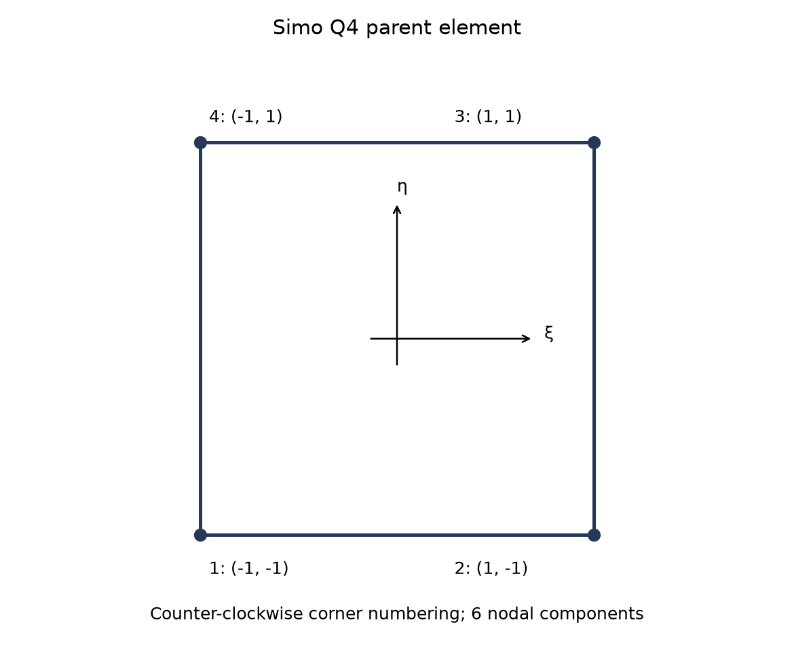
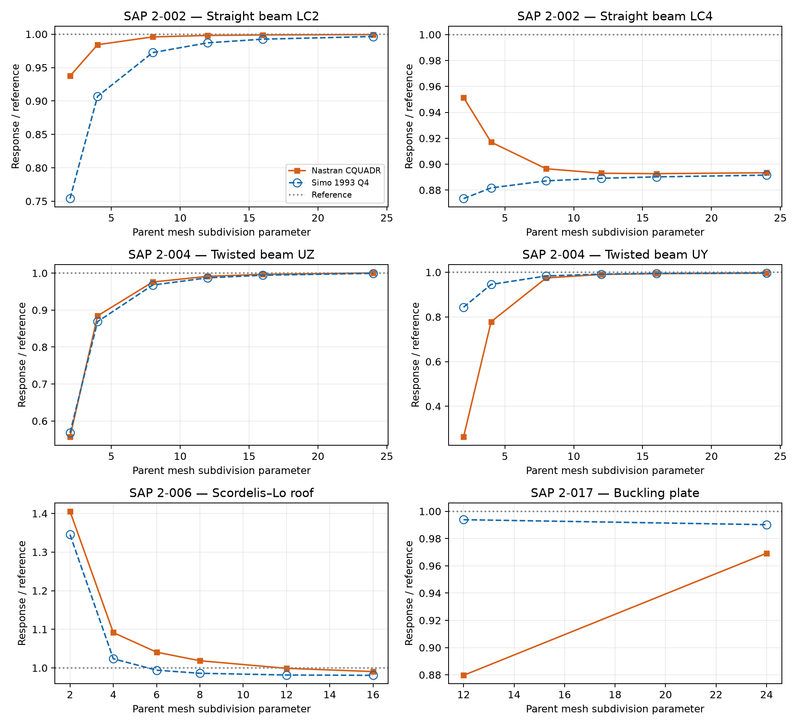

# Simo 1993 Q4 Shell: Covariant Warping-Aware Kinematics, ANS–EAS Enhancement and Mystran Benchmark

**Ary — 25 October 2026**

## Abstract

The formulation uses covariant membrane and curvature measures, including displacement–director-gradient coupling, together with ANS shear, four enhanced membrane modes and a rotation–spin drilling penalty. Selected static and linear-buckling responses are compared with Nastran CQUADR. The numerical assessment is confined to the stated linear shell model and does not establish the full finite-rotation tangent or post-buckling theory.

## 1. Scope

This report presents mathematical construction steps and case-specific numerical results. See the companion [Simo 1989 Q4 report](Simo1989_Formulation.md) for the related formulation and its separate external comparison.

## 2. Step 1: geometry, directors and degrees of freedom

The bilinear reference surface is

$$
\boldsymbol\phi_0(\xi,\eta)=\sum_{I=1}^{4}N_I\mathbf{X}_I,\qquad N_I=\frac14(1+\xi_I\xi)(1+\eta_I\eta).
$$

Corner coordinates are $(-1,-1),(1,-1),(1,1),(-1,1)$ in counter-clockwise order. Define

$$
\mathbf{g}_\alpha=\boldsymbol\phi_{0,\alpha},\qquad a_{\alpha\beta}=\mathbf{g}_\alpha\cdot\mathbf{g}_\beta,\qquad \mathbf{g}^{\alpha}=a^{\alpha\beta}\mathbf{g}_\beta,\qquad J_s=\|\mathbf{g}_1\times\mathbf{g}_2\|.
$$

Here $a^{\alpha\beta}$ is the inverse surface metric. Each unit nodal director $\mathbf{t}_{0I}$ is associated with a two-dimensional tangent plane. The reference director interpolation and small rotation variation are

$$
\mathbf{t}_0=\sum_I N_I\mathbf{t}_{0I},\qquad \delta\mathbf{t}=\sum_I N_I(\boldsymbol\theta_I\times\mathbf{t}_{0I}).
$$

The interpolated director is used consistently in the strain definitions; unit nodal directors do not imply that their bilinear interpolation has unit length everywhere. The reported Q4 comparison uses 24 nodal components,

$$
\mathbf{d}_I=[u_I,v_I,w_I,\theta_{XI},\theta_{YI},\theta_{ZI}]^{\mathrm{T}}.
$$



*Figure 1. Corner numbering and oriented element sides. The geometry is bilinear and may be warped.*

## 3. Step 2: covariant membrane, bending and shear measures

The linear membrane tensor is

$$
\varepsilon_{\alpha\beta}=\frac12(\mathbf{u}_{,\alpha}\cdot\mathbf{g}_\beta+\mathbf{g}_\alpha\cdot\mathbf{u}_{,\beta}).
$$

For the director-based curvature measure, retain both linearised contributions:

$$
\delta\rho_{\alpha\beta}=\mathbf{u}_{,\alpha}\cdot\mathbf{t}_{0,\beta}+\mathbf{g}_\alpha\cdot\delta\mathbf{t}_{,\beta}.
$$

The first term is displacement–director-gradient coupling; the second is the rotation contribution. The first vanishes when the reference director is constant. It can remain active on curved or warped geometry and must not be omitted merely because the element has four corners.

The covariant transverse shear is

$$
\gamma_\alpha=\mathbf{u}_{,\alpha}\cdot\mathbf{t}_0+\mathbf{g}_\alpha\cdot\delta\mathbf{t}.
$$

For a physical reference frame $\mathbf{E}_1,\mathbf{E}_2$, define $p_a^{\alpha}=\mathbf{E}_a\cdot\mathbf{g}^{\alpha}$. Tensor and shear components are projected consistently:

$$
\varepsilon_{ab}^{p}=p_a^{\alpha}\varepsilon_{\alpha\beta}p_b^{\beta},\qquad \rho_{ab}^{p}=p_a^{\alpha}\delta\rho_{\alpha\beta}p_b^{\beta},\qquad \gamma_a^p=p_a^{\alpha}\gamma_\alpha.
$$

A fixed centroid frame supplies the common reference axes. On warped surfaces these equations define the chosen projected strain representation; they are not a claim that the centroid plane coincides with every local tangent plane. Engineering shear components use twice the symmetric tensor off-diagonal component.

## 4. Step 3: ANS transverse shear in the assessed Q4 variant

The edge-midpoint tying points are $A=(0,-1)$, $B=(1,0)$, $C=(0,1)$ and $D=(-1,0)$. Interpolation must recover its own tying-point values:

$$
\widehat\gamma_\xi(\xi,\eta)=\frac{1-\eta}{2}\gamma_\xi(A)+\frac{1+\eta}{2}\gamma_\xi(C),
$$

$$
\widehat\gamma_\eta(\xi,\eta)=\frac{1-\xi}{2}\gamma_\eta(D)+\frac{1+\xi}{2}\gamma_\eta(B).
$$

The covariant assumed components are mapped to the physical strain frame at each integration point. This construction is distinct from a DKM edge field with eliminated side-rotation increments.


*Figure 2. Four edge-midpoint shear samples and four interior Gauss points. All Gauss weights equal one.*

## 5. Step 4: enhanced membrane strain and condensation

For isotropic elasticity, let $\mathbf{C}_0$ denote the plane-stress matrix with normal coefficients $E/(1-\nu^2)$, Poisson coupling $\nu E/(1-\nu^2)$ and engineering-shear coefficient $G=E/[2(1+\nu)]$. The integrated matrices are

$$
\mathbf{D}_m=h\mathbf{C}_0,\qquad \mathbf{D}_b=\frac{h^3}{12}\mathbf{C}_0,\qquad \mathbf{D}_s=\frac56Gh\mathbf{I}_2.
$$

Four internal parameters enrich the membrane strain:

$$
\boldsymbol\varepsilon_m=\mathbf{B}_m\mathbf{d}_e+\mathbf{M}\boldsymbol\alpha,\qquad \boldsymbol\alpha\in\mathbb{R}^{4}.
$$

The natural-coordinate enhanced operator has columns $(\xi,0,0)^{\mathrm{T}}$, $(0,\eta,0)^{\mathrm{T}}$, $(0,0,\xi)^{\mathrm{T}}$ and $(0,0,\eta)^{\mathrm{T}}$. With centroid strain transformation $\mathbf{T}_0$ and the corresponding planar mapping determinant $j_p$,

$$
\mathbf{M}(\xi,\eta)=\frac{j_p(0,0)}{j_p(\xi,\eta)}\mathbf{T}_0\widehat{\mathbf{M}}(\xi,\eta).
$$

On regular planar mappings, determinant-ratio scaling supports zero-mean enhanced modes. It does not by itself prove every warped-surface patch property. Define

$$
\mathbf{K}_{u\alpha}=\int_A\mathbf{B}_m^{\mathrm{T}}\mathbf{D}_m\mathbf{M}\,\mathrm{d}A,
$$

$$
\mathbf{K}_{\alpha\alpha}=\int_A\mathbf{M}^{\mathrm{T}}\mathbf{D}_m\mathbf{M}\,\mathrm{d}A.
$$

After internal equilibrium,

$$
\boldsymbol\alpha=-\mathbf{K}_{\alpha\alpha}^{-1}\mathbf{K}_{\alpha u}\mathbf{d}_e,\qquad \mathbf{K}_{\mathrm{cond}}=\mathbf{K}_{uu}-\mathbf{K}_{u\alpha}\mathbf{K}_{\alpha\alpha}^{-1}\mathbf{K}_{\alpha u}.
$$

The total compatible stiffness includes membrane, bending and ANS shear. The EAS correction affects the membrane field; drilling is added as described separately below. Thickness factors are already contained in the integrated constitutive matrices.

## 6. Step 5: Hughes–Brezzi-type drilling constraint

The membrane continuum spin and interpolated normal rotation are

$$
\omega=\frac12(v_{,x}-u_{,y}),\qquad \theta_d=\sum_I N_I(\boldsymbol\theta_I\cdot\mathbf{t}_{0I}),\qquad \gamma_d=\omega-\theta_d.
$$

The rotational projection uses each node's director. A corresponding per-node operator in global translation and rotation components is

$$
\mathbf{b}_{d,I}=\left[\frac12(N_{I,x}\mathbf{e}_2-N_{I,y}\mathbf{e}_1)^{\mathrm{T}},-N_I\mathbf{t}_{0I}^{\mathrm{T}}\right].
$$

With $\beta_d=0.02$ for the assessed isotropic setting,

$$
\Pi_d=\frac12\int_A\beta_dGh\gamma_d^2\,\mathrm{d}A,\qquad \mathbf{K}_d=\int_A\mathbf{B}_d^{\mathrm{T}}\beta_dGh\mathbf{B}_d\,\mathrm{d}A.
$$

For planar rigid spin, continuum spin and normal rotation coincide and the drilling energy vanishes. On a general warped element the full projected operator must be checked against physical rigid motions. A positive coefficient supplies a positive-semidefinite drilling term; it does not alone prove rank sufficiency or that arbitrary penalty magnitudes leave every physical response unchanged.

## 7. Difference between the Simo 1989 and Simo 1993 Q4 descriptions

The year labels identify the two assessed Q4 variants and their formulation lineage. They must not be read as a claim that every ingredient was introduced in that year or that these linear elements reproduce the complete geometrically exact shell theory.

| Feature | Simo 1989 description | Simo 1993 Q4 description |
|---|---|---|
| Director kinematics | Five physical nodal variables: three translations and two tangent rotations | Same physical director motion, represented with three rotational components and drilling regularisation |
| Separate supplied 1989 hybrid | Five-DOF, projected EAS and DKM side shear | Not this DKM hybrid |
| Assessed Q4 shear | ANS edge-midpoint field | ANS edge-midpoint field |
| Assessed Q4 membrane | Compatible covariant strain plus EAS4 | Compatible covariant strain plus EAS4 |
| Assessed Q4 bending | Rotation and director-gradient coupling | Rotation and director-gradient coupling |
| Drilling treatment | Edge-based normal-rotation regularisation for the 24-component comparison | Distributed rotation–spin penalty |
| External comparison | Nastran CQUAD4 | Nastran CQUADR |

The common membrane, bending and ANS equations do not make the two responses universally identical. Nodal director descriptions, drilling regularisation and the comparison element can change the result. Conversely, benchmark agreement cannot establish equivalence of the complete nonlinear theories.

## 8. Mystran Benchmark: comparison with Nastran CQUADR

Membrane, bending, shear, EAS and distributed drilling terms use 2 × 2 Gauss integration at $\xi,\eta=\pm1/\sqrt{3}$, with unit weights and surface measure $J_s\,\mathrm{d}\xi\,\mathrm{d}\eta$. Edge regularisation is evaluated as the discrete sum defined in Section 6 where applicable.



*Figure 3. Response normalized by the independent reference. Beam abscissae are longitudinal subdivisions, roof abscissae use equal subdivisions in both directions, and buckling uses the longitudinal counts of the 2 × 12 and 4 × 24 meshes. Open-circle markers remain visible when curves overlap.*

### 8.1 Selected numerical results

Beam responses use longitudinal subdivision count 24, the roof uses 16 × 16 parent panels, and the buckling plate uses 4 × 24 parent panels. The curved beam uses its benchmark mesh. Accuracy is assessed separately for each solver against its independent reference.

For each matched physical response, the two accuracy measures use the independent reference for that case, load, component and unit:

```math
\mathrm{Nastran\_error}=100\frac{|q_{\mathrm{Nastran}}-q_{\mathrm{ref,Nastran}}|}{|q_{\mathrm{ref,Nastran}}|},
\qquad
\mathrm{Mystran\_error}=100\frac{|q_{\mathrm{Mystran}}-q_{\mathrm{ref,Mystran}}|}{|q_{\mathrm{ref,Mystran}}|}.
```

For matched responses with the same physical reference, $q_{\mathrm{ref,Nastran}}=q_{\mathrm{ref,Mystran}}=q_{\mathrm{ref}}$ as listed in the table. Both errors are nonnegative percentages. Nastran is not the error denominator. For a zero reference, report the absolute residual in the response unit; if no independent reference is available, report the percentage error as unavailable. Reference-normalized response plots retain unity as the target. The reported solver responses and existing meshes are unchanged.


| SAP case | LC | Response | Unit | Simo 1993 Q4 | Nastran CQUADR | Reference | Nastran_error (%) | Mystran_error (%) |
| --- | --- | --- | --- | --- | --- | --- | --- | --- |
| 2-002 | 1 | tip UX | in | 3e-05 | 3.438168e-05 | 3e-05 | 14.6056 | 0.0000 |
| 2-002 | 2 | tip UZ | in | 0.1077193 | 0.1080311 | 0.1081 | 0.0637 | 0.3522 |
| 2-002 | 3 | tip UY | in | 0.431884 | 0.432016 | 0.4321 | 0.0194 | 0.0500 |
| 2-002 | 4 | tip abs UY | in | 0.003040183 | 0.003046425 | 0.00341 | 10.6620 | 10.8451 |
| 2-002 | 5 | tip abs UX | in | 0.0008973687 | 0.0009 | 0.0009 | 0.0000 | 0.2924 |
| 2-002 | 6 | tip RZ | rad | 0.036 | 0.036 | 0.036 | 0.0000 | 0.0000 |
| 2-003 | 1 | tip UY | in | 0.088489225 | 0.08892159 | 0.0886 | 0.3630 | 0.1250 |
| 2-003 | 2 | tip UZ | in | 0.49073815 | 0.4942291 | 0.5004 | 1.2332 | 1.9308 |
| 2-004 | 1 | tip UZ | in | 0.0017479417 | 0.001749793 | 0.001749 | 0.0453 | 0.0605 |
| 2-004 | 2 | tip UY | in | 0.0054125913 | 0.005407034 | 0.005429 | 0.4046 | 0.3022 |
| 2-006 | 1 | free edge midpoint UZ | ft | -0.3026752 | -0.3056915 | -0.3086 | 0.9425 | 1.9199 |
| 2-017 | 2 | critical load | kip | 126.6542 | 123.9762 | 127.91 | 3.0754 | 0.9818 |

### 8.2 Interpretation

- **2-002, 2, tip UZ:** reference 0.1081 in; Nastran_error=0.0637%; Simo 1993 Q4 Mystran_error=0.3522%.
- **2-002, 4, tip abs UY:** reference 0.00341 in; Nastran_error=10.6620%; Simo 1993 Q4 Mystran_error=10.8451%.
- **2-002, 5, tip abs UX:** reference 0.0009 in; Nastran_error=0.0000%; Simo 1993 Q4 Mystran_error=0.2924%.
- **2-004, 1, tip UZ:** reference 0.001749 in; Nastran_error=0.0453%; Simo 1993 Q4 Mystran_error=0.0605%.
- **2-004, 2, tip UY:** reference 0.005429 in; Nastran_error=0.4046%; Simo 1993 Q4 Mystran_error=0.3022%.
- **2-006, 1, free edge midpoint UZ:** reference -0.3086 ft; Nastran_error=0.9425%; Simo 1993 Q4 Mystran_error=1.9199%.
- **2-017, 2, critical load:** reference 127.91 kip; Nastran_error=3.0754%; Simo 1993 Q4 Mystran_error=0.9818%.


The full table retains the axial, flexural, torsional and buckling distinctions. A close twisted-beam response does not establish universal accuracy, and only two buckling mesh levels are shown. A year label cannot substitute for specifying the strain interpolation and drilling constraint. Benchmark differences from CQUAD4 and CQUADR must be interpreted against their respective reference responses.

## 9. Conclusions

The director-based membrane and curvature measures provide the common physical basis. ANS shear and EAS membrane enhancement define the assessed Q4 strain approximation. The five-DOF director concept, the separate DKM hybrid and the 24-component benchmark variants are distinguished explicitly. Differences between the two assessed Simo Q4 descriptions are concentrated in drilling regularisation and director treatment, rather than an automatic change of all shell equations with the year label. Linear static and buckling results do not establish finite-rotation or post-buckling behavior.

## 10. References

Simo, J.C., & Fox, D.D. (1989). On a stress resultant geometrically exact shell model. Part I: Formulation and optimal parametrization. *Computer Methods in Applied Mechanics and Engineering*, 72, 267–304.

Simo, J.C., & Rifai, M.S. (1990). A class of mixed assumed strain methods and the method of incompatible modes. *International Journal for Numerical Methods in Engineering*, 29, 1595–1638.

Fox, D.D., & Simo, J.C. (1992). A drill rotation formulation for geometrically exact shells. *Computer Methods in Applied Mechanics and Engineering*, 98, 329–343.

Dvorkin, E.N., & Bathe, K.-J. (1984). A continuum mechanics based four-node shell element for general nonlinear analysis. *Engineering Computations*, 1, 77–88.

Hughes, T.J.R., & Brezzi, F. (1989). On drilling degrees of freedom. *Computer Methods in Applied Mechanics and Engineering*, 72, 105–121.

Computers & Structures, Inc. *SAP2000 Verification Examples*, Problems 2-002, 2-003, 2-004, 2-006 and 2-017.
