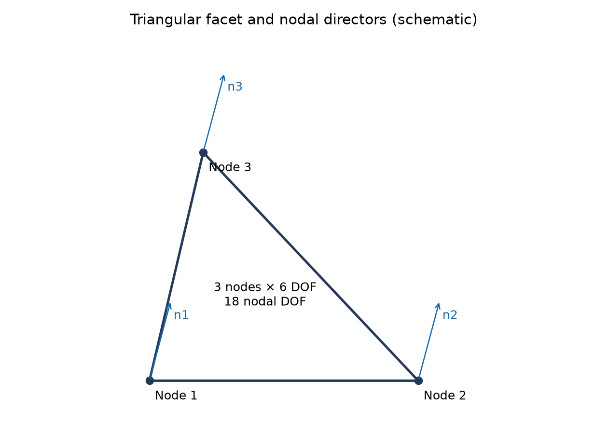
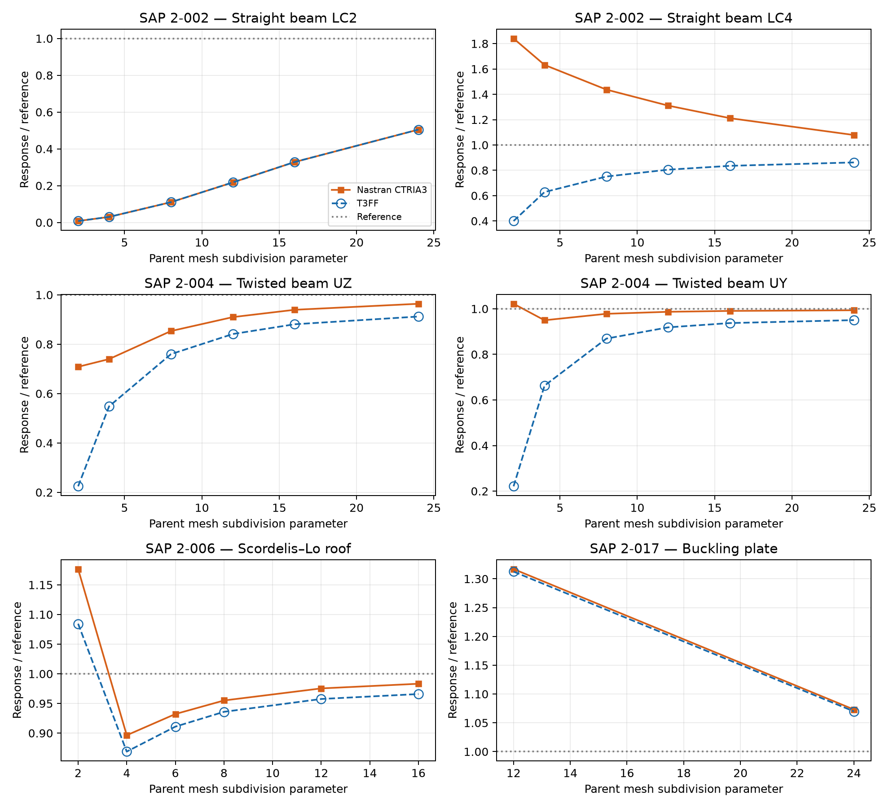
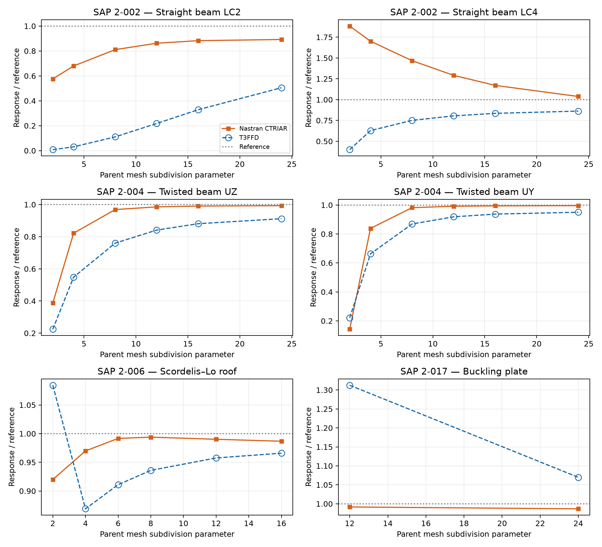

# T3FF and T3FFD Triangular Shells: Director-Based Formulation, Drilling Stabilisation and SAP Benchmark Assessment

**Ary — 25 October 2026**

## Abstract

T3FF and T3FFD are presented together as a family of three-node flat-facet shells with a common membrane, bending and discrete shear gap foundation. Their shared geometry, director transformations and shear treatment are developed first, followed by a separate treatment of drilling regularisation and the Hughes–Brezzi extension. Selected SAP benchmarks compare T3FF with Nastran CTRIA3 and T3FFD with Nastran CTRIAR. The reported T3FF and T3FFD responses coincide for the assessed drilling setting, while their differences from the two Nastran comparison elements remain case dependent. The results distinguish numerical agreement, agreement with an independent reference, and the separate requirements of rigid-body objectivity and element rank.

## 1. Scope and organisation

A combined treatment avoids duplicating the geometry and strain equations. T3FF denotes the baseline director-based flat-facet shell. T3FFD denotes the drilling-extension family, including fictitious, Hughes–Brezzi and combined regularisation choices. The benchmark results reported here correspond to the common fictitious-drilling setting. They are not a comparative test of fictitious versus Hughes–Brezzi drilling.

| Formulation | External comparison |
|---|---|
| T3FF | Nastran CTRIA3 |
| T3FFD | Nastran CTRIAR |

The following sections describe mathematical construction steps, with no additional global degrees of freedom beyond the 18 nodal unknowns.

## 2. Step 1: facet geometry and interpolation

For corner positions $\mathbf{x}_1,\mathbf{x}_2,\mathbf{x}_3$, define

$$
A_e=\frac12\left\|(\mathbf{x}_2-\mathbf{x}_1)\times(\mathbf{x}_3-\mathbf{x}_1)\right\|.
$$

A right-handed facet frame follows from

$$
\mathbf{e}_1=\frac{\mathbf{x}_2-\mathbf{x}_1}{\|\mathbf{x}_2-\mathbf{x}_1\|},\qquad \mathbf{e}_3=\frac{(\mathbf{x}_2-\mathbf{x}_1)\times(\mathbf{x}_3-\mathbf{x}_1)}{2A_e},\qquad \mathbf{e}_2=\mathbf{e}_3\times\mathbf{e}_1.
$$

The linear natural-coordinate functions are

$$
N_1=1-r-s,\qquad N_2=r,\qquad N_3=s,\qquad r\geq0,\quad s\geq0,\quad r+s\leq1.
$$

Each node carries translations and right-hand-rule rotations:

$$
\mathbf{q}_i=[u_i,v_i,w_i,\theta_{xi},\theta_{yi},\theta_{zi}]^{\mathrm{T}},\qquad \mathbf{q}_e\in\mathbb{R}^{18}.
$$

The physical shell kinematics use three translations and two flexural rotations per node. Drilling rotation about the nodal normal is treated separately. Nodal directors $\mathbf{n}_i$ describe the orientation of the shell at each node; a nodal basis aligns its third axis with $\mathbf{n}_i$.

*Figure 1. Flat triangular facet with schematic nodal directors. Director arrows illustrate orientation and are not a prescribed numerical geometry.*

## 3. Step 2: membrane and bending response

For isotropic elasticity, the plane-stress matrix is

$$
\mathbf{C}_{ps}=\frac{E}{1-\nu^2}\begin{bmatrix}1&\nu&0\\\nu&1&0\\0&0&(1-\nu)/2\end{bmatrix}.
$$

The thickness-integrated matrices are

$$
\mathbf{D}_m=t\mathbf{C}_{ps},\qquad \mathbf{D}_b=\frac{t^3}{12}\mathbf{C}_{ps},\qquad G=\frac{E}{2(1+\nu)}.
$$

Using facet coordinates $x,y$, the membrane strain and compatible curvature are

$$
\boldsymbol\varepsilon_m=[u_{,x},v_{,y},u_{,y}+v_{,x}]^{\mathrm{T}}=\mathbf{B}_m\mathbf{q}_e,
$$

$$
\boldsymbol\kappa=[\theta_{y,x},-\theta_{x,y},\theta_{y,y}-\theta_{x,x}]^{\mathrm{T}}=\mathbf{B}_b\mathbf{q}_e.
$$

The corresponding constant-operator stiffness terms are

$$
\mathbf{K}_m=A_e\mathbf{B}_m^{\mathrm{T}}\mathbf{D}_m\mathbf{B}_m,\qquad \mathbf{K}_b=A_e\mathbf{B}_b^{\mathrm{T}}\mathbf{D}_b\mathbf{B}_b.
$$

## 4. Step 3: discrete shear gaps and shear scaling

For each cyclic node ordering $o_j\in\{(1,2,3),(2,3,1),(3,1,2)\}$, an edge-integrated displacement–rotation relation defines a discrete shear operator $\mathbf{B}_{s,j}$. A consistent right-hand-rule shear convention is

$$
\boldsymbol\gamma=[w_{,x}+\theta_y,w_{,y}-\theta_x]^{\mathrm{T}}.
$$

The adopted three-ordering construction averages shear energies:

$$
\mathbf{K}_s=\frac{A_e}{3}\sum_{j=1}^{3}\mathbf{B}_{s,j}^{\mathrm{T}}\mathbf{D}_s^{\mathrm{eff}}\mathbf{B}_{s,j}.
$$

This differs from forming the stiffness of an averaged strain operator. Define $h_e=\sqrt{2A_e}$ and the thickness-sensitive shear factor

$$
\psi=\kappa_s\frac{t^2}{t^2+\alpha h_e^2},\qquad \alpha=\frac{\kappa_s}{2(1+\nu)},\qquad \kappa_s=\frac56.
$$

Using the convention that the shear correction is included in $\psi$,

$$
\mathbf{D}_s^{\mathrm{eff}}=\psi Gt\mathbf{I}_2.
$$

The shear correction and thickness factors must each be applied once. The common facet stiffness before drilling is $\mathbf{K}_E=\mathbf{K}_m+\mathbf{K}_b+\mathbf{K}_s$.

## 5. Step 4: director transformations

Let $\mathbf{T}_{ae}$ map nodal-basis unknowns to the facet representation and $\mathbf{T}_{ga}$ map global unknowns to nodal bases. Then

$$
\mathbf{q}_E=\mathbf{T}_{ae}\mathbf{q}_A,\qquad \mathbf{q}_A=\mathbf{T}_{ga}\mathbf{q}_G.
$$

The intermediate stiffness and global stiffness are

$$
\mathbf{K}_A=\mathbf{T}_{ae}^{\mathrm{T}}\mathbf{K}_E\mathbf{T}_{ae},
$$

$$
\mathbf{K}_G=\mathbf{T}_{ga}^{\mathrm{T}}\left(\mathbf{K}_A+\mathbf{K}_d^A\right)\mathbf{T}_{ga}.
$$

This sequence distinguishes the facet frame, nodal director bases and global coordinates. The drilling term must be defined in a basis consistent with its displacement and rotation components.

## 6. Step 5: T3FF drilling and the T3FFD extension

### 6.1 Fictitious drilling setting used in the benchmarks

Let $k_f$ be the mean of the six flexural-rotation diagonal stiffnesses in the nodal basis multiplied by a nonnegative scale $s_d$:

$$
k_f=\frac{s_d}{6}\sum_{i=1}^{3}\left[(\mathbf{K}_A)_{\theta_{1i}\theta_{1i}}+(\mathbf{K}_A)_{\theta_{2i}\theta_{2i}}\right].
$$

A diagonal regularisation adds $k_f$ to each nodal drilling entry. This supplies numerical resistance to drilling unknowns; it does not, by itself, prove that the six physical rigid-body motions remain in the nullspace. A direct absolute-rotation penalty can resist a uniform rigid rotation about the normal.

The reported T3FF and T3FFD benchmarks use this common setting and have identical response values. Their equality is specific to the assessed setting, not a proof that all drilling alternatives leave every shell response unchanged.

### 6.2 Hughes–Brezzi drilling strain

A displacement–rotation drilling constraint compares interpolated normal rotation with continuum membrane spin:

$$
\gamma_d=\theta_d-\omega,\qquad \theta_d=\sum_{i=1}^{3}N_i\theta_{di},\qquad \omega=\frac12(v_{,x}-u_{,y}).
$$

Its per-node facet operator is

$$
\mathbf{b}_{d,i}=\left[\frac12N_{i,y},-\frac12N_{i,x},0,0,0,N_i\right].
$$

The opposite sign for the entire row gives the same quadratic stiffness. With dimensionless $\beta_d>0$,

$$
\Pi_d=\frac12\int_{A_e}\beta_dGt\gamma_d^2\,\mathrm{d}A,\qquad \mathbf{K}_d^E=\int_{A_e}\mathbf{B}_d^{\mathrm{T}}\beta_dGt\mathbf{B}_d\,\mathrm{d}A.
$$

Where the complete facet-to-nodal transformation retains the drilling field, the corresponding nodal-basis operator is $\mathbf{B}_d^A=\mathbf{B}_d^E\mathbf{T}_{ae}$. A reduced transformation that has already eliminated a drilling component cannot be assumed to recover it merely by adding this product.

For rigid in-plane rotation, $u=-\Omega y$, $v=\Omega x$, and $\theta_d=\Omega$, so $\gamma_d=0$. This establishes the constraint's rigid-spin consistency; it is not a complete proof of the rank of the assembled shell stiffness.

### 6.3 Rank and three-dimensional shell use

| Drilling choice | Mathematical role | Required assessment |
|---|---|---|
| None | Reference without drilling resistance | Identify unconstrained drilling modes |
| Fictitious diagonal | Adds drilling resistance | Check physical rigid motions and sensitivity |
| Hughes–Brezzi | Penalises rotation–spin mismatch | Check the full transformed operator and remaining mechanisms |
| Combined | Uses both contributions | Check rank, objectivity and over-stiffening |

For a nondegenerate unconstrained 18-DOF shell with only six rigid-body modes, the target deformational rank is 12. This is a verification criterion, not a rank result established for every listed choice. The supplied formulation assessment reports residual mechanisms for the Hughes–Brezzi-only choice; therefore T3FFD should not be described simply as an HB addition that automatically makes every three-dimensional configuration rank sufficient.

## 7. Step 6: numerical integration

Constant membrane and compatible bending terms are integrated at the triangular centroid $(r,s)=(1/3,1/3)$. The three cyclic shear operators are combined by energy averaging. The quadratic drilling product uses symmetric three-point integration:

$$
(r_g,s_g)\in\{(1/6,1/6),(2/3,1/6),(1/6,2/3)\},\qquad w_g=1/3.
$$

These weights are normalised to sum to unity; the area factor is $A_e$. Thus

$$
\mathbf{K}_d^E=\beta_dGtA_e\sum_{g=1}^{3}w_g\mathbf{B}_d(r_g,s_g)^{\mathrm{T}}\mathbf{B}_d(r_g,s_g).
$$

*Figure 2. Symmetric triangular integration points. Their numbering is illustrative.*

## 8. SAP benchmark comparisons

The external comparisons are T3FF versus Nastran CTRIA3 and T3FFD versus Nastran CTRIAR. Results are matched by benchmark, load case, response and unit. A signed difference is defined by

$$
\Delta_q=100\frac{q_{\mathrm{T3FF\ family}}-q_{\mathrm{Nastran}}}{q_{\mathrm{Nastran}}}.
$$

The reference line in the plots is independent of the Nastran comparison; agreement between two elements does not establish agreement with that reference.

*Figure 3. T3FF displacement and buckling convergence versus Nastran CTRIA3. Open circles and dashed lines identify T3FF even where responses overlap.*

*Figure 4. T3FFD results versus Nastran CTRIAR on the corresponding benchmark sequences. Beam abscissae are longitudinal subdivisions, roof abscissae are equal subdivisions in both directions, and buckling uses the longitudinal counts of the 2 × 12 and 4 × 24 meshes.*

### 8.1 Selected numerical results

Beam results use longitudinal subdivision count 24; the roof uses 16 × 16 parent panels. The curved beam uses its benchmark mesh. The buckling plate uses 4 × 24 parent panels. Units are specified in the tables.

#### T3FF versus Nastran CTRIA3

| SAP case | LC | Response | Unit | T3FF | Nastran CTRIA3 | Difference |
|---|---|---|---|---:|---:|---:|
| 2-002 | 1 | tip UX | in | 3e-05 | 3e-05 | +0.000% |
| 2-002 | 2 | tip UZ | in | 0.05457731 | 0.05456462 | +0.023% |
| 2-002 | 3 | tip UY | in | 0.4320323 | 0.4321559 | -0.029% |
| 2-002 | 4 | tip abs UY | in | 0.00294009 | 0.003678172 | -20.067% |
| 2-002 | 5 | tip abs UX | in | 0.0004543581 | 0.0004542509 | +0.024% |
| 2-002 | 6 | tip RZ | rad | 0.036 | 0.036 | +0.000% |
| 2-003 | 1 | tip UY | in | 0.080838235 | 0.080835205 | +0.004% |
| 2-003 | 2 | tip UZ | in | 0.48943995 | 0.4948982 | -1.103% |
| 2-004 | 1 | tip UZ | in | 0.0015952413 | 0.0016856563 | -5.364% |
| 2-004 | 2 | tip UY | in | 0.0051590657 | 0.0053938653 | -4.353% |
| 2-006 | 1 | free edge midpoint UZ | ft | -0.2980717 | -0.3034232 | -1.764% |
| 2-017 | 2 | critical load | kip | 136.843 | 137.259 | -0.303% |

#### T3FFD versus Nastran CTRIAR

| SAP case | LC | Response | Unit | T3FFD | Nastran CTRIAR | Difference |
|---|---|---|---|---:|---:|---:|
| 2-002 | 1 | tip UX | in | 3e-05 | 3.090472e-05 | -2.927% |
| 2-002 | 2 | tip UZ | in | 0.05457731 | 0.09643454 | -43.405% |
| 2-002 | 3 | tip UY | in | 0.4320323 | 0.4321313 | -0.023% |
| 2-002 | 4 | tip abs UY | in | 0.00294009 | 0.003539409 | -16.933% |
| 2-002 | 5 | tip abs UX | in | 0.0004543581 | 0.0008025134 | -43.383% |
| 2-002 | 6 | tip RZ | rad | 0.036 | 0.036 | +0.000% |
| 2-003 | 1 | tip UY | in | 0.080838235 | 0.087579825 | -7.698% |
| 2-003 | 2 | tip UZ | in | 0.48943995 | 0.4939091 | -0.905% |
| 2-004 | 1 | tip UZ | in | 0.0015952413 | 0.001736926 | -8.157% |
| 2-004 | 2 | tip UY | in | 0.0051590657 | 0.005405563 | -4.560% |
| 2-006 | 1 | free edge midpoint UZ | ft | -0.2980717 | -0.3045089 | -2.114% |
| 2-017 | 2 | critical load | kip | 136.843 | 126.2154 | +8.420% |

### 8.2 Discussion

T3FF and T3FFD give identical responses for the reported setting. Their comparison percentages differ because Nastran CTRIA3 and CTRIAR do not give the same response on every benchmark. In the straight beam, LC2 and LC5 illustrate this clearly: close agreement with CTRIA3 coexists with a much larger difference from CTRIAR and from the independent bending reference. LC4 retains a substantial difference against both comparison elements.

On the twisted beam, the family underpredicts the selected displacements relative to both Nastran triangles. The roof response is also lower in magnitude. For buckling, the selected family load is close to CTRIA3 but higher than CTRIAR. Only two buckling mesh levels are shown, so the limiting critical load is not established.

These observations support reporting T3FF and T3FFD as a common mechanical family with explicitly identified drilling choices. They do not support attributing the benchmark values to an HB-only formulation or claiming that drilling alone resolves every membrane or bending limitation.

## 9. Conclusions

1. A single report is appropriate because T3FF and T3FFD share facet geometry, director transformations, membrane and bending terms, and DSG shear treatment.
2. The drilling extension is a distinct mathematical choice. Fictitious, Hughes–Brezzi and combined terms require separate rank and rigid-motion assessment.
3. The selected T3FF and T3FFD responses coincide; their comparisons with Nastran CTRIA3 and CTRIAR remain different and are therefore tabulated separately.
4. Benchmark convergence, reference accuracy and three-dimensional rank sufficiency must be assessed separately.

## References

Krysl, P. (2022). Robust flat-facet triangular shell finite element. *International Journal for Numerical Methods in Engineering*, 123(10), 2399–2423.

Hughes, T.J.R., & Brezzi, F. (1989). On drilling degrees of freedom. *Computer Methods in Applied Mechanics and Engineering*, 72, 105–121.

Lyly, M., Stenberg, R., & Vihinen, T. (1993). A stable bilinear element for Reissner–Mindlin plates. *Computer Methods in Applied Mechanics and Engineering*, 110(3–4), 343–357.

Computers & Structures, Inc. *SAP2000 Verification Examples*, Problems 2-002, 2-003, 2-004, 2-006 and 2-017.

