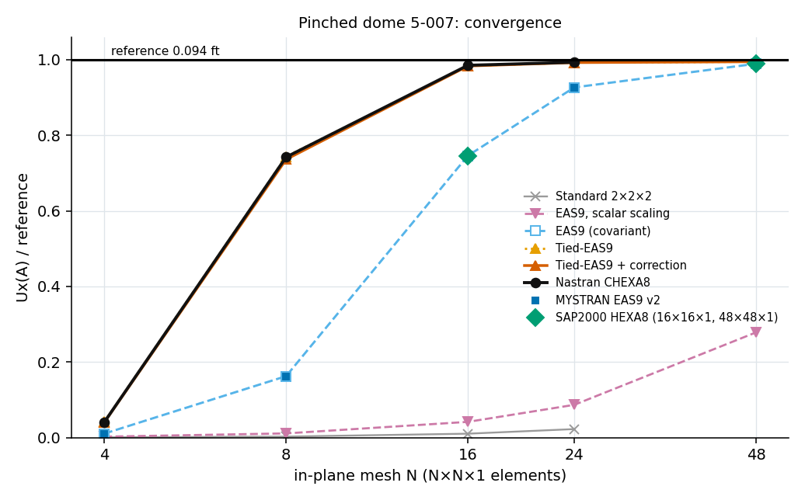
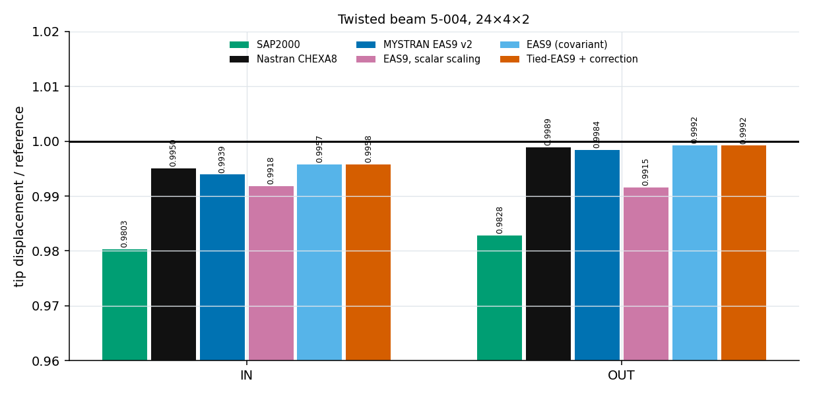
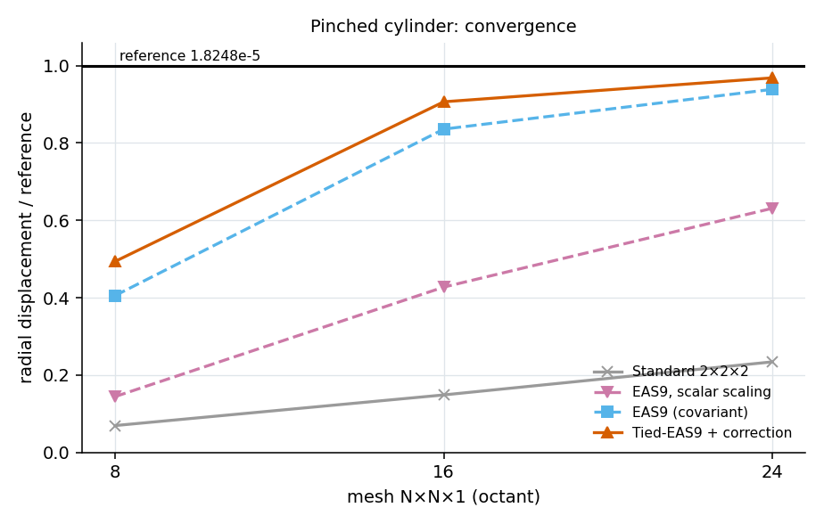
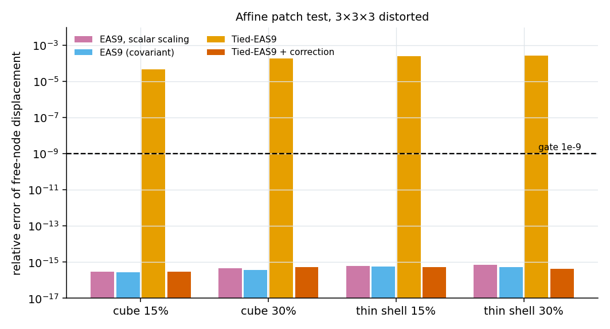

# CHEXA8 EAS: Covariant Enhanced Strains, Consistent Shear Tying, and Mystran Benchmark Comparisons with Nastran

**Ary · Technical formulation and benchmark report · 26 October 2026**

## Abstract

An eight-node hexahedral continuum element is examined through compatible, enhanced assumed strain and tied-shear formulations. Nine local strain parameters are mapped through a frozen centroid transformation and eliminated by static condensation, leaving three translations per vertex. A weighted mean correction reconciles the tied transverse-shear operator with constant-stress equilibrium on distorted bricks, while a shortest-direction rule addresses sensitivity to the designated thickness axis. Existing pinched-dome, twisted-beam, pinched-cylinder and affine-patch results distinguish the effects of covariance, shear tying, consistency restoration and enlarged enhancement spaces. On the reported $24\times24\times1$ dome mesh, corrected tying gives 0.76% displacement error versus 0.68% for Nastran CHEXA8 and 7.33% for covariant EAS9. The corrected tied twisted-beam errors are 0.42% IN and 0.08% OUT. Extended EAS18 and EAS21 spaces show severe over-flexibility in the listed thin-shell benchmarks. These observations support a formulation-specific assessment rather than a universal accuracy claim.

**Keywords:** eight-node hexahedron; enhanced assumed strain; transverse-shear tying; covariant mapping; patch consistency; static condensation; Nastran; Mystran Benchmark.

## 1. Introduction and methodological scope

Trilinear hexahedra provide a simple displacement interpolation for three-dimensional elasticity, but thin bending configurations can expose excessive stiffness. Enhanced assumed strain methods expand the element strain space while retaining the original global displacement variables [1–3]. Assumed-shear and solid-shell approaches modify selected strain components to improve bending response [4,5]. These mechanisms address different parts of the approximation and must be evaluated together with coordinate invariance and constant-stress consistency.

This report develops the mathematical distinctions among scalar-scaled enhancement, centroid-mapped covariant EAS9 and tied EAS9 with a weighted mean correction. The shortest-direction variant is included as a geometric convention for choosing the thickness axis. The construction is presented as the specific formulation assessed by the retained benchmark studies, without identifying it as a verbatim reproduction of any one published element. All numerical results are existing observations; no new solver runs are included.

The main questions are whether the enhancement is frame-consistent, whether shear tying preserves the distorted affine patch, and whether the resulting thin-structure response approaches an independent reference. Passing one of these tests does not imply passing the others.

## 2. Formulation family and scope

| # | Version | Strain field | Difference from the previous version |
|---|---|---|---|
| 1 | Standard | $\varepsilon = B\mathbf u$ | Full 2×2×2 Gauss, no enhancement |
| 2 | EAS9, scalar scaling | $\varepsilon = B\mathbf u + \frac{\det J_0}{\det J}\hat M\boldsymbol\alpha$ | Nine enhanced modes, scaled by $\det J_0/\det J$ only, defined in global Cartesian axes |
| 3 | EAS9 (covariant) | $\varepsilon = B\mathbf u + \frac{\det J_0}{\det J}T_0\hat M\boldsymbol\alpha$ | Modes mapped to physical axes with the frozen centroid transformation $T_0$ |
| 4 | EAS12 / EAS18 / EAS21 | as version 3 | $\hat M$ extended by 3 / 9 / 12 modes |
| 5 | Tied-EAS9 | $\varepsilon = \tilde B\mathbf u + M\boldsymbol\alpha$ | $B$ replaced by $\tilde B$: transverse shear $xz$, $yz$ sampled at $\xi=0$, $\eta=0$ |
| 6 | Tied-EAS9 + correction | $\varepsilon = \tilde B'\mathbf u + M\boldsymbol\alpha$ | Weighted mean of $\tilde B - B$ removed (affine and patch consistency) |
| 7 | Tied-EAS9 + correction + auto axis | as version 6 | $\zeta$ relabelled to the shortest element direction |

All versions: 8 nodes, 24 translational DOF, 2×2×2 Gauss, enhanced parameters condensed at element level.

## 3. Kinematics, constitutive law and integration

Natural coordinates $\boldsymbol\xi=(\xi,\eta,\zeta)\in[-1,1]^3$, trilinear shape functions

```math
N_k=\tfrac18(1+\xi_k\xi)(1+\eta_k\eta)(1+\zeta_k\zeta),\quad k=1,\dots,8.
```

Jacobian $J_{ai}=\partial x_i/\partial\xi_a=\sum_k \partial N_k/\partial\xi_a\,x_{k,i}$, physical gradient $\nabla N=J^{-1}\,\partial N/\partial\boldsymbol\xi$. $B$ is the 6×24 strain-displacement matrix in Voigt order $[xx,yy,zz,xy,yz,zx]$ (engineering shear). $D$ is isotropic elasticity with $\lambda=E\nu/((1+\nu)(1-2\nu))$ and $\mu=E/(2(1+\nu))$. Gauss points $\pm1/\sqrt3$, weights $w_g=\det J_g$, $J_0=J(0,0,0)$.

### 3.1 Nodal numbering and displacement field

The reference brick uses the following vertex coordinates:

| Node | $\xi_k$ | $\eta_k$ | $\zeta_k$ |
|---|---:|---:|---:|
| 1 | -1 | -1 | -1 |
| 2 | +1 | -1 | -1 |
| 3 | +1 | +1 | -1 |
| 4 | -1 | +1 | -1 |
| 5 | -1 | -1 | +1 |
| 6 | +1 | -1 | +1 |
| 7 | +1 | +1 | +1 |
| 8 | -1 | +1 | +1 |

The lower face is 1–2–3–4 and the corresponding upper face is 5–6–7–8. The physical geometry and displacement are

```math
\mathbf{x}=\sum_{k=1}^{8}N_k\mathbf{x}_k,
\qquad
\mathbf{u}_h=\sum_{k=1}^{8}N_k\mathbf{u}_k,
\qquad
\mathbf{d}_e=[u_1,v_1,w_1,\ldots,u_8,v_8,w_8]^{\mathrm{T}}.
```

For the declared engineering-strain ordering,

```math
\mathbf{B}=[\mathbf{B}_1\ \cdots\ \mathbf{B}_8],
\qquad
\mathbf{B}_k=
\begin{bmatrix}
N_{k,x}&0&0\\
0&N_{k,y}&0\\
0&0&N_{k,z}\\
N_{k,y}&N_{k,x}&0\\
0&N_{k,z}&N_{k,y}\\
N_{k,z}&0&N_{k,x}
\end{bmatrix}.
```

### 3.2 Eight-point quadrature

The eight Gauss points are all sign combinations of $(1/\sqrt3,1/\sqrt3,1/\sqrt3)$, with unit reference weights. Their physical weights are $w_g=\det\mathbf{J}_g$. This is full $2\times2\times2$ integration; shear tying changes the sampled strain field rather than reducing the integration rule. The same quadrature is used for displacement, coupling and enhanced blocks. Positive Jacobians at the quadrature points are necessary for the stated energy formulation.

## 4. Enhanced strain and assumed-shear formulations

For a selected displacement-strain operator $\mathcal{B}$ and enhanced operator $M$, the element potential is

```math
\Pi_e(\mathbf{d}_e,\boldsymbol{\alpha})
=\frac12\int_{\Omega_e}
(\mathcal{B}\mathbf{d}_e+M\boldsymbol{\alpha})^{\mathrm{T}}D
(\mathcal{B}\mathbf{d}_e+M\boldsymbol{\alpha})\,dV
-\mathbf{d}_e^{\mathrm{T}}\mathbf{f}_e.
```

Here $\mathcal{B}=B$ for the compatible EAS variants, $\mathcal{B}=\tilde B$ for uncorrected tying, and $\mathcal{B}=\tilde B'$ for mean-corrected tying. The strain enhancement is local to the element; condensation leaves 24 global displacement components per brick [1–3]. A nonsingular enhanced block is required.

### 4.1 Standard

```math
K=\sum_g w_g\,B_g^TDB_g.
```


### 4.2 EAS9, scalar scaling

The EAS9 formulation introduces nine reference-domain zero-mean enhanced
strain modes in the natural engineering-strain order:

`[xi-xi, eta-eta, zeta-zeta, xi-eta, eta-zeta, zeta-xi]`

The enhanced strain interpolation matrix is:

```math
\widehat{\mathbf{M}} =
\begin{bmatrix}
\xi & 0 & 0 & 0 & 0 & 0 & 0 & 0 & 0 \\
0 & \eta & 0 & 0 & 0 & 0 & 0 & 0 & 0 \\
0 & 0 & \zeta & 0 & 0 & 0 & 0 & 0 & 0 \\
0 & 0 & 0 & \xi & \eta & 0 & 0 & 0 & 0 \\
0 & 0 & 0 & 0 & 0 & \eta & \zeta & 0 & 0 \\
0 & 0 & 0 & 0 & 0 & 0 & 0 & \zeta & \xi
\end{bmatrix}
```

The scalar-scaled enhanced strain operator is:

```math
\mathbf{M}(\boldsymbol{\xi})
=
\frac{\det\mathbf{J}_0}
{\det\mathbf{J}(\boldsymbol{\xi})}
\widehat{\mathbf{M}}(\boldsymbol{\xi})
```

where `J0` is the Jacobian evaluated at the element center.

The element matrices are:

**Displacement stiffness:**

```math
\mathbf{K}_{uu}
=
\sum_g w_g
\mathbf{B}_g^T
\mathbf{D}
\mathbf{B}_g
```

**Displacement-enhancement coupling:**

```math
\mathbf{K}_{u\alpha}
=
\sum_g w_g
\mathbf{B}_g^T
\mathbf{D}
\mathbf{M}_g
```

**Enhanced-mode stiffness:**

```math
\mathbf{K}_{\alpha\alpha}
=
\sum_g w_g
\mathbf{M}_g^T
\mathbf{D}
\mathbf{M}_g
```

The nine internal enhanced parameters are eliminated
by static condensation:

```math
\boxed{
\mathbf{K}
=
\mathbf{K}_{uu}
-
\mathbf{K}_{u\alpha}
\mathbf{K}_{\alpha\alpha}^{-1}
\mathbf{K}_{u\alpha}^{T}
}
```

**Limitation of scalar scaling:**

Because the natural enhanced modes are used directly
as Cartesian strain components, without a covariant
strain transformation, the resulting stiffness matrix
is generally dependent on the orientation of the
global Cartesian coordinate system.

Section 4.3 introduces the covariant EAS9 formulation
to eliminate this deficiency.


### 4.3 EAS9, covariant

Following the EAS framework [1–3], each column of $\hat M$ represents a covariant strain tensor $\hat E$ (shear components halved). It is mapped to physical axes with the centre Jacobian:

```math
E=J_0^{-1}\hat E\,J_0^{-T},\qquad M(\boldsymbol\xi)=\frac{\det J_0}{\det J(\boldsymbol\xi)}\,T_0\hat M(\boldsymbol\xi),
```

where $T_0$ is the 6×6 matrix of this map in Voigt form $[E_{11},E_{22},E_{33},2E_{12},2E_{23},2E_{31}]$. Since $w_gM_g=\det J_0\,T_0\hat M_g$ and the monomials $\xi,\eta,\zeta$ sum to zero over the eight Gauss points, $\sum_g w_gM_g=0$. Enhanced strains are therefore orthogonal to constant stress, $K_{\alpha u}\mathbf u_{\rm aff}=0$ and $\boldsymbol\alpha=0$ for affine states (patch consistency). $K$ is invariant to rotation of the element.

Recovery: $\boldsymbol\alpha=K_{\alpha\alpha}^{-1}(F_\alpha-K_{\alpha u}\mathbf u)$, $\boldsymbol\varepsilon=B\mathbf u+M\boldsymbol\alpha$, $\boldsymbol\sigma=D(\boldsymbol\varepsilon-\boldsymbol\varepsilon_{th})$. Thermal load: $F_{th}=F_u-K_{u\alpha}K_{\alpha\alpha}^{-1}F_\alpha$. Consistent mass uses the mechanical interpolation only.

### 4.4 Extended mode sets

```math
\text{EAS12}=\text{EAS9}+\{\eta\zeta\text{ in }\varepsilon_{\xi\xi},\ \zeta\xi\text{ in }\varepsilon_{\eta\eta},\ \xi\eta\text{ in }\varepsilon_{\zeta\zeta}\}
```

EAS18: $\xi,\eta,\zeta$ in each of the six strains. EAS21: EAS18 plus the three quadratic modes of EAS12. Mapping and condensation as in Section 4.3.

### 4.5 Tied-EAS9

Assumed-strain and solid-shell formulations motivate selective transverse-shear interpolation [4,5]. The particular sampling, centroid frame and mean correction below define the formulation studied here; they are not attributed as a verbatim reproduction of a single cited element.

Let $\mathbf{g}_1$, $\mathbf{g}_2$ and $\mathbf{g}_3$ be the physical vectors represented by the three rows of the centroid Jacobian. The orthonormal frame is defined by:

```math
\mathbf n=\frac{\mathbf{g}_3}{\|\mathbf{g}_3\|},\quad \mathbf t=\mathbf{g}_1-(\mathbf{g}_1\cdot\mathbf n)\mathbf n,\ \ \hat{\mathbf t}=\frac{\mathbf t}{\|\mathbf t\|},\quad \mathbf b=\mathbf n\times\hat{\mathbf t},\quad R=[\hat{\mathbf t}\ \ \mathbf b\ \ \mathbf n].
```

$P_{xz}$ and $P_{yz}$ (6×6) take the $xz$ or $yz$ shear component of $R^T\varepsilon R$ and rotate it back. The tied operator is

```math
\tilde B(\xi,\eta,\zeta)=B(\xi,\eta,\zeta)+P_{xz}\big[B(0,\eta,\zeta)-B(\xi,\eta,\zeta)\big]+P_{yz}\big[B(\xi,0,\zeta)-B(\xi,\eta,\zeta)\big].
```

$K$ is built as in Section 4.3 with $B$ replaced by $\tilde B$; $M$ is unchanged. The operator assumes $\zeta$ is the thickness direction.

### 4.6 Correction

Let $\Delta B=\tilde B-B$. Affine and patch consistency require

- (C1) $\tilde B\mathbf u_{\rm aff}=\varepsilon_0$: constant strain is reproduced;
- (C2) $\sum_g w_g\tilde B_g=\sum_g w_gB_g$: equilibrium for constant stress.

Tied-EAS9 satisfies C1 pointwise (single frame $R$) but not C2 on distorted elements. The correction

```math
\tilde B'=\tilde B-\frac{\sum_g w_g\Delta B_g}{\sum_g w_g}
```

enforces C2 exactly and keeps C1, since $\Delta B_g\mathbf u_{\rm aff}=0$ at every point. On parallelepipeds the mean of $\Delta B$ is zero and the correction vanishes.

### 4.7 Auto axis

The mean edge length along $\xi$, $\eta$, $\zeta$ is computed; the shortest direction becomes $\zeta$ by a cyclic relabelling of the natural axes (handedness preserved). The EAS9 mode set is invariant under cyclic permutation. $K$ is computed on the permuted node order and mapped back.

## 5. Mathematical evaluation steps

**Element energy and condensation**

1. Establish the eight vertex coordinates and isotropic elastic constants $E$, $\nu$; form $D$.
2. Compute $J_0$, $\det J_0>0$. Versions 3–7: form $T_0$. Version 7: find the shortest direction and permute nodes.
3. Versions 5–7: form $R$, $P_{xz}$, $P_{yz}$.
4. At each of the 8 Gauss points: compute $J$, $\det J>0$, $\nabla N$, $B$. Versions 5–7: also $B(0,\eta,\zeta)$, $B(\xi,0,\zeta)$, then $\tilde B$ and $\Delta B$. Versions 2–7: evaluate the corresponding enhanced operator $M$.
5. Versions 6–7: subtract the weighted mean of $\Delta B$ from $\tilde B$.
6. Accumulate $K_{uu}$, $K_{u\alpha}$, $K_{\alpha\alpha}$ with weight $\det J$ (using $B$ for versions 2–4, $\tilde B$ for version 5 and $\tilde B'$ for versions 6–7).
7. Eliminate the enhanced parameters using $K=K_{uu}-K_{u\alpha}K_{\alpha\alpha}^{-1}K_{u\alpha}^T$; version 7: map back to the original node order. Symmetry follows from the element potential when the blocks are evaluated consistently.

**Global**

8. Combine element energies to obtain the global equilibrium operator (three translations per node).
9. Partition free and constrained DOF; build the load vector.
10. Solve $K_{ff}\mathbf u_f=F_f-K_{fc}\mathbf u_c$, including the prescribed constrained translations $\mathbf u_c$.
11. Average the displacement over the probe nodes and compare with the reference.

## 6. Mystran Benchmark: existing comparisons with Nastran

All numerical observations in this section are retained from the existing report and its comparison tables. No additional analyses have been performed. The EAS9 v2 comparator, covariant EAS9 study and tied study are retained as separately labelled result sets; similar names do not justify merging their slightly different numerical values.

For a nonzero independent reference $q_{\mathrm{ref}}$,

```math
R=\frac{q}{q_{\mathrm{ref}}},
\qquad
e_q=100\frac{|q-q_{\mathrm{ref}}|}{|q_{\mathrm{ref}}|}.
```

Nastran is a discrete-element comparison, while the independent reference defines the reported physical error. Published SAP2000 values belong to the original benchmark meshes; they are not filled into unanalysed refinement levels [6,7]. Missing entries remain unreported.

### 6.1 Benchmarks

| Benchmark | SAP2000 problem | Model | Reference | SAP2000 published | Meshes |
|---|---|---|---|---|---|
| Pinched dome | 5-007 | $E=68{,}250{,}000$ kip/ft², $\nu=0.3$, $R=10$ ft, $t=0.04$ ft, 18° hole, quarter model, one element through thickness | $U_x(A)=0.094$ ft | 0.0701 ft (HEXA8 16×16×1), 0.093 ft (HEXA8 48×48×1) | N×N×1, N = 4, 8, 16, 24, 48 |
| Twisted beam | 5-004 | $E=29\times10^6$, $\nu=0.22$, $L=12$, 90° twist, unit tip force | IN 0.005429, OUT 0.001749 | IN 0.005322, OUT 0.001719 | 24×4×2 |
| Pinched cylinder | – | $R=300$, $L/2=300$, $t=3$, $E=3\times10^6$, $\nu=0.3$, $P=1$, octant, end diaphragm | $1.8248\times10^{-5}$ | – | N×N×1, N = 8, 16, 24 |
| Affine patch | – | 3×3×3 bricks, interior nodes perturbed 15% and 30% | exact affine field | – | 3×3×3 |

### 6.2 Pinched dome 5-007



*Figure 1. Existing pinched-dome results for the reported formulation variants and comparison elements.*


Ratio $U_x(A)/0.094$ (error against reference).

| Mesh | Standard | EAS9, scalar scaling | EAS9 (covariant) | Tied-EAS9 | Tied-EAS9 + correction | Nastran CHEXA8 | MYSTRAN EAS9 v2 | SAP2000 |
|---|---|---|---|---|---|---|---|---|
| 4×4×1 | 0.0007 (99.93%) | 0.0024 (99.76%) | 0.0105 (98.95%) | 0.0415 (95.85%) | 0.0402 (95.98%) | 0.0408 (95.92%) | 0.0105 (98.95%) | – |
| 8×8×1 | 0.0027 (99.73%) | 0.0111 (98.89%) | 0.1625 (83.75%) | 0.7435 (25.65%) | 0.7361 (26.39%) | 0.7422 (25.78%) | 0.1625 (83.75%) | – |
| 16×16×1 | 0.0103 (98.97%) | 0.0416 (95.84%) | 0.7460 (25.40%) | 0.9836 (1.64%) | 0.9833 (1.67%) | 0.9851 (1.49%) | 0.7460 (25.40%) | 0.7457 (25.43%) |
| 24×24×1 | 0.0225 (97.75%) | 0.0867 (91.33%) | 0.9267 (7.33%) | 0.9924 (0.76%) | 0.9924 (0.76%) | 0.9932 (0.68%) | 0.9267 (7.33%) | – |
| 48×48×1 | – | 0.2785 (72.15%) | 0.9892 (1.08%) | 0.9947 (0.53%) | 0.9947 (0.53%) | – | – | 0.9894 (1.06%) |

At $24\times24\times1$, corrected tying has 0.76% error and Nastran CHEXA8 has 0.68% error, while covariant EAS9 has 7.33% error. The $48\times48\times1$ corrected tied result has 0.53% error, but a matching Nastran entry is unavailable. Those two mesh levels must not be combined into a paired claim.

### 6.3 Twisted beam 5-004



*Figure 2. Existing twisted-beam IN/OUT results on the stated parent mesh. Displacements use inches.*


| Source | IN (in) | error IN | OUT (in) | error OUT |
|---|---|---|---|---|
| SAP2000 | 0.0053220 | 1.97% | 0.0017190 | 1.72% |
| Nastran CHEXA8 | 0.0054018 | 0.50% | 0.0017470 | 0.11% |
| MYSTRAN EAS9 v2 | 0.0053959 | 0.61% | 0.0017462 | 0.16% |
| EAS9, scalar scaling | 0.0053847 | 0.82% | 0.0017342 | 0.85% |
| EAS9 (covariant) | 0.0054057 | 0.43% | 0.0017477 | 0.08% |
| Tied-EAS9 | 0.0054058 | 0.43% | 0.0017477 | 0.07% |
| Tied-EAS9 + correction | 0.0054060 | 0.42% | 0.0017476 | 0.08% |
| Tied-EAS9 + correction + auto axis | 0.0054060 | 0.42% | 0.0017476 | 0.08% |
| Reference | 0.005429 | – | 0.001749 | – |

The mean-corrected tied result has reported errors of 0.42% IN and 0.08% OUT. Nastran CHEXA8 has 0.50% and 0.11% in the retained comparison. The small differences should be interpreted at the numerical precision shown; they do not establish uniform superiority across geometries.

### 6.4 Pinched cylinder



*Figure 3. Existing pinched-cylinder displacement ratios. No Nastran series is available in this table.*


Ratio to reference.

| Version | 8×8×1 | 16×16×1 | 24×24×1 |
|---|---|---|---|
| Standard | 0.0693 | 0.1485 | 0.2341 |
| EAS9, scalar scaling | 0.1442 | 0.4274 | 0.6312 |
| EAS9 (covariant) | 0.4055 | 0.8360 | 0.9388 |
| Tied-EAS9 | 0.4939 | 0.9066 | 0.9685 |
| Tied-EAS9 + correction | 0.4939 | 0.9066 | 0.9685 |

### 6.5 Affine patch test and rotation invariance



*Figure 4. Existing affine-patch and rotation tests, distinguishing scalar mode scaling from covariant mapping and mean-corrected tying.*


Relative error of free-node displacement. Thin shell: 3×3×0.1 box.

| Version | Cube, 15% | Cube, 30% | Thin shell, 15% | Thin shell, 30% | Rotation error of $K$ |
|---|---|---|---|---|---|
| EAS9, scalar scaling | 3.0e-16 | 4.6e-16 | 6.1e-16 | 7.0e-16 | 8.1e-02 |
| EAS9 (covariant) | 2.8e-16 | 3.6e-16 | 5.6e-16 | 5.5e-16 | 4.2e-16 |
| Tied-EAS9 | 4.8e-05 | 1.9e-04 | 2.6e-04 | 2.8e-04 | 4.2e-16 |
| Tied-EAS9 + correction | 2.9e-16 | 5.2e-16 | 5.4e-16 | 4.1e-16 | 6.3e-16 |
| Tied-EAS9 + correction + auto axis | 2.6e-16 | 3.6e-16 | 5.4e-16 | 4.1e-16 | 6.3e-16 |

Scalar scaling passes the stated affine displacement tests but has a rotation error of $8.1\times10^{-2}$. Covariant mapping reduces the recorded rotation error to approximately $4.2\times10^{-16}$. Uncorrected tying is rotationally consistent but fails the distorted patch at the reported levels. Removing its weighted mean discrepancy restores the tested patch response to roundoff.

### 6.6 Extended EAS mode sets

Ratio to reference.

| Version | Dome 8 | Dome 16 | Dome 24 | Cylinder 8 | Cylinder 16 | Cylinder 24 |
|---|---|---|---|---|---|---|
| EAS9 (covariant) | 0.1625 | 0.7460 | 0.9267 | 0.4055 | 0.8360 | 0.9388 |
| EAS12 | 0.1627 | 0.7467 | 0.9272 | 0.4065 | 0.8386 | 0.9419 |
| EAS18 | 0.2171 | 3.2157 | 15.7140 | 1.0741 | 5.7539 | 15.1887 |
| EAS21 | 0.2214 | 3.2377 | 15.8823 | 1.1582 | 5.8948 | 15.9126 |

The EAS12 extension changes the listed ratios only slightly. EAS18 and EAS21 produce displacements several times the reference on finer meshes; these observations indicate severe over-flexibility in the reported configurations. Adding enhanced modes is therefore not a monotonic improvement. No independent rank or nonlinear-stability conclusion is inferred from these ratios alone.

### 6.7 Dependence on thickness axis

Dome 24×24×1, ratio to reference, with the thickness direction mapped to $\zeta$, $\eta$ or $\xi$ by relabelling the element nodes.

| Version | thickness = ζ | thickness = η | thickness = ξ |
|---|---|---|---|
| EAS9 (covariant) | 0.9267 | 0.9267 | 0.9267 |
| Tied-EAS9 + correction | 0.9924 | 0.9267 | 0.9269 |
| Tied-EAS9 + correction + auto axis | 0.9924 | 0.9924 | 0.9924 |


## 7. Discussion and conclusions

Covariant mode mapping and mean-consistent shear tying serve separate purposes. The centroid tensor transformation removes the orientation defect of directly treating reference modes as Cartesian strains. The determinant ratio preserves their zero-mean condition, and the weighted shear correction restores the compatible mean required by the stated patch-equilibrium argument. These properties depend on using consistent strain conventions and sufficiently accurate quadrature.

The benchmark observations show that corrected tying substantially improves the listed thin-dome and pinched-cylinder responses over covariant EAS9 alone. The same results also show that an apparently small formulation change can alter consistency: uncorrected tying retains a distorted-patch residual, while the corrected variant reaches roundoff in the reported tests. A shortest-direction thickness convention removes the tested axis-relabeling discrepancy, although nearly equal edge lengths make that geometric choice nonunique and it is not a substitute for mesh-quality control.

Increasing the enhancement space does not guarantee a better approximation. The reported EAS18/EAS21 displacements become excessively large, while EAS12 offers only small changes relative to EAS9. The evidence supports retaining the explicit mode definition and condensation assumptions with every comparison.

Nastran agreement is useful comparative evidence, but the independent analytical or established benchmark value remains the error reference. The listed static small-strain and patch observations do not establish nonlinear tangent consistency, buckling, general thermal response, anisotropic behavior or robustness under arbitrary distortion. Those capabilities require their own evidence.

[Solid formulation index](README.md) · [CPENTA6 ABE formulation](CPENTA6_ABE_Formulation.md) · [Solid benchmark collection](../../solid_benchmark/README.md)

## 8. References

[1] J. C. Simo and M. S. Rifai (1990). “A class of mixed assumed strain methods and the method of incompatible modes.” *International Journal for Numerical Methods in Engineering*, 29, 1595–1638. [DOI](https://doi.org/10.1002/nme.1620290802).

[2] U. Andelfinger and E. Ramm (1993). “EAS-elements for two-dimensional, three-dimensional, plate and shell structures and their equivalence to HR-elements.” *International Journal for Numerical Methods in Engineering*, 36, 1311–1337.

[3] J. C. Simo, F. Armero and R. L. Taylor (1993). “Improved versions of assumed enhanced strain tri-linear elements for 3D finite deformation problems.” *Computer Methods in Applied Mechanics and Engineering*. [DOI](https://doi.org/10.1016/0045-7825(93)90215-J).

[4] K. J. Bathe and E. N. Dvorkin (1985). “A four-node plate bending element based on Mindlin/Reissner plate theory and a mixed interpolation.” *International Journal for Numerical Methods in Engineering*, 21, 367–383. Background for mixed transverse-shear interpolation; the present continuum brick is a distinct formulation.

[5] R. Hauptmann and K. Schweizerhof (1998). “A systematic development of ‘solid-shell’ element formulations for linear and non-linear analyses employing only displacement degrees of freedom.” *International Journal for Numerical Methods in Engineering*, 42, 49–69.

[6] R. H. MacNeal and R. L. Harder (1985). “A proposed standard set of problems to test finite element accuracy.” *Finite Elements in Analysis and Design*, 1, 3–20.

[7] Computers and Structures, Inc. *SAP2000 Software Verification: Solids*, Examples 5-004 and 5-007. Original published benchmark definitions and reference values are retained in the [solid benchmark collection](../../solid_benchmark/README.md). The pinched-cylinder and perturbed affine-patch studies are additional examples described in this report; they are not relabelled as SAP2000 cases.
