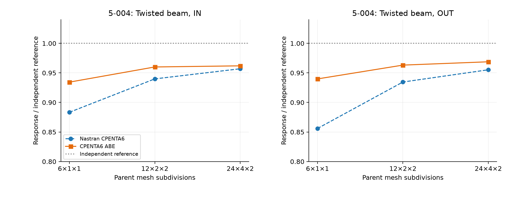
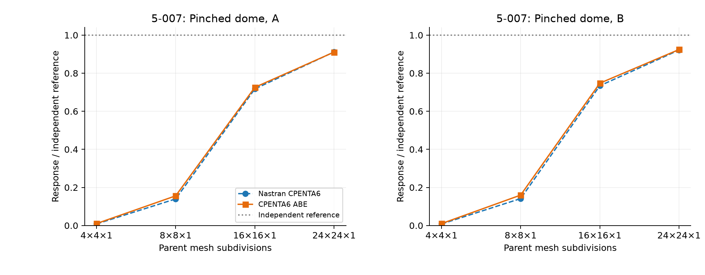
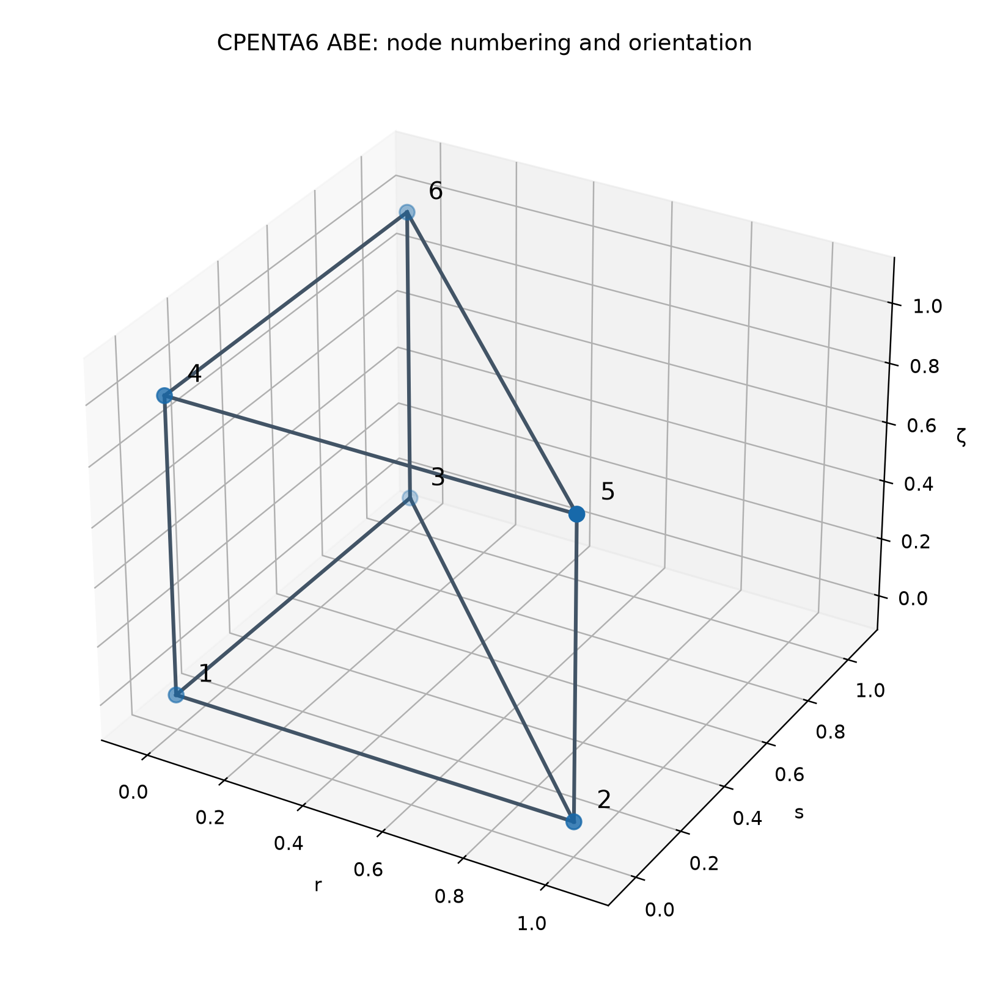
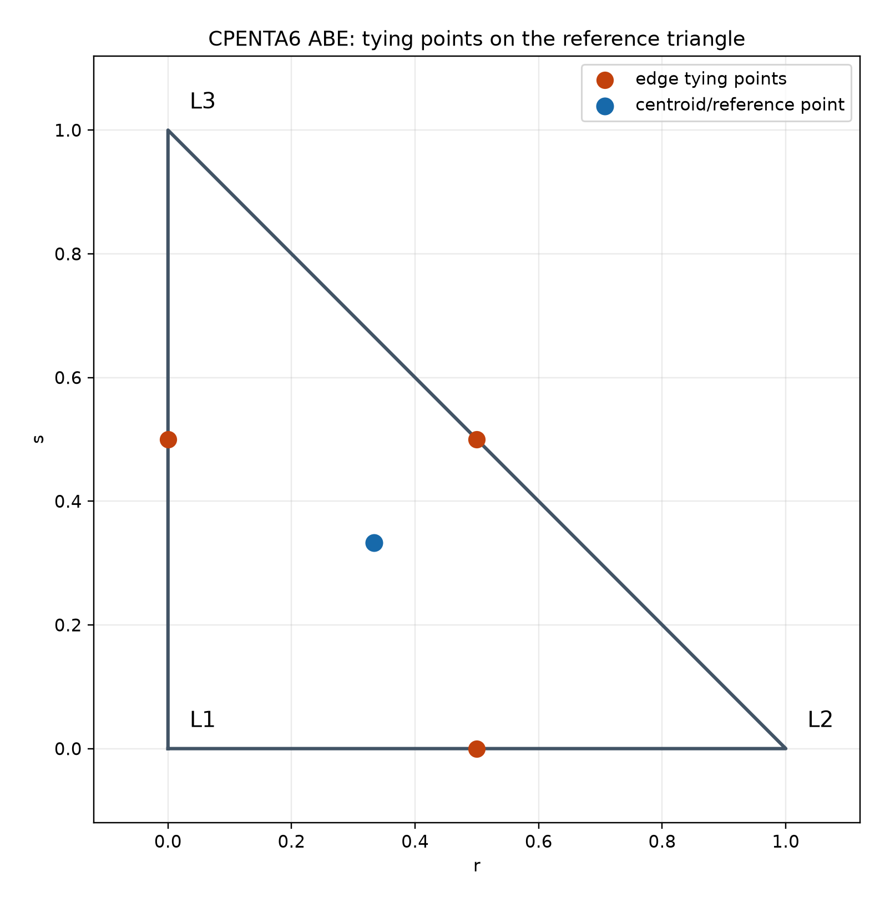
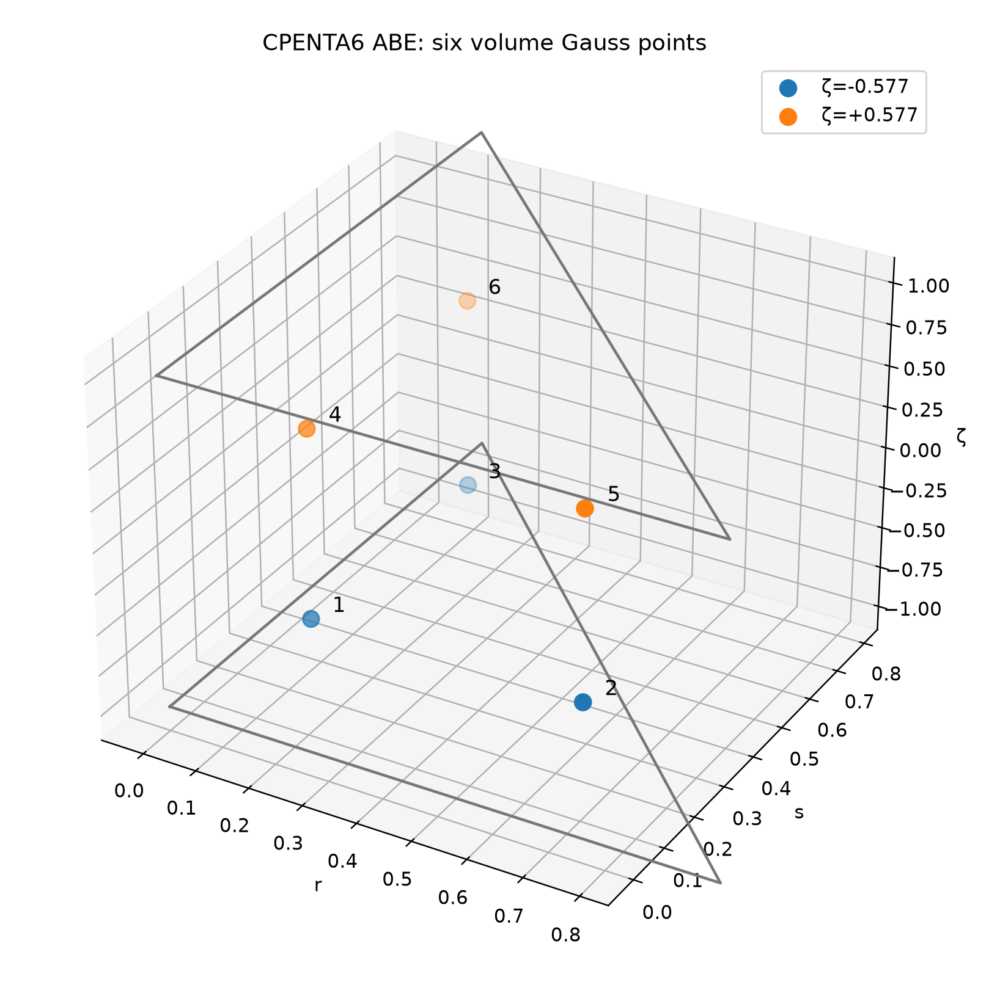
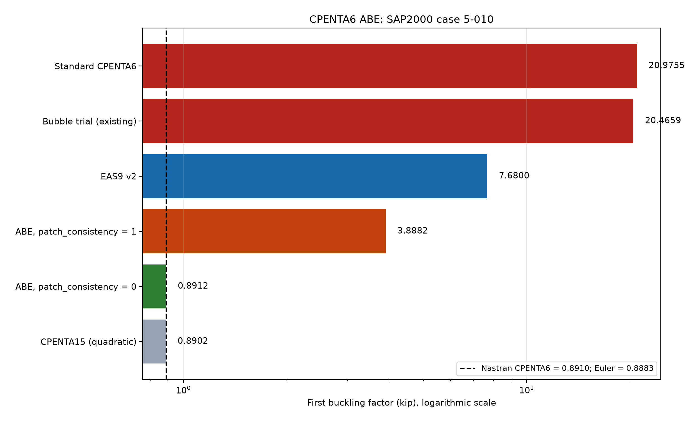

# CPENTA6 ABE: edge-tied assumed shear and condensed enhanced-strain wedge

**Technical formulation and numerical-validation note — MYSTRAN NEWSOLID (`PENTATYP,ABE`)**
**Revision:** 26 October 2026 (existing Nastran benchmark comparisons added) | **Origin:** Ary, [project formulation note](https://github.com/realbabilu/MYSTRAN/blob/v18.00.a/update/Formulation/Solid/CPENTA6_ABE_Formulation.md)

## Abstract

ABE is an 18-DOF, six-node continuum prism using an edge-tied assumed transverse-shear operator and nine internal enhanced assumed strain (EAS) parameters grouped as **A (1), B (2), E (6)**. The internal parameters are statically condensed; **only three global translations per node** are retained. The method is a **project-specific combination**, not a separately published element. For SAP2000 verification 5-010, the reported `patch_consistency=0` buckling factor changes from **0.8912** at a 2×1×12 mesh to **0.8885** at 8×1×48, near Euler's **0.8883**. The same setting, however, fails the distorted constant-stress patch test 5-001; `patch_consistency=1` restores patch consistency but reintroduces thin-bending locking. The two settings must not be conflated.

## 1. Domain, interpolation, and degrees of freedom

The reference wedge is

$$
\widehat\Omega=\{(r,s,\zeta):r\ge0,\ s\ge0,\ r+s\le1,\ -1\le\zeta\le1\}.
$$

Set $L_1=1-r-s$, $L_2=r$, and $L_3=s$. The six interpolation functions are

$$
N_a(r,s,\zeta)=\frac{1-\zeta}{2}L_a(r,s),\quad
N_{a+3}(r,s,\zeta)=\frac{1+\zeta}{2}L_a(r,s),\quad a=1,2,3.
$$

The isoparametric geometry and displacement are

$$
\mathbf x(r,s,\zeta)=\sum_{a=1}^{6}N_a\mathbf x_a,
\qquad \mathbf u^h(r,s,\zeta)=\mathbf N\mathbf d,
\qquad \mathbf d\in\mathbb R^{18},
$$

$$
\mathbf N=\begin{bmatrix}N_1\mathbf I_3&N_2\mathbf I_3&\cdots&N_6\mathbf I_3\end{bmatrix}.
$$

The bottom nodes are (1,2,3) at $\zeta=-1$ and their corresponding upper nodes are (4,5,6) at $\zeta=+1$. The Jacobian convention in this report uses **rows** as physical coordinate derivatives:

$$
\mathbf J=\frac{\partial\mathbf x}{\partial(r,s,\zeta)}=
\begin{bmatrix}\mathbf x_{,r}^{T}\\\mathbf x_{,s}^{T}\\\mathbf x_{,\zeta}^{T}\end{bmatrix},
\qquad dV=\det\mathbf J\,dr\,ds\,d\zeta.
$$

Use an orientation with $\det\mathbf J>0$ at all quadrature points. The spatial gradient is $\nabla_{\mathbf x}N_a=\mathbf J^{-1}\nabla_{\xi}N_a$ with the corresponding row/column convention; equivalently, $\nabla_{\xi}N_a=\mathbf J\nabla_{\mathbf x}N_a$.

Let $\mathbf B$ denote the usual $6\times18$ engineering-strain operator in ordering

$$
\boldsymbol\varepsilon_V=[\varepsilon_{xx},\varepsilon_{yy},\varepsilon_{zz},\gamma_{xy},\gamma_{yz},\gamma_{zx}]^T,\qquad
\boldsymbol\varepsilon_V=\mathbf B\mathbf d.
$$

For isotropic linear elasticity, the constitutive relationship in engineering-shear Voigt notation is

$$
\boldsymbol{\sigma}_v = \mathbf{D}\boldsymbol{\varepsilon}_v
$$

where

$$
\mathbf{D} =
\begin{bmatrix}
\lambda+2\mu & \lambda & \lambda & 0 & 0 & 0 \\
\lambda & \lambda+2\mu & \lambda & 0 & 0 & 0 \\
\lambda & \lambda & \lambda+2\mu & 0 & 0 & 0 \\
0 & 0 & 0 & \mu & 0 & 0 \\
0 & 0 & 0 & 0 & \mu & 0 \\
0 & 0 & 0 & 0 & 0 & \mu
\end{bmatrix}
$$

The Lamé parameters are

$$
\lambda = \frac{E\nu}{(1+\nu)(1-2\nu)},
\qquad
\mu = \frac{E}{2(1+\nu)}.
$$


## 2. Frozen centroid covariant transformation

At $\boldsymbol\xi_0=(1/3,1/3,0)$, evaluate $\mathbf J_0$. A physical symmetric strain tensor $\boldsymbol\varepsilon$ maps to centroid-frame covariant components through

$$
\widehat{\boldsymbol\varepsilon}=\mathbf J_0\boldsymbol\varepsilon\mathbf J_0^{T},\qquad
\widehat{\boldsymbol\varepsilon}_V=
[\widehat\varepsilon_{rr},\widehat\varepsilon_{ss},\widehat\varepsilon_{\zeta\zeta},
2\widehat\varepsilon_{rs},2\widehat\varepsilon_{s\zeta},2\widehat\varepsilon_{r\zeta}]^T.
$$

Define $\mathbf T_0\in\mathbb R^{6\times6}$ by the tensor relation above, **including engineering shear factors**, then

$$
\widehat{\mathbf B}(\boldsymbol\xi)=\mathbf T_0\mathbf B(\boldsymbol\xi),\quad
\widehat{\mathbf D}_0=\mathbf T_0^{-T}\mathbf D\mathbf T_0^{-1},\quad
\boldsymbol\varepsilon_V=\mathbf T_0^{-1}\widehat{\boldsymbol\varepsilon}_V.
$$

Using the *constant* $\mathbf T_0$ in this transformation avoids inadvertently substituting a different local frame at each integration point. The mechanical energy is unchanged:

$$
\boldsymbol\varepsilon_V^T\mathbf D\boldsymbol\varepsilon_V
=\widehat{\boldsymbol\varepsilon}_V^T\widehat{\mathbf D}_0\widehat{\boldsymbol\varepsilon}_V.
$$


## 3. Edge-tied assumed transverse shear

For each quadrature plane $\zeta=\zeta_g$, evaluate the covariant compatible shear rows at triangle-edge midpoints.

**Edge 1-2:**

```math
\mathbf{a}(\zeta_g)
=
\widehat{\mathbf{B}}_{r\zeta}
\left(\frac{1}{2},0,\zeta_g\right)
```

**Edge 1-3:**

```math
\mathbf{b}(\zeta_g)
=
\widehat{\mathbf{B}}_{s\zeta}
\left(0,\frac{1}{2},\zeta_g\right)
```

**Edge 2-3:**

```math
\mathbf{c}(\zeta_g)
=
\mathbf{b}(\zeta_g)
-
\mathbf{a}(\zeta_g)
-
\left[
\widehat{\mathbf{B}}_{s\zeta}
-
\widehat{\mathbf{B}}_{r\zeta}
\right]
\left(\frac{1}{2},\frac{1}{2},\zeta_g\right)
```


Here, `a`, `b`, and `c` are **row vectors of length 18**.

The following operators denote rows 6 and 5 of the compatible strain-displacement matrix, respectively:

```math
\widehat{\mathbf{B}}_{r\zeta}
\qquad \text{(row 6)}
```

```math
\widehat{\mathbf{B}}_{s\zeta}
\qquad \text{(row 5)}
```

Both operators are extracted from the compatible matrix:

```math
\widehat{\mathbf{B}}
```


The assumed transverse-shear strain operators are interpolated as follows.

**First transverse-shear component:**

```math
\boxed{
\overline{\mathbf{B}}_{r\zeta}(r,s,\zeta_g)
=
\mathbf{a}+\mathbf{c}\,s
}
```

**Second transverse-shear component:**

```math
\boxed{
\overline{\mathbf{B}}_{s\zeta}(r,s,\zeta_g)
=
\mathbf{b}-\mathbf{c}\,r
}
```

The other four strain rows remain compatible. Define $\overline{\mathbf{B}}$ as the resulting six-row natural-frame strain-displacement matrix.

The edge-tied operator is evaluated at the stated quadrature planes. No higher-order reconstruction through the thickness coordinate $\zeta$ is assumed.

The edge-tied construction follows the *isotropic MITC3-type* transverse-shear interpolation discussed by Lee and Bathe (2004), adapted here to the continuum wedge.

However, this formulation is **not identical to a conventional MITC3 shell element**, because the CPENTA6 ABE formulation retains the three-dimensional solid normal-strain components and the nine local enhanced assumed-strain (EAS) parameters.


## 4. Nine local enhanced assumed strain parameters

With $\bar r=r-1/3$, $\bar s=s-1/3$, the natural strain is augmented as

$$
\boxed{\widehat{\boldsymbol\varepsilon}_V
=\overline{\mathbf B}\mathbf d+\mathbf G(\boldsymbol\xi)\boldsymbol\alpha},
\qquad
\mathbf G=\frac{\det\mathbf J_0}{\det\mathbf J(\boldsymbol\xi)}\mathbf M_{\xi},
\qquad \boldsymbol\alpha\in\mathbb R^9.
$$

Let $\mathbf e_i$ denote the $i$-th unit column in natural engineering-strain Voigt space. **Exact column definition and ordering:**

$$
\boxed{\mathbf M_{\xi}=\begin{bmatrix}
\zeta\mathbf e_3 &
\zeta\mathbf e_5 & \zeta\mathbf e_6 &
\bar r\mathbf e_1 & \bar s\mathbf e_1 &
\bar r\mathbf e_2 & \bar s\mathbf e_2 &
\bar r\mathbf e_4 & \bar s\mathbf e_4
\end{bmatrix}}.
$$

| Family | Parameters | Natural components | Interpretation |
|---|---:|---|---|
| **A** | 1 | $\zeta\mathbf e_3$ | Linear thickness-normal enhancement |
| **B** | 2 | $\zeta\mathbf e_5$, $\zeta\mathbf e_6$ | Transverse-shear enhancements |
| **E** | 6 | $(\bar r,\bar s)\otimes(\mathbf e_1,\mathbf e_2,\mathbf e_4)$ | In-plane extension/shear enhancements |

**Orthogonality.** Since every reference mode has zero volume integral,

$$
\int_{\Omega_e}\mathbf G\,dV
=\int_{\widehat\Omega}\frac{\det\mathbf J_0}{\det\mathbf J}\mathbf M_\xi
\det\mathbf J\,d\widehat V
=\det\mathbf J_0\int_{\widehat\Omega}\mathbf M_\xi\,d\widehat V=\mathbf0.
$$

This ensures the EAS modes alone are orthogonal to any *constant stress represented in the frozen natural frame*. It **does not** prove that the edge-tied displacement operator passes the patch test on distorted geometry (see Section 7).

### 4.1 Mixed stationarity and static condensation

For the linear strain-enhanced element, the local internal potential is

$$
\Pi_e(\mathbf d,\boldsymbol\alpha)
=\frac12\int_{\Omega_e}
(\overline{\mathbf B}\mathbf d+\mathbf G\boldsymbol\alpha)^T
\widehat{\mathbf D}_0
(\overline{\mathbf B}\mathbf d+\mathbf G\boldsymbol\alpha)\,dV
-\mathbf d^T\mathbf f_e.
$$

Its block Hessian is

$$
\begin{bmatrix}\mathbf K_{dd}&\mathbf K_{d\alpha}\\
\mathbf K_{\alpha d}&\mathbf K_{\alpha\alpha}\end{bmatrix}
=\int_{\Omega_e}
\begin{bmatrix}\overline{\mathbf B}^T\\\mathbf G^T\end{bmatrix}
\widehat{\mathbf D}_0
\begin{bmatrix}\overline{\mathbf B}&\mathbf G\end{bmatrix}\,dV.
$$

The enhanced stationarity equation reads

$$
\mathbf K_{\alpha d}\mathbf d+\mathbf K_{\alpha\alpha}\boldsymbol\alpha=\mathbf0,
\quad \boldsymbol\alpha=-\mathbf K_{\alpha\alpha}^{-1}\mathbf K_{\alpha d}\mathbf d.
$$

Hence the **18 × 18 condensed element stiffness** is

$$
\boxed{\mathbf K_e=\mathbf K_{dd}-
\mathbf K_{d\alpha}\mathbf K_{\alpha\alpha}^{-1}\mathbf K_{\alpha d}}.
$$

The condensation requires a nonsingular $\mathbf K_{\alpha\alpha}$. No new global DOFs are introduced.


## 5. Patch-consistency mean correction

Define the shear-only row difference:

```math
\Delta\mathbf{B}
=
\widehat{\mathbf{B}}
-
\overline{\mathbf{B}}
```

All non-transverse-shear rows of the difference matrix are zero.

The volume-averaged difference is defined as:

```math
\langle\Delta\mathbf{B}\rangle
=
\frac{1}{V_e}
\int_{\Omega_e}
\left(
\widehat{\mathbf{B}}
-
\overline{\mathbf{B}}
\right)
\,dV
```

where the element volume is:

```math
V_e
=
\int_{\Omega_e}dV
```

The patch-consistency correction factor `f` is controlled by the parameter `patch_consistency`, with:

```math
0\leq f\leq 1
```

The corrected assumed strain-displacement operator is:

```math
\boxed{
\overline{\mathbf{B}}_f
=
\overline{\mathbf{B}}
+
f\langle\Delta\mathbf{B}\rangle
}
```

The correction is applied **only to the two transverse-shear rows** and is constant within the element.

### 5.1 Full mean correction (f = 1)

For `f = 1`, the correction restores the volume mean of the compatible transverse-shear operators:

```math
\int_{\Omega_e}
\left(
\overline{\mathbf{B}}_1
-
\widehat{\mathbf{B}}
\right)
\,dV
=
\mathbf{0}
```

This property, combined with the EAS zero-mean orthogonality condition, supports constant-stress consistency for the reported linear patch tests.

The consistency argument also assumes a valid element mesh, correct Dirichlet boundary conditions, and sufficiently accurate numerical integration.

### 5.2 No mean correction (f = 0)

For `f = 0`, the original edge-tied operator is retained:

```math
\overline{\mathbf{B}}_0
=
\overline{\mathbf{B}}
```

No patch-consistency mean correction is applied.

In the reported distorted-mesh patch tests, the uncorrected formulation did not satisfy the patch-consistency requirements.

### 5.3 Interpretation of the correction factor

The parameter `patch_consistency` controls the interpolation between the uncorrected and fully mean-corrected operators.

- `f = 0`: Original edge-tied assumed-shear operator.
- `0 < f < 1`: Partial mean correction.
- `f = 1`: Full volume-mean correction.

Neither `f = 0` nor `f = 1` is universally superior for every benchmark. The selection must consider patch consistency, bending, twisting, and element distortion sensitivity.

## 6. Quadrature, stress recovery, and other operators

Use the tensor product of a three-point triangular rule and two-point Gauss–Legendre integration through $\zeta$:

| Point | $r$ | $s$ | $\zeta$ | Reference weight |
|---|---:|---:|---:|---:|
| 1 | 1/6 | 1/6 | $-1/\sqrt3$ | 1/6 |
| 2 | 2/3 | 1/6 | $-1/\sqrt3$ | 1/6 |
| 3 | 1/6 | 2/3 | $-1/\sqrt3$ | 1/6 |
| 4 | 1/6 | 1/6 | $+1/\sqrt3$ | 1/6 |
| 5 | 2/3 | 1/6 | $+1/\sqrt3$ | 1/6 |
| 6 | 1/6 | 2/3 | $+1/\sqrt3$ | 1/6 |

Thus $\sum_g w_g=1$ (the reference prism has unit volume) and numerical integrals read

$$
\int_{\Omega_e}\mathbf H\,dV\approx
\sum_{g=1}^{6}w_g\,\det\mathbf J_g\,\mathbf H_g.
$$

After the displacement solution, recover each element's enhanced coordinates from the same operator used for $\mathbf K_e$:

$$
\boldsymbol\alpha_e=-\mathbf K_{\alpha\alpha}^{-1}\mathbf K_{\alpha d}\mathbf d_e,
\quad
\boldsymbol\varepsilon_V(\boldsymbol\xi_g)
=\mathbf T_0^{-1}[\overline{\mathbf B}_f(\boldsymbol\xi_g)\mathbf d_e
+\mathbf G(\boldsymbol\xi_g)\boldsymbol\alpha_e],
\quad
\boldsymbol\sigma_V=\mathbf D\boldsymbol\varepsilon_V.
$$

The reported comparisons use standard CPENTA6 operators for the consistent/lumped mass and initial-stress geometric stiffness. This **is not** a consistent nonlinear EAS tangent; 5-010 validation must be interpreted as an eigen-buckling benchmark with the reported prestress assumptions. For an initial Cauchy prestress $\boldsymbol\sigma_0$, the usual small-strain geometric operator has component blocks

$$
(K_G)_{ai,bj}=\delta_{ij}\int_{\Omega_e}
(\nabla N_a)^T\boldsymbol\sigma_0(\nabla N_b)\,dV,
$$

subject to the precise signs and conventions of the MYSTRAN buckling eigenproblem.

## 7. Mystran Benchmark and reported convergence

The mesh labels and ratios below retain the original reported studies. Section 7.6 adds the existing matched-model Nastran comparisons, with the benchmark definitions kept distinct. No new numerical solutions are included.

### 7.1 SAP2000 5-010: first buckling factor


**Figure 1.** Connected-point convergence of the first buckling factor, using a logarithmic vertical axis.

| Mesh | Standard | EAS9 v2 | ABE $f=1$ | ABE $f=0$ |
|---|---:|---:|---:|---:|
| 2×1×12 | 20.980 | 7.680 | 3.888 | 0.8912 |
| 4×1×24 | 6.258 | 3.414 | 2.216 | 0.8890 |
| 8×1×48 | 2.388 | 1.714 | 1.322 | 0.8885 |

**Reference:** Euler buckling factor 0.8883; the original note also reports Nastran CPENTA6 factor 0.8910 for its audited mesh. These are **different kinds of reference**: Euler is a theoretical asymptote, while Nastran is a discrete FE result and should not be represented as a universal exact solution.


**Figure 2.** Absolute relative error $100|\lambda_h/0.8883-1|$ (%) against the Euler factor on the three reported mesh levels. The logarithmic ordinate highlights the ABE $f=0$ result. Its relative errors are approximately **0.326%, 0.079%, 0.023%**.


### 7.2 SAP2000 5-001: Distorted constant-stress patch

The reported model consists of seven irregular solids (14 wedges), with material properties E = 10⁶ and ν = 0.25.

The prescribed exact displacement field is:

```math
\mathbf{u}(\mathbf{x})
=
\frac{1}{2000}
\begin{bmatrix}
2x+y+z \\
x+2y+z \\
x+y+2z
\end{bmatrix}
```

This displacement field produces a constant strain state throughout the model.


| Formulation | Relative displacement error | Relative stress error |
|---|---:|---:|
| Standard CPENTA6 | $4.3\times10^{-16}$ | $1.8\times10^{-15}$ |
| EAS9 v2 | $4.3\times10^{-16}$ | $2.0\times10^{-15}$ |
| ABE $f=1$ | $2.0\times10^{-15}$ | $8.3\times10^{-14}$ |
| ABE $f=0.5$ | 0.059 | 0.19 |
| ABE $f=0.25$ | 0.079 | 0.27 |
| ABE $f=0$ | 0.091 | 0.33 |


**Figure 3.** Observed patch-test accuracy versus mean-restoration parameter $f$. Values at $f=1$ are near machine precision; the graph uses a linear ordinate. **These data show that the high buckling accuracy at $f=0$ does not imply general patch consistency.**

### 7.3 Distorted patch refinement: nonzero consistency-error floor


**Figure 4.** Reported error under 10% relative interior-node distortion. The error changes with $n$, but does **not** tend to numerical zero over the tested mesh sequence. This is a consistency warning, not a definitive asymptotic-order estimate.

| Cube grid $n\times n\times n$ | $n=2$ | $n=3$ | $n=4$ | $n=6$ |
|---|---:|---:|---:|---:|
| ABE $f=0$ patch error | 0.0008 | 0.0027 | 0.0034 | 0.0033 |

At $n=6$, the reported errors under 10%, 20%, and 30% perturbations are 0.0033, 0.0072, and 0.012, respectively. Affine mapped/regular meshes passed near machine precision. The metric is reproduced as reported; its exact norm definition should be included in the benchmark driver before assigning a quantitative convergence order.

### 7.4 Additional reported benchmarks

Values are ratios to the stated independent benchmark, and `IN / OUT` represent different response directions.

| Benchmark | EAS9 v2 | ABE $f=1$ | ABE $f=0$ | CPENTA15 |
|---|---|---|---|---|
| 5-003 curved beam A (6×1×1) | .821 / .785 | .850 / .758 | .851 / .757 | .859 / .926 |
| 5-003 curved beam B (90×1×1) | .940 / .895 | .978 / .874 | .978 / .874 | .998 / .954 |
| 5-004 twist 12×2×2 | .952 / .951 | .960 / .963 | .960 / .963 | .997 / 1.004 |
| 5-004 twist 24×4×2 | .960 / .963 | .962 / .969 | .962 / .969 | .998 / 1.003 |
| 5-008 cylinder $\nu=.3/.49/.499/.4999$ | .972/.976/.980/.981 | .971/.976/.980/.981 | .971/.976/.980/.981 | 1.013/1.003/.984/.875 |
| Cantilever 12×2×2 (bending/frequency/buckling) | .946/1.023/1.044 | .961/1.017/1.035 | .961/1.017/1.035 | .994/1.001/1.001 |

### 7.5 Rank and invariance gates

For an unconstrained linear elastic three-dimensional element with 18 DOFs, the expected unconstrained stiffness rank is **12** (six rigid-body modes). The source reports ABE rank 12 for regular and distorted single-element cases, a rotation residual near $4\times10^{-16}$, and cyclic node-renumbering differences $\le10^{-13}$. Its EAS9 v2 comparator differed by roughly 3% under two cyclic permutations. For reproducibility, always test rotated coordinates **and** cyclic renumbering with matching DOF permutations, and report the eigenvalue threshold used to decide numerical rank.

### 7.6 Mystran Benchmark: matched-model comparison with Nastran

The existing solid benchmark collection [9] supplies **14 displacement comparisons** for CPENTA6 ABE and Nastran CPENTA6: six for the twisted beam and eight for the pinched dome. Each pair uses the same geometry, boundary conditions, loading and observation definition. No new solver analysis is included. These comparisons extend the verification cases above; they are not substituted for the earlier studies with explicitly varied mean-correction factor $f$.

For a nonzero independent reference $q_{\mathrm{ref}}$, the reported ratio and absolute relative error are

```math
R=\frac{q}{q_{\mathrm{ref}}},
\qquad
e_q=100\frac{|q-q_{\mathrm{ref}}|}{|q_{\mathrm{ref}}|}.
```

Each formulation is assessed against the independent reference. A difference from Nastran is not itself an accuracy error. The archived ABE selection is reported as ABE; no unrecorded value of $f$ is inferred from its label.

#### 7.6.1 Example 5-004: twisted beam

The independent tip displacements are 0.005429 in for IN and 0.001749 in for OUT. The wedge prism axis follows the longitudinal beam X direction. The three parent meshes are $6\times1\times1$, $12\times2\times2$ and $24\times4\times2$; wedge subdivision and observed response follow the existing solid benchmark definitions [9]. The scalar displacement values below are in inches.

| Parent mesh | Response | Independent | Nastran CPENTA6 | CPENTA6 ABE | Nastran error (%) | ABE error (%) |
|---|---|---|---|---|---|---|
| 6x1x1 | IN | 0.005429 | 0.00479564327 | 0.00507261744 | 11.666 | 6.564 |
| 6x1x1 | OUT | 0.001749 | 0.00149701489 | 0.00164370373 | 14.407 | 6.020 |
| 12x2x2 | IN | 0.005429 | 0.00510252045 | 0.00521202825 | 6.014 | 3.997 |
| 12x2x2 | OUT | 0.001749 | 0.00163453702 | 0.00168458481 | 6.544 | 3.683 |
| 24x4x2 | IN | 0.005429 | 0.00519550086 | 0.00522235651 | 4.301 | 3.806 |
| 24x4x2 | OUT | 0.001749 | 0.001670758 | 0.00169441715 | 4.474 | 3.121 |




*Figure 5. Existing twisted-beam response ratios for CPENTA6 ABE and Nastran CPENTA6. Markers identify the available mesh levels; the horizontal reference is unity.*

ABE is closer to the independent reference for all six reported responses. On the finest mesh, the ABE errors are 3.806% IN and 3.121% OUT, compared with 4.301% and 4.474% for Nastran. Both formulations remain below the independent displacement. The printed original SAP2000 values, 0.005322 and 0.001719 in, belong to its original benchmark discretization and are not new results on these refined wedge meshes.

#### 7.6.2 Example 5-007: pinched dome

The independent reference displacements at the two loaded observation locations are $q_A=+0.094$ and $q_B=-0.094$, in the consistent length unit of the benchmark. The paired models retain one layer through the thickness and refine the surface mesh from $4\times4$ to $24\times24$ [9]. The signed displacements are retained in the table; dividing by the correspondingly signed reference gives positive response ratios.

| Parent mesh | Response | Independent | Nastran CPENTA6 | CPENTA6 ABE | Nastran error (%) | ABE error (%) |
|---|---|---|---|---|---|---|
| 4x4_L1 | A | 0.094 | 0.000769008213 | 0.000945648731 | 99.182 | 98.994 |
| 4x4_L1 | B | -0.094 | -0.000745704107 | -0.00092883053 | 99.207 | 99.012 |
| 8x8_L1 | A | 0.094 | 0.0131235151 | 0.0146426009 | 86.039 | 84.423 |
| 8x8_L1 | B | -0.094 | -0.0132863545 | -0.0150070367 | 85.866 | 84.035 |
| 16x16_L1 | A | 0.094 | 0.0674458295 | 0.0682209618 | 28.249 | 27.425 |
| 16x16_L1 | B | -0.094 | -0.0689957589 | -0.0702637359 | 26.600 | 25.251 |
| 24x24_L1 | A | 0.094 | 0.0856874436 | 0.0856176093 | 8.843 | 8.917 |
| 24x24_L1 | B | -0.094 | -0.0866304785 | -0.0868746303 | 7.840 | 7.580 |




*Figure 6. Existing pinched-dome response ratios at A and B for one layer through the thickness.*

Both formulations are extremely stiff on the $4\times4\times1$ mesh, with errors near 99%. Surface refinement reduces these errors substantially. On the $24\times24\times1$ mesh, ABE errors are 8.917% at A and 7.580% at B; Nastran errors are 8.843% and 7.840%. At A, Nastran is slightly closer to the reference on this finest mesh. These results demonstrate case-dependent improvement and do not establish that ABE is uniformly more accurate.

#### 7.6.3 Uniform thermal comparison

The existing 5-011 uniform-temperature comparison also gives the following relative differences between ABE and Nastran CPENTA6 over the corresponding result arrays:

| Quantity | Relative difference |
|---|---:|
| Displacement | $9.03769\times10^{-15}$ |
| Stress | $4.83804\times10^{-16}$ |
| Strain | $1.48485\times10^{-15}$ |

The benchmark uses $E=10^6$ psi, $\nu=0.25$, $\alpha_T=5.5\times10^{-6}/{}^{\circ}\mathrm{F}$ and a uniform $100{}^{\circ}\mathrm{F}$ temperature rise. The analytical restrained thermal stresses are $\sigma_{xx}=\sigma_{yy}=-733.333333$ psi. The agreement pertains to the equivalent uniform thermal state; it does not validate arbitrary temperature gradients or every non-affine recovery state. These relative differences measure agreement with Nastran, not error against an independent nonzero stress field.

[Compressed benchmark results](CPENTA6_ABE_benchmark_results.zip) · [All-solid benchmark report](../../solid_benchmark/comparison_all.md)

## 8. Orientation and known limitations

The original note's reported 2×1×12 buckling factors depend strongly on the prism-axis orientation:

| Prism axis | Standard | EAS9 v2 | ABE $f=1$ | ABE $f=0$ |
|---|---:|---:|---:|---:|
| $y$ (triangles in $xz$) | 20.98 | 7.680 | 3.888 | 0.8912 |
| $z$ (longitudinal axis) | 26.71 | 0.9456 | 0.9127 | 0.9127 |
| $x$ (triangles in bending plane) | 79.84 | 79.79 | 79.79 | 79.79 |

The $x$ orientation locks badly in all these wedge variants. ABE **cannot** reconstruct in-plane curvature that the one-layer linear triangle lacks. Strong warpage, highly distorted elements, nonlinear buckling tangents, complete stress-recovery validation, general thermal loading beyond the uniform 5-011 comparison, and broader reliability under arbitrary meshing remain open. The original note reports mass and $K_G$ inherited from standard CPENTA6 rather than fully re-derived from an enhanced nonlinear variational formulation.

**Formulation limitation:** `patch_consistency=0` is a research setting with excellent *reported* thin-column buckling but a demonstrable patch-test failure. Treat its use on general distorted meshes as experimental. `patch_consistency=1` passes the reported patch but significantly overpredicts thin-column buckling. The two settings must remain distinct when assessing general distorted meshes.

## 9. Mathematical evaluation steps

1. Rebuild $\mathbf T_0$ from the declared Jacobian row convention and test energy invariance.
2. Check quadrature weights and $\det\mathbf J_g>0$, local $\mathbf K_{\alpha\alpha}$ conditioning and rigid-body rank.
3. Verify shear row indices: $r\zeta\leftrightarrow6$, $s\zeta\leftrightarrow5$ in the declared order.
4. Use the **same** corrected $\overline{\mathbf B}_f$ for stiffness, condensation, and stress recovery.
5. Verify regular/affine and distorted patch tests separately, with $f=0$ and $f=1$.
6. Test 5-003 bending, 5-004 twisting, 5-008 near-incompressibility, and 5-010 buckling on a consistent mesh sequence.
7. Compare against independent SAP2000 results and Nastran results at the **same physical locations, load cases, coordinate system, and units**.
8. Retain the mesh definition, displacement checkpoint, stress components and eigenvalue/sign convention with the reported results.

## References

1. P. S. Lee and K. J. Bathe (2004), “Development of MITC isotropic triangular shell finite elements,” *Computers & Structures* **82**, 945–962, DOI: [10.1016/j.compstruc.2004.02.004](https://doi.org/10.1016/j.compstruc.2004.02.004).
2. U. Andelfinger and E. Ramm (1993), “EAS-elements for two-dimensional, three-dimensional, plate and shell structures and their equivalence to HR-elements,” *International Journal for Numerical Methods in Engineering* **36**, 1311–1337.
3. J. C. Simo and M. S. Rifai (1990), “A class of mixed assumed strain methods and the method of incompatible modes,” *International Journal for Numerical Methods in Engineering* **29**, 1595–1638.
4. J. C. Simo and F. Armero (1992), “Geometrically non-linear enhanced strain mixed methods and the method of incompatible modes,” *International Journal for Numerical Methods in Engineering* **33**, 1413–1449.
5. R. Hauptmann and K. Schweizerhof (1998), “A systematic development of solid-shell element formulations for linear and non-linear analyses employing only displacement degrees of freedom,” *International Journal for Numerical Methods in Engineering* **42**, 49–69.
6. R. H. MacNeal and R. L. Harder (1985), “A proposed standard set of problems to test finite element accuracy,” *Finite Elements in Analysis and Design* **1**, 3–20.
7. Computers and Structures, Inc. (CSI), *SAP2000 Verification: Analysis / Solids*, [5-001](https://docs.csiamerica.com/manuals/sap2000/Verification/Analysis/Solids/Problem%205-001.pdf), [5-003](https://docs.csiamerica.com/manuals/sap2000/Verification/Analysis/Solids/Problem%205-003.pdf), [5-004](https://docs.csiamerica.com/manuals/sap2000/Verification/Analysis/Solids/Problem%205-004.pdf), [5-008](https://docs.csiamerica.com/manuals/sap2000/Verification/Analysis/Solids/Problem%205-008.pdf), [5-010](https://docs.csiamerica.com/manuals/sap2000/Verification/Analysis/Solids/Problem%205-010.pdf).
8. Original project report: [CPENTA6_ABE_Formulation.md (v18.00.a)](https://github.com/realbabilu/MYSTRAN/blob/v18.00.a/update/Formulation/Solid/CPENTA6_ABE_Formulation.md). Also consult its further references to Taylor–Beresford–Wilson (1976), Wilson et al. (1973), Dvorkin–Bathe (1984), Bathe–Dvorkin (1986), and Büchter–Ramm (1992).

9. Existing project benchmark observations: [all-solid comparison](../../solid_benchmark/comparison_all.md), [result archive](CPENTA6_ABE_benchmark_results.zip), and SAP2000 Example 5-007 pinched-dome reference as retained in the solid benchmark collection. No additional analyses were performed for this revision.
## Geometric orientation and integration-point map

The following figures make the CPENTA6 ABE convention explicit. The node map follows the six-node wedge ordering used by the solid formulation. The reference-plane diagram shows the triangular coordinates, edge-tying locations, and centroidal point used by the assumed-shear construction. The volume-integration diagram shows the triangular-plane points paired through the thickness direction. These figures describe the adopted reference convention and do not introduce additional global degrees of freedom.



*Figure 1. CPENTA6 node numbering and lower/upper triangular faces.*



*Figure 2. Reference-triangle orientation, edge-tying points, and centroidal reference point.*



*Figure 3. Six volume Gauss points used by the triangular-plane and thickness-direction quadrature.*

The benchmark plot remains separate from the geometric diagrams:



*Figure 4. CPENTA6 ABE buckling benchmark for SAP2000 case 5-010.*