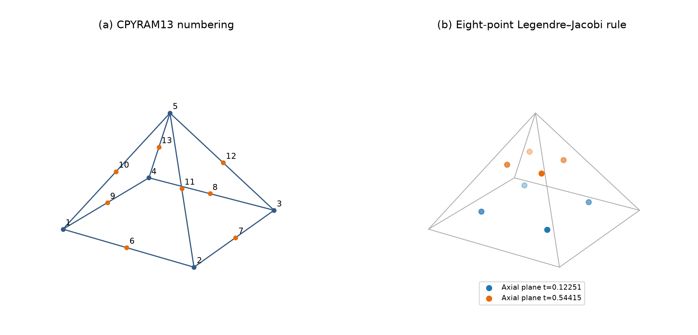
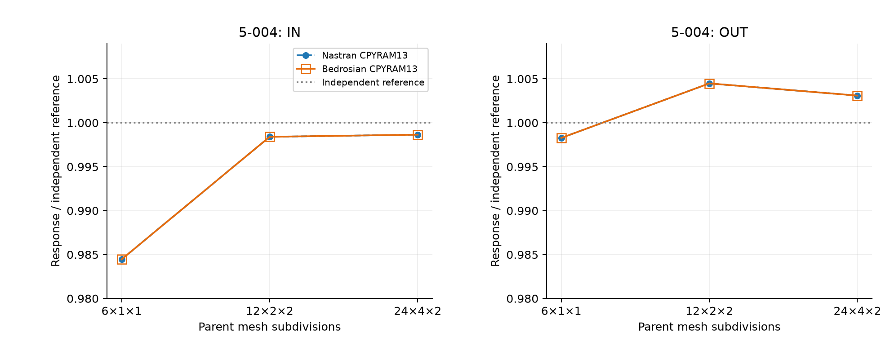
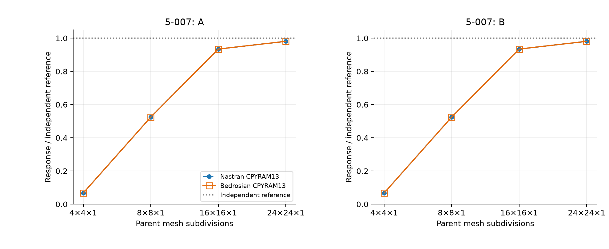
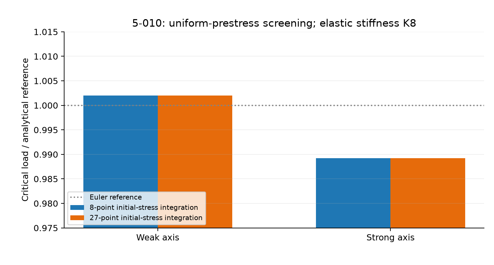

# CPYRAM13 Bedrosian: Rational Quadratic Pyramid Interpolation and Mystran Benchmark Comparisons with Nastran

**Ary · Technical formulation and benchmark report · 26 October 2026**

## Abstract

The thirteen-node Bedrosian pyramid combines quadratic triangular traces with an eight-node serendipity quadrilateral base through rational interpolation. The selected element retains three translations per node and a 39-component element displacement vector. Its rational functions are expressed in collapsed coordinates, together with the physical gradient transformation, Legendre–Jacobi quadrature, elastic energy, thermal loading and initial-stress operators. The selected elastic and thermal rule contains eight integration points; consistent mass is evaluated separately with 27 points. Fourteen existing displacement comparisons with Nastran CPYRAM13 cover a twisted cantilever and a pinched dome. On the finest reported meshes, the Bedrosian formulation has independent-reference errors of 0.1357% IN and 0.3090% OUT for the beam, and approximately 1.8937% for the dome. Uniform thermal and prescribed-prestress buckling results provide additional, separately qualified evidence. Close agreement with Nastran does not remove the local stability concern associated with the eight-point elastic rule.

**Keywords:** quadratic pyramid; Bedrosian interpolation; rational shape functions; collapsed coordinates; Legendre–Jacobi integration; Nastran; Mystran Benchmark.

## 1. Selected element and scope

The formulation documented here is the **13-node rational Bedrosian pyramid** [1], expressed with corners 1–4, apex 5, base-edge nodes 6–9 and lateral-edge nodes 10–13. Its interpolation is algebraically equivalent to the second-order functions in Bedrosian's equations (20)–(32), with a different node ordering. This numbering difference is stated explicitly rather than transferring the original paper's indices unchanged.

The selected mathematical choices were checked against the current local and published formulation definitions. They agree on the following:

| Operator or property | Selected choice |
|---|---|
| Displacement and geometry | Bedrosian rational interpolation, 13 physical nodes |
| Global nodal variables | Three translations per node |
| Element displacement dimension | 39 |
| Elastic stiffness | Eight-point Legendre–Jacobi integration |
| Equivalent thermal loading | The same eight-point rule |
| Consistent mass | Independent 27-point Legendre–Jacobi rule |
| Initial-stress stiffness | Eight or 27 points, without changing the elastic rule |
| Additional enrichment variables | None |
| Rank-one or hourglass penalty | None |

All benchmark results are existing observations. No solver analyses were performed for this report. The main paired comparisons use the existing solid benchmark collection [2,3]. Additional thermal and buckling observations retain their own model and prestress qualifications [4].

## 2. Reference domain, numbering and collapsed coordinates

The reference pyramid is

```math
\widehat{\Omega}=\{(\xi,\eta,t):0\leq t\leq1,\ |\xi|\leq1-t,\ |\eta|\leq1-t\}.
```

Introduce $q=1-t$ and collapsed coordinates $a,b\in[-1,1]$:

```math
\xi=qa,\qquad \eta=qb,\qquad t=t,
\qquad d\xi\,d\eta\,dt=q^2\,da\,db\,dt.
```

| Node | Reference position $(\xi,\eta,t)$ | Role |
|---|---|---|
| 1 | $(-1,-1,0)$ | Base corner |
| 2 | $(1,-1,0)$ | Base corner |
| 3 | $(1,1,0)$ | Base corner |
| 4 | $(-1,1,0)$ | Base corner |
| 5 | $(0,0,1)$ | Apex |
| 6 | $(0,-1,0)$ | Edge 1–2 |
| 7 | $(1,0,0)$ | Edge 2–3 |
| 8 | $(0,1,0)$ | Edge 3–4 |
| 9 | $(-1,0,0)$ | Edge 4–1 |
| 10 | $(-1/2,-1/2,1/2)$ | Edge 1–5 |
| 11 | $(1/2,-1/2,1/2)$ | Edge 2–5 |
| 12 | $(1/2,1/2,1/2)$ | Edge 3–5 |
| 13 | $(-1/2,1/2,1/2)$ | Edge 4–5 |



*Figure 1. Numbering used in this report and the selected eight-point rule on the reference pyramid. The integration points avoid the apex.*

For comparison with the original paper, the present nodes 1–13 correspond respectively to Bedrosian's nodes $(5,7,1,3,13,6,8,2,4,11,12,9,10)$ in Figure 7 [1].

## 3. Bedrosian interpolation

### 3.1 Corner and lateral-edge functions

For the four sign pairs

```math
(s_i,r_i)=(-1,-1),(1,-1),(1,1),(-1,1),\qquad i=1,\ldots,4,
```

the collapsed-coordinate functions are

```math
N_i=\frac{q}{4}(1+s_i a)(1+r_i b)
\left[q(s_i a+r_i b)-1\right],
```

```math
N_{i+9}=tq(1+s_i a)(1+r_i b),\qquad i=1,\ldots,4.
```

The apex function is

```math
N_5=t(2t-1).
```

### 3.2 Base-edge functions

```math
N_6=\tfrac12q^2(1-a^2)(1-b),\qquad
N_7=\tfrac12q^2(1-b^2)(1+a),
```

```math
N_8=\tfrac12q^2(1-a^2)(1+b),\qquad
N_9=\tfrac12q^2(1-b^2)(1-a).
```

These expressions are polynomial in $(a,b,t)$ but rational in the pyramid coordinates after substituting $a=\xi/q$ and $b=\eta/q$. The rational dependence permits the quadrilateral and triangular face traces to coexist [1]. At $t=0$, the base trace is the quadratic QUAD8 serendipity interpolation. Each triangular side reduces to a six-node quadratic triangular trace. There is no base-face center node.

The nodal and completeness identities are

```math
N_i(\boldsymbol{\xi}_j)=\delta_{ij},\qquad
\sum_{i=1}^{13}N_i=1,
```

```math
\sum_iN_i\xi_i=\xi,\qquad
\sum_iN_i\eta_i=\eta,\qquad
\sum_iN_it_i=t.
```

The functions reproduce the quadratic polynomial space in the reference pyramid coordinates [1]. On a general distorted isoparametric mapping, this is not a claim of arbitrary quadratic completeness in physical Cartesian coordinates.

### 3.3 Apex behavior

As $t\to1$ inside the reference pyramid, $N_5\to1$ and all other shape values approach zero. The physical-reference derivatives can have direction-dependent apex limits [1]. The apex is a valid interpolation node but is not a volume quadrature point. A collapsed Jacobian vanishes geometrically there, so a direct inverse-Jacobian evaluation at that point is inappropriate.

## 4. Geometry, strain and elastic energy

The isoparametric geometry and displacement are

```math
\mathbf{x}=\sum_{i=1}^{13}N_i\mathbf{x}_i,
\qquad
\mathbf{u}_h=\sum_{i=1}^{13}N_i\mathbf{u}_i,
\qquad
\mathbf{d}_e=[u_1,v_1,w_1,\ldots,u_{13},v_{13},w_{13}]^{\mathrm{T}}.
```

Define a Jacobian with physical derivative vectors as columns:

```math
\mathbf{J}_c=[\mathbf{x}_{,a}\quad\mathbf{x}_{,b}\quad\mathbf{x}_{,t}],
\qquad
\nabla_xN_i=\mathbf{J}_c^{-\mathrm{T}}
\begin{bmatrix}N_{i,a}\\N_{i,b}\\N_{i,t}\end{bmatrix}.
```

Here $N_{i,t}$ is the derivative at fixed collapsed coordinates $a,b$. If derivatives in the pyramid coordinates are used instead,

```math
N_{i,\xi}=\frac{N_{i,a}}q,\qquad
N_{i,\eta}=\frac{N_{i,b}}q,\qquad
\left.N_{i,t}\right|_{\xi,\eta}
=\left.N_{i,t}\right|_{a,b}+\frac{aN_{i,a}+bN_{i,b}}q.
```

With engineering-strain ordering $[xx,yy,zz,xy,yz,zx]$,

```math
\boldsymbol{\varepsilon}=\mathbf{B}\mathbf{d}_e,
\qquad
\mathbf{B}=[\mathbf{B}_1\ \cdots\ \mathbf{B}_{13}],
\qquad
\mathbf{B}_i=
\begin{bmatrix}
N_{i,x}&0&0\\
0&N_{i,y}&0\\
0&0&N_{i,z}\\
N_{i,y}&N_{i,x}&0\\
0&N_{i,z}&N_{i,y}\\
N_{i,z}&0&N_{i,x}
\end{bmatrix}.
```

For isotropic elasticity, $\mu=E/[2(1+\nu)]$ and $\lambda=E\nu/[(1+\nu)(1-2\nu)]$. The normal block of $\mathbf{D}$ has diagonal $\lambda+2\mu$ and off-diagonal $\lambda$; its three engineering-shear diagonals are $\mu$. The elastic potential and stiffness are

```math
\Pi_e=\tfrac12\int_{\Omega_e}
(\mathbf{B}\mathbf{d}_e)^{\mathrm{T}}\mathbf{D}(\mathbf{B}\mathbf{d}_e)\,dV
-\mathbf{d}_e^{\mathrm{T}}\mathbf{f}_e,
\qquad
\mathbf{K}_e=\int_{\Omega_e}\mathbf{B}^{\mathrm{T}}\mathbf{D}\mathbf{B}\,dV.
```

No internal enhanced-strain parameters or static condensation are part of this selected CPYRAM13 formulation.

## 5. Selected quadrature and operator distinctions

### 5.1 Eight-point elastic and thermal integration

The transverse coordinates use two-point Gauss–Legendre integration: $a,b=\pm1/\sqrt3$, each with unit weight. The axial rule integrates with weight $(1-t)^2$ on $[0,1]$:

```math
t_- =\frac{5-\sqrt{10}}{15},\qquad
t_+ =\frac{5+\sqrt{10}}{15},
```

```math
\omega_- =\frac16+\frac{\sqrt{10}}{48},\qquad
\omega_+ =\frac16-\frac{\sqrt{10}}{48}.
```

The distinction between collapsed and pyramid Jacobians is essential. If $\mathbf{J}_p=\partial\mathbf{x}/\partial(\xi,\eta,t)$, then

```math
\det\mathbf{J}_c=q^2\det\mathbf{J}_p.
```

The equivalent physical quadrature weights are therefore

```math
W_{ijk}=w_iw_j\omega_k\det\mathbf{J}_p
=w_iw_j\omega_k\frac{\det\mathbf{J}_c}{(1-t_k)^2},
\qquad
\mathbf{K}_e\approx\sum_{i,j,k=1}^{2}W_{ijk}\mathbf{B}_{ijk}^{\mathrm{T}}\mathbf{D}\mathbf{B}_{ijk}.
```

The Jacobi weight already includes $q^2$; it must not be counted twice. On the identity reference pyramid, the summed physical weights are $4/3$, its volume. Distorted rational mappings do not make this rule an exact integral of every stiffness term.

### 5.2 Mass and initial-stress integration

The consistent mass is

```math
\mathbf{M}_e=\int_{\Omega_e}\rho\mathbf{N}^{\mathrm{T}}\mathbf{N}\,dV,
\qquad
\mathbf{N}=[N_1\mathbf{I}_3\ \cdots\ N_{13}\mathbf{I}_3].
```

It uses an independent $3\times3\times3$ Legendre–Jacobi rule. An eight-sample consistent mass can have rank at most $8\times3=24<39$, so the elastic sampling rule must not automatically be reused for mass. A positive definite mass or accurate vibration spectrum is not inferred from the static displacement comparisons. Simple row-sum mass lumping is not adopted as a validated substitute; quadratic shape-function integrals need not all be positive.

For a physical symmetric prestress tensor $\boldsymbol{\sigma}_0$, the initial-stress nodal blocks are

```math
(\mathbf{K}_{G,e})_{ij}
=\left[\int_{\Omega_e}(\nabla N_i)^{\mathrm{T}}
\boldsymbol{\sigma}_0\nabla N_j\,dV\right]\mathbf{I}_3.
```

Eight- and 27-point variants refer to this operator, with the elastic stiffness retained at eight points. With compression negative, the eigenproblem is $(\mathbf{K}+\Lambda\mathbf{K}_G)\boldsymbol{\phi}=\mathbf{0}$. The capital $\Lambda$ denotes the load factor, distinct from the Lamé constant.

### 5.3 Local stability qualification

The retained eight-point studies identify an additional local zero-energy-mode risk. No rank-one stabilization or artificial hourglass penalty is added to the selected formulation. Six rigid-body modes are expected for a fully stable isolated 39-translation element, corresponding to stiffness rank 33; the eight-point choice is not certified to attain that rank on every geometry. Successful constrained beam and dome calculations do not by themselves establish stability on arbitrary patches. Changing the elastic rule would define a different numerical formulation and must not be inferred from the 27-point mass or geometric-stiffness options.

## 6. Consistent loading, thermal strain and observation

For a boundary traction,

```math
\mathbf{f}_{\Gamma,e}=\int_{\Gamma_e}\mathbf{N}^{\mathrm{T}}\mathbf{t}\,dA.
```

On a planar QUAD8 end face under constant traction with resultant $\mathbf{F}_{\mathrm{face}}$, each corner receives $-\mathbf{F}_{\mathrm{face}}/12$ and each midside node $\mathbf{F}_{\mathrm{face}}/3$. The negative corner weights are a consequence of consistent quadratic interpolation. Equal forces on corner nodes alone constitute a different discrete load. Root restraints must likewise include generated midside nodes when the physical root is fully clamped [4].

Thermal strain and equivalent loading are

```math
\boldsymbol{\varepsilon}_T
=\alpha_T\Delta T[1,1,1,0,0,0]^{\mathrm{T}},
\qquad
\mathbf{f}_{T,e}=\int_{\Omega_e}\mathbf{B}^{\mathrm{T}}\mathbf{D}\boldsymbol{\varepsilon}_T\,dV,
\qquad
\boldsymbol{\sigma}=\mathbf{D}(\mathbf{B}\mathbf{d}_e-\boldsymbol{\varepsilon}_T).
```

Arithmetic means of specified tip-corner translations and traction-work-weighted surface displacements are different observables. Each result set retains its stated checkpoint; values from different extraction definitions are not silently merged.

The mathematical sequence is to establish the 13-node geometry, evaluate the collapsed basis and gradients, form the selected weighted operators, apply consistent loading and constraints, solve the constrained equilibrium equations, and evaluate the specified physical checkpoint. Shape-function and quadrature definitions remain attached to each formulation choice.

## 7. Mystran Benchmark: existing comparison with Nastran

For nonzero reference $q_{\mathrm{ref}}$, the reported quantities are $R=q/q_{\mathrm{ref}}$ and $e_q=100|q-q_{\mathrm{ref}}|/|q_{\mathrm{ref}}|$. Nastran and Bedrosian errors are calculated independently against the same physical reference [2,3].

### 7.1 Twisted beam, Example 5-004

The beam is 12 in long, twists by 90 degrees and has $E=29\times10^6$ psi and $\nu=0.22$. Independent tip references are 0.005429 in IN and 0.001749 in OUT. Six pyramids replace each parent brick region, with shared quadratic edge nodes. The paired observations use matching pyramid geometries, restraints, loading and checkpoint definitions from the existing solid benchmark collection. All displacement values in this table are inches.

| Parent mesh | Nodes | Pyramids | Response | Independent | Nastran | Bedrosian CPYRAM13 | Nastran error (%) | Bedrosian error (%) |
|---|---:|---:|---|---:|---:|---:|---:|---:|
| 6x1x1 | 134 | 36 | IN | 0.005429 | 0.00534463162 | 0.00534461718 | 1.5540 | 1.5543 |
| 6x1x1 | 134 | 36 | OUT | 0.001749 | 0.00174598355 | 0.00174598087 | 0.1725 | 0.1726 |
| 12x2x2 | 813 | 288 | IN | 0.005429 | 0.00542030582 | 0.00542032175 | 0.1601 | 0.1598 |
| 12x2x2 | 813 | 288 | OUT | 0.001749 | 0.00175683182 | 0.00175683508 | 0.4478 | 0.4480 |
| 24x4x2 | 3013 | 1152 | IN | 0.005429 | 0.00542165044 | 0.00542163507 | 0.1354 | 0.1357 |
| 24x4x2 | 3013 | 1152 | OUT | 0.001749 | 0.00175441101 | 0.00175440491 | 0.3094 | 0.3090 |




*Figure 2. Existing beam reference ratios. Coincident curves retain distinct markers and line styles; the narrow ordinate highlights the remaining displacement error.*

On the finest mesh, the Bedrosian IN and OUT errors are approximately 0.1357% and 0.3090%. The OUT sequence is not monotone in independent-reference error: its coarse value is slightly below the reference, while the intermediate and finest values are above it. Agreement with Nastran remains distinct from agreement with the independent beam solution.

### 7.2 Pinched dome, Example 5-007

The quarter-dome benchmark has radius 10 ft, thickness 0.04 ft, an 18-degree opening, $E=68{,}250{,}000$ kip/ft$^2$ and $\nu=0.3$. The reference responses are $U_x(A)=+0.094$ ft and $U_y(B)=-0.094$ ft. The retained pyramid series uses one layer through the thickness. Values below are feet; signed references and displacements are preserved.

| Parent mesh | Nodes | Pyramids | Response | Independent | Nastran | Bedrosian CPYRAM13 | Nastran error (%) | Bedrosian error (%) |
|---|---:|---:|---|---:|---:|---:|---:|---:|
| 4x4_L1 | 299 | 96 | A | 0.094 | 0.00628159824 | 0.0062824979 | 93.3174 | 93.3165 |
| 4x4_L1 | 299 | 96 | B | -0.094 | -0.00628159824 | -0.0062824979 | 93.3174 | 93.3165 |
| 8x8_L1 | 1107 | 384 | A | 0.094 | 0.0492805839 | 0.0492799617 | 47.5738 | 47.5745 |
| 8x8_L1 | 1107 | 384 | B | -0.094 | -0.049280582 | -0.0492799617 | 47.5738 | 47.5745 |
| 16x16_L1 | 4259 | 1536 | A | 0.094 | 0.0878373943 | 0.0878392346 | 6.5560 | 6.5540 |
| 16x16_L1 | 4259 | 1536 | B | -0.094 | -0.0878373943 | -0.0878392309 | 6.5560 | 6.5540 |
| 24x24_L1 | 9459 | 3456 | A | 0.094 | 0.0922199376 | 0.0922198892 | 1.8937 | 1.8937 |
| 24x24_L1 | 9459 | 3456 | B | -0.094 | -0.0922199413 | -0.0922198892 | 1.8937 | 1.8937 |




*Figure 3. Existing one-layer dome results. Both formulations approach the independent reference as the surface mesh is refined, with approximately 1.8937% error at the finest reported level.*

The coarse $4\times4$ surface mesh remains very stiff, with about 93.3% error. On $24\times24\times1$, both response ratios are approximately 0.9811. The small differences between solvers do not establish universal accuracy under distorted geometry or a different through-thickness discretization. Original SAP2000 printed values belong to its original brick meshes, not new pyramid analyses.

### 7.3 Uniform thermal loading, Example 5-011

The additional model contains 600 pyramids and 1703 nodes, derived from 100 original solid regions. It uses $E=10^6$ psi, $\nu=0.25$, $\alpha_T=5.5\times10^{-6}/{}^{\circ}\mathrm{F}$ and $\Delta T=100{}^{\circ}\mathrm{F}$. Under the inherited perimeter restraints, the analytical in-plane stresses are $-733.3333333333$ psi [4].

| Quantity | Existing observation |
|---|---:|
| Mean $\sigma_{xx}$ (psi) | -733.3333333333 |
| Mean $\sigma_{yy}$ (psi) | -733.3333333333 |
| Maximum in-plane stress error (psi) | $1.08002\times10^{-11}$ |
| Maximum $|\sigma_{zz}|$ (psi) | $1.33582\times10^{-11}$ |
| Maximum affine displacement error (in) | $4.86807\times10^{-17}$ |
| Relative free-equilibrium residual | $1.32503\times10^{-15}$ |

These observations support the stated uniform affine thermal solution. A matching Nastran thermal series is not included in this retained comparison, and general temperature-gradient or stress-output equivalence is not inferred.

### 7.4 Column buckling, Example 5-010: screening only

The additional 144-pyramid model has 457 nodes. It uses $E=3600$ ksi and $\nu=0.2$, with assumed uniform $\sigma_{zz}=-1/12$ kip/in$^2$ for a 1-kip reference compression. The retained source model did not specify an applied compressive load case for recovering a first-order prestress field; the uniform stress is an explicit analytical assumption [4].

| Initial-stress integration | Weak-axis load (kip) | Strong-axis load (kip) |
|---|---:|---:|
| 8 points, with elastic $K_8$ | 0.889792750 | 126.534706768 |
| 27 points, with elastic $K_8$ | 0.889792754 | 126.534703427 |
| Independent Euler reference | 0.888 | 127.91 |
| Published SAP2000 reference observation | 0.891 | 127.12 |



*Figure 4. Existing buckling loads normalized separately by their weak- and strong-axis Euler references. The two integration choices are nearly coincident; this is not a Nastran buckling comparison.*

The eight-point initial-stress result has approximately 0.202% weak-axis error and 1.075% strong-axis error. The small change under geometric-stiffness quadrature refinement does not establish elastic stability or source-identical buckling validation. A comparison based on an actual compressive equilibrium solution and its recovered stress remains a separate requirement.

## 8. Discussion and conclusions

The Bedrosian basis supplies the required quadratic face traces with 13 physical nodes. Its collapsed-coordinate form makes the apex limit and the integration weight explicit. Correct treatment of the $q^2$ factor is essential; independent mass quadrature is equally important because the selected elastic sampling cannot support a full-rank consistent mass.

The retained beam and dome comparisons show close agreement with Nastran on the matched models, while independent-reference error remains finite and mesh-dependent. Uniform thermal success is limited to the stated affine state, and the buckling results remain prescribed-prestress screening. The eight-point elastic zero-energy-mode concern is retained as a formulation limitation rather than removed by favorable global responses.

The evidence does not establish general near-incompressible accuracy, arbitrary distortion tolerance, modal accuracy, nonlinear robustness or complete stress-recovery equivalence. No new stabilization, enrichment or integration change is introduced by this report.

[Compressed benchmark observations](CPYRAM13_Bedrosian_benchmark_results.zip) · [Solid formulation index](README.md) · [CHEXA8 EAS formulation](CHEXA8_EAS_Formulation.md)

## 9. References

[1] G. Bedrosian (1992). “Shape functions and integration formulas for three-dimensional finite element analysis.” *International Journal for Numerical Methods in Engineering*, 35, 95–108. [DOI](https://doi.org/10.1002/nme.1620350106). Original quadratic pyramid functions: equations (20)–(32), pp. 101–102; original numbering: Figure 7. The supplied paper was inspected for this report.

[2] Computers and Structures, Inc. *SAP2000 Software Verification: Solids*, Examples 5-004 and 5-007. Original beam and dome geometry, published SAP2000 results and independent reference values, as retained in the project benchmark records.

[3] Ary (2026). Existing [solid benchmark collection](../../solid_benchmark/comparison_all.md) and [compressed all-solid comparison data](../../solid_benchmark/comparison_all.zip). The 14 CPYRAM13 paired observations in this report retain the existing values and checkpoints.

[4] Project CPYRAM13 research records (2026): consistent-load and result-audit studies for 5-004; dome mesh/output audit for 5-007; thermal and prescribed-prestress studies for 5-011/5-010. The additional observations and their qualifications are retained in the [benchmark archive](CPYRAM13_Bedrosian_benchmark_results.zip). These are project research records, distinct from the peer-reviewed interpolation source [1].
