# Three-Dimensional Continuum Solid Formulations in MYSTRAN NEWSOLID

**Ary · Independent Researcher · Personal Research**
**Technical manuscript · Revision 3 · 18 October 2026**
Implementation snapshot: `v18.00.a`, commit `5acbd00e`. Benchmark archive: 17 October 2026.

## Abstract

This manuscript documents eight three-dimensional continuum solid elements in MYSTRAN NEWSOLID: four- and ten-node tetrahedra, six- and fifteen-node prisms, eight- and twenty-node bricks, and five- and thirteen-node pyramids. Compatible interpolation, nodal strain smoothing, enhanced assumed strains, selective shear integration, local condensation and stress recovery are formulated in a common small-strain framework. The nine enhanced-strain columns for the linear brick and prism are transcribed from the current Fortran source. A matched-model comparison with Nastran covers 56 meshes, 63 MYSTRAN analysis selections and 126 displacement responses on a twisted beam and a pinched dome derived from SAP2000 verification examples. Existing constant-strain and rigid-rotation audits provide separate evidence for quadratic interpolation and recovery. The results show case-dependent accuracy: close agreement for several quadratic families coexists with substantial thin-dome errors for some linear formulations and the EAS9 prism. Solver agreement and error relative to independent reference solutions are reported separately. All numerical tables and curves are reused from existing results; no new solver analyses are reported.

**Keywords:** continuum finite elements; nodal smoothing; enhanced assumed strain; quadratic solids; rational pyramid; patch test; mesh refinement; MYSTRAN; Nastran.

## 1. Scope, evidence and formulation lineage

The supplied `NEWSOLID_ARY_CONTINUUM_FORMULATIONS_REV2_20261017.zip` provides the editorial starting point and topology illustrations. Its proposed research selection is distinguished from the current executable. In particular, the archive selects CPENTA6 EAS9, whereas the implementation defaults to ABE and exposes EAS9 as an alternative. Both are documented here. These are continuum elements with translational unknowns; an enhanced strain parameter is an element-local algebraic variable, not an internal physical grid.

The mathematical lineage includes enhanced assumed strain theory [1,2], node-based smoothing and its blending with conventional tetrahedra [3,4], and rational pyramidal interpolation [5]. These references establish methodological context; the project-specific nine-mode operators below are identified by source, rather than attributed verbatim to a journal article. This document is a research-style technical manuscript; no peer-review or journal-ranking status is claimed.

| Element | Current formulation | Translational element DOFs | Selection |
|---|---|---:|---|
| CTETRA4 | Compatible T4 plus assembled nodal smoothing blend, NS weight 0.9 | 12, with patch coupling | NEWSOLID |
| CTETRA10 | Quadratic tetrahedral interpolation | 30 | NEWSOLID |
| CPENTA6 | Edge-tied assumed shear plus nine enhanced modes (ABE) | 18 | Default `PENTATYP,ABE` |
| CPENTA6 | Compatible strain plus nine enhanced modes | 18 | `PENTATYP,EAS9` |
| CPENTA15 | Quadratic prism with conditional selective shear integration | 45 | NEWSOLID |
| CHEXA8 | Trilinear brick plus nine enhanced modes | 24 | NEWSOLID, integration order 2 |
| CHEXA20 | Quadratic serendipity brick with conditional selective shear integration | 60 | NEWSOLID |
| CPYRAM5 | Five-node collapsed-coordinate pyramid | 15 | NEWSOLID |
| CPYRAM13 | Bedrosian rational quadratic pyramid | 39 | NEWSOLID |

The existing six-slot grid storage is preserved. Only translations enter these continuum operators; condensation adds no global unknowns. Element DOF counts do not describe the total constrained system or the larger CTETRA4 nodal-patch stencil.

## 2. Governing equations and discrete operators

### 2.1 Kinematics and constitutive convention

For a body occupying $\Omega$, linear momentum balance and displacement/traction boundary conditions are

$$\nabla\!\cdot\boldsymbol\sigma+\mathbf b=\mathbf0,\qquad
\mathbf u=\bar{\mathbf u}\text{ on }\Gamma_u,\qquad
\boldsymbol\sigma\mathbf n=\bar{\mathbf t}\text{ on }\Gamma_t.$$

With engineering shear strains, the six-component ordering is

$$\boldsymbol\varepsilon=[\varepsilon_{xx},\varepsilon_{yy},\varepsilon_{zz},\gamma_{xy},\gamma_{yz},\gamma_{zx}]^{\mathsf T},\quad
\boldsymbol\sigma=[\sigma_{xx},\sigma_{yy},\sigma_{zz},\tau_{xy},\tau_{yz},\tau_{zx}]^{\mathsf T}.$$

$$\boldsymbol\sigma=\mathbf D(\boldsymbol\varepsilon-\boldsymbol\varepsilon_T),\quad
\mathbf D=\begin{bmatrix}
\lambda+2\mu&\lambda&\lambda&0&0&0\\
\lambda&\lambda+2\mu&\lambda&0&0&0\\
\lambda&\lambda&\lambda+2\mu&0&0&0\\
0&0&0&\mu&0&0\\0&0&0&0&\mu&0\\0&0&0&0&0&\mu
\end{bmatrix},\quad
\lambda=\frac{E\nu}{(1+\nu)(1-2\nu)},\quad\mu=\frac{E}{2(1+\nu)}.$$

The isotropic specialization is the material model in the reported comparisons. A tensor shear component is half its engineering-strain counterpart; stress shear components require no such factor.

### 2.2 Isoparametric interpolation and virtual work

$$\mathbf x(\boldsymbol\xi)=\sum_aN_a\mathbf x_a,\qquad
\mathbf u^h(\boldsymbol\xi)=\sum_aN_a\mathbf d_a,\qquad
\nabla_xN_a=\mathbf J^{-\mathsf T}\nabla_\xi N_a,\qquad
\mathbf J=\frac{\partial\mathbf x}{\partial\boldsymbol\xi}.$$

The Fortran modules store the transpose Jacobian, with natural-coordinate indices in rows; their inverse-times-natural-gradient multiplication is equivalent to this convention. The compatible strain block is

$$\mathbf B_a=\begin{bmatrix}
N_{a,x}&0&0\\0&N_{a,y}&0\\0&0&N_{a,z}\\
N_{a,y}&N_{a,x}&0\\0&N_{a,z}&N_{a,y}\\N_{a,z}&0&N_{a,x}
\end{bmatrix},\qquad\boldsymbol\varepsilon=\mathbf B\mathbf d_e.$$

Stationarity of elastic potential energy gives

$$\mathbf K_e=\int_{\Omega_e}\mathbf B^{\mathsf T}\mathbf D\mathbf B\,dV,\qquad
\mathbf f_e=\int_{\Omega_e}\mathbf N^{\mathsf T}\mathbf b\,dV+
\int_{\Gamma_t^e}\mathbf N^{\mathsf T}\bar{\mathbf t}\,dA+\mathbf f_T.$$

$$\mathbf K_e\simeq\sum_gw_g\det\mathbf J_g\,\mathbf B_g^{\mathsf T}\mathbf D\mathbf B_g.$$

Partition of unity, linear-coordinate reproduction, zero derivative sum and positive integration-point Jacobians are basic consistency conditions. They do not alone establish distorted-patch accuracy or constrained positive definiteness. In global assembly, prescribed displacements satisfy $\mathbf K_{ff}\mathbf u_f=\mathbf f_f-\mathbf K_{fc}\bar{\mathbf u}_c$; every constrained quadratic midside displacement must use its own coordinate.

### 2.3 Enhanced strain condensation and recovery

Let $\overline{\mathbf B}$ denote either the compatible operator or an explicitly assumed-strain modification. Introduce nine element-local parameters $\boldsymbol\eta$:

$$\boldsymbol\varepsilon=\overline{\mathbf B}\mathbf d_e+\mathbf G\boldsymbol\eta,\qquad
\begin{bmatrix}\mathbf K_{dd}&\mathbf K_{d\eta}\\\mathbf K_{\eta d}&\mathbf K_{\eta\eta}\end{bmatrix}
\begin{bmatrix}\mathbf d_e\\\boldsymbol\eta\end{bmatrix}
=\begin{bmatrix}\mathbf f_d\\\mathbf f_\eta\end{bmatrix}.$$

Each block follows by integrating the corresponding pair of strain operators against $\mathbf D$. Elimination gives

$$\mathbf K_c=\mathbf K_{dd}-\mathbf K_{d\eta}\mathbf K_{\eta\eta}^{-1}\mathbf K_{\eta d},\qquad
\mathbf f_c=\mathbf f_d-\mathbf K_{d\eta}\mathbf K_{\eta\eta}^{-1}\mathbf f_\eta,$$

$$\boldsymbol\eta=\mathbf K_{\eta\eta}^{-1}(\mathbf f_\eta-\mathbf K_{\eta d}\mathbf d_e),\qquad
\mathbf B_{\rm eff}=\overline{\mathbf B}-\mathbf G\mathbf K_{\eta\eta}^{-1}\mathbf K_{\eta d}.$$

Stress recovery must include the condensed enhancement and thermal contribution, rather than substituting the compatible strain alone. The current prism state routine uses Cholesky factorization and rejects local reciprocal condition estimates below $10^{-12}$; it does not add the diagonal regularization described in the archive's historical Python ABE article. The brick state routine uses partial pivoting and explicitly symmetrizes the condensed matrix.

For the EAS9 transformation, set $\mathbf A_0=\partial\mathbf x/\partial\boldsymbol\xi$ at the parent centroid. Interpret a natural Voigt column as a symmetric tensor $\widehat{\mathbf E}$, dividing engineering shears by two. The physical column is obtained from

$$\mathbf E=\frac{\det\mathbf A_0}{\det\mathbf A(\boldsymbol\xi)}
\mathbf A_0^{-\mathsf T}\widehat{\mathbf E}\mathbf A_0^{-1}.$$

Repack using engineering shears. Constant-stress orthogonality must hold under the actual quadrature; a mode that vanishes at the centroid need not satisfy that integral condition by itself.

## 3. Element interpolation and implementation

### 3.1 CTETRA4: compatible tetrahedron and nodal smoothing

For barycentric coordinates $L_a$, $a=1,\ldots,4$, $N_a=L_a$ and $\mathbf B_e$ is constant on a straight tetrahedron. The standard stiffness is $V_e\mathbf B_e^{\mathsf T}\mathbf D\mathbf B_e$. NEWSOLID adds a nodal-patch correction after element assembly. For a node $I$ with incident tetrahedra $\mathcal P_I$, the embedded patch operator is

$$V_I=\frac14\sum_{e\in\mathcal P_I}V_e,\qquad
\overline{\mathbf B}_I=
\frac{\sum_{e\in\mathcal P_I}V_e\mathbf B_e^{(I)}}{\sum_{e\in\mathcal P_I}V_e},\qquad
\mathbf K_{\rm NS}=\sum_I V_I\overline{\mathbf B}_I^{\mathsf T}\mathbf D_I\overline{\mathbf B}_I.$$

For eligible homogeneous patches, the resulting blend is

$$\mathbf K_{\rm blend}=(1-\beta)\mathbf K_{\rm FEM}+\beta\mathbf K_{\rm NS},\qquad\beta=0.9.$$

The code subtracts $\beta V_e\mathbf B_e^{\mathsf T}\mathbf D\mathbf B_e/4$ and adds $\beta V_I\overline{\mathbf B}_I^{\mathsf T}\mathbf D\overline{\mathbf B}_I$ per eligible patch. It skips a patch if incident material-row IDs differ or its material cannot be built. Thus a mixed-material model is not represented by applying the homogeneous blend indiscriminately. Boundary patches use their incident elements; no artificial exterior tetrahedra are introduced.

The source variable is named `ALPHA`, but its value is the NS weight $\beta$. In the cited alpha-FEM convention [3], the FEM weight is $\alpha_L^3$; equivalence with this blend requires $\alpha_L=(1-\beta)^{1/3}\approx0.464159$, not 0.9. This calibrated implementation weight is not presented as a universal optimum. Smoothing enlarges the assembly stencil without introducing global DOFs. The elastic patch correction is excluded from the later geometric-stiffness assembly pass.

### 3.2 CTETRA10: quadratic tetrahedron

The four vertex and six edge functions are

$$N_i=L_i(2L_i-1),\quad i=1,\ldots,4,\qquad N_{ij}=4L_iL_j.$$

They span the quadratic tetrahedral space and use 30 translational DOFs. Edge functions must be associated with the actual input edge ordering. Curved geometry changes the mapping and quadrature demand; the reported refinement suite uses straight edge midpoints. No CTETRA4 nodal-smoothing correction is applied to CTETRA10. The dispatch maps the solid integration selector to either a centroid rule of weight $1/6$ or a four-point tetrahedral rule. The latter uses barycentric permutations of $(0.58541020,0.13819660,0.13819660,0.13819660)$ and weight $1/24$ per point, as rounded in `ORDER_TETRA.f90`. These are source values, not a claim that a centroid rule suffices for quadratic stiffness.

### 3.3 CPENTA6: EAS9 and ABE alternatives

Set $L_1=1-r-s$, $L_2=r$, $L_3=s$ on the unit triangle and $z\in[-1,1]$ axially. The six compatible functions are

$$N_i=\tfrac12L_i(1-z),\qquad N_{i+3}=\tfrac12L_i(1+z),\qquad i=1,2,3.$$

With $\bar r=r-1/3$, $\bar s=s-1/3$, and natural-strain unit vectors $\mathbf e_j\in\mathbb R^6$, the actual EAS9 natural columns, before centroid transformation and determinant scaling, are

$$\widehat{\mathbf G}_{\rm wedge}=\left[
\bar r\mathbf e_1,\ \bar s\mathbf e_2,\ z\mathbf e_3,
\bar r\mathbf e_4,\ \bar s\mathbf e_4,
\bar s\mathbf e_5,\ z\mathbf e_5,\ z\mathbf e_6,\ \bar r\mathbf e_6\right].$$

EAS9 uses the compatible $\mathbf B$. ABE instead replaces two shear rows in the frozen natural frame. Let $\mathbf a=\widehat{\mathbf B}_{rz}(1/2,0,z)$, $\mathbf b=\widehat{\mathbf B}_{sz}(0,1/2,z)$ and

$$\mathbf c=\mathbf b-\mathbf a-
[\widehat{\mathbf B}_{sz}-\widehat{\mathbf B}_{rz}]_{(1/2,1/2,z)}.$$

Then $\overline{\mathbf B}_{rz}=\mathbf a+s\mathbf c$ and $\overline{\mathbf B}_{sz}=\mathbf b-r\mathbf c$. The other rows retain their compatible values. The ABE natural enhancement columns are

$$\widehat{\mathbf G}_{\rm ABE}=\left[
z\mathbf e_3,z\mathbf e_5,z\mathbf e_6,
\bar r\mathbf e_1,\bar s\mathbf e_1,
\bar r\mathbf e_2,\bar s\mathbf e_2,
\bar r\mathbf e_4,\bar s\mathbf e_4\right].$$

ABE therefore also contains nine local parameters. The current operator has no affine-field projection correction. Both state variants use three triangle points $(1/6,1/6)$, $(2/3,1/6)$, $(1/6,2/3)$ with weights $1/6$, crossed with $z=\pm1/\sqrt3$, weights 1: six volume points in total. ABE is the executable default; the 5-001 example explicitly selects EAS9. Their benchmark behavior differs strongly by geometry and should not be collapsed into one CPENTA6 curve.

### 3.4 CPENTA15: quadratic prism

In the same coordinates, a convenient topology-based definition is

$$N_i^- =\tfrac12L_i(1-z)(2L_i-2-z),\qquad
N_i^+ =\tfrac12L_i(1+z)(2L_i-2+z),$$

$$N_{ij}^- =2L_iL_j(1-z),\qquad
N_{ij}^+ =2L_iL_j(1+z),\qquad N_i^v=L_i(1-z^2).$$

These give six vertices, six triangular-face edge midpoints and three vertical-edge midpoints. Equations specify physical edges, not a universal positional permutation. For the supplied FIXED_QUADRATIC convention, the audited mapping to MYSTRAN positions is `[1..9,13..15,10..12]`; coordinates and prescribed values are preserved.

When the quadratic selective-integration path is enabled at seven triangle points, the code retains the full-rule normal contribution and replaces the shear contribution with a three-point triangle times two-point axial rule. This correction changes integration of the standard quadratic interpolation; it adds no internal or global DOF.

### 3.5 CHEXA8: trilinear brick with EAS9

For corner signs $s_a,t_a,v_a\in\{-1,1\}$ on $[-1,1]^3$,

$$N_a=\tfrac18(1+s_a\xi)(1+t_a\eta)(1+v_a\zeta).$$

The source-specific natural enhancement matrix is

$$\widehat{\mathbf G}_{\rm brick}=\left[
\xi\mathbf e_1,\eta\mathbf e_2,\zeta\mathbf e_3,
\xi\mathbf e_4,\eta\mathbf e_4,
\eta\mathbf e_5,\zeta\mathbf e_5,
\zeta\mathbf e_6,\xi\mathbf e_6\right].$$

It uses the transformation in Section 2.3 and a $2\times2\times2$ Gauss rule with coordinates $\pm1/\sqrt3$ and unit one-dimensional weights. NEWSOLID CHEXA8 requires order 2 in this path. All nine enhancement parameters are condensed into a $24\times24$ matrix. These columns are the implemented project variant, not a claim of literal identity with every historical nine-mode brick.

### 3.6 CHEXA20: quadratic serendipity brick

The vertex functions are

$$N_a=\tfrac18(1+s_a\xi)(1+t_a\eta)(1+v_a\zeta)
(s_a\xi+t_a\eta+v_a\zeta-2).$$

For an edge parallel to $\xi$, $N_e=\tfrac14(1-\xi^2)(1+t_e\eta)(1+v_e\zeta)$; cyclic permutations define the other eight edge functions. The interpolation has 20 nodes and 60 translations. The supplied FIXED_QUADRATIC-to-MYSTRAN mapping is `[1..12,17..20,13..16]`. This audited input-convention mapping is not a proposed change to the element basis.

For the enabled order-3 selective-shear path, define $\mathbf D_s$ by retaining only the shear block $D_{4:6,4:6}$ and setting all other entries to zero. The implemented replacement is

$$\mathbf K=Q_{\rm full}[\mathbf B^{\mathsf T}\mathbf D\mathbf B]
-Q_{\rm full}[\mathbf B^{\mathsf T}\mathbf D_s\mathbf B]
+Q_{\rm shear}[\mathbf B^{\mathsf T}\mathbf D_s\mathbf B].$$

Here $Q_{\rm full}$ is $3\times3\times3$ and $Q_{\rm shear}$ is $2\times2\times2$, each including its own determinant. CPENTA15 uses the same replacement principle with its triangular-product rules. Shear rows of the unreduced strain operator are retained for stress evaluation; quadrature reduction must not be implemented by deleting strain components.

### 3.7 CPYRAM5: collapsed-coordinate pyramid

Let $a,b\in[-1,1]$, $z\in[0,1]$, and $q=1-z$. The reference physical coordinates are $\xi=qa$, $\eta=qb$, $\zeta=z$. With basal signs $(s_i,t_i)=(-1,-1),(1,-1),(1,1),(-1,1)$,

$$N_i=\tfrac14q(1+s_i a)(1+t_i b),\quad i=1,\ldots,4,\qquad N_5=z.$$

The implementation integrates in collapsed coordinates using two Legendre points in each basal direction and a two-point rule on $z\in[0,1]$. The determinant of the collapsed geometry mapping already contains the shrinking cross-section. The apex is a singular mapping location and is excluded from volume integration.

### 3.8 CPYRAM13: Bedrosian rational quadratic pyramid

The source evaluates an algebraically cancelled form in collapsed coordinates. Let $u_i=1+s_i a$, $v_i=1+t_i b$, $h_i=s_i a+t_i b$. The basal vertices, apex and lateral midpoint functions are

$$N_i=\tfrac14q\,u_iv_i(qh_i-1),\quad
N_5=z(2z-1),\quad N_{i+9}=zq\,u_iv_i,\qquad i=1,\ldots,4.$$

The basal midpoint functions, in order around the square, are

$$\begin{aligned}
N_6&=\tfrac12q^2(1-a^2)(1-b),&N_7&=\tfrac12q^2(1-b^2)(1+a),\\
N_8&=\tfrac12q^2(1-a^2)(1+b),&N_9&=\tfrac12q^2(1-b^2)(1-a).
\end{aligned}$$

They are rational when expressed in uncollapsed pyramid coordinates. Derivatives in the module are with respect to $(a,b,z)$ and must be combined with the corresponding collapsed Jacobian. No fourteenth node or enrichment DOF is used.

The stiffness rule crosses two-point Legendre integration in $a,b$ with a two-point Jacobi rule carrying weight $(1-z)^2$:

$$z_\pm=\frac{5\pm\sqrt{10}}{15},\qquad
w_- =\frac16+\frac{\sqrt{10}}{48},\quad
w_+ =\frac16-\frac{\sqrt{10}}{48}.$$

Because the collapsed Jacobian already carries the axial weight, the code uses $w_z/(1-z)^2$ when multiplying that determinant. Applying $(1-z)^2$ a second time is incorrect. A separate 27-point product rule is provided for mass. Shape values and collapsed derivatives have finite apex limits, while the physical mapping remains singular at the apex.

### 3.9 Topology illustrations

The following figures are reused from the supplied revision-2 archive as geometric schematics. Their displayed indices are not authoritative input-deck positions; the physical-edge formulas, source maps and audited input deck control connectivity. They are not evidence of new quadrature or element tests.

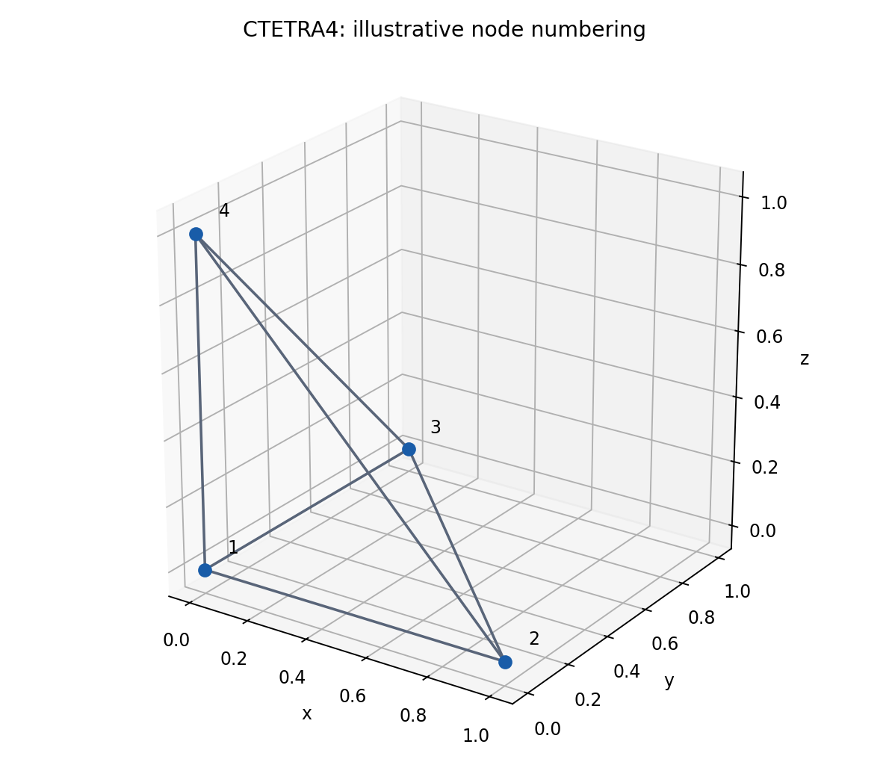

*CTETRA4: vertex and midside topology illustration supplied with the revision-2 archive.*

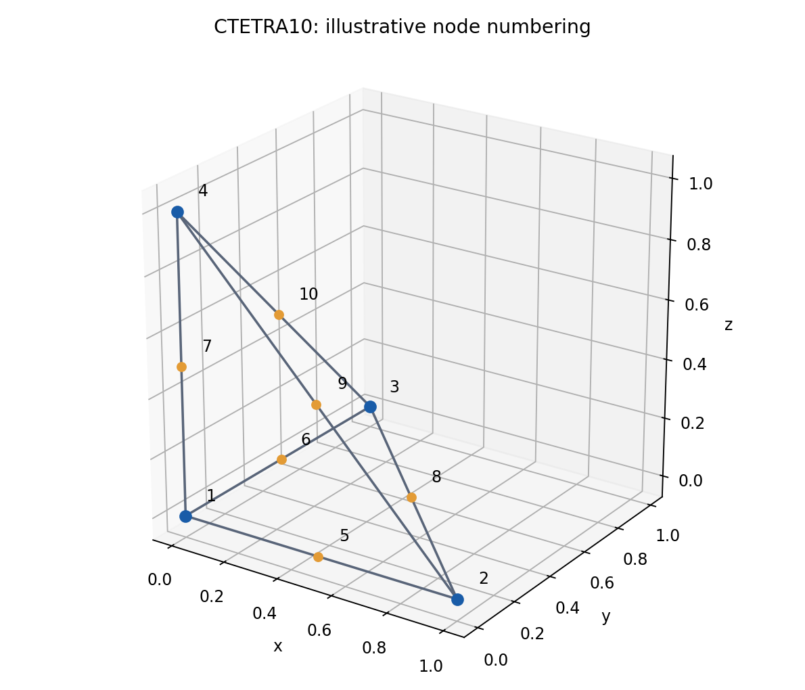

*CTETRA10: vertex and midside topology illustration supplied with the revision-2 archive.*

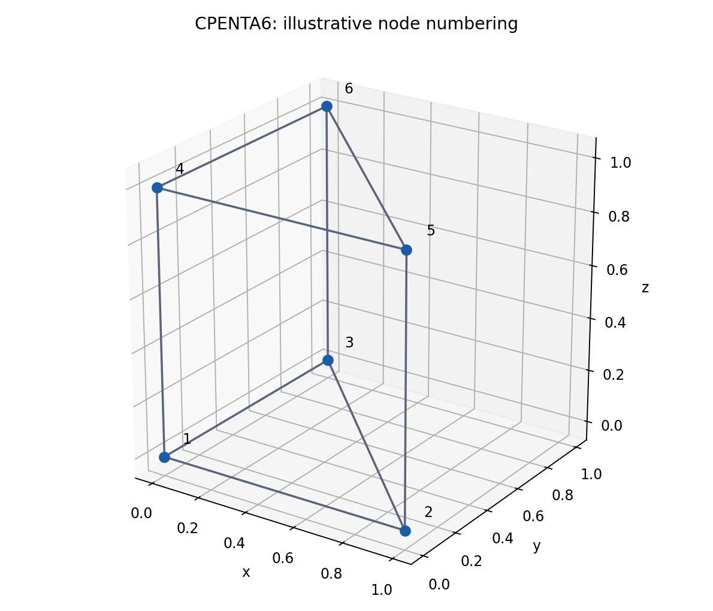

*CPENTA6: vertex and midside topology illustration supplied with the revision-2 archive.*

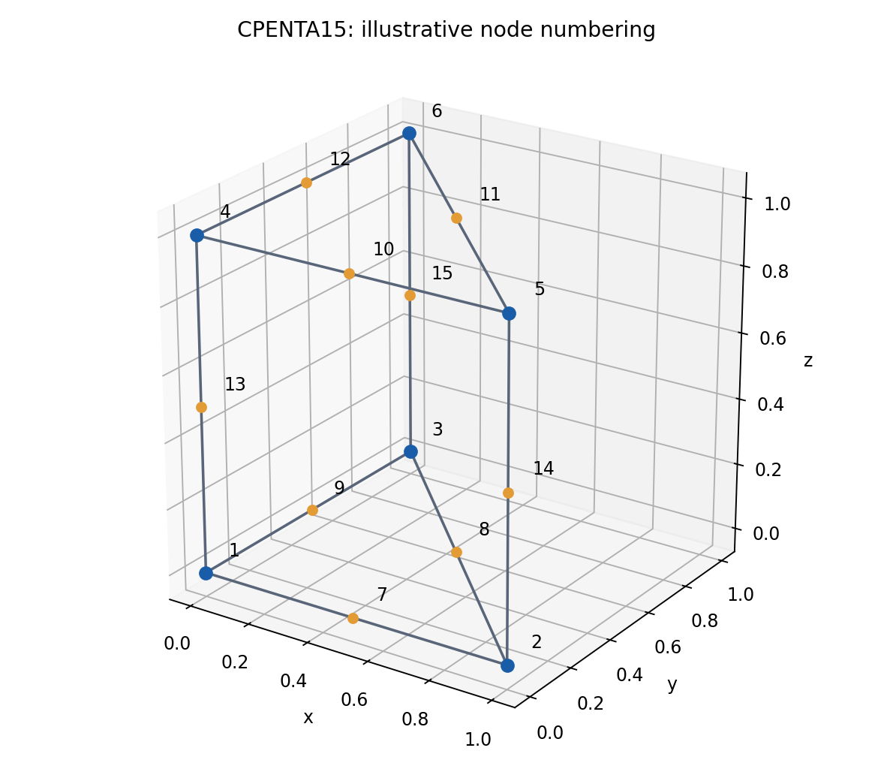

*CPENTA15: vertex and midside topology illustration supplied with the revision-2 archive.*

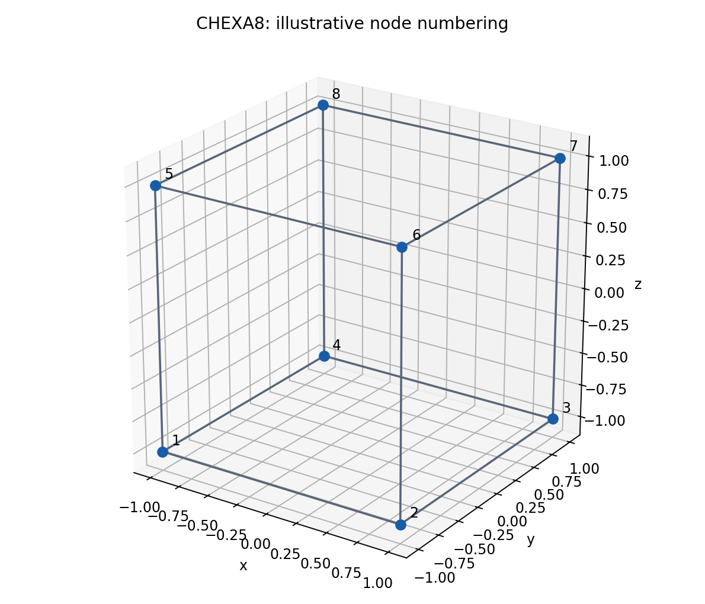

*CHEXA8: vertex and midside topology illustration supplied with the revision-2 archive.*

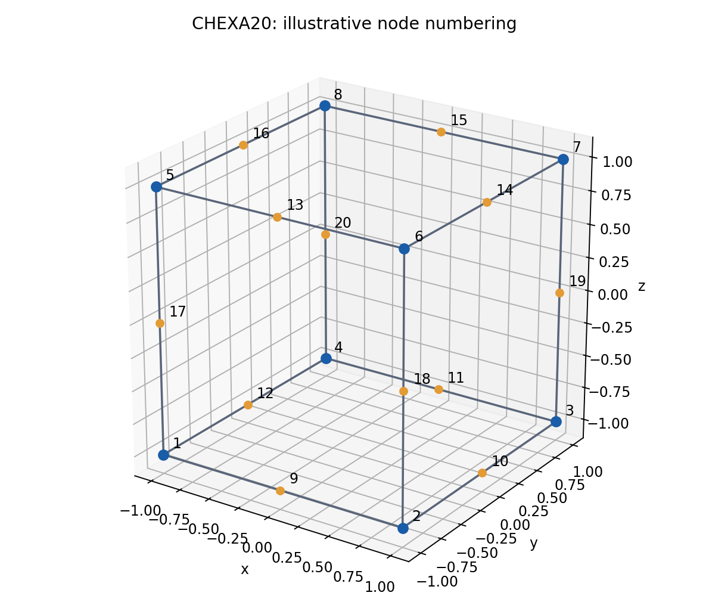

*CHEXA20: vertex and midside topology illustration supplied with the revision-2 archive.*

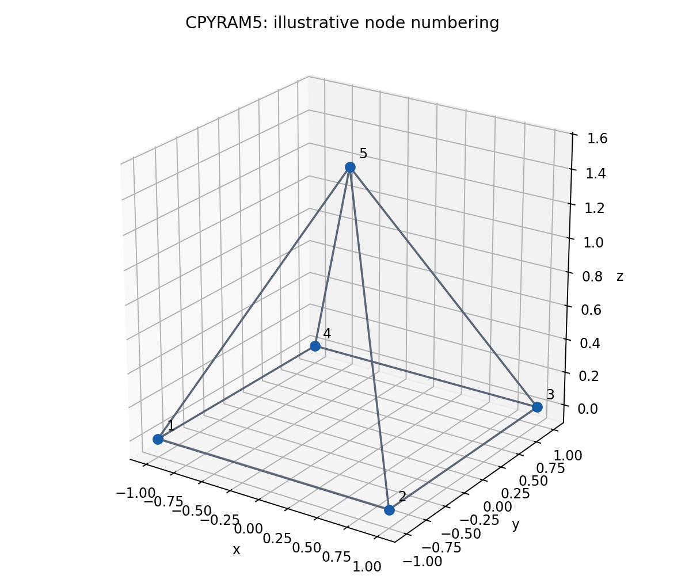

*CPYRAM5: vertex and midside topology illustration supplied with the revision-2 archive.*

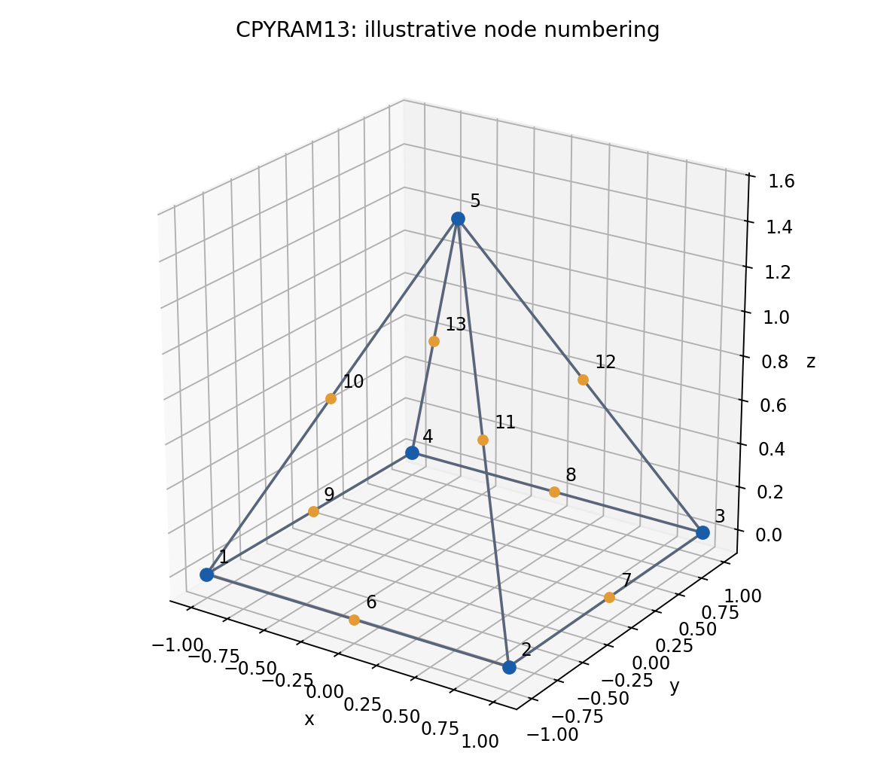

*CPYRAM13: vertex and midside topology illustration supplied with the revision-2 archive.*

## 4. Thermal, mass, initial-stress and output operators

The standard consistent mass and thermal loading expressions are

$$\mathbf M=\int_{\Omega_e}\rho\mathbf N^{\mathsf T}\mathbf N\,dV,\qquad
\boldsymbol\varepsilon_T=\alpha_T\Delta T[1,1,1,0,0,0]^{\mathsf T},\qquad
\mathbf f_T=\int_{\Omega_e}\mathbf B^{\mathsf T}\mathbf D\boldsymbol\varepsilon_T\,dV.$$

Enhanced variants condense thermal loads consistently using Section 2.3. These equations describe the operator family; the displacement comparison in Section 6 does not independently validate mass or thermal behavior for every element.

For a physical prestress tensor $\boldsymbol\sigma_0$ and ordinary displacement gradients,

$$\mathbf K_{G,ab}=\int_{\Omega_e}(\nabla N_a)^{\mathsf T}
\boldsymbol\sigma_0(\nabla N_b)\,\mathbf I_3\,dV,\qquad
(\mathbf K+\lambda_b\mathbf K_G)\boldsymbol\phi=\mathbf0.$$

Compression is negative in the stress convention used by these state routines. A physical initial-stress operator is not a derived finite-strain ANS/EAS tangent. The CTETRA4 audit separately verifies its Python/Fortran initial-stress operator and independence from output coordinates; this does not establish every solid's buckling accuracy.

At material sampling points, stresses follow $\mathbf D(\boldsymbol\varepsilon-\boldsymbol\varepsilon_T)$ with the appropriate recovered strain. GPSTRESS VOLUME produces grid-point stress results for the requested recovery volumes; those values are distinct from raw integration-point stresses and ordinary element OES output. The 5-001 audit checks direct tensors, principal values/directions, pressure and von Mises, with

$$p=-\tfrac13\operatorname{tr}\boldsymbol\sigma,\qquad
\sigma_{\rm vm}=\sqrt{\tfrac32\mathbf s:\mathbf s},\qquad
\mathbf s=\boldsymbol\sigma-\tfrac13\operatorname{tr}(\boldsymbol\sigma)\mathbf I.$$

GPSTRAIN has not been implemented in this work. `STRAIN(PLOT)` requests ordinary element strain OSTR, not GPSTRAIN. CPYRAM13 ordinary OP2 strain remains suppressed by the writer because the available center-only output does not populate its standard six-location layout; center strain is available through F06 printing. This limitation is separate from the validated GPSTRESS VOLUME records.

## 5. Verification strategy and existing patch evidence

The existing 5-001 quadratic audit uses the supplied distorted geometry with joint-2 coordinate $X=0.826$, material $E=10^6$, $\nu=0.25$, prescribed exterior translations and solved interior translations. Six independent constant-strain states, a rigid-body rotation, and the supplied combined affine field are evaluated. The normalization for near-zero stress states follows the original audit, avoiding division by a vanishing reference stress.

| Worst relative error over eight existing states | CPENTA15 | CHEXA20 |
|---|---:|---:|
| Nodal displacement | 1.13722e-10 | 3.46945e-15 |
| Gauss-point stress | 8.37835e-10 | 4.36557e-14 |
| GPSTRESS | 4.17345e-10 | 1.16043e-14 |
| Minimum integration-point determinant | 0.0124390601 | 0.00248365932 |

Both quadratic families satisfy the established $10^{-7}$ relative criterion in those isolated solves. This evidence is taken from the [quadratic audit](../../quadratic_patch_5001_audit.md); it is not a new analysis in this revision. The combined eight-solid deck requires normalized BDF formatting and reconciled midside ordering. The runnable [MYSTRAN EAS9 example](../../solid_benchmark/5-001_8_SOLIDS_GPSTRESS_PENTA_REMESH_FIXED_QUADRATIC_MYSTRAN_EAS9.dat) preserves coordinates and boundary values.

The separate [5-001 GPSTRESS OP2 audit](../../op2_solid_5001_audit.md) reports eight direct and eight principal volumes, each with 204 total corner-grid rows. Seven volumes have identical single-precision payloads to the tested Nastran reference. CPENTA6 EAS9 differs from Nastran while satisfying the analytical patch. Thus 7/8 payload matches do not mean that only seven elements pass an analytical patch. ABE's distorted-patch limitation and the ordinary CHEXA8 corner-recovery diagnostic remain documented separately.

## 6. Existing matched-model benchmark assessment

### 6.1 Models, references and measures

The two geometry families are SAP2000-derived 5-004 twisted beam and 5-007 pinched dome. They are reconstructed benchmark models, rather than a claim that the original SAP2000 model was rerun for every topology. The archive supplies independent responses of 0.005429 (beam IN), 0.001749 (beam OUT), and +0.094/-0.094 (dome A/B). The published SAP2000 values are separate original-mesh results: beam IN 0.005322 and OUT 0.001719; dome A 0.0701 at 16x16x1 HEXA8 (578 nodes, 256 elements) and 0.093 at 48x48x1 HEXA8 (4802 nodes, 2304 elements). They are not new SAP2000 analyses on each generated mesh. Units follow the supplied consistent-unit input models; no unit conversion is applied in the tables.

| Model | Material | Loading and supports | Reported response |
|---|---|---|---|
| 5-004 twisted beam | $E=29\times10^6$, $\nu=0.22$ | Length 12; root $x=0$ translations fixed; separate unit global-Y and global-Z tip-force resultants distributed equally among selected tip grids | Mean selected tip-grid Y displacement (IN) or Z displacement (OUT) |
| 5-007 reconstructed quarter dome | $E=68{,}250{,}000$ kip/ft$^2$, $\nu=0.30$ | Supplied symmetry/support translation sets and vertical anchor retained; load resultants $(+1,-1,0)$ kip | Mean X displacement of the two A grids, or mean Y displacement of the two B grids, across the thickness |

The mesh inventory records the actual selected grids, support counts and load resultants. Using the same output reduction in both solvers is essential; comparing one surface node with a through-thickness average would change the response definition.

For scalar response $q$ and independent target $q_*$,

$$R=q/q_*,\qquad e_{\rm ref}=100\frac{|q-q_*|}{|q_*|},\qquad
e_{\rm pair}=100\frac{|q_M-q_N|}{|q_N|}.$$

The report contains 56 distinct matched meshes, 56 Nastran analyses and 63 MYSTRAN selections because ABE and EAS9 share prism meshes. Two scalar responses per selection give 126 response comparisons. Beam refinement uses 6x1x1, 12x2x2 and 24x4x2 parent grids; dome refinement uses 4x4x1, 8x8x1, 16x16x1 and 24x24x1. The dome has one thickness layer at every level. These are in-plane refinement studies, not simultaneous through-thickness convergence studies.

Each parent brick yields six tetrahedra, two prisms, six pyramids or one brick. Quadratic edge midpoints are shared and retain the straight-edge geometry. Beam prisms are extruded along the beam axis; dome prisms follow the radial extrusion. Material, connectivity, coordinates, fixed translations and load resultants are matched between solvers. Solver integration choices remain formulation-dependent. The paired results are independent solver executions; the Python model generator is not a third numerical reference for these runs.

The existing mesh audits identify no unused nodes or unintended internal free translations. Sampled corner-map Jacobians are positive; this is a sampled geometry audit, not proof that every possible high-order mapping is positive everywhere. No automatic translational constraints were added in the 63 MYSTRAN selections. Two coarse dome tetrahedral Nastran decks require `GEOMCHECK TET_AR=150.` for an aspect ratio about 127.36; the geometry and determinant checks were retained. Full parameters and mesh counts are available in the linked CSVs and input archive.

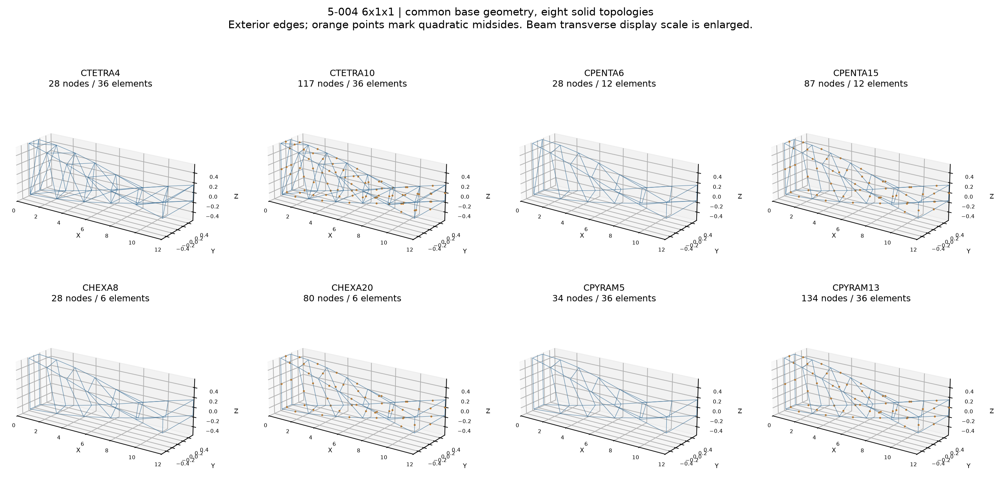

*Figure 1. Existing twisted-beam meshes, reproduced from the matched-model benchmark archive.*

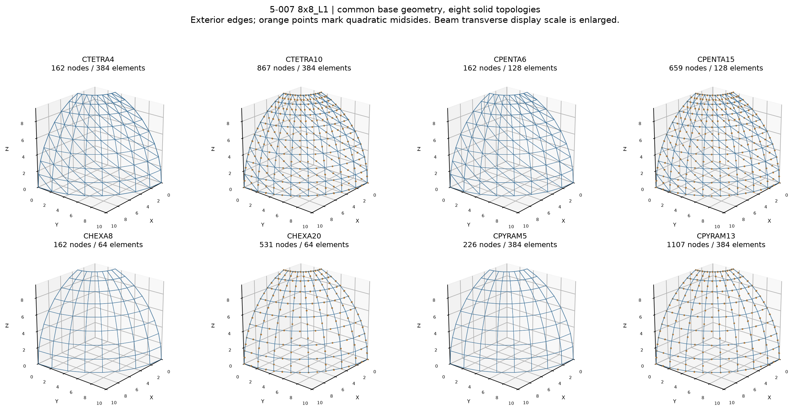

*Figure 2. Existing pinched-dome meshes; topology and one-layer thickness are retained across the comparison.*

### 6.2 Finest-mesh scalar results

Tables 1-3 are generated directly from the published `finest_mesh_summary.csv`. Displacements are rounded for display; downloadable CSVs retain the original precision. The element count varies with topology even when the parent grid is identical. Dome B is retained in the full data and per-element tables below.

**Table 1. Twisted beam, IN response; parent grid 24x4x2.**

| Element / option | Elements | Nastran | MYSTRAN | N error (%) | M error (%) |
|---|---:|---:|---:|---:|---:|
| CTETRA4 | 1152 | 0.0014950003 | 0.0043074328 | 72.463 | 20.659 |
| CTETRA10 | 1152 | 0.0054125089 | 0.0054124913 | 0.30376 | 0.30408 |
| CPENTA6 ABE | 384 | 0.0051955009 | 0.0052223565 | 4.301 | 3.8063 |
| CPENTA6 EAS9 | 384 | 0.0051955009 | 0.0052115471 | 4.301 | 4.0054 |
| CPENTA15 | 384 | 0.0054218103 | 0.0054221827 | 0.13243 | 0.12557 |
| CHEXA8 | 192 | 0.0054018464 | 0.005395933 | 0.50016 | 0.60908 |
| CHEXA20 | 192 | 0.005424081 | 0.0054240594 | 0.090606 | 0.091004 |
| CPYRAM5 | 1152 | 0.002300146 | 0.0023001351 | 57.632 | 57.632 |
| CPYRAM13 | 1152 | 0.0054216504 | 0.0054216351 | 0.13538 | 0.13566 |

**Table 2. Twisted beam, OUT response; parent grid 24x4x2.**

| Element / option | Elements | Nastran | MYSTRAN | N error (%) | M error (%) |
|---|---:|---:|---:|---:|---:|
| CTETRA4 | 1152 | 0.00056964933 | 0.001657805 | 67.43 | 5.2141 |
| CTETRA10 | 1152 | 0.0017531385 | 0.0017531318 | 0.23662 | 0.23624 |
| CPENTA6 ABE | 384 | 0.001670758 | 0.0016944171 | 4.4735 | 3.1208 |
| CPENTA6 EAS9 | 384 | 0.001670758 | 0.0016845901 | 4.4735 | 3.6827 |
| CPENTA15 | 384 | 0.0017545652 | 0.0017545718 | 0.31819 | 0.31857 |
| CHEXA8 | 192 | 0.0017470133 | 0.0017461829 | 0.11359 | 0.16107 |
| CHEXA20 | 192 | 0.0017549564 | 0.0017549463 | 0.34056 | 0.33998 |
| CPYRAM5 | 1152 | 0.00081481538 | 0.00081481119 | 53.412 | 53.413 |
| CPYRAM13 | 1152 | 0.001754411 | 0.0017544049 | 0.30938 | 0.30903 |

**Table 3. Pinched dome, A response; parent grid 24x24x1.**

| Element / option | Elements | Nastran | MYSTRAN | N error (%) | M error (%) |
|---|---:|---:|---:|---:|---:|
| CTETRA4 | 3456 | 0.0003103354 | 0.001620851 | 99.67 | 98.276 |
| CTETRA10 | 3456 | 0.087270301 | 0.087268297 | 7.1593 | 7.1614 |
| CPENTA6 ABE | 1152 | 0.085687444 | 0.085617609 | 8.8431 | 8.9174 |
| CPENTA6 EAS9 | 1152 | 0.085687444 | 0.001011309 | 8.8431 | 98.924 |
| CPENTA15 | 1152 | 0.09076561 | 0.090485241 | 3.4408 | 3.7391 |
| CHEXA8 | 576 | 0.09335861 | 0.087106735 | 0.68233 | 7.3333 |
| CHEXA20 | 576 | 0.093142476 | 0.093141329 | 0.91226 | 0.91348 |
| CPYRAM5 | 3456 | 7.3195897e-05 | 7.3196457e-05 | 99.922 | 99.922 |
| CPYRAM13 | 3456 | 0.092219938 | 0.092219889 | 1.8937 | 1.8937 |

### 6.3 Per-element refinement curves and finest-mesh data

The original plots below show beam IN/OUT ratios, dome A ratio and dome A percentage error. The bold black ratio reference is 1. The error plot's bold line is 1% error, while exact agreement has zero error. Its symlog ordinate and -0.5 lower display margin improve visibility; they do not represent negative absolute error. Published SAP2000 markers/lines retain their original-mesh meaning.

#### CTETRA4

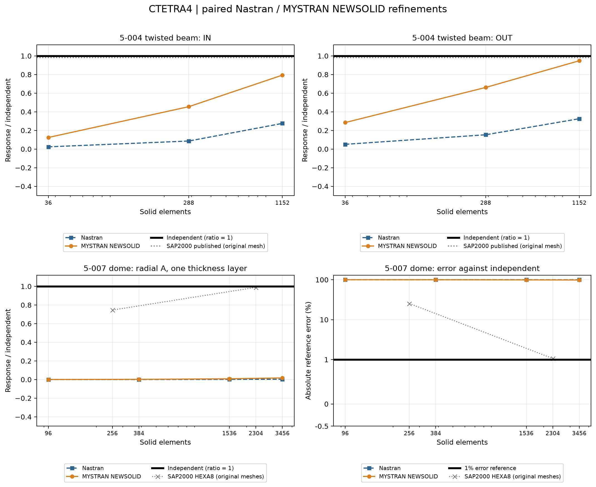

| Case | Option | Response | Nastran | MYSTRAN | Independent | N error (%) | M error (%) |
|---|---|---|---:|---:|---:|---:|---:|
| 5-004 | NEWSOLID | IN | 0.0014950003 | 0.0043074328 | 0.005429 | 72.462695 | 20.658817 |
| 5-004 | NEWSOLID | OUT | 0.00056964933 | 0.001657805 | 0.001749 | 67.429998 | 5.21412 |
| 5-007 | NEWSOLID | A | 0.0003103354 | 0.001620851 | 0.094 | 99.669856 | 98.27569 |
| 5-007 | NEWSOLID | B | -0.0003109609 | -0.0016573349 | -0.094 | 99.669191 | 98.236878 |

#### CTETRA10

| Case | Option | Response | Nastran | MYSTRAN | Independent | N error (%) | M error (%) |
|---|---|---|---:|---:|---:|---:|---:|
| 5-004 | NEWSOLID | IN | 0.0054125089 | 0.0054124913 | 0.005429 | 0.30376022 | 0.30408272 |
| 5-004 | NEWSOLID | OUT | 0.0017531385 | 0.0017531318 | 0.001749 | 0.23661929 | 0.2362359 |
| 5-007 | NEWSOLID | A | 0.087270301 | 0.087268297 | 0.094 | 7.1592544 | 7.1613866 |
| 5-007 | NEWSOLID | B | -0.088259183 | -0.088256732 | -0.094 | 6.1072523 | 6.10986 |

#### CPENTA6

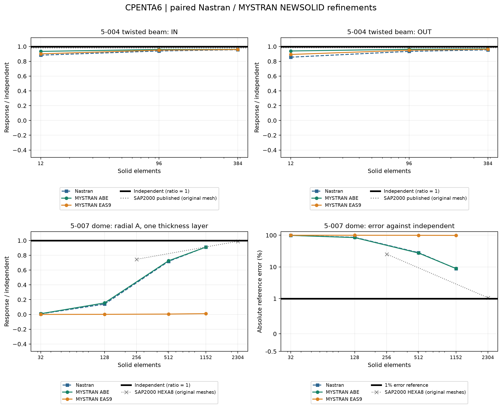

| Case | Option | Response | Nastran | MYSTRAN | Independent | N error (%) | M error (%) |
|---|---|---|---:|---:|---:|---:|---:|
| 5-007 | ABE | A | 0.085687444 | 0.085617609 | 0.094 | 8.8431451 | 8.9174369 |
| 5-007 | ABE | B | -0.086630479 | -0.08687463 | -0.094 | 7.8399165 | 7.5801805 |
| 5-007 | EAS9 | A | 0.085687444 | 0.001011309 | 0.094 | 8.8431451 | 98.924139 |
| 5-007 | EAS9 | B | -0.086630479 | -0.0010240344 | -0.094 | 7.8399165 | 98.910602 |
| 5-004 | ABE | IN | 0.0051955009 | 0.0052223565 | 0.005429 | 4.3009605 | 3.8062902 |
| 5-004 | ABE | OUT | 0.001670758 | 0.0016944171 | 0.001749 | 4.4735278 | 3.1208035 |
| 5-004 | EAS9 | IN | 0.0051955009 | 0.0052115471 | 0.005429 | 4.3009605 | 4.0053949 |
| 5-004 | EAS9 | OUT | 0.001670758 | 0.0016845901 | 0.001749 | 4.4735278 | 3.6826681 |

#### CPENTA15

| Case | Option | Response | Nastran | MYSTRAN | Independent | N error (%) | M error (%) |
|---|---|---|---:|---:|---:|---:|---:|
| 5-007 | NEWSOLID | A | 0.09076561 | 0.090485241 | 0.094 | 3.4408401 | 3.739105 |
| 5-007 | NEWSOLID | B | -0.090704888 | -0.090463363 | -0.094 | 3.5054382 | 3.7623802 |
| 5-004 | NEWSOLID | IN | 0.0054218103 | 0.0054221827 | 0.005429 | 0.13243049 | 0.12557208 |
| 5-004 | NEWSOLID | OUT | 0.0017545652 | 0.0017545718 | 0.001749 | 0.31819388 | 0.31857328 |

#### CHEXA8

| Case | Option | Response | Nastran | MYSTRAN | Independent | N error (%) | M error (%) |
|---|---|---|---:|---:|---:|---:|---:|
| 5-004 | NEWSOLID | IN | 0.0054018464 | 0.005395933 | 0.005429 | 0.50015852 | 0.609081 |
| 5-004 | NEWSOLID | OUT | 0.0017470133 | 0.0017461829 | 0.001749 | 0.1135927 | 0.16106894 |
| 5-007 | NEWSOLID | A | 0.09335861 | 0.087106735 | 0.094 | 0.68232997 | 7.3332612 |
| 5-007 | NEWSOLID | B | -0.09335861 | -0.087106735 | -0.094 | 0.68232997 | 7.3332612 |

#### CHEXA20

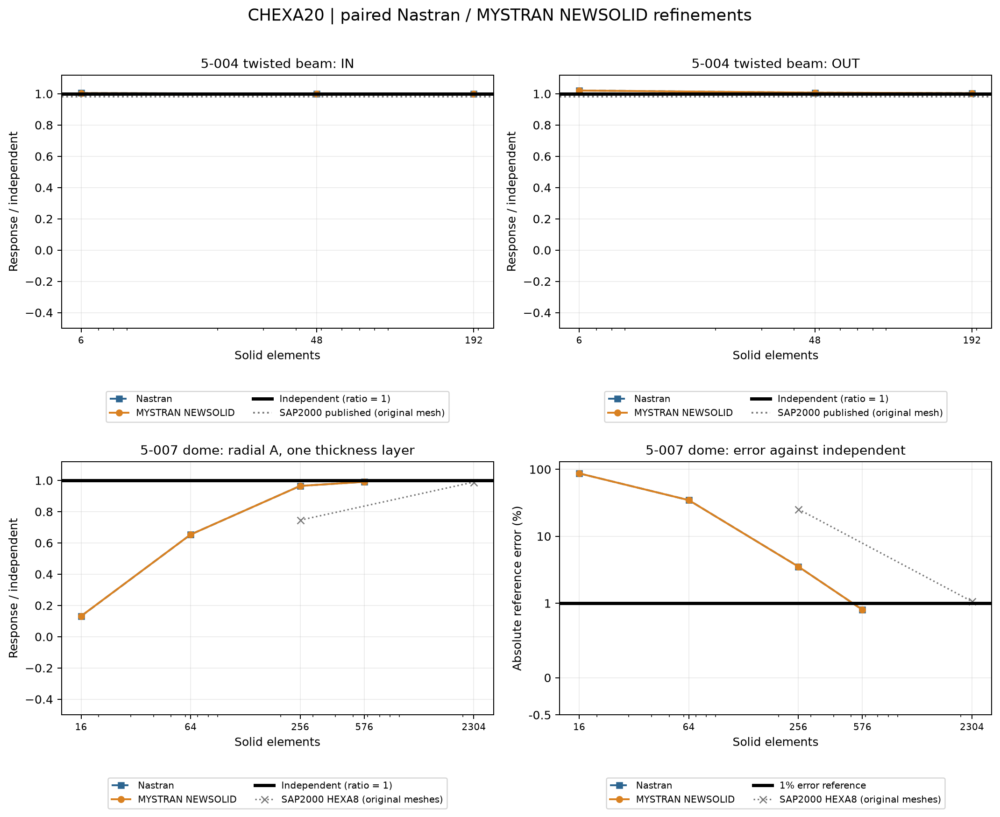

| Case | Option | Response | Nastran | MYSTRAN | Independent | N error (%) | M error (%) |
|---|---|---|---:|---:|---:|---:|---:|
| 5-004 | NEWSOLID | IN | 0.005424081 | 0.0054240594 | 0.005429 | 0.090606459 | 0.091003873 |
| 5-004 | NEWSOLID | OUT | 0.0017549564 | 0.0017549463 | 0.001749 | 0.3405624 | 0.33998199 |
| 5-007 | NEWSOLID | A | 0.093142476 | 0.093141329 | 0.094 | 0.91225965 | 0.91348027 |
| 5-007 | NEWSOLID | B | -0.093142476 | -0.093141321 | -0.094 | 0.91225965 | 0.9134882 |

#### CPYRAM5

| Case | Option | Response | Nastran | MYSTRAN | Independent | N error (%) | M error (%) |
|---|---|---|---:|---:|---:|---:|---:|
| 5-004 | NEWSOLID | IN | 0.002300146 | 0.0023001351 | 0.005429 | 57.632234 | 57.632435 |
| 5-004 | NEWSOLID | OUT | 0.00081481538 | 0.00081481119 | 0.001749 | 53.4125 | 53.412739 |
| 5-007 | NEWSOLID | A | 7.3195897e-05 | 7.3196457e-05 | 0.094 | 99.922132 | 99.922131 |
| 5-007 | NEWSOLID | B | -7.3195897e-05 | -7.3196457e-05 | -0.094 | 99.922132 | 99.922131 |

#### CPYRAM13

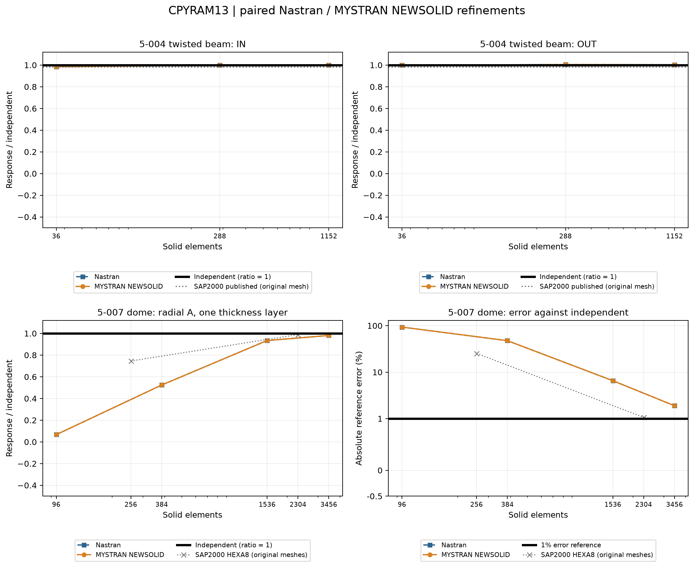

| Case | Option | Response | Nastran | MYSTRAN | Independent | N error (%) | M error (%) |
|---|---|---|---:|---:|---:|---:|---:|
| 5-004 | NEWSOLID | IN | 0.0054216504 | 0.0054216351 | 0.005429 | 0.13537593 | 0.13565898 |
| 5-004 | NEWSOLID | OUT | 0.001754411 | 0.0017544049 | 0.001749 | 0.3093772 | 0.30902842 |
| 5-007 | NEWSOLID | A | 0.092219938 | 0.092219889 | 0.094 | 1.8936834 | 1.8937349 |
| 5-007 | NEWSOLID | B | -0.092219941 | -0.092219889 | -0.094 | 1.8936794 | 1.8937349 |

### 6.4 Discussion of accuracy and convergence

On the finest beam mesh, CTETRA4 smoothing substantially reduces independent-reference error compared with the ordinary Nastran tetrahedron, although the remaining IN error is about 20.66%. CPENTA6 ABE and EAS9 improve the beam responses relative to the tested Nastran prism; their performance cannot be extrapolated to every geometry. Several quadratic families closely reproduce Nastran on the matched meshes, with distinct remaining errors against independent targets.

The dome exposes the limits of the enhanced linear formulations under one-layer in-plane refinement. CHEXA8 has approximately 7.33% MYSTRAN A-response error compared with 0.682% for Nastran. CPENTA6 EAS9 has approximately 98.92% A-response error, whereas ABE has approximately 8.92%. CPENTA15 has approximately 3.74% MYSTRAN error, and CHEXA20 and CPYRAM13 have approximately 0.913% and 1.894%, respectively. CTETRA4 and CPYRAM5 remain very stiff on this mesh sequence. Consequently, the evidence does not support a statement that only CHEXA8 trails Nastran, nor a claim that all NEWSOLID results are equal or better.

The curves are empirical mesh-refinement evidence. Different topology counts, fixed thickness-layer count and formulation-dependent locking preclude claiming a universal asymptotic convergence order from these data alone. No fitted convergence slope or extrapolated exact value is introduced. Agreement of a scalar displacement does not establish pointwise stress, force, mass, eigenvalue or thermal accuracy.

## 7. Implementation traceability and archive reconciliation

| Mathematical content | Current repository source | Documentation finding |
|---|---|---|
| Selectors | [PARAMS.f90](../../../Source/Modules/PARAMS.f90) | NEWSOLID default; CPENTA6 ABE default, EAS9 alternative |
| CTETRA4 smoothing | [CTETRA4S_SMOOTH_ASSEMBLY.f90](../../../Source/LK1/L1E/CTETRA4S_SMOOTH_ASSEMBLY.f90) | NS weight 0.9; skip heterogeneous material-row patches |
| Tetrahedron operators | [TETRA.f90](../../../Source/EMG/EMG5/TETRA.f90) | Compatible tetrahedral operators and T4 initial stress |
| Brick stiffness | [HEXA.f90](../../../Source/EMG/EMG5/HEXA.f90) | EAS9 columns; conditional quadratic shear replacement |
| Prism stiffness | [PENTA.f90](../../../Source/EMG/EMG5/PENTA.f90) | EAS9 and ABE paths; conditional quadratic shear replacement |
| Enhanced state and recovery | [EAS9_FRAME.f90](../../../Source/Modules/EAS9_FRAME.f90) | Exact nine-column matrices; condensed thermal/state recovery |
| Pyramid dispatch | [PYRAM.f90](../../../Source/EMG/EMG5/PYRAM.f90) | Five-node and Bedrosian thirteen-node paths |
| Rational basis and quadrature | [PYRAM13_BEDROSIAN.f90](../../../Source/Modules/PYRAM13_BEDROSIAN.f90) | Explicit collapsed basis; axial-weight correction |
| Ordinary element strain output | [WRITE_ELEM_STRAINS.f90](../../../Source/LK9/L91/WRITE_ELEM_STRAINS.f90) | CPYRAM13 ordinary OP2 strain limitation |

The source snapshot is identified above so later code changes do not silently redefine this manuscript. The revision-2 archive labels ABE as not selected; this manuscript documents it because it is the executable default. Historical statements that the EAS columns still need extraction are superseded by Section 3's source transcription. The archive's generic mass/thermal/buckling equations are retained as theoretical operators and are not turned into new validation claims. Source hashes and input-archive provenance are stored in [provenance.json](data/provenance.json).

## 8. Conclusions

The NEWSOLID family combines compatible linear/quadratic interpolation, nodal smoothing and locally condensed strain enhancement while preserving translational global unknowns. Explicit mode definitions, determinant scaling and integration rules make the custom brick and prism variants traceable to the current implementation. The existing quadratic patch audits support very small displacement and stress errors after reconciling input ordering. The matched beam/dome archive demonstrates both strong quadratic agreement and substantial formulation-dependent limitations, especially for thin-dome linear and EAS9-prism responses. These observations support case-specific verification rather than universal superiority or complete validation of every output and analysis operator.

## Data availability and reproducibility

- [All 126 response comparisons](data/comparison_all.csv), [finest-mesh results](data/finest_mesh_summary.csv), [mesh inventory](data/mesh_inventory.csv), [geometry audit](data/geometry_audit.csv), [constraint audit](data/constraint_audit.csv) and [published reference values](data/sap2000_reference.csv).
- [Input-deck archive](../../solid_benchmark/solid_benchmark_inputs.zip), containing inputs, instructions and checksums, with no raw solver outputs.
- [All-solid benchmark report](../../solid_benchmark/comparison_all.md) and [five-case report](../../solid_benchmark/mystran_solid_comparison.md), including separate buckling and thermal evidence outside the main beam/dome comparison.
- [Runnable eight-solid GPSTRESS VOLUME patch input](../../solid_benchmark/5-001_8_SOLIDS_GPSTRESS_PENTA_REMESH_FIXED_QUADRATIC_MYSTRAN_EAS9.dat).

This revision performs documentation and data-transcription checks only. It reports no new solver runs, no modified stiffness operators and no invented reference results.

## References

1. J. C. Simo and M. S. Rifai (1990), “A class of mixed assumed strain methods and the method of incompatible modes,” *International Journal for Numerical Methods in Engineering*, 29, 1595-1638. [DOI](https://doi.org/10.1002/nme.1620290802).
2. J. C. Simo, F. Armero and R. L. Taylor (1993), “Improved versions of assumed enhanced strain tri-linear elements for 3D finite deformation problems,” *Computer Methods in Applied Mechanics and Engineering*. [DOI](https://doi.org/10.1016/0045-7825(93)90215-J).
3. G. R. Liu, T. Nguyen-Thoi and K. Y. Lam (2008), “A novel alpha finite element method (alphaFEM) for exact solution to mechanics problems using triangular and tetrahedral elements,” *Computer Methods in Applied Mechanics and Engineering*, 197, 3883-3897. [Publisher](https://www.sciencedirect.com/science/article/pii/S0045782508001199), [DOI](https://doi.org/10.1016/j.cma.2008.03.011).
4. G. R. Liu, T. Nguyen-Thoi, H. Nguyen-Xuan and K. Y. Lam (2009), “A node-based smoothed finite element method (NS-FEM) for upper bound solutions to solid mechanics problems,” *Computers & Structures*, 87, 14-26. [Publisher](https://www.sciencedirect.com/science/article/pii/S0045794908002034), [DOI](https://doi.org/10.1016/j.compstruc.2008.09.003).
5. G. Bedrosian (1992), “Shape functions and integration formulas for three-dimensional finite element analysis,” *International Journal for Numerical Methods in Engineering*. [DOI](https://doi.org/10.1002/nme.1620350106).
6. Computers and Structures, Inc., *SAP2000 Verification: Solids*, Problems 5-001, 5-004 and 5-007. [Publisher verification collection](https://docs.csiamerica.com/manuals/sap2000/Verification/Analysis/Solids/). Published values and mesh provenance are recorded in the benchmark archive.
7. Ary (2026), `NEWSOLID_ARY_CONTINUUM_FORMULATIONS_REV2_20261017.zip`, supplied formulation archive, and MYSTRAN matched-solid benchmark CSVs dated 17 October 2026. These are project research records, not peer-reviewed publications. Literature metadata is transcribed from the supplied archive; full-text bibliographic verification is not part of this revision.
