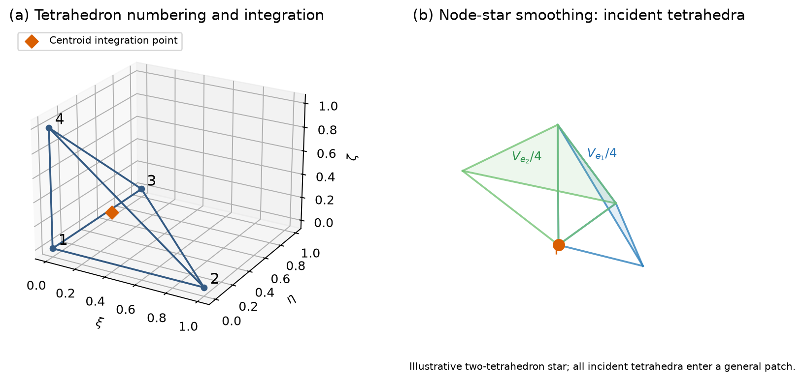
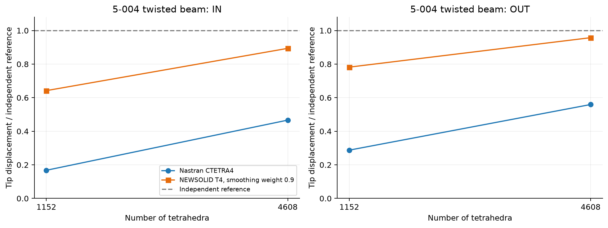
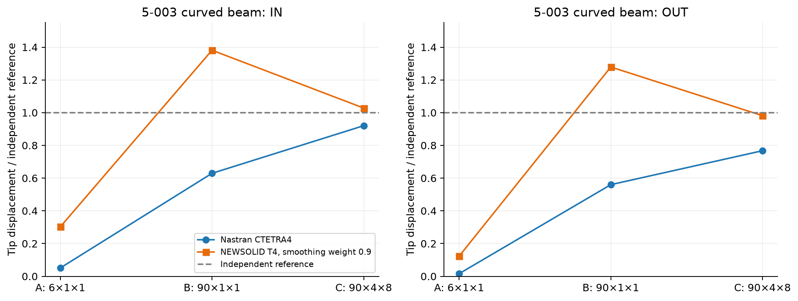
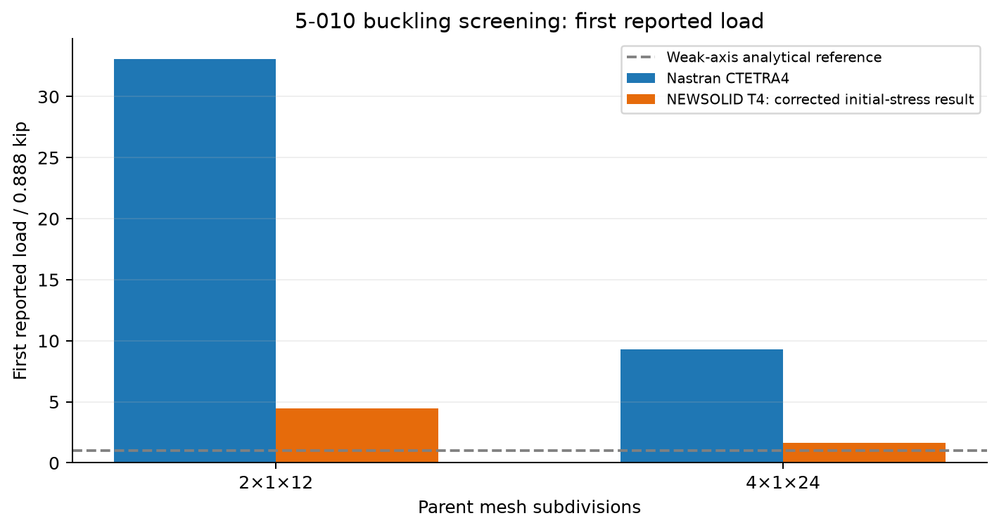

# TETRA4 NEWSOLID: Blended Nodal Strain Smoothing for Three-Dimensional Solids and Mystran Benchmark Comparisons with Nastran

**Ary · Technical formulation and benchmark report · 26 October 2026**

## Abstract

The selected four-node tetrahedral solid combines compatible constant-strain elasticity with a volume-weighted nodal strain field. A fixed smoothing weight of 0.9 retains a positive compatible contribution while extending strain coupling across the tetrahedra incident on each vertex. The formulation uses three translations per node and introduces no additional global unknowns. Its interpolation, smoothing domains, elastic energy, thermal loading and initial-stress operator are stated below. Existing results from five SAP2000-derived verification problems are compared with Nastran CTETRA4 and independent analytical references. Affine patch and uniform-temperature responses agree closely with their exact solutions. Smoothing substantially reduces the excessive stiffness of the conventional tetrahedron in the twisted-beam examples, while curved-beam results show both improvement and an overly flexible intermediate mesh. Corrected buckling results remain screening evidence: the elastic smoothing and conventional initial-stress operators have not been established as a consistent nonlocal finite-deformation tangent.

**Keywords:** four-node tetrahedron; nodal strain smoothing; blended stiffness; continuum solids; patch test; Nastran; Mystran Benchmark.

## 1. Selected formulation and comparison scope

TETRA4 NEWSOLID denotes the **nodally smoothed blend with smoothing weight 0.9**. The conventional compatible tetrahedron provides the reference displacement element. Node-based smoothing supplies the methodological background [1]; blended tetrahedral methods provide related context [2]. The particular weight and benchmark results reported here belong to the selected formulation and are not universal optimality claims from those references.

| Property | Definition |
|---|---|
| Geometry | Four vertices, straight-sided tetrahedron |
| Nodal variables | Three translations per vertex |
| Element displacement vector | Twelve components |
| Compatible strain | Constant within each tetrahedron |
| Smoothed strain | Volume-weighted average over a node star |
| Smoothing weight | $\beta=0.9$ |
| Coupling | All translations belonging to incident tetrahedra |
| Additional global variables | None |
| Comparison element | Nastran CTETRA4 on the corresponding tetrahedral model |

All numerical observations reuse existing benchmark results. No new solver analyses are included. The five cases are affine patch 5-001, curved beam 5-003, twisted beam 5-004, column buckling 5-010 and uniform thermal loading 5-011 [3–7]. Printed SAP2000 values belong to the original benchmark discretizations; they are not reanalyses on the tetrahedral refinement meshes used here.

## 2. Geometry, nodal numbering and interpolation

### 2.1 Reference tetrahedron

Use the reference domain

```math
\widehat{\Omega}=\{(\xi,\eta,\zeta):\xi\geq0,\eta\geq0,\zeta\geq0,\xi+\eta+\zeta\leq1\}.
```

The vertex coordinates and interpolation functions are

| Vertex | $(\xi,\eta,\zeta)$ | Shape function |
|---|---|---|
| 1 | $(0,0,0)$ | $N_1=1-\xi-\eta-\zeta$ |
| 2 | $(1,0,0)$ | $N_2=\xi$ |
| 3 | $(0,1,0)$ | $N_3=\eta$ |
| 4 | $(0,0,1)$ | $N_4=\zeta$ |

```math
\mathbf{x}=\sum_{a=1}^{4}N_a\mathbf{x}_a,
\qquad
\mathbf{u}_h=\sum_{a=1}^{4}N_a\mathbf{u}_a,
\qquad
\mathbf{d}_e=[u_1,v_1,w_1,\ldots,u_4,v_4,w_4]^{\mathrm{T}}.
```

Define the Jacobian by columns of physical edge vectors:

```math
\mathbf{J}=[\mathbf{x}_2-\mathbf{x}_1\quad\mathbf{x}_3-\mathbf{x}_1\quad\mathbf{x}_4-\mathbf{x}_1],
\qquad
\nabla_x N_a=\mathbf{J}^{-\mathrm{T}}\nabla_{\xi}N_a,
\qquad
V_e=\frac{\det\mathbf{J}}{6}>0.
```

A valid orientation is assumed. Degenerate or inverted tetrahedra require geometric correction before these operators apply.



*Figure 1. Vertex numbering and centroid integration point (left); an illustrative node star (right). Each incident tetrahedron contributes one quarter of its volume to the central node's smoothing domain. The star is a mathematical schematic, not a benchmark mesh.*

### 2.2 Compatible strain operator

The engineering strain vector is ordered as

```math
\boldsymbol{\varepsilon}
=[\varepsilon_{xx},\varepsilon_{yy},\varepsilon_{zz},\gamma_{xy},\gamma_{yz},\gamma_{zx}]^{\mathrm{T}},
\qquad
\boldsymbol{\varepsilon}_e=\mathbf{B}_e\mathbf{d}_e.
```

For $b_a=N_{a,x}$, $c_a=N_{a,y}$ and $d_a=N_{a,z}$,

```math
\mathbf{B}_e=[\mathbf{B}_1\quad\mathbf{B}_2\quad\mathbf{B}_3\quad\mathbf{B}_4],
\qquad
\mathbf{B}_a=
\begin{bmatrix}
b_a&0&0\\
0&c_a&0\\
0&0&d_a\\
c_a&b_a&0\\
0&d_a&c_a\\
d_a&0&b_a
\end{bmatrix}.
```

For a straight-sided tetrahedron, every derivative and hence $\mathbf{B}_e$ is constant.

## 3. Constitutive law and compatible energy

For homogeneous isotropic elasticity,

```math
\mu=\frac{E}{2(1+\nu)},
\qquad
\lambda=\frac{E\nu}{(1+\nu)(1-2\nu)},
```

```math
\mathbf{D}=
\begin{bmatrix}
\lambda+2\mu&\lambda&\lambda&0&0&0\\
\lambda&\lambda+2\mu&\lambda&0&0&0\\
\lambda&\lambda&\lambda+2\mu&0&0&0\\
0&0&0&\mu&0&0\\
0&0&0&0&\mu&0\\
0&0&0&0&0&\mu
\end{bmatrix}.
```

Let $\mathbf{A}_e$ extract an element's translations from the global vector $\mathbf{d}$. The compatible stiffness and energy are

```math
\mathbf{K}_{\mathrm{FEM}}
=\sum_e V_e\mathbf{A}_e^{\mathrm{T}}\mathbf{B}_e^{\mathrm{T}}\mathbf{D}\mathbf{B}_e\mathbf{A}_e,
\qquad
U_{\mathrm{FEM}}=\tfrac12\mathbf{d}^{\mathrm{T}}\mathbf{K}_{\mathrm{FEM}}\mathbf{d}.
```

The standard tetrahedron represents affine displacement exactly but can be excessively stiff in coarse bending meshes. Smoothing modifies the strain energy over neighboring tetrahedra.

## 4. Nodal smoothing and the selected blend

### 4.1 Nodal smoothing volumes

For a vertex $I$, let $\mathcal{P}_I$ contain the tetrahedra incident on that vertex. A barycentric subdivision assigns $V_e/4$ of each incident tetrahedron to its nodal smoothing volume:

```math
V_I=\sum_{e\in\mathcal{P}_I}\frac{V_e}{4},
\qquad
\overline{\mathbf{B}}_I
=\frac{1}{V_I}\sum_{e\in\mathcal{P}_I}
\frac{V_e}{4}\mathbf{B}_e\mathbf{A}_e,
\qquad
\overline{\boldsymbol{\varepsilon}}_I
=\overline{\mathbf{B}}_I\mathbf{d}.
```

Equivalently, the common factor of one quarter cancels in the strain average:

```math
\overline{\mathbf{B}}_I
=\frac{\sum_{e\in\mathcal{P}_I}V_e\mathbf{B}_e\mathbf{A}_e}
{\sum_{e\in\mathcal{P}_I}V_e}.
```

The purely nodally smoothed stiffness is

```math
\mathbf{K}_{\mathrm{NS}}
=\sum_I V_I\overline{\mathbf{B}}_I^{\mathrm{T}}
\mathbf{D}\overline{\mathbf{B}}_I.
```

The averaging acts on the full six-component strain. It is not only a volumetric projection. A node star generally contains vertices outside any one of its tetrahedra, so its energy couples translations across element boundaries.

### 4.2 Blended stiffness and equilibrium

The selected elastic operator is

```math
\mathbf{K}_{\beta}
=(1-\beta)\mathbf{K}_{\mathrm{FEM}}+\beta\mathbf{K}_{\mathrm{NS}},
\qquad \beta=0.9.
```

Its total potential, for mechanical nodal loading, is

```math
\Pi(\mathbf{d})
=\frac{1-\beta}{2}\sum_e V_e\boldsymbol{\varepsilon}_e^{\mathrm{T}}\mathbf{D}\boldsymbol{\varepsilon}_e
+\frac{\beta}{2}\sum_I V_I\overline{\boldsymbol{\varepsilon}}_I^{\mathrm{T}}\mathbf{D}\overline{\boldsymbol{\varepsilon}}_I
-\mathbf{d}^{\mathrm{T}}\mathbf{f},
\qquad
\mathbf{K}_{\beta}\mathbf{d}=\mathbf{f}.
```

Here $\beta$ is specifically the **nodal-smoothing weight**. It must not be identified numerically with a parameter in another alpha-FEM convention [2]. No case-specific retuning is applied to the reported benchmarks.

### 4.3 Consistency, symmetry and stiffness bounds

For an affine displacement $\mathbf{u}=\mathbf{c}+\mathbf{H}\mathbf{x}$, all incident tetrahedra recover the same strain; the nodal average therefore reproduces that strain exactly. Rigid translations and infinitesimal rigid rotations have zero strain in both energies.

For homogeneous positive-definite $\mathbf{D}$, volume-weighted averaging gives the quadratic-form bounds

```math
\mathbf{0}\preceq\mathbf{K}_{\mathrm{NS}}\preceq\mathbf{K}_{\mathrm{FEM}},
\qquad
0.1\mathbf{K}_{\mathrm{FEM}}\preceq\mathbf{K}_{\beta}\preceq\mathbf{K}_{\mathrm{FEM}}.
```

Consequently, on a connected nondegenerate mesh with the usual compatible rank, the blend retains the compatible kernel and introduces no additional zero-energy modes. Both operators are symmetric. These are algebraic energy statements; they do not guarantee that every individual displacement lies closer to an exact solution. Curved-beam model B below demonstrates an overly flexible response despite the retained compatible contribution.

The expressions above assume homogeneous material within each smoothing star. Extending them across material interfaces or changing material axes requires a separately defined interface treatment; those cases are outside the reported homogeneous benchmarks.

## 5. Numerical integration and mathematical steps

The reference tetrahedron has volume $1/6$. A single integration point at

```math
(\xi_g,\eta_g,\zeta_g)=(1/4,1/4,1/4),
\qquad w_g=1/6
```

integrates constant compatible elastic stiffness exactly. The smoothed contribution is evaluated from the nodal smoothing volume and its constant averaged strain operator. It is a domain average, not an extra Gauss point in the original tetrahedron.

The mathematical sequence is:

1. Establish positive tetrahedral orientation and evaluate $V_e$, $\nabla N_a$ and $\mathbf{B}_e$.
2. Form the compatible energy and stiffness of each tetrahedron.
3. Identify the incident tetrahedra of each vertex and calculate $V_I$.
4. Embed the incident strain operators in a common translation space and evaluate $\overline{\mathbf{B}}_I$.
5. Form the nodal smoothed energy and combine it with the compatible energy using $\beta=0.9$.
6. Apply the prescribed displacement constraints and mechanical or thermal load vectors.
7. Evaluate the stated physical checkpoint and compare it with Nastran and the independent reference using the same units and sign convention.

No internal enrichment parameters or static condensation are involved.

## 6. Thermal loading, stress and buckling operators

### 6.1 Uniform thermal strain

For an isotropic temperature change,

```math
\boldsymbol{\varepsilon}_T
=\alpha_T\Delta T[1,1,1,0,0,0]^{\mathrm{T}},
\qquad
\mathbf{f}_T
=\sum_e V_e\mathbf{A}_e^{\mathrm{T}}\mathbf{B}_e^{\mathrm{T}}\mathbf{D}\boldsymbol{\varepsilon}_T.
```

The uniform thermal benchmark uses this compatible equivalent load together with the blended elastic stiffness. For uniform material and constant thermal strain, the corresponding nodal-smoothed thermal load is identical because

```math
\sum_I V_I\overline{\mathbf{B}}_I^{\mathrm{T}}\mathbf{D}\boldsymbol{\varepsilon}_T
=\sum_e V_e\mathbf{A}_e^{\mathrm{T}}\mathbf{B}_e^{\mathrm{T}}\mathbf{D}\boldsymbol{\varepsilon}_T.
```

This identity does not cover a general nonuniform temperature field.

The reported conventional element stress is

```math
\boldsymbol{\sigma}_e
=\mathbf{D}(\mathbf{B}_e\mathbf{d}_e-\boldsymbol{\varepsilon}_T).
```

The strain field conjugate to the smoothed energy would instead give nodal-domain stresses $\overline{\boldsymbol{\sigma}}_I=\mathbf{D}(\overline{\mathbf{B}}_I\mathbf{d}-\boldsymbol{\varepsilon}_T)$. These coincide in the affine patch and uniform thermal states tested here. Their equivalence for non-affine stress recovery is not established by those tests.

### 6.2 Initial-stress buckling screening

The corrected buckling results use the blended elastic stiffness with the conventional translational initial-stress operator. For recovered Cartesian prestress tensor $\boldsymbol{\sigma}_{0,e}$, its $3\times3$ nodal block is

```math
(\mathbf{K}_{G,e})_{ab}
=V_e\left[(\nabla N_a)^{\mathrm{T}}\boldsymbol{\sigma}_{0,e}\nabla N_b\right]\mathbf{I}_3.
```

With tension positive and compression negative,

```math
(\mathbf{K}_{\beta}+\lambda\mathbf{K}_{G})\boldsymbol{\phi}=\mathbf{0}.
```

For a reference compression $P_0$, $P_{\mathrm{cr}}=\lambda P_0$. The reported column uses $P_0=1$ kip. Stress and shape gradients must be expressed in the same physical frame. This combination defines the screening calculation; a consistent second variation of the nonlocal smoothed formulation remains outside the demonstrated scope.

## 7. Mystran Benchmark: comparison with Nastran

For a nonzero independent reference $q_{\mathrm{ref}}$, report

```math
R=\frac{q}{q_{\mathrm{ref}}},
\qquad
 e_q=100\frac{|q-q_{\mathrm{ref}}|}{|q_{\mathrm{ref}}|}.
```

Nastran error and NEWSOLID error are calculated independently against the analytical reference. When the exact reference is zero, an absolute residual is used instead. Solver agreement alone does not establish physical accuracy.

### 7.1 Example 5-001: affine patch

The reconstructed seven-brick patch is subdivided into 168 tetrahedra with 47 nodes. Prescribed affine boundary motion leaves interior translations free. Eight states cover the combined manual strain state, three direct strains, three engineering shears and rigid rotation [3].

| Joint 8 component | Exact affine value (in) | Nastran CTETRA4 (in) | NEWSOLID T4 (in) |
|---|---|---|---|
| Ux | 0.0008885 | 0.00088850001 | 0.00088850001 |
| Uy | 0.0011785 | 0.0011785 | 0.0011785 |
| Uz | 0.001157 | 0.001157 | 0.001157 |


The manual exact stress state is $(2000,2000,2000,400,400,400)$ psi in the stated six-component ordering. Across the retained 24 state/formulation evaluations, the maximum relative displacement error is $4.74975\times10^{-8}$ and the maximum relative stress error is $5.44959\times10^{-11}$. The NEWSOLID matrix check finds six rigid-body modes, relative symmetry residual $1.77015\times10^{-16}$ and rigid-motion residual $3.07242\times10^{-17}$.

The original printed joint displacements are rounded; the table uses the exact values at the actual joint coordinates. This affine result does not establish general non-affine stress-recovery accuracy.

### 7.2 Example 5-004: twisted cantilever

The 12-in beam twists by 90 degrees along its length, with $E=29\times10^6$ psi and $\nu=0.22$. Root translations are restrained. A unit transverse force is distributed over the tip nodes, and the checkpoint is the mean tip translation in the loading direction [5]. The two parent meshes contain 361 nodes/1152 tetrahedra and 1295 nodes/4608 tetrahedra, respectively.

| Parent mesh | Load | Independent (in) | Nastran CTETRA4 (in) | NEWSOLID T4 (in) | Nastran error (%) | NEWSOLID error (%) |
|---|---|---|---|---|---|---|
| 12x2x2 | IN | 0.005429 | 0.00090991403 | 0.0034858605 | 83.24 | 35.79 |
| 12x2x2 | OUT | 0.001749 | 0.00050293776 | 0.0013676496 | 71.24 | 21.80 |
| 24x4x2 | IN | 0.005429 | 0.0025321052 | 0.0048525808 | 53.36 | 10.62 |
| 24x4x2 | OUT | 0.001749 | 0.00097818335 | 0.0016744754 | 44.07 | 4.26 |




*Figure 2. Mean tip displacement divided by the independent reference for the two existing meshes. Lines connect the measured meshes and do not imply additional analyses.*

On the finer mesh, NEWSOLID errors are 10.62% IN and 4.26% OUT. Both responses are closer to the independent solution than Nastran CTETRA4 on the corresponding mesh. The printed SAP2000 values, 0.005322 and 0.001719 in, belong to the original solid benchmark rather than these refined tetrahedral meshes.

### 7.3 Example 5-003: curved cantilever

The quarter-circle beam has inner/outer radii 4.12/4.32 in, thickness 0.1 in, $E=10^7$ psi and $\nu=0.25$. The root is restrained. Each load case applies a unit resultant to the four original tip corners; the observed quantity is their mean translation [4]. Parent meshes are A: $6\times1\times1$, B: $90\times1\times1$, and C: $90\times4\times8$. Model C contains 16,727 nodes and 69,120 tetrahedra.

| Model | Load | Independent (in) | Nastran CTETRA4 (in) | NEWSOLID T4 (in) | Nastran error (%) | NEWSOLID error (%) |
|---|---|---|---|---|---|---|
| A | IN | 0.0886 | 0.0045069195 | 0.026779659 | 94.91 | 69.77 |
| A | OUT | 0.5004 | 0.0079427101 | 0.061290141 | 98.41 | 87.75 |
| B | IN | 0.0886 | 0.055748768 | 0.12238824 | 37.08 | 38.14 |
| B | OUT | 0.5004 | 0.28015745 | 0.63994193 | 44.01 | 27.89 |
| C | IN | 0.0886 | 0.081527561 | 0.091072455 | 7.98 | 2.79 |
| C | OUT | 0.5004 | 0.38393986 | 0.49118185 | 23.27 | 1.84 |




*Figure 3. Existing A/B/C results. These meshes change cross-section resolution as well as arc resolution, so the sequence is not a uniform refinement study.*

Model A remains too stiff. Model B overshoots both exact displacements, producing NEWSOLID errors of 38.14% IN and 27.89% OUT; it is less accurate than Nastran in the IN case. Model C reduces NEWSOLID errors to 2.79% and 1.84%. Its cross-section indexing follows the retained benchmark reconstruction; exact identity with the official SAP2000 C mesh is not certified. The nonmonotone result is retained rather than replaced by a general claim of improvement.

### 7.4 Example 5-011: restrained uniform thermal expansion

The plate has $E=10^6$ psi, $\nu=0.25$, $\alpha_T=5.5\times10^{-6}/{}^{\circ}\mathrm{F}$ and a uniform $100{}^{\circ}\mathrm{F}$ temperature rise. The original 100 hexahedral regions are divided into 600 positive-volume tetrahedra with 242 nodes, total volume 100 in$^3$. Bottom perimeter nodes are restrained in all translations; top perimeter nodes are restrained in the two in-plane translations [7].

The exact affine solution is

```math
u_x=u_y=0,
\qquad
u_z=\alpha_T\Delta T\frac{1+\nu}{1-\nu}z,
```

```math
\sigma_{xx}=\sigma_{yy}
=-\frac{E\alpha_T\Delta T}{1-\nu}
=-733.333333\ \mathrm{psi},
\qquad
\sigma_{zz}=\tau_{xy}=\tau_{yz}=\tau_{zx}=0.
```

| Quantity | Exact (psi) | Nastran CTETRA4 (psi) | NEWSOLID T4 (psi) |
|---|---:|---:|---:|
| $\sigma_{xx}$ | -733.333333 | -733.333313 | -733.333313 |
| $\sigma_{yy}$ | -733.333333 | -733.333313 | -733.333313 |

The retained displacement relative error is approximately $2.66\times10^{-8}$ and the stress relative error approximately $2.77\times10^{-8}$. These results support the uniform affine thermal case; nonuniform temperature and non-affine enhanced recovery need separate evidence.

### 7.5 Example 5-010: column buckling screening

The column is 100 in tall, 12 in wide and 1 in thick. The reference compressive load is 1 kip, distributed over the actual top boundary triangles. Base vertical translations are restrained, with additional horizontal restraints at the two left-side corner positions. The analytical weak-axis reference is 0.888 kip and the strong-axis reference is 127.91 kip [6].

The table uses the **corrected** initial-stress results: 3.949972 and 1.438476 kip. Earlier NEWSOLID values of 4.269164 and 1.494327 kip are superseded and are not used in the table or graph.

| Parent mesh | Independent weak-axis load (kip) | Nastran CTETRA4 (kip) | NEWSOLID T4 (kip) | Nastran error (%) | NEWSOLID error (%) |
|---|---|---|---|---|---|
| 2×1×12 | 0.888 | 29.374107 | 3.949972 | 3207.89 | 344.82 |
| 4×1×24 | 0.888 | 8.2330523 | 1.438476 | 827.15 | 61.99 |




*Figure 4. First reported compressive buckling load normalized by the analytical weak-axis reference. These are screening comparisons rather than certification of mode matching or a consistent smoothed geometric tangent.*

The refined NEWSOLID load is closer to the weak-axis analytical value than the conventional tetrahedral result but still has about 61.99% error. A strong-direction NEWSOLID mode is not established in the first 14 refined modes, so no strong-axis result is inferred. No missing mode is treated as zero. Mode identification and a consistent nonlocal geometric tangent remain necessary before using this comparison as a general buckling validation.

## 8. Interpretation and limits

The selected blend preserves affine consistency and reduces the conventional tetrahedron's bending stiffness in the tested beams. The evidence supports a fixed nodal-smoothing formulation with strong case dependence: the refined twisted beam improves substantially, the curved beam requires cross-section refinement and shows intermediate oversoftening, and buckling remains inaccurate despite its corrected initial-stress calculation.

The five cases do not establish nearly incompressible accuracy, arbitrary material interfaces, anisotropic frames, nonuniform thermal loading, general non-affine stress recovery, pressure loading or vibration accuracy. The value 0.9 is the selected smoothing weight, not an accuracy guarantee. Affine patch success is a consistency check; it does not resolve the observed coarse-mesh or buckling errors.

[Benchmark result archive](TETRA4_benchmark_results.zip) · [Solid formulation index](README.md) · [Solid benchmark collection](../../solid_benchmark/README.md)

## 9. References

[1] G. R. Liu, T. Nguyen-Thoi, H. Nguyen-Xuan and K. Y. Lam (2009). “A node-based smoothed finite element method (NS-FEM) for upper bound solutions to solid mechanics problems.” *Computers & Structures*, 87(1–2), 14–26. [Publisher](https://www.sciencedirect.com/science/article/pii/S0045794908002034). Methodological background for nodal strain averaging; no universal bound on the reported pointwise displacements is inferred.

[2] G. R. Liu, T. Nguyen-Thoi and K. Y. Lam (2008). “A novel alpha finite element method (alphaFEM) for exact solution to mechanics problems using triangular and tetrahedral elements.” *Computer Methods in Applied Mechanics and Engineering*, 197, 3883–3897. [DOI](https://doi.org/10.1016/j.cma.2008.03.011). Related blending framework; its parameter convention is distinct from the smoothing weight used here.

[3] Computers and Structures, Inc. *SAP2000 Software Verification*, Example 5-001, Solid—Patch Test. Reference geometry, affine states and analytical stresses.

[4] Computers and Structures, Inc. *SAP2000 Software Verification*, Example 5-003, Solid—Curved Beam with Static Loads. Independent tip displacements and original A/B/C benchmark definitions.

[5] Computers and Structures, Inc. *SAP2000 Software Verification*, Example 5-004, Solid—Twisted Beam with Static Loads. Independent IN/OUT tip displacements.

[6] Computers and Structures, Inc. *SAP2000 Software Verification*, Example 5-010, Solid—Buckling. Independent weak-/strong-axis critical loads and column definition.

[7] Computers and Structures, Inc. *SAP2000 Software Verification*, Example 5-011, Solid—Thermal Loads. Material, restraints and uniform thermal stress reference. References [3–7] use the verification extracts supplied with the benchmark package.
