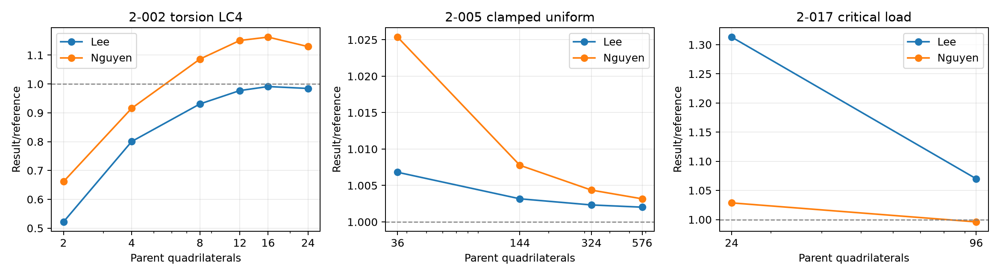

# MITC3+ Lee and CTRIAR KMITC3+ native audit

25 October2026. Thermal recovery/output fix was separately committed and pushed as `ecf47ec4` on `v18.00.a`. This audit covers the owner-requested Lee default update and experimental Nguyen selector, retiring MITC3+HB.

## Scope and source mapping

- CTRIA3 `TRIA3TYP=MITC3+`: TPLT_MITC3P Lee six interior shear samples, corrected physical bubble gradient and alpha_spin0.01. CST membrane retained; TREL1 thermal ordering retained. EMG no longer substitutes DKMT18 recovery.
- CTRIAR `TRIARTYP=KMITC3+`: separate CTRIAR_KMITC3P implementation, modified Allman membrane, K_Add, P1 composite curvature and bubble condensation. Explicit EXPERIMENTAL/HOLD echo. No blending or fallback.
- BD_PARAM validates the new spelling and rejects retired HB aliases. PARAMS/EMG/interface registration and README table updated. Old HB source/interface removed after preserving backups.
- Six-mode shear benchmark retains explicit DARPACK4 in DAT. EIG_LANCZOS_ARPACK, eigensolver defaults and residual tolerance unchanged.

## Evidence

| Check | Outcome |
|---|---|
| Native regression | Lee71/71 and Nguyen71/71 completed; explicit DARPACK4 on2-016 |
| Element K parity |8 skew/rotated/cyclic/reversed tests; maximum relative error4.09e-16; nullity6 |
| Stress parity |4 native/Python tests; maximum relative error6.23e-7 including printed displacement rounding |
| Exact source static parity |2-002 n24 LC1-6,2-010 pressure,2-017 preload, original2-007, both variants; max relative displacement error1.67e-7 |
| Mixed model |Lee+KMITC3+ K relative error2.73e-16; both IDs in F06/OP2 stress and force tables |
| Retired selector |MITC3+HB rejected with explicit migration error |
| Nguyen coarse2-017 matrices |K1.38e-16,Kg4.49e-14 relative difference; spectrum parity resolved by corrected SPC1 cards (see correction) |
| Lee shear defaultDARPACK2 |Mode6 residual4.89273508e-6; known fail retained |
| Lee shear DARPACK4 |Six modes complete; mode6 residual1.30774524e-10 |
| Lee DARPACK4 versus6 |All six MAC=1.0 to reported precision |

These completion counts are not accuracy-pass counts. The supplied model210/model217 inputs were also run independently for both variants. Their bundled OP2 files are original-reference artifacts, not newly computed Python output.

## Selected computed/reference ratios

| Model/observable | Lee+Spin | KMITC3+ Nguyen |
|---|---:|---:|
|2-002 n24 LC1 axial |1.000000|1.024745|
|2-002 n24 LC2 |0.504379|0.800043|
|2-002 n24 LC3 |1.000003|1.000173|
|2-002 n24 LC4 torsion |0.984457|1.129667|
|2-002 n24 LC5 |0.504339|0.800284|
|2-002 n24 LC6 |1.000000|1.000000|
|Original128-triangle2-007 node1 |0.991928|0.255666|
|Original128-triangle2-007 node9 |0.997619|0.258714|
|2-017 coarse2x12 first factor |1.313134|1.028640|
|2-017 fine4x24 first factor |1.070002|0.995999|

Full measurements: [CSV](validation_20261025/regression_comparison.csv). Hemisphere displacements are transformed from each GRID CD to basic axes before observation; the older raw T2=0 extraction is not used. Original two-triangle hemisphere and four-child benchmark results are kept separate.

## Decisions

Lee is the owner-selected default with its recorded shear-patch, membrane and roof trade-offs. KMITC3+ is selectable **experimental/HOLD**: coarse-mesh hemisphere accuracy, torsion regression and restrained thermal-stress variation remain research limitations; the earlier 2-017 spectrum discrepancy is resolved as an input-constraint issue. Small native eigen residuals alone do not establish Python/native spectrum equivalence. No shared eigensolver change is attempted.

Detailed notes: [Lee](MITC3Plus_Lee_Spin_20261025.md), [Nguyen](KMITC3Plus_Nguyen_20261025.md).

## Reproduction / provenance

Workspace `H:/Projects/MYSTRAN/codex_mod/mitc3_lee_nguyen_20261024` contains candidate_sources, build_candidate.py, check_matrix_parity.py, check_stress.py, check_integration.py, matched_dat.py, run_regression.py, run_supplied.py, check_geometric.py and check_buckling_mac.py, raw DAT/F06/OP2/run.json and source/executable hashes. Source text was checked identical to the tested candidate after promotion. Build is an incremental replacement of eight objects in the previously controlled thermal/DSG3 archive, not a clean rebuild of the dirty checkout. Default source/Binaries/mystran.exe is unchanged; use the named tested mystran_lee_nguyen.exe.

Before/after user source snapshots are preserved under source_before. Other dirty formulations, benchmark outputs and solid-element work were not staged as part of this change.

## 2-017 parity correction — 25 October 2026

The original SPC1 cards listed eight GRID IDs per line; the native reader consumes six. Python therefore constrained DOFs left free in MYSTRAN. Correcting the cards resolves the six-mode diagnostic discrepancy for both Lee and Nguyen. With SAP active UX/UZ/RY enforced on every node, including centroids, one-mode default-eigensolver runs match Python within 3.62e-7 relative error. No production Fortran or eigensolver changes were required. This supersedes the earlier unresolved-spectrum interpretation, while preserving its historical evidence.

The original hemisphere ratio 0.25566649 is a coarse-mesh result: supplied Python refinement gives approximately 0.81553, 0.98735 and 0.99820 at 512, 2048 and 8192 triangles. It is not evidence of a wrong convergence limit.

See [corrected parity evidence and input decks](validation_20261025/parity_2_017/README.md).
