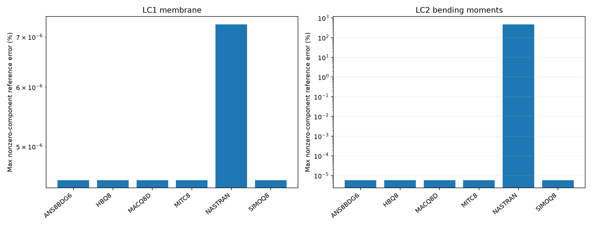

# CSI 2-001 — Shell patch with prescribed displacements

Updated 19 October 2026. Existing solver runs only; numerical results come from native OP2.

**Status: analytical membrane and bending recovery measured; a blanket full-patch PASS is not inferred.**

## Model identity and analytical field

The existing quadratic production model is **duel3b_CCW**, not duel3a. Q8 element IDs 21–25 use 20 nodes; T6 IDs 51–60 use 25 nodes. The DAT origin is translated to (1,2,0); analytical x/y are measured relative to that origin. E=1,000,000 psi, nu=0.25, thickness=0.001 in, MID3=MID2. All reported tensors below are in basic global axes.

LC1 prescribed UX=(x+y/2)/1000, UY=(y+x/2)/1000 gives sigmaXX=sigmaYY=1333.333333 psi and sigmaXY=400 psi, or NXX=NYY=1.333333333 and NXY=0.4 lb/in. LC2 prescribed UZ=(x²+xy+y²)/2000, RX=(y+x/2)/1000, RY=−(x+y/2)/1000 gives MXX=MYY=1.111111111e−7 and MXY=3.333333333e−8 lb-in/in in the audited recovery convention. Other membrane/moment components and transverse shear have zero analytical targets. The CSI printed stress 1333 psi is rounded; the exact analytical field is used for errors.

## Q8 native OP2 element recovery range

Each row spans all exported center/corner element points for that component. It reports uniformity as minimum/maximum, not an arbitrary displacement envelope. Zero targets use absolute residual in component units, never percentage error. Numerical extraction is the retained native OP2 canonical export; the pointwise SIMOQ8 audit independently rechecked matching physical points and local-to-global tensor transforms.

| Solver/formulation | LC | Basic component | Samples | Minimum | Maximum | Analytical | Max error (%) nonzero ref | Max absolute residual |
|---|---|---|---|---|---|---|---|---|
| ANS8BDG6 | 1 | MXX | 25 | 0 | 0 | 0 | — | 0 |
| ANS8BDG6 | 1 | MXY | 25 | 0 | 0 | 0 | — | 0 |
| ANS8BDG6 | 1 | MYY | 25 | 0 | 0 | 0 | — | 0 |
| ANS8BDG6 | 1 | NXX | 25 | 1.333333 | 1.333333 | 1.333333 | 3.963558e-06 | 5.284743e-08 |
| ANS8BDG6 | 1 | NXY | 25 | 0.4 | 0.4 | 0.4 | 4.510622e-06 | 1.804249e-08 |
| ANS8BDG6 | 1 | NYY | 25 | 1.333333 | 1.333333 | 1.333333 | 3.946794e-06 | 5.262392e-08 |
| ANS8BDG6 | 1 | QX | 25 | 0 | 0 | 0 | — | 0 |
| ANS8BDG6 | 1 | QY | 25 | 0 | 0 | 0 | — | 0 |
| ANS8BDG6 | 2 | MXX | 25 | 1.111111e-07 | 1.111111e-07 | 1.111111e-07 | 4.084285e-06 | 4.538095e-15 |
| ANS8BDG6 | 2 | MXY | 25 | 3.333333e-08 | 3.333334e-08 | 3.333333e-08 | 5.885143e-06 | 1.961714e-15 |
| ANS8BDG6 | 2 | MYY | 25 | 1.111111e-07 | 1.111111e-07 | 1.111111e-07 | 5.854351e-06 | 6.504834e-15 |
| ANS8BDG6 | 2 | NXX | 25 | 0 | 0 | 0 | — | 0 |
| ANS8BDG6 | 2 | NXY | 25 | 0 | 0 | 0 | — | 0 |
| ANS8BDG6 | 2 | NYY | 25 | 0 | 0 | 0 | — | 0 |
| ANS8BDG6 | 2 | QX | 25 | -8.711765e-15 | 4.096631e-15 | 0 | — | 8.711765e-15 |
| ANS8BDG6 | 2 | QY | 25 | -8.183664e-15 | 1.486961e-14 | 0 | — | 1.486961e-14 |
| HBQ8 | 1 | MXX | 25 | 0 | 0 | 0 | — | 0 |
| HBQ8 | 1 | MXY | 25 | 0 | 0 | 0 | — | 0 |
| HBQ8 | 1 | MYY | 25 | 0 | 0 | 0 | — | 0 |
| HBQ8 | 1 | NXX | 25 | 1.333333 | 1.333333 | 1.333333 | 3.963558e-06 | 5.284743e-08 |
| HBQ8 | 1 | NXY | 25 | 0.4 | 0.4 | 0.4 | 4.510622e-06 | 1.804249e-08 |
| HBQ8 | 1 | NYY | 25 | 1.333333 | 1.333333 | 1.333333 | 3.946794e-06 | 5.262392e-08 |
| HBQ8 | 1 | QX | 25 | 0 | 0 | 0 | — | 0 |
| HBQ8 | 1 | QY | 25 | 0 | 0 | 0 | — | 0 |
| HBQ8 | 2 | MXX | 25 | 1.111111e-07 | 1.111111e-07 | 1.111111e-07 | 4.084285e-06 | 4.538095e-15 |
| HBQ8 | 2 | MXY | 25 | 3.333333e-08 | 3.333334e-08 | 3.333333e-08 | 5.885143e-06 | 1.961714e-15 |
| HBQ8 | 2 | MYY | 25 | 1.111111e-07 | 1.111111e-07 | 1.111111e-07 | 5.854351e-06 | 6.504834e-15 |
| HBQ8 | 2 | NXX | 25 | 0 | 0 | 0 | — | 0 |
| HBQ8 | 2 | NXY | 25 | 0 | 0 | 0 | — | 0 |
| HBQ8 | 2 | NYY | 25 | 0 | 0 | 0 | — | 0 |
| HBQ8 | 2 | QX | 25 | -8.711765e-15 | 4.096631e-15 | 0 | — | 8.711765e-15 |
| HBQ8 | 2 | QY | 25 | -8.183664e-15 | 1.486961e-14 | 0 | — | 1.486961e-14 |
| MACQ8D | 1 | MXX | 25 | 0 | 0 | 0 | — | 0 |
| MACQ8D | 1 | MXY | 25 | 0 | 0 | 0 | — | 0 |
| MACQ8D | 1 | MYY | 25 | 0 | 0 | 0 | — | 0 |
| MACQ8D | 1 | NXX | 25 | 1.333333 | 1.333333 | 1.333333 | 3.963558e-06 | 5.284743e-08 |
| MACQ8D | 1 | NXY | 25 | 0.4 | 0.4 | 0.4 | 4.510622e-06 | 1.804249e-08 |
| MACQ8D | 1 | NYY | 25 | 1.333333 | 1.333333 | 1.333333 | 3.946794e-06 | 5.262392e-08 |
| MACQ8D | 1 | QX | 25 | 0 | 0 | 0 | — | 0 |
| MACQ8D | 1 | QY | 25 | 0 | 0 | 0 | — | 0 |
| MACQ8D | 2 | MXX | 25 | 1.111111e-07 | 1.111111e-07 | 1.111111e-07 | 4.084285e-06 | 4.538095e-15 |
| MACQ8D | 2 | MXY | 25 | 3.333333e-08 | 3.333334e-08 | 3.333333e-08 | 5.885143e-06 | 1.961714e-15 |
| MACQ8D | 2 | MYY | 25 | 1.111111e-07 | 1.111111e-07 | 1.111111e-07 | 5.854351e-06 | 6.504834e-15 |
| MACQ8D | 2 | NXX | 25 | 0 | 0 | 0 | — | 0 |
| MACQ8D | 2 | NXY | 25 | 0 | 0 | 0 | — | 0 |
| MACQ8D | 2 | NYY | 25 | 0 | 0 | 0 | — | 0 |
| MACQ8D | 2 | QX | 25 | -3.832197e-16 | 6.334189e-16 | 0 | — | 6.334189e-16 |
| MACQ8D | 2 | QY | 25 | -7.549923e-16 | 1.277137e-15 | 0 | — | 1.277137e-15 |
| MITC8 | 1 | MXX | 25 | 0 | 0 | 0 | — | 0 |
| MITC8 | 1 | MXY | 25 | 0 | 0 | 0 | — | 0 |
| MITC8 | 1 | MYY | 25 | 0 | 0 | 0 | — | 0 |
| MITC8 | 1 | NXX | 25 | 1.333333 | 1.333333 | 1.333333 | 3.963558e-06 | 5.284743e-08 |
| MITC8 | 1 | NXY | 25 | 0.4 | 0.4 | 0.4 | 4.510622e-06 | 1.804249e-08 |
| MITC8 | 1 | NYY | 25 | 1.333333 | 1.333333 | 1.333333 | 3.946794e-06 | 5.262392e-08 |
| MITC8 | 1 | QX | 25 | 0 | 0 | 0 | — | 0 |
| MITC8 | 1 | QY | 25 | 0 | 0 | 0 | — | 0 |
| MITC8 | 2 | MXX | 25 | 1.111111e-07 | 1.111111e-07 | 1.111111e-07 | 4.084285e-06 | 4.538095e-15 |
| MITC8 | 2 | MXY | 25 | 3.333333e-08 | 3.333334e-08 | 3.333333e-08 | 5.885143e-06 | 1.961714e-15 |
| MITC8 | 2 | MYY | 25 | 1.111111e-07 | 1.111111e-07 | 1.111111e-07 | 5.854351e-06 | 6.504834e-15 |
| MITC8 | 2 | NXX | 25 | 0 | 0 | 0 | — | 0 |
| MITC8 | 2 | NXY | 25 | 0 | 0 | 0 | — | 0 |
| MITC8 | 2 | NYY | 25 | 0 | 0 | 0 | — | 0 |
| MITC8 | 2 | QX | 25 | -8.711765e-15 | 4.096631e-15 | 0 | — | 8.711765e-15 |
| MITC8 | 2 | QY | 25 | -8.183664e-15 | 1.486961e-14 | 0 | — | 1.486961e-14 |
| NASTRAN | 1 | MXX | 25 | 0 | 0 | 0 | — | 0 |
| NASTRAN | 1 | MXY | 25 | 0 | 0 | 0 | — | 0 |
| NASTRAN | 1 | MYY | 25 | 0 | 0 | 0 | — | 0 |
| NASTRAN | 1 | NXX | 25 | 1.333333 | 1.333333 | 1.333333 | 4.488917e-06 | 5.985223e-08 |
| NASTRAN | 1 | NXY | 25 | 0.4 | 0.4 | 0.4 | 7.274771e-06 | 2.909908e-08 |
| NASTRAN | 1 | NYY | 25 | 1.333333 | 1.333333 | 1.333333 | 4.488917e-06 | 5.985223e-08 |
| NASTRAN | 1 | QX | 25 | 0 | 0 | 0 | — | 0 |
| NASTRAN | 1 | QY | 25 | 0 | 0 | 0 | — | 0 |
| NASTRAN | 2 | MXX | 25 | -2.274022e-07 | 3.413475e-07 | 1.111111e-07 | 304.662 | 3.385133e-07 |
| NASTRAN | 2 | MXY | 25 | -1.246031e-07 | 1.53495e-07 | 3.333333e-08 | 473.8092 | 1.579364e-07 |
| NASTRAN | 2 | MYY | 25 | -8.179104e-08 | 3.065909e-07 | 1.111111e-07 | 175.9318 | 1.954798e-07 |
| NASTRAN | 2 | NXX | 25 | 0 | 0 | 0 | — | 0 |
| NASTRAN | 2 | NXY | 25 | 0 | 0 | 0 | — | 0 |
| NASTRAN | 2 | NYY | 25 | 0 | 0 | 0 | — | 0 |
| NASTRAN | 2 | QX | 25 | -0.0003278166 | 0.0004218897 | 0 | — | 0.0004218897 |
| NASTRAN | 2 | QY | 25 | -8.636074e-05 | 0.0001510312 | 0 | — | 0.0001510312 |
| SIMOQ8 | 1 | MXX | 25 | 0 | 0 | 0 | — | 0 |
| SIMOQ8 | 1 | MXY | 25 | 0 | 0 | 0 | — | 0 |
| SIMOQ8 | 1 | MYY | 25 | 0 | 0 | 0 | — | 0 |
| SIMOQ8 | 1 | NXX | 25 | 1.333333 | 1.333333 | 1.333333 | 3.963558e-06 | 5.284743e-08 |
| SIMOQ8 | 1 | NXY | 25 | 0.4 | 0.4 | 0.4 | 4.510622e-06 | 1.804249e-08 |
| SIMOQ8 | 1 | NYY | 25 | 1.333333 | 1.333333 | 1.333333 | 3.946794e-06 | 5.262392e-08 |
| SIMOQ8 | 1 | QX | 25 | 0 | 0 | 0 | — | 0 |
| SIMOQ8 | 1 | QY | 25 | 0 | 0 | 0 | — | 0 |
| SIMOQ8 | 2 | MXX | 25 | 1.111111e-07 | 1.111111e-07 | 1.111111e-07 | 4.084285e-06 | 4.538095e-15 |
| SIMOQ8 | 2 | MXY | 25 | 3.333333e-08 | 3.333334e-08 | 3.333333e-08 | 5.885143e-06 | 1.961714e-15 |
| SIMOQ8 | 2 | MYY | 25 | 1.111111e-07 | 1.111111e-07 | 1.111111e-07 | 5.854351e-06 | 6.504834e-15 |
| SIMOQ8 | 2 | NXX | 25 | 0 | 0 | 0 | — | 0 |
| SIMOQ8 | 2 | NXY | 25 | 0 | 0 | 0 | — | 0 |
| SIMOQ8 | 2 | NYY | 25 | 0 | 0 | 0 | — | 0 |
| SIMOQ8 | 2 | QX | 25 | -3.344215e-15 | 2.004129e-15 | 0 | — | 3.344215e-15 |
| SIMOQ8 | 2 | QY | 25 | -4.971937e-15 | 4.590796e-15 | 0 | — | 4.971937e-15 |

## T6 native OP2 analytical checks

The table retains the original absolute-or-relative tolerance status. PASS here describes only the listed exported quantity and sample coverage; it does not extend to unmeasured recovery locations.

| Solver | Formulation | LC | Quantity | Samples | Max absolute residual | Max relative error (%) | Recorded status |
|---|---|---|---|---|---|---|---|
| mystran | SIMOT6 | 1 | membrane | 240 | 5.586706e-08 | 4.190029e-06 | PASS |
| mystran | SIMOT6 | 1 | moment | 240 | 0 | — | PASS |
| mystran | SIMOT6 | 1 | shear | 120 | 0 | — | PASS |
| nastran | SIMOT6 | 1 | membrane | 240 | 1.872727e-07 | 1.41561e-05 | PASS |
| nastran | SIMOT6 | 1 | moment | 240 | 0 | — | PASS |
| nastran | SIMOT6 | 1 | shear | 120 | 0 | — | PASS |
| mystran | SIMOT6 | 2 | membrane | 240 | 0 | — | PASS |
| mystran | SIMOT6 | 2 | moment | 240 | 5.564052e-15 | 5.253603e-06 | PASS |
| mystran | SIMOT6 | 2 | shear | 120 | 1.616391e-14 | — | PASS |
| nastran | SIMOT6 | 2 | membrane | 240 | 0 | — | PASS |
| nastran | SIMOT6 | 2 | moment | 240 | 1.370189e-14 | 1.23317e-05 | PASS |
| nastran | SIMOT6 | 2 | shear | 120 | 3.108515e-15 | — | PASS |
| mystran | MITC6 | 1 | membrane | 240 | 5.586706e-08 | 4.190029e-06 | PASS |
| mystran | MITC6 | 1 | moment | 240 | 0 | — | PASS |
| mystran | MITC6 | 1 | shear | 120 | 0 | — | PASS |
| nastran | MITC6 | 1 | membrane | 240 | 1.872727e-07 | 1.41561e-05 | PASS |
| nastran | MITC6 | 1 | moment | 240 | 0 | — | PASS |
| nastran | MITC6 | 1 | shear | 120 | 0 | — | PASS |
| mystran | MITC6 | 2 | membrane | 240 | 0 | — | PASS |
| mystran | MITC6 | 2 | moment | 240 | 5.564052e-15 | 5.253603e-06 | PASS |
| mystran | MITC6 | 2 | shear | 120 | 3.759323e-14 | — | PASS |
| nastran | MITC6 | 2 | membrane | 240 | 0 | — | PASS |
| nastran | MITC6 | 2 | moment | 240 | 1.370189e-14 | 1.23317e-05 | PASS |
| nastran | MITC6 | 2 | shear | 120 | 3.108515e-15 | — | PASS |
| mystran | MH6T | 1 | membrane | 240 | 5.586706e-08 | 4.190029e-06 | PASS |
| mystran | MH6T | 1 | moment | 240 | 0 | — | PASS |
| mystran | MH6T | 1 | shear | 120 | 0 | — | PASS |
| nastran | MH6T | 1 | membrane | 240 | 1.872727e-07 | 1.41561e-05 | PASS |
| nastran | MH6T | 1 | moment | 240 | 0 | — | PASS |
| nastran | MH6T | 1 | shear | 120 | 0 | — | PASS |
| mystran | MH6T | 2 | membrane | 240 | 0 | — | PASS |
| mystran | MH6T | 2 | moment | 240 | 5.564052e-15 | 5.253603e-06 | PASS |
| mystran | MH6T | 2 | shear | 120 | 7.616499e-16 | — | PASS |
| nastran | MH6T | 2 | membrane | 240 | 0 | — | PASS |
| nastran | MH6T | 2 | moment | 240 | 1.370189e-14 | 1.23317e-05 | PASS |
| nastran | MH6T | 2 | shear | 120 | 3.108515e-15 | — | PASS |
| mystran | REZAIEE | 1 | membrane | 240 | 5.586706e-08 | 4.190029e-06 | PASS |
| mystran | REZAIEE | 1 | moment | 240 | 0 | — | PASS |
| mystran | REZAIEE | 1 | shear | 120 | 0 | — | PASS |
| nastran | REZAIEE | 1 | membrane | 240 | 1.872727e-07 | 1.41561e-05 | PASS |
| nastran | REZAIEE | 1 | moment | 240 | 0 | — | PASS |
| nastran | REZAIEE | 1 | shear | 120 | 0 | — | PASS |
| mystran | REZAIEE | 2 | membrane | 240 | 0 | — | PASS |
| mystran | REZAIEE | 2 | moment | 240 | 5.564052e-15 | 5.253603e-06 | PASS |
| mystran | REZAIEE | 2 | shear | 120 | 3.759323e-14 | — | PASS |
| nastran | REZAIEE | 2 | membrane | 240 | 0 | — | PASS |
| nastran | REZAIEE | 2 | moment | 240 | 1.370189e-14 | 1.23317e-05 | PASS |
| nastran | REZAIEE | 2 | shear | 120 | 3.108515e-15 | — | PASS |

## Recovery limitations and failures

SIMOQ8 v13 same-point membrane and bending moment checks are verified for this flat patch and CW–CCW tensor invariance. Standard Q8 OEF output covers center and four corners, not every midside recovery point. The separate LC2 nodal-force/shear diagnostic remains unresolved; no full all-node force-uniformity claim is made. Nastran Q8 LC2 moment discrepancies are retained as measured, not hidden by solver parity. This test does not validate a curved shell or arbitrary transverse-shear recovery, and no stiffness matrix was changed to improve the table.

## Source and reproducibility

[CSI Example 2-001](https://docs.csiamerica.com/manuals/csibridge/Verification/Analysis/Shells/Problem%202-001.pdf). Meshes were generated independently in Python, not exported from SAP2000 S2K. Original DAT and OP2 remain local. No stiffness, loads or constraints were changed for this publication update. Missing measurements are shown as —. Solver agreement alone does not establish independent accuracy.

[Benchmark index](README.md) · [All comparisons](comparison_all.md)
