# Linear shells — 2-001: Membrane, bending, shear and twist patches

25 October 2026. Fresh native MYSTRAN and Nastran runs. CQUAD4, CQUADR, CTRIA3 and CTRIAR only.

[All linear comparisons](comparison_all_linear.md) · [Full CSV](comparison_all_linear.csv) · [Tested DAT](DAT/linear_shell_benchmark_DAT.zip) · [Linear publication QA](PUBLICATION_QA_linear.md)

Case IDs retain source-model filenames; actual element and formulation are given by their columns and deck selectors. Two-axis 2-002 tip observables use the two physical corner nodes.

NATIVE means the Nastran result for the corresponding element card: CQUAD4, CQUADR, CTRIA3 or CTRIAR. It does not mean the same proprietary interpolation as a MYSTRAN selector. Curves use independent/analytical references; published SAP2000 values are separate table columns. A completed solve is not a physical-accuracy pass. Zero references use absolute residuals; missing and failed output is never replaced by zero.

The tested source snapshot includes DKMT18 SF as an explicitly labelled candidate and corrected DSG3 local-z Kg. It is documented in [source provenance](data_linear/provenance_linear.json), with a reproducible element-local patch. This benchmark snapshot is not a declaration that SF passed every production-promotion gate. No shared eigensolver prototype is included.

## Model and comparison scope

MacNeal-Harder membrane/bending plus separate distorted bending/shear/twist patches. Analytical fields evaluated at the actual GRID coordinates; prescribed and free DOFs reported separately.

## Extraction status

| Solver | Status | Metric rows |
|---|---|---:|
| MYSTRAN | MEASURED | 550 |
| NASTRAN | MEASURED | 100 |

## Figures

### prob_2_001_mh · LC 1 · all_original_nodes_rotation_max_abs_error

### prob_2_001_mh · LC 1 · all_original_nodes_translation_max_abs_error

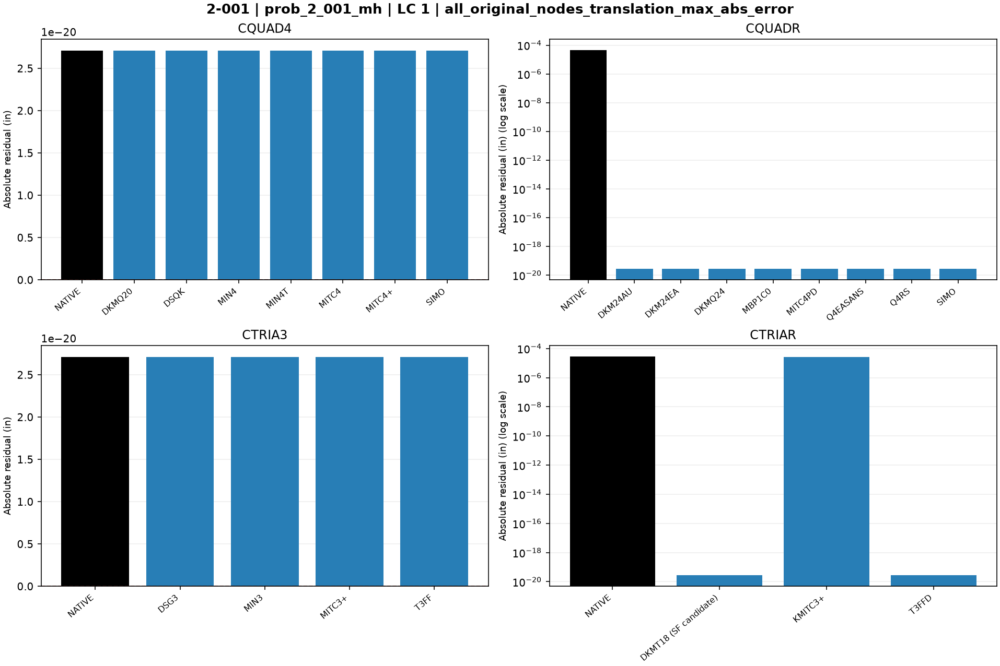

### prob_2_001_mh · LC 1 · free_original_nodes_rotation_max_abs_error

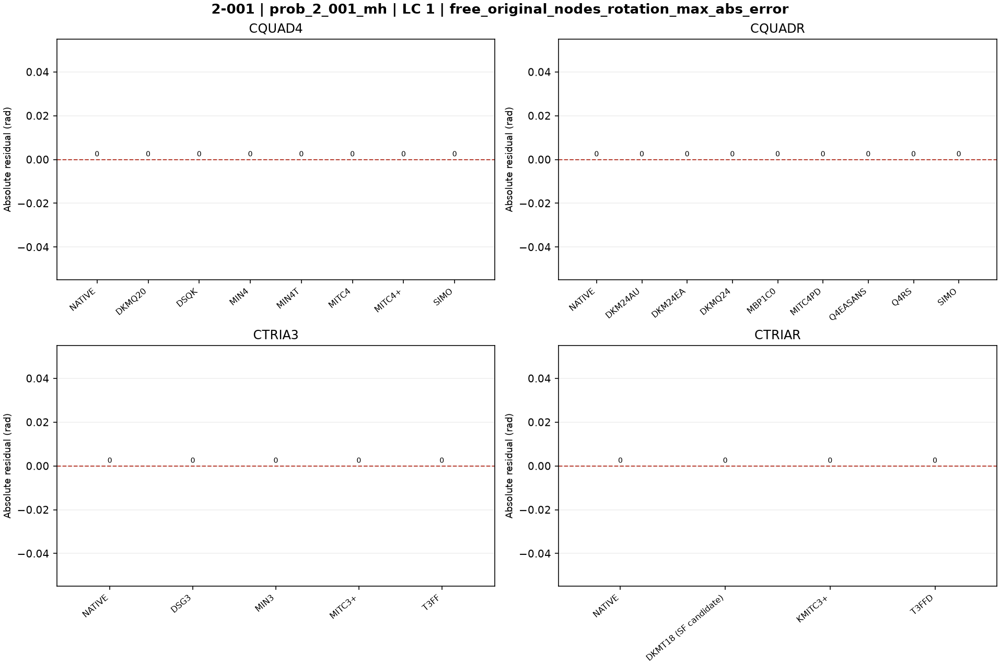

### prob_2_001_mh · LC 1 · free_original_nodes_translation_max_abs_error

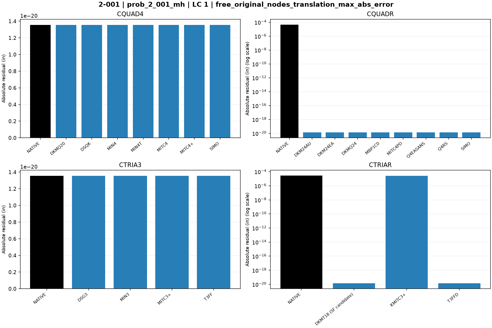

### prob_2_001_mh · LC 1 · native_max_abs_fiber_principal_stress

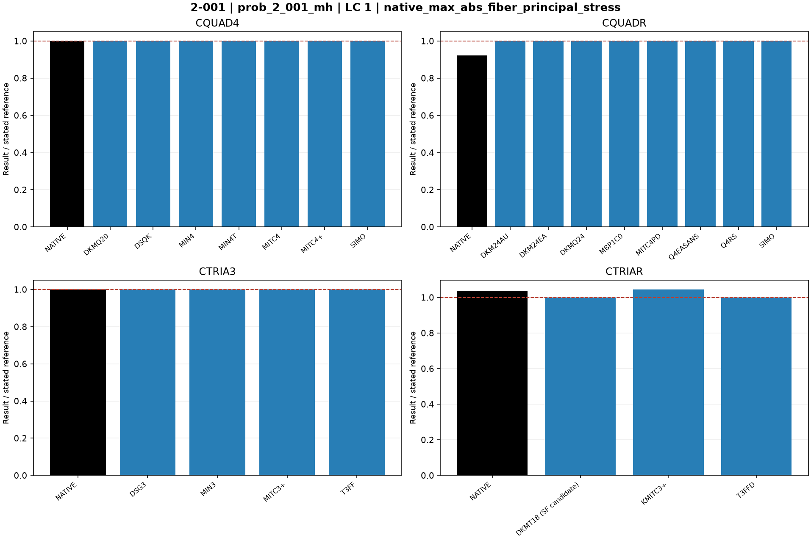

### prob_2_001_mh · LC 2 · all_original_nodes_rotation_max_abs_error

### prob_2_001_mh · LC 2 · all_original_nodes_translation_max_abs_error

### prob_2_001_mh · LC 2 · free_original_nodes_rotation_max_abs_error

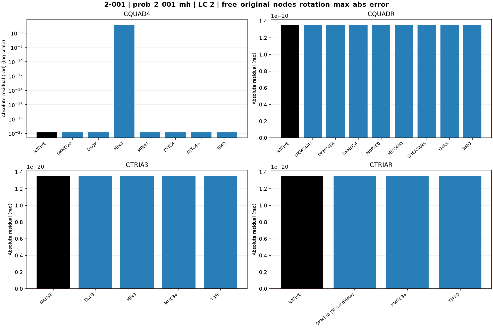

### prob_2_001_mh · LC 2 · free_original_nodes_translation_max_abs_error

### prob_2_001_mh · LC 2 · native_max_abs_fiber_principal_stress

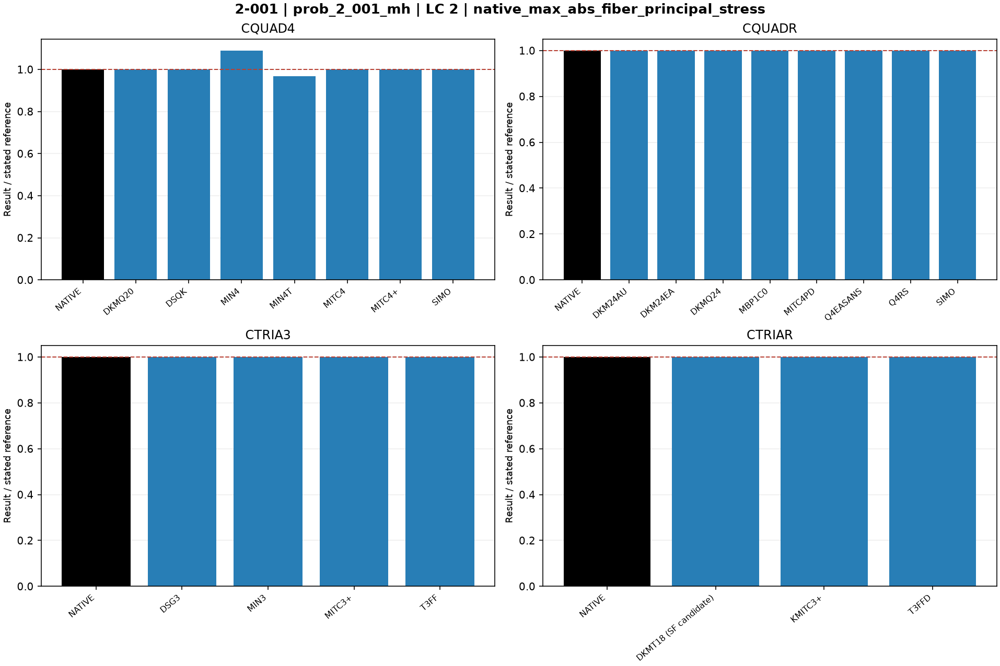

### prob_2_001_patchbending · LC 4 · all_original_nodes_rotation_max_abs_error

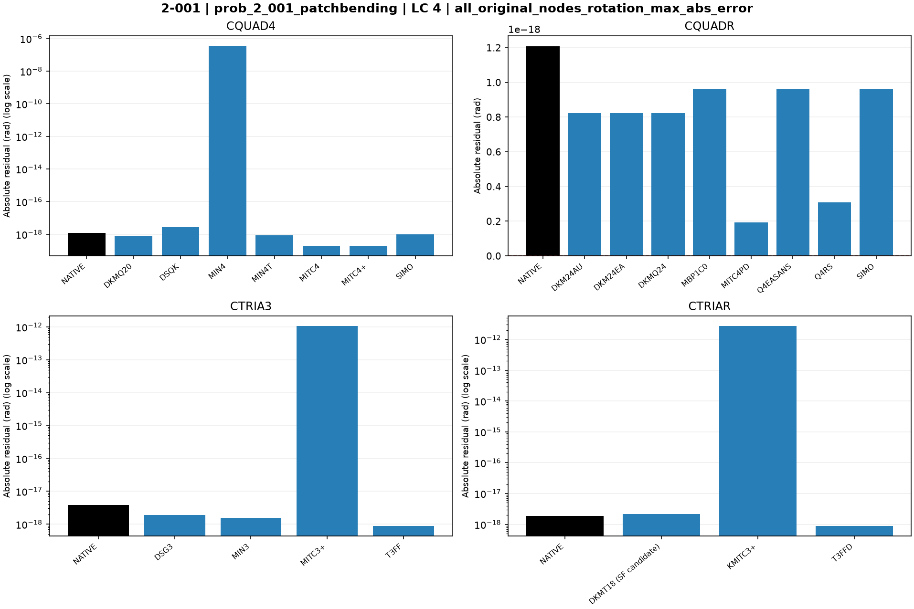

### prob_2_001_patchbending · LC 4 · all_original_nodes_translation_max_abs_error

### prob_2_001_patchbending · LC 4 · free_original_nodes_rotation_max_abs_error

### prob_2_001_patchbending · LC 4 · free_original_nodes_translation_max_abs_error

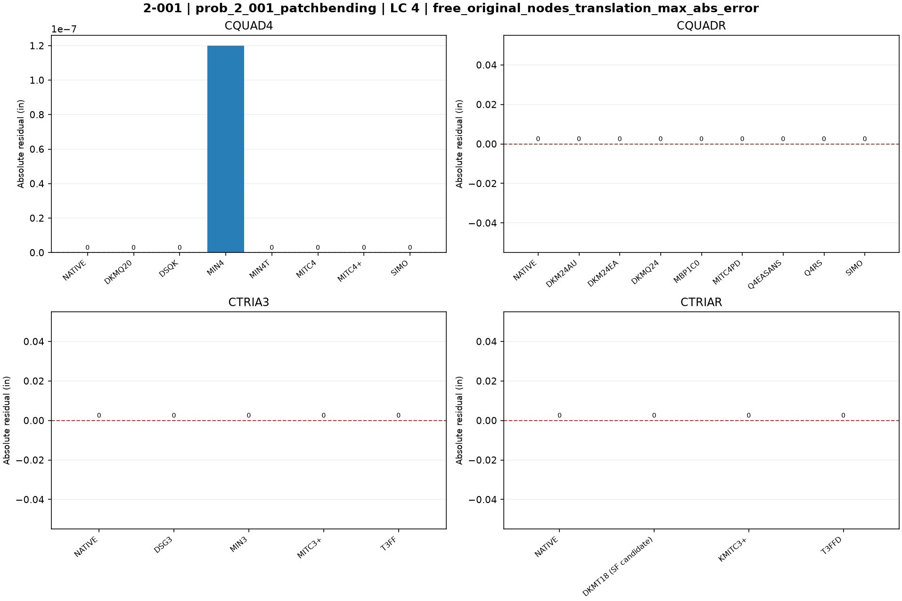

### prob_2_001_patchbending · LC 4 · native_max_abs_fiber_principal_stress

### prob_2_001_patchshear · LC 3 · all_original_nodes_rotation_max_abs_error

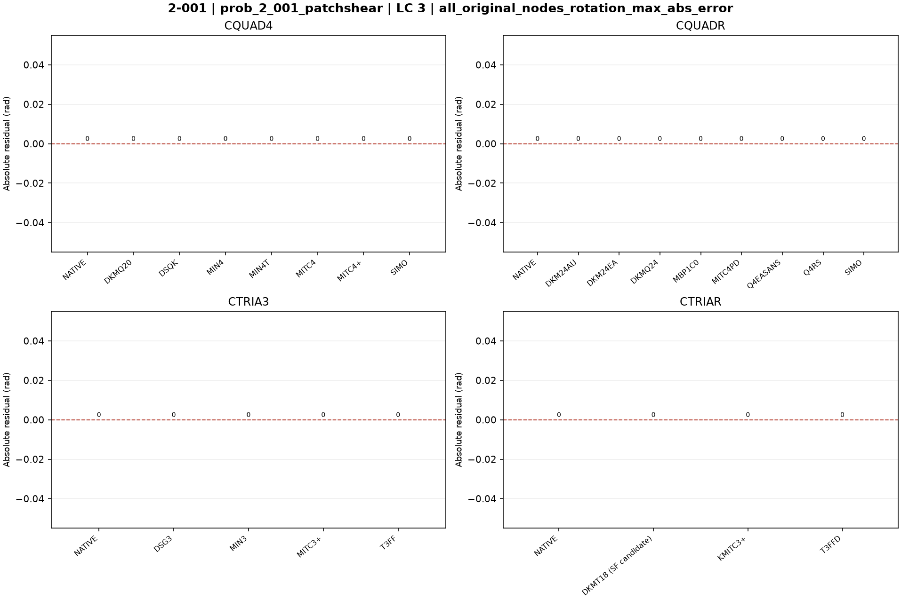

### prob_2_001_patchshear · LC 3 · all_original_nodes_translation_max_abs_error

### prob_2_001_patchshear · LC 3 · free_original_nodes_rotation_max_abs_error

### prob_2_001_patchshear · LC 3 · free_original_nodes_translation_max_abs_error

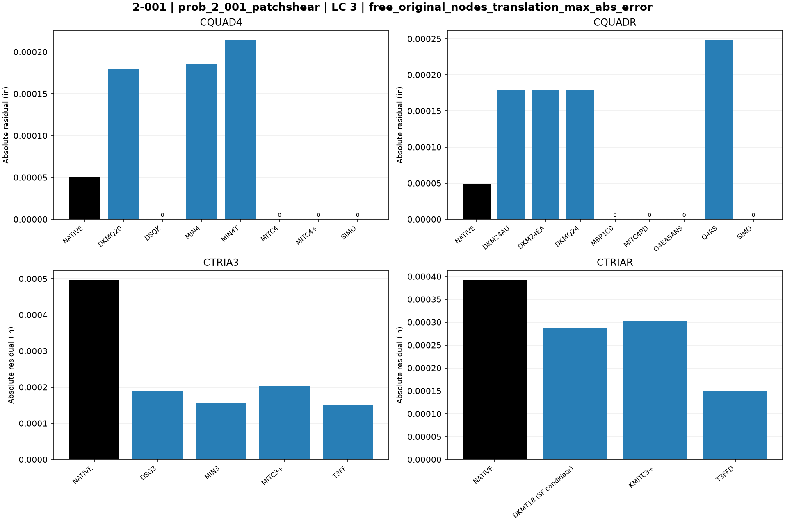

### prob_2_001_patchshear · LC 3 · native_max_transverse_shear_resultant

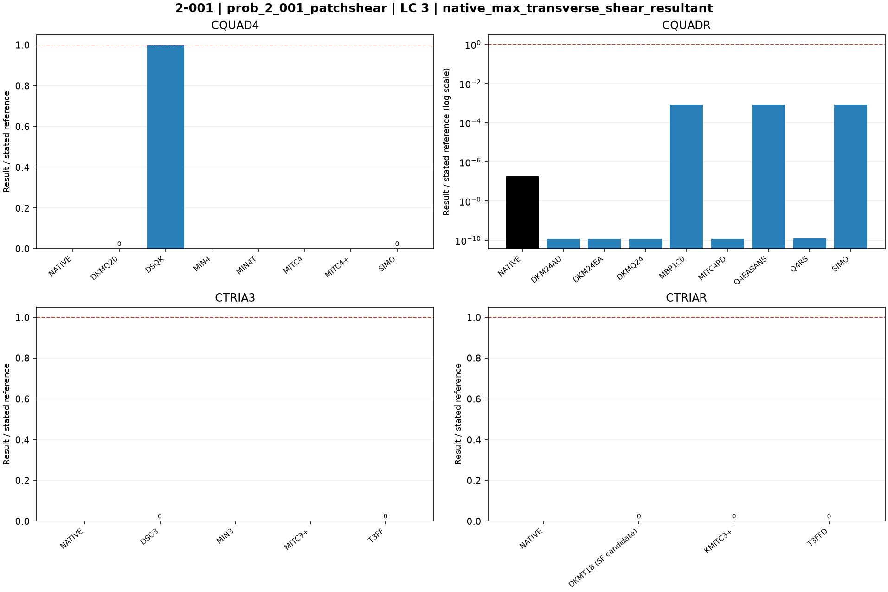

### prob_2_001_patchtwist · LC 5 · all_original_nodes_rotation_max_abs_error

### prob_2_001_patchtwist · LC 5 · all_original_nodes_translation_max_abs_error

### prob_2_001_patchtwist · LC 5 · free_original_nodes_rotation_max_abs_error

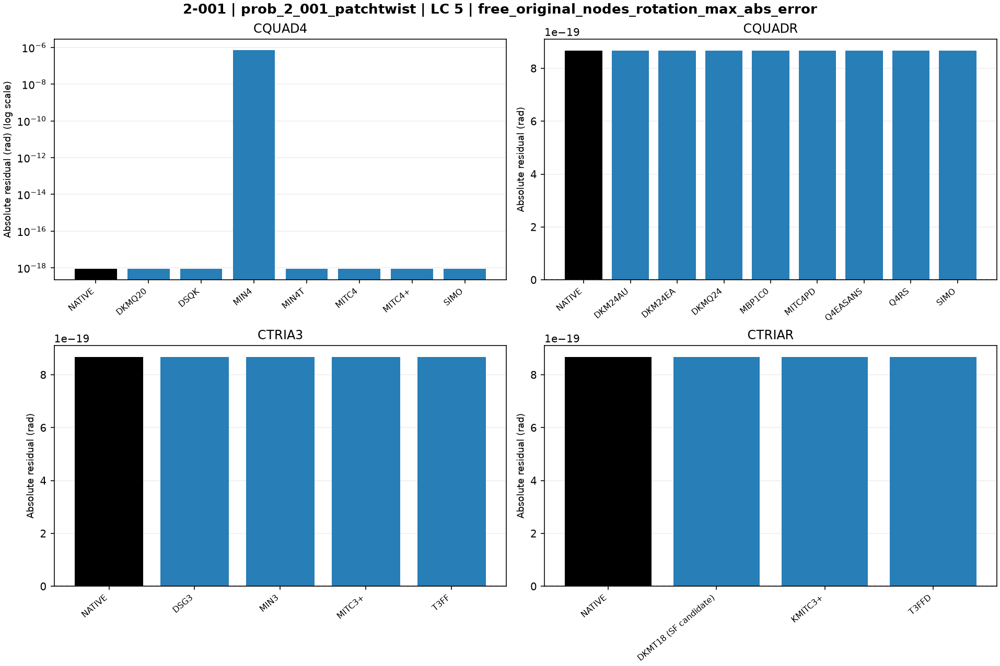

### prob_2_001_patchtwist · LC 5 · free_original_nodes_translation_max_abs_error

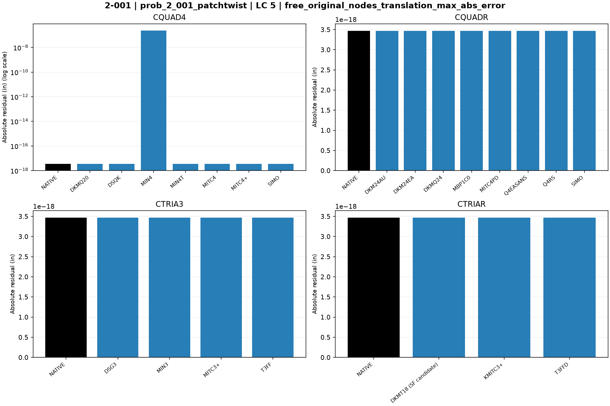

### prob_2_001_patchtwist · LC 5 · native_max_abs_fiber_principal_stress

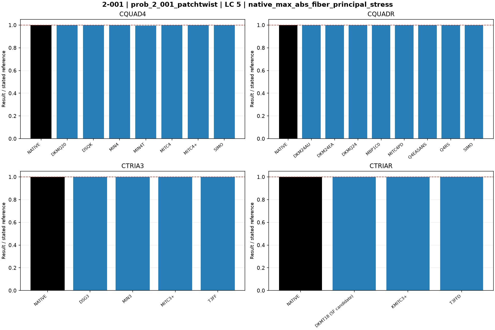

## Finest available mesh per named series

| Case / parent quads | Solver / formulation | LC | Quantity | Measured | Independent / analytical | CSI published | Unit | Error % primary | Absolute residual | Status |
|---|---|---:|---|---:|---:|---:|---|---:|---:|---|
| prob_2_001_mh_cquadr_simo / 5 | MYSTRAN CQUAD4_DKMQ20 | 1 | all_original_nodes_rotation_max_abs_error | 0 | 0 | — | rad | — | 0 | MEASURED |
| prob_2_001_mh_cquadr_simo / 5 | MYSTRAN CQUAD4_DKMQ20 | 2 | all_original_nodes_rotation_max_abs_error | 2.710505e-20 | 0 | — | rad | — | 2.710505e-20 | MEASURED |
| prob_2_001_mh_cquadr_simo / 5 | MYSTRAN CQUAD4_DSQK | 1 | all_original_nodes_rotation_max_abs_error | 0 | 0 | — | rad | — | 0 | MEASURED |
| prob_2_001_mh_cquadr_simo / 5 | MYSTRAN CQUAD4_DSQK | 2 | all_original_nodes_rotation_max_abs_error | 2.710505e-20 | 0 | — | rad | — | 2.710505e-20 | MEASURED |
| prob_2_001_mh_cquadr_simo / 5 | MYSTRAN CQUAD4_MIN4 | 1 | all_original_nodes_rotation_max_abs_error | 0 | 0 | — | rad | — | 0 | MEASURED |
| prob_2_001_mh_cquadr_simo / 5 | MYSTRAN CQUAD4_MIN4 | 2 | all_original_nodes_rotation_max_abs_error | 1.50037e-05 | 0 | — | rad | — | 1.50037e-05 | MEASURED |
| prob_2_001_mh_cquadr_simo / 5 | MYSTRAN CQUAD4_MIN4T | 1 | all_original_nodes_rotation_max_abs_error | 0 | 0 | — | rad | — | 0 | MEASURED |
| prob_2_001_mh_cquadr_simo / 5 | MYSTRAN CQUAD4_MIN4T | 2 | all_original_nodes_rotation_max_abs_error | 2.710505e-20 | 0 | — | rad | — | 2.710505e-20 | MEASURED |
| prob_2_001_mh_cquadr_simo / 5 | MYSTRAN CQUAD4_MITC4 | 1 | all_original_nodes_rotation_max_abs_error | 0 | 0 | — | rad | — | 0 | MEASURED |
| prob_2_001_mh_cquadr_simo / 5 | MYSTRAN CQUAD4_MITC4 | 2 | all_original_nodes_rotation_max_abs_error | 2.710505e-20 | 0 | — | rad | — | 2.710505e-20 | MEASURED |
| prob_2_001_mh_cquadr_simo / 5 | MYSTRAN CQUAD4_MITC4plus | 1 | all_original_nodes_rotation_max_abs_error | 0 | 0 | — | rad | — | 0 | MEASURED |
| prob_2_001_mh_cquadr_simo / 5 | MYSTRAN CQUAD4_MITC4plus | 2 | all_original_nodes_rotation_max_abs_error | 2.710505e-20 | 0 | — | rad | — | 2.710505e-20 | MEASURED |
| prob_2_001_mh_cquadr_simo / 5 | MYSTRAN CQUAD4_SIMO | 1 | all_original_nodes_rotation_max_abs_error | 0 | 0 | — | rad | — | 0 | MEASURED |
| prob_2_001_mh_cquadr_simo / 5 | MYSTRAN CQUAD4_SIMO | 2 | all_original_nodes_rotation_max_abs_error | 2.710505e-20 | 0 | — | rad | — | 2.710505e-20 | MEASURED |
| prob_2_001_mh_cquadr_simo / 5 | MYSTRAN CQUADR_DKM24AU | 1 | all_original_nodes_rotation_max_abs_error | 0 | 0 | — | rad | — | 0 | MEASURED |
| prob_2_001_mh_cquadr_simo / 5 | MYSTRAN CQUADR_DKM24AU | 2 | all_original_nodes_rotation_max_abs_error | 2.710505e-20 | 0 | — | rad | — | 2.710505e-20 | MEASURED |
| prob_2_001_mh_cquadr_simo / 5 | MYSTRAN CQUADR_DKM24EA | 1 | all_original_nodes_rotation_max_abs_error | 0 | 0 | — | rad | — | 0 | MEASURED |
| prob_2_001_mh_cquadr_simo / 5 | MYSTRAN CQUADR_DKM24EA | 2 | all_original_nodes_rotation_max_abs_error | 2.710505e-20 | 0 | — | rad | — | 2.710505e-20 | MEASURED |
| prob_2_001_mh_cquadr_simo / 5 | MYSTRAN CQUADR_DKMQ24 | 1 | all_original_nodes_rotation_max_abs_error | 0 | 0 | — | rad | — | 0 | MEASURED |
| prob_2_001_mh_cquadr_simo / 5 | MYSTRAN CQUADR_DKMQ24 | 2 | all_original_nodes_rotation_max_abs_error | 2.710505e-20 | 0 | — | rad | — | 2.710505e-20 | MEASURED |
| prob_2_001_mh_cquadr_simo / 5 | MYSTRAN CQUADR_MBP1C0 | 1 | all_original_nodes_rotation_max_abs_error | 0 | 0 | — | rad | — | 0 | MEASURED |
| prob_2_001_mh_cquadr_simo / 5 | MYSTRAN CQUADR_MBP1C0 | 2 | all_original_nodes_rotation_max_abs_error | 2.710505e-20 | 0 | — | rad | — | 2.710505e-20 | MEASURED |
| prob_2_001_mh_cquadr_simo / 5 | MYSTRAN CQUADR_MITC4PD | 1 | all_original_nodes_rotation_max_abs_error | 0 | 0 | — | rad | — | 0 | MEASURED |
| prob_2_001_mh_cquadr_simo / 5 | MYSTRAN CQUADR_MITC4PD | 2 | all_original_nodes_rotation_max_abs_error | 2.710505e-20 | 0 | — | rad | — | 2.710505e-20 | MEASURED |
| prob_2_001_mh_cquadr_simo / 5 | MYSTRAN CQUADR_Q4EASANS | 1 | all_original_nodes_rotation_max_abs_error | 0 | 0 | — | rad | — | 0 | MEASURED |
| prob_2_001_mh_cquadr_simo / 5 | MYSTRAN CQUADR_Q4EASANS | 2 | all_original_nodes_rotation_max_abs_error | 2.710505e-20 | 0 | — | rad | — | 2.710505e-20 | MEASURED |
| prob_2_001_mh_cquadr_simo / 5 | MYSTRAN CQUADR_Q4RS | 1 | all_original_nodes_rotation_max_abs_error | 0 | 0 | — | rad | — | 0 | MEASURED |
| prob_2_001_mh_cquadr_simo / 5 | MYSTRAN CQUADR_Q4RS | 2 | all_original_nodes_rotation_max_abs_error | 2.710505e-20 | 0 | — | rad | — | 2.710505e-20 | MEASURED |
| prob_2_001_mh_cquadr_simo / 5 | MYSTRAN CQUADR_SIMO | 1 | all_original_nodes_rotation_max_abs_error | 0 | 0 | — | rad | — | 0 | MEASURED |
| prob_2_001_mh_cquadr_simo / 5 | MYSTRAN CQUADR_SIMO | 2 | all_original_nodes_rotation_max_abs_error | 2.710505e-20 | 0 | — | rad | — | 2.710505e-20 | MEASURED |
| prob_2_001_mh_cquadr_simo / 5 | MYSTRAN CTRIA3_DSG3 | 1 | all_original_nodes_rotation_max_abs_error | 0 | 0 | — | rad | — | 0 | MEASURED |
| prob_2_001_mh_cquadr_simo / 5 | MYSTRAN CTRIA3_DSG3 | 2 | all_original_nodes_rotation_max_abs_error | 2.710505e-20 | 0 | — | rad | — | 2.710505e-20 | MEASURED |
| prob_2_001_mh_cquadr_simo / 5 | MYSTRAN CTRIA3_MIN3 | 1 | all_original_nodes_rotation_max_abs_error | 0 | 0 | — | rad | — | 0 | MEASURED |
| prob_2_001_mh_cquadr_simo / 5 | MYSTRAN CTRIA3_MIN3 | 2 | all_original_nodes_rotation_max_abs_error | 2.710505e-20 | 0 | — | rad | — | 2.710505e-20 | MEASURED |
| prob_2_001_mh_cquadr_simo / 5 | MYSTRAN CTRIA3_MITC3plus | 1 | all_original_nodes_rotation_max_abs_error | 0 | 0 | — | rad | — | 0 | MEASURED |
| prob_2_001_mh_cquadr_simo / 5 | MYSTRAN CTRIA3_MITC3plus | 2 | all_original_nodes_rotation_max_abs_error | 2.710505e-20 | 0 | — | rad | — | 2.710505e-20 | MEASURED |
| prob_2_001_mh_cquadr_simo / 5 | MYSTRAN CTRIA3_T3FF | 1 | all_original_nodes_rotation_max_abs_error | 0 | 0 | — | rad | — | 0 | MEASURED |
| prob_2_001_mh_cquadr_simo / 5 | MYSTRAN CTRIA3_T3FF | 2 | all_original_nodes_rotation_max_abs_error | 2.710505e-20 | 0 | — | rad | — | 2.710505e-20 | MEASURED |
| prob_2_001_mh_cquadr_simo / 5 | MYSTRAN CTRIAR_DKMT18 (SF candidate) | 1 | all_original_nodes_rotation_max_abs_error | 0 | 0 | — | rad | — | 0 | MEASURED |
| prob_2_001_mh_cquadr_simo / 5 | MYSTRAN CTRIAR_DKMT18 (SF candidate) | 2 | all_original_nodes_rotation_max_abs_error | 2.710505e-20 | 0 | — | rad | — | 2.710505e-20 | MEASURED |
| prob_2_001_mh_cquadr_simo / 5 | MYSTRAN CTRIAR_KMITC3plus | 1 | all_original_nodes_rotation_max_abs_error | 0 | 0 | — | rad | — | 0 | MEASURED |
| prob_2_001_mh_cquadr_simo / 5 | MYSTRAN CTRIAR_KMITC3plus | 2 | all_original_nodes_rotation_max_abs_error | 2.710505e-20 | 0 | — | rad | — | 2.710505e-20 | MEASURED |
| prob_2_001_mh_cquadr_simo / 5 | MYSTRAN CTRIAR_T3FFD | 1 | all_original_nodes_rotation_max_abs_error | 0 | 0 | — | rad | — | 0 | MEASURED |
| prob_2_001_mh_cquadr_simo / 5 | MYSTRAN CTRIAR_T3FFD | 2 | all_original_nodes_rotation_max_abs_error | 2.710505e-20 | 0 | — | rad | — | 2.710505e-20 | MEASURED |
| prob_2_001_mh_cquadr_simo / 5 | NASTRAN CQUAD4_NATIVE | 1 | all_original_nodes_rotation_max_abs_error | 0 | 0 | — | rad | — | 0 | MEASURED |
| prob_2_001_mh_cquadr_simo / 5 | NASTRAN CQUAD4_NATIVE | 2 | all_original_nodes_rotation_max_abs_error | 2.710505e-20 | 0 | — | rad | — | 2.710505e-20 | MEASURED |
| prob_2_001_mh_cquadr_simo / 5 | NASTRAN CQUADR_NATIVE | 1 | all_original_nodes_rotation_max_abs_error | 0 | 0 | — | rad | — | 0 | MEASURED |
| prob_2_001_mh_cquadr_simo / 5 | NASTRAN CQUADR_NATIVE | 2 | all_original_nodes_rotation_max_abs_error | 2.710505e-20 | 0 | — | rad | — | 2.710505e-20 | MEASURED |
| prob_2_001_mh_cquadr_simo / 5 | NASTRAN CTRIA3_NATIVE | 1 | all_original_nodes_rotation_max_abs_error | 0 | 0 | — | rad | — | 0 | MEASURED |
| prob_2_001_mh_cquadr_simo / 5 | NASTRAN CTRIA3_NATIVE | 2 | all_original_nodes_rotation_max_abs_error | 2.710505e-20 | 0 | — | rad | — | 2.710505e-20 | MEASURED |
| prob_2_001_mh_cquadr_simo / 5 | NASTRAN CTRIAR_NATIVE | 1 | all_original_nodes_rotation_max_abs_error | 0 | 0 | — | rad | — | 0 | MEASURED |
| prob_2_001_mh_cquadr_simo / 5 | NASTRAN CTRIAR_NATIVE | 2 | all_original_nodes_rotation_max_abs_error | 2.710505e-20 | 0 | — | rad | — | 2.710505e-20 | MEASURED |
| prob_2_001_mh_cquadr_simo / 5 | MYSTRAN CQUAD4_DKMQ20 | 1 | all_original_nodes_translation_max_abs_error | 2.710505e-20 | 0 | — | in | — | 2.710505e-20 | MEASURED |
| prob_2_001_mh_cquadr_simo / 5 | MYSTRAN CQUAD4_DKMQ20 | 2 | all_original_nodes_translation_max_abs_error | 3.388132e-21 | 0 | — | in | — | 3.388132e-21 | MEASURED |
| prob_2_001_mh_cquadr_simo / 5 | MYSTRAN CQUAD4_DSQK | 1 | all_original_nodes_translation_max_abs_error | 2.710505e-20 | 0 | — | in | — | 2.710505e-20 | MEASURED |
| prob_2_001_mh_cquadr_simo / 5 | MYSTRAN CQUAD4_DSQK | 2 | all_original_nodes_translation_max_abs_error | 3.388132e-21 | 0 | — | in | — | 3.388132e-21 | MEASURED |
| prob_2_001_mh_cquadr_simo / 5 | MYSTRAN CQUAD4_MIN4 | 1 | all_original_nodes_translation_max_abs_error | 2.710505e-20 | 0 | — | in | — | 2.710505e-20 | MEASURED |
| prob_2_001_mh_cquadr_simo / 5 | MYSTRAN CQUAD4_MIN4 | 2 | all_original_nodes_translation_max_abs_error | 1.61681e-07 | 0 | — | in | — | 1.61681e-07 | MEASURED |
| prob_2_001_mh_cquadr_simo / 5 | MYSTRAN CQUAD4_MIN4T | 1 | all_original_nodes_translation_max_abs_error | 2.710505e-20 | 0 | — | in | — | 2.710505e-20 | MEASURED |
| prob_2_001_mh_cquadr_simo / 5 | MYSTRAN CQUAD4_MIN4T | 2 | all_original_nodes_translation_max_abs_error | 3.388132e-21 | 0 | — | in | — | 3.388132e-21 | MEASURED |
| prob_2_001_mh_cquadr_simo / 5 | MYSTRAN CQUAD4_MITC4 | 1 | all_original_nodes_translation_max_abs_error | 2.710505e-20 | 0 | — | in | — | 2.710505e-20 | MEASURED |
| prob_2_001_mh_cquadr_simo / 5 | MYSTRAN CQUAD4_MITC4 | 2 | all_original_nodes_translation_max_abs_error | 3.388132e-21 | 0 | — | in | — | 3.388132e-21 | MEASURED |
| prob_2_001_mh_cquadr_simo / 5 | MYSTRAN CQUAD4_MITC4plus | 1 | all_original_nodes_translation_max_abs_error | 2.710505e-20 | 0 | — | in | — | 2.710505e-20 | MEASURED |
| prob_2_001_mh_cquadr_simo / 5 | MYSTRAN CQUAD4_MITC4plus | 2 | all_original_nodes_translation_max_abs_error | 3.388132e-21 | 0 | — | in | — | 3.388132e-21 | MEASURED |
| prob_2_001_mh_cquadr_simo / 5 | MYSTRAN CQUAD4_SIMO | 1 | all_original_nodes_translation_max_abs_error | 2.710505e-20 | 0 | — | in | — | 2.710505e-20 | MEASURED |
| prob_2_001_mh_cquadr_simo / 5 | MYSTRAN CQUAD4_SIMO | 2 | all_original_nodes_translation_max_abs_error | 3.388132e-21 | 0 | — | in | — | 3.388132e-21 | MEASURED |
| prob_2_001_mh_cquadr_simo / 5 | MYSTRAN CQUADR_DKM24AU | 1 | all_original_nodes_translation_max_abs_error | 2.710505e-20 | 0 | — | in | — | 2.710505e-20 | MEASURED |
| prob_2_001_mh_cquadr_simo / 5 | MYSTRAN CQUADR_DKM24AU | 2 | all_original_nodes_translation_max_abs_error | 3.388132e-21 | 0 | — | in | — | 3.388132e-21 | MEASURED |
| prob_2_001_mh_cquadr_simo / 5 | MYSTRAN CQUADR_DKM24EA | 1 | all_original_nodes_translation_max_abs_error | 2.710505e-20 | 0 | — | in | — | 2.710505e-20 | MEASURED |
| prob_2_001_mh_cquadr_simo / 5 | MYSTRAN CQUADR_DKM24EA | 2 | all_original_nodes_translation_max_abs_error | 3.388132e-21 | 0 | — | in | — | 3.388132e-21 | MEASURED |
| prob_2_001_mh_cquadr_simo / 5 | MYSTRAN CQUADR_DKMQ24 | 1 | all_original_nodes_translation_max_abs_error | 2.710505e-20 | 0 | — | in | — | 2.710505e-20 | MEASURED |
| prob_2_001_mh_cquadr_simo / 5 | MYSTRAN CQUADR_DKMQ24 | 2 | all_original_nodes_translation_max_abs_error | 3.388132e-21 | 0 | — | in | — | 3.388132e-21 | MEASURED |
| prob_2_001_mh_cquadr_simo / 5 | MYSTRAN CQUADR_MBP1C0 | 1 | all_original_nodes_translation_max_abs_error | 2.710505e-20 | 0 | — | in | — | 2.710505e-20 | MEASURED |
| prob_2_001_mh_cquadr_simo / 5 | MYSTRAN CQUADR_MBP1C0 | 2 | all_original_nodes_translation_max_abs_error | 3.388132e-21 | 0 | — | in | — | 3.388132e-21 | MEASURED |
| prob_2_001_mh_cquadr_simo / 5 | MYSTRAN CQUADR_MITC4PD | 1 | all_original_nodes_translation_max_abs_error | 2.710505e-20 | 0 | — | in | — | 2.710505e-20 | MEASURED |
| prob_2_001_mh_cquadr_simo / 5 | MYSTRAN CQUADR_MITC4PD | 2 | all_original_nodes_translation_max_abs_error | 3.388132e-21 | 0 | — | in | — | 3.388132e-21 | MEASURED |
| prob_2_001_mh_cquadr_simo / 5 | MYSTRAN CQUADR_Q4EASANS | 1 | all_original_nodes_translation_max_abs_error | 2.710505e-20 | 0 | — | in | — | 2.710505e-20 | MEASURED |
| prob_2_001_mh_cquadr_simo / 5 | MYSTRAN CQUADR_Q4EASANS | 2 | all_original_nodes_translation_max_abs_error | 3.388132e-21 | 0 | — | in | — | 3.388132e-21 | MEASURED |
| prob_2_001_mh_cquadr_simo / 5 | MYSTRAN CQUADR_Q4RS | 1 | all_original_nodes_translation_max_abs_error | 2.710505e-20 | 0 | — | in | — | 2.710505e-20 | MEASURED |
| prob_2_001_mh_cquadr_simo / 5 | MYSTRAN CQUADR_Q4RS | 2 | all_original_nodes_translation_max_abs_error | 3.388132e-21 | 0 | — | in | — | 3.388132e-21 | MEASURED |
| prob_2_001_mh_cquadr_simo / 5 | MYSTRAN CQUADR_SIMO | 1 | all_original_nodes_translation_max_abs_error | 2.710505e-20 | 0 | — | in | — | 2.710505e-20 | MEASURED |
| prob_2_001_mh_cquadr_simo / 5 | MYSTRAN CQUADR_SIMO | 2 | all_original_nodes_translation_max_abs_error | 3.388132e-21 | 0 | — | in | — | 3.388132e-21 | MEASURED |
| prob_2_001_mh_cquadr_simo / 5 | MYSTRAN CTRIA3_DSG3 | 1 | all_original_nodes_translation_max_abs_error | 2.710505e-20 | 0 | — | in | — | 2.710505e-20 | MEASURED |
| prob_2_001_mh_cquadr_simo / 5 | MYSTRAN CTRIA3_DSG3 | 2 | all_original_nodes_translation_max_abs_error | 3.388132e-21 | 0 | — | in | — | 3.388132e-21 | MEASURED |
| prob_2_001_mh_cquadr_simo / 5 | MYSTRAN CTRIA3_MIN3 | 1 | all_original_nodes_translation_max_abs_error | 2.710505e-20 | 0 | — | in | — | 2.710505e-20 | MEASURED |
| prob_2_001_mh_cquadr_simo / 5 | MYSTRAN CTRIA3_MIN3 | 2 | all_original_nodes_translation_max_abs_error | 3.388132e-21 | 0 | — | in | — | 3.388132e-21 | MEASURED |
| prob_2_001_mh_cquadr_simo / 5 | MYSTRAN CTRIA3_MITC3plus | 1 | all_original_nodes_translation_max_abs_error | 2.710505e-20 | 0 | — | in | — | 2.710505e-20 | MEASURED |
| prob_2_001_mh_cquadr_simo / 5 | MYSTRAN CTRIA3_MITC3plus | 2 | all_original_nodes_translation_max_abs_error | 3.388132e-21 | 0 | — | in | — | 3.388132e-21 | MEASURED |
| prob_2_001_mh_cquadr_simo / 5 | MYSTRAN CTRIA3_T3FF | 1 | all_original_nodes_translation_max_abs_error | 2.710505e-20 | 0 | — | in | — | 2.710505e-20 | MEASURED |
| prob_2_001_mh_cquadr_simo / 5 | MYSTRAN CTRIA3_T3FF | 2 | all_original_nodes_translation_max_abs_error | 3.388132e-21 | 0 | — | in | — | 3.388132e-21 | MEASURED |
| prob_2_001_mh_cquadr_simo / 5 | MYSTRAN CTRIAR_DKMT18 (SF candidate) | 1 | all_original_nodes_translation_max_abs_error | 2.710505e-20 | 0 | — | in | — | 2.710505e-20 | MEASURED |
| prob_2_001_mh_cquadr_simo / 5 | MYSTRAN CTRIAR_DKMT18 (SF candidate) | 2 | all_original_nodes_translation_max_abs_error | 3.388132e-21 | 0 | — | in | — | 3.388132e-21 | MEASURED |
| prob_2_001_mh_cquadr_simo / 5 | MYSTRAN CTRIAR_KMITC3plus | 1 | all_original_nodes_translation_max_abs_error | 2.70849e-05 | 0 | — | in | — | 2.70849e-05 | MEASURED |
| prob_2_001_mh_cquadr_simo / 5 | MYSTRAN CTRIAR_KMITC3plus | 2 | all_original_nodes_translation_max_abs_error | 3.388132e-21 | 0 | — | in | — | 3.388132e-21 | MEASURED |
| prob_2_001_mh_cquadr_simo / 5 | MYSTRAN CTRIAR_T3FFD | 1 | all_original_nodes_translation_max_abs_error | 2.710505e-20 | 0 | — | in | — | 2.710505e-20 | MEASURED |
| prob_2_001_mh_cquadr_simo / 5 | MYSTRAN CTRIAR_T3FFD | 2 | all_original_nodes_translation_max_abs_error | 3.388132e-21 | 0 | — | in | — | 3.388132e-21 | MEASURED |
| prob_2_001_mh_cquadr_simo / 5 | NASTRAN CQUAD4_NATIVE | 1 | all_original_nodes_translation_max_abs_error | 2.710505e-20 | 0 | — | in | — | 2.710505e-20 | MEASURED |
| prob_2_001_mh_cquadr_simo / 5 | NASTRAN CQUAD4_NATIVE | 2 | all_original_nodes_translation_max_abs_error | 3.388132e-21 | 0 | — | in | — | 3.388132e-21 | MEASURED |
| prob_2_001_mh_cquadr_simo / 5 | NASTRAN CQUADR_NATIVE | 1 | all_original_nodes_translation_max_abs_error | 4.592776e-05 | 0 | — | in | — | 4.592776e-05 | MEASURED |
| prob_2_001_mh_cquadr_simo / 5 | NASTRAN CQUADR_NATIVE | 2 | all_original_nodes_translation_max_abs_error | 3.388132e-21 | 0 | — | in | — | 3.388132e-21 | MEASURED |
| prob_2_001_mh_cquadr_simo / 5 | NASTRAN CTRIA3_NATIVE | 1 | all_original_nodes_translation_max_abs_error | 2.710505e-20 | 0 | — | in | — | 2.710505e-20 | MEASURED |
| prob_2_001_mh_cquadr_simo / 5 | NASTRAN CTRIA3_NATIVE | 2 | all_original_nodes_translation_max_abs_error | 3.388132e-21 | 0 | — | in | — | 3.388132e-21 | MEASURED |
| prob_2_001_mh_cquadr_simo / 5 | NASTRAN CTRIAR_NATIVE | 1 | all_original_nodes_translation_max_abs_error | 2.85821e-05 | 0 | — | in | — | 2.85821e-05 | MEASURED |
| prob_2_001_mh_cquadr_simo / 5 | NASTRAN CTRIAR_NATIVE | 2 | all_original_nodes_translation_max_abs_error | 3.388132e-21 | 0 | — | in | — | 3.388132e-21 | MEASURED |
| prob_2_001_mh_cquadr_simo / 5 | MYSTRAN CQUAD4_DKMQ20 | 1 | free_original_nodes_rotation_max_abs_error | 0 | 0 | — | rad | — | 0 | MEASURED |
| prob_2_001_mh_cquadr_simo / 5 | MYSTRAN CQUAD4_DKMQ20 | 2 | free_original_nodes_rotation_max_abs_error | 1.355253e-20 | 0 | — | rad | — | 1.355253e-20 | MEASURED |
| prob_2_001_mh_cquadr_simo / 5 | MYSTRAN CQUAD4_DSQK | 1 | free_original_nodes_rotation_max_abs_error | 0 | 0 | — | rad | — | 0 | MEASURED |
| prob_2_001_mh_cquadr_simo / 5 | MYSTRAN CQUAD4_DSQK | 2 | free_original_nodes_rotation_max_abs_error | 1.355253e-20 | 0 | — | rad | — | 1.355253e-20 | MEASURED |
| prob_2_001_mh_cquadr_simo / 5 | MYSTRAN CQUAD4_MIN4 | 1 | free_original_nodes_rotation_max_abs_error | 0 | 0 | — | rad | — | 0 | MEASURED |
| prob_2_001_mh_cquadr_simo / 5 | MYSTRAN CQUAD4_MIN4 | 2 | free_original_nodes_rotation_max_abs_error | 1.50037e-05 | 0 | — | rad | — | 1.50037e-05 | MEASURED |
| prob_2_001_mh_cquadr_simo / 5 | MYSTRAN CQUAD4_MIN4T | 1 | free_original_nodes_rotation_max_abs_error | 0 | 0 | — | rad | — | 0 | MEASURED |
| prob_2_001_mh_cquadr_simo / 5 | MYSTRAN CQUAD4_MIN4T | 2 | free_original_nodes_rotation_max_abs_error | 1.355253e-20 | 0 | — | rad | — | 1.355253e-20 | MEASURED |
| prob_2_001_mh_cquadr_simo / 5 | MYSTRAN CQUAD4_MITC4 | 1 | free_original_nodes_rotation_max_abs_error | 0 | 0 | — | rad | — | 0 | MEASURED |
| prob_2_001_mh_cquadr_simo / 5 | MYSTRAN CQUAD4_MITC4 | 2 | free_original_nodes_rotation_max_abs_error | 1.355253e-20 | 0 | — | rad | — | 1.355253e-20 | MEASURED |
| prob_2_001_mh_cquadr_simo / 5 | MYSTRAN CQUAD4_MITC4plus | 1 | free_original_nodes_rotation_max_abs_error | 0 | 0 | — | rad | — | 0 | MEASURED |
| prob_2_001_mh_cquadr_simo / 5 | MYSTRAN CQUAD4_MITC4plus | 2 | free_original_nodes_rotation_max_abs_error | 1.355253e-20 | 0 | — | rad | — | 1.355253e-20 | MEASURED |
| prob_2_001_mh_cquadr_simo / 5 | MYSTRAN CQUAD4_SIMO | 1 | free_original_nodes_rotation_max_abs_error | 0 | 0 | — | rad | — | 0 | MEASURED |
| prob_2_001_mh_cquadr_simo / 5 | MYSTRAN CQUAD4_SIMO | 2 | free_original_nodes_rotation_max_abs_error | 1.355253e-20 | 0 | — | rad | — | 1.355253e-20 | MEASURED |
| prob_2_001_mh_cquadr_simo / 5 | MYSTRAN CQUADR_DKM24AU | 1 | free_original_nodes_rotation_max_abs_error | 0 | 0 | — | rad | — | 0 | MEASURED |
| prob_2_001_mh_cquadr_simo / 5 | MYSTRAN CQUADR_DKM24AU | 2 | free_original_nodes_rotation_max_abs_error | 1.355253e-20 | 0 | — | rad | — | 1.355253e-20 | MEASURED |
| prob_2_001_mh_cquadr_simo / 5 | MYSTRAN CQUADR_DKM24EA | 1 | free_original_nodes_rotation_max_abs_error | 0 | 0 | — | rad | — | 0 | MEASURED |
| prob_2_001_mh_cquadr_simo / 5 | MYSTRAN CQUADR_DKM24EA | 2 | free_original_nodes_rotation_max_abs_error | 1.355253e-20 | 0 | — | rad | — | 1.355253e-20 | MEASURED |
| prob_2_001_mh_cquadr_simo / 5 | MYSTRAN CQUADR_DKMQ24 | 1 | free_original_nodes_rotation_max_abs_error | 0 | 0 | — | rad | — | 0 | MEASURED |
| prob_2_001_mh_cquadr_simo / 5 | MYSTRAN CQUADR_DKMQ24 | 2 | free_original_nodes_rotation_max_abs_error | 1.355253e-20 | 0 | — | rad | — | 1.355253e-20 | MEASURED |
| prob_2_001_mh_cquadr_simo / 5 | MYSTRAN CQUADR_MBP1C0 | 1 | free_original_nodes_rotation_max_abs_error | 0 | 0 | — | rad | — | 0 | MEASURED |
| prob_2_001_mh_cquadr_simo / 5 | MYSTRAN CQUADR_MBP1C0 | 2 | free_original_nodes_rotation_max_abs_error | 1.355253e-20 | 0 | — | rad | — | 1.355253e-20 | MEASURED |
| prob_2_001_mh_cquadr_simo / 5 | MYSTRAN CQUADR_MITC4PD | 1 | free_original_nodes_rotation_max_abs_error | 0 | 0 | — | rad | — | 0 | MEASURED |
| prob_2_001_mh_cquadr_simo / 5 | MYSTRAN CQUADR_MITC4PD | 2 | free_original_nodes_rotation_max_abs_error | 1.355253e-20 | 0 | — | rad | — | 1.355253e-20 | MEASURED |
| prob_2_001_mh_cquadr_simo / 5 | MYSTRAN CQUADR_Q4EASANS | 1 | free_original_nodes_rotation_max_abs_error | 0 | 0 | — | rad | — | 0 | MEASURED |
| prob_2_001_mh_cquadr_simo / 5 | MYSTRAN CQUADR_Q4EASANS | 2 | free_original_nodes_rotation_max_abs_error | 1.355253e-20 | 0 | — | rad | — | 1.355253e-20 | MEASURED |
| prob_2_001_mh_cquadr_simo / 5 | MYSTRAN CQUADR_Q4RS | 1 | free_original_nodes_rotation_max_abs_error | 0 | 0 | — | rad | — | 0 | MEASURED |
| prob_2_001_mh_cquadr_simo / 5 | MYSTRAN CQUADR_Q4RS | 2 | free_original_nodes_rotation_max_abs_error | 1.355253e-20 | 0 | — | rad | — | 1.355253e-20 | MEASURED |
| prob_2_001_mh_cquadr_simo / 5 | MYSTRAN CQUADR_SIMO | 1 | free_original_nodes_rotation_max_abs_error | 0 | 0 | — | rad | — | 0 | MEASURED |
| prob_2_001_mh_cquadr_simo / 5 | MYSTRAN CQUADR_SIMO | 2 | free_original_nodes_rotation_max_abs_error | 1.355253e-20 | 0 | — | rad | — | 1.355253e-20 | MEASURED |
| prob_2_001_mh_cquadr_simo / 5 | MYSTRAN CTRIA3_DSG3 | 1 | free_original_nodes_rotation_max_abs_error | 0 | 0 | — | rad | — | 0 | MEASURED |
| prob_2_001_mh_cquadr_simo / 5 | MYSTRAN CTRIA3_DSG3 | 2 | free_original_nodes_rotation_max_abs_error | 1.355253e-20 | 0 | — | rad | — | 1.355253e-20 | MEASURED |
| prob_2_001_mh_cquadr_simo / 5 | MYSTRAN CTRIA3_MIN3 | 1 | free_original_nodes_rotation_max_abs_error | 0 | 0 | — | rad | — | 0 | MEASURED |
| prob_2_001_mh_cquadr_simo / 5 | MYSTRAN CTRIA3_MIN3 | 2 | free_original_nodes_rotation_max_abs_error | 1.355253e-20 | 0 | — | rad | — | 1.355253e-20 | MEASURED |
| prob_2_001_mh_cquadr_simo / 5 | MYSTRAN CTRIA3_MITC3plus | 1 | free_original_nodes_rotation_max_abs_error | 0 | 0 | — | rad | — | 0 | MEASURED |
| prob_2_001_mh_cquadr_simo / 5 | MYSTRAN CTRIA3_MITC3plus | 2 | free_original_nodes_rotation_max_abs_error | 1.355253e-20 | 0 | — | rad | — | 1.355253e-20 | MEASURED |
| prob_2_001_mh_cquadr_simo / 5 | MYSTRAN CTRIA3_T3FF | 1 | free_original_nodes_rotation_max_abs_error | 0 | 0 | — | rad | — | 0 | MEASURED |
| prob_2_001_mh_cquadr_simo / 5 | MYSTRAN CTRIA3_T3FF | 2 | free_original_nodes_rotation_max_abs_error | 1.355253e-20 | 0 | — | rad | — | 1.355253e-20 | MEASURED |
| prob_2_001_mh_cquadr_simo / 5 | MYSTRAN CTRIAR_DKMT18 (SF candidate) | 1 | free_original_nodes_rotation_max_abs_error | 0 | 0 | — | rad | — | 0 | MEASURED |
| prob_2_001_mh_cquadr_simo / 5 | MYSTRAN CTRIAR_DKMT18 (SF candidate) | 2 | free_original_nodes_rotation_max_abs_error | 1.355253e-20 | 0 | — | rad | — | 1.355253e-20 | MEASURED |
| prob_2_001_mh_cquadr_simo / 5 | MYSTRAN CTRIAR_KMITC3plus | 1 | free_original_nodes_rotation_max_abs_error | 0 | 0 | — | rad | — | 0 | MEASURED |
| prob_2_001_mh_cquadr_simo / 5 | MYSTRAN CTRIAR_KMITC3plus | 2 | free_original_nodes_rotation_max_abs_error | 1.355253e-20 | 0 | — | rad | — | 1.355253e-20 | MEASURED |
| prob_2_001_mh_cquadr_simo / 5 | MYSTRAN CTRIAR_T3FFD | 1 | free_original_nodes_rotation_max_abs_error | 0 | 0 | — | rad | — | 0 | MEASURED |
| prob_2_001_mh_cquadr_simo / 5 | MYSTRAN CTRIAR_T3FFD | 2 | free_original_nodes_rotation_max_abs_error | 1.355253e-20 | 0 | — | rad | — | 1.355253e-20 | MEASURED |
| prob_2_001_mh_cquadr_simo / 5 | NASTRAN CQUAD4_NATIVE | 1 | free_original_nodes_rotation_max_abs_error | 0 | 0 | — | rad | — | 0 | MEASURED |
| prob_2_001_mh_cquadr_simo / 5 | NASTRAN CQUAD4_NATIVE | 2 | free_original_nodes_rotation_max_abs_error | 1.355253e-20 | 0 | — | rad | — | 1.355253e-20 | MEASURED |
| prob_2_001_mh_cquadr_simo / 5 | NASTRAN CQUADR_NATIVE | 1 | free_original_nodes_rotation_max_abs_error | 0 | 0 | — | rad | — | 0 | MEASURED |
| prob_2_001_mh_cquadr_simo / 5 | NASTRAN CQUADR_NATIVE | 2 | free_original_nodes_rotation_max_abs_error | 1.355253e-20 | 0 | — | rad | — | 1.355253e-20 | MEASURED |
| prob_2_001_mh_cquadr_simo / 5 | NASTRAN CTRIA3_NATIVE | 1 | free_original_nodes_rotation_max_abs_error | 0 | 0 | — | rad | — | 0 | MEASURED |
| prob_2_001_mh_cquadr_simo / 5 | NASTRAN CTRIA3_NATIVE | 2 | free_original_nodes_rotation_max_abs_error | 1.355253e-20 | 0 | — | rad | — | 1.355253e-20 | MEASURED |
| prob_2_001_mh_cquadr_simo / 5 | NASTRAN CTRIAR_NATIVE | 1 | free_original_nodes_rotation_max_abs_error | 0 | 0 | — | rad | — | 0 | MEASURED |
| prob_2_001_mh_cquadr_simo / 5 | NASTRAN CTRIAR_NATIVE | 2 | free_original_nodes_rotation_max_abs_error | 1.355253e-20 | 0 | — | rad | — | 1.355253e-20 | MEASURED |
| prob_2_001_mh_cquadr_simo / 5 | MYSTRAN CQUAD4_DKMQ20 | 1 | free_original_nodes_translation_max_abs_error | 1.355253e-20 | 0 | — | in | — | 1.355253e-20 | MEASURED |
| prob_2_001_mh_cquadr_simo / 5 | MYSTRAN CQUAD4_DKMQ20 | 2 | free_original_nodes_translation_max_abs_error | 3.388132e-21 | 0 | — | in | — | 3.388132e-21 | MEASURED |
| prob_2_001_mh_cquadr_simo / 5 | MYSTRAN CQUAD4_DSQK | 1 | free_original_nodes_translation_max_abs_error | 1.355253e-20 | 0 | — | in | — | 1.355253e-20 | MEASURED |
| prob_2_001_mh_cquadr_simo / 5 | MYSTRAN CQUAD4_DSQK | 2 | free_original_nodes_translation_max_abs_error | 3.388132e-21 | 0 | — | in | — | 3.388132e-21 | MEASURED |
| prob_2_001_mh_cquadr_simo / 5 | MYSTRAN CQUAD4_MIN4 | 1 | free_original_nodes_translation_max_abs_error | 1.355253e-20 | 0 | — | in | — | 1.355253e-20 | MEASURED |
| prob_2_001_mh_cquadr_simo / 5 | MYSTRAN CQUAD4_MIN4 | 2 | free_original_nodes_translation_max_abs_error | 1.61681e-07 | 0 | — | in | — | 1.61681e-07 | MEASURED |
| prob_2_001_mh_cquadr_simo / 5 | MYSTRAN CQUAD4_MIN4T | 1 | free_original_nodes_translation_max_abs_error | 1.355253e-20 | 0 | — | in | — | 1.355253e-20 | MEASURED |
| prob_2_001_mh_cquadr_simo / 5 | MYSTRAN CQUAD4_MIN4T | 2 | free_original_nodes_translation_max_abs_error | 3.388132e-21 | 0 | — | in | — | 3.388132e-21 | MEASURED |
| prob_2_001_mh_cquadr_simo / 5 | MYSTRAN CQUAD4_MITC4 | 1 | free_original_nodes_translation_max_abs_error | 1.355253e-20 | 0 | — | in | — | 1.355253e-20 | MEASURED |
| prob_2_001_mh_cquadr_simo / 5 | MYSTRAN CQUAD4_MITC4 | 2 | free_original_nodes_translation_max_abs_error | 3.388132e-21 | 0 | — | in | — | 3.388132e-21 | MEASURED |
| prob_2_001_mh_cquadr_simo / 5 | MYSTRAN CQUAD4_MITC4plus | 1 | free_original_nodes_translation_max_abs_error | 1.355253e-20 | 0 | — | in | — | 1.355253e-20 | MEASURED |
| prob_2_001_mh_cquadr_simo / 5 | MYSTRAN CQUAD4_MITC4plus | 2 | free_original_nodes_translation_max_abs_error | 3.388132e-21 | 0 | — | in | — | 3.388132e-21 | MEASURED |
| prob_2_001_mh_cquadr_simo / 5 | MYSTRAN CQUAD4_SIMO | 1 | free_original_nodes_translation_max_abs_error | 1.355253e-20 | 0 | — | in | — | 1.355253e-20 | MEASURED |
| prob_2_001_mh_cquadr_simo / 5 | MYSTRAN CQUAD4_SIMO | 2 | free_original_nodes_translation_max_abs_error | 3.388132e-21 | 0 | — | in | — | 3.388132e-21 | MEASURED |
| prob_2_001_mh_cquadr_simo / 5 | MYSTRAN CQUADR_DKM24AU | 1 | free_original_nodes_translation_max_abs_error | 1.355253e-20 | 0 | — | in | — | 1.355253e-20 | MEASURED |
| prob_2_001_mh_cquadr_simo / 5 | MYSTRAN CQUADR_DKM24AU | 2 | free_original_nodes_translation_max_abs_error | 3.388132e-21 | 0 | — | in | — | 3.388132e-21 | MEASURED |
| prob_2_001_mh_cquadr_simo / 5 | MYSTRAN CQUADR_DKM24EA | 1 | free_original_nodes_translation_max_abs_error | 1.355253e-20 | 0 | — | in | — | 1.355253e-20 | MEASURED |
| prob_2_001_mh_cquadr_simo / 5 | MYSTRAN CQUADR_DKM24EA | 2 | free_original_nodes_translation_max_abs_error | 3.388132e-21 | 0 | — | in | — | 3.388132e-21 | MEASURED |
| prob_2_001_mh_cquadr_simo / 5 | MYSTRAN CQUADR_DKMQ24 | 1 | free_original_nodes_translation_max_abs_error | 1.355253e-20 | 0 | — | in | — | 1.355253e-20 | MEASURED |
| prob_2_001_mh_cquadr_simo / 5 | MYSTRAN CQUADR_DKMQ24 | 2 | free_original_nodes_translation_max_abs_error | 3.388132e-21 | 0 | — | in | — | 3.388132e-21 | MEASURED |
| prob_2_001_mh_cquadr_simo / 5 | MYSTRAN CQUADR_MBP1C0 | 1 | free_original_nodes_translation_max_abs_error | 1.355253e-20 | 0 | — | in | — | 1.355253e-20 | MEASURED |
| prob_2_001_mh_cquadr_simo / 5 | MYSTRAN CQUADR_MBP1C0 | 2 | free_original_nodes_translation_max_abs_error | 3.388132e-21 | 0 | — | in | — | 3.388132e-21 | MEASURED |
| prob_2_001_mh_cquadr_simo / 5 | MYSTRAN CQUADR_MITC4PD | 1 | free_original_nodes_translation_max_abs_error | 1.355253e-20 | 0 | — | in | — | 1.355253e-20 | MEASURED |
| prob_2_001_mh_cquadr_simo / 5 | MYSTRAN CQUADR_MITC4PD | 2 | free_original_nodes_translation_max_abs_error | 3.388132e-21 | 0 | — | in | — | 3.388132e-21 | MEASURED |
| prob_2_001_mh_cquadr_simo / 5 | MYSTRAN CQUADR_Q4EASANS | 1 | free_original_nodes_translation_max_abs_error | 1.355253e-20 | 0 | — | in | — | 1.355253e-20 | MEASURED |
| prob_2_001_mh_cquadr_simo / 5 | MYSTRAN CQUADR_Q4EASANS | 2 | free_original_nodes_translation_max_abs_error | 3.388132e-21 | 0 | — | in | — | 3.388132e-21 | MEASURED |
| prob_2_001_mh_cquadr_simo / 5 | MYSTRAN CQUADR_Q4RS | 1 | free_original_nodes_translation_max_abs_error | 1.355253e-20 | 0 | — | in | — | 1.355253e-20 | MEASURED |
| prob_2_001_mh_cquadr_simo / 5 | MYSTRAN CQUADR_Q4RS | 2 | free_original_nodes_translation_max_abs_error | 3.388132e-21 | 0 | — | in | — | 3.388132e-21 | MEASURED |
| prob_2_001_mh_cquadr_simo / 5 | MYSTRAN CQUADR_SIMO | 1 | free_original_nodes_translation_max_abs_error | 1.355253e-20 | 0 | — | in | — | 1.355253e-20 | MEASURED |
| prob_2_001_mh_cquadr_simo / 5 | MYSTRAN CQUADR_SIMO | 2 | free_original_nodes_translation_max_abs_error | 3.388132e-21 | 0 | — | in | — | 3.388132e-21 | MEASURED |
| prob_2_001_mh_cquadr_simo / 5 | MYSTRAN CTRIA3_DSG3 | 1 | free_original_nodes_translation_max_abs_error | 1.355253e-20 | 0 | — | in | — | 1.355253e-20 | MEASURED |
| prob_2_001_mh_cquadr_simo / 5 | MYSTRAN CTRIA3_DSG3 | 2 | free_original_nodes_translation_max_abs_error | 3.388132e-21 | 0 | — | in | — | 3.388132e-21 | MEASURED |
| prob_2_001_mh_cquadr_simo / 5 | MYSTRAN CTRIA3_MIN3 | 1 | free_original_nodes_translation_max_abs_error | 1.355253e-20 | 0 | — | in | — | 1.355253e-20 | MEASURED |
| prob_2_001_mh_cquadr_simo / 5 | MYSTRAN CTRIA3_MIN3 | 2 | free_original_nodes_translation_max_abs_error | 3.388132e-21 | 0 | — | in | — | 3.388132e-21 | MEASURED |
| prob_2_001_mh_cquadr_simo / 5 | MYSTRAN CTRIA3_MITC3plus | 1 | free_original_nodes_translation_max_abs_error | 1.355253e-20 | 0 | — | in | — | 1.355253e-20 | MEASURED |
| prob_2_001_mh_cquadr_simo / 5 | MYSTRAN CTRIA3_MITC3plus | 2 | free_original_nodes_translation_max_abs_error | 3.388132e-21 | 0 | — | in | — | 3.388132e-21 | MEASURED |
| prob_2_001_mh_cquadr_simo / 5 | MYSTRAN CTRIA3_T3FF | 1 | free_original_nodes_translation_max_abs_error | 1.355253e-20 | 0 | — | in | — | 1.355253e-20 | MEASURED |
| prob_2_001_mh_cquadr_simo / 5 | MYSTRAN CTRIA3_T3FF | 2 | free_original_nodes_translation_max_abs_error | 3.388132e-21 | 0 | — | in | — | 3.388132e-21 | MEASURED |
| prob_2_001_mh_cquadr_simo / 5 | MYSTRAN CTRIAR_DKMT18 (SF candidate) | 1 | free_original_nodes_translation_max_abs_error | 1.355253e-20 | 0 | — | in | — | 1.355253e-20 | MEASURED |
| prob_2_001_mh_cquadr_simo / 5 | MYSTRAN CTRIAR_DKMT18 (SF candidate) | 2 | free_original_nodes_translation_max_abs_error | 3.388132e-21 | 0 | — | in | — | 3.388132e-21 | MEASURED |
| prob_2_001_mh_cquadr_simo / 5 | MYSTRAN CTRIAR_KMITC3plus | 1 | free_original_nodes_translation_max_abs_error | 2.70849e-05 | 0 | — | in | — | 2.70849e-05 | MEASURED |
| prob_2_001_mh_cquadr_simo / 5 | MYSTRAN CTRIAR_KMITC3plus | 2 | free_original_nodes_translation_max_abs_error | 3.388132e-21 | 0 | — | in | — | 3.388132e-21 | MEASURED |
| prob_2_001_mh_cquadr_simo / 5 | MYSTRAN CTRIAR_T3FFD | 1 | free_original_nodes_translation_max_abs_error | 1.355253e-20 | 0 | — | in | — | 1.355253e-20 | MEASURED |
| prob_2_001_mh_cquadr_simo / 5 | MYSTRAN CTRIAR_T3FFD | 2 | free_original_nodes_translation_max_abs_error | 3.388132e-21 | 0 | — | in | — | 3.388132e-21 | MEASURED |
| prob_2_001_mh_cquadr_simo / 5 | NASTRAN CQUAD4_NATIVE | 1 | free_original_nodes_translation_max_abs_error | 1.355253e-20 | 0 | — | in | — | 1.355253e-20 | MEASURED |
| prob_2_001_mh_cquadr_simo / 5 | NASTRAN CQUAD4_NATIVE | 2 | free_original_nodes_translation_max_abs_error | 3.388132e-21 | 0 | — | in | — | 3.388132e-21 | MEASURED |
| prob_2_001_mh_cquadr_simo / 5 | NASTRAN CQUADR_NATIVE | 1 | free_original_nodes_translation_max_abs_error | 4.592776e-05 | 0 | — | in | — | 4.592776e-05 | MEASURED |
| prob_2_001_mh_cquadr_simo / 5 | NASTRAN CQUADR_NATIVE | 2 | free_original_nodes_translation_max_abs_error | 3.388132e-21 | 0 | — | in | — | 3.388132e-21 | MEASURED |
| prob_2_001_mh_cquadr_simo / 5 | NASTRAN CTRIA3_NATIVE | 1 | free_original_nodes_translation_max_abs_error | 1.355253e-20 | 0 | — | in | — | 1.355253e-20 | MEASURED |
| prob_2_001_mh_cquadr_simo / 5 | NASTRAN CTRIA3_NATIVE | 2 | free_original_nodes_translation_max_abs_error | 3.388132e-21 | 0 | — | in | — | 3.388132e-21 | MEASURED |
| prob_2_001_mh_cquadr_simo / 5 | NASTRAN CTRIAR_NATIVE | 1 | free_original_nodes_translation_max_abs_error | 2.85821e-05 | 0 | — | in | — | 2.85821e-05 | MEASURED |
| prob_2_001_mh_cquadr_simo / 5 | NASTRAN CTRIAR_NATIVE | 2 | free_original_nodes_translation_max_abs_error | 3.388132e-21 | 0 | — | in | — | 3.388132e-21 | MEASURED |
| prob_2_001_mh_cquadr_simo / 5 | MYSTRAN CQUAD4_DKMQ20 | 1 | native_max_abs_fiber_principal_stress | 1733.335 | 1733.333 | — | psi | 0.0001152698 | 0.001998009 | MEASURED |
| prob_2_001_mh_cquadr_simo / 5 | MYSTRAN CQUAD4_DKMQ20 | 2 | native_max_abs_fiber_principal_stress | 0.866667 | 0.8666667 | — | psi | 4.420102e-05 | 3.830755e-07 | MEASURED |
| prob_2_001_mh_cquadr_simo / 5 | MYSTRAN CQUAD4_DSQK | 1 | native_max_abs_fiber_principal_stress | 1733.33 | 1733.333 | — | psi | 0.0001923077 | 0.003333333 | MEASURED |
| prob_2_001_mh_cquadr_simo / 5 | MYSTRAN CQUAD4_DSQK | 2 | native_max_abs_fiber_principal_stress | 0.866667 | 0.8666667 | — | psi | 3.84615e-05 | 3.33333e-07 | MEASURED |
| prob_2_001_mh_cquadr_simo / 5 | MYSTRAN CQUAD4_MIN4 | 1 | native_max_abs_fiber_principal_stress | 1733.33 | 1733.333 | — | psi | 0.0001923077 | 0.003333333 | MEASURED |
| prob_2_001_mh_cquadr_simo / 5 | MYSTRAN CQUAD4_MIN4 | 2 | native_max_abs_fiber_principal_stress | 0.9443664 | 0.8666667 | — | psi | 8.965353 | 0.07769973 | MEASURED |
| prob_2_001_mh_cquadr_simo / 5 | MYSTRAN CQUAD4_MIN4T | 1 | native_max_abs_fiber_principal_stress | 1733.33 | 1733.333 | — | psi | 0.0001923077 | 0.003333333 | MEASURED |
| prob_2_001_mh_cquadr_simo / 5 | MYSTRAN CQUAD4_MIN4T | 2 | native_max_abs_fiber_principal_stress | 0.8383787 | 0.8666667 | — | psi | 3.264002 | 0.02828802 | MEASURED |
| prob_2_001_mh_cquadr_simo / 5 | MYSTRAN CQUAD4_MITC4 | 1 | native_max_abs_fiber_principal_stress | 1733.335 | 1733.333 | — | psi | 0.0001152698 | 0.001998009 | MEASURED |
| prob_2_001_mh_cquadr_simo / 5 | MYSTRAN CQUAD4_MITC4 | 2 | native_max_abs_fiber_principal_stress | 0.866667 | 0.8666667 | — | psi | 4.420102e-05 | 3.830755e-07 | MEASURED |
| prob_2_001_mh_cquadr_simo / 5 | MYSTRAN CQUAD4_MITC4plus | 1 | native_max_abs_fiber_principal_stress | 1733.335 | 1733.333 | — | psi | 0.0001152698 | 0.001998009 | MEASURED |
| prob_2_001_mh_cquadr_simo / 5 | MYSTRAN CQUAD4_MITC4plus | 2 | native_max_abs_fiber_principal_stress | 0.866667 | 0.8666667 | — | psi | 4.420102e-05 | 3.830755e-07 | MEASURED |
| prob_2_001_mh_cquadr_simo / 5 | MYSTRAN CQUAD4_SIMO | 1 | native_max_abs_fiber_principal_stress | 1733.335 | 1733.333 | — | psi | 0.0001152698 | 0.001998009 | MEASURED |
| prob_2_001_mh_cquadr_simo / 5 | MYSTRAN CQUAD4_SIMO | 2 | native_max_abs_fiber_principal_stress | 0.866667 | 0.8666667 | — | psi | 4.420102e-05 | 3.830755e-07 | MEASURED |
| prob_2_001_mh_cquadr_simo / 5 | MYSTRAN CQUADR_DKM24AU | 1 | native_max_abs_fiber_principal_stress | 1733.335 | 1733.333 | — | psi | 0.0001152698 | 0.001998009 | MEASURED |
| prob_2_001_mh_cquadr_simo / 5 | MYSTRAN CQUADR_DKM24AU | 2 | native_max_abs_fiber_principal_stress | 0.866667 | 0.8666667 | — | psi | 4.420102e-05 | 3.830755e-07 | MEASURED |
| prob_2_001_mh_cquadr_simo / 5 | MYSTRAN CQUADR_DKM24EA | 1 | native_max_abs_fiber_principal_stress | 1733.335 | 1733.333 | — | psi | 0.0001152698 | 0.001998009 | MEASURED |
| prob_2_001_mh_cquadr_simo / 5 | MYSTRAN CQUADR_DKM24EA | 2 | native_max_abs_fiber_principal_stress | 0.866667 | 0.8666667 | — | psi | 4.420102e-05 | 3.830755e-07 | MEASURED |
| prob_2_001_mh_cquadr_simo / 5 | MYSTRAN CQUADR_DKMQ24 | 1 | native_max_abs_fiber_principal_stress | 1733.335 | 1733.333 | — | psi | 0.0001152698 | 0.001998009 | MEASURED |
| prob_2_001_mh_cquadr_simo / 5 | MYSTRAN CQUADR_DKMQ24 | 2 | native_max_abs_fiber_principal_stress | 0.866667 | 0.8666667 | — | psi | 4.420102e-05 | 3.830755e-07 | MEASURED |
| prob_2_001_mh_cquadr_simo / 5 | MYSTRAN CQUADR_MBP1C0 | 1 | native_max_abs_fiber_principal_stress | 1733.335 | 1733.333 | — | psi | 0.0001152698 | 0.001998009 | MEASURED |
| prob_2_001_mh_cquadr_simo / 5 | MYSTRAN CQUADR_MBP1C0 | 2 | native_max_abs_fiber_principal_stress | 0.866667 | 0.8666667 | — | psi | 4.420102e-05 | 3.830755e-07 | MEASURED |
| prob_2_001_mh_cquadr_simo / 5 | MYSTRAN CQUADR_MITC4PD | 1 | native_max_abs_fiber_principal_stress | 1733.335 | 1733.333 | — | psi | 0.0001152698 | 0.001998009 | MEASURED |
| prob_2_001_mh_cquadr_simo / 5 | MYSTRAN CQUADR_MITC4PD | 2 | native_max_abs_fiber_principal_stress | 0.866667 | 0.8666667 | — | psi | 4.420102e-05 | 3.830755e-07 | MEASURED |
| prob_2_001_mh_cquadr_simo / 5 | MYSTRAN CQUADR_Q4EASANS | 1 | native_max_abs_fiber_principal_stress | 1733.335 | 1733.333 | — | psi | 0.0001152698 | 0.001998009 | MEASURED |
| prob_2_001_mh_cquadr_simo / 5 | MYSTRAN CQUADR_Q4EASANS | 2 | native_max_abs_fiber_principal_stress | 0.866667 | 0.8666667 | — | psi | 4.420102e-05 | 3.830755e-07 | MEASURED |
| prob_2_001_mh_cquadr_simo / 5 | MYSTRAN CQUADR_Q4RS | 1 | native_max_abs_fiber_principal_stress | 1733.335 | 1733.333 | — | psi | 0.0001152698 | 0.001998009 | MEASURED |
| prob_2_001_mh_cquadr_simo / 5 | MYSTRAN CQUADR_Q4RS | 2 | native_max_abs_fiber_principal_stress | 0.866667 | 0.8666667 | — | psi | 4.420102e-05 | 3.830755e-07 | MEASURED |
| prob_2_001_mh_cquadr_simo / 5 | MYSTRAN CQUADR_SIMO | 1 | native_max_abs_fiber_principal_stress | 1733.335 | 1733.333 | — | psi | 0.0001152698 | 0.001998009 | MEASURED |
| prob_2_001_mh_cquadr_simo / 5 | MYSTRAN CQUADR_SIMO | 2 | native_max_abs_fiber_principal_stress | 0.866667 | 0.8666667 | — | psi | 4.420102e-05 | 3.830755e-07 | MEASURED |
| prob_2_001_mh_cquadr_simo / 5 | MYSTRAN CTRIA3_DSG3 | 1 | native_max_abs_fiber_principal_stress | 1733.337 | 1733.333 | — | psi | 0.0002055707 | 0.003563225 | MEASURED |
| prob_2_001_mh_cquadr_simo / 5 | MYSTRAN CTRIA3_DSG3 | 2 | native_max_abs_fiber_principal_stress | 0.8666673 | 0.8666667 | — | psi | 7.029177e-05 | 6.091953e-07 | MEASURED |
| prob_2_001_mh_cquadr_simo / 5 | MYSTRAN CTRIA3_MIN3 | 1 | native_max_abs_fiber_principal_stress | 1733.337 | 1733.333 | — | psi | 0.0002055707 | 0.003563225 | MEASURED |
| prob_2_001_mh_cquadr_simo / 5 | MYSTRAN CTRIA3_MIN3 | 2 | native_max_abs_fiber_principal_stress | 0.8666673 | 0.8666667 | — | psi | 7.029177e-05 | 6.091953e-07 | MEASURED |
| prob_2_001_mh_cquadr_simo / 5 | MYSTRAN CTRIA3_MITC3plus | 1 | native_max_abs_fiber_principal_stress | 1733.337 | 1733.333 | — | psi | 0.0002055707 | 0.003563225 | MEASURED |
| prob_2_001_mh_cquadr_simo / 5 | MYSTRAN CTRIA3_MITC3plus | 2 | native_max_abs_fiber_principal_stress | 0.8666673 | 0.8666667 | — | psi | 7.029177e-05 | 6.091953e-07 | MEASURED |
| prob_2_001_mh_cquadr_simo / 5 | MYSTRAN CTRIA3_T3FF | 1 | native_max_abs_fiber_principal_stress | 1733.33 | 1733.333 | — | psi | 0.0001923077 | 0.003333333 | MEASURED |
| prob_2_001_mh_cquadr_simo / 5 | MYSTRAN CTRIA3_T3FF | 2 | native_max_abs_fiber_principal_stress | 0.866667 | 0.8666667 | — | psi | 3.84615e-05 | 3.33333e-07 | MEASURED |
| prob_2_001_mh_cquadr_simo / 5 | MYSTRAN CTRIAR_DKMT18 (SF candidate) | 1 | native_max_abs_fiber_principal_stress | 1733.33 | 1733.333 | — | psi | 0.0001923077 | 0.003333333 | MEASURED |
| prob_2_001_mh_cquadr_simo / 5 | MYSTRAN CTRIAR_DKMT18 (SF candidate) | 2 | native_max_abs_fiber_principal_stress | 0.866667 | 0.8666667 | — | psi | 3.84615e-05 | 3.33333e-07 | MEASURED |
| prob_2_001_mh_cquadr_simo / 5 | MYSTRAN CTRIAR_KMITC3plus | 1 | native_max_abs_fiber_principal_stress | 1810.469 | 1733.333 | — | psi | 4.450157 | 77.13605 | MEASURED |
| prob_2_001_mh_cquadr_simo / 5 | MYSTRAN CTRIAR_KMITC3plus | 2 | native_max_abs_fiber_principal_stress | 0.8666673 | 0.8666667 | — | psi | 7.029177e-05 | 6.091953e-07 | MEASURED |
| prob_2_001_mh_cquadr_simo / 5 | MYSTRAN CTRIAR_T3FFD | 1 | native_max_abs_fiber_principal_stress | 1733.33 | 1733.333 | — | psi | 0.0001923077 | 0.003333333 | MEASURED |
| prob_2_001_mh_cquadr_simo / 5 | MYSTRAN CTRIAR_T3FFD | 2 | native_max_abs_fiber_principal_stress | 0.866667 | 0.8666667 | — | psi | 3.84615e-05 | 3.33333e-07 | MEASURED |
| prob_2_001_mh_cquadr_simo / 5 | NASTRAN CQUAD4_NATIVE | 1 | native_max_abs_fiber_principal_stress | 1733.334 | 1733.333 | — | psi | 1.181676e-05 | 0.0002048239 | MEASURED |
| prob_2_001_mh_cquadr_simo / 5 | NASTRAN CQUAD4_NATIVE | 2 | native_max_abs_fiber_principal_stress | 0.8666667 | 0.8666667 | — | psi | 3.846115e-06 | 3.3333e-08 | MEASURED |
| prob_2_001_mh_cquadr_simo / 5 | NASTRAN CQUADR_NATIVE | 1 | native_max_abs_fiber_principal_stress | 1598.948 | 1733.333 | — | psi | 7.753014 | 134.3856 | MEASURED |
| prob_2_001_mh_cquadr_simo / 5 | NASTRAN CQUADR_NATIVE | 2 | native_max_abs_fiber_principal_stress | 0.8666667 | 0.8666667 | — | psi | 3.846115e-06 | 3.3333e-08 | MEASURED |
| prob_2_001_mh_cquadr_simo / 5 | NASTRAN CTRIA3_NATIVE | 1 | native_max_abs_fiber_principal_stress | 1733.333 | 1733.333 | — | psi | 8.004711e-06 | 0.0001387483 | MEASURED |
| prob_2_001_mh_cquadr_simo / 5 | NASTRAN CTRIA3_NATIVE | 2 | native_max_abs_fiber_principal_stress | 0.8666667 | 0.8666667 | — | psi | 5.621263e-06 | 4.871762e-08 | MEASURED |
| prob_2_001_mh_cquadr_simo / 5 | NASTRAN CTRIAR_NATIVE | 1 | native_max_abs_fiber_principal_stress | 1796.77 | 1733.333 | — | psi | 3.65983 | 63.43706 | MEASURED |
| prob_2_001_mh_cquadr_simo / 5 | NASTRAN CTRIAR_NATIVE | 2 | native_max_abs_fiber_principal_stress | 0.8666667 | 0.8666667 | — | psi | 5.621263e-06 | 4.871762e-08 | MEASURED |
| prob_2_001_patchbending_cquadr_simo / 4 | MYSTRAN CQUAD4_DKMQ20 | 4 | all_original_nodes_rotation_max_abs_error | 8.230101e-19 | 0 | — | rad | — | 8.230101e-19 | MEASURED |
| prob_2_001_patchbending_cquadr_simo / 4 | MYSTRAN CQUAD4_DSQK | 4 | all_original_nodes_rotation_max_abs_error | 2.687035e-18 | 0 | — | rad | — | 2.687035e-18 | MEASURED |
| prob_2_001_patchbending_cquadr_simo / 4 | MYSTRAN CQUAD4_MIN4 | 4 | all_original_nodes_rotation_max_abs_error | 3.6e-07 | 0 | — | rad | — | 3.6e-07 | MEASURED |
| prob_2_001_patchbending_cquadr_simo / 4 | MYSTRAN CQUAD4_MIN4T | 4 | all_original_nodes_rotation_max_abs_error | 8.765511e-19 | 0 | — | rad | — | 8.765511e-19 | MEASURED |
| prob_2_001_patchbending_cquadr_simo / 4 | MYSTRAN CQUAD4_MITC4 | 4 | all_original_nodes_rotation_max_abs_error | 1.919311e-19 | 0 | — | rad | — | 1.919311e-19 | MEASURED |
| prob_2_001_patchbending_cquadr_simo / 4 | MYSTRAN CQUAD4_MITC4plus | 4 | all_original_nodes_rotation_max_abs_error | 1.919311e-19 | 0 | — | rad | — | 1.919311e-19 | MEASURED |
| prob_2_001_patchbending_cquadr_simo / 4 | MYSTRAN CQUAD4_SIMO | 4 | all_original_nodes_rotation_max_abs_error | 9.596556e-19 | 0 | — | rad | — | 9.596556e-19 | MEASURED |
| prob_2_001_patchbending_cquadr_simo / 4 | MYSTRAN CQUADR_DKM24AU | 4 | all_original_nodes_rotation_max_abs_error | 8.230101e-19 | 0 | — | rad | — | 8.230101e-19 | MEASURED |
| prob_2_001_patchbending_cquadr_simo / 4 | MYSTRAN CQUADR_DKM24EA | 4 | all_original_nodes_rotation_max_abs_error | 8.230101e-19 | 0 | — | rad | — | 8.230101e-19 | MEASURED |
| prob_2_001_patchbending_cquadr_simo / 4 | MYSTRAN CQUADR_DKMQ24 | 4 | all_original_nodes_rotation_max_abs_error | 8.230101e-19 | 0 | — | rad | — | 8.230101e-19 | MEASURED |
| prob_2_001_patchbending_cquadr_simo / 4 | MYSTRAN CQUADR_MBP1C0 | 4 | all_original_nodes_rotation_max_abs_error | 9.596556e-19 | 0 | — | rad | — | 9.596556e-19 | MEASURED |
| prob_2_001_patchbending_cquadr_simo / 4 | MYSTRAN CQUADR_MITC4PD | 4 | all_original_nodes_rotation_max_abs_error | 1.919311e-19 | 0 | — | rad | — | 1.919311e-19 | MEASURED |
| prob_2_001_patchbending_cquadr_simo / 4 | MYSTRAN CQUADR_Q4EASANS | 4 | all_original_nodes_rotation_max_abs_error | 9.596556e-19 | 0 | — | rad | — | 9.596556e-19 | MEASURED |
| prob_2_001_patchbending_cquadr_simo / 4 | MYSTRAN CQUADR_Q4RS | 4 | all_original_nodes_rotation_max_abs_error | 3.074743e-19 | 0 | — | rad | — | 3.074743e-19 | MEASURED |
| prob_2_001_patchbending_cquadr_simo / 4 | MYSTRAN CQUADR_SIMO | 4 | all_original_nodes_rotation_max_abs_error | 9.596556e-19 | 0 | — | rad | — | 9.596556e-19 | MEASURED |
| prob_2_001_patchbending_cquadr_simo / 4 | MYSTRAN CTRIA3_DSG3 | 4 | all_original_nodes_rotation_max_abs_error | 1.904718e-18 | 0 | — | rad | — | 1.904718e-18 | MEASURED |
| prob_2_001_patchbending_cquadr_simo / 4 | MYSTRAN CTRIA3_MIN3 | 4 | all_original_nodes_rotation_max_abs_error | 1.563582e-18 | 0 | — | rad | — | 1.563582e-18 | MEASURED |
| prob_2_001_patchbending_cquadr_simo / 4 | MYSTRAN CTRIA3_MITC3plus | 4 | all_original_nodes_rotation_max_abs_error | 1.07073e-12 | 0 | — | rad | — | 1.07073e-12 | MEASURED |
| prob_2_001_patchbending_cquadr_simo / 4 | MYSTRAN CTRIA3_T3FF | 4 | all_original_nodes_rotation_max_abs_error | 8.750917e-19 | 0 | — | rad | — | 8.750917e-19 | MEASURED |
| prob_2_001_patchbending_cquadr_simo / 4 | MYSTRAN CTRIAR_DKMT18 (SF candidate) | 4 | all_original_nodes_rotation_max_abs_error | 2.193461e-18 | 0 | — | rad | — | 2.193461e-18 | MEASURED |
| prob_2_001_patchbending_cquadr_simo / 4 | MYSTRAN CTRIAR_KMITC3plus | 4 | all_original_nodes_rotation_max_abs_error | 2.743353e-12 | 0 | — | rad | — | 2.743353e-12 | MEASURED |
| prob_2_001_patchbending_cquadr_simo / 4 | MYSTRAN CTRIAR_T3FFD | 4 | all_original_nodes_rotation_max_abs_error | 8.750917e-19 | 0 | — | rad | — | 8.750917e-19 | MEASURED |
| prob_2_001_patchbending_cquadr_simo / 4 | NASTRAN CQUAD4_NATIVE | 4 | all_original_nodes_rotation_max_abs_error | 1.174208e-18 | 0 | — | rad | — | 1.174208e-18 | MEASURED |
| prob_2_001_patchbending_cquadr_simo / 4 | NASTRAN CQUADR_NATIVE | 4 | all_original_nodes_rotation_max_abs_error | 1.208357e-18 | 0 | — | rad | — | 1.208357e-18 | MEASURED |
| prob_2_001_patchbending_cquadr_simo / 4 | NASTRAN CTRIA3_NATIVE | 4 | all_original_nodes_rotation_max_abs_error | 3.868908e-18 | 0 | — | rad | — | 3.868908e-18 | MEASURED |
| prob_2_001_patchbending_cquadr_simo / 4 | NASTRAN CTRIAR_NATIVE | 4 | all_original_nodes_rotation_max_abs_error | 1.846371e-18 | 0 | — | rad | — | 1.846371e-18 | MEASURED |
| prob_2_001_patchbending_cquadr_simo / 4 | MYSTRAN CQUAD4_DKMQ20 | 4 | all_original_nodes_translation_max_abs_error | 0 | 0 | — | in | — | 0 | MEASURED |
| prob_2_001_patchbending_cquadr_simo / 4 | MYSTRAN CQUAD4_DSQK | 4 | all_original_nodes_translation_max_abs_error | 0 | 0 | — | in | — | 0 | MEASURED |
| prob_2_001_patchbending_cquadr_simo / 4 | MYSTRAN CQUAD4_MIN4 | 4 | all_original_nodes_translation_max_abs_error | 1.2e-07 | 0 | — | in | — | 1.2e-07 | MEASURED |
| prob_2_001_patchbending_cquadr_simo / 4 | MYSTRAN CQUAD4_MIN4T | 4 | all_original_nodes_translation_max_abs_error | 0 | 0 | — | in | — | 0 | MEASURED |
| prob_2_001_patchbending_cquadr_simo / 4 | MYSTRAN CQUAD4_MITC4 | 4 | all_original_nodes_translation_max_abs_error | 0 | 0 | — | in | — | 0 | MEASURED |
| prob_2_001_patchbending_cquadr_simo / 4 | MYSTRAN CQUAD4_MITC4plus | 4 | all_original_nodes_translation_max_abs_error | 0 | 0 | — | in | — | 0 | MEASURED |
| prob_2_001_patchbending_cquadr_simo / 4 | MYSTRAN CQUAD4_SIMO | 4 | all_original_nodes_translation_max_abs_error | 0 | 0 | — | in | — | 0 | MEASURED |
| prob_2_001_patchbending_cquadr_simo / 4 | MYSTRAN CQUADR_DKM24AU | 4 | all_original_nodes_translation_max_abs_error | 0 | 0 | — | in | — | 0 | MEASURED |
| prob_2_001_patchbending_cquadr_simo / 4 | MYSTRAN CQUADR_DKM24EA | 4 | all_original_nodes_translation_max_abs_error | 0 | 0 | — | in | — | 0 | MEASURED |
| prob_2_001_patchbending_cquadr_simo / 4 | MYSTRAN CQUADR_DKMQ24 | 4 | all_original_nodes_translation_max_abs_error | 0 | 0 | — | in | — | 0 | MEASURED |
| prob_2_001_patchbending_cquadr_simo / 4 | MYSTRAN CQUADR_MBP1C0 | 4 | all_original_nodes_translation_max_abs_error | 0 | 0 | — | in | — | 0 | MEASURED |
| prob_2_001_patchbending_cquadr_simo / 4 | MYSTRAN CQUADR_MITC4PD | 4 | all_original_nodes_translation_max_abs_error | 0 | 0 | — | in | — | 0 | MEASURED |
| prob_2_001_patchbending_cquadr_simo / 4 | MYSTRAN CQUADR_Q4EASANS | 4 | all_original_nodes_translation_max_abs_error | 0 | 0 | — | in | — | 0 | MEASURED |
| prob_2_001_patchbending_cquadr_simo / 4 | MYSTRAN CQUADR_Q4RS | 4 | all_original_nodes_translation_max_abs_error | 0 | 0 | — | in | — | 0 | MEASURED |
| prob_2_001_patchbending_cquadr_simo / 4 | MYSTRAN CQUADR_SIMO | 4 | all_original_nodes_translation_max_abs_error | 0 | 0 | — | in | — | 0 | MEASURED |
| prob_2_001_patchbending_cquadr_simo / 4 | MYSTRAN CTRIA3_DSG3 | 4 | all_original_nodes_translation_max_abs_error | 0 | 0 | — | in | — | 0 | MEASURED |
| prob_2_001_patchbending_cquadr_simo / 4 | MYSTRAN CTRIA3_MIN3 | 4 | all_original_nodes_translation_max_abs_error | 0 | 0 | — | in | — | 0 | MEASURED |
| prob_2_001_patchbending_cquadr_simo / 4 | MYSTRAN CTRIA3_MITC3plus | 4 | all_original_nodes_translation_max_abs_error | 0 | 0 | — | in | — | 0 | MEASURED |
| prob_2_001_patchbending_cquadr_simo / 4 | MYSTRAN CTRIA3_T3FF | 4 | all_original_nodes_translation_max_abs_error | 0 | 0 | — | in | — | 0 | MEASURED |
| prob_2_001_patchbending_cquadr_simo / 4 | MYSTRAN CTRIAR_DKMT18 (SF candidate) | 4 | all_original_nodes_translation_max_abs_error | 0 | 0 | — | in | — | 0 | MEASURED |
| prob_2_001_patchbending_cquadr_simo / 4 | MYSTRAN CTRIAR_KMITC3plus | 4 | all_original_nodes_translation_max_abs_error | 0 | 0 | — | in | — | 0 | MEASURED |
| prob_2_001_patchbending_cquadr_simo / 4 | MYSTRAN CTRIAR_T3FFD | 4 | all_original_nodes_translation_max_abs_error | 0 | 0 | — | in | — | 0 | MEASURED |
| prob_2_001_patchbending_cquadr_simo / 4 | NASTRAN CQUAD4_NATIVE | 4 | all_original_nodes_translation_max_abs_error | 0 | 0 | — | in | — | 0 | MEASURED |
| prob_2_001_patchbending_cquadr_simo / 4 | NASTRAN CQUADR_NATIVE | 4 | all_original_nodes_translation_max_abs_error | 0 | 0 | — | in | — | 0 | MEASURED |
| prob_2_001_patchbending_cquadr_simo / 4 | NASTRAN CTRIA3_NATIVE | 4 | all_original_nodes_translation_max_abs_error | 0 | 0 | — | in | — | 0 | MEASURED |
| prob_2_001_patchbending_cquadr_simo / 4 | NASTRAN CTRIAR_NATIVE | 4 | all_original_nodes_translation_max_abs_error | 0 | 0 | — | in | — | 0 | MEASURED |
| prob_2_001_patchbending_cquadr_simo / 4 | MYSTRAN CQUAD4_DKMQ20 | 4 | free_original_nodes_rotation_max_abs_error | 8.230101e-19 | 0 | — | rad | — | 8.230101e-19 | MEASURED |
| prob_2_001_patchbending_cquadr_simo / 4 | MYSTRAN CQUAD4_DSQK | 4 | free_original_nodes_rotation_max_abs_error | 2.687035e-18 | 0 | — | rad | — | 2.687035e-18 | MEASURED |
| prob_2_001_patchbending_cquadr_simo / 4 | MYSTRAN CQUAD4_MIN4 | 4 | free_original_nodes_rotation_max_abs_error | 3.6e-07 | 0 | — | rad | — | 3.6e-07 | MEASURED |
| prob_2_001_patchbending_cquadr_simo / 4 | MYSTRAN CQUAD4_MIN4T | 4 | free_original_nodes_rotation_max_abs_error | 8.765511e-19 | 0 | — | rad | — | 8.765511e-19 | MEASURED |
| prob_2_001_patchbending_cquadr_simo / 4 | MYSTRAN CQUAD4_MITC4 | 4 | free_original_nodes_rotation_max_abs_error | 1.919311e-19 | 0 | — | rad | — | 1.919311e-19 | MEASURED |
| prob_2_001_patchbending_cquadr_simo / 4 | MYSTRAN CQUAD4_MITC4plus | 4 | free_original_nodes_rotation_max_abs_error | 1.919311e-19 | 0 | — | rad | — | 1.919311e-19 | MEASURED |
| prob_2_001_patchbending_cquadr_simo / 4 | MYSTRAN CQUAD4_SIMO | 4 | free_original_nodes_rotation_max_abs_error | 9.596556e-19 | 0 | — | rad | — | 9.596556e-19 | MEASURED |
| prob_2_001_patchbending_cquadr_simo / 4 | MYSTRAN CQUADR_DKM24AU | 4 | free_original_nodes_rotation_max_abs_error | 8.230101e-19 | 0 | — | rad | — | 8.230101e-19 | MEASURED |
| prob_2_001_patchbending_cquadr_simo / 4 | MYSTRAN CQUADR_DKM24EA | 4 | free_original_nodes_rotation_max_abs_error | 8.230101e-19 | 0 | — | rad | — | 8.230101e-19 | MEASURED |
| prob_2_001_patchbending_cquadr_simo / 4 | MYSTRAN CQUADR_DKMQ24 | 4 | free_original_nodes_rotation_max_abs_error | 8.230101e-19 | 0 | — | rad | — | 8.230101e-19 | MEASURED |
| prob_2_001_patchbending_cquadr_simo / 4 | MYSTRAN CQUADR_MBP1C0 | 4 | free_original_nodes_rotation_max_abs_error | 9.596556e-19 | 0 | — | rad | — | 9.596556e-19 | MEASURED |
| prob_2_001_patchbending_cquadr_simo / 4 | MYSTRAN CQUADR_MITC4PD | 4 | free_original_nodes_rotation_max_abs_error | 1.919311e-19 | 0 | — | rad | — | 1.919311e-19 | MEASURED |
| prob_2_001_patchbending_cquadr_simo / 4 | MYSTRAN CQUADR_Q4EASANS | 4 | free_original_nodes_rotation_max_abs_error | 9.596556e-19 | 0 | — | rad | — | 9.596556e-19 | MEASURED |
| prob_2_001_patchbending_cquadr_simo / 4 | MYSTRAN CQUADR_Q4RS | 4 | free_original_nodes_rotation_max_abs_error | 3.074743e-19 | 0 | — | rad | — | 3.074743e-19 | MEASURED |
| prob_2_001_patchbending_cquadr_simo / 4 | MYSTRAN CQUADR_SIMO | 4 | free_original_nodes_rotation_max_abs_error | 9.596556e-19 | 0 | — | rad | — | 9.596556e-19 | MEASURED |
| prob_2_001_patchbending_cquadr_simo / 4 | MYSTRAN CTRIA3_DSG3 | 4 | free_original_nodes_rotation_max_abs_error | 1.904718e-18 | 0 | — | rad | — | 1.904718e-18 | MEASURED |
| prob_2_001_patchbending_cquadr_simo / 4 | MYSTRAN CTRIA3_MIN3 | 4 | free_original_nodes_rotation_max_abs_error | 1.563582e-18 | 0 | — | rad | — | 1.563582e-18 | MEASURED |
| prob_2_001_patchbending_cquadr_simo / 4 | MYSTRAN CTRIA3_MITC3plus | 4 | free_original_nodes_rotation_max_abs_error | 1.07073e-12 | 0 | — | rad | — | 1.07073e-12 | MEASURED |
| prob_2_001_patchbending_cquadr_simo / 4 | MYSTRAN CTRIA3_T3FF | 4 | free_original_nodes_rotation_max_abs_error | 8.750917e-19 | 0 | — | rad | — | 8.750917e-19 | MEASURED |
| prob_2_001_patchbending_cquadr_simo / 4 | MYSTRAN CTRIAR_DKMT18 (SF candidate) | 4 | free_original_nodes_rotation_max_abs_error | 2.193461e-18 | 0 | — | rad | — | 2.193461e-18 | MEASURED |
| prob_2_001_patchbending_cquadr_simo / 4 | MYSTRAN CTRIAR_KMITC3plus | 4 | free_original_nodes_rotation_max_abs_error | 2.743353e-12 | 0 | — | rad | — | 2.743353e-12 | MEASURED |
| prob_2_001_patchbending_cquadr_simo / 4 | MYSTRAN CTRIAR_T3FFD | 4 | free_original_nodes_rotation_max_abs_error | 8.750917e-19 | 0 | — | rad | — | 8.750917e-19 | MEASURED |
| prob_2_001_patchbending_cquadr_simo / 4 | NASTRAN CQUAD4_NATIVE | 4 | free_original_nodes_rotation_max_abs_error | 1.174208e-18 | 0 | — | rad | — | 1.174208e-18 | MEASURED |
| prob_2_001_patchbending_cquadr_simo / 4 | NASTRAN CQUADR_NATIVE | 4 | free_original_nodes_rotation_max_abs_error | 1.208357e-18 | 0 | — | rad | — | 1.208357e-18 | MEASURED |
| prob_2_001_patchbending_cquadr_simo / 4 | NASTRAN CTRIA3_NATIVE | 4 | free_original_nodes_rotation_max_abs_error | 3.868908e-18 | 0 | — | rad | — | 3.868908e-18 | MEASURED |
| prob_2_001_patchbending_cquadr_simo / 4 | NASTRAN CTRIAR_NATIVE | 4 | free_original_nodes_rotation_max_abs_error | 1.846371e-18 | 0 | — | rad | — | 1.846371e-18 | MEASURED |
| prob_2_001_patchbending_cquadr_simo / 4 | MYSTRAN CQUAD4_DKMQ20 | 4 | free_original_nodes_translation_max_abs_error | 0 | 0 | — | in | — | 0 | MEASURED |
| prob_2_001_patchbending_cquadr_simo / 4 | MYSTRAN CQUAD4_DSQK | 4 | free_original_nodes_translation_max_abs_error | 0 | 0 | — | in | — | 0 | MEASURED |
| prob_2_001_patchbending_cquadr_simo / 4 | MYSTRAN CQUAD4_MIN4 | 4 | free_original_nodes_translation_max_abs_error | 1.2e-07 | 0 | — | in | — | 1.2e-07 | MEASURED |
| prob_2_001_patchbending_cquadr_simo / 4 | MYSTRAN CQUAD4_MIN4T | 4 | free_original_nodes_translation_max_abs_error | 0 | 0 | — | in | — | 0 | MEASURED |
| prob_2_001_patchbending_cquadr_simo / 4 | MYSTRAN CQUAD4_MITC4 | 4 | free_original_nodes_translation_max_abs_error | 0 | 0 | — | in | — | 0 | MEASURED |
| prob_2_001_patchbending_cquadr_simo / 4 | MYSTRAN CQUAD4_MITC4plus | 4 | free_original_nodes_translation_max_abs_error | 0 | 0 | — | in | — | 0 | MEASURED |
| prob_2_001_patchbending_cquadr_simo / 4 | MYSTRAN CQUAD4_SIMO | 4 | free_original_nodes_translation_max_abs_error | 0 | 0 | — | in | — | 0 | MEASURED |
| prob_2_001_patchbending_cquadr_simo / 4 | MYSTRAN CQUADR_DKM24AU | 4 | free_original_nodes_translation_max_abs_error | 0 | 0 | — | in | — | 0 | MEASURED |
| prob_2_001_patchbending_cquadr_simo / 4 | MYSTRAN CQUADR_DKM24EA | 4 | free_original_nodes_translation_max_abs_error | 0 | 0 | — | in | — | 0 | MEASURED |
| prob_2_001_patchbending_cquadr_simo / 4 | MYSTRAN CQUADR_DKMQ24 | 4 | free_original_nodes_translation_max_abs_error | 0 | 0 | — | in | — | 0 | MEASURED |
| prob_2_001_patchbending_cquadr_simo / 4 | MYSTRAN CQUADR_MBP1C0 | 4 | free_original_nodes_translation_max_abs_error | 0 | 0 | — | in | — | 0 | MEASURED |
| prob_2_001_patchbending_cquadr_simo / 4 | MYSTRAN CQUADR_MITC4PD | 4 | free_original_nodes_translation_max_abs_error | 0 | 0 | — | in | — | 0 | MEASURED |
| prob_2_001_patchbending_cquadr_simo / 4 | MYSTRAN CQUADR_Q4EASANS | 4 | free_original_nodes_translation_max_abs_error | 0 | 0 | — | in | — | 0 | MEASURED |
| prob_2_001_patchbending_cquadr_simo / 4 | MYSTRAN CQUADR_Q4RS | 4 | free_original_nodes_translation_max_abs_error | 0 | 0 | — | in | — | 0 | MEASURED |
| prob_2_001_patchbending_cquadr_simo / 4 | MYSTRAN CQUADR_SIMO | 4 | free_original_nodes_translation_max_abs_error | 0 | 0 | — | in | — | 0 | MEASURED |
| prob_2_001_patchbending_cquadr_simo / 4 | MYSTRAN CTRIA3_DSG3 | 4 | free_original_nodes_translation_max_abs_error | 0 | 0 | — | in | — | 0 | MEASURED |
| prob_2_001_patchbending_cquadr_simo / 4 | MYSTRAN CTRIA3_MIN3 | 4 | free_original_nodes_translation_max_abs_error | 0 | 0 | — | in | — | 0 | MEASURED |
| prob_2_001_patchbending_cquadr_simo / 4 | MYSTRAN CTRIA3_MITC3plus | 4 | free_original_nodes_translation_max_abs_error | 0 | 0 | — | in | — | 0 | MEASURED |
| prob_2_001_patchbending_cquadr_simo / 4 | MYSTRAN CTRIA3_T3FF | 4 | free_original_nodes_translation_max_abs_error | 0 | 0 | — | in | — | 0 | MEASURED |
| prob_2_001_patchbending_cquadr_simo / 4 | MYSTRAN CTRIAR_DKMT18 (SF candidate) | 4 | free_original_nodes_translation_max_abs_error | 0 | 0 | — | in | — | 0 | MEASURED |
| prob_2_001_patchbending_cquadr_simo / 4 | MYSTRAN CTRIAR_KMITC3plus | 4 | free_original_nodes_translation_max_abs_error | 0 | 0 | — | in | — | 0 | MEASURED |
| prob_2_001_patchbending_cquadr_simo / 4 | MYSTRAN CTRIAR_T3FFD | 4 | free_original_nodes_translation_max_abs_error | 0 | 0 | — | in | — | 0 | MEASURED |
| prob_2_001_patchbending_cquadr_simo / 4 | NASTRAN CQUAD4_NATIVE | 4 | free_original_nodes_translation_max_abs_error | 0 | 0 | — | in | — | 0 | MEASURED |
| prob_2_001_patchbending_cquadr_simo / 4 | NASTRAN CQUADR_NATIVE | 4 | free_original_nodes_translation_max_abs_error | 0 | 0 | — | in | — | 0 | MEASURED |
| prob_2_001_patchbending_cquadr_simo / 4 | NASTRAN CTRIA3_NATIVE | 4 | free_original_nodes_translation_max_abs_error | 0 | 0 | — | in | — | 0 | MEASURED |
| prob_2_001_patchbending_cquadr_simo / 4 | NASTRAN CTRIAR_NATIVE | 4 | free_original_nodes_translation_max_abs_error | 0 | 0 | — | in | — | 0 | MEASURED |
| prob_2_001_patchbending_cquadr_simo / 4 | MYSTRAN CQUAD4_DKMQ20 | 4 | native_max_abs_fiber_principal_stress | 0.5333336 | 0.5333333 | — | psi | 4.199228e-05 | 2.239588e-07 | MEASURED |
| prob_2_001_patchbending_cquadr_simo / 4 | MYSTRAN CQUAD4_DSQK | 4 | native_max_abs_fiber_principal_stress | 0.533333 | 0.5333333 | — | psi | 6.249994e-05 | 3.33333e-07 | MEASURED |
| prob_2_001_patchbending_cquadr_simo / 4 | MYSTRAN CQUAD4_MIN4 | 4 | native_max_abs_fiber_principal_stress | 0.53336 | 0.5333333 | — | psi | 0.00500012 | 2.666731e-05 | MEASURED |
| prob_2_001_patchbending_cquadr_simo / 4 | MYSTRAN CQUAD4_MIN4T | 4 | native_max_abs_fiber_principal_stress | 0.527162 | 0.5333333 | — | psi | 1.157134 | 0.006171382 | MEASURED |
| prob_2_001_patchbending_cquadr_simo / 4 | MYSTRAN CQUAD4_MITC4 | 4 | native_max_abs_fiber_principal_stress | 0.5333336 | 0.5333333 | — | psi | 4.199228e-05 | 2.239588e-07 | MEASURED |
| prob_2_001_patchbending_cquadr_simo / 4 | MYSTRAN CQUAD4_MITC4plus | 4 | native_max_abs_fiber_principal_stress | 0.5333336 | 0.5333333 | — | psi | 4.199228e-05 | 2.239588e-07 | MEASURED |
| prob_2_001_patchbending_cquadr_simo / 4 | MYSTRAN CQUAD4_SIMO | 4 | native_max_abs_fiber_principal_stress | 0.5333336 | 0.5333333 | — | psi | 4.199228e-05 | 2.239588e-07 | MEASURED |
| prob_2_001_patchbending_cquadr_simo / 4 | MYSTRAN CQUADR_DKM24AU | 4 | native_max_abs_fiber_principal_stress | 0.5333336 | 0.5333333 | — | psi | 4.199228e-05 | 2.239588e-07 | MEASURED |
| prob_2_001_patchbending_cquadr_simo / 4 | MYSTRAN CQUADR_DKM24EA | 4 | native_max_abs_fiber_principal_stress | 0.5333336 | 0.5333333 | — | psi | 4.199228e-05 | 2.239588e-07 | MEASURED |
| prob_2_001_patchbending_cquadr_simo / 4 | MYSTRAN CQUADR_DKMQ24 | 4 | native_max_abs_fiber_principal_stress | 0.5333336 | 0.5333333 | — | psi | 4.199228e-05 | 2.239588e-07 | MEASURED |
| prob_2_001_patchbending_cquadr_simo / 4 | MYSTRAN CQUADR_MBP1C0 | 4 | native_max_abs_fiber_principal_stress | 0.5333336 | 0.5333333 | — | psi | 4.199228e-05 | 2.239588e-07 | MEASURED |
| prob_2_001_patchbending_cquadr_simo / 4 | MYSTRAN CQUADR_MITC4PD | 4 | native_max_abs_fiber_principal_stress | 0.5333336 | 0.5333333 | — | psi | 4.199228e-05 | 2.239588e-07 | MEASURED |
| prob_2_001_patchbending_cquadr_simo / 4 | MYSTRAN CQUADR_Q4EASANS | 4 | native_max_abs_fiber_principal_stress | 0.5333336 | 0.5333333 | — | psi | 4.199228e-05 | 2.239588e-07 | MEASURED |
| prob_2_001_patchbending_cquadr_simo / 4 | MYSTRAN CQUADR_Q4RS | 4 | native_max_abs_fiber_principal_stress | 0.5333336 | 0.5333333 | — | psi | 4.199228e-05 | 2.239588e-07 | MEASURED |
| prob_2_001_patchbending_cquadr_simo / 4 | MYSTRAN CQUADR_SIMO | 4 | native_max_abs_fiber_principal_stress | 0.5333336 | 0.5333333 | — | psi | 4.199228e-05 | 2.239588e-07 | MEASURED |
| prob_2_001_patchbending_cquadr_simo / 4 | MYSTRAN CTRIA3_DSG3 | 4 | native_max_abs_fiber_principal_stress | 0.5333337 | 0.5333333 | — | psi | 6.69058e-05 | 3.568309e-07 | MEASURED |
| prob_2_001_patchbending_cquadr_simo / 4 | MYSTRAN CTRIA3_MIN3 | 4 | native_max_abs_fiber_principal_stress | 0.5333337 | 0.5333333 | — | psi | 6.69058e-05 | 3.568309e-07 | MEASURED |
| prob_2_001_patchbending_cquadr_simo / 4 | MYSTRAN CTRIA3_MITC3plus | 4 | native_max_abs_fiber_principal_stress | 0.5333337 | 0.5333333 | — | psi | 6.69058e-05 | 3.568309e-07 | MEASURED |
| prob_2_001_patchbending_cquadr_simo / 4 | MYSTRAN CTRIA3_T3FF | 4 | native_max_abs_fiber_principal_stress | 0.533333 | 0.5333333 | — | psi | 6.249994e-05 | 3.33333e-07 | MEASURED |
| prob_2_001_patchbending_cquadr_simo / 4 | MYSTRAN CTRIAR_DKMT18 (SF candidate) | 4 | native_max_abs_fiber_principal_stress | 0.533333 | 0.5333333 | — | psi | 6.249994e-05 | 3.33333e-07 | MEASURED |
| prob_2_001_patchbending_cquadr_simo / 4 | MYSTRAN CTRIAR_KMITC3plus | 4 | native_max_abs_fiber_principal_stress | 0.5333337 | 0.5333333 | — | psi | 6.69058e-05 | 3.568309e-07 | MEASURED |
| prob_2_001_patchbending_cquadr_simo / 4 | MYSTRAN CTRIAR_T3FFD | 4 | native_max_abs_fiber_principal_stress | 0.533333 | 0.5333333 | — | psi | 6.249994e-05 | 3.33333e-07 | MEASURED |
| prob_2_001_patchbending_cquadr_simo / 4 | NASTRAN CQUAD4_NATIVE | 4 | native_max_abs_fiber_principal_stress | 0.5333334 | 0.5333333 | — | psi | 5.285086e-06 | 2.818712e-08 | MEASURED |
| prob_2_001_patchbending_cquadr_simo / 4 | NASTRAN CQUADR_NATIVE | 4 | native_max_abs_fiber_principal_stress | 0.5333334 | 0.5333333 | — | psi | 5.285086e-06 | 2.818712e-08 | MEASURED |
| prob_2_001_patchbending_cquadr_simo / 4 | NASTRAN CTRIA3_NATIVE | 4 | native_max_abs_fiber_principal_stress | 0.5333333 | 0.5333333 | — | psi | 2.942136e-06 | 1.569139e-08 | MEASURED |
| prob_2_001_patchbending_cquadr_simo / 4 | NASTRAN CTRIAR_NATIVE | 4 | native_max_abs_fiber_principal_stress | 0.5333333 | 0.5333333 | — | psi | 2.942136e-06 | 1.569139e-08 | MEASURED |
| prob_2_001_patchshear_cquadr_simo / 4 | MYSTRAN CQUAD4_DKMQ20 | 3 | all_original_nodes_rotation_max_abs_error | 0 | 0 | — | rad | — | 0 | MEASURED |
| prob_2_001_patchshear_cquadr_simo / 4 | MYSTRAN CQUAD4_DSQK | 3 | all_original_nodes_rotation_max_abs_error | 0 | 0 | — | rad | — | 0 | MEASURED |
| prob_2_001_patchshear_cquadr_simo / 4 | MYSTRAN CQUAD4_MIN4 | 3 | all_original_nodes_rotation_max_abs_error | 0 | 0 | — | rad | — | 0 | MEASURED |
| prob_2_001_patchshear_cquadr_simo / 4 | MYSTRAN CQUAD4_MIN4T | 3 | all_original_nodes_rotation_max_abs_error | 0 | 0 | — | rad | — | 0 | MEASURED |
| prob_2_001_patchshear_cquadr_simo / 4 | MYSTRAN CQUAD4_MITC4 | 3 | all_original_nodes_rotation_max_abs_error | 0 | 0 | — | rad | — | 0 | MEASURED |
| prob_2_001_patchshear_cquadr_simo / 4 | MYSTRAN CQUAD4_MITC4plus | 3 | all_original_nodes_rotation_max_abs_error | 0 | 0 | — | rad | — | 0 | MEASURED |
| prob_2_001_patchshear_cquadr_simo / 4 | MYSTRAN CQUAD4_SIMO | 3 | all_original_nodes_rotation_max_abs_error | 0 | 0 | — | rad | — | 0 | MEASURED |
| prob_2_001_patchshear_cquadr_simo / 4 | MYSTRAN CQUADR_DKM24AU | 3 | all_original_nodes_rotation_max_abs_error | 0 | 0 | — | rad | — | 0 | MEASURED |
| prob_2_001_patchshear_cquadr_simo / 4 | MYSTRAN CQUADR_DKM24EA | 3 | all_original_nodes_rotation_max_abs_error | 0 | 0 | — | rad | — | 0 | MEASURED |
| prob_2_001_patchshear_cquadr_simo / 4 | MYSTRAN CQUADR_DKMQ24 | 3 | all_original_nodes_rotation_max_abs_error | 0 | 0 | — | rad | — | 0 | MEASURED |
| prob_2_001_patchshear_cquadr_simo / 4 | MYSTRAN CQUADR_MBP1C0 | 3 | all_original_nodes_rotation_max_abs_error | 0 | 0 | — | rad | — | 0 | MEASURED |
| prob_2_001_patchshear_cquadr_simo / 4 | MYSTRAN CQUADR_MITC4PD | 3 | all_original_nodes_rotation_max_abs_error | 0 | 0 | — | rad | — | 0 | MEASURED |
| prob_2_001_patchshear_cquadr_simo / 4 | MYSTRAN CQUADR_Q4EASANS | 3 | all_original_nodes_rotation_max_abs_error | 0 | 0 | — | rad | — | 0 | MEASURED |
| prob_2_001_patchshear_cquadr_simo / 4 | MYSTRAN CQUADR_Q4RS | 3 | all_original_nodes_rotation_max_abs_error | 0 | 0 | — | rad | — | 0 | MEASURED |
| prob_2_001_patchshear_cquadr_simo / 4 | MYSTRAN CQUADR_SIMO | 3 | all_original_nodes_rotation_max_abs_error | 0 | 0 | — | rad | — | 0 | MEASURED |
| prob_2_001_patchshear_cquadr_simo / 4 | MYSTRAN CTRIA3_DSG3 | 3 | all_original_nodes_rotation_max_abs_error | 0 | 0 | — | rad | — | 0 | MEASURED |
| prob_2_001_patchshear_cquadr_simo / 4 | MYSTRAN CTRIA3_MIN3 | 3 | all_original_nodes_rotation_max_abs_error | 0 | 0 | — | rad | — | 0 | MEASURED |
| prob_2_001_patchshear_cquadr_simo / 4 | MYSTRAN CTRIA3_MITC3plus | 3 | all_original_nodes_rotation_max_abs_error | 0 | 0 | — | rad | — | 0 | MEASURED |
| prob_2_001_patchshear_cquadr_simo / 4 | MYSTRAN CTRIA3_T3FF | 3 | all_original_nodes_rotation_max_abs_error | 0 | 0 | — | rad | — | 0 | MEASURED |
| prob_2_001_patchshear_cquadr_simo / 4 | MYSTRAN CTRIAR_DKMT18 (SF candidate) | 3 | all_original_nodes_rotation_max_abs_error | 0 | 0 | — | rad | — | 0 | MEASURED |
| prob_2_001_patchshear_cquadr_simo / 4 | MYSTRAN CTRIAR_KMITC3plus | 3 | all_original_nodes_rotation_max_abs_error | 0 | 0 | — | rad | — | 0 | MEASURED |
| prob_2_001_patchshear_cquadr_simo / 4 | MYSTRAN CTRIAR_T3FFD | 3 | all_original_nodes_rotation_max_abs_error | 0 | 0 | — | rad | — | 0 | MEASURED |
| prob_2_001_patchshear_cquadr_simo / 4 | NASTRAN CQUAD4_NATIVE | 3 | all_original_nodes_rotation_max_abs_error | 0 | 0 | — | rad | — | 0 | MEASURED |
| prob_2_001_patchshear_cquadr_simo / 4 | NASTRAN CQUADR_NATIVE | 3 | all_original_nodes_rotation_max_abs_error | 0 | 0 | — | rad | — | 0 | MEASURED |
| prob_2_001_patchshear_cquadr_simo / 4 | NASTRAN CTRIA3_NATIVE | 3 | all_original_nodes_rotation_max_abs_error | 0 | 0 | — | rad | — | 0 | MEASURED |
| prob_2_001_patchshear_cquadr_simo / 4 | NASTRAN CTRIAR_NATIVE | 3 | all_original_nodes_rotation_max_abs_error | 0 | 0 | — | rad | — | 0 | MEASURED |
| prob_2_001_patchshear_cquadr_simo / 4 | MYSTRAN CQUAD4_DKMQ20 | 3 | all_original_nodes_translation_max_abs_error | 0.000179313 | 0 | — | in | — | 0.000179313 | MEASURED |
| prob_2_001_patchshear_cquadr_simo / 4 | MYSTRAN CQUAD4_DSQK | 3 | all_original_nodes_translation_max_abs_error | 0 | 0 | — | in | — | 0 | MEASURED |
| prob_2_001_patchshear_cquadr_simo / 4 | MYSTRAN CQUAD4_MIN4 | 3 | all_original_nodes_translation_max_abs_error | 0.000186058 | 0 | — | in | — | 0.000186058 | MEASURED |
| prob_2_001_patchshear_cquadr_simo / 4 | MYSTRAN CQUAD4_MIN4T | 3 | all_original_nodes_translation_max_abs_error | 0.000214738 | 0 | — | in | — | 0.000214738 | MEASURED |
| prob_2_001_patchshear_cquadr_simo / 4 | MYSTRAN CQUAD4_MITC4 | 3 | all_original_nodes_translation_max_abs_error | 0 | 0 | — | in | — | 0 | MEASURED |
| prob_2_001_patchshear_cquadr_simo / 4 | MYSTRAN CQUAD4_MITC4plus | 3 | all_original_nodes_translation_max_abs_error | 0 | 0 | — | in | — | 0 | MEASURED |
| prob_2_001_patchshear_cquadr_simo / 4 | MYSTRAN CQUAD4_SIMO | 3 | all_original_nodes_translation_max_abs_error | 0 | 0 | — | in | — | 0 | MEASURED |
| prob_2_001_patchshear_cquadr_simo / 4 | MYSTRAN CQUADR_DKM24AU | 3 | all_original_nodes_translation_max_abs_error | 0.000179313 | 0 | — | in | — | 0.000179313 | MEASURED |
| prob_2_001_patchshear_cquadr_simo / 4 | MYSTRAN CQUADR_DKM24EA | 3 | all_original_nodes_translation_max_abs_error | 0.000179313 | 0 | — | in | — | 0.000179313 | MEASURED |
| prob_2_001_patchshear_cquadr_simo / 4 | MYSTRAN CQUADR_DKMQ24 | 3 | all_original_nodes_translation_max_abs_error | 0.000179313 | 0 | — | in | — | 0.000179313 | MEASURED |
| prob_2_001_patchshear_cquadr_simo / 4 | MYSTRAN CQUADR_MBP1C0 | 3 | all_original_nodes_translation_max_abs_error | 0 | 0 | — | in | — | 0 | MEASURED |
| prob_2_001_patchshear_cquadr_simo / 4 | MYSTRAN CQUADR_MITC4PD | 3 | all_original_nodes_translation_max_abs_error | 0 | 0 | — | in | — | 0 | MEASURED |
| prob_2_001_patchshear_cquadr_simo / 4 | MYSTRAN CQUADR_Q4EASANS | 3 | all_original_nodes_translation_max_abs_error | 0 | 0 | — | in | — | 0 | MEASURED |
| prob_2_001_patchshear_cquadr_simo / 4 | MYSTRAN CQUADR_Q4RS | 3 | all_original_nodes_translation_max_abs_error | 0.000248916 | 0 | — | in | — | 0.000248916 | MEASURED |
| prob_2_001_patchshear_cquadr_simo / 4 | MYSTRAN CQUADR_SIMO | 3 | all_original_nodes_translation_max_abs_error | 0 | 0 | — | in | — | 0 | MEASURED |
| prob_2_001_patchshear_cquadr_simo / 4 | MYSTRAN CTRIA3_DSG3 | 3 | all_original_nodes_translation_max_abs_error | 0.00019016 | 0 | — | in | — | 0.00019016 | MEASURED |
| prob_2_001_patchshear_cquadr_simo / 4 | MYSTRAN CTRIA3_MIN3 | 3 | all_original_nodes_translation_max_abs_error | 0.000155624 | 0 | — | in | — | 0.000155624 | MEASURED |
| prob_2_001_patchshear_cquadr_simo / 4 | MYSTRAN CTRIA3_MITC3plus | 3 | all_original_nodes_translation_max_abs_error | 0.000202791 | 0 | — | in | — | 0.000202791 | MEASURED |
| prob_2_001_patchshear_cquadr_simo / 4 | MYSTRAN CTRIA3_T3FF | 3 | all_original_nodes_translation_max_abs_error | 0.000150861 | 0 | — | in | — | 0.000150861 | MEASURED |
| prob_2_001_patchshear_cquadr_simo / 4 | MYSTRAN CTRIAR_DKMT18 (SF candidate) | 3 | all_original_nodes_translation_max_abs_error | 0.000287886 | 0 | — | in | — | 0.000287886 | MEASURED |
| prob_2_001_patchshear_cquadr_simo / 4 | MYSTRAN CTRIAR_KMITC3plus | 3 | all_original_nodes_translation_max_abs_error | 0.000303673 | 0 | — | in | — | 0.000303673 | MEASURED |
| prob_2_001_patchshear_cquadr_simo / 4 | MYSTRAN CTRIAR_T3FFD | 3 | all_original_nodes_translation_max_abs_error | 0.000150861 | 0 | — | in | — | 0.000150861 | MEASURED |
| prob_2_001_patchshear_cquadr_simo / 4 | NASTRAN CQUAD4_NATIVE | 3 | all_original_nodes_translation_max_abs_error | 5.077e-05 | 0 | — | in | — | 5.077e-05 | MEASURED |
| prob_2_001_patchshear_cquadr_simo / 4 | NASTRAN CQUADR_NATIVE | 3 | all_original_nodes_translation_max_abs_error | 4.8243e-05 | 0 | — | in | — | 4.8243e-05 | MEASURED |
| prob_2_001_patchshear_cquadr_simo / 4 | NASTRAN CTRIA3_NATIVE | 3 | all_original_nodes_translation_max_abs_error | 0.000497214 | 0 | — | in | — | 0.000497214 | MEASURED |
| prob_2_001_patchshear_cquadr_simo / 4 | NASTRAN CTRIAR_NATIVE | 3 | all_original_nodes_translation_max_abs_error | 0.000392929 | 0 | — | in | — | 0.000392929 | MEASURED |
| prob_2_001_patchshear_cquadr_simo / 4 | MYSTRAN CQUAD4_DKMQ20 | 3 | free_original_nodes_rotation_max_abs_error | 0 | 0 | — | rad | — | 0 | MEASURED |
| prob_2_001_patchshear_cquadr_simo / 4 | MYSTRAN CQUAD4_DSQK | 3 | free_original_nodes_rotation_max_abs_error | 0 | 0 | — | rad | — | 0 | MEASURED |
| prob_2_001_patchshear_cquadr_simo / 4 | MYSTRAN CQUAD4_MIN4 | 3 | free_original_nodes_rotation_max_abs_error | 0 | 0 | — | rad | — | 0 | MEASURED |
| prob_2_001_patchshear_cquadr_simo / 4 | MYSTRAN CQUAD4_MIN4T | 3 | free_original_nodes_rotation_max_abs_error | 0 | 0 | — | rad | — | 0 | MEASURED |
| prob_2_001_patchshear_cquadr_simo / 4 | MYSTRAN CQUAD4_MITC4 | 3 | free_original_nodes_rotation_max_abs_error | 0 | 0 | — | rad | — | 0 | MEASURED |
| prob_2_001_patchshear_cquadr_simo / 4 | MYSTRAN CQUAD4_MITC4plus | 3 | free_original_nodes_rotation_max_abs_error | 0 | 0 | — | rad | — | 0 | MEASURED |
| prob_2_001_patchshear_cquadr_simo / 4 | MYSTRAN CQUAD4_SIMO | 3 | free_original_nodes_rotation_max_abs_error | 0 | 0 | — | rad | — | 0 | MEASURED |
| prob_2_001_patchshear_cquadr_simo / 4 | MYSTRAN CQUADR_DKM24AU | 3 | free_original_nodes_rotation_max_abs_error | 0 | 0 | — | rad | — | 0 | MEASURED |
| prob_2_001_patchshear_cquadr_simo / 4 | MYSTRAN CQUADR_DKM24EA | 3 | free_original_nodes_rotation_max_abs_error | 0 | 0 | — | rad | — | 0 | MEASURED |
| prob_2_001_patchshear_cquadr_simo / 4 | MYSTRAN CQUADR_DKMQ24 | 3 | free_original_nodes_rotation_max_abs_error | 0 | 0 | — | rad | — | 0 | MEASURED |
| prob_2_001_patchshear_cquadr_simo / 4 | MYSTRAN CQUADR_MBP1C0 | 3 | free_original_nodes_rotation_max_abs_error | 0 | 0 | — | rad | — | 0 | MEASURED |
| prob_2_001_patchshear_cquadr_simo / 4 | MYSTRAN CQUADR_MITC4PD | 3 | free_original_nodes_rotation_max_abs_error | 0 | 0 | — | rad | — | 0 | MEASURED |
| prob_2_001_patchshear_cquadr_simo / 4 | MYSTRAN CQUADR_Q4EASANS | 3 | free_original_nodes_rotation_max_abs_error | 0 | 0 | — | rad | — | 0 | MEASURED |
| prob_2_001_patchshear_cquadr_simo / 4 | MYSTRAN CQUADR_Q4RS | 3 | free_original_nodes_rotation_max_abs_error | 0 | 0 | — | rad | — | 0 | MEASURED |
| prob_2_001_patchshear_cquadr_simo / 4 | MYSTRAN CQUADR_SIMO | 3 | free_original_nodes_rotation_max_abs_error | 0 | 0 | — | rad | — | 0 | MEASURED |
| prob_2_001_patchshear_cquadr_simo / 4 | MYSTRAN CTRIA3_DSG3 | 3 | free_original_nodes_rotation_max_abs_error | 0 | 0 | — | rad | — | 0 | MEASURED |
| prob_2_001_patchshear_cquadr_simo / 4 | MYSTRAN CTRIA3_MIN3 | 3 | free_original_nodes_rotation_max_abs_error | 0 | 0 | — | rad | — | 0 | MEASURED |
| prob_2_001_patchshear_cquadr_simo / 4 | MYSTRAN CTRIA3_MITC3plus | 3 | free_original_nodes_rotation_max_abs_error | 0 | 0 | — | rad | — | 0 | MEASURED |
| prob_2_001_patchshear_cquadr_simo / 4 | MYSTRAN CTRIA3_T3FF | 3 | free_original_nodes_rotation_max_abs_error | 0 | 0 | — | rad | — | 0 | MEASURED |
| prob_2_001_patchshear_cquadr_simo / 4 | MYSTRAN CTRIAR_DKMT18 (SF candidate) | 3 | free_original_nodes_rotation_max_abs_error | 0 | 0 | — | rad | — | 0 | MEASURED |
| prob_2_001_patchshear_cquadr_simo / 4 | MYSTRAN CTRIAR_KMITC3plus | 3 | free_original_nodes_rotation_max_abs_error | 0 | 0 | — | rad | — | 0 | MEASURED |
| prob_2_001_patchshear_cquadr_simo / 4 | MYSTRAN CTRIAR_T3FFD | 3 | free_original_nodes_rotation_max_abs_error | 0 | 0 | — | rad | — | 0 | MEASURED |
| prob_2_001_patchshear_cquadr_simo / 4 | NASTRAN CQUAD4_NATIVE | 3 | free_original_nodes_rotation_max_abs_error | 0 | 0 | — | rad | — | 0 | MEASURED |
| prob_2_001_patchshear_cquadr_simo / 4 | NASTRAN CQUADR_NATIVE | 3 | free_original_nodes_rotation_max_abs_error | 0 | 0 | — | rad | — | 0 | MEASURED |
| prob_2_001_patchshear_cquadr_simo / 4 | NASTRAN CTRIA3_NATIVE | 3 | free_original_nodes_rotation_max_abs_error | 0 | 0 | — | rad | — | 0 | MEASURED |
| prob_2_001_patchshear_cquadr_simo / 4 | NASTRAN CTRIAR_NATIVE | 3 | free_original_nodes_rotation_max_abs_error | 0 | 0 | — | rad | — | 0 | MEASURED |
| prob_2_001_patchshear_cquadr_simo / 4 | MYSTRAN CQUAD4_DKMQ20 | 3 | free_original_nodes_translation_max_abs_error | 0.000179313 | 0 | — | in | — | 0.000179313 | MEASURED |
| prob_2_001_patchshear_cquadr_simo / 4 | MYSTRAN CQUAD4_DSQK | 3 | free_original_nodes_translation_max_abs_error | 0 | 0 | — | in | — | 0 | MEASURED |
| prob_2_001_patchshear_cquadr_simo / 4 | MYSTRAN CQUAD4_MIN4 | 3 | free_original_nodes_translation_max_abs_error | 0.000186058 | 0 | — | in | — | 0.000186058 | MEASURED |
| prob_2_001_patchshear_cquadr_simo / 4 | MYSTRAN CQUAD4_MIN4T | 3 | free_original_nodes_translation_max_abs_error | 0.000214738 | 0 | — | in | — | 0.000214738 | MEASURED |
| prob_2_001_patchshear_cquadr_simo / 4 | MYSTRAN CQUAD4_MITC4 | 3 | free_original_nodes_translation_max_abs_error | 0 | 0 | — | in | — | 0 | MEASURED |
| prob_2_001_patchshear_cquadr_simo / 4 | MYSTRAN CQUAD4_MITC4plus | 3 | free_original_nodes_translation_max_abs_error | 0 | 0 | — | in | — | 0 | MEASURED |
| prob_2_001_patchshear_cquadr_simo / 4 | MYSTRAN CQUAD4_SIMO | 3 | free_original_nodes_translation_max_abs_error | 0 | 0 | — | in | — | 0 | MEASURED |
| prob_2_001_patchshear_cquadr_simo / 4 | MYSTRAN CQUADR_DKM24AU | 3 | free_original_nodes_translation_max_abs_error | 0.000179313 | 0 | — | in | — | 0.000179313 | MEASURED |
| prob_2_001_patchshear_cquadr_simo / 4 | MYSTRAN CQUADR_DKM24EA | 3 | free_original_nodes_translation_max_abs_error | 0.000179313 | 0 | — | in | — | 0.000179313 | MEASURED |
| prob_2_001_patchshear_cquadr_simo / 4 | MYSTRAN CQUADR_DKMQ24 | 3 | free_original_nodes_translation_max_abs_error | 0.000179313 | 0 | — | in | — | 0.000179313 | MEASURED |
| prob_2_001_patchshear_cquadr_simo / 4 | MYSTRAN CQUADR_MBP1C0 | 3 | free_original_nodes_translation_max_abs_error | 0 | 0 | — | in | — | 0 | MEASURED |
| prob_2_001_patchshear_cquadr_simo / 4 | MYSTRAN CQUADR_MITC4PD | 3 | free_original_nodes_translation_max_abs_error | 0 | 0 | — | in | — | 0 | MEASURED |
| prob_2_001_patchshear_cquadr_simo / 4 | MYSTRAN CQUADR_Q4EASANS | 3 | free_original_nodes_translation_max_abs_error | 0 | 0 | — | in | — | 0 | MEASURED |
| prob_2_001_patchshear_cquadr_simo / 4 | MYSTRAN CQUADR_Q4RS | 3 | free_original_nodes_translation_max_abs_error | 0.000248916 | 0 | — | in | — | 0.000248916 | MEASURED |
| prob_2_001_patchshear_cquadr_simo / 4 | MYSTRAN CQUADR_SIMO | 3 | free_original_nodes_translation_max_abs_error | 0 | 0 | — | in | — | 0 | MEASURED |
| prob_2_001_patchshear_cquadr_simo / 4 | MYSTRAN CTRIA3_DSG3 | 3 | free_original_nodes_translation_max_abs_error | 0.00019016 | 0 | — | in | — | 0.00019016 | MEASURED |
| prob_2_001_patchshear_cquadr_simo / 4 | MYSTRAN CTRIA3_MIN3 | 3 | free_original_nodes_translation_max_abs_error | 0.000155624 | 0 | — | in | — | 0.000155624 | MEASURED |
| prob_2_001_patchshear_cquadr_simo / 4 | MYSTRAN CTRIA3_MITC3plus | 3 | free_original_nodes_translation_max_abs_error | 0.000202791 | 0 | — | in | — | 0.000202791 | MEASURED |
| prob_2_001_patchshear_cquadr_simo / 4 | MYSTRAN CTRIA3_T3FF | 3 | free_original_nodes_translation_max_abs_error | 0.000150861 | 0 | — | in | — | 0.000150861 | MEASURED |
| prob_2_001_patchshear_cquadr_simo / 4 | MYSTRAN CTRIAR_DKMT18 (SF candidate) | 3 | free_original_nodes_translation_max_abs_error | 0.000287886 | 0 | — | in | — | 0.000287886 | MEASURED |
| prob_2_001_patchshear_cquadr_simo / 4 | MYSTRAN CTRIAR_KMITC3plus | 3 | free_original_nodes_translation_max_abs_error | 0.000303673 | 0 | — | in | — | 0.000303673 | MEASURED |
| prob_2_001_patchshear_cquadr_simo / 4 | MYSTRAN CTRIAR_T3FFD | 3 | free_original_nodes_translation_max_abs_error | 0.000150861 | 0 | — | in | — | 0.000150861 | MEASURED |
| prob_2_001_patchshear_cquadr_simo / 4 | NASTRAN CQUAD4_NATIVE | 3 | free_original_nodes_translation_max_abs_error | 5.077e-05 | 0 | — | in | — | 5.077e-05 | MEASURED |
| prob_2_001_patchshear_cquadr_simo / 4 | NASTRAN CQUADR_NATIVE | 3 | free_original_nodes_translation_max_abs_error | 4.8243e-05 | 0 | — | in | — | 4.8243e-05 | MEASURED |
| prob_2_001_patchshear_cquadr_simo / 4 | NASTRAN CTRIA3_NATIVE | 3 | free_original_nodes_translation_max_abs_error | 0.000497214 | 0 | — | in | — | 0.000497214 | MEASURED |
| prob_2_001_patchshear_cquadr_simo / 4 | NASTRAN CTRIAR_NATIVE | 3 | free_original_nodes_translation_max_abs_error | 0.000392929 | 0 | — | in | — | 0.000392929 | MEASURED |
| prob_2_001_patchshear_cquadr_simo / 4 | MYSTRAN CQUAD4_DKMQ20 | 3 | native_max_transverse_shear_resultant | 0 | 0.3333333 | — | lb/in | 100 | 0.3333333 | MEASURED |
| prob_2_001_patchshear_cquadr_simo / 4 | MYSTRAN CQUAD4_DSQK | 3 | native_max_transverse_shear_resultant | 0.3333333 | 0.3333333 | — | lb/in | 2.648689e-06 | 8.828964e-09 | MEASURED |
| prob_2_001_patchshear_cquadr_simo / 4 | MYSTRAN CQUAD4_MIN4 | 3 | native_max_transverse_shear_resultant | 6.982509e-08 | 0.3333333 | — | lb/in | 99.99998 | 0.3333333 | MEASURED |
| prob_2_001_patchshear_cquadr_simo / 4 | MYSTRAN CQUAD4_MIN4T | 3 | native_max_transverse_shear_resultant | 5.358556e-08 | 0.3333333 | — | lb/in | 99.99998 | 0.3333333 | MEASURED |
| prob_2_001_patchshear_cquadr_simo / 4 | MYSTRAN CQUAD4_MITC4 | 3 | native_max_transverse_shear_resultant | 4.717651e-08 | 0.3333333 | — | lb/in | 99.99999 | 0.3333333 | MEASURED |
| prob_2_001_patchshear_cquadr_simo / 4 | MYSTRAN CQUAD4_MITC4plus | 3 | native_max_transverse_shear_resultant | 4.717651e-08 | 0.3333333 | — | lb/in | 99.99999 | 0.3333333 | MEASURED |
| prob_2_001_patchshear_cquadr_simo / 4 | MYSTRAN CQUAD4_SIMO | 3 | native_max_transverse_shear_resultant | 0 | 0.3333333 | — | lb/in | 100 | 0.3333333 | MEASURED |
| prob_2_001_patchshear_cquadr_simo / 4 | MYSTRAN CQUADR_DKM24AU | 3 | native_max_transverse_shear_resultant | 3.848758e-11 | 0.3333333 | — | lb/in | 100 | 0.3333333 | MEASURED |
| prob_2_001_patchshear_cquadr_simo / 4 | MYSTRAN CQUADR_DKM24EA | 3 | native_max_transverse_shear_resultant | 3.848758e-11 | 0.3333333 | — | lb/in | 100 | 0.3333333 | MEASURED |
| prob_2_001_patchshear_cquadr_simo / 4 | MYSTRAN CQUADR_DKMQ24 | 3 | native_max_transverse_shear_resultant | 3.848758e-11 | 0.3333333 | — | lb/in | 100 | 0.3333333 | MEASURED |
| prob_2_001_patchshear_cquadr_simo / 4 | MYSTRAN CQUADR_MBP1C0 | 3 | native_max_transverse_shear_resultant | 0.0002777778 | 0.3333333 | — | lb/in | 99.91667 | 0.3330556 | MEASURED |
| prob_2_001_patchshear_cquadr_simo / 4 | MYSTRAN CQUADR_MITC4PD | 3 | native_max_transverse_shear_resultant | 3.931376e-11 | 0.3333333 | — | lb/in | 100 | 0.3333333 | MEASURED |
| prob_2_001_patchshear_cquadr_simo / 4 | MYSTRAN CQUADR_Q4EASANS | 3 | native_max_transverse_shear_resultant | 0.0002777778 | 0.3333333 | — | lb/in | 99.91667 | 0.3330556 | MEASURED |
| prob_2_001_patchshear_cquadr_simo / 4 | MYSTRAN CQUADR_Q4RS | 3 | native_max_transverse_shear_resultant | 4.054967e-11 | 0.3333333 | — | lb/in | 100 | 0.3333333 | MEASURED |
| prob_2_001_patchshear_cquadr_simo / 4 | MYSTRAN CQUADR_SIMO | 3 | native_max_transverse_shear_resultant | 0.0002777778 | 0.3333333 | — | lb/in | 99.91667 | 0.3330556 | MEASURED |
| prob_2_001_patchshear_cquadr_simo / 4 | MYSTRAN CTRIA3_DSG3 | 3 | native_max_transverse_shear_resultant | 0 | 0.3333333 | — | lb/in | 100 | 0.3333333 | MEASURED |
| prob_2_001_patchshear_cquadr_simo / 4 | MYSTRAN CTRIA3_MIN3 | 3 | native_max_transverse_shear_resultant | 7.138679e-08 | 0.3333333 | — | lb/in | 99.99998 | 0.3333333 | MEASURED |
| prob_2_001_patchshear_cquadr_simo / 4 | MYSTRAN CTRIA3_MITC3plus | 3 | native_max_transverse_shear_resultant | 8.826442e-08 | 0.3333333 | — | lb/in | 99.99997 | 0.3333332 | MEASURED |
| prob_2_001_patchshear_cquadr_simo / 4 | MYSTRAN CTRIA3_T3FF | 3 | native_max_transverse_shear_resultant | 0 | 0.3333333 | — | lb/in | 100 | 0.3333333 | MEASURED |
| prob_2_001_patchshear_cquadr_simo / 4 | MYSTRAN CTRIAR_DKMT18 (SF candidate) | 3 | native_max_transverse_shear_resultant | 0 | 0.3333333 | — | lb/in | 100 | 0.3333333 | MEASURED |
| prob_2_001_patchshear_cquadr_simo / 4 | MYSTRAN CTRIAR_KMITC3plus | 3 | native_max_transverse_shear_resultant | 0 | 0.3333333 | — | lb/in | 100 | 0.3333333 | MEASURED |
| prob_2_001_patchshear_cquadr_simo / 4 | MYSTRAN CTRIAR_T3FFD | 3 | native_max_transverse_shear_resultant | 0 | 0.3333333 | — | lb/in | 100 | 0.3333333 | MEASURED |
| prob_2_001_patchshear_cquadr_simo / 4 | NASTRAN CQUAD4_NATIVE | 3 | native_max_transverse_shear_resultant | 4.685143e-08 | 0.3333333 | — | lb/in | 99.99999 | 0.3333333 | MEASURED |
| prob_2_001_patchshear_cquadr_simo / 4 | NASTRAN CQUADR_NATIVE | 3 | native_max_transverse_shear_resultant | 6.26768e-08 | 0.3333333 | — | lb/in | 99.99998 | 0.3333333 | MEASURED |
| prob_2_001_patchshear_cquadr_simo / 4 | NASTRAN CTRIA3_NATIVE | 3 | native_max_transverse_shear_resultant | 5.428577e-08 | 0.3333333 | — | lb/in | 99.99998 | 0.3333333 | MEASURED |
| prob_2_001_patchshear_cquadr_simo / 4 | NASTRAN CTRIAR_NATIVE | 3 | native_max_transverse_shear_resultant | 6.139841e-08 | 0.3333333 | — | lb/in | 99.99998 | 0.3333333 | MEASURED |
| prob_2_001_patchtwist_cquadr_simo / 4 | MYSTRAN CQUAD4_DKMQ20 | 5 | all_original_nodes_rotation_max_abs_error | 8.673617e-19 | 0 | — | rad | — | 8.673617e-19 | MEASURED |
| prob_2_001_patchtwist_cquadr_simo / 4 | MYSTRAN CQUAD4_DSQK | 5 | all_original_nodes_rotation_max_abs_error | 8.673617e-19 | 0 | — | rad | — | 8.673617e-19 | MEASURED |
| prob_2_001_patchtwist_cquadr_simo / 4 | MYSTRAN CQUAD4_MIN4 | 5 | all_original_nodes_rotation_max_abs_error | 7.19e-07 | 0 | — | rad | — | 7.19e-07 | MEASURED |
| prob_2_001_patchtwist_cquadr_simo / 4 | MYSTRAN CQUAD4_MIN4T | 5 | all_original_nodes_rotation_max_abs_error | 8.673617e-19 | 0 | — | rad | — | 8.673617e-19 | MEASURED |
| prob_2_001_patchtwist_cquadr_simo / 4 | MYSTRAN CQUAD4_MITC4 | 5 | all_original_nodes_rotation_max_abs_error | 8.673617e-19 | 0 | — | rad | — | 8.673617e-19 | MEASURED |
| prob_2_001_patchtwist_cquadr_simo / 4 | MYSTRAN CQUAD4_MITC4plus | 5 | all_original_nodes_rotation_max_abs_error | 8.673617e-19 | 0 | — | rad | — | 8.673617e-19 | MEASURED |
| prob_2_001_patchtwist_cquadr_simo / 4 | MYSTRAN CQUAD4_SIMO | 5 | all_original_nodes_rotation_max_abs_error | 8.673617e-19 | 0 | — | rad | — | 8.673617e-19 | MEASURED |
| prob_2_001_patchtwist_cquadr_simo / 4 | MYSTRAN CQUADR_DKM24AU | 5 | all_original_nodes_rotation_max_abs_error | 8.673617e-19 | 0 | — | rad | — | 8.673617e-19 | MEASURED |
| prob_2_001_patchtwist_cquadr_simo / 4 | MYSTRAN CQUADR_DKM24EA | 5 | all_original_nodes_rotation_max_abs_error | 8.673617e-19 | 0 | — | rad | — | 8.673617e-19 | MEASURED |
| prob_2_001_patchtwist_cquadr_simo / 4 | MYSTRAN CQUADR_DKMQ24 | 5 | all_original_nodes_rotation_max_abs_error | 8.673617e-19 | 0 | — | rad | — | 8.673617e-19 | MEASURED |
| prob_2_001_patchtwist_cquadr_simo / 4 | MYSTRAN CQUADR_MBP1C0 | 5 | all_original_nodes_rotation_max_abs_error | 8.673617e-19 | 0 | — | rad | — | 8.673617e-19 | MEASURED |
| prob_2_001_patchtwist_cquadr_simo / 4 | MYSTRAN CQUADR_MITC4PD | 5 | all_original_nodes_rotation_max_abs_error | 8.673617e-19 | 0 | — | rad | — | 8.673617e-19 | MEASURED |
| prob_2_001_patchtwist_cquadr_simo / 4 | MYSTRAN CQUADR_Q4EASANS | 5 | all_original_nodes_rotation_max_abs_error | 8.673617e-19 | 0 | — | rad | — | 8.673617e-19 | MEASURED |
| prob_2_001_patchtwist_cquadr_simo / 4 | MYSTRAN CQUADR_Q4RS | 5 | all_original_nodes_rotation_max_abs_error | 8.673617e-19 | 0 | — | rad | — | 8.673617e-19 | MEASURED |
| prob_2_001_patchtwist_cquadr_simo / 4 | MYSTRAN CQUADR_SIMO | 5 | all_original_nodes_rotation_max_abs_error | 8.673617e-19 | 0 | — | rad | — | 8.673617e-19 | MEASURED |
| prob_2_001_patchtwist_cquadr_simo / 4 | MYSTRAN CTRIA3_DSG3 | 5 | all_original_nodes_rotation_max_abs_error | 8.673617e-19 | 0 | — | rad | — | 8.673617e-19 | MEASURED |
| prob_2_001_patchtwist_cquadr_simo / 4 | MYSTRAN CTRIA3_MIN3 | 5 | all_original_nodes_rotation_max_abs_error | 8.673617e-19 | 0 | — | rad | — | 8.673617e-19 | MEASURED |
| prob_2_001_patchtwist_cquadr_simo / 4 | MYSTRAN CTRIA3_MITC3plus | 5 | all_original_nodes_rotation_max_abs_error | 8.673617e-19 | 0 | — | rad | — | 8.673617e-19 | MEASURED |
| prob_2_001_patchtwist_cquadr_simo / 4 | MYSTRAN CTRIA3_T3FF | 5 | all_original_nodes_rotation_max_abs_error | 8.673617e-19 | 0 | — | rad | — | 8.673617e-19 | MEASURED |
| prob_2_001_patchtwist_cquadr_simo / 4 | MYSTRAN CTRIAR_DKMT18 (SF candidate) | 5 | all_original_nodes_rotation_max_abs_error | 8.673617e-19 | 0 | — | rad | — | 8.673617e-19 | MEASURED |
| prob_2_001_patchtwist_cquadr_simo / 4 | MYSTRAN CTRIAR_KMITC3plus | 5 | all_original_nodes_rotation_max_abs_error | 8.673617e-19 | 0 | — | rad | — | 8.673617e-19 | MEASURED |
| prob_2_001_patchtwist_cquadr_simo / 4 | MYSTRAN CTRIAR_T3FFD | 5 | all_original_nodes_rotation_max_abs_error | 8.673617e-19 | 0 | — | rad | — | 8.673617e-19 | MEASURED |
| prob_2_001_patchtwist_cquadr_simo / 4 | NASTRAN CQUAD4_NATIVE | 5 | all_original_nodes_rotation_max_abs_error | 8.673617e-19 | 0 | — | rad | — | 8.673617e-19 | MEASURED |
| prob_2_001_patchtwist_cquadr_simo / 4 | NASTRAN CQUADR_NATIVE | 5 | all_original_nodes_rotation_max_abs_error | 8.673617e-19 | 0 | — | rad | — | 8.673617e-19 | MEASURED |
| prob_2_001_patchtwist_cquadr_simo / 4 | NASTRAN CTRIA3_NATIVE | 5 | all_original_nodes_rotation_max_abs_error | 8.673617e-19 | 0 | — | rad | — | 8.673617e-19 | MEASURED |
| prob_2_001_patchtwist_cquadr_simo / 4 | NASTRAN CTRIAR_NATIVE | 5 | all_original_nodes_rotation_max_abs_error | 8.673617e-19 | 0 | — | rad | — | 8.673617e-19 | MEASURED |
| prob_2_001_patchtwist_cquadr_simo / 4 | MYSTRAN CQUAD4_DKMQ20 | 5 | all_original_nodes_translation_max_abs_error | 3.469447e-18 | 0 | — | in | — | 3.469447e-18 | MEASURED |
| prob_2_001_patchtwist_cquadr_simo / 4 | MYSTRAN CQUAD4_DSQK | 5 | all_original_nodes_translation_max_abs_error | 3.469447e-18 | 0 | — | in | — | 3.469447e-18 | MEASURED |
| prob_2_001_patchtwist_cquadr_simo / 4 | MYSTRAN CQUAD4_MIN4 | 5 | all_original_nodes_translation_max_abs_error | 2.4e-07 | 0 | — | in | — | 2.4e-07 | MEASURED |
| prob_2_001_patchtwist_cquadr_simo / 4 | MYSTRAN CQUAD4_MIN4T | 5 | all_original_nodes_translation_max_abs_error | 3.469447e-18 | 0 | — | in | — | 3.469447e-18 | MEASURED |
| prob_2_001_patchtwist_cquadr_simo / 4 | MYSTRAN CQUAD4_MITC4 | 5 | all_original_nodes_translation_max_abs_error | 3.469447e-18 | 0 | — | in | — | 3.469447e-18 | MEASURED |
| prob_2_001_patchtwist_cquadr_simo / 4 | MYSTRAN CQUAD4_MITC4plus | 5 | all_original_nodes_translation_max_abs_error | 3.469447e-18 | 0 | — | in | — | 3.469447e-18 | MEASURED |
| prob_2_001_patchtwist_cquadr_simo / 4 | MYSTRAN CQUAD4_SIMO | 5 | all_original_nodes_translation_max_abs_error | 3.469447e-18 | 0 | — | in | — | 3.469447e-18 | MEASURED |
| prob_2_001_patchtwist_cquadr_simo / 4 | MYSTRAN CQUADR_DKM24AU | 5 | all_original_nodes_translation_max_abs_error | 3.469447e-18 | 0 | — | in | — | 3.469447e-18 | MEASURED |
| prob_2_001_patchtwist_cquadr_simo / 4 | MYSTRAN CQUADR_DKM24EA | 5 | all_original_nodes_translation_max_abs_error | 3.469447e-18 | 0 | — | in | — | 3.469447e-18 | MEASURED |
| prob_2_001_patchtwist_cquadr_simo / 4 | MYSTRAN CQUADR_DKMQ24 | 5 | all_original_nodes_translation_max_abs_error | 3.469447e-18 | 0 | — | in | — | 3.469447e-18 | MEASURED |
| prob_2_001_patchtwist_cquadr_simo / 4 | MYSTRAN CQUADR_MBP1C0 | 5 | all_original_nodes_translation_max_abs_error | 3.469447e-18 | 0 | — | in | — | 3.469447e-18 | MEASURED |
| prob_2_001_patchtwist_cquadr_simo / 4 | MYSTRAN CQUADR_MITC4PD | 5 | all_original_nodes_translation_max_abs_error | 3.469447e-18 | 0 | — | in | — | 3.469447e-18 | MEASURED |
| prob_2_001_patchtwist_cquadr_simo / 4 | MYSTRAN CQUADR_Q4EASANS | 5 | all_original_nodes_translation_max_abs_error | 3.469447e-18 | 0 | — | in | — | 3.469447e-18 | MEASURED |
| prob_2_001_patchtwist_cquadr_simo / 4 | MYSTRAN CQUADR_Q4RS | 5 | all_original_nodes_translation_max_abs_error | 3.469447e-18 | 0 | — | in | — | 3.469447e-18 | MEASURED |
| prob_2_001_patchtwist_cquadr_simo / 4 | MYSTRAN CQUADR_SIMO | 5 | all_original_nodes_translation_max_abs_error | 3.469447e-18 | 0 | — | in | — | 3.469447e-18 | MEASURED |
| prob_2_001_patchtwist_cquadr_simo / 4 | MYSTRAN CTRIA3_DSG3 | 5 | all_original_nodes_translation_max_abs_error | 3.469447e-18 | 0 | — | in | — | 3.469447e-18 | MEASURED |
| prob_2_001_patchtwist_cquadr_simo / 4 | MYSTRAN CTRIA3_MIN3 | 5 | all_original_nodes_translation_max_abs_error | 3.469447e-18 | 0 | — | in | — | 3.469447e-18 | MEASURED |
| prob_2_001_patchtwist_cquadr_simo / 4 | MYSTRAN CTRIA3_MITC3plus | 5 | all_original_nodes_translation_max_abs_error | 3.469447e-18 | 0 | — | in | — | 3.469447e-18 | MEASURED |
| prob_2_001_patchtwist_cquadr_simo / 4 | MYSTRAN CTRIA3_T3FF | 5 | all_original_nodes_translation_max_abs_error | 3.469447e-18 | 0 | — | in | — | 3.469447e-18 | MEASURED |
| prob_2_001_patchtwist_cquadr_simo / 4 | MYSTRAN CTRIAR_DKMT18 (SF candidate) | 5 | all_original_nodes_translation_max_abs_error | 3.469447e-18 | 0 | — | in | — | 3.469447e-18 | MEASURED |
| prob_2_001_patchtwist_cquadr_simo / 4 | MYSTRAN CTRIAR_KMITC3plus | 5 | all_original_nodes_translation_max_abs_error | 3.469447e-18 | 0 | — | in | — | 3.469447e-18 | MEASURED |
| prob_2_001_patchtwist_cquadr_simo / 4 | MYSTRAN CTRIAR_T3FFD | 5 | all_original_nodes_translation_max_abs_error | 3.469447e-18 | 0 | — | in | — | 3.469447e-18 | MEASURED |
| prob_2_001_patchtwist_cquadr_simo / 4 | NASTRAN CQUAD4_NATIVE | 5 | all_original_nodes_translation_max_abs_error | 3.469447e-18 | 0 | — | in | — | 3.469447e-18 | MEASURED |
| prob_2_001_patchtwist_cquadr_simo / 4 | NASTRAN CQUADR_NATIVE | 5 | all_original_nodes_translation_max_abs_error | 3.469447e-18 | 0 | — | in | — | 3.469447e-18 | MEASURED |
| prob_2_001_patchtwist_cquadr_simo / 4 | NASTRAN CTRIA3_NATIVE | 5 | all_original_nodes_translation_max_abs_error | 3.469447e-18 | 0 | — | in | — | 3.469447e-18 | MEASURED |
| prob_2_001_patchtwist_cquadr_simo / 4 | NASTRAN CTRIAR_NATIVE | 5 | all_original_nodes_translation_max_abs_error | 3.469447e-18 | 0 | — | in | — | 3.469447e-18 | MEASURED |
| prob_2_001_patchtwist_cquadr_simo / 4 | MYSTRAN CQUAD4_DKMQ20 | 5 | free_original_nodes_rotation_max_abs_error | 8.673617e-19 | 0 | — | rad | — | 8.673617e-19 | MEASURED |
| prob_2_001_patchtwist_cquadr_simo / 4 | MYSTRAN CQUAD4_DSQK | 5 | free_original_nodes_rotation_max_abs_error | 8.673617e-19 | 0 | — | rad | — | 8.673617e-19 | MEASURED |
| prob_2_001_patchtwist_cquadr_simo / 4 | MYSTRAN CQUAD4_MIN4 | 5 | free_original_nodes_rotation_max_abs_error | 7.19e-07 | 0 | — | rad | — | 7.19e-07 | MEASURED |
| prob_2_001_patchtwist_cquadr_simo / 4 | MYSTRAN CQUAD4_MIN4T | 5 | free_original_nodes_rotation_max_abs_error | 8.673617e-19 | 0 | — | rad | — | 8.673617e-19 | MEASURED |
| prob_2_001_patchtwist_cquadr_simo / 4 | MYSTRAN CQUAD4_MITC4 | 5 | free_original_nodes_rotation_max_abs_error | 8.673617e-19 | 0 | — | rad | — | 8.673617e-19 | MEASURED |
| prob_2_001_patchtwist_cquadr_simo / 4 | MYSTRAN CQUAD4_MITC4plus | 5 | free_original_nodes_rotation_max_abs_error | 8.673617e-19 | 0 | — | rad | — | 8.673617e-19 | MEASURED |
| prob_2_001_patchtwist_cquadr_simo / 4 | MYSTRAN CQUAD4_SIMO | 5 | free_original_nodes_rotation_max_abs_error | 8.673617e-19 | 0 | — | rad | — | 8.673617e-19 | MEASURED |
| prob_2_001_patchtwist_cquadr_simo / 4 | MYSTRAN CQUADR_DKM24AU | 5 | free_original_nodes_rotation_max_abs_error | 8.673617e-19 | 0 | — | rad | — | 8.673617e-19 | MEASURED |
| prob_2_001_patchtwist_cquadr_simo / 4 | MYSTRAN CQUADR_DKM24EA | 5 | free_original_nodes_rotation_max_abs_error | 8.673617e-19 | 0 | — | rad | — | 8.673617e-19 | MEASURED |
| prob_2_001_patchtwist_cquadr_simo / 4 | MYSTRAN CQUADR_DKMQ24 | 5 | free_original_nodes_rotation_max_abs_error | 8.673617e-19 | 0 | — | rad | — | 8.673617e-19 | MEASURED |
| prob_2_001_patchtwist_cquadr_simo / 4 | MYSTRAN CQUADR_MBP1C0 | 5 | free_original_nodes_rotation_max_abs_error | 8.673617e-19 | 0 | — | rad | — | 8.673617e-19 | MEASURED |
| prob_2_001_patchtwist_cquadr_simo / 4 | MYSTRAN CQUADR_MITC4PD | 5 | free_original_nodes_rotation_max_abs_error | 8.673617e-19 | 0 | — | rad | — | 8.673617e-19 | MEASURED |
| prob_2_001_patchtwist_cquadr_simo / 4 | MYSTRAN CQUADR_Q4EASANS | 5 | free_original_nodes_rotation_max_abs_error | 8.673617e-19 | 0 | — | rad | — | 8.673617e-19 | MEASURED |
| prob_2_001_patchtwist_cquadr_simo / 4 | MYSTRAN CQUADR_Q4RS | 5 | free_original_nodes_rotation_max_abs_error | 8.673617e-19 | 0 | — | rad | — | 8.673617e-19 | MEASURED |
| prob_2_001_patchtwist_cquadr_simo / 4 | MYSTRAN CQUADR_SIMO | 5 | free_original_nodes_rotation_max_abs_error | 8.673617e-19 | 0 | — | rad | — | 8.673617e-19 | MEASURED |
| prob_2_001_patchtwist_cquadr_simo / 4 | MYSTRAN CTRIA3_DSG3 | 5 | free_original_nodes_rotation_max_abs_error | 8.673617e-19 | 0 | — | rad | — | 8.673617e-19 | MEASURED |
| prob_2_001_patchtwist_cquadr_simo / 4 | MYSTRAN CTRIA3_MIN3 | 5 | free_original_nodes_rotation_max_abs_error | 8.673617e-19 | 0 | — | rad | — | 8.673617e-19 | MEASURED |
| prob_2_001_patchtwist_cquadr_simo / 4 | MYSTRAN CTRIA3_MITC3plus | 5 | free_original_nodes_rotation_max_abs_error | 8.673617e-19 | 0 | — | rad | — | 8.673617e-19 | MEASURED |
| prob_2_001_patchtwist_cquadr_simo / 4 | MYSTRAN CTRIA3_T3FF | 5 | free_original_nodes_rotation_max_abs_error | 8.673617e-19 | 0 | — | rad | — | 8.673617e-19 | MEASURED |
| prob_2_001_patchtwist_cquadr_simo / 4 | MYSTRAN CTRIAR_DKMT18 (SF candidate) | 5 | free_original_nodes_rotation_max_abs_error | 8.673617e-19 | 0 | — | rad | — | 8.673617e-19 | MEASURED |
| prob_2_001_patchtwist_cquadr_simo / 4 | MYSTRAN CTRIAR_KMITC3plus | 5 | free_original_nodes_rotation_max_abs_error | 8.673617e-19 | 0 | — | rad | — | 8.673617e-19 | MEASURED |
| prob_2_001_patchtwist_cquadr_simo / 4 | MYSTRAN CTRIAR_T3FFD | 5 | free_original_nodes_rotation_max_abs_error | 8.673617e-19 | 0 | — | rad | — | 8.673617e-19 | MEASURED |
| prob_2_001_patchtwist_cquadr_simo / 4 | NASTRAN CQUAD4_NATIVE | 5 | free_original_nodes_rotation_max_abs_error | 8.673617e-19 | 0 | — | rad | — | 8.673617e-19 | MEASURED |
| prob_2_001_patchtwist_cquadr_simo / 4 | NASTRAN CQUADR_NATIVE | 5 | free_original_nodes_rotation_max_abs_error | 8.673617e-19 | 0 | — | rad | — | 8.673617e-19 | MEASURED |
| prob_2_001_patchtwist_cquadr_simo / 4 | NASTRAN CTRIA3_NATIVE | 5 | free_original_nodes_rotation_max_abs_error | 8.673617e-19 | 0 | — | rad | — | 8.673617e-19 | MEASURED |
| prob_2_001_patchtwist_cquadr_simo / 4 | NASTRAN CTRIAR_NATIVE | 5 | free_original_nodes_rotation_max_abs_error | 8.673617e-19 | 0 | — | rad | — | 8.673617e-19 | MEASURED |
| prob_2_001_patchtwist_cquadr_simo / 4 | MYSTRAN CQUAD4_DKMQ20 | 5 | free_original_nodes_translation_max_abs_error | 3.469447e-18 | 0 | — | in | — | 3.469447e-18 | MEASURED |
| prob_2_001_patchtwist_cquadr_simo / 4 | MYSTRAN CQUAD4_DSQK | 5 | free_original_nodes_translation_max_abs_error | 3.469447e-18 | 0 | — | in | — | 3.469447e-18 | MEASURED |
| prob_2_001_patchtwist_cquadr_simo / 4 | MYSTRAN CQUAD4_MIN4 | 5 | free_original_nodes_translation_max_abs_error | 2.4e-07 | 0 | — | in | — | 2.4e-07 | MEASURED |
| prob_2_001_patchtwist_cquadr_simo / 4 | MYSTRAN CQUAD4_MIN4T | 5 | free_original_nodes_translation_max_abs_error | 3.469447e-18 | 0 | — | in | — | 3.469447e-18 | MEASURED |
| prob_2_001_patchtwist_cquadr_simo / 4 | MYSTRAN CQUAD4_MITC4 | 5 | free_original_nodes_translation_max_abs_error | 3.469447e-18 | 0 | — | in | — | 3.469447e-18 | MEASURED |
| prob_2_001_patchtwist_cquadr_simo / 4 | MYSTRAN CQUAD4_MITC4plus | 5 | free_original_nodes_translation_max_abs_error | 3.469447e-18 | 0 | — | in | — | 3.469447e-18 | MEASURED |
| prob_2_001_patchtwist_cquadr_simo / 4 | MYSTRAN CQUAD4_SIMO | 5 | free_original_nodes_translation_max_abs_error | 3.469447e-18 | 0 | — | in | — | 3.469447e-18 | MEASURED |
| prob_2_001_patchtwist_cquadr_simo / 4 | MYSTRAN CQUADR_DKM24AU | 5 | free_original_nodes_translation_max_abs_error | 3.469447e-18 | 0 | — | in | — | 3.469447e-18 | MEASURED |
| prob_2_001_patchtwist_cquadr_simo / 4 | MYSTRAN CQUADR_DKM24EA | 5 | free_original_nodes_translation_max_abs_error | 3.469447e-18 | 0 | — | in | — | 3.469447e-18 | MEASURED |
| prob_2_001_patchtwist_cquadr_simo / 4 | MYSTRAN CQUADR_DKMQ24 | 5 | free_original_nodes_translation_max_abs_error | 3.469447e-18 | 0 | — | in | — | 3.469447e-18 | MEASURED |
| prob_2_001_patchtwist_cquadr_simo / 4 | MYSTRAN CQUADR_MBP1C0 | 5 | free_original_nodes_translation_max_abs_error | 3.469447e-18 | 0 | — | in | — | 3.469447e-18 | MEASURED |
| prob_2_001_patchtwist_cquadr_simo / 4 | MYSTRAN CQUADR_MITC4PD | 5 | free_original_nodes_translation_max_abs_error | 3.469447e-18 | 0 | — | in | — | 3.469447e-18 | MEASURED |
| prob_2_001_patchtwist_cquadr_simo / 4 | MYSTRAN CQUADR_Q4EASANS | 5 | free_original_nodes_translation_max_abs_error | 3.469447e-18 | 0 | — | in | — | 3.469447e-18 | MEASURED |
| prob_2_001_patchtwist_cquadr_simo / 4 | MYSTRAN CQUADR_Q4RS | 5 | free_original_nodes_translation_max_abs_error | 3.469447e-18 | 0 | — | in | — | 3.469447e-18 | MEASURED |
| prob_2_001_patchtwist_cquadr_simo / 4 | MYSTRAN CQUADR_SIMO | 5 | free_original_nodes_translation_max_abs_error | 3.469447e-18 | 0 | — | in | — | 3.469447e-18 | MEASURED |
| prob_2_001_patchtwist_cquadr_simo / 4 | MYSTRAN CTRIA3_DSG3 | 5 | free_original_nodes_translation_max_abs_error | 3.469447e-18 | 0 | — | in | — | 3.469447e-18 | MEASURED |
| prob_2_001_patchtwist_cquadr_simo / 4 | MYSTRAN CTRIA3_MIN3 | 5 | free_original_nodes_translation_max_abs_error | 3.469447e-18 | 0 | — | in | — | 3.469447e-18 | MEASURED |
| prob_2_001_patchtwist_cquadr_simo / 4 | MYSTRAN CTRIA3_MITC3plus | 5 | free_original_nodes_translation_max_abs_error | 3.469447e-18 | 0 | — | in | — | 3.469447e-18 | MEASURED |
| prob_2_001_patchtwist_cquadr_simo / 4 | MYSTRAN CTRIA3_T3FF | 5 | free_original_nodes_translation_max_abs_error | 3.469447e-18 | 0 | — | in | — | 3.469447e-18 | MEASURED |
| prob_2_001_patchtwist_cquadr_simo / 4 | MYSTRAN CTRIAR_DKMT18 (SF candidate) | 5 | free_original_nodes_translation_max_abs_error | 3.469447e-18 | 0 | — | in | — | 3.469447e-18 | MEASURED |
| prob_2_001_patchtwist_cquadr_simo / 4 | MYSTRAN CTRIAR_KMITC3plus | 5 | free_original_nodes_translation_max_abs_error | 3.469447e-18 | 0 | — | in | — | 3.469447e-18 | MEASURED |
| prob_2_001_patchtwist_cquadr_simo / 4 | MYSTRAN CTRIAR_T3FFD | 5 | free_original_nodes_translation_max_abs_error | 3.469447e-18 | 0 | — | in | — | 3.469447e-18 | MEASURED |
| prob_2_001_patchtwist_cquadr_simo / 4 | NASTRAN CQUAD4_NATIVE | 5 | free_original_nodes_translation_max_abs_error | 3.469447e-18 | 0 | — | in | — | 3.469447e-18 | MEASURED |
| prob_2_001_patchtwist_cquadr_simo / 4 | NASTRAN CQUADR_NATIVE | 5 | free_original_nodes_translation_max_abs_error | 3.469447e-18 | 0 | — | in | — | 3.469447e-18 | MEASURED |
| prob_2_001_patchtwist_cquadr_simo / 4 | NASTRAN CTRIA3_NATIVE | 5 | free_original_nodes_translation_max_abs_error | 3.469447e-18 | 0 | — | in | — | 3.469447e-18 | MEASURED |
| prob_2_001_patchtwist_cquadr_simo / 4 | NASTRAN CTRIAR_NATIVE | 5 | free_original_nodes_translation_max_abs_error | 3.469447e-18 | 0 | — | in | — | 3.469447e-18 | MEASURED |
| prob_2_001_patchtwist_cquadr_simo / 4 | MYSTRAN CQUAD4_DKMQ20 | 5 | native_max_abs_fiber_principal_stress | 0.4000001 | 0.4 | — | psi | 3.113351e-05 | 1.24534e-07 | MEASURED |
| prob_2_001_patchtwist_cquadr_simo / 4 | MYSTRAN CQUAD4_DSQK | 5 | native_max_abs_fiber_principal_stress | 0.4 | 0.4 | — | psi | 6.938894e-14 | 2.775558e-16 | MEASURED |
| prob_2_001_patchtwist_cquadr_simo / 4 | MYSTRAN CQUAD4_MIN4 | 5 | native_max_abs_fiber_principal_stress | 0.4000853 | 0.4 | — | psi | 0.02131795 | 8.52718e-05 | MEASURED |
| prob_2_001_patchtwist_cquadr_simo / 4 | MYSTRAN CQUAD4_MIN4T | 5 | native_max_abs_fiber_principal_stress | 0.397931 | 0.4 | — | psi | 0.5172476 | 0.00206899 | MEASURED |
| prob_2_001_patchtwist_cquadr_simo / 4 | MYSTRAN CQUAD4_MITC4 | 5 | native_max_abs_fiber_principal_stress | 0.4000001 | 0.4 | — | psi | 3.113351e-05 | 1.24534e-07 | MEASURED |
| prob_2_001_patchtwist_cquadr_simo / 4 | MYSTRAN CQUAD4_MITC4plus | 5 | native_max_abs_fiber_principal_stress | 0.4000001 | 0.4 | — | psi | 3.113351e-05 | 1.24534e-07 | MEASURED |
| prob_2_001_patchtwist_cquadr_simo / 4 | MYSTRAN CQUAD4_SIMO | 5 | native_max_abs_fiber_principal_stress | 0.4000001 | 0.4 | — | psi | 3.113351e-05 | 1.24534e-07 | MEASURED |
| prob_2_001_patchtwist_cquadr_simo / 4 | MYSTRAN CQUADR_DKM24AU | 5 | native_max_abs_fiber_principal_stress | 0.4000001 | 0.4 | — | psi | 3.113351e-05 | 1.24534e-07 | MEASURED |
| prob_2_001_patchtwist_cquadr_simo / 4 | MYSTRAN CQUADR_DKM24EA | 5 | native_max_abs_fiber_principal_stress | 0.4000001 | 0.4 | — | psi | 3.113351e-05 | 1.24534e-07 | MEASURED |
| prob_2_001_patchtwist_cquadr_simo / 4 | MYSTRAN CQUADR_DKMQ24 | 5 | native_max_abs_fiber_principal_stress | 0.4000001 | 0.4 | — | psi | 3.113351e-05 | 1.24534e-07 | MEASURED |
| prob_2_001_patchtwist_cquadr_simo / 4 | MYSTRAN CQUADR_MBP1C0 | 5 | native_max_abs_fiber_principal_stress | 0.4000001 | 0.4 | — | psi | 3.113351e-05 | 1.24534e-07 | MEASURED |
| prob_2_001_patchtwist_cquadr_simo / 4 | MYSTRAN CQUADR_MITC4PD | 5 | native_max_abs_fiber_principal_stress | 0.4000001 | 0.4 | — | psi | 3.113351e-05 | 1.24534e-07 | MEASURED |
| prob_2_001_patchtwist_cquadr_simo / 4 | MYSTRAN CQUADR_Q4EASANS | 5 | native_max_abs_fiber_principal_stress | 0.4000001 | 0.4 | — | psi | 3.113351e-05 | 1.24534e-07 | MEASURED |
| prob_2_001_patchtwist_cquadr_simo / 4 | MYSTRAN CQUADR_Q4RS | 5 | native_max_abs_fiber_principal_stress | 0.4000001 | 0.4 | — | psi | 3.113351e-05 | 1.24534e-07 | MEASURED |
| prob_2_001_patchtwist_cquadr_simo / 4 | MYSTRAN CQUADR_SIMO | 5 | native_max_abs_fiber_principal_stress | 0.4000001 | 0.4 | — | psi | 3.113351e-05 | 1.24534e-07 | MEASURED |
| prob_2_001_patchtwist_cquadr_simo / 4 | MYSTRAN CTRIA3_DSG3 | 5 | native_max_abs_fiber_principal_stress | 0.4000004 | 0.4 | — | psi | 9.057377e-05 | 3.622951e-07 | MEASURED |
| prob_2_001_patchtwist_cquadr_simo / 4 | MYSTRAN CTRIA3_MIN3 | 5 | native_max_abs_fiber_principal_stress | 0.4000004 | 0.4 | — | psi | 9.057377e-05 | 3.622951e-07 | MEASURED |
| prob_2_001_patchtwist_cquadr_simo / 4 | MYSTRAN CTRIA3_MITC3plus | 5 | native_max_abs_fiber_principal_stress | 0.4000004 | 0.4 | — | psi | 9.057377e-05 | 3.622951e-07 | MEASURED |
| prob_2_001_patchtwist_cquadr_simo / 4 | MYSTRAN CTRIA3_T3FF | 5 | native_max_abs_fiber_principal_stress | 0.4 | 0.4 | — | psi | 1.804112e-13 | 7.21645e-16 | MEASURED |
| prob_2_001_patchtwist_cquadr_simo / 4 | MYSTRAN CTRIAR_DKMT18 (SF candidate) | 5 | native_max_abs_fiber_principal_stress | 0.4 | 0.4 | — | psi | 3.191891e-13 | 1.276756e-15 | MEASURED |
| prob_2_001_patchtwist_cquadr_simo / 4 | MYSTRAN CTRIAR_KMITC3plus | 5 | native_max_abs_fiber_principal_stress | 0.4000004 | 0.4 | — | psi | 9.057377e-05 | 3.622951e-07 | MEASURED |
| prob_2_001_patchtwist_cquadr_simo / 4 | MYSTRAN CTRIAR_T3FFD | 5 | native_max_abs_fiber_principal_stress | 0.4 | 0.4 | — | psi | 1.804112e-13 | 7.21645e-16 | MEASURED |
| prob_2_001_patchtwist_cquadr_simo / 4 | NASTRAN CQUAD4_NATIVE | 5 | native_max_abs_fiber_principal_stress | 0.4 | 0.4 | — | psi | 6.008822e-06 | 2.403529e-08 | MEASURED |
| prob_2_001_patchtwist_cquadr_simo / 4 | NASTRAN CQUADR_NATIVE | 5 | native_max_abs_fiber_principal_stress | 0.4 | 0.4 | — | psi | 6.008822e-06 | 2.403529e-08 | MEASURED |
| prob_2_001_patchtwist_cquadr_simo / 4 | NASTRAN CTRIA3_NATIVE | 5 | native_max_abs_fiber_principal_stress | 0.4 | 0.4 | — | psi | 4.024558e-13 | 1.609823e-15 | MEASURED |
| prob_2_001_patchtwist_cquadr_simo / 4 | NASTRAN CTRIAR_NATIVE | 5 | native_max_abs_fiber_principal_stress | 0.4 | 0.4 | — | psi | 4.57967e-13 | 1.831868e-15 | MEASURED |

All mesh rows, missing fields, hashes and run statuses remain in the CSV.
