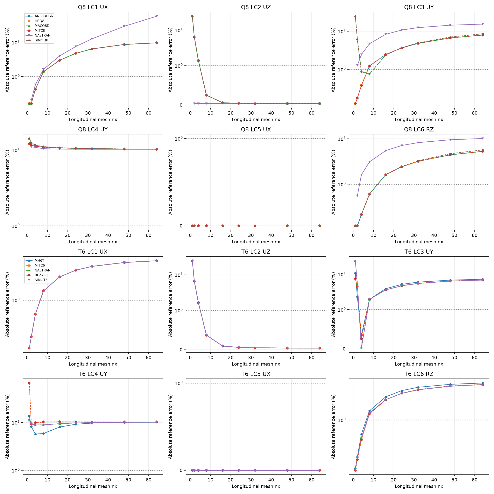

# CSI 2-002 — Straight beam with six static load cases

Updated 19 October 2026. Existing solver runs only; numerical results come from native OP2.

**Status: measured OP2 convergence, with retained pivot/numerical warnings.** The regular rectangular branch is available; distorted models B/C and four-triangle model E are not represented by these runs.

## Model and observation

Length 6 in, section width 0.2 in, shell thickness 0.1 in; E=10,000,000 psi and nu=0.3. The beam lies in basic XZ. The two physical free-end corners are selected by geometry, not by maximum response. Q8 uses one rectangular element across the width; T6 uses two triangles per rectangle. Mesh nx=1,2,4,8,16,24,32,48,64 differs from CSI's 6×1 example.

The root lower corner has SPC1236; the upper corner has SPC126, leaving its Z translation free as specified to avoid a local Poisson restraint. LC2 includes the compensating root load. BAILOUT=-1 does not certify numerical reliability.

| LC | Observable at two tip corners | Independent | Units |
|---|---|---|---|
| 1 | signed mean UX | 3e-05 | in |
| 2 | signed mean UZ | 0.1081 | in |
| 3 | signed mean UY | 0.4321 | in |
| 4 | mean absolute UY | 0.00341 | in |
| 5 | mean absolute UX | 0.0009 | in |
| 6 | signed mean RZ | 0.036 | rad |

## Finest existing mesh, nx=64

| Family | Solver/formulation | LC | Measured | Reference error (%) | Status |
|---|---|---|---|---|---|
| Q8 | ANS8BDG6 | 1 | 3.289586e-05 | 9.652853 | BAILOUT_PAIR_WARNING |
| Q8 | HBQ8 | 1 | 3.289587e-05 | 9.652913 | BAILOUT_PAIR_WARNING |
| Q8 | MACQ8D | 1 | 3.289588e-05 | 9.652926 | BAILOUT_PAIR_WARNING |
| Q8 | MITC8 | 1 | 3.289586e-05 | 9.652853 | BAILOUT_PAIR_WARNING |
| Q8 | NASTRAN | 1 | 4.732348e-05 | 57.74492 | BAILOUT_PAIR_WARNING |
| Q8 | SIMOQ8 | 1 | 3.289583e-05 | 9.65278 | BAILOUT_PAIR_WARNING |
| Q8 | ANS8BDG6 | 2 | 0.1080608 | 0.03627004 | BAILOUT_PAIR_WARNING |
| Q8 | HBQ8 | 2 | 0.1080608 | 0.03627004 | BAILOUT_PAIR_WARNING |
| Q8 | MACQ8D | 2 | 0.1080608 | 0.03627004 | BAILOUT_PAIR_WARNING |
| Q8 | MITC8 | 2 | 0.1080608 | 0.03627004 | BAILOUT_PAIR_WARNING |
| Q8 | NASTRAN | 2 | 0.1080612 | 0.03586339 | BAILOUT_PAIR_WARNING |
| Q8 | SIMOQ8 | 2 | 0.1080608 | 0.03627004 | BAILOUT_PAIR_WARNING |
| Q8 | ANS8BDG6 | 3 | 0.4663728 | 7.931687 | BAILOUT_PAIR_WARNING |
| Q8 | HBQ8 | 3 | 0.4663728 | 7.931687 | BAILOUT_PAIR_WARNING |
| Q8 | MACQ8D | 3 | 0.4663668 | 7.930286 | BAILOUT_PAIR_WARNING |
| Q8 | MITC8 | 3 | 0.4663728 | 7.931687 | BAILOUT_PAIR_WARNING |
| Q8 | NASTRAN | 3 | 0.498387 | 15.34066 | BAILOUT_PAIR_WARNING |
| Q8 | SIMOQ8 | 3 | 0.4689446 | 8.526878 | BAILOUT_PAIR_WARNING |
| Q8 | ANS8BDG6 | 4 | 0.003059515 | 10.27814 | BAILOUT_PAIR_WARNING |
| Q8 | HBQ8 | 4 | 0.003059515 | 10.27814 | BAILOUT_PAIR_WARNING |
| Q8 | MACQ8D | 4 | 0.003059301 | 10.28443 | BAILOUT_PAIR_WARNING |
| Q8 | MITC8 | 4 | 0.003059515 | 10.27814 | BAILOUT_PAIR_WARNING |
| Q8 | NASTRAN | 4 | 0.003060951 | 10.23605 | BAILOUT_PAIR_WARNING |
| Q8 | SIMOQ8 | 4 | 0.003059301 | 10.28443 | BAILOUT_PAIR_WARNING |
| Q8 | ANS8BDG6 | 5 | 0.0009 | 1.717773e-06 | BAILOUT_PAIR_WARNING |
| Q8 | HBQ8 | 5 | 0.0009 | 1.717773e-06 | BAILOUT_PAIR_WARNING |
| Q8 | MACQ8D | 5 | 0.0009 | 1.717773e-06 | BAILOUT_PAIR_WARNING |
| Q8 | MITC8 | 5 | 0.0009 | 1.717773e-06 | BAILOUT_PAIR_WARNING |
| Q8 | NASTRAN | 5 | 0.0009 | 1.717773e-06 | BAILOUT_PAIR_WARNING |
| Q8 | SIMOQ8 | 5 | 0.0009 | 1.717773e-06 | BAILOUT_PAIR_WARNING |
| Q8 | ANS8BDG6 | 6 | 0.03790442 | 5.290063 | BAILOUT_PAIR_WARNING |
| Q8 | HBQ8 | 6 | 0.03790442 | 5.290063 | BAILOUT_PAIR_WARNING |
| Q8 | MACQ8D | 6 | 0.0379042 | 5.289442 | BAILOUT_PAIR_WARNING |
| Q8 | MITC8 | 6 | 0.03790442 | 5.290063 | BAILOUT_PAIR_WARNING |
| Q8 | NASTRAN | 6 | 0.03965903 | 10.16396 | BAILOUT_PAIR_WARNING |
| Q8 | SIMOQ8 | 6 | 0.03805123 | 5.697848 | BAILOUT_PAIR_WARNING |
| T6 | MH6T | 1 | 3.162276e-05 | 5.409187 | BAILOUT_PAIR_WARNING |
| T6 | MITC6 | 1 | 3.162276e-05 | 5.409187 | BAILOUT_PAIR_WARNING |
| T6 | NASTRAN | 1 | 3.162305e-05 | 5.410169 | BAILOUT_PAIR_WARNING |
| T6 | REZAIEE | 1 | 3.162276e-05 | 5.409187 | BAILOUT_PAIR_WARNING |
| T6 | SIMOT6 | 1 | 3.162276e-05 | 5.409187 | BAILOUT_PAIR_WARNING |
| T6 | MH6T | 2 | 0.1080577 | 0.03913724 | BAILOUT_PAIR_WARNING |
| T6 | MITC6 | 2 | 0.1080577 | 0.03913724 | BAILOUT_PAIR_WARNING |
| T6 | NASTRAN | 2 | 0.1080577 | 0.03913379 | BAILOUT_PAIR_WARNING |
| T6 | REZAIEE | 2 | 0.1080577 | 0.03913724 | BAILOUT_PAIR_WARNING |
| T6 | SIMOT6 | 2 | 0.1080577 | 0.03913724 | BAILOUT_PAIR_WARNING |
| T6 | MH6T | 3 | 0.4631377 | 7.182997 | BAILOUT_PAIR_WARNING |
| T6 | MITC6 | 3 | 0.4615922 | 6.825321 | BAILOUT_PAIR_WARNING |
| T6 | NASTRAN | 3 | 0.4614714 | 6.797353 | BAILOUT_PAIR_WARNING |
| T6 | REZAIEE | 3 | 0.4615922 | 6.825321 | BAILOUT_PAIR_WARNING |
| T6 | SIMOT6 | 3 | 0.4614714 | 6.797353 | BAILOUT_PAIR_WARNING |
| T6 | MH6T | 4 | 0.003063743 | 10.15416 | BAILOUT_PAIR_WARNING |
| T6 | MITC6 | 4 | 0.003061716 | 10.2136 | BAILOUT_PAIR_WARNING |
| T6 | NASTRAN | 4 | 0.003063543 | 10.16002 | BAILOUT_PAIR_WARNING |
| T6 | REZAIEE | 4 | 0.003061716 | 10.2136 | BAILOUT_PAIR_WARNING |
| T6 | SIMOT6 | 4 | 0.003063543 | 10.16002 | BAILOUT_PAIR_WARNING |
| T6 | MH6T | 5 | 0.0009 | 1.717773e-06 | BAILOUT_PAIR_WARNING |
| T6 | MITC6 | 5 | 0.0009 | 1.717773e-06 | BAILOUT_PAIR_WARNING |
| T6 | NASTRAN | 5 | 0.0009 | 1.717773e-06 | BAILOUT_PAIR_WARNING |
| T6 | REZAIEE | 5 | 0.0009 | 1.717773e-06 | BAILOUT_PAIR_WARNING |
| T6 | SIMOT6 | 5 | 0.0009 | 1.717773e-06 | BAILOUT_PAIR_WARNING |
| T6 | MH6T | 6 | 0.03774494 | 4.847054 | BAILOUT_PAIR_WARNING |
| T6 | MITC6 | 6 | 0.03763626 | 4.545165 | BAILOUT_PAIR_WARNING |
| T6 | NASTRAN | 6 | 0.03762859 | 4.523864 | BAILOUT_PAIR_WARNING |
| T6 | REZAIEE | 6 | 0.03763626 | 4.545165 | BAILOUT_PAIR_WARNING |
| T6 | SIMOT6 | 6 | 0.03762859 | 4.523864 | BAILOUT_PAIR_WARNING |

## Coarse-mesh failure

Q8 Nastran nx=1 gives tip UX=224904.1875 in under unit axial loading, versus the 0.00003-in reference. The raw result is retained as a numerical failure and excluded from the accuracy curves. Pivot-recovery outputs at other meshes remain warning-qualified. No failed or missing result is converted to zero.

## Source and reproducibility

[CSI Example 2-002](https://docs.csiamerica.com/manuals/csibridge/Verification/Analysis/Shells/Problem%202-002.pdf). Meshes were generated independently in Python, not exported from SAP2000 S2K. Original DAT and OP2 remain local. No stiffness, loads or constraints were changed for this publication update. Missing measurements are shown as —. Solver agreement alone does not establish independent accuracy.

[Benchmark index](README.md) · [All comparisons](comparison_all.md)
