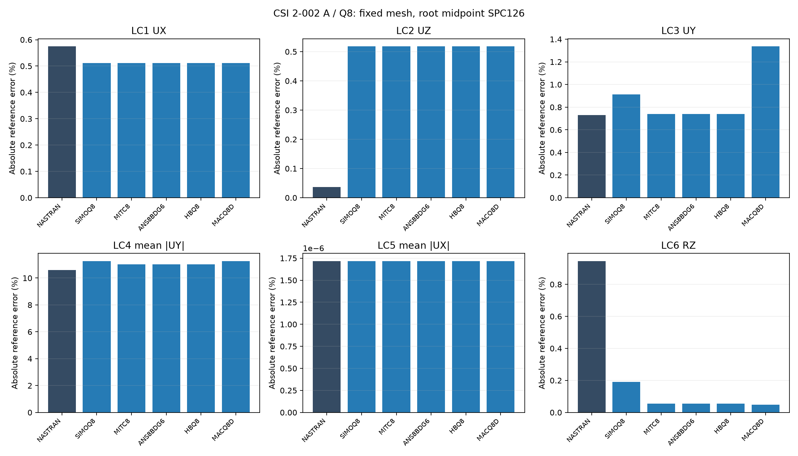
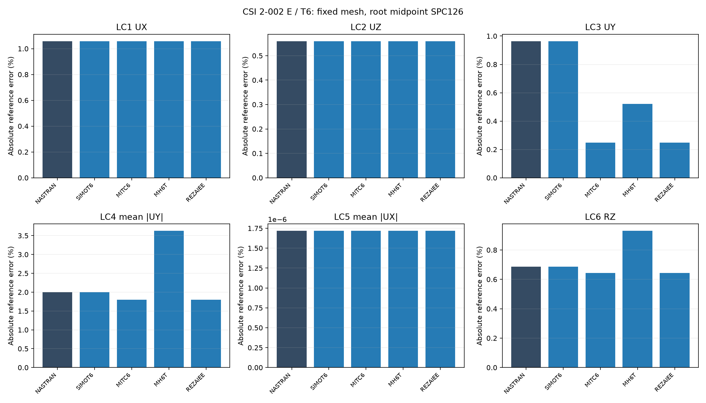

# CSI 2-002 — fixed source meshes A/Q8 and E/T6

20 October 2026. **One source mesh per model. No remeshing or convergence study.** Existing S2K vertices/topology are enriched with quadratic edge nodes only. Nine MYSTRAN formulations and two Nastran models are compared for six load cases. **All reported quadratic models include the root-midpoint boundary condition.**

## Source models and reference

A comes from Example 2-002a-thick.s2k: 6 rectangular areas → 6 CQUAD8 / 33 nodes. E comes from Example 2-002e-thick.s2k: 24 triangles, **four per parent panel** → 24 CTRIA6 / 63 nodes. E is not the old two-triangle Model D. Original joint coordinates/IDs, panel centers and area IDs are preserved, including area53. No new mesh level was generated.

The source E triangle windings are mixed (12 normal +Y, 12 normal −Y). DAT order is consistently normalized to −Y like A; per-element changes are recorded. Original S2K files remain unchanged. This reorder changes element-frame/fiber conventions, not geometry or the basic physical loads.

Units lb/in, length6 in, width0.2 in, shell h0.1 in, E=10,000,000 psi, G=3,846,153.84615385 psi, nu0.3. Both source sections are Shell-Thick; PSHELL MID1=MID2=MID3=1, transverse shear factor5/6. Basic XZ is the shell plane; no Y/Z swap is applied to the observables.

Source loads are retained: LC1 FX=+0.5 at tips7/14; LC2 FZ=+0.5 at both tips and **−0.5 at root joint8**; LC3 FY=+0.5 at both tips; LC4 FY=−5/+5 at7/14; LC5 FX=−5/+5; LC6 MZ=+0.5/+0.5. The negative LC2 load acts on a free UZ DOF and is not discarded as a reaction.

| LC | Observable at physical joints7/14 | Independent | Units | CSI SAP2000 A | CSI SAP2000 E |
|---|---|---|---|---|---|
| 1 | signed mean UX | 3e-05 | in | 3e-05 | 3e-05 |
| 2 | signed mean UZ | 0.1081 | in | 0.1072 | 0.0066 |
| 3 | signed mean UY | 0.4321 | in | 0.4321 | 0.4298 |
| 4 | mean absolute UY | 0.00341 | in | 0.00224 | 0.00458 |
| 5 | mean absolute UX | 0.0009 | in | 0.000899 | 5.5e-05 |
| 6 | signed mean RZ | 0.036 | rad | 0.036 | 0.036 |

CSI printed SAP2000 results use its source linear shell elements; they are not native quadratic outputs and are not used as independent denominators. Numerical errors below are 100×abs(solver−independent)/abs(independent). Fixed tip coordinates are (6,0,0) and (6,0,0.2) in, GRID7/14, verified within 1e-12 in. All GRID CD=0. LC4/5 use mean absolute values so opposite tip signs do not cancel; no arbitrary maximum-response probe is substituted.

## Quadratic support boundary conditions

The source support fixes joint1 in1236 and joint8 in126. For the quadratic element edge, the common restrained components are also imposed at its new midpoint (0,0,0.1): **SPC126 at GRID18 for A/Q8 and GRID25 for E/T6**. This extends the support conditions along the quadratic edge while keeping midpoint UZ, RX and RY free. The upper-root UZ release specified by CSI is retained. No full SPC123456 clamp is added.

This midpoint-supported model is the selected benchmark configuration. Only this configuration appears in the current tables, figures and DAT archives. The original S2K files remain unchanged. Existing mesh, material, source loads, element formulations and six subcases are retained; no remeshing or stiffness change was needed.

## Single-mesh error bars

## Nastran results with midpoint BC

| Model | LC | Observable | Measured | Independent | Units | Error (%) |
|---|---|---|---|---|---|---|
| A | 1 | UX | 3.01724831e-05 | 3e-05 | in | 0.574944 |
| A | 2 | UZ | 0.108060114 | 0.1081 | in | 0.0368972 |
| A | 3 | UY | 0.428939611 | 0.4321 | in | 0.731402 |
| A | 4 | abs_UY | 0.00304914406 | 0.00341 | in | 10.5823 |
| A | 5 | abs_UX | 0.000899999985 | 0.0009 | in | 1.71777e-06 |
| A | 6 | RZ | 0.0363403894 | 0.036 | rad | 0.945526 |
| E | 1 | UX | 3.03175711e-05 | 3e-05 | in | 1.05857 |
| E | 2 | UZ | 0.107494935 | 0.1081 | in | 0.559727 |
| E | 3 | UY | 0.427932769 | 0.4321 | in | 0.964414 |
| E | 4 | abs_UY | 0.00334176095 | 0.00341 | in | 2.00115 |
| E | 5 | abs_UX | 0.000899999985 | 0.0009 | in | 1.71777e-06 |
| E | 6 | RZ | 0.036247056 | 0.036 | rad | 0.686267 |

## Matched Nastran and MYSTRAN results

| Model | Formulation | LC | Units | Independent | Nastran | Nastran error (%) | MYSTRAN | MYSTRAN error (%) |
|---|---|---|---|---|---|---|---|---|
| A | SIMOQ8 | 1 | in | 3e-05 | 3.01724831e-05 | 0.574944 | 3.01533728e-05 | 0.511243 |
| A | SIMOQ8 | 2 | in | 0.1081 | 0.108060114 | 0.0368972 | 0.107539706 | 0.518311 |
| A | SIMOQ8 | 3 | in | 0.4321 | 0.428939611 | 0.731402 | 0.428156883 | 0.912547 |
| A | SIMOQ8 | 4 | in | 0.00341 | 0.00304914406 | 10.5823 | 0.0030258426 | 11.2656 |
| A | SIMOQ8 | 5 | in | 0.0009 | 0.000899999985 | 1.71777e-06 | 0.000899999985 | 1.71777e-06 |
| A | SIMOQ8 | 6 | rad | 0.036 | 0.0363403894 | 0.945526 | 0.0360687077 | 0.190855 |
| A | MITC8 | 1 | in | 3e-05 | 3.01724831e-05 | 0.574944 | 3.01533746e-05 | 0.511249 |
| A | MITC8 | 2 | in | 0.1081 | 0.108060114 | 0.0368972 | 0.107539706 | 0.518311 |
| A | MITC8 | 3 | in | 0.4321 | 0.428939611 | 0.731402 | 0.428902864 | 0.739906 |
| A | MITC8 | 4 | in | 0.00341 | 0.00304914406 | 10.5823 | 0.00303439144 | 11.0149 |
| A | MITC8 | 5 | in | 0.0009 | 0.000899999985 | 1.71777e-06 | 0.000899999985 | 1.71777e-06 |
| A | MITC8 | 6 | rad | 0.036 | 0.0363403894 | 0.945526 | 0.0360195935 | 0.0544263 |
| A | ANS8BDG6 | 1 | in | 3e-05 | 3.01724831e-05 | 0.574944 | 3.01533746e-05 | 0.511249 |
| A | ANS8BDG6 | 2 | in | 0.1081 | 0.108060114 | 0.0368972 | 0.107539706 | 0.518311 |
| A | ANS8BDG6 | 3 | in | 0.4321 | 0.428939611 | 0.731402 | 0.428902864 | 0.739906 |
| A | ANS8BDG6 | 4 | in | 0.00341 | 0.00304914406 | 10.5823 | 0.00303439144 | 11.0149 |
| A | ANS8BDG6 | 5 | in | 0.0009 | 0.000899999985 | 1.71777e-06 | 0.000899999985 | 1.71777e-06 |
| A | ANS8BDG6 | 6 | rad | 0.036 | 0.0363403894 | 0.945526 | 0.0360195935 | 0.0544263 |
| A | HBQ8 | 1 | in | 3e-05 | 3.01724831e-05 | 0.574944 | 3.01533746e-05 | 0.511249 |
| A | HBQ8 | 2 | in | 0.1081 | 0.108060114 | 0.0368972 | 0.107539706 | 0.518311 |
| A | HBQ8 | 3 | in | 0.4321 | 0.428939611 | 0.731402 | 0.428902864 | 0.739906 |
| A | HBQ8 | 4 | in | 0.00341 | 0.00304914406 | 10.5823 | 0.00303439144 | 11.0149 |
| A | HBQ8 | 5 | in | 0.0009 | 0.000899999985 | 1.71777e-06 | 0.000899999985 | 1.71777e-06 |
| A | HBQ8 | 6 | rad | 0.036 | 0.0363403894 | 0.945526 | 0.0360195935 | 0.0544263 |
| A | MACQ8D | 1 | in | 3e-05 | 3.01724831e-05 | 0.574944 | 3.01533746e-05 | 0.511249 |
| A | MACQ8D | 2 | in | 0.1081 | 0.108060114 | 0.0368972 | 0.107539706 | 0.518311 |
| A | MACQ8D | 3 | in | 0.4321 | 0.428939611 | 0.731402 | 0.426322073 | 1.33717 |
| A | MACQ8D | 4 | in | 0.00341 | 0.00304914406 | 10.5823 | 0.0030258426 | 11.2656 |
| A | MACQ8D | 5 | in | 0.0009 | 0.000899999985 | 1.71777e-06 | 0.000899999985 | 1.71777e-06 |
| A | MACQ8D | 6 | rad | 0.036 | 0.0363403894 | 0.945526 | 0.0360176414 | 0.049004 |
| E | SIMOT6 | 1 | in | 3e-05 | 3.03175711e-05 | 1.05857 | 3.03170764e-05 | 1.05692 |
| E | SIMOT6 | 2 | in | 0.1081 | 0.107494935 | 0.559727 | 0.107494853 | 0.559803 |
| E | SIMOT6 | 3 | in | 0.4321 | 0.427932769 | 0.964414 | 0.427932769 | 0.964414 |
| E | SIMOT6 | 4 | in | 0.00341 | 0.00334176095 | 2.00115 | 0.00334176095 | 2.00115 |
| E | SIMOT6 | 5 | in | 0.0009 | 0.000899999985 | 1.71777e-06 | 0.000899999985 | 1.71777e-06 |
| E | SIMOT6 | 6 | rad | 0.036 | 0.036247056 | 0.686267 | 0.036247056 | 0.686267 |
| E | MITC6 | 1 | in | 3e-05 | 3.03175711e-05 | 1.05857 | 3.03170764e-05 | 1.05692 |
| E | MITC6 | 2 | in | 0.1081 | 0.107494935 | 0.559727 | 0.107494853 | 0.559803 |
| E | MITC6 | 3 | in | 0.4321 | 0.427932769 | 0.964414 | 0.431028724 | 0.247923 |
| E | MITC6 | 4 | in | 0.00341 | 0.00334176095 | 2.00115 | 0.00334879966 | 1.79473 |
| E | MITC6 | 5 | in | 0.0009 | 0.000899999985 | 1.71777e-06 | 0.000899999985 | 1.71777e-06 |
| E | MITC6 | 6 | rad | 0.036 | 0.036247056 | 0.686267 | 0.0362315588 | 0.643219 |
| E | MH6T | 1 | in | 3e-05 | 3.03175711e-05 | 1.05857 | 3.03170764e-05 | 1.05692 |
| E | MH6T | 2 | in | 0.1081 | 0.107494935 | 0.559727 | 0.107494853 | 0.559803 |
| E | MH6T | 3 | in | 0.4321 | 0.427932769 | 0.964414 | 0.429846406 | 0.521545 |
| E | MH6T | 4 | in | 0.00341 | 0.00334176095 | 2.00115 | 0.0032863114 | 3.62723 |
| E | MH6T | 5 | in | 0.0009 | 0.000899999985 | 1.71777e-06 | 0.000899999985 | 1.71777e-06 |
| E | MH6T | 6 | rad | 0.036 | 0.036247056 | 0.686267 | 0.0363349169 | 0.930325 |
| E | REZAIEE | 1 | in | 3e-05 | 3.03175711e-05 | 1.05857 | 3.03170764e-05 | 1.05692 |
| E | REZAIEE | 2 | in | 0.1081 | 0.107494935 | 0.559727 | 0.107494853 | 0.559803 |
| E | REZAIEE | 3 | in | 0.4321 | 0.427932769 | 0.964414 | 0.431028724 | 0.247923 |
| E | REZAIEE | 4 | in | 0.00341 | 0.00334176095 | 2.00115 | 0.00334879966 | 1.79473 |
| E | REZAIEE | 5 | in | 0.0009 | 0.000899999985 | 1.71777e-06 | 0.000899999985 | 1.71777e-06 |
| E | REZAIEE | 6 | rad | 0.036 | 0.036247056 | 0.686267 | 0.0362315588 | 0.643219 |

## Solver status and limitations

The selected dataset contains11 readable OP2 files, six subcases each:132 signed tip observations,66 aggregated measurements and54 Nastran/MYSTRAN pairs. Every GRID displacement is finite; explicit SPC residuals are zero; hashes match the prepared midpoint-supported DAT. Physical signatures agree across solvers within each model.

Both Nastran runs use BAILOUT=−1 and retain warning4698 about matrix/factor conditioning or pivot ratios. Values remain warning-qualified, not an unconditional PASS. AUTOSPC is explicitly enabled in both solvers; numerical automatic-DOF treatment is distinct from the assigned physical support. The two Nastran models were successfully executed using run_nastran.bat; MYSTRAN completed normally for all nine formulations.

Displacements are extracted from native OP2, with F06 used for diagnostic status only. Successful execution and matching inputs do not certify independent-reference accuracy. No unsupported claim that midpoint BC removes every error is made: for example Nastran A twist LC4 still differs by10.58%. No kernel was changed to force agreement.

Only the single fixed source mesh per model is used. No convergence study is included. Original files and prior research outputs remain local; superseded outputs are not joined to this selected dataset.

## Reference and input archives

[CSI Example 2-002](https://docs.csiamerica.com/manuals/csibridge/Verification/Analysis/Shells/Problem%202-002.pdf), supplied pages and the two user-supplied thick S2K files. Quadratic enrichment retains source vertices and topology, and adds the required midpoint support as detailed above.

[Q8/T6 midpoint-supported DAT](DAT/CSI_2_002_A_Q8_E_T6_FIXED_MESH_DAT_20261020.zip): 11 executed inputs, two Nastran and nine MYSTRAN. The [complete benchmark DAT archive](DAT/quadratic_shell_benchmark_DAT.zip) also contains only these midpoint-supported inputs for2-002. No Python, CSV, raw solver output or S2K program/license metadata is published. OP2 and internal scripts remain local.

[Benchmark index](README.md) · [All comparisons](comparison_all.md)
