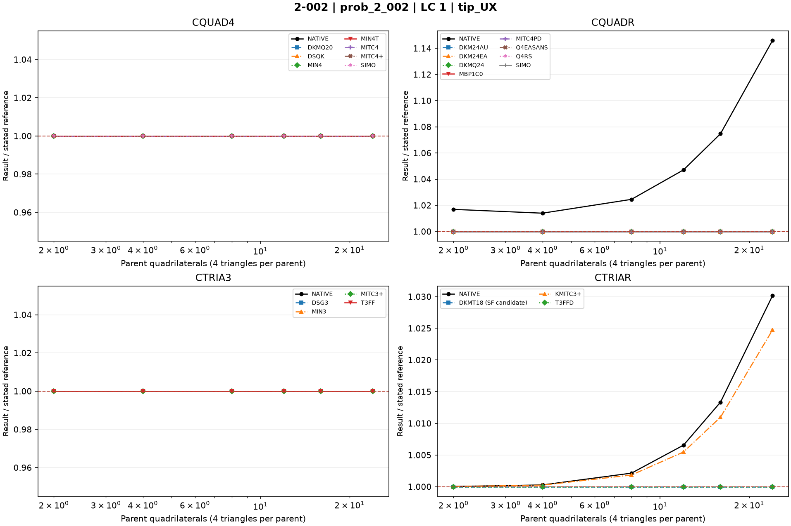
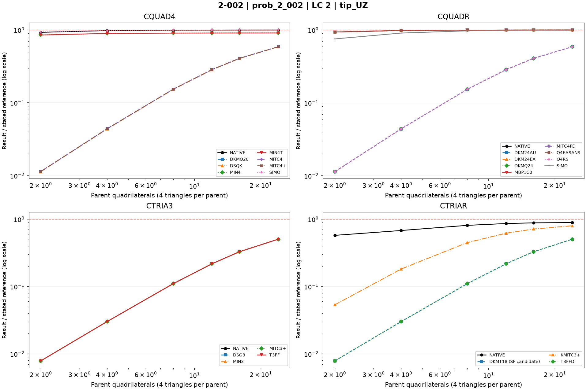
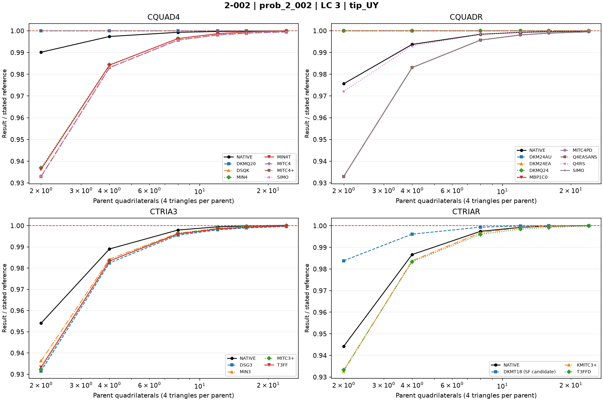
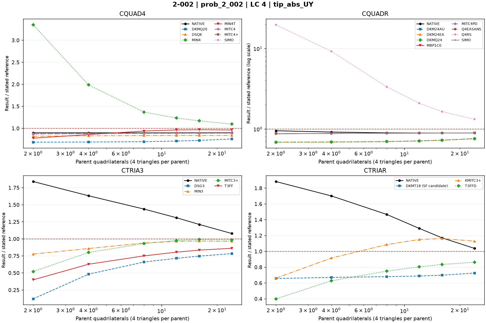
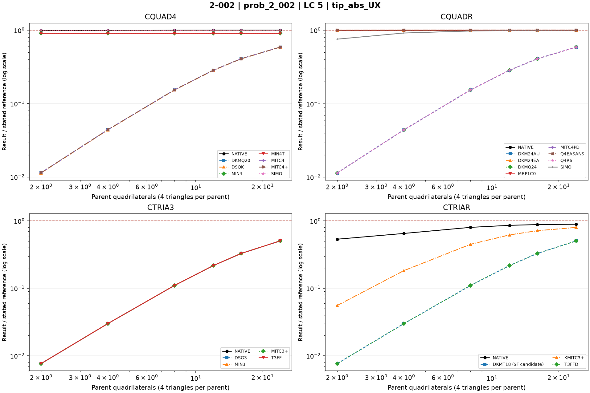
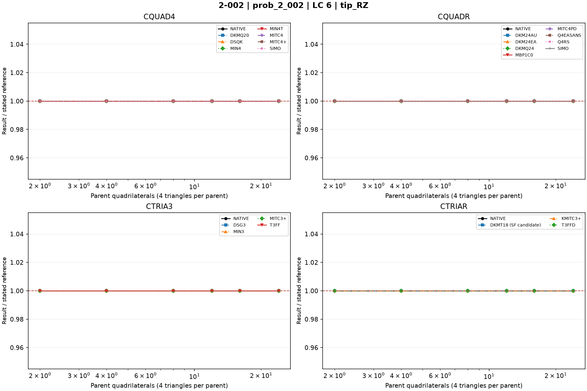
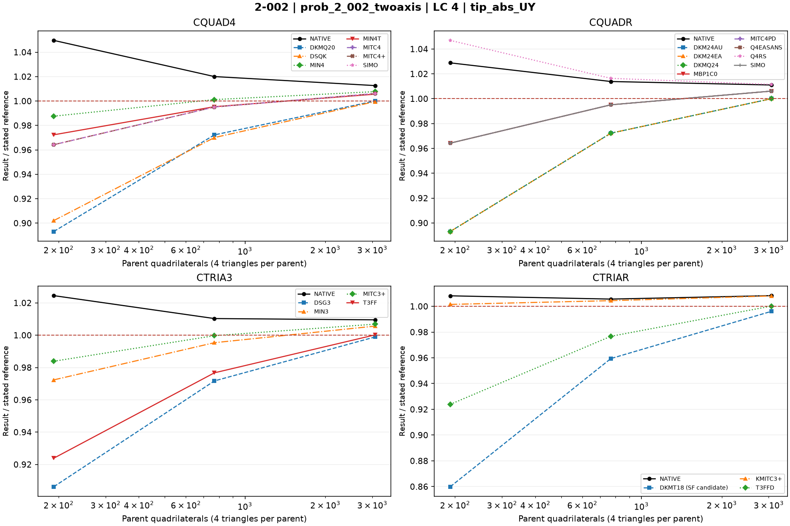

# Linear shells — 2-002: Straight beam: six load cases

25 October 2026. Fresh native MYSTRAN and Nastran runs. CQUAD4, CQUADR, CTRIA3 and CTRIAR only.

[All linear comparisons](comparison_all_linear.md) · [Full CSV](comparison_all_linear.csv) · [Tested DAT](DAT/linear_shell_benchmark_DAT.zip) · [Linear publication QA](PUBLICATION_QA_linear.md)

Case IDs retain source-model filenames; actual element and formulation are given by their columns and deck selectors. Two-axis 2-002 tip observables use the two physical corner nodes.

NATIVE means the Nastran result for the corresponding element card: CQUAD4, CQUADR, CTRIA3 or CTRIAR. It does not mean the same proprietary interpolation as a MYSTRAN selector. Curves use independent/analytical references; published SAP2000 values are separate table columns. A completed solve is not a physical-accuracy pass. Zero references use absolute residuals; missing and failed output is never replaced by zero.

The tested source snapshot includes DKMT18 SF as an explicitly labelled candidate and corrected DSG3 local-z Kg. It is documented in [source provenance](data_linear/provenance_linear.json), with a reproducible element-local patch. This benchmark snapshot is not a declaration that SF passed every production-promotion gate. No shared eigensolver prototype is included.

## Model and comparison scope

S2K A rectangular geometry; 6 in x 0.2 in x 0.1 in. Preserve SPC1236 at lower root, SPC126 at upper root and the LC2 root counterforce. Refinement changes axial segmentation only.

Original longitudinal meshes retain all six load cases. The separate two-axis series is LC4 only (48x4,96x8,192x16), with unchanged L=6,b=.2,t=.1 and mixed root supports. No absent LC is shown as a failed measurement.

## Extraction status

| Solver | Status | Metric rows |
|---|---|---:|
| MYSTRAN | MEASURED | 990 |
| NASTRAN | MEASURED | 180 |

## Mesh convergence

LC1–LC6 use curves across the longitudinal mesh series. LC4 additionally includes the separate two-axis refinement series. The fixed SAP2000-source mesh remains a table comparison only; it is not shown as a bar chart.

## Figures

### prob_2_002 · LC 1 · tip_UX

### prob_2_002 · LC 2 · tip_UZ

### prob_2_002 · LC 3 · tip_UY

### prob_2_002 · LC 4 · tip_abs_UY

### prob_2_002 · LC 5 · tip_abs_UX

### prob_2_002 · LC 6 · tip_RZ

### prob_2_002_twoaxis · LC 4 · tip_abs_UY

## Finest available mesh per named series

| Case / parent quads | Solver / formulation | LC | Quantity | Measured | Independent / analytical | CSI published | Unit | Error % primary | Absolute residual | Status |
|---|---|---:|---|---:|---:|---:|---|---:|---:|---|
| prob_2_002_nx24_cquadr_simo / 24 | MYSTRAN CQUAD4_DKMQ20 | 6 | tip_RZ | 0.036 | 0.036 | — | rad | 0 | 0 | MEASURED |
| prob_2_002_nx24_cquadr_simo / 24 | MYSTRAN CQUAD4_DSQK | 6 | tip_RZ | 0.036 | 0.036 | — | rad | 0 | 0 | MEASURED |
| prob_2_002_nx24_cquadr_simo / 24 | MYSTRAN CQUAD4_MIN4 | 6 | tip_RZ | 0.036 | 0.036 | — | rad | 0 | 0 | MEASURED |
| prob_2_002_nx24_cquadr_simo / 24 | MYSTRAN CQUAD4_MIN4T | 6 | tip_RZ | 0.036 | 0.036 | — | rad | 0 | 0 | MEASURED |
| prob_2_002_nx24_cquadr_simo / 24 | MYSTRAN CQUAD4_MITC4 | 6 | tip_RZ | 0.036 | 0.036 | — | rad | 0 | 0 | MEASURED |
| prob_2_002_nx24_cquadr_simo / 24 | MYSTRAN CQUAD4_MITC4plus | 6 | tip_RZ | 0.036 | 0.036 | — | rad | 0 | 0 | MEASURED |
| prob_2_002_nx24_cquadr_simo / 24 | MYSTRAN CQUAD4_SIMO | 6 | tip_RZ | 0.036 | 0.036 | — | rad | 0 | 0 | MEASURED |
| prob_2_002_nx24_cquadr_simo / 24 | MYSTRAN CQUADR_DKM24AU | 6 | tip_RZ | 0.036 | 0.036 | — | rad | 0 | 0 | MEASURED |
| prob_2_002_nx24_cquadr_simo / 24 | MYSTRAN CQUADR_DKM24EA | 6 | tip_RZ | 0.036 | 0.036 | — | rad | 0 | 0 | MEASURED |
| prob_2_002_nx24_cquadr_simo / 24 | MYSTRAN CQUADR_DKMQ24 | 6 | tip_RZ | 0.036 | 0.036 | — | rad | 0 | 0 | MEASURED |
| prob_2_002_nx24_cquadr_simo / 24 | MYSTRAN CQUADR_MBP1C0 | 6 | tip_RZ | 0.036 | 0.036 | — | rad | 0 | 0 | MEASURED |
| prob_2_002_nx24_cquadr_simo / 24 | MYSTRAN CQUADR_MITC4PD | 6 | tip_RZ | 0.036 | 0.036 | — | rad | 0 | 0 | MEASURED |
| prob_2_002_nx24_cquadr_simo / 24 | MYSTRAN CQUADR_Q4EASANS | 6 | tip_RZ | 0.036 | 0.036 | — | rad | 0 | 0 | MEASURED |
| prob_2_002_nx24_cquadr_simo / 24 | MYSTRAN CQUADR_Q4RS | 6 | tip_RZ | 0.036 | 0.036 | — | rad | 0 | 0 | MEASURED |
| prob_2_002_nx24_cquadr_simo / 24 | MYSTRAN CQUADR_SIMO | 6 | tip_RZ | 0.036 | 0.036 | — | rad | 0 | 0 | MEASURED |
| prob_2_002_nx24_cquadr_simo / 24 | MYSTRAN CTRIA3_DSG3 | 6 | tip_RZ | 0.036 | 0.036 | — | rad | 0 | 0 | MEASURED |
| prob_2_002_nx24_cquadr_simo / 24 | MYSTRAN CTRIA3_MIN3 | 6 | tip_RZ | 0.036 | 0.036 | — | rad | 0 | 0 | MEASURED |
| prob_2_002_nx24_cquadr_simo / 24 | MYSTRAN CTRIA3_MITC3plus | 6 | tip_RZ | 0.036 | 0.036 | — | rad | 0 | 0 | MEASURED |
| prob_2_002_nx24_cquadr_simo / 24 | MYSTRAN CTRIA3_T3FF | 6 | tip_RZ | 0.036 | 0.036 | — | rad | 0 | 0 | MEASURED |
| prob_2_002_nx24_cquadr_simo / 24 | MYSTRAN CTRIAR_DKMT18 (SF candidate) | 6 | tip_RZ | 0.036 | 0.036 | — | rad | 0 | 0 | MEASURED |
| prob_2_002_nx24_cquadr_simo / 24 | MYSTRAN CTRIAR_KMITC3plus | 6 | tip_RZ | 0.036 | 0.036 | — | rad | 0 | 0 | MEASURED |
| prob_2_002_nx24_cquadr_simo / 24 | MYSTRAN CTRIAR_T3FFD | 6 | tip_RZ | 0.036 | 0.036 | — | rad | 0 | 0 | MEASURED |
| prob_2_002_nx24_cquadr_simo / 24 | NASTRAN CQUAD4_NATIVE | 6 | tip_RZ | 0.036 | 0.036 | — | rad | 0 | 0 | MEASURED |
| prob_2_002_nx24_cquadr_simo / 24 | NASTRAN CQUADR_NATIVE | 6 | tip_RZ | 0.036 | 0.036 | — | rad | 0 | 0 | MEASURED |
| prob_2_002_nx24_cquadr_simo / 24 | NASTRAN CTRIA3_NATIVE | 6 | tip_RZ | 0.036 | 0.036 | — | rad | 0 | 0 | MEASURED |
| prob_2_002_nx24_cquadr_simo / 24 | NASTRAN CTRIAR_NATIVE | 6 | tip_RZ | 0.036 | 0.036 | — | rad | 0 | 0 | MEASURED |
| prob_2_002_nx24_cquadr_simo / 24 | MYSTRAN CQUAD4_DKMQ20 | 1 | tip_UX | 3e-05 | 3e-05 | — | in | 0 | 0 | MEASURED |
| prob_2_002_nx24_cquadr_simo / 24 | MYSTRAN CQUAD4_DSQK | 1 | tip_UX | 3e-05 | 3e-05 | — | in | 0 | 0 | MEASURED |
| prob_2_002_nx24_cquadr_simo / 24 | MYSTRAN CQUAD4_MIN4 | 1 | tip_UX | 3e-05 | 3e-05 | — | in | 0 | 0 | MEASURED |
| prob_2_002_nx24_cquadr_simo / 24 | MYSTRAN CQUAD4_MIN4T | 1 | tip_UX | 3e-05 | 3e-05 | — | in | 0 | 0 | MEASURED |
| prob_2_002_nx24_cquadr_simo / 24 | MYSTRAN CQUAD4_MITC4 | 1 | tip_UX | 3e-05 | 3e-05 | — | in | 0 | 0 | MEASURED |
| prob_2_002_nx24_cquadr_simo / 24 | MYSTRAN CQUAD4_MITC4plus | 1 | tip_UX | 3e-05 | 3e-05 | — | in | 0 | 0 | MEASURED |
| prob_2_002_nx24_cquadr_simo / 24 | MYSTRAN CQUAD4_SIMO | 1 | tip_UX | 3e-05 | 3e-05 | — | in | 0 | 0 | MEASURED |
| prob_2_002_nx24_cquadr_simo / 24 | MYSTRAN CQUADR_DKM24AU | 1 | tip_UX | 3e-05 | 3e-05 | — | in | 0 | 0 | MEASURED |
| prob_2_002_nx24_cquadr_simo / 24 | MYSTRAN CQUADR_DKM24EA | 1 | tip_UX | 3e-05 | 3e-05 | — | in | 0 | 0 | MEASURED |
| prob_2_002_nx24_cquadr_simo / 24 | MYSTRAN CQUADR_DKMQ24 | 1 | tip_UX | 3e-05 | 3e-05 | — | in | 0 | 0 | MEASURED |
| prob_2_002_nx24_cquadr_simo / 24 | MYSTRAN CQUADR_MBP1C0 | 1 | tip_UX | 3e-05 | 3e-05 | — | in | 0 | 0 | MEASURED |
| prob_2_002_nx24_cquadr_simo / 24 | MYSTRAN CQUADR_MITC4PD | 1 | tip_UX | 3e-05 | 3e-05 | — | in | 0 | 0 | MEASURED |
| prob_2_002_nx24_cquadr_simo / 24 | MYSTRAN CQUADR_Q4EASANS | 1 | tip_UX | 3e-05 | 3e-05 | — | in | 0 | 0 | MEASURED |
| prob_2_002_nx24_cquadr_simo / 24 | MYSTRAN CQUADR_Q4RS | 1 | tip_UX | 3e-05 | 3e-05 | — | in | 0 | 0 | MEASURED |
| prob_2_002_nx24_cquadr_simo / 24 | MYSTRAN CQUADR_SIMO | 1 | tip_UX | 3e-05 | 3e-05 | — | in | 0 | 0 | MEASURED |
| prob_2_002_nx24_cquadr_simo / 24 | MYSTRAN CTRIA3_DSG3 | 1 | tip_UX | 3e-05 | 3e-05 | — | in | 0 | 0 | MEASURED |
| prob_2_002_nx24_cquadr_simo / 24 | MYSTRAN CTRIA3_MIN3 | 1 | tip_UX | 3e-05 | 3e-05 | — | in | 0 | 0 | MEASURED |
| prob_2_002_nx24_cquadr_simo / 24 | MYSTRAN CTRIA3_MITC3plus | 1 | tip_UX | 3e-05 | 3e-05 | — | in | 0 | 0 | MEASURED |
| prob_2_002_nx24_cquadr_simo / 24 | MYSTRAN CTRIA3_T3FF | 1 | tip_UX | 3e-05 | 3e-05 | — | in | 0 | 0 | MEASURED |
| prob_2_002_nx24_cquadr_simo / 24 | MYSTRAN CTRIAR_DKMT18 (SF candidate) | 1 | tip_UX | 3e-05 | 3e-05 | — | in | 0 | 0 | MEASURED |
| prob_2_002_nx24_cquadr_simo / 24 | MYSTRAN CTRIAR_KMITC3plus | 1 | tip_UX | 3.074236e-05 | 3e-05 | — | in | 2.474533 | 7.4236e-07 | MEASURED |
| prob_2_002_nx24_cquadr_simo / 24 | MYSTRAN CTRIAR_T3FFD | 1 | tip_UX | 3e-05 | 3e-05 | — | in | 0 | 0 | MEASURED |
| prob_2_002_nx24_cquadr_simo / 24 | NASTRAN CQUAD4_NATIVE | 1 | tip_UX | 3e-05 | 3e-05 | — | in | 0 | 0 | MEASURED |
| prob_2_002_nx24_cquadr_simo / 24 | NASTRAN CQUADR_NATIVE | 1 | tip_UX | 3.438168e-05 | 3e-05 | — | in | 14.6056 | 4.38168e-06 | MEASURED |
| prob_2_002_nx24_cquadr_simo / 24 | NASTRAN CTRIA3_NATIVE | 1 | tip_UX | 3e-05 | 3e-05 | — | in | 0 | 0 | MEASURED |
| prob_2_002_nx24_cquadr_simo / 24 | NASTRAN CTRIAR_NATIVE | 1 | tip_UX | 3.090472e-05 | 3e-05 | — | in | 3.015733 | 9.0472e-07 | MEASURED |
| prob_2_002_nx24_cquadr_simo / 24 | MYSTRAN CQUAD4_DKMQ20 | 3 | tip_UY | 0.4320889 | 0.4321 | — | in | 0.00256885 | 1.11e-05 | MEASURED |
| prob_2_002_nx24_cquadr_simo / 24 | MYSTRAN CQUAD4_DSQK | 3 | tip_UY | 0.4318509 | 0.4321 | — | in | 0.05764869 | 0.0002491 | MEASURED |
| prob_2_002_nx24_cquadr_simo / 24 | MYSTRAN CQUAD4_MIN4 | 3 | tip_UY | 0.4320454 | 0.4321 | — | in | 0.01263596 | 5.46e-05 | MEASURED |
| prob_2_002_nx24_cquadr_simo / 24 | MYSTRAN CQUAD4_MIN4T | 3 | tip_UY | 0.4320962 | 0.4321 | — | in | 0.0008794261 | 3.8e-06 | MEASURED |
| prob_2_002_nx24_cquadr_simo / 24 | MYSTRAN CQUAD4_MITC4 | 3 | tip_UY | 0.431884 | 0.4321 | — | in | 0.04998843 | 0.000216 | MEASURED |
| prob_2_002_nx24_cquadr_simo / 24 | MYSTRAN CQUAD4_MITC4plus | 3 | tip_UY | 0.431884 | 0.4321 | — | in | 0.04998843 | 0.000216 | MEASURED |
| prob_2_002_nx24_cquadr_simo / 24 | MYSTRAN CQUAD4_SIMO | 3 | tip_UY | 0.431884 | 0.4321 | — | in | 0.04998843 | 0.000216 | MEASURED |
| prob_2_002_nx24_cquadr_simo / 24 | MYSTRAN CQUADR_DKM24AU | 3 | tip_UY | 0.4320889 | 0.4321 | — | in | 0.00256885 | 1.11e-05 | MEASURED |
| prob_2_002_nx24_cquadr_simo / 24 | MYSTRAN CQUADR_DKM24EA | 3 | tip_UY | 0.4320889 | 0.4321 | — | in | 0.00256885 | 1.11e-05 | MEASURED |
| prob_2_002_nx24_cquadr_simo / 24 | MYSTRAN CQUADR_DKMQ24 | 3 | tip_UY | 0.4320889 | 0.4321 | — | in | 0.00256885 | 1.11e-05 | MEASURED |
| prob_2_002_nx24_cquadr_simo / 24 | MYSTRAN CQUADR_MBP1C0 | 3 | tip_UY | 0.431884 | 0.4321 | — | in | 0.04998843 | 0.000216 | MEASURED |
| prob_2_002_nx24_cquadr_simo / 24 | MYSTRAN CQUADR_MITC4PD | 3 | tip_UY | 0.431884 | 0.4321 | — | in | 0.04998843 | 0.000216 | MEASURED |
| prob_2_002_nx24_cquadr_simo / 24 | MYSTRAN CQUADR_Q4EASANS | 3 | tip_UY | 0.431884 | 0.4321 | — | in | 0.04998843 | 0.000216 | MEASURED |
| prob_2_002_nx24_cquadr_simo / 24 | MYSTRAN CQUADR_Q4RS | 3 | tip_UY | 0.4320759 | 0.4321 | — | in | 0.005577413 | 2.41e-05 | MEASURED |
| prob_2_002_nx24_cquadr_simo / 24 | MYSTRAN CQUADR_SIMO | 3 | tip_UY | 0.431884 | 0.4321 | — | in | 0.04998843 | 0.000216 | MEASURED |
| prob_2_002_nx24_cquadr_simo / 24 | MYSTRAN CTRIA3_DSG3 | 3 | tip_UY | 0.4319362 | 0.4321 | — | in | 0.03790789 | 0.0001638 | MEASURED |
| prob_2_002_nx24_cquadr_simo / 24 | MYSTRAN CTRIA3_MIN3 | 3 | tip_UY | 0.4320962 | 0.4321 | — | in | 0.0008794261 | 3.8e-06 | MEASURED |
| prob_2_002_nx24_cquadr_simo / 24 | MYSTRAN CTRIA3_MITC3plus | 3 | tip_UY | 0.4321014 | 0.4321 | — | in | 0.0003239991 | 1.4e-06 | MEASURED |
| prob_2_002_nx24_cquadr_simo / 24 | MYSTRAN CTRIA3_T3FF | 3 | tip_UY | 0.4320323 | 0.4321 | — | in | 0.01566767 | 6.77e-05 | MEASURED |
| prob_2_002_nx24_cquadr_simo / 24 | MYSTRAN CTRIAR_DKMT18 (SF candidate) | 3 | tip_UY | 0.4321397 | 0.4321 | — | in | 0.009187688 | 3.97e-05 | MEASURED |
| prob_2_002_nx24_cquadr_simo / 24 | MYSTRAN CTRIAR_KMITC3plus | 3 | tip_UY | 0.4321748 | 0.4321 | — | in | 0.01731081 | 7.48e-05 | MEASURED |
| prob_2_002_nx24_cquadr_simo / 24 | MYSTRAN CTRIAR_T3FFD | 3 | tip_UY | 0.4320323 | 0.4321 | — | in | 0.01566767 | 6.77e-05 | MEASURED |
| prob_2_002_nx24_cquadr_simo / 24 | NASTRAN CQUAD4_NATIVE | 3 | tip_UY | 0.4320603 | 0.4321 | — | in | 0.009187688 | 3.97e-05 | MEASURED |
| prob_2_002_nx24_cquadr_simo / 24 | NASTRAN CQUADR_NATIVE | 3 | tip_UY | 0.432016 | 0.4321 | — | in | 0.01943994 | 8.4e-05 | MEASURED |
| prob_2_002_nx24_cquadr_simo / 24 | NASTRAN CTRIA3_NATIVE | 3 | tip_UY | 0.4321559 | 0.4321 | — | in | 0.01293682 | 5.59e-05 | MEASURED |
| prob_2_002_nx24_cquadr_simo / 24 | NASTRAN CTRIAR_NATIVE | 3 | tip_UY | 0.4321313 | 0.4321 | — | in | 0.007243694 | 3.13e-05 | MEASURED |
| prob_2_002_nx24_cquadr_simo / 24 | MYSTRAN CQUAD4_DKMQ20 | 2 | tip_UZ | 0.06358443 | 0.1081 | — | in | 41.17999 | 0.04451557 | MEASURED |
| prob_2_002_nx24_cquadr_simo / 24 | MYSTRAN CQUAD4_DSQK | 2 | tip_UZ | 0.06342303 | 0.1081 | — | in | 41.3293 | 0.04467697 | MEASURED |
| prob_2_002_nx24_cquadr_simo / 24 | MYSTRAN CQUAD4_MIN4 | 2 | tip_UZ | 0.09831534 | 0.1081 | — | in | 9.051489 | 0.00978466 | MEASURED |
| prob_2_002_nx24_cquadr_simo / 24 | MYSTRAN CQUAD4_MIN4T | 2 | tip_UZ | 0.09831534 | 0.1081 | — | in | 9.051489 | 0.00978466 | MEASURED |
| prob_2_002_nx24_cquadr_simo / 24 | MYSTRAN CQUAD4_MITC4 | 2 | tip_UZ | 0.06358497 | 0.1081 | — | in | 41.17949 | 0.04451503 | MEASURED |
| prob_2_002_nx24_cquadr_simo / 24 | MYSTRAN CQUAD4_MITC4plus | 2 | tip_UZ | 0.06358497 | 0.1081 | — | in | 41.17949 | 0.04451503 | MEASURED |
| prob_2_002_nx24_cquadr_simo / 24 | MYSTRAN CQUAD4_SIMO | 2 | tip_UZ | 0.1080311 | 0.1081 | — | in | 0.06373728 | 6.89e-05 | MEASURED |
| prob_2_002_nx24_cquadr_simo / 24 | MYSTRAN CQUADR_DKM24AU | 2 | tip_UZ | 0.06358443 | 0.1081 | — | in | 41.17999 | 0.04451557 | MEASURED |
| prob_2_002_nx24_cquadr_simo / 24 | MYSTRAN CQUADR_DKM24EA | 2 | tip_UZ | 0.1080296 | 0.1081 | — | in | 0.06512488 | 7.04e-05 | MEASURED |
| prob_2_002_nx24_cquadr_simo / 24 | MYSTRAN CQUADR_DKMQ24 | 2 | tip_UZ | 0.06358443 | 0.1081 | — | in | 41.17999 | 0.04451557 | MEASURED |
| prob_2_002_nx24_cquadr_simo / 24 | MYSTRAN CQUADR_MBP1C0 | 2 | tip_UZ | 0.1080296 | 0.1081 | — | in | 0.06512488 | 7.04e-05 | MEASURED |
| prob_2_002_nx24_cquadr_simo / 24 | MYSTRAN CQUADR_MITC4PD | 2 | tip_UZ | 0.06358443 | 0.1081 | — | in | 41.17999 | 0.04451557 | MEASURED |
| prob_2_002_nx24_cquadr_simo / 24 | MYSTRAN CQUADR_Q4EASANS | 2 | tip_UZ | 0.1080296 | 0.1081 | — | in | 0.06512488 | 7.04e-05 | MEASURED |
| prob_2_002_nx24_cquadr_simo / 24 | MYSTRAN CQUADR_Q4RS | 2 | tip_UZ | 0.06358497 | 0.1081 | — | in | 41.17949 | 0.04451503 | MEASURED |
| prob_2_002_nx24_cquadr_simo / 24 | MYSTRAN CQUADR_SIMO | 2 | tip_UZ | 0.1077193 | 0.1081 | — | in | 0.3521739 | 0.0003807 | MEASURED |
| prob_2_002_nx24_cquadr_simo / 24 | MYSTRAN CTRIA3_DSG3 | 2 | tip_UZ | 0.05457191 | 0.1081 | — | in | 49.5172 | 0.05352809 | MEASURED |
| prob_2_002_nx24_cquadr_simo / 24 | MYSTRAN CTRIA3_MIN3 | 2 | tip_UZ | 0.05457731 | 0.1081 | — | in | 49.5122 | 0.05352269 | MEASURED |
| prob_2_002_nx24_cquadr_simo / 24 | MYSTRAN CTRIA3_MITC3plus | 2 | tip_UZ | 0.05452335 | 0.1081 | — | in | 49.56212 | 0.05357665 | MEASURED |
| prob_2_002_nx24_cquadr_simo / 24 | MYSTRAN CTRIA3_T3FF | 2 | tip_UZ | 0.05457731 | 0.1081 | — | in | 49.5122 | 0.05352269 | MEASURED |
| prob_2_002_nx24_cquadr_simo / 24 | MYSTRAN CTRIAR_DKMT18 (SF candidate) | 2 | tip_UZ | 0.05457731 | 0.1081 | — | in | 49.5122 | 0.05352269 | MEASURED |
| prob_2_002_nx24_cquadr_simo / 24 | MYSTRAN CTRIAR_KMITC3plus | 2 | tip_UZ | 0.08648463 | 0.1081 | — | in | 19.99572 | 0.02161537 | MEASURED |
| prob_2_002_nx24_cquadr_simo / 24 | MYSTRAN CTRIAR_T3FFD | 2 | tip_UZ | 0.05457731 | 0.1081 | — | in | 49.5122 | 0.05352269 | MEASURED |
| prob_2_002_nx24_cquadr_simo / 24 | NASTRAN CQUAD4_NATIVE | 2 | tip_UZ | 0.1080129 | 0.1081 | — | in | 0.08057354 | 8.71e-05 | MEASURED |
| prob_2_002_nx24_cquadr_simo / 24 | NASTRAN CQUADR_NATIVE | 2 | tip_UZ | 0.1080311 | 0.1081 | — | in | 0.06373728 | 6.89e-05 | MEASURED |
| prob_2_002_nx24_cquadr_simo / 24 | NASTRAN CTRIA3_NATIVE | 2 | tip_UZ | 0.05456462 | 0.1081 | — | in | 49.52394 | 0.05353538 | MEASURED |
| prob_2_002_nx24_cquadr_simo / 24 | NASTRAN CTRIAR_NATIVE | 2 | tip_UZ | 0.09643454 | 0.1081 | — | in | 10.79136 | 0.01166546 | MEASURED |
| prob_2_002_nx24_cquadr_simo / 24 | MYSTRAN CQUAD4_DKMQ20 | 5 | tip_abs_UX | 0.00052945 | 0.0009 | — | in | 41.17222 | 0.00037055 | MEASURED |
| prob_2_002_nx24_cquadr_simo / 24 | MYSTRAN CQUAD4_DSQK | 5 | tip_abs_UX | 0.0005280882 | 0.0009 | — | in | 41.32353 | 0.0003719118 | MEASURED |
| prob_2_002_nx24_cquadr_simo / 24 | MYSTRAN CQUAD4_MIN4 | 5 | tip_abs_UX | 0.000819 | 0.0009 | — | in | 9 | 8.1e-05 | MEASURED |
| prob_2_002_nx24_cquadr_simo / 24 | MYSTRAN CQUAD4_MIN4T | 5 | tip_abs_UX | 0.000819 | 0.0009 | — | in | 9 | 8.1e-05 | MEASURED |
| prob_2_002_nx24_cquadr_simo / 24 | MYSTRAN CQUAD4_MITC4 | 5 | tip_abs_UX | 0.0005294545 | 0.0009 | — | in | 41.17172 | 0.0003705455 | MEASURED |
| prob_2_002_nx24_cquadr_simo / 24 | MYSTRAN CQUAD4_MITC4plus | 5 | tip_abs_UX | 0.0005294545 | 0.0009 | — | in | 41.17172 | 0.0003705455 | MEASURED |
| prob_2_002_nx24_cquadr_simo / 24 | MYSTRAN CQUAD4_SIMO | 5 | tip_abs_UX | 0.0009 | 0.0009 | — | in | 0 | 0 | MEASURED |
| prob_2_002_nx24_cquadr_simo / 24 | MYSTRAN CQUADR_DKM24AU | 5 | tip_abs_UX | 0.00052945 | 0.0009 | — | in | 41.17222 | 0.00037055 | MEASURED |
| prob_2_002_nx24_cquadr_simo / 24 | MYSTRAN CQUADR_DKM24EA | 5 | tip_abs_UX | 0.0008999868 | 0.0009 | — | in | 0.001466667 | 1.32e-08 | MEASURED |
| prob_2_002_nx24_cquadr_simo / 24 | MYSTRAN CQUADR_DKMQ24 | 5 | tip_abs_UX | 0.00052945 | 0.0009 | — | in | 41.17222 | 0.00037055 | MEASURED |
| prob_2_002_nx24_cquadr_simo / 24 | MYSTRAN CQUADR_MBP1C0 | 5 | tip_abs_UX | 0.0008999868 | 0.0009 | — | in | 0.001466667 | 1.32e-08 | MEASURED |
| prob_2_002_nx24_cquadr_simo / 24 | MYSTRAN CQUADR_MITC4PD | 5 | tip_abs_UX | 0.00052945 | 0.0009 | — | in | 41.17222 | 0.00037055 | MEASURED |
| prob_2_002_nx24_cquadr_simo / 24 | MYSTRAN CQUADR_Q4EASANS | 5 | tip_abs_UX | 0.0008999868 | 0.0009 | — | in | 0.001466667 | 1.32e-08 | MEASURED |
| prob_2_002_nx24_cquadr_simo / 24 | MYSTRAN CQUADR_Q4RS | 5 | tip_abs_UX | 0.0005294545 | 0.0009 | — | in | 41.17172 | 0.0003705455 | MEASURED |
| prob_2_002_nx24_cquadr_simo / 24 | MYSTRAN CQUADR_SIMO | 5 | tip_abs_UX | 0.0008973687 | 0.0009 | — | in | 0.2923667 | 2.6313e-06 | MEASURED |
| prob_2_002_nx24_cquadr_simo / 24 | MYSTRAN CTRIA3_DSG3 | 5 | tip_abs_UX | 0.0004543128 | 0.0009 | — | in | 49.5208 | 0.0004456872 | MEASURED |
| prob_2_002_nx24_cquadr_simo / 24 | MYSTRAN CTRIA3_MIN3 | 5 | tip_abs_UX | 0.0004543581 | 0.0009 | — | in | 49.51577 | 0.0004456419 | MEASURED |
| prob_2_002_nx24_cquadr_simo / 24 | MYSTRAN CTRIA3_MITC3plus | 5 | tip_abs_UX | 0.0004539053 | 0.0009 | — | in | 49.56608 | 0.0004460947 | MEASURED |
| prob_2_002_nx24_cquadr_simo / 24 | MYSTRAN CTRIA3_T3FF | 5 | tip_abs_UX | 0.0004543581 | 0.0009 | — | in | 49.51577 | 0.0004456419 | MEASURED |
| prob_2_002_nx24_cquadr_simo / 24 | MYSTRAN CTRIAR_DKMT18 (SF candidate) | 5 | tip_abs_UX | 0.0004543581 | 0.0009 | — | in | 49.51577 | 0.0004456419 | MEASURED |
| prob_2_002_nx24_cquadr_simo / 24 | MYSTRAN CTRIAR_KMITC3plus | 5 | tip_abs_UX | 0.0007202555 | 0.0009 | — | in | 19.97161 | 0.0001797445 | MEASURED |
| prob_2_002_nx24_cquadr_simo / 24 | MYSTRAN CTRIAR_T3FFD | 5 | tip_abs_UX | 0.0004543581 | 0.0009 | — | in | 49.51577 | 0.0004456419 | MEASURED |
| prob_2_002_nx24_cquadr_simo / 24 | NASTRAN CQUAD4_NATIVE | 5 | tip_abs_UX | 0.0008998445 | 0.0009 | — | in | 0.01727778 | 1.555e-07 | MEASURED |
| prob_2_002_nx24_cquadr_simo / 24 | NASTRAN CQUADR_NATIVE | 5 | tip_abs_UX | 0.0009 | 0.0009 | — | in | 0 | 0 | MEASURED |
| prob_2_002_nx24_cquadr_simo / 24 | NASTRAN CTRIA3_NATIVE | 5 | tip_abs_UX | 0.0004542509 | 0.0009 | — | in | 49.52768 | 0.0004457491 | MEASURED |
| prob_2_002_nx24_cquadr_simo / 24 | NASTRAN CTRIAR_NATIVE | 5 | tip_abs_UX | 0.0008025134 | 0.0009 | — | in | 10.83184 | 9.74866e-05 | MEASURED |
| prob_2_002_nx24_cquadr_simo / 24 | MYSTRAN CQUAD4_DKMQ20 | 4 | tip_abs_UY | 0.002587678 | 0.00341 | — | in | 24.11501 | 0.000822322 | MEASURED |
| prob_2_002_nx24_cquadr_simo / 24 | MYSTRAN CQUAD4_DSQK | 4 | tip_abs_UY | 0.00270621 | 0.00341 | — | in | 20.639 | 0.00070379 | MEASURED |
| prob_2_002_nx24_cquadr_simo / 24 | MYSTRAN CQUAD4_MIN4 | 4 | tip_abs_UY | 0.003739982 | 0.00341 | — | in | 9.676891 | 0.000329982 | MEASURED |
| prob_2_002_nx24_cquadr_simo / 24 | MYSTRAN CQUAD4_MIN4T | 4 | tip_abs_UY | 0.00328687 | 0.00341 | — | in | 3.61085 | 0.00012313 | MEASURED |
| prob_2_002_nx24_cquadr_simo / 24 | MYSTRAN CQUAD4_MITC4 | 4 | tip_abs_UY | 0.003040183 | 0.00341 | — | in | 10.84507 | 0.000369817 | MEASURED |
| prob_2_002_nx24_cquadr_simo / 24 | MYSTRAN CQUAD4_MITC4plus | 4 | tip_abs_UY | 0.003040183 | 0.00341 | — | in | 10.84507 | 0.000369817 | MEASURED |
| prob_2_002_nx24_cquadr_simo / 24 | MYSTRAN CQUAD4_SIMO | 4 | tip_abs_UY | 0.003040183 | 0.00341 | — | in | 10.84507 | 0.000369817 | MEASURED |
| prob_2_002_nx24_cquadr_simo / 24 | MYSTRAN CQUADR_DKM24AU | 4 | tip_abs_UY | 0.002587678 | 0.00341 | — | in | 24.11501 | 0.000822322 | MEASURED |
| prob_2_002_nx24_cquadr_simo / 24 | MYSTRAN CQUADR_DKM24EA | 4 | tip_abs_UY | 0.002587678 | 0.00341 | — | in | 24.11501 | 0.000822322 | MEASURED |
| prob_2_002_nx24_cquadr_simo / 24 | MYSTRAN CQUADR_DKMQ24 | 4 | tip_abs_UY | 0.002587678 | 0.00341 | — | in | 24.11501 | 0.000822322 | MEASURED |
| prob_2_002_nx24_cquadr_simo / 24 | MYSTRAN CQUADR_MBP1C0 | 4 | tip_abs_UY | 0.003040183 | 0.00341 | — | in | 10.84507 | 0.000369817 | MEASURED |
| prob_2_002_nx24_cquadr_simo / 24 | MYSTRAN CQUADR_MITC4PD | 4 | tip_abs_UY | 0.003040183 | 0.00341 | — | in | 10.84507 | 0.000369817 | MEASURED |
| prob_2_002_nx24_cquadr_simo / 24 | MYSTRAN CQUADR_Q4EASANS | 4 | tip_abs_UY | 0.003040183 | 0.00341 | — | in | 10.84507 | 0.000369817 | MEASURED |
| prob_2_002_nx24_cquadr_simo / 24 | MYSTRAN CQUADR_Q4RS | 4 | tip_abs_UY | 0.00451102 | 0.00341 | — | in | 32.28798 | 0.00110102 | MEASURED |
| prob_2_002_nx24_cquadr_simo / 24 | MYSTRAN CQUADR_SIMO | 4 | tip_abs_UY | 0.003040183 | 0.00341 | — | in | 10.84507 | 0.000369817 | MEASURED |
| prob_2_002_nx24_cquadr_simo / 24 | MYSTRAN CTRIA3_DSG3 | 4 | tip_abs_UY | 0.002674404 | 0.00341 | — | in | 21.57173 | 0.000735596 | MEASURED |
| prob_2_002_nx24_cquadr_simo / 24 | MYSTRAN CTRIA3_MIN3 | 4 | tip_abs_UY | 0.00328687 | 0.00341 | — | in | 3.61085 | 0.00012313 | MEASURED |
| prob_2_002_nx24_cquadr_simo / 24 | MYSTRAN CTRIA3_MITC3plus | 4 | tip_abs_UY | 0.003356999 | 0.00341 | — | in | 1.554282 | 5.3001e-05 | MEASURED |
| prob_2_002_nx24_cquadr_simo / 24 | MYSTRAN CTRIA3_T3FF | 4 | tip_abs_UY | 0.00294009 | 0.00341 | — | in | 13.78035 | 0.00046991 | MEASURED |
| prob_2_002_nx24_cquadr_simo / 24 | MYSTRAN CTRIAR_DKMT18 (SF candidate) | 4 | tip_abs_UY | 0.002475087 | 0.00341 | — | in | 27.4168 | 0.000934913 | MEASURED |
| prob_2_002_nx24_cquadr_simo / 24 | MYSTRAN CTRIAR_KMITC3plus | 4 | tip_abs_UY | 0.003852166 | 0.00341 | — | in | 12.96674 | 0.000442166 | MEASURED |
| prob_2_002_nx24_cquadr_simo / 24 | MYSTRAN CTRIAR_T3FFD | 4 | tip_abs_UY | 0.00294009 | 0.00341 | — | in | 13.78035 | 0.00046991 | MEASURED |
| prob_2_002_nx24_cquadr_simo / 24 | NASTRAN CQUAD4_NATIVE | 4 | tip_abs_UY | 0.003068753 | 0.00341 | — | in | 10.00724 | 0.000341247 | MEASURED |
| prob_2_002_nx24_cquadr_simo / 24 | NASTRAN CQUADR_NATIVE | 4 | tip_abs_UY | 0.003046425 | 0.00341 | — | in | 10.66202 | 0.000363575 | MEASURED |
| prob_2_002_nx24_cquadr_simo / 24 | NASTRAN CTRIA3_NATIVE | 4 | tip_abs_UY | 0.003678172 | 0.00341 | — | in | 7.864282 | 0.000268172 | MEASURED |
| prob_2_002_nx24_cquadr_simo / 24 | NASTRAN CTRIAR_NATIVE | 4 | tip_abs_UY | 0.003539409 | 0.00341 | — | in | 3.794985 | 0.000129409 | MEASURED |
| prob_2_002_twoaxis_nx192_ny16 / 3072 | MYSTRAN CQUAD4_DKMQ20 | 4 | tip_abs_UY | 0.00341004 | 0.00341 | — | in | 0.001173021 | 4e-08 | MEASURED |
| prob_2_002_twoaxis_nx192_ny16 / 3072 | MYSTRAN CQUAD4_DSQK | 4 | tip_abs_UY | 0.002402014 | 0.00341 | — | in | 29.55971 | 0.001007986 | MEASURED |
| prob_2_002_twoaxis_nx192_ny16 / 3072 | MYSTRAN CQUAD4_MIN4 | 4 | tip_abs_UY | 0.003436206 | 0.00341 | — | in | 0.7685044 | 2.6206e-05 | MEASURED |
| prob_2_002_twoaxis_nx192_ny16 / 3072 | MYSTRAN CQUAD4_MIN4T | 4 | tip_abs_UY | 0.003429128 | 0.00341 | — | in | 0.5609384 | 1.9128e-05 | MEASURED |
| prob_2_002_twoaxis_nx192_ny16 / 3072 | MYSTRAN CQUAD4_MITC4 | 4 | tip_abs_UY | 0.003430854 | 0.00341 | — | in | 0.6115543 | 2.0854e-05 | MEASURED |
| prob_2_002_twoaxis_nx192_ny16 / 3072 | MYSTRAN CQUAD4_MITC4plus | 4 | tip_abs_UY | 0.003430854 | 0.00341 | — | in | 0.6115543 | 2.0854e-05 | MEASURED |
| prob_2_002_twoaxis_nx192_ny16 / 3072 | MYSTRAN CQUAD4_SIMO | 4 | tip_abs_UY | 0.003430854 | 0.00341 | — | in | 0.6115543 | 2.0854e-05 | MEASURED |
| prob_2_002_twoaxis_nx192_ny16 / 3072 | MYSTRAN CQUADR_DKM24AU | 4 | tip_abs_UY | 0.00341004 | 0.00341 | — | in | 0.001173021 | 4e-08 | MEASURED |
| prob_2_002_twoaxis_nx192_ny16 / 3072 | MYSTRAN CQUADR_DKM24EA | 4 | tip_abs_UY | 0.00341004 | 0.00341 | — | in | 0.001173021 | 4e-08 | MEASURED |
| prob_2_002_twoaxis_nx192_ny16 / 3072 | MYSTRAN CQUADR_DKMQ24 | 4 | tip_abs_UY | 0.00341004 | 0.00341 | — | in | 0.001173021 | 4e-08 | MEASURED |
| prob_2_002_twoaxis_nx192_ny16 / 3072 | MYSTRAN CQUADR_MBP1C0 | 4 | tip_abs_UY | 0.003430854 | 0.00341 | — | in | 0.6115543 | 2.0854e-05 | MEASURED |
| prob_2_002_twoaxis_nx192_ny16 / 3072 | MYSTRAN CQUADR_MITC4PD | 4 | tip_abs_UY | 0.003430854 | 0.00341 | — | in | 0.6115543 | 2.0854e-05 | MEASURED |
| prob_2_002_twoaxis_nx192_ny16 / 3072 | MYSTRAN CQUADR_Q4EASANS | 4 | tip_abs_UY | 0.003430854 | 0.00341 | — | in | 0.6115543 | 2.0854e-05 | MEASURED |
| prob_2_002_twoaxis_nx192_ny16 / 3072 | MYSTRAN CQUADR_Q4RS | 4 | tip_abs_UY | 0.003449202 | 0.00341 | — | in | 1.149619 | 3.9202e-05 | MEASURED |
| prob_2_002_twoaxis_nx192_ny16 / 3072 | MYSTRAN CQUADR_SIMO | 4 | tip_abs_UY | 0.003430854 | 0.00341 | — | in | 0.6115543 | 2.0854e-05 | MEASURED |
| prob_2_002_twoaxis_nx192_ny16 / 3072 | MYSTRAN CTRIA3_DSG3 | 4 | tip_abs_UY | 0.003406231 | 0.00341 | — | in | 0.1105279 | 3.769e-06 | MEASURED |
| prob_2_002_twoaxis_nx192_ny16 / 3072 | MYSTRAN CTRIA3_MIN3 | 4 | tip_abs_UY | 0.003429128 | 0.00341 | — | in | 0.5609384 | 1.9128e-05 | MEASURED |
| prob_2_002_twoaxis_nx192_ny16 / 3072 | MYSTRAN CTRIA3_MITC3plus | 4 | tip_abs_UY | 0.00343331 | 0.00341 | — | in | 0.6835924 | 2.33105e-05 | MEASURED |
| prob_2_002_twoaxis_nx192_ny16 / 3072 | MYSTRAN CTRIA3_T3FF | 4 | tip_abs_UY | 0.003410611 | 0.00341 | — | in | 0.01790323 | 6.105e-07 | MEASURED |
| prob_2_002_twoaxis_nx192_ny16 / 3072 | MYSTRAN CTRIAR_DKMT18 (SF candidate) | 4 | tip_abs_UY | 0.003396703 | 0.00341 | — | in | 0.389956 | 1.32975e-05 | MEASURED |
| prob_2_002_twoaxis_nx192_ny16 / 3072 | MYSTRAN CTRIAR_KMITC3plus | 4 | tip_abs_UY | 0.0034374 | 0.00341 | — | in | 0.8035191 | 2.74e-05 | MEASURED |
| prob_2_002_twoaxis_nx192_ny16 / 3072 | MYSTRAN CTRIAR_T3FFD | 4 | tip_abs_UY | 0.003410611 | 0.00341 | — | in | 0.01790323 | 6.105e-07 | MEASURED |
| prob_2_002_twoaxis_nx192_ny16 / 3072 | NASTRAN CQUAD4_NATIVE | 4 | tip_abs_UY | 0.003453134 | 0.00341 | — | in | 1.264927 | 4.3134e-05 | MEASURED |
| prob_2_002_twoaxis_nx192_ny16 / 3072 | NASTRAN CQUADR_NATIVE | 4 | tip_abs_UY | 0.003447578 | 0.00341 | — | in | 1.101994 | 3.7578e-05 | MEASURED |
| prob_2_002_twoaxis_nx192_ny16 / 3072 | NASTRAN CTRIA3_NATIVE | 4 | tip_abs_UY | 0.003442407 | 0.00341 | — | in | 0.9503519 | 3.2407e-05 | MEASURED |
| prob_2_002_twoaxis_nx192_ny16 / 3072 | NASTRAN CTRIAR_NATIVE | 4 | tip_abs_UY | 0.003438248 | 0.00341 | — | in | 0.8283871 | 2.8248e-05 | MEASURED |
| s2k_2002a / 6 | MYSTRAN CQUAD4_DKMQ20 | 6 | tip_RZ | 0.036 | 0.036 | 0.036 | rad | 0 | 0 | MEASURED |
| s2k_2002a / 6 | MYSTRAN CQUAD4_DSQK | 6 | tip_RZ | 0.036 | 0.036 | 0.036 | rad | 0 | 0 | MEASURED |
| s2k_2002a / 6 | MYSTRAN CQUAD4_MIN4 | 6 | tip_RZ | 0.036 | 0.036 | 0.036 | rad | 0 | 0 | MEASURED |
| s2k_2002a / 6 | MYSTRAN CQUAD4_MIN4T | 6 | tip_RZ | 0.036 | 0.036 | 0.036 | rad | 0 | 0 | MEASURED |
| s2k_2002a / 6 | MYSTRAN CQUAD4_MITC4 | 6 | tip_RZ | 0.036 | 0.036 | 0.036 | rad | 0 | 0 | MEASURED |
| s2k_2002a / 6 | MYSTRAN CQUAD4_MITC4plus | 6 | tip_RZ | 0.036 | 0.036 | 0.036 | rad | 0 | 0 | MEASURED |
| s2k_2002a / 6 | MYSTRAN CQUAD4_SIMO | 6 | tip_RZ | 0.036 | 0.036 | 0.036 | rad | 0 | 0 | MEASURED |
| s2k_2002a / 6 | MYSTRAN CQUADR_DKM24AU | 6 | tip_RZ | 0.036 | 0.036 | 0.036 | rad | 0 | 0 | MEASURED |
| s2k_2002a / 6 | MYSTRAN CQUADR_DKM24EA | 6 | tip_RZ | 0.036 | 0.036 | 0.036 | rad | 0 | 0 | MEASURED |
| s2k_2002a / 6 | MYSTRAN CQUADR_DKMQ24 | 6 | tip_RZ | 0.036 | 0.036 | 0.036 | rad | 0 | 0 | MEASURED |
| s2k_2002a / 6 | MYSTRAN CQUADR_MBP1C0 | 6 | tip_RZ | 0.036 | 0.036 | 0.036 | rad | 0 | 0 | MEASURED |
| s2k_2002a / 6 | MYSTRAN CQUADR_MITC4PD | 6 | tip_RZ | 0.036 | 0.036 | 0.036 | rad | 0 | 0 | MEASURED |
| s2k_2002a / 6 | MYSTRAN CQUADR_Q4EASANS | 6 | tip_RZ | 0.036 | 0.036 | 0.036 | rad | 0 | 0 | MEASURED |
| s2k_2002a / 6 | MYSTRAN CQUADR_Q4RS | 6 | tip_RZ | 0.036 | 0.036 | 0.036 | rad | 0 | 0 | MEASURED |
| s2k_2002a / 6 | MYSTRAN CQUADR_SIMO | 6 | tip_RZ | 0.036 | 0.036 | 0.036 | rad | 0 | 0 | MEASURED |
| s2k_2002a / 6 | MYSTRAN CTRIA3_DSG3 | 6 | tip_RZ | 0.036 | 0.036 | 0.036 | rad | 0 | 0 | MEASURED |
| s2k_2002a / 6 | MYSTRAN CTRIA3_MIN3 | 6 | tip_RZ | 0.036 | 0.036 | 0.036 | rad | 0 | 0 | MEASURED |
| s2k_2002a / 6 | MYSTRAN CTRIA3_MITC3plus | 6 | tip_RZ | 0.036 | 0.036 | 0.036 | rad | 0 | 0 | MEASURED |
| s2k_2002a / 6 | MYSTRAN CTRIA3_T3FF | 6 | tip_RZ | 0.036 | 0.036 | 0.036 | rad | 0 | 0 | MEASURED |
| s2k_2002a / 6 | MYSTRAN CTRIAR_DKMT18 (SF candidate) | 6 | tip_RZ | 0.036 | 0.036 | 0.036 | rad | 0 | 0 | MEASURED |
| s2k_2002a / 6 | MYSTRAN CTRIAR_KMITC3plus | 6 | tip_RZ | 0.036 | 0.036 | 0.036 | rad | 0 | 0 | MEASURED |
| s2k_2002a / 6 | MYSTRAN CTRIAR_T3FFD | 6 | tip_RZ | 0.036 | 0.036 | 0.036 | rad | 0 | 0 | MEASURED |
| s2k_2002a / 6 | NASTRAN CQUAD4_NATIVE | 6 | tip_RZ | 0.036 | 0.036 | 0.036 | rad | 0 | 0 | MEASURED |
| s2k_2002a / 6 | NASTRAN CQUADR_NATIVE | 6 | tip_RZ | 0.036 | 0.036 | 0.036 | rad | 0 | 0 | MEASURED |
| s2k_2002a / 6 | NASTRAN CTRIA3_NATIVE | 6 | tip_RZ | 0.036 | 0.036 | 0.036 | rad | 0 | 0 | MEASURED |
| s2k_2002a / 6 | NASTRAN CTRIAR_NATIVE | 6 | tip_RZ | 0.036 | 0.036 | 0.036 | rad | 0 | 0 | MEASURED |
| s2k_2002a / 6 | MYSTRAN CQUAD4_DKMQ20 | 1 | tip_UX | 3e-05 | 3e-05 | 3e-05 | in | 0 | 0 | MEASURED |
| s2k_2002a / 6 | MYSTRAN CQUAD4_DSQK | 1 | tip_UX | 3e-05 | 3e-05 | 3e-05 | in | 0 | 0 | MEASURED |
| s2k_2002a / 6 | MYSTRAN CQUAD4_MIN4 | 1 | tip_UX | 3e-05 | 3e-05 | 3e-05 | in | 0 | 0 | MEASURED |
| s2k_2002a / 6 | MYSTRAN CQUAD4_MIN4T | 1 | tip_UX | 3e-05 | 3e-05 | 3e-05 | in | 0 | 0 | MEASURED |
| s2k_2002a / 6 | MYSTRAN CQUAD4_MITC4 | 1 | tip_UX | 3e-05 | 3e-05 | 3e-05 | in | 0 | 0 | MEASURED |
| s2k_2002a / 6 | MYSTRAN CQUAD4_MITC4plus | 1 | tip_UX | 3e-05 | 3e-05 | 3e-05 | in | 0 | 0 | MEASURED |
| s2k_2002a / 6 | MYSTRAN CQUAD4_SIMO | 1 | tip_UX | 3e-05 | 3e-05 | 3e-05 | in | 0 | 0 | MEASURED |
| s2k_2002a / 6 | MYSTRAN CQUADR_DKM24AU | 1 | tip_UX | 3e-05 | 3e-05 | 3e-05 | in | 0 | 0 | MEASURED |
| s2k_2002a / 6 | MYSTRAN CQUADR_DKM24EA | 1 | tip_UX | 3e-05 | 3e-05 | 3e-05 | in | 0 | 0 | MEASURED |
| s2k_2002a / 6 | MYSTRAN CQUADR_DKMQ24 | 1 | tip_UX | 3e-05 | 3e-05 | 3e-05 | in | 0 | 0 | MEASURED |
| s2k_2002a / 6 | MYSTRAN CQUADR_MBP1C0 | 1 | tip_UX | 3e-05 | 3e-05 | 3e-05 | in | 0 | 0 | MEASURED |
| s2k_2002a / 6 | MYSTRAN CQUADR_MITC4PD | 1 | tip_UX | 3e-05 | 3e-05 | 3e-05 | in | 0 | 0 | MEASURED |
| s2k_2002a / 6 | MYSTRAN CQUADR_Q4EASANS | 1 | tip_UX | 3e-05 | 3e-05 | 3e-05 | in | 0 | 0 | MEASURED |
| s2k_2002a / 6 | MYSTRAN CQUADR_Q4RS | 1 | tip_UX | 3e-05 | 3e-05 | 3e-05 | in | 0 | 0 | MEASURED |
| s2k_2002a / 6 | MYSTRAN CQUADR_SIMO | 1 | tip_UX | 3e-05 | 3e-05 | 3e-05 | in | 0 | 0 | MEASURED |
| s2k_2002a / 6 | MYSTRAN CTRIA3_DSG3 | 1 | tip_UX | 3e-05 | 3e-05 | 3e-05 | in | 0 | 0 | MEASURED |
| s2k_2002a / 6 | MYSTRAN CTRIA3_MIN3 | 1 | tip_UX | 3e-05 | 3e-05 | 3e-05 | in | 0 | 0 | MEASURED |
| s2k_2002a / 6 | MYSTRAN CTRIA3_MITC3plus | 1 | tip_UX | 3e-05 | 3e-05 | 3e-05 | in | 0 | 0 | MEASURED |
| s2k_2002a / 6 | MYSTRAN CTRIA3_T3FF | 1 | tip_UX | 3e-05 | 3e-05 | 3e-05 | in | 0 | 0 | MEASURED |
| s2k_2002a / 6 | MYSTRAN CTRIAR_DKMT18 (SF candidate) | 1 | tip_UX | 3e-05 | 3e-05 | 3e-05 | in | 0 | 0 | MEASURED |
| s2k_2002a / 6 | MYSTRAN CTRIAR_KMITC3plus | 1 | tip_UX | 3.002434e-05 | 3e-05 | 3e-05 | in | 0.08113333 | 2.434e-08 | MEASURED |
| s2k_2002a / 6 | MYSTRAN CTRIAR_T3FFD | 1 | tip_UX | 3e-05 | 3e-05 | 3e-05 | in | 0 | 0 | MEASURED |
| s2k_2002a / 6 | NASTRAN CQUAD4_NATIVE | 1 | tip_UX | 3e-05 | 3e-05 | 3e-05 | in | 0 | 0 | MEASURED |
| s2k_2002a / 6 | NASTRAN CQUADR_NATIVE | 1 | tip_UX | 3.048955e-05 | 3e-05 | 3e-05 | in | 1.631833 | 4.8955e-07 | MEASURED |
| s2k_2002a / 6 | NASTRAN CTRIA3_NATIVE | 1 | tip_UX | 3e-05 | 3e-05 | 3e-05 | in | 0 | 0 | MEASURED |
| s2k_2002a / 6 | NASTRAN CTRIAR_NATIVE | 1 | tip_UX | 3.002778e-05 | 3e-05 | 3e-05 | in | 0.0926 | 2.778e-08 | MEASURED |
| s2k_2002a / 6 | MYSTRAN CQUAD4_DKMQ20 | 3 | tip_UY | 0.4320886 | 0.4321 | 0.4321 | in | 0.002638278 | 1.14e-05 | MEASURED |
| s2k_2002a / 6 | MYSTRAN CQUAD4_DSQK | 3 | tip_UY | 0.4288202 | 0.4321 | 0.4321 | in | 0.7590373 | 0.0032798 | MEASURED |
| s2k_2002a / 6 | MYSTRAN CQUAD4_MIN4 | 3 | tip_UY | 0.4291798 | 0.4321 | 0.4321 | in | 0.6758158 | 0.0029202 | MEASURED |
| s2k_2002a / 6 | MYSTRAN CQUAD4_MIN4T | 3 | tip_UY | 0.4291826 | 0.4321 | 0.4321 | in | 0.6751678 | 0.0029174 | MEASURED |
| s2k_2002a / 6 | MYSTRAN CQUAD4_MITC4 | 3 | tip_UY | 0.4288233 | 0.4321 | 0.4321 | in | 0.7583198 | 0.0032767 | MEASURED |
| s2k_2002a / 6 | MYSTRAN CQUAD4_MITC4plus | 3 | tip_UY | 0.4288233 | 0.4321 | 0.4321 | in | 0.7583198 | 0.0032767 | MEASURED |
| s2k_2002a / 6 | MYSTRAN CQUAD4_SIMO | 3 | tip_UY | 0.4288233 | 0.4321 | 0.4321 | in | 0.7583198 | 0.0032767 | MEASURED |
| s2k_2002a / 6 | MYSTRAN CQUADR_DKM24AU | 3 | tip_UY | 0.4320886 | 0.4321 | 0.4321 | in | 0.002638278 | 1.14e-05 | MEASURED |
| s2k_2002a / 6 | MYSTRAN CQUADR_DKM24EA | 3 | tip_UY | 0.4320886 | 0.4321 | 0.4321 | in | 0.002638278 | 1.14e-05 | MEASURED |
| s2k_2002a / 6 | MYSTRAN CQUADR_DKMQ24 | 3 | tip_UY | 0.4320886 | 0.4321 | 0.4321 | in | 0.002638278 | 1.14e-05 | MEASURED |
| s2k_2002a / 6 | MYSTRAN CQUADR_MBP1C0 | 3 | tip_UY | 0.4288233 | 0.4321 | 0.4321 | in | 0.7583198 | 0.0032767 | MEASURED |
| s2k_2002a / 6 | MYSTRAN CQUADR_MITC4PD | 3 | tip_UY | 0.4288233 | 0.4321 | 0.4321 | in | 0.7583198 | 0.0032767 | MEASURED |
| s2k_2002a / 6 | MYSTRAN CQUADR_Q4EASANS | 3 | tip_UY | 0.4288233 | 0.4321 | 0.4321 | in | 0.7583198 | 0.0032767 | MEASURED |
| s2k_2002a / 6 | MYSTRAN CQUADR_Q4RS | 3 | tip_UY | 0.4307702 | 0.4321 | 0.4321 | in | 0.3077528 | 0.0013298 | MEASURED |
| s2k_2002a / 6 | MYSTRAN CQUADR_SIMO | 3 | tip_UY | 0.4288233 | 0.4321 | 0.4321 | in | 0.7583198 | 0.0032767 | MEASURED |
| s2k_2002a / 6 | MYSTRAN CTRIA3_DSG3 | 3 | tip_UY | 0.4286841 | 0.4321 | 0.4321 | in | 0.7905346 | 0.0034159 | MEASURED |
| s2k_2002a / 6 | MYSTRAN CTRIA3_MIN3 | 3 | tip_UY | 0.4291826 | 0.4321 | 0.4321 | in | 0.6751678 | 0.0029174 | MEASURED |
| s2k_2002a / 6 | MYSTRAN CTRIA3_MITC3plus | 3 | tip_UY | 0.4290872 | 0.4321 | 0.4321 | in | 0.697246 | 0.0030128 | MEASURED |
| s2k_2002a / 6 | MYSTRAN CTRIA3_T3FF | 3 | tip_UY | 0.4289694 | 0.4321 | 0.4321 | in | 0.7245082 | 0.0031306 | MEASURED |
| s2k_2002a / 6 | MYSTRAN CTRIAR_DKMT18 (SF candidate) | 3 | tip_UY | 0.4314676 | 0.4321 | 0.4321 | in | 0.146355 | 0.0006324 | MEASURED |
| s2k_2002a / 6 | MYSTRAN CTRIAR_KMITC3plus | 3 | tip_UY | 0.4292517 | 0.4321 | 0.4321 | in | 0.6591761 | 0.0028483 | MEASURED |
| s2k_2002a / 6 | MYSTRAN CTRIAR_T3FFD | 3 | tip_UY | 0.4289694 | 0.4321 | 0.4321 | in | 0.7245082 | 0.0031306 | MEASURED |
| s2k_2002a / 6 | NASTRAN CQUAD4_NATIVE | 3 | tip_UY | 0.4315796 | 0.4321 | 0.4321 | in | 0.1204351 | 0.0005204 | MEASURED |
| s2k_2002a / 6 | NASTRAN CQUADR_NATIVE | 3 | tip_UY | 0.4308743 | 0.4321 | 0.4321 | in | 0.2836612 | 0.0012257 | MEASURED |
| s2k_2002a / 6 | NASTRAN CTRIA3_NATIVE | 3 | tip_UY | 0.4302179 | 0.4321 | 0.4321 | in | 0.4355705 | 0.0018821 | MEASURED |
| s2k_2002a / 6 | NASTRAN CTRIAR_NATIVE | 3 | tip_UY | 0.4297999 | 0.4321 | 0.4321 | in | 0.5323073 | 0.0023001 | MEASURED |
| s2k_2002a / 6 | MYSTRAN CQUAD4_DKMQ20 | 2 | tip_UZ | 0.01008781 | 0.1081 | 0.1072 | in | 90.66808 | 0.09801219 | MEASURED |
| s2k_2002a / 6 | MYSTRAN CQUAD4_DSQK | 2 | tip_UZ | 0.01003034 | 0.1081 | 0.1072 | in | 90.72124 | 0.09806966 | MEASURED |
| s2k_2002a / 6 | MYSTRAN CQUAD4_MIN4 | 2 | tip_UZ | 0.0976755 | 0.1081 | 0.1072 | in | 9.643386 | 0.0104245 | MEASURED |
| s2k_2002a / 6 | MYSTRAN CQUAD4_MIN4T | 2 | tip_UZ | 0.0976755 | 0.1081 | 0.1072 | in | 9.643386 | 0.0104245 | MEASURED |
| s2k_2002a / 6 | MYSTRAN CQUAD4_MITC4 | 2 | tip_UZ | 0.010088 | 0.1081 | 0.1072 | in | 90.6679 | 0.098012 | MEASURED |
| s2k_2002a / 6 | MYSTRAN CQUAD4_MITC4plus | 2 | tip_UZ | 0.010088 | 0.1081 | 0.1072 | in | 90.6679 | 0.098012 | MEASURED |
| s2k_2002a / 6 | MYSTRAN CQUAD4_SIMO | 2 | tip_UZ | 0.107328 | 0.1081 | 0.1072 | in | 0.7141536 | 0.000772 | MEASURED |
| s2k_2002a / 6 | MYSTRAN CQUADR_DKM24AU | 2 | tip_UZ | 0.01008781 | 0.1081 | 0.1072 | in | 90.66808 | 0.09801219 | MEASURED |
| s2k_2002a / 6 | MYSTRAN CQUADR_DKM24EA | 2 | tip_UZ | 0.1073058 | 0.1081 | 0.1072 | in | 0.7346901 | 0.0007942 | MEASURED |
| s2k_2002a / 6 | MYSTRAN CQUADR_DKMQ24 | 2 | tip_UZ | 0.01008781 | 0.1081 | 0.1072 | in | 90.66808 | 0.09801219 | MEASURED |
| s2k_2002a / 6 | MYSTRAN CQUADR_MBP1C0 | 2 | tip_UZ | 0.1073058 | 0.1081 | 0.1072 | in | 0.7346901 | 0.0007942 | MEASURED |
| s2k_2002a / 6 | MYSTRAN CQUADR_MITC4PD | 2 | tip_UZ | 0.01008781 | 0.1081 | 0.1072 | in | 90.66808 | 0.09801219 | MEASURED |
| s2k_2002a / 6 | MYSTRAN CQUADR_Q4EASANS | 2 | tip_UZ | 0.1073058 | 0.1081 | 0.1072 | in | 0.7346901 | 0.0007942 | MEASURED |
| s2k_2002a / 6 | MYSTRAN CQUADR_Q4RS | 2 | tip_UZ | 0.010088 | 0.1081 | 0.1072 | in | 90.6679 | 0.098012 | MEASURED |
| s2k_2002a / 6 | MYSTRAN CQUADR_SIMO | 2 | tip_UZ | 0.1030755 | 0.1081 | 0.1072 | in | 4.648011 | 0.0050245 | MEASURED |
| s2k_2002a / 6 | MYSTRAN CTRIA3_DSG3 | 2 | tip_UZ | 0.007047882 | 0.1081 | 0.1072 | in | 93.48022 | 0.1010521 | MEASURED |
| s2k_2002a / 6 | MYSTRAN CTRIA3_MIN3 | 2 | tip_UZ | 0.00704925 | 0.1081 | 0.1072 | in | 93.47895 | 0.1010507 | MEASURED |
| s2k_2002a / 6 | MYSTRAN CTRIA3_MITC3plus | 2 | tip_UZ | 0.007035595 | 0.1081 | 0.1072 | in | 93.49159 | 0.1010644 | MEASURED |
| s2k_2002a / 6 | MYSTRAN CTRIA3_T3FF | 2 | tip_UZ | 0.00704925 | 0.1081 | 0.1072 | in | 93.47895 | 0.1010507 | MEASURED |
| s2k_2002a / 6 | MYSTRAN CTRIAR_DKMT18 (SF candidate) | 2 | tip_UZ | 0.00704925 | 0.1081 | 0.1072 | in | 93.47895 | 0.1010507 | MEASURED |
| s2k_2002a / 6 | MYSTRAN CTRIAR_KMITC3plus | 2 | tip_UZ | 0.03517386 | 0.1081 | 0.1072 | in | 67.46174 | 0.07292614 | MEASURED |
| s2k_2002a / 6 | MYSTRAN CTRIAR_T3FFD | 2 | tip_UZ | 0.00704925 | 0.1081 | 0.1072 | in | 93.47895 | 0.1010507 | MEASURED |
| s2k_2002a / 6 | NASTRAN CQUAD4_NATIVE | 2 | tip_UZ | 0.1070906 | 0.1081 | 0.1072 | in | 0.933765 | 0.0010094 | MEASURED |
| s2k_2002a / 6 | NASTRAN CQUADR_NATIVE | 2 | tip_UZ | 0.107328 | 0.1081 | 0.1072 | in | 0.7141536 | 0.000772 | MEASURED |
| s2k_2002a / 6 | NASTRAN CTRIA3_NATIVE | 2 | tip_UZ | 0.00704634 | 0.1081 | 0.1072 | in | 93.48165 | 0.1010537 | MEASURED |
| s2k_2002a / 6 | NASTRAN CTRIAR_NATIVE | 2 | tip_UZ | 0.08210336 | 0.1081 | 0.1072 | in | 24.0487 | 0.02599664 | MEASURED |
| s2k_2002a / 6 | MYSTRAN CQUAD4_DKMQ20 | 5 | tip_abs_UX | 8.39983e-05 | 0.0009 | 0.000899 | in | 90.66686 | 0.0008160017 | MEASURED |
| s2k_2002a / 6 | MYSTRAN CQUAD4_DSQK | 5 | tip_abs_UX | 8.349242e-05 | 0.0009 | 0.000899 | in | 90.72306 | 0.0008165076 | MEASURED |
| s2k_2002a / 6 | MYSTRAN CQUAD4_MIN4 | 5 | tip_abs_UX | 0.000819 | 0.0009 | 0.000899 | in | 9 | 8.1e-05 | MEASURED |
| s2k_2002a / 6 | MYSTRAN CQUAD4_MIN4T | 5 | tip_abs_UX | 0.000819 | 0.0009 | 0.000899 | in | 9 | 8.1e-05 | MEASURED |
| s2k_2002a / 6 | MYSTRAN CQUAD4_MITC4 | 5 | tip_abs_UX | 8.4e-05 | 0.0009 | 0.000899 | in | 90.66667 | 0.000816 | MEASURED |
| s2k_2002a / 6 | MYSTRAN CQUAD4_MITC4plus | 5 | tip_abs_UX | 8.4e-05 | 0.0009 | 0.000899 | in | 90.66667 | 0.000816 | MEASURED |
| s2k_2002a / 6 | MYSTRAN CQUAD4_SIMO | 5 | tip_abs_UX | 0.0009 | 0.0009 | 0.000899 | in | 0 | 0 | MEASURED |
| s2k_2002a / 6 | MYSTRAN CQUADR_DKM24AU | 5 | tip_abs_UX | 8.39983e-05 | 0.0009 | 0.000899 | in | 90.66686 | 0.0008160017 | MEASURED |
| s2k_2002a / 6 | MYSTRAN CQUADR_DKM24EA | 5 | tip_abs_UX | 0.0008998045 | 0.0009 | 0.000899 | in | 0.02172222 | 1.955e-07 | MEASURED |
| s2k_2002a / 6 | MYSTRAN CQUADR_DKMQ24 | 5 | tip_abs_UX | 8.39983e-05 | 0.0009 | 0.000899 | in | 90.66686 | 0.0008160017 | MEASURED |
| s2k_2002a / 6 | MYSTRAN CQUADR_MBP1C0 | 5 | tip_abs_UX | 0.0008998045 | 0.0009 | 0.000899 | in | 0.02172222 | 1.955e-07 | MEASURED |
| s2k_2002a / 6 | MYSTRAN CQUADR_MITC4PD | 5 | tip_abs_UX | 8.39983e-05 | 0.0009 | 0.000899 | in | 90.66686 | 0.0008160017 | MEASURED |
| s2k_2002a / 6 | MYSTRAN CQUADR_Q4EASANS | 5 | tip_abs_UX | 0.0008998045 | 0.0009 | 0.000899 | in | 0.02172222 | 1.955e-07 | MEASURED |
| s2k_2002a / 6 | MYSTRAN CQUADR_Q4RS | 5 | tip_abs_UX | 8.4e-05 | 0.0009 | 0.000899 | in | 90.66667 | 0.000816 | MEASURED |
| s2k_2002a / 6 | MYSTRAN CQUADR_SIMO | 5 | tip_abs_UX | 0.0008626021 | 0.0009 | 0.000899 | in | 4.155322 | 3.73979e-05 | MEASURED |
| s2k_2002a / 6 | MYSTRAN CTRIA3_DSG3 | 5 | tip_abs_UX | 5.848796e-05 | 0.0009 | 0.000899 | in | 93.50134 | 0.000841512 | MEASURED |
| s2k_2002a / 6 | MYSTRAN CTRIA3_MIN3 | 5 | tip_abs_UX | 5.85e-05 | 0.0009 | 0.000899 | in | 93.5 | 0.0008415 | MEASURED |
| s2k_2002a / 6 | MYSTRAN CTRIA3_MITC3plus | 5 | tip_abs_UX | 5.837987e-05 | 0.0009 | 0.000899 | in | 93.51335 | 0.0008416201 | MEASURED |
| s2k_2002a / 6 | MYSTRAN CTRIA3_T3FF | 5 | tip_abs_UX | 5.85e-05 | 0.0009 | 0.000899 | in | 93.5 | 0.0008415 | MEASURED |
| s2k_2002a / 6 | MYSTRAN CTRIAR_DKMT18 (SF candidate) | 5 | tip_abs_UX | 5.85e-05 | 0.0009 | 0.000899 | in | 93.5 | 0.0008415 | MEASURED |
| s2k_2002a / 6 | MYSTRAN CTRIAR_KMITC3plus | 5 | tip_abs_UX | 0.000292828 | 0.0009 | 0.000899 | in | 67.46356 | 0.000607172 | MEASURED |
| s2k_2002a / 6 | MYSTRAN CTRIAR_T3FFD | 5 | tip_abs_UX | 5.85e-05 | 0.0009 | 0.000899 | in | 93.5 | 0.0008415 | MEASURED |
| s2k_2002a / 6 | NASTRAN CQUAD4_NATIVE | 5 | tip_abs_UX | 0.0008978422 | 0.0009 | 0.000899 | in | 0.2397556 | 2.1578e-06 | MEASURED |
| s2k_2002a / 6 | NASTRAN CQUADR_NATIVE | 5 | tip_abs_UX | 0.0009 | 0.0009 | 0.000899 | in | 0 | 0 | MEASURED |
| s2k_2002a / 6 | NASTRAN CTRIA3_NATIVE | 5 | tip_abs_UX | 5.847403e-05 | 0.0009 | 0.000899 | in | 93.50289 | 0.000841526 | MEASURED |
| s2k_2002a / 6 | NASTRAN CTRIAR_NATIVE | 5 | tip_abs_UX | 0.0006693184 | 0.0009 | 0.000899 | in | 25.63129 | 0.0002306816 | MEASURED |
| s2k_2002a / 6 | MYSTRAN CQUAD4_DKMQ20 | 4 | tip_abs_UY | 0.002362082 | 0.00341 | 0.00224 | in | 30.73073 | 0.001047918 | MEASURED |
| s2k_2002a / 6 | MYSTRAN CQUAD4_DSQK | 4 | tip_abs_UY | 0.002834247 | 0.00341 | 0.00224 | in | 16.88425 | 0.000575753 | MEASURED |
| s2k_2002a / 6 | MYSTRAN CQUAD4_MIN4 | 4 | tip_abs_UY | 0.005253481 | 0.00341 | 0.00224 | in | 54.06103 | 0.001843481 | MEASURED |
| s2k_2002a / 6 | MYSTRAN CQUAD4_MIN4T | 4 | tip_abs_UY | 0.003100766 | 0.00341 | 0.00224 | in | 9.068446 | 0.000309234 | MEASURED |
| s2k_2002a / 6 | MYSTRAN CQUAD4_MITC4 | 4 | tip_abs_UY | 0.003018745 | 0.00341 | 0.00224 | in | 11.47375 | 0.000391255 | MEASURED |
| s2k_2002a / 6 | MYSTRAN CQUAD4_MITC4plus | 4 | tip_abs_UY | 0.003018745 | 0.00341 | 0.00224 | in | 11.47375 | 0.000391255 | MEASURED |
| s2k_2002a / 6 | MYSTRAN CQUAD4_SIMO | 4 | tip_abs_UY | 0.003018745 | 0.00341 | 0.00224 | in | 11.47375 | 0.000391255 | MEASURED |
| s2k_2002a / 6 | MYSTRAN CQUADR_DKM24AU | 4 | tip_abs_UY | 0.002362082 | 0.00341 | 0.00224 | in | 30.73073 | 0.001047918 | MEASURED |
| s2k_2002a / 6 | MYSTRAN CQUADR_DKM24EA | 4 | tip_abs_UY | 0.002362082 | 0.00341 | 0.00224 | in | 30.73073 | 0.001047918 | MEASURED |
| s2k_2002a / 6 | MYSTRAN CQUADR_DKMQ24 | 4 | tip_abs_UY | 0.002362082 | 0.00341 | 0.00224 | in | 30.73073 | 0.001047918 | MEASURED |
| s2k_2002a / 6 | MYSTRAN CQUADR_MBP1C0 | 4 | tip_abs_UY | 0.003018745 | 0.00341 | 0.00224 | in | 11.47375 | 0.000391255 | MEASURED |
| s2k_2002a / 6 | MYSTRAN CQUADR_MITC4PD | 4 | tip_abs_UY | 0.003018745 | 0.00341 | 0.00224 | in | 11.47375 | 0.000391255 | MEASURED |
| s2k_2002a / 6 | MYSTRAN CQUADR_Q4EASANS | 4 | tip_abs_UY | 0.003018745 | 0.00341 | 0.00224 | in | 11.47375 | 0.000391255 | MEASURED |
| s2k_2002a / 6 | MYSTRAN CQUADR_Q4RS | 4 | tip_abs_UY | 0.01707005 | 0.00341 | 0.00224 | in | 400.588 | 0.01366005 | MEASURED |
| s2k_2002a / 6 | MYSTRAN CQUADR_SIMO | 4 | tip_abs_UY | 0.003018745 | 0.00341 | 0.00224 | in | 11.47375 | 0.000391255 | MEASURED |
| s2k_2002a / 6 | MYSTRAN CTRIA3_DSG3 | 4 | tip_abs_UY | 0.002071299 | 0.00341 | 0.00224 | in | 39.25809 | 0.001338701 | MEASURED |
| s2k_2002a / 6 | MYSTRAN CTRIA3_MIN3 | 4 | tip_abs_UY | 0.003100766 | 0.00341 | 0.00224 | in | 9.068446 | 0.000309234 | MEASURED |
| s2k_2002a / 6 | MYSTRAN CTRIA3_MITC3plus | 4 | tip_abs_UY | 0.003012953 | 0.00341 | 0.00224 | in | 11.64361 | 0.000397047 | MEASURED |
| s2k_2002a / 6 | MYSTRAN CTRIA3_T3FF | 4 | tip_abs_UY | 0.002408477 | 0.00341 | 0.00224 | in | 29.37018 | 0.001001523 | MEASURED |
| s2k_2002a / 6 | MYSTRAN CTRIAR_DKMT18 (SF candidate) | 4 | tip_abs_UY | 0.002307374 | 0.00341 | 0.00224 | in | 32.33507 | 0.001102626 | MEASURED |
| s2k_2002a / 6 | MYSTRAN CTRIAR_KMITC3plus | 4 | tip_abs_UY | 0.003474103 | 0.00341 | 0.00224 | in | 1.879853 | 6.4103e-05 | MEASURED |
| s2k_2002a / 6 | MYSTRAN CTRIAR_T3FFD | 4 | tip_abs_UY | 0.002408477 | 0.00341 | 0.00224 | in | 29.37018 | 0.001001523 | MEASURED |
| s2k_2002a / 6 | NASTRAN CQUAD4_NATIVE | 4 | tip_abs_UY | 0.003061058 | 0.00341 | 0.00224 | in | 10.2329 | 0.000348942 | MEASURED |
| s2k_2002a / 6 | NASTRAN CQUADR_NATIVE | 4 | tip_abs_UY | 0.003078367 | 0.00341 | 0.00224 | in | 9.725308 | 0.000331633 | MEASURED |
| s2k_2002a / 6 | NASTRAN CTRIA3_NATIVE | 4 | tip_abs_UY | 0.005179209 | 0.00341 | 0.00224 | in | 51.88296 | 0.001769209 | MEASURED |
| s2k_2002a / 6 | NASTRAN CTRIAR_NATIVE | 4 | tip_abs_UY | 0.005380898 | 0.00341 | 0.00224 | in | 57.7976 | 0.001970898 | MEASURED |

All mesh rows, missing fields, hashes and run statuses remain in the CSV.
