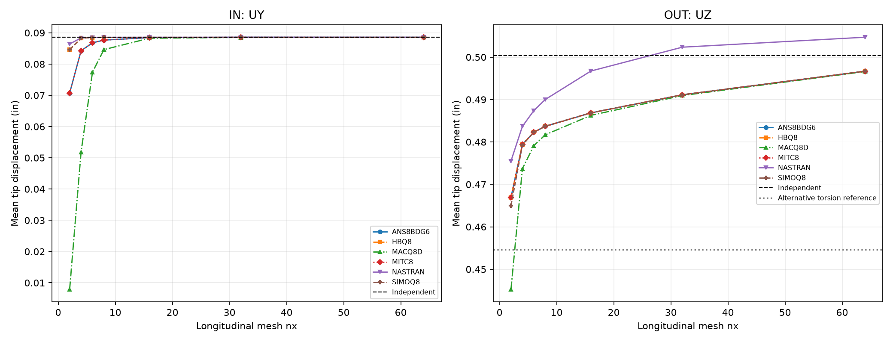

# CSI 2-003 — Curved beam with static loads

Updated 19 October 2026. Existing solver runs only; numerical results come from native OP2.

**Status: Q8 full-clamp results measured and available. T6 old support definition is not the same full-clamp model.**

The quarter-circle beam has inner/outer radii 4.12/4.32 in, thickness 0.1 in, E=10,000,000 psi, nu=0.25. Root corner constraints are SPC123456. Each free-end corner carries +0.5 lb in Y for IN and Z for OUT. The observable is the signed mean of the two physical tip corners.

The original CSI 6×1 thick results are UY=0.0773 in and UZ=0.4298 in. Independent references are 0.0886 and 0.5004 in. CSI also gives an alternative OUT estimate 0.4546 in after a beam/shell torsional-stiffness adjustment; it is shown separately, not selected to minimize error. Existing Q8 meshes are nx=2,4,6,8,16,32,64.

## Measured 6×1 target and finest mesh

| nx | Solver/formulation | Load | Measured (in) | Error primary (%) | Error alternative (%) |
|---|---|---|---|---|---|
| 6 | NASTRAN | IN | 0.08852482 | 0.08485506 | — |
| 6 | NASTRAN | OUT | 0.4873798 | 2.601961 | 7.210688 |
| 6 | SIMOQ8 | IN | 0.08851396 | 0.09710731 | — |
| 6 | SIMOQ8 | OUT | 0.482289 | 3.619304 | 6.090849 |
| 6 | MITC8 | IN | 0.08680153 | 2.029881 | — |
| 6 | MITC8 | OUT | 0.4822907 | 3.618971 | 6.091217 |
| 6 | ANS8BDG6 | IN | 0.08680153 | 2.029881 | — |
| 6 | ANS8BDG6 | OUT | 0.4822907 | 3.618971 | 6.091217 |
| 6 | HBQ8 | IN | 0.08851063 | 0.1008704 | — |
| 6 | HBQ8 | OUT | 0.4822907 | 3.618971 | 6.091217 |
| 6 | MACQ8D | IN | 0.07741049 | 12.62924 | — |
| 6 | MACQ8D | OUT | 0.4791138 | 4.253831 | 5.392396 |
| 64 | NASTRAN | IN | 0.08857301 | 0.03046834 | — |
| 64 | NASTRAN | OUT | 0.5046866 | 0.8566365 | 11.01773 |
| 64 | SIMOQ8 | IN | 0.08855188 | 0.05430852 | — |
| 64 | SIMOQ8 | OUT | 0.4966917 | 0.7410723 | 9.259057 |
| 64 | MITC8 | IN | 0.0885732 | 0.0302497 | — |
| 64 | MITC8 | OUT | 0.4966719 | 0.7450299 | 9.254701 |
| 64 | ANS8BDG6 | IN | 0.0885732 | 0.0302497 | — |
| 64 | ANS8BDG6 | OUT | 0.4966719 | 0.7450299 | 9.254701 |
| 64 | HBQ8 | IN | 0.08855188 | 0.05430852 | — |
| 64 | HBQ8 | OUT | 0.4966719 | 0.7450299 | 9.254701 |
| 64 | MACQ8D | IN | 0.08855064 | 0.05570865 | — |
| 64 | MACQ8D | OUT | 0.4965999 | 0.759404 | 9.238879 |

T6 retained runs use the older SPC1234 root definition. They cannot be joined to the Q8 full-clamp convergence study. No stiffness correction or re-use of a differently constrained run is implied.

## T6 existing outputs, separate SPC1234 model

These raw tip averages are supplied for visibility. They are **not** Q8 full-clamp equivalents; reference errors remain blank. Native Nastran OP2 in this older T6 branch yielded no displacement table in the current extraction (MISSING_OUG), so no Nastran value is invented.

| nx | Formulation | LC | Signed mean tip (in) | Independent error | Status |
|---|---|---|---|---|---|
| 6 | MH6T | 1 | 0.08653679 | — | BC_MISMATCH_SPC1234 |
| 6 | MH6T | 2 | 0.4876741 | — | BC_MISMATCH_SPC1234 |
| 6 | MITC6 | 1 | 0.04071208 | — | BC_MISMATCH_SPC1234 |
| 6 | MITC6 | 2 | 0.4778033 | — | BC_MISMATCH_SPC1234 |
| 6 | REZAIEE | 1 | 0.08797763 | — | BC_MISMATCH_SPC1234 |
| 6 | REZAIEE | 2 | 0.4778033 | — | BC_MISMATCH_SPC1234 |
| 6 | SIMOT6 | 1 | 0.08339882 | — | BC_MISMATCH_SPC1234 |
| 6 | SIMOT6 | 2 | 0.4748761 | — | BC_MISMATCH_SPC1234 |
| 64 | MH6T | 1 | 0.08845656 | — | BC_MISMATCH_SPC1234 |
| 64 | MH6T | 2 | 0.5005932 | — | BC_MISMATCH_SPC1234 |
| 64 | MITC6 | 1 | 0.08850867 | — | BC_MISMATCH_SPC1234 |
| 64 | MITC6 | 2 | 0.4946298 | — | BC_MISMATCH_SPC1234 |
| 64 | REZAIEE | 1 | 0.08859665 | — | BC_MISMATCH_SPC1234 |
| 64 | REZAIEE | 2 | 0.4946298 | — | BC_MISMATCH_SPC1234 |
| 64 | SIMOT6 | 1 | 0.08855405 | — | BC_MISMATCH_SPC1234 |
| 64 | SIMOT6 | 2 | 0.4954607 | — | BC_MISMATCH_SPC1234 |

## Source and reproducibility

[CSI Example 2-003](https://docs.csiamerica.com/manuals/csibridge/Verification/Analysis/Shells/Problem%202-003.pdf). Meshes were generated independently in Python, not exported from SAP2000 S2K. Original DAT and OP2 remain local. No stiffness, loads or constraints were changed for this publication update. Missing measurements are shown as —. Solver agreement alone does not establish independent accuracy.

[Benchmark index](README.md) · [All comparisons](comparison_all.md)
