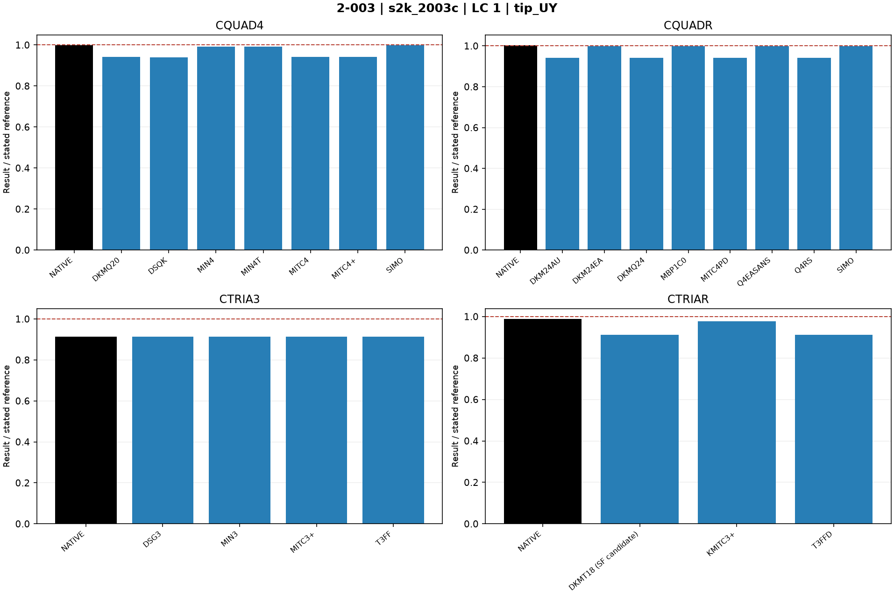
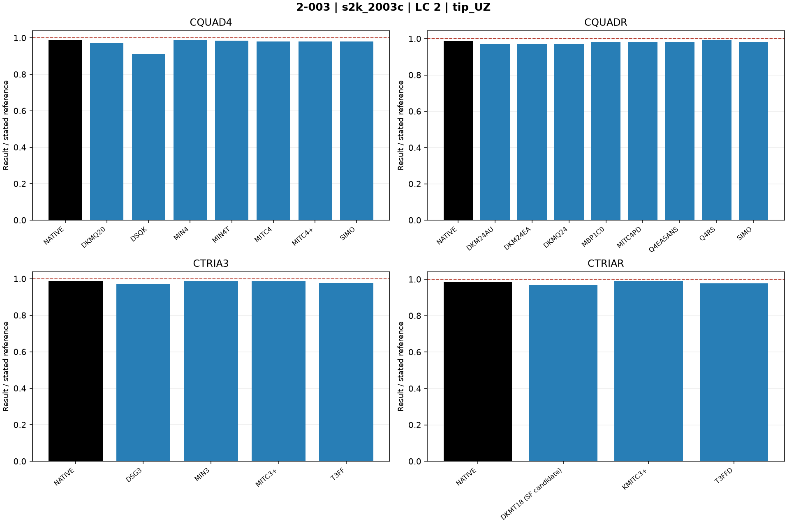
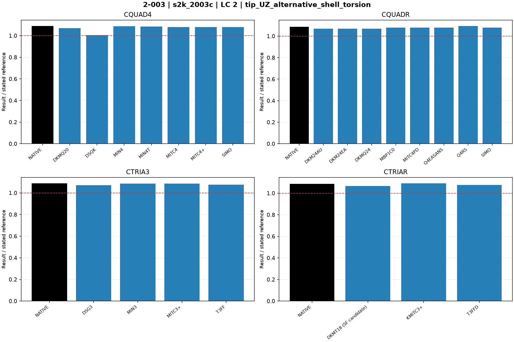

# Linear shells — 2-003: Curved beam: Model C

25 October 2026. Fresh native MYSTRAN and Nastran runs. CQUAD4, CQUADR, CTRIA3 and CTRIAR only.

[All linear comparisons](comparison_all_linear.md) · [Full CSV](comparison_all_linear.csv) · [Tested DAT](DAT/linear_shell_benchmark_DAT.zip) · [Linear publication QA](PUBLICATION_QA_linear.md)

Case IDs retain source-model filenames; actual element and formulation are given by their columns and deck selectors. Two-axis 2-002 tip observables use the two physical corner nodes.

NATIVE means the Nastran result for the corresponding element card: CQUAD4, CQUADR, CTRIA3 or CTRIAR. It does not mean the same proprietary interpolation as a MYSTRAN selector. Curves use independent/analytical references; published SAP2000 values are separate table columns. A completed solve is not a physical-accuracy pass. Zero references use absolute residuals; missing and failed output is never replaced by zero.

The tested source snapshot includes DKMT18 SF as an explicitly labelled candidate and corrected DSG3 local-z Kg. It is documented in [source provenance](data_linear/provenance_linear.json), with a reproducible element-local patch. This benchmark snapshot is not a declaration that SF passed every production-promotion gate. No shared eigensolver prototype is included.

## Model and comparison scope

Only Model C is published: exact imported 90x3 circular-arc mesh. Source SPC1234 roots retained; not relabeled full-clamp. UY=0.0886 in independent; UZ=0.5004 in primary and 0.4546 in alternative shell-torsion estimate. SAP thick C=0.0884/0.4558 in.

## Extraction status

| Solver | Status | Metric rows |
|---|---|---:|
| MYSTRAN | MEASURED | 66 |
| NASTRAN | MEASURED | 12 |

## Figures

### s2k_2003c · LC 1 · tip_UY

### s2k_2003c · LC 2 · tip_UZ

### s2k_2003c · LC 2 · tip_UZ_alternative_shell_torsion

## Finest available mesh per named series

| Case / parent quads | Solver / formulation | LC | Quantity | Measured | Independent / analytical | CSI published | Unit | Error % primary | Absolute residual | Status |
|---|---|---:|---|---:|---:|---:|---|---:|---:|---|
| s2k_2003c / 270 | MYSTRAN CQUAD4_DKMQ20 | 1 | tip_UY | 0.08337293 | 0.0886 | 0.0884 | in | 5.899633 | 0.005227075 | MEASURED |
| s2k_2003c / 270 | MYSTRAN CQUAD4_DSQK | 1 | tip_UY | 0.08334126 | 0.0886 | 0.0884 | in | 5.935378 | 0.005258745 | MEASURED |
| s2k_2003c / 270 | MYSTRAN CQUAD4_MIN4 | 1 | tip_UY | 0.08786146 | 0.0886 | 0.0884 | in | 0.8335722 | 0.000738545 | MEASURED |
| s2k_2003c / 270 | MYSTRAN CQUAD4_MIN4T | 1 | tip_UY | 0.08786146 | 0.0886 | 0.0884 | in | 0.8335722 | 0.000738545 | MEASURED |
| s2k_2003c / 270 | MYSTRAN CQUAD4_MITC4 | 1 | tip_UY | 0.08337304 | 0.0886 | 0.0884 | in | 5.899509 | 0.005226965 | MEASURED |
| s2k_2003c / 270 | MYSTRAN CQUAD4_MITC4plus | 1 | tip_UY | 0.08337304 | 0.0886 | 0.0884 | in | 5.899509 | 0.005226965 | MEASURED |
| s2k_2003c / 270 | MYSTRAN CQUAD4_SIMO | 1 | tip_UY | 0.08851311 | 0.0886 | 0.0884 | in | 0.09807562 | 8.6895e-05 | MEASURED |
| s2k_2003c / 270 | MYSTRAN CQUADR_DKM24AU | 1 | tip_UY | 0.08337293 | 0.0886 | 0.0884 | in | 5.899633 | 0.005227075 | MEASURED |
| s2k_2003c / 270 | MYSTRAN CQUADR_DKM24EA | 1 | tip_UY | 0.08851299 | 0.0886 | 0.0884 | in | 0.09820542 | 8.701e-05 | MEASURED |
| s2k_2003c / 270 | MYSTRAN CQUADR_DKMQ24 | 1 | tip_UY | 0.08337293 | 0.0886 | 0.0884 | in | 5.899633 | 0.005227075 | MEASURED |
| s2k_2003c / 270 | MYSTRAN CQUADR_MBP1C0 | 1 | tip_UY | 0.08851299 | 0.0886 | 0.0884 | in | 0.09820542 | 8.701e-05 | MEASURED |
| s2k_2003c / 270 | MYSTRAN CQUADR_MITC4PD | 1 | tip_UY | 0.08337293 | 0.0886 | 0.0884 | in | 5.899633 | 0.005227075 | MEASURED |
| s2k_2003c / 270 | MYSTRAN CQUADR_Q4EASANS | 1 | tip_UY | 0.08851299 | 0.0886 | 0.0884 | in | 0.09820542 | 8.701e-05 | MEASURED |
| s2k_2003c / 270 | MYSTRAN CQUADR_Q4RS | 1 | tip_UY | 0.08337304 | 0.0886 | 0.0884 | in | 5.899509 | 0.005226965 | MEASURED |
| s2k_2003c / 270 | MYSTRAN CQUADR_SIMO | 1 | tip_UY | 0.08848923 | 0.0886 | 0.0884 | in | 0.1250282 | 0.000110775 | MEASURED |
| s2k_2003c / 270 | MYSTRAN CTRIA3_DSG3 | 1 | tip_UY | 0.08083689 | 0.0886 | 0.0884 | in | 8.76197 | 0.007763105 | MEASURED |
| s2k_2003c / 270 | MYSTRAN CTRIA3_MIN3 | 1 | tip_UY | 0.08083824 | 0.0886 | 0.0884 | in | 8.760457 | 0.007761765 | MEASURED |
| s2k_2003c / 270 | MYSTRAN CTRIA3_MITC3plus | 1 | tip_UY | 0.08082486 | 0.0886 | 0.0884 | in | 8.775559 | 0.007775145 | MEASURED |
| s2k_2003c / 270 | MYSTRAN CTRIA3_T3FF | 1 | tip_UY | 0.08083824 | 0.0886 | 0.0884 | in | 8.760457 | 0.007761765 | MEASURED |
| s2k_2003c / 270 | MYSTRAN CTRIAR_DKMT18 (SF candidate) | 1 | tip_UY | 0.08083824 | 0.0886 | 0.0884 | in | 8.760457 | 0.007761765 | MEASURED |
| s2k_2003c / 270 | MYSTRAN CTRIAR_KMITC3plus | 1 | tip_UY | 0.08665167 | 0.0886 | 0.0884 | in | 2.199024 | 0.001948335 | MEASURED |
| s2k_2003c / 270 | MYSTRAN CTRIAR_T3FFD | 1 | tip_UY | 0.08083824 | 0.0886 | 0.0884 | in | 8.760457 | 0.007761765 | MEASURED |
| s2k_2003c / 270 | NASTRAN CQUAD4_NATIVE | 1 | tip_UY | 0.08851186 | 0.0886 | 0.0884 | in | 0.09948646 | 8.8145e-05 | MEASURED |
| s2k_2003c / 270 | NASTRAN CQUADR_NATIVE | 1 | tip_UY | 0.08892159 | 0.0886 | 0.0884 | in | 0.3629684 | 0.00032159 | MEASURED |
| s2k_2003c / 270 | NASTRAN CTRIA3_NATIVE | 1 | tip_UY | 0.0808352 | 0.0886 | 0.0884 | in | 8.763877 | 0.007764795 | MEASURED |
| s2k_2003c / 270 | NASTRAN CTRIAR_NATIVE | 1 | tip_UY | 0.08757983 | 0.0886 | 0.0884 | in | 1.151439 | 0.001020175 | MEASURED |
| s2k_2003c / 270 | MYSTRAN CQUAD4_DKMQ20 | 2 | tip_UZ | 0.4862863 | 0.5004 | 0.4558 | in | 2.820494 | 0.01411375 | MEASURED |
| s2k_2003c / 270 | MYSTRAN CQUAD4_DSQK | 2 | tip_UZ | 0.457022 | 0.5004 | 0.4558 | in | 8.668675 | 0.04337805 | MEASURED |
| s2k_2003c / 270 | MYSTRAN CQUAD4_MIN4 | 2 | tip_UZ | 0.4941892 | 0.5004 | 0.4558 | in | 1.241177 | 0.00621085 | MEASURED |
| s2k_2003c / 270 | MYSTRAN CQUAD4_MIN4T | 2 | tip_UZ | 0.4933464 | 0.5004 | 0.4558 | in | 1.409592 | 0.0070536 | MEASURED |
| s2k_2003c / 270 | MYSTRAN CQUAD4_MITC4 | 2 | tip_UZ | 0.4907381 | 0.5004 | 0.4558 | in | 1.930825 | 0.00966185 | MEASURED |
| s2k_2003c / 270 | MYSTRAN CQUAD4_MITC4plus | 2 | tip_UZ | 0.4907381 | 0.5004 | 0.4558 | in | 1.930825 | 0.00966185 | MEASURED |
| s2k_2003c / 270 | MYSTRAN CQUAD4_SIMO | 2 | tip_UZ | 0.4907381 | 0.5004 | 0.4558 | in | 1.930825 | 0.00966185 | MEASURED |
| s2k_2003c / 270 | MYSTRAN CQUADR_DKM24AU | 2 | tip_UZ | 0.4862863 | 0.5004 | 0.4558 | in | 2.820494 | 0.01411375 | MEASURED |
| s2k_2003c / 270 | MYSTRAN CQUADR_DKM24EA | 2 | tip_UZ | 0.4862863 | 0.5004 | 0.4558 | in | 2.820494 | 0.01411375 | MEASURED |
| s2k_2003c / 270 | MYSTRAN CQUADR_DKMQ24 | 2 | tip_UZ | 0.4862863 | 0.5004 | 0.4558 | in | 2.820494 | 0.01411375 | MEASURED |
| s2k_2003c / 270 | MYSTRAN CQUADR_MBP1C0 | 2 | tip_UZ | 0.4907381 | 0.5004 | 0.4558 | in | 1.930825 | 0.00966185 | MEASURED |
| s2k_2003c / 270 | MYSTRAN CQUADR_MITC4PD | 2 | tip_UZ | 0.4907381 | 0.5004 | 0.4558 | in | 1.930825 | 0.00966185 | MEASURED |
| s2k_2003c / 270 | MYSTRAN CQUADR_Q4EASANS | 2 | tip_UZ | 0.4907381 | 0.5004 | 0.4558 | in | 1.930825 | 0.00966185 | MEASURED |
| s2k_2003c / 270 | MYSTRAN CQUADR_Q4RS | 2 | tip_UZ | 0.4975968 | 0.5004 | 0.4558 | in | 0.5601819 | 0.00280315 | MEASURED |
| s2k_2003c / 270 | MYSTRAN CQUADR_SIMO | 2 | tip_UZ | 0.4907381 | 0.5004 | 0.4558 | in | 1.930825 | 0.00966185 | MEASURED |
| s2k_2003c / 270 | MYSTRAN CTRIA3_DSG3 | 2 | tip_UZ | 0.4872192 | 0.5004 | 0.4558 | in | 2.634053 | 0.0131808 | MEASURED |
| s2k_2003c / 270 | MYSTRAN CTRIA3_MIN3 | 2 | tip_UZ | 0.4933464 | 0.5004 | 0.4558 | in | 1.409582 | 0.00705355 | MEASURED |
| s2k_2003c / 270 | MYSTRAN CTRIA3_MITC3plus | 2 | tip_UZ | 0.4937396 | 0.5004 | 0.4558 | in | 1.331015 | 0.0066604 | MEASURED |
| s2k_2003c / 270 | MYSTRAN CTRIA3_T3FF | 2 | tip_UZ | 0.4894399 | 0.5004 | 0.4558 | in | 2.190258 | 0.01096005 | MEASURED |
| s2k_2003c / 270 | MYSTRAN CTRIAR_DKMT18 (SF candidate) | 2 | tip_UZ | 0.4843852 | 0.5004 | 0.4558 | in | 3.20041 | 0.01601485 | MEASURED |
| s2k_2003c / 270 | MYSTRAN CTRIAR_KMITC3plus | 2 | tip_UZ | 0.4961415 | 0.5004 | 0.4558 | in | 0.8510092 | 0.00425845 | MEASURED |
| s2k_2003c / 270 | MYSTRAN CTRIAR_T3FFD | 2 | tip_UZ | 0.4894399 | 0.5004 | 0.4558 | in | 2.190258 | 0.01096005 | MEASURED |
| s2k_2003c / 270 | NASTRAN CQUAD4_NATIVE | 2 | tip_UZ | 0.4954054 | 0.5004 | 0.4558 | in | 0.9981215 | 0.0049946 | MEASURED |
| s2k_2003c / 270 | NASTRAN CQUADR_NATIVE | 2 | tip_UZ | 0.4942291 | 0.5004 | 0.4558 | in | 1.233193 | 0.0061709 | MEASURED |
| s2k_2003c / 270 | NASTRAN CTRIA3_NATIVE | 2 | tip_UZ | 0.4948982 | 0.5004 | 0.4558 | in | 1.09948 | 0.0055018 | MEASURED |
| s2k_2003c / 270 | NASTRAN CTRIAR_NATIVE | 2 | tip_UZ | 0.4939091 | 0.5004 | 0.4558 | in | 1.297142 | 0.0064909 | MEASURED |
| s2k_2003c / 270 | MYSTRAN CQUAD4_DKMQ20 | 2 | tip_UZ_alternative_shell_torsion | 0.4862863 | 0.4546 | 0.4558 | in | 6.970139 | 0.03168625 | MEASURED |
| s2k_2003c / 270 | MYSTRAN CQUAD4_DSQK | 2 | tip_UZ_alternative_shell_torsion | 0.457022 | 0.4546 | 0.4558 | in | 0.5327651 | 0.00242195 | MEASURED |
| s2k_2003c / 270 | MYSTRAN CQUAD4_MIN4 | 2 | tip_UZ_alternative_shell_torsion | 0.4941892 | 0.4546 | 0.4558 | in | 8.708568 | 0.03958915 | MEASURED |
| s2k_2003c / 270 | MYSTRAN CQUAD4_MIN4T | 2 | tip_UZ_alternative_shell_torsion | 0.4933464 | 0.4546 | 0.4558 | in | 8.523185 | 0.0387464 | MEASURED |
| s2k_2003c / 270 | MYSTRAN CQUAD4_MITC4 | 2 | tip_UZ_alternative_shell_torsion | 0.4907381 | 0.4546 | 0.4558 | in | 7.949439 | 0.03613815 | MEASURED |
| s2k_2003c / 270 | MYSTRAN CQUAD4_MITC4plus | 2 | tip_UZ_alternative_shell_torsion | 0.4907381 | 0.4546 | 0.4558 | in | 7.949439 | 0.03613815 | MEASURED |
| s2k_2003c / 270 | MYSTRAN CQUAD4_SIMO | 2 | tip_UZ_alternative_shell_torsion | 0.4907381 | 0.4546 | 0.4558 | in | 7.949439 | 0.03613815 | MEASURED |
| s2k_2003c / 270 | MYSTRAN CQUADR_DKM24AU | 2 | tip_UZ_alternative_shell_torsion | 0.4862863 | 0.4546 | 0.4558 | in | 6.970139 | 0.03168625 | MEASURED |
| s2k_2003c / 270 | MYSTRAN CQUADR_DKM24EA | 2 | tip_UZ_alternative_shell_torsion | 0.4862863 | 0.4546 | 0.4558 | in | 6.970139 | 0.03168625 | MEASURED |
| s2k_2003c / 270 | MYSTRAN CQUADR_DKMQ24 | 2 | tip_UZ_alternative_shell_torsion | 0.4862863 | 0.4546 | 0.4558 | in | 6.970139 | 0.03168625 | MEASURED |
| s2k_2003c / 270 | MYSTRAN CQUADR_MBP1C0 | 2 | tip_UZ_alternative_shell_torsion | 0.4907381 | 0.4546 | 0.4558 | in | 7.949439 | 0.03613815 | MEASURED |
| s2k_2003c / 270 | MYSTRAN CQUADR_MITC4PD | 2 | tip_UZ_alternative_shell_torsion | 0.4907381 | 0.4546 | 0.4558 | in | 7.949439 | 0.03613815 | MEASURED |
| s2k_2003c / 270 | MYSTRAN CQUADR_Q4EASANS | 2 | tip_UZ_alternative_shell_torsion | 0.4907381 | 0.4546 | 0.4558 | in | 7.949439 | 0.03613815 | MEASURED |
| s2k_2003c / 270 | MYSTRAN CQUADR_Q4RS | 2 | tip_UZ_alternative_shell_torsion | 0.4975968 | 0.4546 | 0.4558 | in | 9.458172 | 0.04299685 | MEASURED |
| s2k_2003c / 270 | MYSTRAN CQUADR_SIMO | 2 | tip_UZ_alternative_shell_torsion | 0.4907381 | 0.4546 | 0.4558 | in | 7.949439 | 0.03613815 | MEASURED |
| s2k_2003c / 270 | MYSTRAN CTRIA3_DSG3 | 2 | tip_UZ_alternative_shell_torsion | 0.4872192 | 0.4546 | 0.4558 | in | 7.175363 | 0.0326192 | MEASURED |
| s2k_2003c / 270 | MYSTRAN CTRIA3_MIN3 | 2 | tip_UZ_alternative_shell_torsion | 0.4933464 | 0.4546 | 0.4558 | in | 8.523196 | 0.03874645 | MEASURED |
| s2k_2003c / 270 | MYSTRAN CTRIA3_MITC3plus | 2 | tip_UZ_alternative_shell_torsion | 0.4937396 | 0.4546 | 0.4558 | in | 8.609679 | 0.0391396 | MEASURED |
| s2k_2003c / 270 | MYSTRAN CTRIA3_T3FF | 2 | tip_UZ_alternative_shell_torsion | 0.4894399 | 0.4546 | 0.4558 | in | 7.663869 | 0.03483995 | MEASURED |
| s2k_2003c / 270 | MYSTRAN CTRIAR_DKMT18 (SF candidate) | 2 | tip_UZ_alternative_shell_torsion | 0.4843852 | 0.4546 | 0.4558 | in | 6.551947 | 0.02978515 | MEASURED |
| s2k_2003c / 270 | MYSTRAN CTRIAR_KMITC3plus | 2 | tip_UZ_alternative_shell_torsion | 0.4961415 | 0.4546 | 0.4558 | in | 9.138044 | 0.04154155 | MEASURED |
| s2k_2003c / 270 | MYSTRAN CTRIAR_T3FFD | 2 | tip_UZ_alternative_shell_torsion | 0.4894399 | 0.4546 | 0.4558 | in | 7.663869 | 0.03483995 | MEASURED |
| s2k_2003c / 270 | NASTRAN CQUAD4_NATIVE | 2 | tip_UZ_alternative_shell_torsion | 0.4954054 | 0.4546 | 0.4558 | in | 8.976111 | 0.0408054 | MEASURED |
| s2k_2003c / 270 | NASTRAN CQUADR_NATIVE | 2 | tip_UZ_alternative_shell_torsion | 0.4942291 | 0.4546 | 0.4558 | in | 8.717356 | 0.0396291 | MEASURED |
| s2k_2003c / 270 | NASTRAN CTRIA3_NATIVE | 2 | tip_UZ_alternative_shell_torsion | 0.4948982 | 0.4546 | 0.4558 | in | 8.86454 | 0.0402982 | MEASURED |
| s2k_2003c / 270 | NASTRAN CTRIAR_NATIVE | 2 | tip_UZ_alternative_shell_torsion | 0.4939091 | 0.4546 | 0.4558 | in | 8.646964 | 0.0393091 | MEASURED |

All mesh rows, missing fields, hashes and run statuses remain in the CSV.
