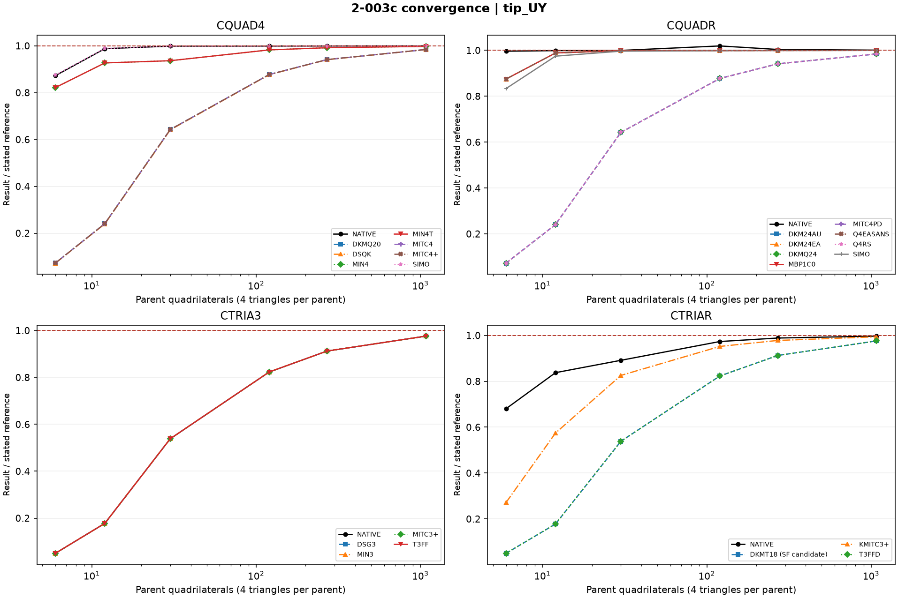
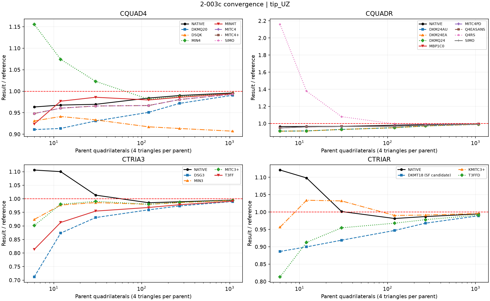
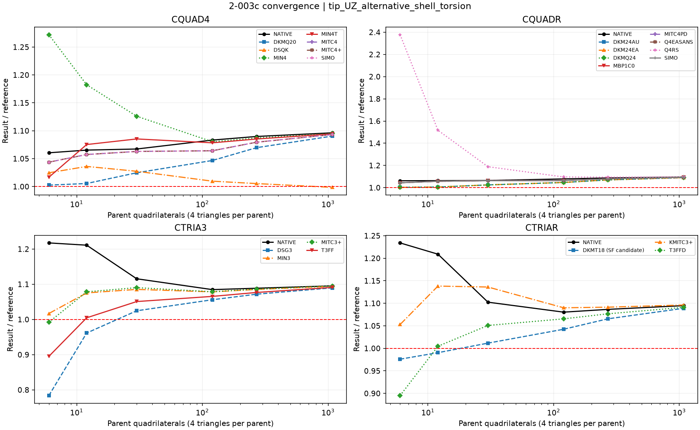

# Linear shells — 2-003c: mesh convergence

Native convergence results with the same tested executable as the October 25 linear suite.

Meshes: 6x1, 12x1, 30x1, 60x2, 90x3, 180x6. This is a combined angular/radial refinement path, not constant-aspect-ratio refinement. Geometry r=4.12..4.32 in, 90-degree arc, t=.1 in, E=1e7 psi, nu=.25. Root DOFs1234 constrained, rotations5/6 free, as in source Model C. Unit tip forces use radial tributary weights; observe the average of the inner and outer physical tip corners.

All 132 MYSTRAN and 24 Nastran runs completed. Nastran needed a local scratch directory and 1GB sequential retry after shared-scratch and memory-allocation failures; no physical deck changes. The generated90x3 reproduces the imported Model C results within 1.014e-7 relative across all26 formulations and three observables.

References: IN=.0886 in; OUT primary=.5004 in; OUT shell-torsion alternative=.4546 in. The two OUT references are distinct. SAP Model C thick=.0884/.4558 in. A curve need not converge to1 against the primary OUT reference because shell torsion and end restraint differ from the hand calculation.

## Reading the two OUT convergence plots

**Both OUT plots use exactly the same computed tip UZ. Only the normalization denominator changes; they are not different solver runs.**

| Plot | Vertical axis | Meaning of the reference |
|---|---|---|
| `tip_UZ` | UZ / 0.5004 in | Original independent beam calculation, using the rectangular-section torsion constant |
| `tip_UZ_alternative_shell_torsion` | UZ / 0.4546 in | The same independent calculation corrected for the shell-theory torsion constant |

The [CSI SAP2000 Problem 2-003 verification PDF](https://docs.csiamerica.com/manuals/sap2000/Verification/Analysis/Shells/Problem%202-003.pdf), in its out-of-plane discussion, explicitly explains this distinction. The beam calculation uses J=0.000045776 in^4, whereas the shell approximation uses J=b*t^3/3. Their ratio is 0.68664. Only the twisting contribution is corrected:

- Original displacement: 0.35414 bending + 0.00010 shear + 0.14619 twisting = approximately **0.5004 in**.
- Shell-torsion adjustment: 0.35414 + 0.00010 + 0.68664*0.14619 = approximately **0.4546 in**.

For **DSQK at 180x6**, the computed UZ is **0.45393135 in** in both plots. Its ratios are **0.907137** against 0.5004 (signed error -9.2863%) and **0.998529** against 0.4546 (signed error -0.1471%). Thus DSQK is close to the shell-torsion reference; its position below one in the original-reference plot does not by itself establish a formulation defect.

The corrected reference is still approximate: CSI also notes a mismatch between the modeled end restraints and the hand calculation. Conversely, closeness to 0.5004 alone does not establish better shell-theory accuracy. The different asymptotes of the other formulations warrant a separate torsional-response investigation; these plots do not establish its cause. Both references remain visible to avoid selecting a target after seeing the results.

### IN displacement: reference 0.0886 in

### OUT displacement: original beam reference 0.5004 in

### Same OUT displacement: shell-torsion reference 0.4546 in

## Finest mesh:180x6

| Formulation | IN UY (in) | IN/reference | OUT UZ (in) | OUT/0.5004 | OUT/0.4546 |
|---|---:|---:|---:|---:|---:|
| CQUAD4_DKMQ20 | 0.0871887 | 0.984071 | 0.4956924 | 0.990592 | 1.090393 |
| CQUAD4_DSQK | 0.08718 | 0.983973 | 0.4539314 | 0.907137 | 0.998529 |
| CQUAD4_MIN4 | 0.08836968 | 0.997400 | 0.4978447 | 0.994893 | 1.095127 |
| CQUAD4_MIN4T | 0.08836968 | 0.997400 | 0.4974966 | 0.994198 | 1.094361 |
| CQUAD4_MITC4 | 0.08718872 | 0.984071 | 0.4969579 | 0.993121 | 1.093176 |
| CQUAD4_MITC4plus | 0.08718872 | 0.984071 | 0.4969579 | 0.993121 | 1.093176 |
| CQUAD4_NATIVE | 0.0885334 | 0.999248 | 0.4983749 | 0.995953 | 1.096293 |
| CQUAD4_SIMO | 0.08853374 | 0.999252 | 0.4969579 | 0.993121 | 1.093176 |
| CQUADR_DKM24AU | 0.0871887 | 0.984071 | 0.4956924 | 0.990592 | 1.090393 |
| CQUADR_DKM24EA | 0.0885337 | 0.999252 | 0.4956924 | 0.990592 | 1.090393 |
| CQUADR_DKMQ24 | 0.0871887 | 0.984071 | 0.4956924 | 0.990592 | 1.090393 |
| CQUADR_MBP1C0 | 0.0885337 | 0.999252 | 0.4969579 | 0.993121 | 1.093176 |
| CQUADR_MITC4PD | 0.0871887 | 0.984071 | 0.4969579 | 0.993121 | 1.093176 |
| CQUADR_NATIVE | 0.08866204 | 1.000700 | 0.4980181 | 0.995240 | 1.095508 |
| CQUADR_Q4EASANS | 0.0885337 | 0.999252 | 0.4969579 | 0.993121 | 1.093176 |
| CQUADR_Q4RS | 0.08718872 | 0.984071 | 0.4987362 | 0.996675 | 1.097088 |
| CQUADR_SIMO | 0.08852773 | 0.999184 | 0.4969579 | 0.993121 | 1.093176 |
| CTRIA3_DSG3 | 0.08647893 | 0.976060 | 0.4953932 | 0.989994 | 1.089734 |
| CTRIA3_MIN3 | 0.08647932 | 0.976065 | 0.4974966 | 0.994198 | 1.094361 |
| CTRIA3_MITC3plus | 0.08647547 | 0.976021 | 0.4977151 | 0.994635 | 1.094842 |
| CTRIA3_NATIVE | 0.08647842 | 0.976054 | 0.4979638 | 0.995131 | 1.095389 |
| CTRIA3_T3FF | 0.08647932 | 0.976065 | 0.4960001 | 0.991207 | 1.091069 |
| CTRIAR_DKMT18 | 0.08647932 | 0.976065 | 0.4949886 | 0.989186 | 1.088844 |
| CTRIAR_KMITC3plus | 0.08806428 | 0.993953 | 0.498324 | 0.995851 | 1.096181 |
| CTRIAR_NATIVE | 0.08832367 | 0.996881 | 0.4976903 | 0.994585 | 1.094787 |
| CTRIAR_T3FFD | 0.08647932 | 0.976065 | 0.4960001 | 0.991207 | 1.091069 |

[All convergence data](comparison_all_linear.zip) · [Run statuses](data_linear/run_status_linear.csv) · [Model audit](data_linear/model_audit.json) · [Source-mesh parity](data_linear/convergence_2003_source_parity.json)
