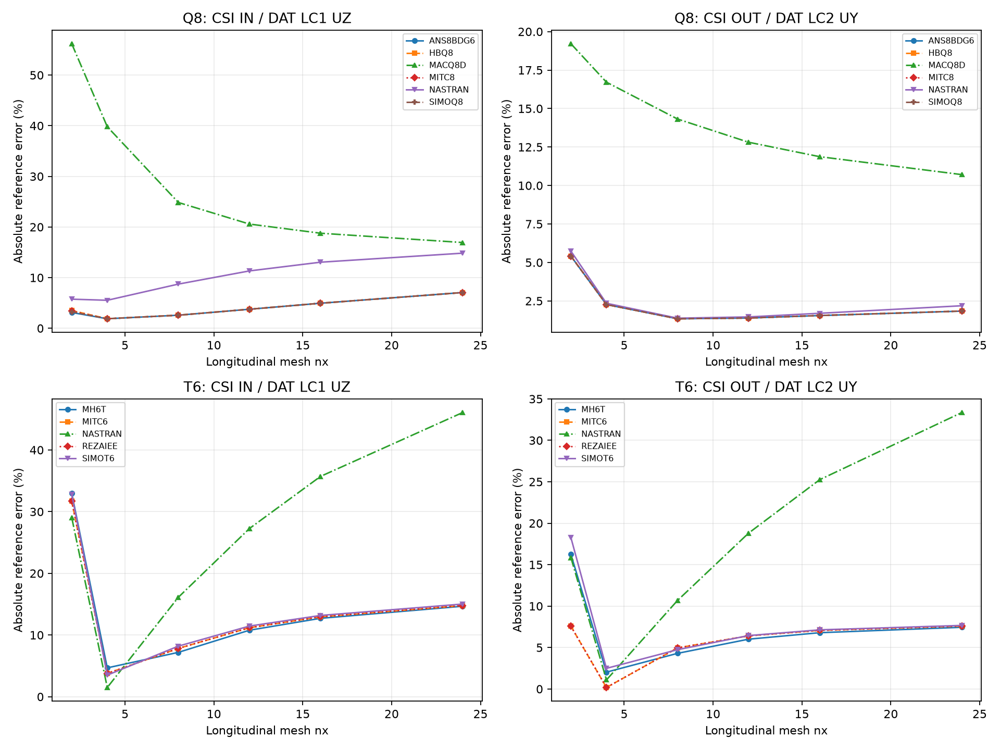

# CSI 2-004 — Twisted beam with static loads

Updated 19 October 2026. Existing solver runs only; numerical results come from native OP2.

**Status: thick-shell displacement convergence re-exported from OP2 at fixed physical tip points.**

Length 12 in, width 1.1 in, thickness 0.32 in, twist 90°, E=29,000,000 psi, nu=0.22. Root is clamped. Each load case distributes unit load over the three physical tip points with weights 0.25, 0.50, 0.25. The response is the unweighted mean displacement of those three points, as in CSI; quadratic midside nodes are not added to that average.

## Coordinate and load-case mapping

The DAT root width is along Y and tip width along Z, whereas CSI draws the root width along Z and tip width along Y. The rigid rotation is X_CSI=X_DAT, Y_CSI=Z_DAT, Z_CSI=−Y_DAT. Thus DAT LC1 +Z corresponds to CSI IN +Y; DAT LC2 +Y corresponds to CSI OUT −Z. Linear-response magnitudes are compared after that explicit sign change. The physical targets in DAT are (12,0,−0.55), (12,0,0), (12,0,+0.55) in, coordinate tolerance 1e-6 in, CD=0.

CSI independent IN/OUT values are 0.005429/0.001749 in. Its thick 12×2 SAP2000 values are 0.005402/0.001760 in. Existing nx=2,4,8,12,16,24; Q8 has 2nx elements, T6 has 4nx triangles. MID3 remains active.

## CSI mesh target nx=12 and finest existing nx=24

| Family | nx | Solver/formulation | CSI branch | Measured magnitude (in) | Error (%) |
|---|---|---|---|---|---|
| Q8 | 12 | ANS8BDG6 | IN | 0.005633152 | 3.760391 |
| Q8 | 12 | ANS8BDG6 | OUT | 0.001773315 | 1.390211 |
| Q8 | 12 | HBQ8 | IN | 0.005633161 | 3.760571 |
| Q8 | 12 | HBQ8 | OUT | 0.001773357 | 1.392645 |
| Q8 | 12 | MACQ8D | IN | 0.004311694 | 20.58032 |
| Q8 | 12 | MACQ8D | OUT | 0.001524923 | 12.81171 |
| Q8 | 12 | MITC8 | IN | 0.005633159 | 3.76052 |
| Q8 | 12 | MITC8 | OUT | 0.001773345 | 1.391935 |
| Q8 | 12 | NASTRAN | IN | 0.006044057 | 11.3291 |
| Q8 | 12 | NASTRAN | OUT | 0.00177458 | 1.462562 |
| Q8 | 12 | SIMOQ8 | IN | 0.00563316 | 3.760537 |
| Q8 | 12 | SIMOQ8 | OUT | 0.00177333 | 1.391096 |
| Q8 | 24 | ANS8BDG6 | IN | 0.005812481 | 7.06357 |
| Q8 | 24 | ANS8BDG6 | OUT | 0.001781178 | 1.839808 |
| Q8 | 24 | HBQ8 | IN | 0.005812483 | 7.063595 |
| Q8 | 24 | HBQ8 | OUT | 0.001781247 | 1.843722 |
| Q8 | 24 | MACQ8D | IN | 0.004509546 | 16.93597 |
| Q8 | 24 | MACQ8D | OUT | 0.001561719 | 10.70787 |
| Q8 | 24 | MITC8 | IN | 0.005812482 | 7.06359 |
| Q8 | 24 | MITC8 | OUT | 0.001781227 | 1.842584 |
| Q8 | 24 | NASTRAN | IN | 0.006234321 | 14.83368 |
| Q8 | 24 | NASTRAN | OUT | 0.001787263 | 2.187694 |
| Q8 | 24 | SIMOQ8 | IN | 0.005812488 | 7.063701 |
| Q8 | 24 | SIMOQ8 | OUT | 0.001781205 | 1.841319 |
| T6 | 12 | MH6T | IN | 0.006014259 | 10.78023 |
| T6 | 12 | MH6T | OUT | 0.00185409 | 6.008584 |
| T6 | 12 | MITC6 | IN | 0.006036301 | 11.18625 |
| T6 | 12 | MITC6 | OUT | 0.001861137 | 6.411492 |
| T6 | 12 | NASTRAN | IN | 0.006909318 | 27.26687 |
| T6 | 12 | NASTRAN | OUT | 0.002077965 | 18.80876 |
| T6 | 12 | REZAIEE | IN | 0.006036301 | 11.18625 |
| T6 | 12 | REZAIEE | OUT | 0.001861137 | 6.411492 |
| T6 | 12 | SIMOT6 | IN | 0.006050781 | 11.45296 |
| T6 | 12 | SIMOT6 | OUT | 0.001861692 | 6.443237 |
| T6 | 24 | MH6T | IN | 0.006225329 | 14.66806 |
| T6 | 24 | MH6T | OUT | 0.001879175 | 7.442818 |
| T6 | 24 | MITC6 | IN | 0.006231294 | 14.77793 |
| T6 | 24 | MITC6 | OUT | 0.001881741 | 7.589523 |
| T6 | 24 | NASTRAN | IN | 0.007930272 | 46.07242 |
| T6 | 24 | NASTRAN | OUT | 0.00233246 | 33.35966 |
| T6 | 24 | REZAIEE | IN | 0.006231294 | 14.77793 |
| T6 | 24 | REZAIEE | OUT | 0.001881741 | 7.589523 |
| T6 | 24 | SIMOT6 | IN | 0.006244585 | 15.02274 |
| T6 | 24 | SIMOT6 | OUT | 0.001883086 | 7.666436 |

DAT physical signatures (GRID, elements, properties, materials, loads and SPC) match across the available solvers/formulations for each individual model. Diagnostic F06 scans found no fatal or excessive-pivot message in these re-exported runs.

## Source and reproducibility

[CSI Example 2-004](https://docs.csiamerica.com/manuals/csibridge/Verification/Analysis/Shells/Problem%202-004.pdf). Meshes were generated independently in Python, not exported from SAP2000 S2K. Original DAT and OP2 remain local. No stiffness, loads or constraints were changed for this publication update. Missing measurements are shown as —. Solver agreement alone does not establish independent accuracy.

[Benchmark index](README.md) · [All comparisons](comparison_all.md)
