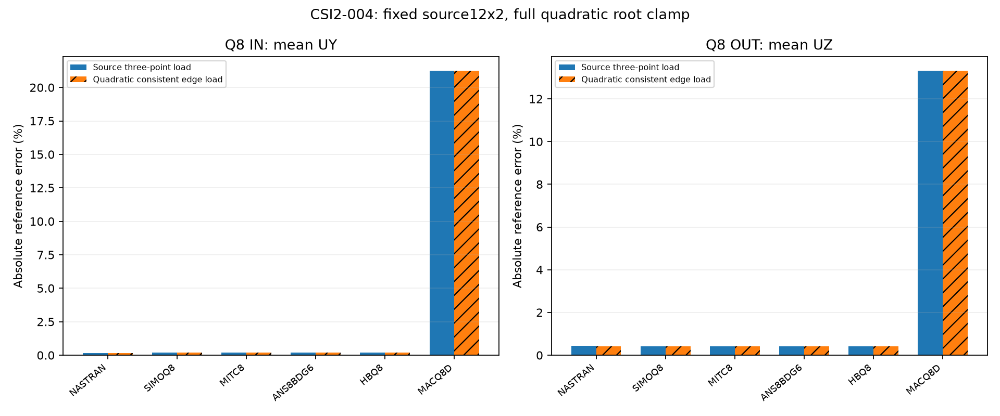
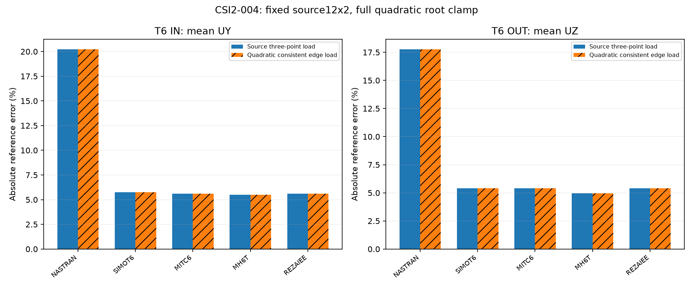

# CSI2-004 — fixed-mesh twisted beam with quadratic root and tip nodes

20 October2026. **No remesh or convergence study.** Source12×2 mesh is retained. Q8 uses24 CQUAD8 /101 nodes. T6 uses48 CTRIA6 /125 nodes, **two triangles per original quad**, on diagonal1–3 as requested. Root corner and midside nodes are fully clamped. Two distinctly labelled tip-load distributions are measured on the same geometry and support.

## Source geometry, material and quadratic enrichment

Engineering source: user-supplied Example2-004-thick.s2k. All39 original joint coordinates and IDs are retained, with24 parent quads. Length12 in, width1.1 in, thickness0.32 in, twist90°, E=29,000,000 psi, nu0.22, G=11,885,245.9016393 psi. Units lb/in. Source section Shell-Thick; PSHELL MID1=MID2=MID3=1, transverse shear factor5/6.

New edge nodes are shared arithmetic midpoints of source edges. They are not moved to a new exact-helix surface. Q8 retains the bilinear geometry defined by its source corners; T6 subdivides a warped source quad into two planar triangles. This is a documented difference in element-surface representation, not equal element counts or an assertion of identical curved geometry. No refinement levels are generated.

At x=0 the five nodes of the full quadratic root edge have SPC123456. Q8 root GRID1/14/27/43/79; T6 root GRID1/14/27/44/92. All GRID CP/CD=0. Original source data and formulation stiffness are unchanged.

## Tip force distribution and midpoint treatment

Source S2K has two separate0.25-lb entries at joint26 per load case. They are summed, not overwritten or deduplicated. The reference source case is FY=0.25/0.50/0.25 lb at13/26/39 for IN, FZ likewise for OUT. These are explicit point forces in the supplied CSI definition.

A separate **quadratic consistent edge-load** interpretation applies a uniform line traction over the same1.1-in tip edge. The five weights, in increasing basic Y, are1/12,1/3,1/6,1/3,1/12 lb. This includes the new midsides while keeping total force1 lb and the same resultant moment. It is an alternative load distribution, not an identical set of three point forces. No extra force is added on top of the original1 lb.

| Tip coordinate Y (in), x=12,z=0 | Source point weight (lb) | Quadratic line weight (lb) |
|---|---:|---:|
|−0.55|0.25|1/12|
|−0.275|0|1/3|
|0|0.50|1/6|
|+0.275|0|1/3|
|+0.55|0.25|1/12|

For both variants, IN uses basic FY with resultant force(0,1,0) lb and moment(0,0,12) lb-in about the origin. OUT uses FZ with force(0,0,1) lb and moment(0,−12,0) lb-in. Native OP2 OLOAD confirms these resultants in every run.

## Fixed physical observation and references

For IN use signed mean basic UY at original joints13,26,39: (12,+0.55,0), (12,0,0), (12,−0.55,0) in. For OUT use signed mean UZ at those same three points. New midsides are loaded in the line-load variant but are not silently added to the CSI three-point observation average.

Independent IN reference0.005429 in, OUT0.001749 in. CSI SAP2000 thick12×2 values are0.005402 and0.001760 in. The supplied hand calculation gives OUT≈0.0017487 in; comparisons use the printed CSI rounded0.001749. No Y/Z rotation is needed for these source-based DAT: source axes and CSI observables agree directly.

## Single-mesh bar comparison

Both datasets have the full root-midpoint clamp. Source-point curves are the direct CSI load-definition comparison. Error bars for the alternative consistent line load use the same independent values as a sensitivity comparison, with the changed distribution explicitly labelled.

## Nastran results

| Family | Load distribution | Case | Measured (in) | Independent (in) | Error (%) |
|---|---|---|---|---|---|
| Q8 | source_point | IN | 0.00542046782 | 0.005429 | 0.157159 |
| Q8 | source_point | OUT | 0.00175651159 | 0.001749 | 0.429479 |
| Q8 | quadratic_line | IN | 0.00542045897 | 0.005429 | 0.157322 |
| Q8 | quadratic_line | OUT | 0.00175646495 | 0.001749 | 0.426812 |
| T6 | source_point | IN | 0.00652788331 | 0.005429 | 20.241 |
| T6 | source_point | OUT | 0.00205992302 | 0.001749 | 17.7772 |
| T6 | quadratic_line | IN | 0.00652787151 | 0.005429 | 20.2408 |
| T6 | quadratic_line | OUT | 0.00205994964 | 0.001749 | 17.7787 |

## All MYSTRAN formulations

| Family | Formulation | Distribution | Case | Measured (in) | Independent (in) | Error (%) |
|---|---|---|---|---|---|---|
| Q8 | SIMOQ8 | source_point | IN | 0.00541859229 | 0.005429 | 0.191706 |
| Q8 | SIMOQ8 | source_point | OUT | 0.00175629719 | 0.001749 | 0.417221 |
| Q8 | MITC8 | source_point | IN | 0.00541859865 | 0.005429 | 0.191589 |
| Q8 | MITC8 | source_point | OUT | 0.00175629836 | 0.001749 | 0.417287 |
| Q8 | ANS8BDG6 | source_point | IN | 0.00541859586 | 0.005429 | 0.19164 |
| Q8 | ANS8BDG6 | source_point | OUT | 0.00175629762 | 0.001749 | 0.417245 |
| Q8 | HBQ8 | source_point | IN | 0.00541859958 | 0.005429 | 0.191572 |
| Q8 | HBQ8 | source_point | OUT | 0.00175629871 | 0.001749 | 0.417307 |
| Q8 | MACQ8D | source_point | IN | 0.00427569263 | 0.005429 | 21.2435 |
| Q8 | MACQ8D | source_point | OUT | 0.00151618337 | 0.001749 | 13.3114 |
| Q8 | SIMOQ8 | quadratic_line | IN | 0.00541858375 | 0.005429 | 0.191863 |
| Q8 | SIMOQ8 | quadratic_line | OUT | 0.00175625664 | 0.001749 | 0.414902 |
| Q8 | MITC8 | quadratic_line | IN | 0.0054185898 | 0.005429 | 0.191752 |
| Q8 | MITC8 | quadratic_line | OUT | 0.0017562578 | 0.001749 | 0.414969 |
| Q8 | ANS8BDG6 | quadratic_line | IN | 0.00541858701 | 0.005429 | 0.191803 |
| Q8 | ANS8BDG6 | quadratic_line | OUT | 0.00175625699 | 0.001749 | 0.414922 |
| Q8 | HBQ8 | quadratic_line | IN | 0.00541859074 | 0.005429 | 0.191734 |
| Q8 | HBQ8 | quadratic_line | OUT | 0.00175625815 | 0.001749 | 0.414989 |
| Q8 | MACQ8D | quadratic_line | IN | 0.00427566096 | 0.005429 | 21.244 |
| Q8 | MACQ8D | quadratic_line | OUT | 0.00151617165 | 0.001749 | 13.3121 |
| T6 | SIMOT6 | source_point | IN | 0.00574045846 | 0.005429 | 5.73694 |
| T6 | SIMOT6 | source_point | OUT | 0.00184371082 | 0.001749 | 5.41514 |
| T6 | MITC6 | source_point | IN | 0.00573430614 | 0.005429 | 5.62362 |
| T6 | MITC6 | source_point | OUT | 0.0018432464 | 0.001749 | 5.38859 |
| T6 | MH6T | source_point | IN | 0.00572797749 | 0.005429 | 5.50705 |
| T6 | MH6T | source_point | OUT | 0.00183581673 | 0.001749 | 4.96379 |
| T6 | REZAIEE | source_point | IN | 0.00573430614 | 0.005429 | 5.62362 |
| T6 | REZAIEE | source_point | OUT | 0.0018432464 | 0.001749 | 5.38859 |
| T6 | SIMOT6 | quadratic_line | IN | 0.0057404465 | 0.005429 | 5.73672 |
| T6 | SIMOT6 | quadratic_line | OUT | 0.00184369277 | 0.001749 | 5.41411 |
| T6 | MITC6 | quadratic_line | IN | 0.00573429434 | 0.005429 | 5.6234 |
| T6 | MITC6 | quadratic_line | OUT | 0.0018432419 | 0.001749 | 5.38833 |
| T6 | MH6T | quadratic_line | IN | 0.00572796554 | 0.005429 | 5.50683 |
| T6 | MH6T | quadratic_line | OUT | 0.00183581328 | 0.001749 | 4.9636 |
| T6 | REZAIEE | quadratic_line | IN | 0.00573429434 | 0.005429 | 5.6234 |
| T6 | REZAIEE | quadratic_line | OUT | 0.0018432419 | 0.001749 | 5.38833 |

## Findings and failure classification

- Q8 Nastran source-point errors are0.157% IN and0.429% OUT. With consistent quadratic edge load they are0.157%/0.427%. Q8 SIMOQ8/MITC8/ANS8BDG6/HBQ8 line-load errors are about0.192% IN and0.415% OUT.
- T6 Nastran two-triangle source-point errors remain20.24% IN and17.78% OUT. The consistent quadratic load gives almost the same response. MYSTRAN T6 line-load errors are about5.51–5.74% IN and4.96–5.41% OUT. These are reported as measured deviations, not hidden or declared passes.
- Midpoint loading changes the primary displacement very little here, so it does not explain the remaining T6 deviation. Warped-quad subdivision, element interpolation and formulation response are separate issues; no stiffness diagnosis is established solely by these displacement data.
- MACQ8D displacement errors for the line-load variant are21.24% IN and13.31% OUT. Its native SPCF output also fails the summed moment-equilibrium audit: maximum moment residual≈8.94484 lb-in, despite force residual below4e−7 lb and correct OLOAD. Classification: **SPCF_OUTPUT_BALANCE_FAIL**. This flags the reaction output; it does not by itself establish an assembled-stiffness defect. No kernel/recovery patch was made for this report.

## Output audit and execution

22 DAT were run:4 Nastran and18 MYSTRAN, two subcases each. All22 OP2 files are readable and finite at every GRID. There are132 signed original-tip observations,44 aggregated results and36 matched Nastran/MYSTRAN quantities. Input hashes remain unchanged; matched physical bulk signatures agree within each family/load distribution. Explicit root SPC residuals are zero. No native observation is missing or converted to zero.

OP2 OLOAD verifies every applied-load distribution and total force/moment. For all formulations except MACQ8D, maximum summed SPCF force/moment residuals are below8e−7 in their respective lb/lb-in units. The MACQ8D output failure remains explicit above. All runs have no fatal or numbered warning message in the diagnostic scan. AUTOSPC is enabled explicitly; no BAILOUT was requested. All four Nastran cases ran successfully through the configured run_nastran.bat without a license failure. Displacements and force audit values are from native OP2; F06 is diagnostic only.

## Reference and reproducibility

[CSI Example2-004](https://docs.csiamerica.com/manuals/csibridge/Verification/Analysis/Shells/Problem%202-004.pdf), supplied screenshots and thick S2K engineering tables. Original source files remain intact. Source program/license metadata, internal Python and raw solver outputs are not published. Prior refinement curves and rotated generated-model results are superseded for the current source-fixed comparison.

## Input archive

[Executed fixed-source Q8/T6 DAT](DAT/CSI_2_004_Q8_T6_FIXED_SOURCE_DAT_20261020.zip):22 inputs, with source-point and consistent-line load variants clearly separated; root midsides clamped in all models. [Complete benchmark DAT archive](DAT/quadratic_shell_benchmark_DAT.zip). No raw outputs or Python.

[Benchmark index](README.md) · [All comparisons](comparison_all.md)
