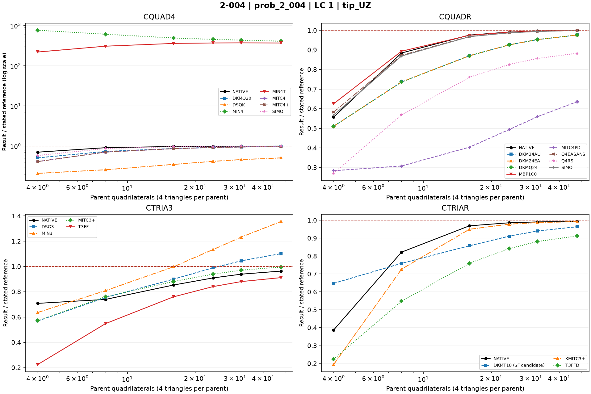
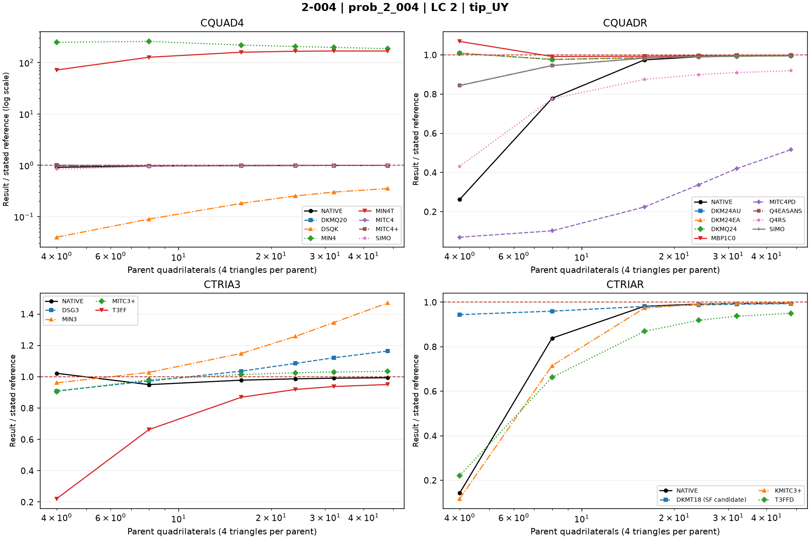
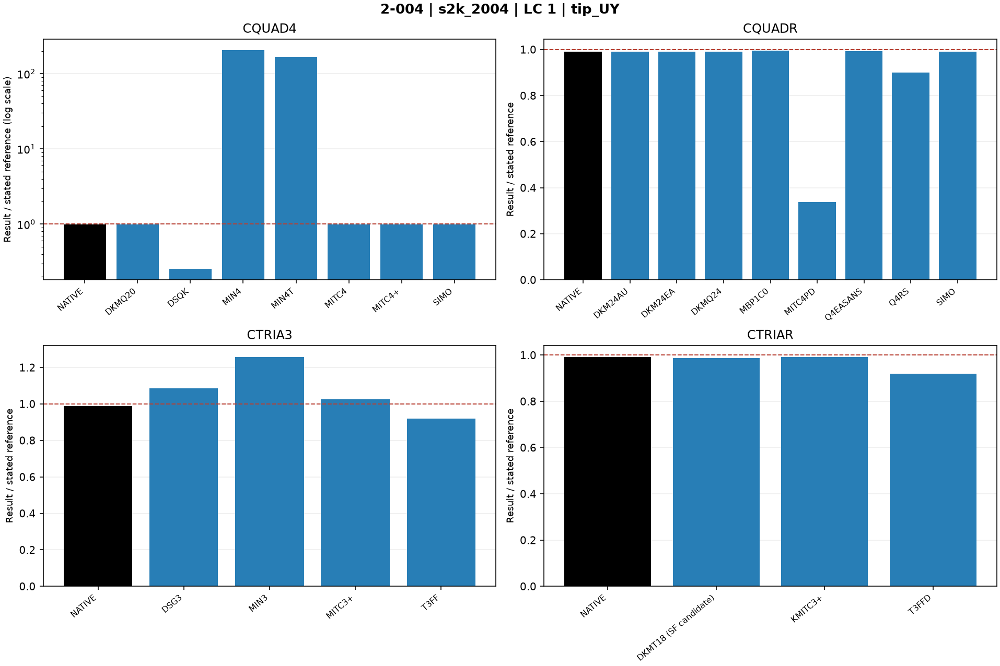
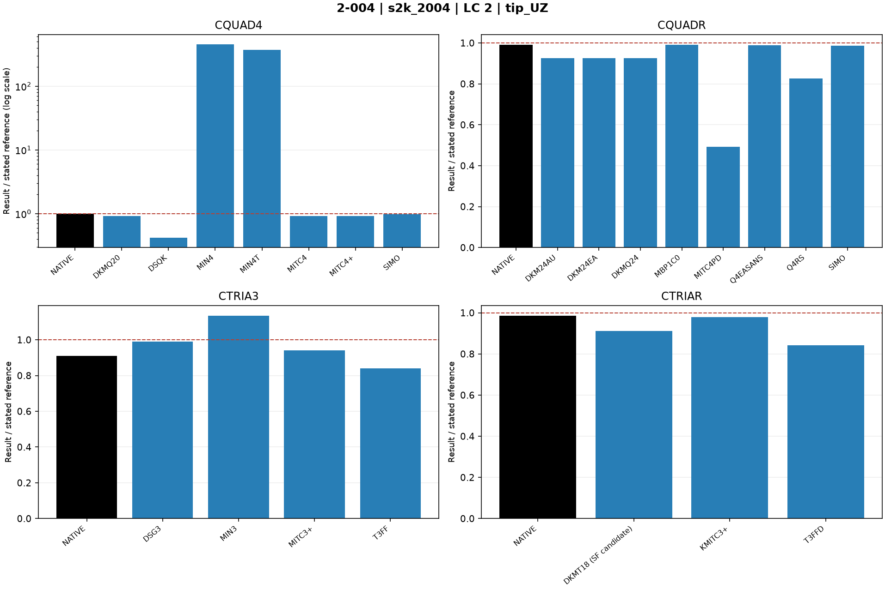

# Linear shells — 2-004: Twisted cantilever beam

25 October 2026. Fresh native MYSTRAN and Nastran runs. CQUAD4, CQUADR, CTRIA3 and CTRIAR only.

[All linear comparisons](comparison_all_linear.md) · [Full ZIP](comparison_all_linear.zip) · [Tested DAT](DAT/linear_shell_benchmark_DAT.zip) · [Linear publication QA](PUBLICATION_QA_linear.md)

Case IDs retain source-model filenames; actual element and formulation are given by their columns and deck selectors. Two-axis 2-002 tip observables use the two physical corner nodes.

NATIVE means the Nastran result for the corresponding element card: CQUAD4, CQUADR, CTRIA3 or CTRIAR. It does not mean the same proprietary interpolation as a MYSTRAN selector. Curves use independent/analytical references; published SAP2000 values are separate table columns. A completed solve is not a physical-accuracy pass. Zero references use absolute residuals; missing and failed output is never replaced by zero.

The tested source snapshot includes DKMT18 SF as an explicitly labelled candidate and corrected DSG3 local-z Kg. It is documented in [source provenance](data_linear/provenance_linear.json), with a reproducible element-local patch. This benchmark snapshot is not a declaration that SF passed every production-promotion gate. No shared eigensolver prototype is included.

## Model and comparison scope

Twisted beam, same physical tip loads and root supports at each axial refinement. Independent UY=0.005429 in, UZ=0.001749 in. Parent width uses two elements.

## Extraction status

| Solver | Status | Metric rows |
|---|---|---:|
| MYSTRAN | MEASURED | 308 |
| NASTRAN | MEASURED | 56 |

## Figures

### prob_2_004 · LC 1 · tip_UZ

### prob_2_004 · LC 2 · tip_UY

### s2k_2004 · LC 1 · tip_UY

### s2k_2004 · LC 2 · tip_UZ

## Finest available mesh per named series

| Case / parent quads | Solver / formulation | LC | Quantity | Measured | Independent / analytical | CSI published | Unit | Error % primary | Absolute residual | Status |
|---|---|---:|---|---:|---:|---:|---|---:|---:|---|
| prob_2_004_nx24_cquadr_simo / 48 | MYSTRAN CQUAD4_DKMQ20 | 2 | tip_UY | 0.005403631 | 0.005429 | — | in | 0.4672807 | 2.536867e-05 | MEASURED |
| prob_2_004_nx24_cquadr_simo / 48 | MYSTRAN CQUAD4_DSQK | 2 | tip_UY | 0.001910535 | 0.005429 | — | in | 64.80871 | 0.003518465 | MEASURED |
| prob_2_004_nx24_cquadr_simo / 48 | MYSTRAN CQUAD4_MIN4 | 2 | tip_UY | 1.014533 | 0.005429 | — | in | 18587.29 | 1.009104 | MEASURED |
| prob_2_004_nx24_cquadr_simo / 48 | MYSTRAN CQUAD4_MIN4T | 2 | tip_UY | 0.9122066 | 0.005429 | — | in | 16702.48 | 0.9067776 | MEASURED |
| prob_2_004_nx24_cquadr_simo / 48 | MYSTRAN CQUAD4_MITC4 | 2 | tip_UY | 0.005406317 | 0.005429 | — | in | 0.4178056 | 2.268267e-05 | MEASURED |
| prob_2_004_nx24_cquadr_simo / 48 | MYSTRAN CQUAD4_MITC4plus | 2 | tip_UY | 0.005407192 | 0.005429 | — | in | 0.4016885 | 2.180767e-05 | MEASURED |
| prob_2_004_nx24_cquadr_simo / 48 | MYSTRAN CQUAD4_SIMO | 2 | tip_UY | 0.005412639 | 0.005429 | — | in | 0.3013569 | 1.636067e-05 | MEASURED |
| prob_2_004_nx24_cquadr_simo / 48 | MYSTRAN CQUADR_DKM24AU | 2 | tip_UY | 0.005403631 | 0.005429 | — | in | 0.4672807 | 2.536867e-05 | MEASURED |
| prob_2_004_nx24_cquadr_simo / 48 | MYSTRAN CQUADR_DKM24EA | 2 | tip_UY | 0.005403631 | 0.005429 | — | in | 0.4672807 | 2.536867e-05 | MEASURED |
| prob_2_004_nx24_cquadr_simo / 48 | MYSTRAN CQUADR_DKMQ24 | 2 | tip_UY | 0.005403631 | 0.005429 | — | in | 0.4672807 | 2.536867e-05 | MEASURED |
| prob_2_004_nx24_cquadr_simo / 48 | MYSTRAN CQUADR_MBP1C0 | 2 | tip_UY | 0.005416093 | 0.005429 | — | in | 0.2377479 | 1.290733e-05 | MEASURED |
| prob_2_004_nx24_cquadr_simo / 48 | MYSTRAN CQUADR_MITC4PD | 2 | tip_UY | 0.002804367 | 0.005429 | — | in | 48.34469 | 0.002624633 | MEASURED |
| prob_2_004_nx24_cquadr_simo / 48 | MYSTRAN CQUADR_Q4EASANS | 2 | tip_UY | 0.005412639 | 0.005429 | — | in | 0.3013569 | 1.636067e-05 | MEASURED |
| prob_2_004_nx24_cquadr_simo / 48 | MYSTRAN CQUADR_Q4RS | 2 | tip_UY | 0.004989889 | 0.005429 | — | in | 8.088242 | 0.0004391107 | MEASURED |
| prob_2_004_nx24_cquadr_simo / 48 | MYSTRAN CQUADR_SIMO | 2 | tip_UY | 0.005412591 | 0.005429 | — | in | 0.3022411 | 1.640867e-05 | MEASURED |
| prob_2_004_nx24_cquadr_simo / 48 | MYSTRAN CTRIA3_DSG3 | 2 | tip_UY | 0.006318737 | 0.005429 | — | in | 16.3886 | 0.000889737 | MEASURED |
| prob_2_004_nx24_cquadr_simo / 48 | MYSTRAN CTRIA3_MIN3 | 2 | tip_UY | 0.007986209 | 0.005429 | — | in | 47.10277 | 0.002557209 | MEASURED |
| prob_2_004_nx24_cquadr_simo / 48 | MYSTRAN CTRIA3_MITC3plus | 2 | tip_UY | 0.005617145 | 0.005429 | — | in | 3.465561 | 0.0001881453 | MEASURED |
| prob_2_004_nx24_cquadr_simo / 48 | MYSTRAN CTRIA3_T3FF | 2 | tip_UY | 0.005159066 | 0.005429 | — | in | 4.972082 | 0.0002699343 | MEASURED |
| prob_2_004_nx24_cquadr_simo / 48 | MYSTRAN CTRIAR_DKMT18 (SF candidate) | 2 | tip_UY | 0.005394614 | 0.005429 | — | in | 0.6333702 | 3.438567e-05 | MEASURED |
| prob_2_004_nx24_cquadr_simo / 48 | MYSTRAN CTRIAR_KMITC3plus | 2 | tip_UY | 0.005411371 | 0.005429 | — | in | 0.324713 | 1.762867e-05 | MEASURED |
| prob_2_004_nx24_cquadr_simo / 48 | MYSTRAN CTRIAR_T3FFD | 2 | tip_UY | 0.005159066 | 0.005429 | — | in | 4.972082 | 0.0002699343 | MEASURED |
| prob_2_004_nx24_cquadr_simo / 48 | NASTRAN CQUAD4_NATIVE | 2 | tip_UY | 0.005407511 | 0.005429 | — | in | 0.3958126 | 2.148867e-05 | MEASURED |
| prob_2_004_nx24_cquadr_simo / 48 | NASTRAN CQUADR_NATIVE | 2 | tip_UY | 0.005407034 | 0.005429 | — | in | 0.4046049 | 2.1966e-05 | MEASURED |
| prob_2_004_nx24_cquadr_simo / 48 | NASTRAN CTRIA3_NATIVE | 2 | tip_UY | 0.005393865 | 0.005429 | — | in | 0.6471665 | 3.513467e-05 | MEASURED |
| prob_2_004_nx24_cquadr_simo / 48 | NASTRAN CTRIAR_NATIVE | 2 | tip_UY | 0.005405563 | 0.005429 | — | in | 0.4317001 | 2.3437e-05 | MEASURED |
| prob_2_004_nx24_cquadr_simo / 48 | MYSTRAN CQUAD4_DKMQ20 | 1 | tip_UZ | 0.00170717 | 0.001749 | — | in | 2.391652 | 4.183e-05 | MEASURED |
| prob_2_004_nx24_cquadr_simo / 48 | MYSTRAN CQUAD4_DSQK | 1 | tip_UZ | 0.0008889924 | 0.001749 | — | in | 49.17139 | 0.0008600076 | MEASURED |
| prob_2_004_nx24_cquadr_simo / 48 | MYSTRAN CQUAD4_MIN4 | 1 | tip_UZ | 0.7156104 | 0.001749 | — | in | 40815.4 | 0.7138614 | MEASURED |
| prob_2_004_nx24_cquadr_simo / 48 | MYSTRAN CQUAD4_MIN4T | 1 | tip_UZ | 0.6466104 | 0.001749 | — | in | 36870.29 | 0.6448614 | MEASURED |
| prob_2_004_nx24_cquadr_simo / 48 | MYSTRAN CQUAD4_MITC4 | 1 | tip_UZ | 0.001706203 | 0.001749 | — | in | 2.44696 | 4.279733e-05 | MEASURED |
| prob_2_004_nx24_cquadr_simo / 48 | MYSTRAN CQUAD4_MITC4plus | 1 | tip_UZ | 0.001707649 | 0.001749 | — | in | 2.364265 | 4.1351e-05 | MEASURED |
| prob_2_004_nx24_cquadr_simo / 48 | MYSTRAN CQUAD4_SIMO | 1 | tip_UZ | 0.001748136 | 0.001749 | — | in | 0.04941872 | 8.643333e-07 | MEASURED |
| prob_2_004_nx24_cquadr_simo / 48 | MYSTRAN CQUADR_DKM24AU | 1 | tip_UZ | 0.00170717 | 0.001749 | — | in | 2.391652 | 4.183e-05 | MEASURED |
| prob_2_004_nx24_cquadr_simo / 48 | MYSTRAN CQUADR_DKM24EA | 1 | tip_UZ | 0.00170717 | 0.001749 | — | in | 2.391652 | 4.183e-05 | MEASURED |
| prob_2_004_nx24_cquadr_simo / 48 | MYSTRAN CQUADR_DKMQ24 | 1 | tip_UZ | 0.00170717 | 0.001749 | — | in | 2.391652 | 4.183e-05 | MEASURED |
| prob_2_004_nx24_cquadr_simo / 48 | MYSTRAN CQUADR_MBP1C0 | 1 | tip_UZ | 0.001749663 | 0.001749 | — | in | 0.03792643 | 6.633333e-07 | MEASURED |
| prob_2_004_nx24_cquadr_simo / 48 | MYSTRAN CQUADR_MITC4PD | 1 | tip_UZ | 0.001111249 | 0.001749 | — | in | 36.46373 | 0.0006377507 | MEASURED |
| prob_2_004_nx24_cquadr_simo / 48 | MYSTRAN CQUADR_Q4EASANS | 1 | tip_UZ | 0.001748135 | 0.001749 | — | in | 0.04947589 | 8.653333e-07 | MEASURED |
| prob_2_004_nx24_cquadr_simo / 48 | MYSTRAN CQUADR_Q4RS | 1 | tip_UZ | 0.0015443 | 0.001749 | — | in | 11.70385 | 0.0002047003 | MEASURED |
| prob_2_004_nx24_cquadr_simo / 48 | MYSTRAN CQUADR_SIMO | 1 | tip_UZ | 0.001747942 | 0.001749 | — | in | 0.06051077 | 1.058333e-06 | MEASURED |
| prob_2_004_nx24_cquadr_simo / 48 | MYSTRAN CTRIA3_DSG3 | 1 | tip_UZ | 0.001926716 | 0.001749 | — | in | 10.16101 | 0.000177716 | MEASURED |
| prob_2_004_nx24_cquadr_simo / 48 | MYSTRAN CTRIA3_MIN3 | 1 | tip_UZ | 0.002372377 | 0.001749 | — | in | 35.64193 | 0.0006233773 | MEASURED |
| prob_2_004_nx24_cquadr_simo / 48 | MYSTRAN CTRIA3_MITC3plus | 1 | tip_UZ | 0.001742189 | 0.001749 | — | in | 0.3894035 | 6.810667e-06 | MEASURED |
| prob_2_004_nx24_cquadr_simo / 48 | MYSTRAN CTRIA3_T3FF | 1 | tip_UZ | 0.001595241 | 0.001749 | — | in | 8.791233 | 0.0001537587 | MEASURED |
| prob_2_004_nx24_cquadr_simo / 48 | MYSTRAN CTRIAR_DKMT18 (SF candidate) | 1 | tip_UZ | 0.001685326 | 0.001749 | — | in | 3.640614 | 6.367433e-05 | MEASURED |
| prob_2_004_nx24_cquadr_simo / 48 | MYSTRAN CTRIAR_KMITC3plus | 1 | tip_UZ | 0.001735368 | 0.001749 | — | in | 0.7794168 | 1.3632e-05 | MEASURED |
| prob_2_004_nx24_cquadr_simo / 48 | MYSTRAN CTRIAR_T3FFD | 1 | tip_UZ | 0.001595241 | 0.001749 | — | in | 8.791233 | 0.0001537587 | MEASURED |
| prob_2_004_nx24_cquadr_simo / 48 | NASTRAN CQUAD4_NATIVE | 1 | tip_UZ | 0.001748232 | 0.001749 | — | in | 0.04392986 | 7.683333e-07 | MEASURED |
| prob_2_004_nx24_cquadr_simo / 48 | NASTRAN CQUADR_NATIVE | 1 | tip_UZ | 0.001749793 | 0.001749 | — | in | 0.04534019 | 7.93e-07 | MEASURED |
| prob_2_004_nx24_cquadr_simo / 48 | NASTRAN CTRIA3_NATIVE | 1 | tip_UZ | 0.001685656 | 0.001749 | — | in | 3.621708 | 6.334367e-05 | MEASURED |
| prob_2_004_nx24_cquadr_simo / 48 | NASTRAN CTRIAR_NATIVE | 1 | tip_UZ | 0.001736926 | 0.001749 | — | in | 0.6903373 | 1.2074e-05 | MEASURED |
| s2k_2004 / 24 | MYSTRAN CQUAD4_DKMQ20 | 1 | tip_UY | 0.005377132 | 0.005429 | 0.005402 | in | 0.9553816 | 5.186767e-05 | MEASURED |
| s2k_2004 / 24 | MYSTRAN CQUAD4_DSQK | 1 | tip_UY | 0.001376953 | 0.005429 | 0.005402 | in | 74.63708 | 0.004052047 | MEASURED |
| s2k_2004 / 24 | MYSTRAN CQUAD4_MIN4 | 1 | tip_UY | 1.11855 | 0.005429 | 0.005402 | in | 20503.24 | 1.113121 | MEASURED |
| s2k_2004 / 24 | MYSTRAN CQUAD4_MIN4T | 1 | tip_UY | 0.9031248 | 0.005429 | 0.005402 | in | 16535.2 | 0.8976958 | MEASURED |
| s2k_2004 / 24 | MYSTRAN CQUAD4_MITC4 | 1 | tip_UY | 0.005379466 | 0.005429 | 0.005402 | in | 0.9123964 | 4.9534e-05 | MEASURED |
| s2k_2004 / 24 | MYSTRAN CQUAD4_MITC4plus | 1 | tip_UY | 0.005380379 | 0.005429 | 0.005402 | in | 0.8955854 | 4.862133e-05 | MEASURED |
| s2k_2004 / 24 | MYSTRAN CQUAD4_SIMO | 1 | tip_UY | 0.005384235 | 0.005429 | 0.005402 | in | 0.8245595 | 4.476533e-05 | MEASURED |
| s2k_2004 / 24 | MYSTRAN CQUADR_DKM24AU | 1 | tip_UY | 0.005377132 | 0.005429 | 0.005402 | in | 0.9553816 | 5.186767e-05 | MEASURED |
| s2k_2004 / 24 | MYSTRAN CQUADR_DKM24EA | 1 | tip_UY | 0.005377132 | 0.005429 | 0.005402 | in | 0.9553816 | 5.186767e-05 | MEASURED |
| s2k_2004 / 24 | MYSTRAN CQUADR_DKMQ24 | 1 | tip_UY | 0.005377132 | 0.005429 | 0.005402 | in | 0.9553816 | 5.186767e-05 | MEASURED |
| s2k_2004 / 24 | MYSTRAN CQUADR_MBP1C0 | 1 | tip_UY | 0.00540477 | 0.005429 | 0.005402 | in | 0.446313 | 2.423033e-05 | MEASURED |
| s2k_2004 / 24 | MYSTRAN CQUADR_MITC4PD | 1 | tip_UY | 0.001830618 | 0.005429 | 0.005402 | in | 66.28075 | 0.003598382 | MEASURED |
| s2k_2004 / 24 | MYSTRAN CQUADR_Q4EASANS | 1 | tip_UY | 0.005384234 | 0.005429 | 0.005402 | in | 0.8245779 | 4.476633e-05 | MEASURED |
| s2k_2004 / 24 | MYSTRAN CQUADR_Q4RS | 1 | tip_UY | 0.004881554 | 0.005429 | 0.005402 | in | 10.08373 | 0.0005474457 | MEASURED |
| s2k_2004 / 24 | MYSTRAN CQUADR_SIMO | 1 | tip_UY | 0.005384047 | 0.005429 | 0.005402 | in | 0.8280223 | 4.495333e-05 | MEASURED |
| s2k_2004 / 24 | MYSTRAN CTRIA3_DSG3 | 1 | tip_UY | 0.005889625 | 0.005429 | 0.005402 | in | 8.484528 | 0.000460625 | MEASURED |
| s2k_2004 / 24 | MYSTRAN CTRIA3_MIN3 | 1 | tip_UY | 0.006826212 | 0.005429 | 0.005402 | in | 25.73608 | 0.001397212 | MEASURED |
| s2k_2004 / 24 | MYSTRAN CTRIA3_MITC3plus | 1 | tip_UY | 0.005565437 | 0.005429 | 0.005402 | in | 2.513115 | 0.000136437 | MEASURED |
| s2k_2004 / 24 | MYSTRAN CTRIA3_T3FF | 1 | tip_UY | 0.004987048 | 0.005429 | 0.005402 | in | 8.140578 | 0.000441952 | MEASURED |
| s2k_2004 / 24 | MYSTRAN CTRIAR_DKMT18 (SF candidate) | 1 | tip_UY | 0.005363033 | 0.005429 | 0.005402 | in | 1.21508 | 6.596667e-05 | MEASURED |
| s2k_2004 / 24 | MYSTRAN CTRIAR_KMITC3plus | 1 | tip_UY | 0.005384236 | 0.005429 | 0.005402 | in | 0.824541 | 4.476433e-05 | MEASURED |
| s2k_2004 / 24 | MYSTRAN CTRIAR_T3FFD | 1 | tip_UY | 0.004987048 | 0.005429 | 0.005402 | in | 8.140578 | 0.000441952 | MEASURED |
| s2k_2004 / 24 | NASTRAN CQUAD4_NATIVE | 1 | tip_UY | 0.005389704 | 0.005429 | 0.005402 | in | 0.7238165 | 3.9296e-05 | MEASURED |
| s2k_2004 / 24 | NASTRAN CQUADR_NATIVE | 1 | tip_UY | 0.005377209 | 0.005429 | 0.005402 | in | 0.9539694 | 5.1791e-05 | MEASURED |
| s2k_2004 / 24 | NASTRAN CTRIA3_NATIVE | 1 | tip_UY | 0.005357193 | 0.005429 | 0.005402 | in | 1.32265 | 7.180667e-05 | MEASURED |
| s2k_2004 / 24 | NASTRAN CTRIAR_NATIVE | 1 | tip_UY | 0.005383901 | 0.005429 | 0.005402 | in | 0.8306993 | 4.509867e-05 | MEASURED |
| s2k_2004 / 24 | MYSTRAN CQUAD4_DKMQ20 | 2 | tip_UZ | 0.001619215 | 0.001749 | 0.00176 | in | 7.420526 | 0.000129785 | MEASURED |
| s2k_2004 / 24 | MYSTRAN CQUAD4_DSQK | 2 | tip_UZ | 0.0007306292 | 0.001749 | 0.00176 | in | 58.22589 | 0.001018371 | MEASURED |
| s2k_2004 / 24 | MYSTRAN CQUAD4_MIN4 | 2 | tip_UZ | 0.7967081 | 0.001749 | 0.00176 | in | 45452.21 | 0.7949591 | MEASURED |
| s2k_2004 / 24 | MYSTRAN CQUAD4_MIN4T | 2 | tip_UZ | 0.6478215 | 0.001749 | 0.00176 | in | 36939.54 | 0.6460725 | MEASURED |
| s2k_2004 / 24 | MYSTRAN CQUAD4_MITC4 | 2 | tip_UZ | 0.00161436 | 0.001749 | 0.00176 | in | 7.698113 | 0.00013464 | MEASURED |
| s2k_2004 / 24 | MYSTRAN CQUAD4_MITC4plus | 2 | tip_UZ | 0.001615508 | 0.001749 | 0.00176 | in | 7.632476 | 0.000133492 | MEASURED |
| s2k_2004 / 24 | MYSTRAN CQUAD4_SIMO | 2 | tip_UZ | 0.001727536 | 0.001749 | 0.00176 | in | 1.227196 | 2.146367e-05 | MEASURED |
| s2k_2004 / 24 | MYSTRAN CQUADR_DKM24AU | 2 | tip_UZ | 0.001619215 | 0.001749 | 0.00176 | in | 7.420526 | 0.000129785 | MEASURED |
| s2k_2004 / 24 | MYSTRAN CQUADR_DKM24EA | 2 | tip_UZ | 0.001619215 | 0.001749 | 0.00176 | in | 7.420526 | 0.000129785 | MEASURED |
| s2k_2004 / 24 | MYSTRAN CQUADR_DKMQ24 | 2 | tip_UZ | 0.001619215 | 0.001749 | 0.00176 | in | 7.420526 | 0.000129785 | MEASURED |
| s2k_2004 / 24 | MYSTRAN CQUADR_MBP1C0 | 2 | tip_UZ | 0.00173262 | 0.001749 | 0.00176 | in | 0.9365542 | 1.638033e-05 | MEASURED |
| s2k_2004 / 24 | MYSTRAN CQUADR_MITC4PD | 2 | tip_UZ | 0.0008624871 | 0.001749 | 0.00176 | in | 50.68684 | 0.0008865129 | MEASURED |
| s2k_2004 / 24 | MYSTRAN CQUADR_Q4EASANS | 2 | tip_UZ | 0.001727532 | 0.001749 | 0.00176 | in | 1.227425 | 2.146767e-05 | MEASURED |
| s2k_2004 / 24 | MYSTRAN CQUADR_Q4RS | 2 | tip_UZ | 0.001444016 | 0.001749 | 0.00176 | in | 17.43762 | 0.000304984 | MEASURED |
| s2k_2004 / 24 | MYSTRAN CQUADR_SIMO | 2 | tip_UZ | 0.001726766 | 0.001749 | 0.00176 | in | 1.271222 | 2.223367e-05 | MEASURED |
| s2k_2004 / 24 | MYSTRAN CTRIA3_DSG3 | 2 | tip_UZ | 0.001730602 | 0.001749 | 0.00176 | in | 1.051915 | 1.8398e-05 | MEASURED |
| s2k_2004 / 24 | MYSTRAN CTRIA3_MIN3 | 2 | tip_UZ | 0.001984443 | 0.001749 | 0.00176 | in | 13.46156 | 0.0002354427 | MEASURED |
| s2k_2004 / 24 | MYSTRAN CTRIA3_MITC3plus | 2 | tip_UZ | 0.001643741 | 0.001749 | 0.00176 | in | 6.01822 | 0.0001052587 | MEASURED |
| s2k_2004 / 24 | MYSTRAN CTRIA3_T3FF | 2 | tip_UZ | 0.001471353 | 0.001749 | 0.00176 | in | 15.87461 | 0.000277647 | MEASURED |
| s2k_2004 / 24 | MYSTRAN CTRIAR_DKMT18 (SF candidate) | 2 | tip_UZ | 0.001593137 | 0.001749 | 0.00176 | in | 8.911569 | 0.0001558633 | MEASURED |
| s2k_2004 / 24 | MYSTRAN CTRIAR_KMITC3plus | 2 | tip_UZ | 0.00171049 | 0.001749 | 0.00176 | in | 2.201849 | 3.851033e-05 | MEASURED |
| s2k_2004 / 24 | MYSTRAN CTRIAR_T3FFD | 2 | tip_UZ | 0.001471353 | 0.001749 | 0.00176 | in | 15.87461 | 0.000277647 | MEASURED |
| s2k_2004 / 24 | NASTRAN CQUAD4_NATIVE | 2 | tip_UZ | 0.00173407 | 0.001749 | 0.00176 | in | 0.8536497 | 1.493033e-05 | MEASURED |
| s2k_2004 / 24 | NASTRAN CQUADR_NATIVE | 2 | tip_UZ | 0.001733871 | 0.001749 | 0.00176 | in | 0.8649895 | 1.512867e-05 | MEASURED |
| s2k_2004 / 24 | NASTRAN CTRIA3_NATIVE | 2 | tip_UZ | 0.001591199 | 0.001749 | 0.00176 | in | 9.022337 | 0.0001578007 | MEASURED |
| s2k_2004 / 24 | NASTRAN CTRIAR_NATIVE | 2 | tip_UZ | 0.001723959 | 0.001749 | 0.00176 | in | 1.431732 | 2.5041e-05 | MEASURED |

All mesh rows, missing fields, hashes and run statuses remain in the CSV.
