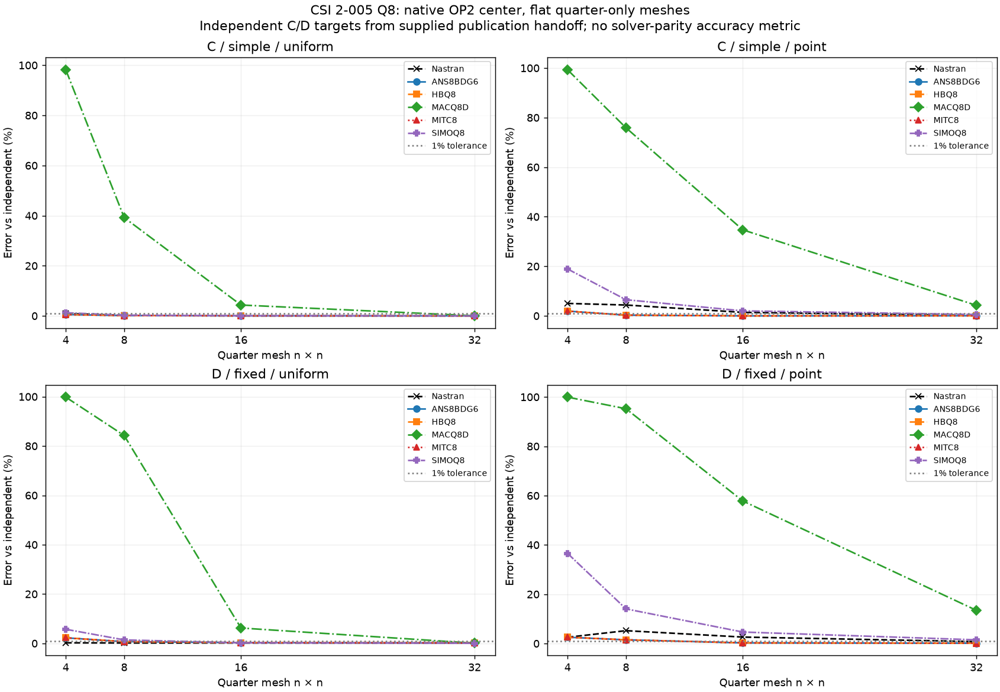
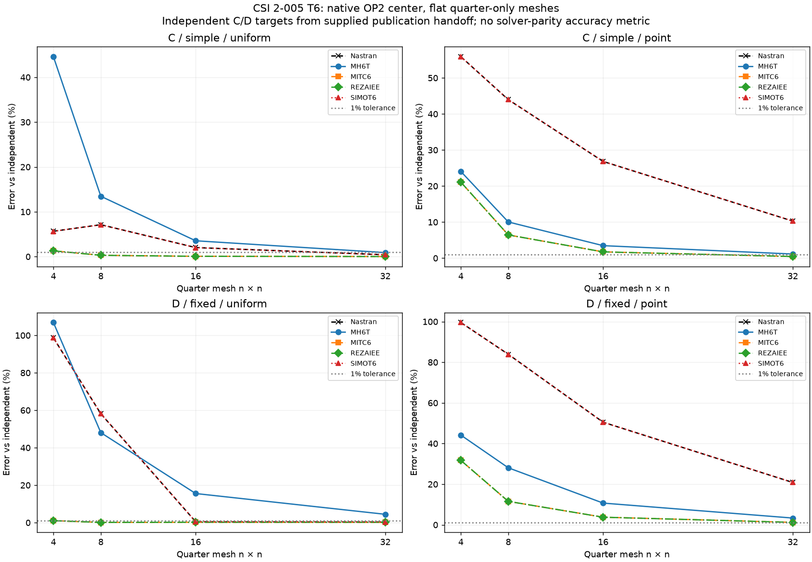

# CSI 2-005 — 2×10 in C/D plate: quarter-only convergence

Independent accuracy compares each solver with the same supplied CSI/analytical observable. Missing references and unverified normalization remain PENDING. Nastran–MYSTRAN differences are not accuracy metrics. Zero references use absolute residuals. Numerical data are retained locally; public tables embed the compared values.

Mesh4/8/16/32; center (0,0,0), GRID1. Quarter extent x=0..1,y=0..5in; E=17472000psi,nu=.3,h=.0001in,MID3=MID2=1. LC1 uniform PLOAD4=-.0001psi,totalFZ=-.0005lb; LC2 centerFORCE=-.0001lb. Identical planar stabilization is documented; UZ/RX/RY physical support unchanged. C=simple, D=fixed. References supplied in this publication handoff: C uniform12.97in,C point16.95in,D uniform2.60in,D point7.25in. Do not reuse old A/B/full-plate probe results.

All72 MYSTRAN and16 Nastran OLOAD distributions agree with analytical consistent loads;88712 pressure-only nodal pairs agree within5.93e-21lb. Displacement/SPC arrays unchanged. The GPFORCE recovery correction does not alter these convergence curves. The observed T6 point-load response difference remains unresolved. BAILOUT/AUTOSPC warnings retained.

| Family | Support | Load | nx | Solver/formulation | abs UZ(in) | Reference(in) | Error(%) |
|---|---|---|---|---|---|---|---|
| Q8 | fixed | uniform | 16 | SIMOQ8 | 2.5940177 | 2.6 | 0.23008677 |
| Q8 | fixed | point | 16 | SIMOQ8 | 6.9122806 | 7.25 | 4.6581992 |
| Q8 | fixed | uniform | 16 | MITC8 | 2.6078613 | 2.6 | 0.30235694 |
| Q8 | fixed | point | 16 | MITC8 | 7.2310143 | 7.25 | 0.26187239 |
| Q8 | fixed | uniform | 16 | ANS8BDG6 | 2.6078613 | 2.6 | 0.30235694 |
| Q8 | fixed | point | 16 | ANS8BDG6 | 7.2310143 | 7.25 | 0.26187239 |
| Q8 | fixed | uniform | 16 | HBQ8 | 2.6078613 | 2.6 | 0.30235694 |
| Q8 | fixed | point | 16 | HBQ8 | 7.2310143 | 7.25 | 0.26187239 |
| Q8 | fixed | uniform | 16 | MACQ8D | 2.7620659 | 2.6 | 6.2333034 |
| Q8 | fixed | point | 16 | MACQ8D | 3.0576336 | 7.25 | 57.825743 |
| Q8 | fixed | uniform | 32 | SIMOQ8 | 2.6016793 | 2.6 | 0.064589427 |
| Q8 | fixed | point | 32 | SIMOQ8 | 7.1414471 | 7.25 | 1.4972818 |
| Q8 | fixed | uniform | 32 | MITC8 | 2.6051304 | 2.6 | 0.19732439 |
| Q8 | fixed | point | 32 | MITC8 | 7.2408843 | 7.25 | 0.12573374 |
| Q8 | fixed | uniform | 32 | ANS8BDG6 | 2.6051304 | 2.6 | 0.19732439 |
| Q8 | fixed | point | 32 | ANS8BDG6 | 7.2408843 | 7.25 | 0.12573374 |
| Q8 | fixed | uniform | 32 | HBQ8 | 2.6051304 | 2.6 | 0.19732439 |
| Q8 | fixed | point | 32 | HBQ8 | 7.2408843 | 7.25 | 0.12573374 |
| Q8 | fixed | uniform | 4 | SIMOQ8 | 2.4512823 | 2.6 | 5.719913 |
| Q8 | fixed | point | 4 | SIMOQ8 | 4.5993662 | 7.25 | 36.560466 |
| Q8 | fixed | uniform | 4 | MITC8 | 2.6585999 | 2.6 | 2.2538405 |
| Q8 | fixed | point | 4 | MITC8 | 7.0646787 | 7.25 | 2.5561563 |
| Q8 | fixed | uniform | 4 | ANS8BDG6 | 2.6585999 | 2.6 | 2.2538405 |
| Q8 | fixed | point | 4 | ANS8BDG6 | 7.0646787 | 7.25 | 2.5561563 |
| Q8 | fixed | uniform | 4 | HBQ8 | 2.6585999 | 2.6 | 2.2538405 |
| Q8 | fixed | point | 4 | HBQ8 | 7.0646787 | 7.25 | 2.5561563 |
| Q8 | fixed | uniform | 4 | MACQ8D | 0.0048306598 | 2.6 | 99.814205 |
| Q8 | fixed | point | 4 | MACQ8D | 0.0040827966 | 7.25 | 99.943686 |
| Q8 | fixed | uniform | 8 | SIMOQ8 | 2.5633862 | 2.6 | 1.408223 |
| Q8 | fixed | point | 8 | SIMOQ8 | 6.2314816 | 7.25 | 14.04853 |
| Q8 | fixed | uniform | 8 | MITC8 | 2.6183331 | 2.6 | 0.70511928 |
| Q8 | fixed | point | 8 | MITC8 | 7.1410685 | 7.25 | 1.502504 |
| Q8 | fixed | uniform | 32 | MACQ8D | 2.6019025 | 2.6 | 0.073172496 |
| Q8 | fixed | point | 32 | MACQ8D | 6.2733207 | 7.25 | 13.471439 |
| Q8 | fixed | uniform | 8 | ANS8BDG6 | 2.6183331 | 2.6 | 0.70511928 |
| Q8 | fixed | point | 8 | ANS8BDG6 | 7.1410685 | 7.25 | 1.502504 |
| Q8 | fixed | uniform | 8 | HBQ8 | 2.6183331 | 2.6 | 0.70511928 |
| Q8 | fixed | point | 8 | HBQ8 | 7.1410685 | 7.25 | 1.502504 |
| Q8 | fixed | uniform | 8 | MACQ8D | 0.40920991 | 2.6 | 84.261157 |
| Q8 | fixed | point | 8 | MACQ8D | 0.34540769 | 7.25 | 95.235756 |
| Q8 | simple | uniform | 16 | SIMOQ8 | 12.960687 | 12.97 | 0.071806603 |
| Q8 | simple | point | 16 | SIMOQ8 | 16.608097 | 16.95 | 2.0171264 |
| Q8 | simple | uniform | 16 | MITC8 | 12.974691 | 12.97 | 0.036171095 |
| Q8 | simple | point | 16 | MITC8 | 16.950802 | 16.95 | 0.0047306747 |
| Q8 | simple | uniform | 16 | ANS8BDG6 | 12.974691 | 12.97 | 0.036171095 |
| Q8 | simple | point | 16 | ANS8BDG6 | 16.950802 | 16.95 | 0.0047306747 |
| Q8 | simple | uniform | 16 | HBQ8 | 12.974691 | 12.97 | 0.036171095 |
| Q8 | simple | point | 16 | HBQ8 | 16.950802 | 16.95 | 0.0047306747 |
| Q8 | simple | uniform | 16 | MACQ8D | 13.532804 | 12.97 | 4.339279 |
| Q8 | simple | point | 16 | MACQ8D | 11.064429 | 16.95 | 34.723131 |
| Q8 | simple | uniform | 32 | SIMOQ8 | 12.968393 | 12.97 | 0.012387619 |
| Q8 | simple | point | 32 | SIMOQ8 | 16.854561 | 16.95 | 0.56306282 |
| Q8 | simple | uniform | 32 | MITC8 | 12.971715 | 12.97 | 0.013222617 |
| Q8 | simple | point | 32 | MITC8 | 16.959122 | 16.95 | 0.053815363 |
| Q8 | simple | uniform | 32 | ANS8BDG6 | 12.971715 | 12.97 | 0.013222617 |
| Q8 | simple | point | 32 | ANS8BDG6 | 16.959122 | 16.95 | 0.053815363 |
| Q8 | simple | uniform | 32 | HBQ8 | 12.971715 | 12.97 | 0.013222617 |
| Q8 | simple | point | 32 | HBQ8 | 16.959122 | 16.95 | 0.053815363 |
| Q8 | simple | uniform | 4 | SIMOQ8 | 12.807607 | 12.97 | 1.2520686 |
| Q8 | simple | point | 4 | SIMOQ8 | 13.742605 | 16.95 | 18.922683 |
| Q8 | simple | uniform | 4 | MITC8 | 13.040395 | 12.97 | 0.54275083 |
| Q8 | simple | point | 4 | MITC8 | 16.62336 | 16.95 | 1.9270815 |
| Q8 | simple | uniform | 4 | ANS8BDG6 | 13.040395 | 12.97 | 0.54275083 |
| Q8 | simple | point | 4 | ANS8BDG6 | 16.62336 | 16.95 | 1.9270815 |
| Q8 | simple | uniform | 4 | HBQ8 | 13.040395 | 12.97 | 0.54275083 |
| Q8 | simple | point | 4 | HBQ8 | 16.62336 | 16.95 | 1.9270815 |
| Q8 | simple | uniform | 4 | MACQ8D | 0.23528598 | 12.97 | 98.185921 |
| Q8 | simple | point | 4 | MACQ8D | 0.11906265 | 16.95 | 99.297565 |
| Q8 | simple | uniform | 8 | SIMOQ8 | 12.930216 | 12.97 | 0.3067399 |
| Q8 | simple | point | 8 | SIMOQ8 | 15.84516 | 16.95 | 6.5182272 |
| Q8 | simple | uniform | 8 | MITC8 | 12.986745 | 12.97 | 0.12910471 |
| Q8 | simple | point | 8 | MITC8 | 16.900743 | 16.95 | 0.29059891 |
| Q8 | simple | uniform | 8 | ANS8BDG6 | 12.986745 | 12.97 | 0.12910471 |
| Q8 | simple | point | 8 | ANS8BDG6 | 16.900743 | 16.95 | 0.29059891 |
| Q8 | simple | uniform | 32 | MACQ8D | 12.977092 | 12.97 | 0.054678406 |
| Q8 | simple | point | 32 | MACQ8D | 16.230137 | 16.95 | 4.2469801 |
| Q8 | simple | uniform | 8 | HBQ8 | 12.986745 | 12.97 | 0.12910471 |
| Q8 | simple | point | 8 | HBQ8 | 16.900743 | 16.95 | 0.29059891 |
| Q8 | simple | uniform | 8 | MACQ8D | 7.8830423 | 12.97 | 39.220953 |
| Q8 | simple | point | 8 | MACQ8D | 4.0857749 | 16.95 | 75.895133 |
| Q8 | fixed | point | 16 | Nastran | 7.0600986 | 7.25 | 2.619329 |
| Q8 | fixed | point | 32 | Nastran | 7.1938906 | 7.25 | 0.77392315 |
| Q8 | fixed | point | 4 | Nastran | 7.0657158 | 7.25 | 2.5418512 |
| Q8 | fixed | point | 8 | Nastran | 6.8719487 | 7.25 | 5.2145004 |
| Q8 | fixed | uniform | 16 | Nastran | 2.6045098 | 2.6 | 0.17345502 |
| Q8 | fixed | uniform | 32 | Nastran | 2.6044865 | 2.6 | 0.17255636 |
| Q8 | fixed | uniform | 4 | Nastran | 2.6060278 | 2.6 | 0.23184006 |
| Q8 | fixed | uniform | 8 | Nastran | 2.6044426 | 2.6 | 0.17086909 |
| Q8 | simple | point | 16 | Nastran | 16.711115 | 16.95 | 1.4093517 |
| Q8 | simple | point | 32 | Nastran | 16.919931 | 16.95 | 0.1773958 |
| Q8 | simple | point | 4 | Nastran | 16.098186 | 16.95 | 5.0254484 |
| Q8 | simple | point | 8 | Nastran | 16.207386 | 16.95 | 4.3812034 |
| Q8 | simple | uniform | 16 | Nastran | 12.974521 | 12.97 | 0.034854921 |
| Q8 | simple | uniform | 32 | Nastran | 12.972214 | 12.97 | 0.017068197 |
| Q8 | simple | uniform | 4 | Nastran | 13.094271 | 12.97 | 0.9581396 |
| Q8 | simple | uniform | 8 | Nastran | 12.997272 | 12.97 | 0.21027364 |
| T6 | fixed | uniform | 16 | SIMOT6 | 2.5868945 | 2.6 | 0.50405722 |
| T6 | fixed | point | 16 | SIMOT6 | 3.5887005 | 7.25 | 50.500682 |
| T6 | fixed | uniform | 16 | MITC6 | 2.605557 | 2.6 | 0.21372942 |
| T6 | fixed | point | 16 | MITC6 | 6.9774208 | 7.25 | 3.759713 |
| T6 | fixed | uniform | 16 | MH6T | 3.0042348 | 2.6 | 15.547492 |
| T6 | fixed | point | 16 | MH6T | 8.025775 | 7.25 | 10.700344 |
| T6 | fixed | uniform | 16 | REZAIEE | 2.605557 | 2.6 | 0.21372942 |
| T6 | fixed | point | 16 | REZAIEE | 6.9774208 | 7.25 | 3.759713 |
| T6 | fixed | uniform | 32 | SIMOT6 | 2.6084027 | 2.6 | 0.32318189 |
| T6 | fixed | point | 32 | SIMOT6 | 5.7377381 | 7.25 | 20.858784 |
| T6 | fixed | uniform | 32 | MITC6 | 2.6048419 | 2.6 | 0.18622875 |
| T6 | fixed | point | 32 | MITC6 | 7.1625061 | 7.25 | 1.2068124 |
| T6 | fixed | uniform | 32 | MH6T | 2.7157393 | 2.6 | 4.4515096 |
| T6 | fixed | point | 32 | MH6T | 7.4919972 | 7.25 | 3.337893 |
| T6 | fixed | uniform | 32 | REZAIEE | 2.6048419 | 2.6 | 0.18622875 |
| T6 | fixed | point | 32 | REZAIEE | 7.1625061 | 7.25 | 1.2068124 |
| T6 | fixed | uniform | 4 | SIMOT6 | 0.034441561 | 2.6 | 98.675325 |
| T6 | fixed | point | 4 | SIMOT6 | 0.032528836 | 7.25 | 99.551326 |
| T6 | fixed | uniform | 4 | MITC6 | 2.5723968 | 2.6 | 1.0616633 |
| T6 | fixed | point | 4 | MITC6 | 4.9514575 | 7.25 | 31.704034 |
| T6 | fixed | uniform | 4 | MH6T | 5.3779855 | 2.6 | 106.8456 |
| T6 | fixed | point | 4 | MH6T | 10.451107 | 7.25 | 44.1532 |
| T6 | fixed | uniform | 4 | REZAIEE | 2.5723968 | 2.6 | 1.0616633 |
| T6 | fixed | point | 4 | REZAIEE | 4.9514575 | 7.25 | 31.704034 |
| T6 | fixed | uniform | 8 | SIMOT6 | 1.0881875 | 2.6 | 58.146636 |
| T6 | fixed | point | 8 | SIMOT6 | 1.1651167 | 7.25 | 83.929425 |
| T6 | fixed | uniform | 8 | MITC6 | 2.6035967 | 2.6 | 0.13833413 |
| T6 | fixed | point | 8 | MITC6 | 6.4124742 | 7.25 | 11.552081 |
| T6 | fixed | uniform | 8 | MH6T | 3.849396 | 2.6 | 48.053692 |
| T6 | fixed | point | 8 | MH6T | 9.2852602 | 7.25 | 28.072554 |
| T6 | fixed | uniform | 8 | REZAIEE | 2.6035967 | 2.6 | 0.13833413 |
| T6 | fixed | point | 8 | REZAIEE | 6.4124742 | 7.25 | 11.552081 |
| T6 | simple | uniform | 16 | SIMOT6 | 13.230814 | 12.97 | 2.0109019 |
| T6 | simple | point | 16 | SIMOT6 | 12.401636 | 16.95 | 26.834005 |
| T6 | simple | uniform | 16 | MITC6 | 12.979735 | 12.97 | 0.075060713 |
| T6 | simple | point | 16 | MITC6 | 16.65617 | 16.95 | 1.733511 |
| T6 | simple | uniform | 16 | MH6T | 13.428687 | 12.97 | 3.5365235 |
| T6 | simple | point | 16 | MH6T | 17.536711 | 16.95 | 3.4614203 |
| T6 | simple | uniform | 16 | REZAIEE | 12.979735 | 12.97 | 0.075060713 |
| T6 | simple | point | 16 | REZAIEE | 16.65617 | 16.95 | 1.733511 |
| T6 | simple | uniform | 32 | SIMOT6 | 13.022655 | 12.97 | 0.40597173 |
| T6 | simple | point | 32 | SIMOT6 | 15.206922 | 16.95 | 10.283649 |
| T6 | simple | uniform | 32 | MITC6 | 12.97311 | 12.97 | 0.023979946 |
| T6 | simple | point | 32 | MITC6 | 16.874557 | 16.95 | 0.44508852 |
| T6 | simple | uniform | 32 | MH6T | 13.086784 | 12.97 | 0.90041914 |
| T6 | simple | point | 32 | MH6T | 17.142673 | 16.95 | 1.1367168 |
| T6 | simple | uniform | 4 | SIMOT6 | 13.702648 | 12.97 | 5.6487908 |
| T6 | simple | point | 4 | SIMOT6 | 7.4757433 | 16.95 | 55.89532 |
| T6 | simple | uniform | 32 | REZAIEE | 12.97311 | 12.97 | 0.023979946 |
| T6 | simple | point | 32 | REZAIEE | 16.874557 | 16.95 | 0.44508852 |
| T6 | simple | uniform | 4 | MITC6 | 13.137794 | 12.97 | 1.293705 |
| T6 | simple | point | 4 | MITC6 | 13.37606 | 16.95 | 21.085195 |
| T6 | simple | uniform | 4 | MH6T | 18.754143 | 12.97 | 44.59632 |
| T6 | simple | point | 4 | MH6T | 21.025267 | 16.95 | 24.042871 |
| T6 | simple | uniform | 4 | REZAIEE | 13.137794 | 12.97 | 1.293705 |
| T6 | simple | point | 4 | REZAIEE | 13.37606 | 16.95 | 21.085195 |
| T6 | simple | uniform | 8 | SIMOT6 | 13.892323 | 12.97 | 7.1112066 |
| T6 | simple | point | 8 | SIMOT6 | 9.4946995 | 16.95 | 43.984074 |
| T6 | simple | uniform | 8 | MITC6 | 13.008797 | 12.97 | 0.29912638 |
| T6 | simple | point | 8 | MITC6 | 15.858779 | 16.95 | 6.4378823 |
| T6 | simple | uniform | 8 | MH6T | 14.715933 | 12.97 | 13.461317 |
| T6 | simple | point | 8 | MH6T | 18.651503 | 16.95 | 10.038363 |
| T6 | simple | uniform | 8 | REZAIEE | 13.008797 | 12.97 | 0.29912638 |
| T6 | simple | point | 8 | REZAIEE | 15.858779 | 16.95 | 6.4378823 |
| T6 | fixed | point | 16 | Nastran | 3.5891111 | 7.25 | 50.495019 |
| T6 | fixed | point | 32 | Nastran | 5.7383895 | 7.25 | 20.8498 |
| T6 | fixed | point | 4 | Nastran | 0.032532562 | 7.25 | 99.551275 |
| T6 | fixed | point | 8 | Nastran | 1.1652499 | 7.25 | 83.927587 |
| T6 | fixed | uniform | 16 | Nastran | 2.5871904 | 2.6 | 0.49267732 |
| T6 | fixed | uniform | 32 | Nastran | 2.6086984 | 2.6 | 0.33455262 |
| T6 | fixed | uniform | 4 | Nastran | 0.034445502 | 2.6 | 98.675173 |
| T6 | fixed | uniform | 8 | Nastran | 1.088312 | 2.6 | 58.141845 |
| T6 | simple | point | 16 | Nastran | 12.403057 | 16.95 | 26.825622 |
| T6 | simple | point | 32 | Nastran | 15.208594 | 16.95 | 10.27378 |
| T6 | simple | point | 4 | Nastran | 7.4765959 | 16.95 | 55.89029 |
| T6 | simple | point | 8 | Nastran | 9.4957857 | 16.95 | 43.977665 |
| T6 | simple | uniform | 16 | Nastran | 13.232331 | 12.97 | 2.0226004 |
| T6 | simple | uniform | 32 | Nastran | 13.024056 | 12.97 | 0.41678053 |
| T6 | simple | uniform | 4 | Nastran | 13.704211 | 12.97 | 5.6608422 |
| T6 | simple | uniform | 8 | Nastran | 13.893911 | 12.97 | 7.1234492 |

## Figures

[Benchmark index](README.md) · [Audited input DAT archive](DAT/quadratic_shell_benchmark_DAT.zip)
