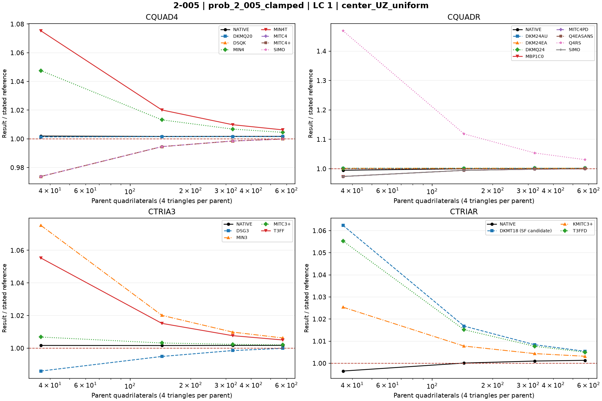
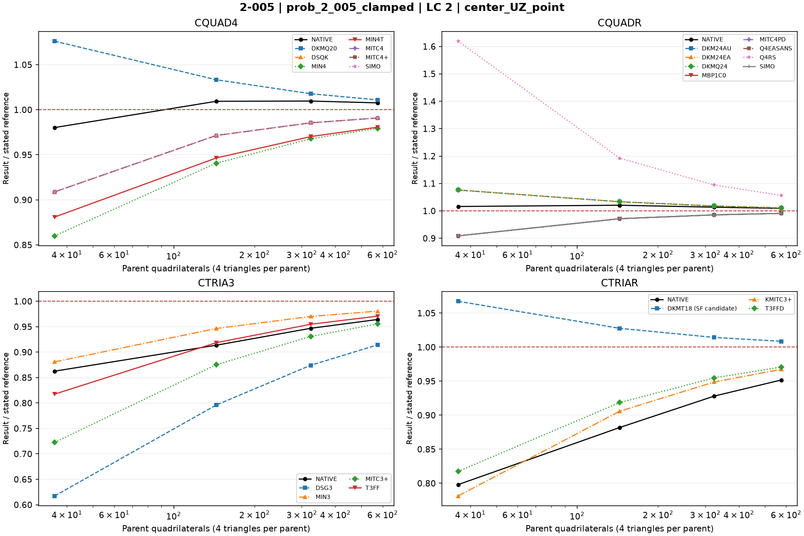
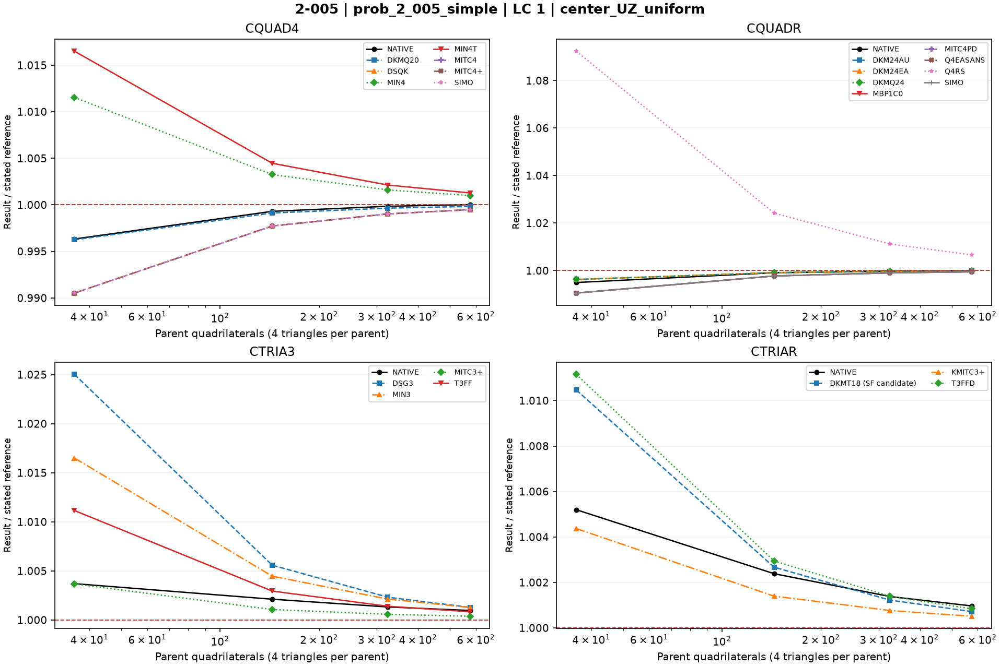
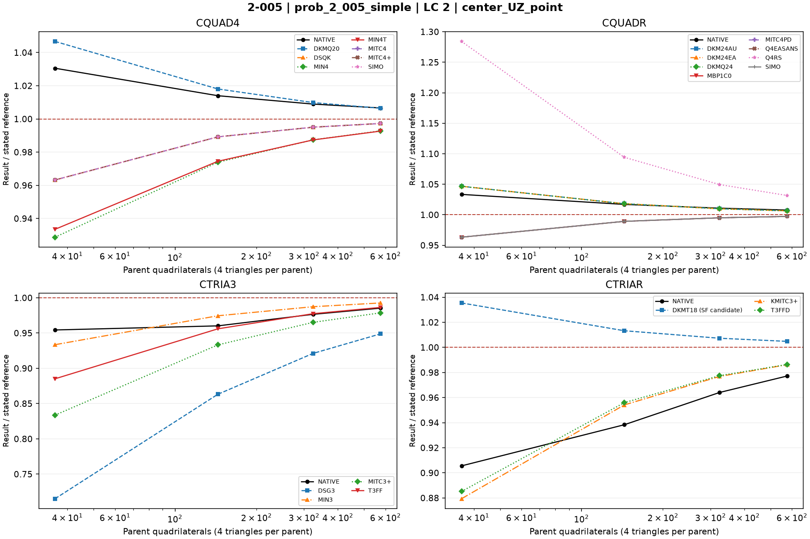

# Linear shells — 2-005: 2 x 10 plate: simple and clamped

27 October 2026 rebenchmark: all MYSTRAN entries were rerun using the rebuilt mixed-hybrid DSQK binary. Nastran entries retain previous outputs for unchanged decks. Default residual acceptance remains 1e-6. See [rebenchmark report](../Linear_Shell_Rebenchmark_20261027.md).

Historical baseline: 25 October 2026; MYSTRAN refreshed 27 October, Nastran retained. CQUAD4, CQUADR, CTRIA3 and CTRIAR only.

[All linear comparisons](comparison_all_linear.md) · [Full ZIP](comparison_all_linear.zip) · [Tested DAT](DAT/linear_shell_benchmark_DAT.zip) · [Linear publication QA](PUBLICATION_QA_linear.md)

Case IDs retain source-model filenames; actual element and formulation are given by their columns and deck selectors. Two-axis 2-002 tip observables use the two physical corner nodes.

NATIVE means the Nastran result for the corresponding element card: CQUAD4, CQUADR, CTRIA3 or CTRIAR. It does not mean the same proprietary interpolation as a MYSTRAN selector. Curves use independent/analytical references; published SAP2000 values are separate table columns. A completed solve is not a physical-accuracy pass. Zero references use absolute residuals; missing and failed output is never replaced by zero.

The tested source snapshot includes DKMT18 SF as an explicitly labelled candidate and corrected DSG3 local-z Kg. It is documented in [source provenance](data_linear/provenance_linear.json), with a reproducible element-local patch. This benchmark snapshot is not a declaration that SF passed every production-promotion gate. No shared eigensolver prototype is included.

## Model and comparison scope

Quarter of 2x10 in plate. Simple and clamped supports remain separate; uniform and point load remain separate. t=0.0001 in. Independent simple=12.97/16.95 in and fixed=2.60/7.25 in.

## Extraction status

| Solver | Status | Metric rows |
|---|---|---:|
| MYSTRAN | MEASURED | 352 |
| NASTRAN | MEASURED | 64 |

## Figures

### prob_2_005_clamped · LC 1 · center_UZ_uniform

### prob_2_005_clamped · LC 2 · center_UZ_point

### prob_2_005_simple · LC 1 · center_UZ_uniform

### prob_2_005_simple · LC 2 · center_UZ_point

## Finest available mesh per named series

| Case / parent quads | Solver / formulation | LC | Quantity | Measured | Independent / analytical | CSI published | Unit | Error % primary | Absolute residual | Status |
|---|---|---:|---|---:|---:|---:|---|---:|---:|---|
| prob_2_005_clamped_mesh_24_cquadr_simo / 576 | MYSTRAN CQUAD4_DKMQ20 | 2 | center_UZ_point | -7.329099 | -7.25 | — | in | 1.091021 | 0.079099 | MEASURED |
| prob_2_005_clamped_mesh_24_cquadr_simo / 576 | MYSTRAN CQUAD4_DSQK | 2 | center_UZ_point | -7.183723 | -7.25 | — | in | 0.9141655 | 0.066277 | MEASURED |
| prob_2_005_clamped_mesh_24_cquadr_simo / 576 | MYSTRAN CQUAD4_MIN4 | 2 | center_UZ_point | -7.100244 | -7.25 | — | in | 2.0656 | 0.149756 | MEASURED |
| prob_2_005_clamped_mesh_24_cquadr_simo / 576 | MYSTRAN CQUAD4_MIN4T | 2 | center_UZ_point | -7.10981 | -7.25 | — | in | 1.933655 | 0.14019 | MEASURED |
| prob_2_005_clamped_mesh_24_cquadr_simo / 576 | MYSTRAN CQUAD4_MITC4 | 2 | center_UZ_point | -7.183721 | -7.25 | — | in | 0.9141931 | 0.066279 | MEASURED |
| prob_2_005_clamped_mesh_24_cquadr_simo / 576 | MYSTRAN CQUAD4_MITC4plus | 2 | center_UZ_point | -7.183721 | -7.25 | — | in | 0.9141931 | 0.066279 | MEASURED |
| prob_2_005_clamped_mesh_24_cquadr_simo / 576 | MYSTRAN CQUAD4_SIMO | 2 | center_UZ_point | -7.183722 | -7.25 | — | in | 0.9141793 | 0.066278 | MEASURED |
| prob_2_005_clamped_mesh_24_cquadr_simo / 576 | MYSTRAN CQUADR_DKM24AU | 2 | center_UZ_point | -7.329099 | -7.25 | — | in | 1.091021 | 0.079099 | MEASURED |
| prob_2_005_clamped_mesh_24_cquadr_simo / 576 | MYSTRAN CQUADR_DKM24EA | 2 | center_UZ_point | -7.329099 | -7.25 | — | in | 1.091021 | 0.079099 | MEASURED |
| prob_2_005_clamped_mesh_24_cquadr_simo / 576 | MYSTRAN CQUADR_DKMQ24 | 2 | center_UZ_point | -7.329099 | -7.25 | — | in | 1.091021 | 0.079099 | MEASURED |
| prob_2_005_clamped_mesh_24_cquadr_simo / 576 | MYSTRAN CQUADR_MBP1C0 | 2 | center_UZ_point | -7.183722 | -7.25 | — | in | 0.9141793 | 0.066278 | MEASURED |
| prob_2_005_clamped_mesh_24_cquadr_simo / 576 | MYSTRAN CQUADR_MITC4PD | 2 | center_UZ_point | -7.183721 | -7.25 | — | in | 0.9141931 | 0.066279 | MEASURED |
| prob_2_005_clamped_mesh_24_cquadr_simo / 576 | MYSTRAN CQUADR_Q4EASANS | 2 | center_UZ_point | -7.183722 | -7.25 | — | in | 0.9141793 | 0.066278 | MEASURED |
| prob_2_005_clamped_mesh_24_cquadr_simo / 576 | MYSTRAN CQUADR_Q4RS | 2 | center_UZ_point | -7.658481 | -7.25 | — | in | 5.634221 | 0.408481 | MEASURED |
| prob_2_005_clamped_mesh_24_cquadr_simo / 576 | MYSTRAN CQUADR_SIMO | 2 | center_UZ_point | -7.183722 | -7.25 | — | in | 0.9141793 | 0.066278 | MEASURED |
| prob_2_005_clamped_mesh_24_cquadr_simo / 576 | MYSTRAN CTRIA3_DSG3 | 2 | center_UZ_point | -6.62952 | -7.25 | — | in | 8.558345 | 0.62048 | MEASURED |
| prob_2_005_clamped_mesh_24_cquadr_simo / 576 | MYSTRAN CTRIA3_MIN3 | 2 | center_UZ_point | -7.10981 | -7.25 | — | in | 1.933655 | 0.14019 | MEASURED |
| prob_2_005_clamped_mesh_24_cquadr_simo / 576 | MYSTRAN CTRIA3_MITC3plus | 2 | center_UZ_point | -6.928662 | -7.25 | — | in | 4.432248 | 0.321338 | MEASURED |
| prob_2_005_clamped_mesh_24_cquadr_simo / 576 | MYSTRAN CTRIA3_T3FF | 2 | center_UZ_point | -7.038525 | -7.25 | — | in | 2.916897 | 0.211475 | MEASURED |
| prob_2_005_clamped_mesh_24_cquadr_simo / 576 | MYSTRAN CTRIAR_DKMT18 (SF candidate) | 2 | center_UZ_point | -7.312051 | -7.25 | — | in | 0.8558759 | 0.062051 | MEASURED |
| prob_2_005_clamped_mesh_24_cquadr_simo / 576 | MYSTRAN CTRIAR_KMITC3plus | 2 | center_UZ_point | -7.013303 | -7.25 | — | in | 3.264786 | 0.236697 | MEASURED |
| prob_2_005_clamped_mesh_24_cquadr_simo / 576 | MYSTRAN CTRIAR_T3FFD | 2 | center_UZ_point | -7.038525 | -7.25 | — | in | 2.916897 | 0.211475 | MEASURED |
| prob_2_005_clamped_mesh_24_cquadr_simo / 576 | NASTRAN CQUAD4_NATIVE | 2 | center_UZ_point | -7.305178 | -7.25 | — | in | 0.7610759 | 0.055178 | MEASURED |
| prob_2_005_clamped_mesh_24_cquadr_simo / 576 | NASTRAN CQUADR_NATIVE | 2 | center_UZ_point | -7.316153 | -7.25 | — | in | 0.9124552 | 0.066153 | MEASURED |
| prob_2_005_clamped_mesh_24_cquadr_simo / 576 | NASTRAN CTRIA3_NATIVE | 2 | center_UZ_point | -6.990426 | -7.25 | — | in | 3.580331 | 0.259574 | MEASURED |
| prob_2_005_clamped_mesh_24_cquadr_simo / 576 | NASTRAN CTRIAR_NATIVE | 2 | center_UZ_point | -6.900092 | -7.25 | — | in | 4.826317 | 0.349908 | MEASURED |
| prob_2_005_clamped_mesh_24_cquadr_simo / 576 | MYSTRAN CQUAD4_DKMQ20 | 1 | center_UZ_uniform | -2.604186 | -2.6 | — | in | 0.161 | 0.004186 | MEASURED |
| prob_2_005_clamped_mesh_24_cquadr_simo / 576 | MYSTRAN CQUAD4_DSQK | 1 | center_UZ_uniform | -2.59965 | -2.6 | — | in | 0.01346154 | 0.00035 | MEASURED |
| prob_2_005_clamped_mesh_24_cquadr_simo / 576 | MYSTRAN CQUAD4_MIN4 | 1 | center_UZ_uniform | -2.611777 | -2.6 | — | in | 0.4529615 | 0.011777 | MEASURED |
| prob_2_005_clamped_mesh_24_cquadr_simo / 576 | MYSTRAN CQUAD4_MIN4T | 1 | center_UZ_uniform | -2.616249 | -2.6 | — | in | 0.6249615 | 0.016249 | MEASURED |
| prob_2_005_clamped_mesh_24_cquadr_simo / 576 | MYSTRAN CQUAD4_MITC4 | 1 | center_UZ_uniform | -2.599649 | -2.6 | — | in | 0.0135 | 0.000351 | MEASURED |
| prob_2_005_clamped_mesh_24_cquadr_simo / 576 | MYSTRAN CQUAD4_MITC4plus | 1 | center_UZ_uniform | -2.599649 | -2.6 | — | in | 0.0135 | 0.000351 | MEASURED |
| prob_2_005_clamped_mesh_24_cquadr_simo / 576 | MYSTRAN CQUAD4_SIMO | 1 | center_UZ_uniform | -2.599649 | -2.6 | — | in | 0.0135 | 0.000351 | MEASURED |
| prob_2_005_clamped_mesh_24_cquadr_simo / 576 | MYSTRAN CQUADR_DKM24AU | 1 | center_UZ_uniform | -2.604186 | -2.6 | — | in | 0.161 | 0.004186 | MEASURED |
| prob_2_005_clamped_mesh_24_cquadr_simo / 576 | MYSTRAN CQUADR_DKM24EA | 1 | center_UZ_uniform | -2.604186 | -2.6 | — | in | 0.161 | 0.004186 | MEASURED |
| prob_2_005_clamped_mesh_24_cquadr_simo / 576 | MYSTRAN CQUADR_DKMQ24 | 1 | center_UZ_uniform | -2.604186 | -2.6 | — | in | 0.161 | 0.004186 | MEASURED |
| prob_2_005_clamped_mesh_24_cquadr_simo / 576 | MYSTRAN CQUADR_MBP1C0 | 1 | center_UZ_uniform | -2.599649 | -2.6 | — | in | 0.0135 | 0.000351 | MEASURED |
| prob_2_005_clamped_mesh_24_cquadr_simo / 576 | MYSTRAN CQUADR_MITC4PD | 1 | center_UZ_uniform | -2.599649 | -2.6 | — | in | 0.0135 | 0.000351 | MEASURED |
| prob_2_005_clamped_mesh_24_cquadr_simo / 576 | MYSTRAN CQUADR_Q4EASANS | 1 | center_UZ_uniform | -2.599649 | -2.6 | — | in | 0.0135 | 0.000351 | MEASURED |
| prob_2_005_clamped_mesh_24_cquadr_simo / 576 | MYSTRAN CQUADR_Q4RS | 1 | center_UZ_uniform | -2.680243 | -2.6 | — | in | 3.086269 | 0.080243 | MEASURED |
| prob_2_005_clamped_mesh_24_cquadr_simo / 576 | MYSTRAN CQUADR_SIMO | 1 | center_UZ_uniform | -2.599649 | -2.6 | — | in | 0.0135 | 0.000351 | MEASURED |
| prob_2_005_clamped_mesh_24_cquadr_simo / 576 | MYSTRAN CTRIA3_DSG3 | 1 | center_UZ_uniform | -2.599687 | -2.6 | — | in | 0.01203846 | 0.000313 | MEASURED |
| prob_2_005_clamped_mesh_24_cquadr_simo / 576 | MYSTRAN CTRIA3_MIN3 | 1 | center_UZ_uniform | -2.616249 | -2.6 | — | in | 0.6249615 | 0.016249 | MEASURED |
| prob_2_005_clamped_mesh_24_cquadr_simo / 576 | MYSTRAN CTRIA3_MITC3plus | 1 | center_UZ_uniform | -2.605258 | -2.6 | — | in | 0.2022308 | 0.005258 | MEASURED |
| prob_2_005_clamped_mesh_24_cquadr_simo / 576 | MYSTRAN CTRIA3_T3FF | 1 | center_UZ_uniform | -2.613057 | -2.6 | — | in | 0.5021923 | 0.013057 | MEASURED |
| prob_2_005_clamped_mesh_24_cquadr_simo / 576 | MYSTRAN CTRIAR_DKMT18 (SF candidate) | 1 | center_UZ_uniform | -2.614103 | -2.6 | — | in | 0.5424231 | 0.014103 | MEASURED |
| prob_2_005_clamped_mesh_24_cquadr_simo / 576 | MYSTRAN CTRIAR_KMITC3plus | 1 | center_UZ_uniform | -2.608239 | -2.6 | — | in | 0.3168846 | 0.008239 | MEASURED |
| prob_2_005_clamped_mesh_24_cquadr_simo / 576 | MYSTRAN CTRIAR_T3FFD | 1 | center_UZ_uniform | -2.613057 | -2.6 | — | in | 0.5021923 | 0.013057 | MEASURED |
| prob_2_005_clamped_mesh_24_cquadr_simo / 576 | NASTRAN CQUAD4_NATIVE | 1 | center_UZ_uniform | -2.604472 | -2.6 | — | in | 0.172 | 0.004472 | MEASURED |
| prob_2_005_clamped_mesh_24_cquadr_simo / 576 | NASTRAN CQUADR_NATIVE | 1 | center_UZ_uniform | -2.603341 | -2.6 | — | in | 0.1285 | 0.003341 | MEASURED |
| prob_2_005_clamped_mesh_24_cquadr_simo / 576 | NASTRAN CTRIA3_NATIVE | 1 | center_UZ_uniform | -2.604443 | -2.6 | — | in | 0.1708846 | 0.004443 | MEASURED |
| prob_2_005_clamped_mesh_24_cquadr_simo / 576 | NASTRAN CTRIAR_NATIVE | 1 | center_UZ_uniform | -2.603444 | -2.6 | — | in | 0.1324615 | 0.003444 | MEASURED |
| prob_2_005_simple_mesh_24_cquadr_simo / 576 | MYSTRAN CQUAD4_DKMQ20 | 2 | center_UZ_point | -17.05872 | -16.95 | — | in | 0.6414159 | 0.10872 | MEASURED |
| prob_2_005_simple_mesh_24_cquadr_simo / 576 | MYSTRAN CQUAD4_DSQK | 2 | center_UZ_point | -16.90369 | -16.95 | — | in | 0.2732153 | 0.04631 | MEASURED |
| prob_2_005_simple_mesh_24_cquadr_simo / 576 | MYSTRAN CQUAD4_MIN4 | 2 | center_UZ_point | -16.82855 | -16.95 | — | in | 0.7165192 | 0.12145 | MEASURED |
| prob_2_005_simple_mesh_24_cquadr_simo / 576 | MYSTRAN CQUAD4_MIN4T | 2 | center_UZ_point | -16.82577 | -16.95 | — | in | 0.7329204 | 0.12423 | MEASURED |
| prob_2_005_simple_mesh_24_cquadr_simo / 576 | MYSTRAN CQUAD4_MITC4 | 2 | center_UZ_point | -16.90369 | -16.95 | — | in | 0.2732153 | 0.04631 | MEASURED |
| prob_2_005_simple_mesh_24_cquadr_simo / 576 | MYSTRAN CQUAD4_MITC4plus | 2 | center_UZ_point | -16.90369 | -16.95 | — | in | 0.2732153 | 0.04631 | MEASURED |
| prob_2_005_simple_mesh_24_cquadr_simo / 576 | MYSTRAN CQUAD4_SIMO | 2 | center_UZ_point | -16.90369 | -16.95 | — | in | 0.2732153 | 0.04631 | MEASURED |
| prob_2_005_simple_mesh_24_cquadr_simo / 576 | MYSTRAN CQUADR_DKM24AU | 2 | center_UZ_point | -17.05872 | -16.95 | — | in | 0.6414159 | 0.10872 | MEASURED |
| prob_2_005_simple_mesh_24_cquadr_simo / 576 | MYSTRAN CQUADR_DKM24EA | 2 | center_UZ_point | -17.05872 | -16.95 | — | in | 0.6414159 | 0.10872 | MEASURED |
| prob_2_005_simple_mesh_24_cquadr_simo / 576 | MYSTRAN CQUADR_DKMQ24 | 2 | center_UZ_point | -17.05872 | -16.95 | — | in | 0.6414159 | 0.10872 | MEASURED |
| prob_2_005_simple_mesh_24_cquadr_simo / 576 | MYSTRAN CQUADR_MBP1C0 | 2 | center_UZ_point | -16.90369 | -16.95 | — | in | 0.2732153 | 0.04631 | MEASURED |
| prob_2_005_simple_mesh_24_cquadr_simo / 576 | MYSTRAN CQUADR_MITC4PD | 2 | center_UZ_point | -16.90369 | -16.95 | — | in | 0.2732153 | 0.04631 | MEASURED |
| prob_2_005_simple_mesh_24_cquadr_simo / 576 | MYSTRAN CQUADR_Q4EASANS | 2 | center_UZ_point | -16.90369 | -16.95 | — | in | 0.2732153 | 0.04631 | MEASURED |
| prob_2_005_simple_mesh_24_cquadr_simo / 576 | MYSTRAN CQUADR_Q4RS | 2 | center_UZ_point | -17.48521 | -16.95 | — | in | 3.157581 | 0.53521 | MEASURED |
| prob_2_005_simple_mesh_24_cquadr_simo / 576 | MYSTRAN CQUADR_SIMO | 2 | center_UZ_point | -16.90369 | -16.95 | — | in | 0.2732153 | 0.04631 | MEASURED |
| prob_2_005_simple_mesh_24_cquadr_simo / 576 | MYSTRAN CTRIA3_DSG3 | 2 | center_UZ_point | -16.08375 | -16.95 | — | in | 5.110619 | 0.86625 | MEASURED |
| prob_2_005_simple_mesh_24_cquadr_simo / 576 | MYSTRAN CTRIA3_MIN3 | 2 | center_UZ_point | -16.82577 | -16.95 | — | in | 0.7329204 | 0.12423 | MEASURED |
| prob_2_005_simple_mesh_24_cquadr_simo / 576 | MYSTRAN CTRIA3_MITC3plus | 2 | center_UZ_point | -16.58876 | -16.95 | — | in | 2.131209 | 0.36124 | MEASURED |
| prob_2_005_simple_mesh_24_cquadr_simo / 576 | MYSTRAN CTRIA3_T3FF | 2 | center_UZ_point | -16.71923 | -16.95 | — | in | 1.361475 | 0.23077 | MEASURED |
| prob_2_005_simple_mesh_24_cquadr_simo / 576 | MYSTRAN CTRIAR_DKMT18 (SF candidate) | 2 | center_UZ_point | -17.03127 | -16.95 | — | in | 0.479469 | 0.08127 | MEASURED |
| prob_2_005_simple_mesh_24_cquadr_simo / 576 | MYSTRAN CTRIAR_KMITC3plus | 2 | center_UZ_point | -16.71614 | -16.95 | — | in | 1.379705 | 0.23386 | MEASURED |
| prob_2_005_simple_mesh_24_cquadr_simo / 576 | MYSTRAN CTRIAR_T3FFD | 2 | center_UZ_point | -16.71923 | -16.95 | — | in | 1.361475 | 0.23077 | MEASURED |
| prob_2_005_simple_mesh_24_cquadr_simo / 576 | NASTRAN CQUAD4_NATIVE | 2 | center_UZ_point | -17.06205 | -16.95 | — | in | 0.6610619 | 0.11205 | MEASURED |
| prob_2_005_simple_mesh_24_cquadr_simo / 576 | NASTRAN CQUADR_NATIVE | 2 | center_UZ_point | -17.08052 | -16.95 | — | in | 0.7700295 | 0.13052 | MEASURED |
| prob_2_005_simple_mesh_24_cquadr_simo / 576 | NASTRAN CTRIA3_NATIVE | 2 | center_UZ_point | -16.70166 | -16.95 | — | in | 1.465133 | 0.24834 | MEASURED |
| prob_2_005_simple_mesh_24_cquadr_simo / 576 | NASTRAN CTRIAR_NATIVE | 2 | center_UZ_point | -16.5631 | -16.95 | — | in | 2.282596 | 0.3869 | MEASURED |
| prob_2_005_simple_mesh_24_cquadr_simo / 576 | MYSTRAN CQUAD4_DKMQ20 | 1 | center_UZ_uniform | -12.96777 | -12.97 | — | in | 0.01719352 | 0.00223 | MEASURED |
| prob_2_005_simple_mesh_24_cquadr_simo / 576 | MYSTRAN CQUAD4_DSQK | 1 | center_UZ_uniform | -12.96325 | -12.97 | — | in | 0.05204318 | 0.00675 | MEASURED |
| prob_2_005_simple_mesh_24_cquadr_simo / 576 | MYSTRAN CQUAD4_MIN4 | 1 | center_UZ_uniform | -12.98289 | -12.97 | — | in | 0.09938319 | 0.01289 | MEASURED |
| prob_2_005_simple_mesh_24_cquadr_simo / 576 | MYSTRAN CQUAD4_MIN4T | 1 | center_UZ_uniform | -12.98656 | -12.97 | — | in | 0.1276793 | 0.01656 | MEASURED |
| prob_2_005_simple_mesh_24_cquadr_simo / 576 | MYSTRAN CQUAD4_MITC4 | 1 | center_UZ_uniform | -12.96328 | -12.97 | — | in | 0.05181187 | 0.00672 | MEASURED |
| prob_2_005_simple_mesh_24_cquadr_simo / 576 | MYSTRAN CQUAD4_MITC4plus | 1 | center_UZ_uniform | -12.96328 | -12.97 | — | in | 0.05181187 | 0.00672 | MEASURED |
| prob_2_005_simple_mesh_24_cquadr_simo / 576 | MYSTRAN CQUAD4_SIMO | 1 | center_UZ_uniform | -12.96326 | -12.97 | — | in | 0.05196608 | 0.00674 | MEASURED |
| prob_2_005_simple_mesh_24_cquadr_simo / 576 | MYSTRAN CQUADR_DKM24AU | 1 | center_UZ_uniform | -12.96777 | -12.97 | — | in | 0.01719352 | 0.00223 | MEASURED |
| prob_2_005_simple_mesh_24_cquadr_simo / 576 | MYSTRAN CQUADR_DKM24EA | 1 | center_UZ_uniform | -12.96777 | -12.97 | — | in | 0.01719352 | 0.00223 | MEASURED |
| prob_2_005_simple_mesh_24_cquadr_simo / 576 | MYSTRAN CQUADR_DKMQ24 | 1 | center_UZ_uniform | -12.96777 | -12.97 | — | in | 0.01719352 | 0.00223 | MEASURED |
| prob_2_005_simple_mesh_24_cquadr_simo / 576 | MYSTRAN CQUADR_MBP1C0 | 1 | center_UZ_uniform | -12.96326 | -12.97 | — | in | 0.05196608 | 0.00674 | MEASURED |
| prob_2_005_simple_mesh_24_cquadr_simo / 576 | MYSTRAN CQUADR_MITC4PD | 1 | center_UZ_uniform | -12.96328 | -12.97 | — | in | 0.05181187 | 0.00672 | MEASURED |
| prob_2_005_simple_mesh_24_cquadr_simo / 576 | MYSTRAN CQUADR_Q4EASANS | 1 | center_UZ_uniform | -12.96326 | -12.97 | — | in | 0.05196608 | 0.00674 | MEASURED |
| prob_2_005_simple_mesh_24_cquadr_simo / 576 | MYSTRAN CQUADR_Q4RS | 1 | center_UZ_uniform | -13.05514 | -12.97 | — | in | 0.6564379 | 0.08514 | MEASURED |
| prob_2_005_simple_mesh_24_cquadr_simo / 576 | MYSTRAN CQUADR_SIMO | 1 | center_UZ_uniform | -12.96326 | -12.97 | — | in | 0.05196608 | 0.00674 | MEASURED |
| prob_2_005_simple_mesh_24_cquadr_simo / 576 | MYSTRAN CTRIA3_DSG3 | 1 | center_UZ_uniform | -12.98662 | -12.97 | — | in | 0.1281419 | 0.01662 | MEASURED |
| prob_2_005_simple_mesh_24_cquadr_simo / 576 | MYSTRAN CTRIA3_MIN3 | 1 | center_UZ_uniform | -12.98656 | -12.97 | — | in | 0.1276793 | 0.01656 | MEASURED |
| prob_2_005_simple_mesh_24_cquadr_simo / 576 | MYSTRAN CTRIA3_MITC3plus | 1 | center_UZ_uniform | -12.97491 | -12.97 | — | in | 0.03785659 | 0.00491 | MEASURED |
| prob_2_005_simple_mesh_24_cquadr_simo / 576 | MYSTRAN CTRIA3_T3FF | 1 | center_UZ_uniform | -12.98087 | -12.97 | — | in | 0.08380879 | 0.01087 | MEASURED |
| prob_2_005_simple_mesh_24_cquadr_simo / 576 | MYSTRAN CTRIAR_DKMT18 (SF candidate) | 1 | center_UZ_uniform | -12.97929 | -12.97 | — | in | 0.07162683 | 0.00929 | MEASURED |
| prob_2_005_simple_mesh_24_cquadr_simo / 576 | MYSTRAN CTRIAR_KMITC3plus | 1 | center_UZ_uniform | -12.97664 | -12.97 | — | in | 0.05119507 | 0.00664 | MEASURED |
| prob_2_005_simple_mesh_24_cquadr_simo / 576 | MYSTRAN CTRIAR_T3FFD | 1 | center_UZ_uniform | -12.98087 | -12.97 | — | in | 0.08380879 | 0.01087 | MEASURED |
| prob_2_005_simple_mesh_24_cquadr_simo / 576 | NASTRAN CQUAD4_NATIVE | 1 | center_UZ_uniform | -12.97029 | -12.97 | — | in | 0.002235929 | 0.00029 | MEASURED |
| prob_2_005_simple_mesh_24_cquadr_simo / 576 | NASTRAN CQUADR_NATIVE | 1 | center_UZ_uniform | -12.97008 | -12.97 | — | in | 0.000616808 | 8e-05 | MEASURED |
| prob_2_005_simple_mesh_24_cquadr_simo / 576 | NASTRAN CTRIA3_NATIVE | 1 | center_UZ_uniform | -12.9825 | -12.97 | — | in | 0.09637625 | 0.0125 | MEASURED |
| prob_2_005_simple_mesh_24_cquadr_simo / 576 | NASTRAN CTRIAR_NATIVE | 1 | center_UZ_uniform | -12.98251 | -12.97 | — | in | 0.09645335 | 0.01251 | MEASURED |

All mesh rows and status/provenance remain in the CSV.
