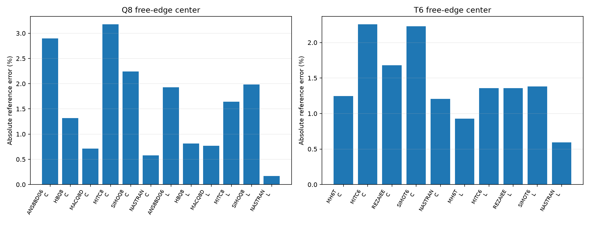
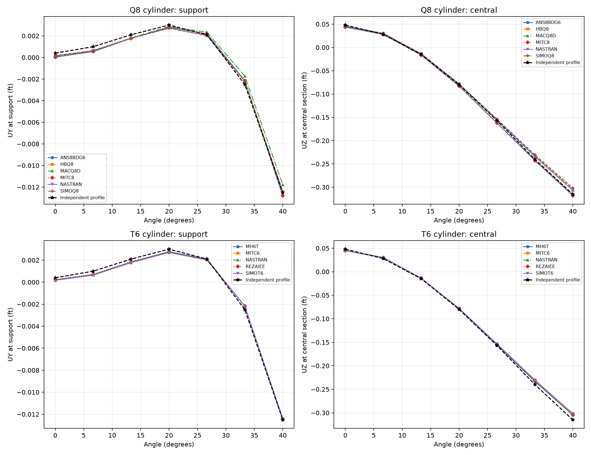

# CSI 2-006 — Scordelis–Lo roof

Updated 19 October 2026. Existing solver runs only; numerical results come from native OP2.

**Status: native OP2 free-edge deflections and fixed-location displacement profiles available. Moment recovery axes require further audit.**

## Physical model

Quarter roof: radius 25 ft, full span 50 ft, circumferential half-angle 40°, thickness 3 in (=0.25 ft), E=432,000,000 lb/ft², nu=0. Supports restrain UX/UZ at the curved end, with UY/RX symmetry at Y=25 ft and UX/RY symmetry at X=0. The existing load is PLOAD4 with CID=0 and explicit global −Z direction, 90 lb/ft² of surface area. This is vertical traction, not pressure normal to the curved shell. Only the existing uniform-load case is reported; SELF/GRAV equivalence has not been tested here.

The center of the free edge is (25 sin40°,25,25 cos40°) ft. Physical GRID49 is confirmed by coordinates, tolerance 2e-6 ft, basic output CD=0. Q8 has 36 elements / 133 nodes. T6 has 144 triangles / 313 nodes, four triangles per original rectangular area. These are different discretizations. Two geometry variants exist; one mesh per variant warrants bars, not convergence lines.

## Free-edge center UZ

Primary independent reference −0.3086 ft; CSI thick SAP2000 −0.3073 ft. C denotes cylinder geometry and L denotes the separate linear-geometry deck.

| Family | Geometry | Solver/formulation | UZ (ft) | Error vs −0.3086 (%) |
|---|---|---|---|---|
| Q8 | cylinder | ANS8BDG6 | -0.317543 | 2.897926 |
| Q8 | cylinder | HBQ8 | -0.3045312 | 1.318455 |
| Q8 | cylinder | MACQ8D | -0.3064 | 0.7129063 |
| Q8 | cylinder | MITC8 | -0.3183984 | 3.175099 |
| Q8 | cylinder | SIMOQ8 | -0.3016842 | 2.241033 |
| Q8 | cylinder | NASTRAN | -0.3068083 | 0.5805921 |
| Q8 | linear geometry | ANS8BDG6 | -0.3026569 | 1.92582 |
| Q8 | linear geometry | HBQ8 | -0.3060876 | 0.8141434 |
| Q8 | linear geometry | MACQ8D | -0.3062258 | 0.7693433 |
| Q8 | linear geometry | MITC8 | -0.303538 | 1.640303 |
| Q8 | linear geometry | SIMOQ8 | -0.302482 | 1.982508 |
| Q8 | linear geometry | NASTRAN | -0.3080852 | 0.1668265 |
| T6 | cylinder | MH6T | -0.3047589 | 1.244674 |
| T6 | cylinder | MITC6 | -0.3016415 | 2.254872 |
| T6 | cylinder | REZAIEE | -0.3034179 | 1.679241 |
| T6 | cylinder | SIMOT6 | -0.3017216 | 2.228894 |
| T6 | cylinder | NASTRAN | -0.3048791 | 1.205736 |
| T6 | linear geometry | MH6T | -0.3057352 | 0.9283309 |
| T6 | linear geometry | MITC6 | -0.3044104 | 1.357616 |
| T6 | linear geometry | REZAIEE | -0.3044104 | 1.357616 |
| T6 | linear geometry | SIMOT6 | -0.3043375 | 1.381247 |
| T6 | linear geometry | NASTRAN | -0.3104326 | 0.593828 |

## Displacement profiles, cylinder variant

At support Y=0 use basic UY. At the central section Y=25 use basic UZ, at the same seven angles for every solver. Profile errors below are signed 100×(solver−reference)/max(abs(reference)) over the whole profile, as in CSI. Denominators are 0.0125 ft and 0.315 ft; these are not pointwise percent errors. The profile endpoint −0.315 ft is a separate figure-estimated reference from the primary −0.3086-ft free-edge value.

| Family | Solver/formulation | Section | Angle (deg) | Measured (ft) | Reference (ft) | Max-normalized signed error (%) |
|---|---|---|---|---|---|---|
| Q8 | ANS8BDG6 | support | 0 | 3.890356e-05 | 0.0004 | -2.888772 |
| Q8 | ANS8BDG6 | support | 6.666667 | 0.0005463323 | 0.001 | -3.629342 |
| Q8 | ANS8BDG6 | support | 13.33333 | 0.001768447 | 0.0021 | -2.652426 |
| Q8 | ANS8BDG6 | support | 20 | 0.002807636 | 0.003 | -1.538912 |
| Q8 | ANS8BDG6 | support | 26.66667 | 0.002181434 | 0.0021 | 0.6514726 |
| Q8 | ANS8BDG6 | support | 33.33333 | -0.002154064 | -0.0025 | 2.767489 |
| Q8 | ANS8BDG6 | support | 40 | -0.01280072 | -0.0125 | -2.405734 |
| Q8 | HBQ8 | support | 0 | 0.0001639562 | 0.0004 | -1.88835 |
| Q8 | HBQ8 | support | 6.666667 | 0.0006406788 | 0.001 | -2.87457 |
| Q8 | HBQ8 | support | 13.33333 | 0.001779493 | 0.0021 | -2.564053 |
| Q8 | HBQ8 | support | 20 | 0.002713976 | 0.003 | -2.288192 |
| Q8 | HBQ8 | support | 26.66667 | 0.002027987 | 0.0021 | -0.5761074 |
| Q8 | HBQ8 | support | 33.33333 | -0.002207031 | -0.0025 | 2.343752 |
| Q8 | HBQ8 | support | 40 | -0.01242934 | -0.0125 | 0.5652592 |
| Q8 | MACQ8D | support | 0 | 9.375661e-05 | 0.0004 | -2.449947 |
| Q8 | MACQ8D | support | 6.666667 | 0.0005962852 | 0.001 | -3.229718 |
| Q8 | MACQ8D | support | 13.33333 | 0.001810988 | 0.0021 | -2.312095 |
| Q8 | MACQ8D | support | 20 | 0.002866358 | 0.003 | -1.069138 |
| Q8 | MACQ8D | support | 26.66667 | 0.002334856 | 0.0021 | 1.87885 |
| Q8 | MACQ8D | support | 33.33333 | -0.001725182 | -0.0025 | 6.198544 |
| Q8 | MACQ8D | support | 40 | -0.01178576 | -0.0125 | 5.713923 |
| Q8 | MITC8 | support | 0 | 3.820265e-05 | 0.0004 | -2.894379 |
| Q8 | MITC8 | support | 6.666667 | 0.0005459702 | 0.001 | -3.632239 |
| Q8 | MITC8 | support | 13.33333 | 0.001768839 | 0.0021 | -2.649285 |
| Q8 | MITC8 | support | 20 | 0.002808552 | 0.003 | -1.53158 |
| Q8 | MITC8 | support | 26.66667 | 0.002182115 | 0.0021 | 0.6569208 |
| Q8 | MITC8 | support | 33.33333 | -0.002154489 | -0.0025 | 2.764089 |
| Q8 | MITC8 | support | 40 | -0.01280283 | -0.0125 | -2.422617 |
| Q8 | SIMOQ8 | support | 0 | 0.0001660526 | 0.0004 | -1.871579 |
| Q8 | SIMOQ8 | support | 6.666667 | 0.0006416776 | 0.001 | -2.866579 |
| Q8 | SIMOQ8 | support | 13.33333 | 0.001778063 | 0.0021 | -2.575492 |
| Q8 | SIMOQ8 | support | 20 | 0.002710816 | 0.003 | -2.313474 |
| Q8 | SIMOQ8 | support | 26.66667 | 0.002025592 | 0.0021 | -0.5952647 |
| Q8 | SIMOQ8 | support | 33.33333 | -0.002205491 | -0.0025 | 2.356073 |
| Q8 | SIMOQ8 | support | 40 | -0.01242118 | -0.0125 | 0.6305635 |
| Q8 | NASTRAN | support | 0 | 0.0001529235 | 0.0004 | -1.976612 |
| Q8 | NASTRAN | support | 6.666667 | 0.0006324255 | 0.001 | -2.940596 |
| Q8 | NASTRAN | support | 13.33333 | 0.001778659 | 0.0021 | -2.570731 |
| Q8 | NASTRAN | support | 20 | 0.002722782 | 0.003 | -2.217743 |
| Q8 | NASTRAN | support | 26.66667 | 0.002043233 | 0.0021 | -0.454134 |
| Q8 | NASTRAN | support | 33.33333 | -0.002201882 | -0.0025 | 2.384946 |
| Q8 | NASTRAN | support | 40 | -0.01248542 | -0.0125 | 0.116615 |
| Q8 | ANS8BDG6 | central | 0 | 0.04371309 | 0.048 | -1.360924 |
| Q8 | ANS8BDG6 | central | 6.666667 | 0.02812179 | 0.028 | 0.03866228 |
| Q8 | ANS8BDG6 | central | 13.33333 | -0.01636361 | -0.015 | -0.4328925 |
| Q8 | ANS8BDG6 | central | 20 | -0.0830733 | -0.08 | -0.9756494 |
| Q8 | ANS8BDG6 | central | 26.66667 | -0.162025 | -0.157 | -1.59523 |
| Q8 | ANS8BDG6 | central | 33.33333 | -0.2426136 | -0.24 | -0.8297139 |
| Q8 | ANS8BDG6 | central | 40 | -0.317543 | -0.315 | -0.8073016 |
| Q8 | HBQ8 | central | 0 | 0.04530731 | 0.048 | -0.8548215 |
| Q8 | HBQ8 | central | 6.666667 | 0.03005296 | 0.028 | 0.6517345 |
| Q8 | HBQ8 | central | 13.33333 | -0.01342111 | -0.015 | 0.5012356 |
| Q8 | HBQ8 | central | 20 | -0.07839222 | -0.08 | 0.5104055 |
| Q8 | HBQ8 | central | 26.66667 | -0.1549062 | -0.157 | 0.6646989 |
| Q8 | HBQ8 | central | 33.33333 | -0.2326262 | -0.24 | 2.340875 |
| Q8 | HBQ8 | central | 40 | -0.3045312 | -0.315 | 3.323414 |
| Q8 | MACQ8D | central | 0 | 0.04527658 | 0.048 | -0.8645782 |
| Q8 | MACQ8D | central | 6.666667 | 0.02991034 | 0.028 | 0.6064557 |
| Q8 | MACQ8D | central | 13.33333 | -0.01368208 | -0.015 | 0.4183869 |
| Q8 | MACQ8D | central | 20 | -0.07866452 | -0.08 | 0.4239623 |
| Q8 | MACQ8D | central | 26.66667 | -0.155242 | -0.157 | 0.5580823 |
| Q8 | MACQ8D | central | 33.33333 | -0.2333807 | -0.24 | 2.101354 |
| Q8 | MACQ8D | central | 40 | -0.3064 | -0.315 | 2.730168 |
| Q8 | MITC8 | central | 0 | 0.04375148 | 0.048 | -1.348736 |
| Q8 | MITC8 | central | 6.666667 | 0.02815942 | 0.028 | 0.05061041 |
| Q8 | MITC8 | central | 13.33333 | -0.01634831 | -0.015 | -0.4280349 |
| Q8 | MITC8 | central | 20 | -0.08315151 | -0.08 | -1.00048 |
| Q8 | MITC8 | central | 26.66667 | -0.1623048 | -0.157 | -1.68406 |
| Q8 | MITC8 | central | 33.33333 | -0.2431857 | -0.24 | -1.011347 |
| Q8 | MITC8 | central | 40 | -0.3183984 | -0.315 | -1.078843 |
| Q8 | SIMOQ8 | central | 0 | 0.04512021 | 0.048 | -0.914218 |
| Q8 | SIMOQ8 | central | 6.666667 | 0.02987132 | 0.028 | 0.5940705 |
| Q8 | SIMOQ8 | central | 13.33333 | -0.01345821 | -0.015 | 0.4894559 |
| Q8 | SIMOQ8 | central | 20 | -0.07797938 | -0.08 | 0.6414672 |
| Q8 | SIMOQ8 | central | 26.66667 | -0.1537357 | -0.157 | 1.036282 |
| Q8 | SIMOQ8 | central | 33.33333 | -0.2305451 | -0.24 | 3.001559 |
| Q8 | SIMOQ8 | central | 40 | -0.3016842 | -0.315 | 4.227247 |
| Q8 | NASTRAN | central | 0 | 0.04579634 | 0.048 | -0.6995751 |
| Q8 | NASTRAN | central | 6.666667 | 0.03044916 | 0.028 | 0.7775115 |
| Q8 | NASTRAN | central | 13.33333 | -0.01344041 | -0.015 | 0.4951077 |
| Q8 | NASTRAN | central | 20 | -0.07892894 | -0.08 | 0.340019 |
| Q8 | NASTRAN | central | 26.66667 | -0.156029 | -0.157 | 0.308249 |
| Q8 | NASTRAN | central | 33.33333 | -0.2343919 | -0.24 | 1.78034 |
| Q8 | NASTRAN | central | 40 | -0.3068083 | -0.315 | 2.600542 |
| T6 | MH6T | support | 0 | 0.0002099802 | 0.0004 | -1.520159 |
| T6 | MH6T | support | 6.666667 | 0.0006883947 | 0.001 | -2.492842 |
| T6 | MH6T | support | 13.33333 | 0.001832621 | 0.0021 | -2.139033 |
| T6 | MH6T | support | 20 | 0.002774917 | 0.003 | -1.800665 |
| T6 | MH6T | support | 26.66667 | 0.002089645 | 0.0021 | -0.08283988 |
| T6 | MH6T | support | 33.33333 | -0.002175216 | -0.0025 | 2.598275 |
| T6 | MH6T | support | 40 | -0.01250973 | -0.0125 | -0.0778079 |
| T6 | MITC6 | support | 0 | 0.0001701042 | 0.0004 | -1.839167 |
| T6 | MITC6 | support | 6.666667 | 0.0006438789 | 0.001 | -2.848969 |
| T6 | MITC6 | support | 13.33333 | 0.001775877 | 0.0021 | -2.592987 |
| T6 | MITC6 | support | 20 | 0.002705084 | 0.003 | -2.359329 |
| T6 | MITC6 | support | 26.66667 | 0.002021411 | 0.0021 | -0.628716 |
| T6 | MITC6 | support | 33.33333 | -0.002199699 | -0.0025 | 2.402405 |
| T6 | MITC6 | support | 40 | -0.0124168 | -0.0125 | 0.6656185 |
| T6 | REZAIEE | support | 0 | 0.0002422885 | 0.0004 | -1.261692 |
| T6 | REZAIEE | support | 6.666667 | 0.0007156766 | 0.001 | -2.274587 |
| T6 | REZAIEE | support | 13.33333 | 0.001846417 | 0.0021 | -2.028661 |
| T6 | REZAIEE | support | 20 | 0.00277208 | 0.003 | -1.823364 |
| T6 | REZAIEE | support | 26.66667 | 0.002077015 | 0.0021 | -0.1838828 |
| T6 | REZAIEE | support | 33.33333 | -0.0021754 | -0.0025 | 2.596803 |
| T6 | REZAIEE | support | 40 | -0.01245703 | -0.0125 | 0.3437832 |
| T6 | SIMOT6 | support | 0 | 0.0001715509 | 0.0004 | -1.827593 |
| T6 | SIMOT6 | support | 6.666667 | 0.0006443655 | 0.001 | -2.845076 |
| T6 | SIMOT6 | support | 13.33333 | 0.001773565 | 0.0021 | -2.61148 |
| T6 | SIMOT6 | support | 20 | 0.002698906 | 0.003 | -2.408752 |
| T6 | SIMOT6 | support | 26.66667 | 0.002012825 | 0.0021 | -0.697401 |
| T6 | SIMOT6 | support | 33.33333 | -0.002203857 | -0.0025 | 2.369147 |
| T6 | SIMOT6 | support | 40 | -0.01238576 | -0.0125 | 0.9138867 |
| T6 | NASTRAN | support | 0 | 0.0001696646 | 0.0004 | -1.842683 |
| T6 | NASTRAN | support | 6.666667 | 0.0006435056 | 0.001 | -2.851955 |
| T6 | NASTRAN | support | 13.33333 | 0.001775001 | 0.0021 | -2.599994 |
| T6 | NASTRAN | support | 20 | 0.002701992 | 0.003 | -2.384066 |
| T6 | NASTRAN | support | 26.66667 | 0.002015151 | 0.0021 | -0.6787932 |
| T6 | NASTRAN | support | 33.33333 | -0.002205457 | -0.0025 | 2.356343 |
| T6 | NASTRAN | support | 40 | -0.01239405 | -0.0125 | 0.8475617 |
| T6 | MH6T | central | 0 | 0.04565379 | 0.048 | -0.7448285 |
| T6 | MH6T | central | 6.666667 | 0.03030735 | 0.028 | 0.7324911 |
| T6 | MH6T | central | 13.33333 | -0.01338553 | -0.015 | 0.5125303 |
| T6 | MH6T | central | 20 | -0.07866192 | -0.08 | 0.4247877 |
| T6 | MH6T | central | 26.66667 | -0.1555431 | -0.157 | 0.4625162 |
| T6 | MH6T | central | 33.33333 | -0.2334811 | -0.24 | 2.069503 |
| T6 | MH6T | central | 40 | -0.3047589 | -0.315 | 3.251131 |
| T6 | MITC6 | central | 0 | 0.04500797 | 0.048 | -0.9498507 |
| T6 | MITC6 | central | 6.666667 | 0.02977048 | 0.028 | 0.5620585 |
| T6 | MITC6 | central | 13.33333 | -0.01352616 | -0.015 | 0.4678862 |
| T6 | MITC6 | central | 20 | -0.07800679 | -0.08 | 0.6327654 |
| T6 | MITC6 | central | 26.66667 | -0.1537499 | -0.157 | 1.031778 |
| T6 | MITC6 | central | 33.33333 | -0.2305874 | -0.24 | 2.988134 |
| T6 | MITC6 | central | 40 | -0.3016415 | -0.315 | 4.240805 |
| T6 | REZAIEE | central | 0 | 0.04509735 | 0.048 | -0.9214758 |
| T6 | REZAIEE | central | 6.666667 | 0.02986608 | 0.028 | 0.592406 |
| T6 | REZAIEE | central | 13.33333 | -0.01348173 | -0.015 | 0.4819921 |
| T6 | REZAIEE | central | 20 | -0.07822529 | -0.08 | 0.5633993 |
| T6 | REZAIEE | central | 26.66667 | -0.1545346 | -0.157 | 0.7826783 |
| T6 | REZAIEE | central | 33.33333 | -0.2320903 | -0.24 | 2.511027 |
| T6 | REZAIEE | central | 40 | -0.3034179 | -0.315 | 3.676869 |
| T6 | SIMOT6 | central | 0 | 0.04485102 | 0.048 | -0.9996762 |
| T6 | SIMOT6 | central | 6.666667 | 0.02965966 | 0.028 | 0.5268752 |
| T6 | SIMOT6 | central | 13.33333 | -0.0135005 | -0.015 | 0.4760328 |
| T6 | SIMOT6 | central | 20 | -0.07777665 | -0.08 | 0.705826 |
| T6 | SIMOT6 | central | 26.66667 | -0.1533325 | -0.157 | 1.16428 |
| T6 | SIMOT6 | central | 33.33333 | -0.2301756 | -0.24 | 3.118857 |
| T6 | SIMOT6 | central | 40 | -0.3017216 | -0.315 | 4.215355 |
| T6 | NASTRAN | central | 0 | 0.04508121 | 0.048 | -0.9266014 |
| T6 | NASTRAN | central | 6.666667 | 0.02983116 | 0.028 | 0.5813206 |
| T6 | NASTRAN | central | 13.33333 | -0.01359918 | -0.015 | 0.4447052 |
| T6 | NASTRAN | central | 20 | -0.0783736 | -0.08 | 0.5163163 |
| T6 | NASTRAN | central | 26.66667 | -0.1546585 | -0.157 | 0.7433345 |
| T6 | NASTRAN | central | 33.33333 | -0.2324183 | -0.24 | 2.406875 |
| T6 | NASTRAN | central | 40 | -0.3048791 | -0.315 | 3.212984 |

## Moment reference and remaining audit

CSI lists support twisting Mxy and central-section My (transverse) / Mx (longitudinal), in lb-ft/ft. These are section-local components. Native OEF components must be rotated into those same directions, with matching point recovery and averaging, before numerical errors are reported. They are not interchangeable with basic XY moments on this curved surface. Their solver comparisons remain explicitly unverified rather than filled with unrelated components.

| Angle (deg) | Support Mxy reference | Central My reference | Central Mx reference |
|---|---|---|---|
| 0 | 0 | -2080 | -100 |
| 6.666667 | 370 | -1980 | -90 |
| 13.33333 | 700 | -1580 | 10 |
| 20 | 990 | -1000 | 140 |
| 26.66667 | 1210 | -400 | 300 |
| 33.33333 | 1310 | 70 | 490 |
| 40 | 1280 | -40 | 700 |

DAT physical signatures (GRID, elements, properties, materials, loads and SPC) match across the available solvers/formulations for each individual model. Diagnostic F06 scans found no fatal or excessive-pivot message in these re-exported runs.

## Source and reproducibility

[CSI Example 2-006](https://docs.csiamerica.com/manuals/csibridge/Verification/Analysis/Shells/Problem%202-006.pdf). Meshes were generated independently in Python, not exported from SAP2000 S2K. Original DAT and OP2 remain local. No stiffness, loads or constraints were changed for this publication update. Missing measurements are shown as —. Solver agreement alone does not establish independent accuracy.

[Benchmark index](README.md) · [All comparisons](comparison_all.md)
