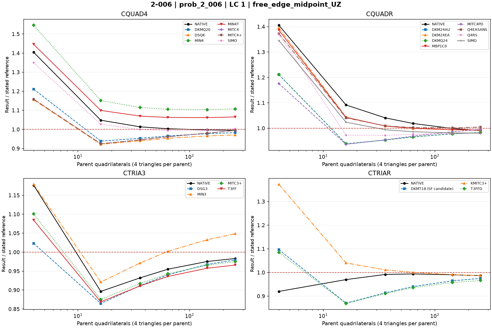
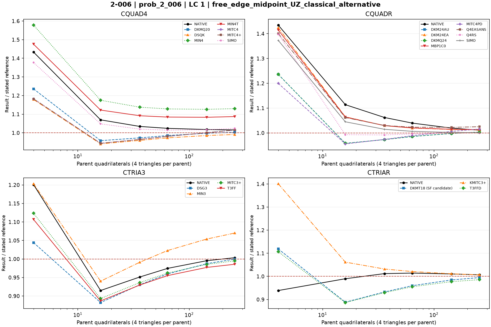

# Linear shells — 2-006: Scordelis-Lo roof

25 October 2026. Fresh native MYSTRAN and Nastran runs. CQUAD4, CQUADR, CTRIA3 and CTRIAR only.

[All linear comparisons](comparison_all_linear.md) · [Full ZIP](comparison_all_linear.zip) · [Tested DAT](DAT/linear_shell_benchmark_DAT.zip) · [Linear publication QA](PUBLICATION_QA_linear.md)

Case IDs retain source-model filenames; actual element and formulation are given by their columns and deck selectors. Two-axis 2-002 tip observables use the two physical corner nodes.

NATIVE means the Nastran result for the corresponding element card: CQUAD4, CQUADR, CTRIA3 or CTRIAR. It does not mean the same proprietary interpolation as a MYSTRAN selector. Curves use independent/analytical references; published SAP2000 values are separate table columns. A completed solve is not a physical-accuracy pass. Zero references use absolute residuals; missing and failed output is never replaced by zero.

The tested source snapshot includes DKMT18 SF as an explicitly labelled candidate and corrected DSG3 local-z Kg. It is documented in [source provenance](data_linear/provenance_linear.json), with a reproducible element-local patch. This benchmark snapshot is not a declaration that SF passed every production-promotion gate. No shared eigensolver prototype is included.

## Model and comparison scope

Scordelis-Lo quarter roof. Primary CSI revision 8 independent free-edge midpoint UZ=-0.3086 ft; classical -0.3024 ft shown separately. Nodal forces represent 90 lb/ft^2 surface-area gravity loading; do not replace by projected area.

## Extraction status

| Solver | Status | Metric rows |
|---|---|---:|
| MYSTRAN | MEASURED | 264 |
| NASTRAN | MEASURED | 48 |

## Figures

### prob_2_006 · LC 1 · free_edge_midpoint_UZ

### prob_2_006 · LC 1 · free_edge_midpoint_UZ_classical_alternative

## Finest available mesh per named series

| Case / parent quads | Solver / formulation | LC | Quantity | Measured | Independent / analytical | CSI published | Unit | Error % primary | Absolute residual | Status |
|---|---|---:|---|---:|---:|---:|---|---:|---:|---|
| prob_2_006_n16_cquadr_simo / 256 | MYSTRAN CQUAD4_DKMQ20 | 1 | free_edge_midpoint_UZ | -0.3033576 | -0.3086 | — | ft | 1.698769 | 0.0052424 | MEASURED |
| prob_2_006_n16_cquadr_simo / 256 | MYSTRAN CQUAD4_DSQK | 1 | free_edge_midpoint_UZ | -0.2996889 | -0.3086 | — | ft | 2.887589 | 0.0089111 | MEASURED |
| prob_2_006_n16_cquadr_simo / 256 | MYSTRAN CQUAD4_MIN4 | 1 | free_edge_midpoint_UZ | -0.3416921 | -0.3086 | — | ft | 10.7233 | 0.0330921 | MEASURED |
| prob_2_006_n16_cquadr_simo / 256 | MYSTRAN CQUAD4_MIN4T | 1 | free_edge_midpoint_UZ | -0.3287904 | -0.3086 | — | ft | 6.542579 | 0.0201904 | MEASURED |
| prob_2_006_n16_cquadr_simo / 256 | MYSTRAN CQUAD4_MITC4 | 1 | free_edge_midpoint_UZ | -0.3069738 | -0.3086 | — | ft | 0.5269605 | 0.0016262 | MEASURED |
| prob_2_006_n16_cquadr_simo / 256 | MYSTRAN CQUAD4_MITC4plus | 1 | free_edge_midpoint_UZ | -0.3069738 | -0.3086 | — | ft | 0.5269605 | 0.0016262 | MEASURED |
| prob_2_006_n16_cquadr_simo / 256 | MYSTRAN CQUAD4_SIMO | 1 | free_edge_midpoint_UZ | -0.30977 | -0.3086 | — | ft | 0.3791316 | 0.00117 | MEASURED |
| prob_2_006_n16_cquadr_simo / 256 | MYSTRAN CQUADR_DKM24AU | 1 | free_edge_midpoint_UZ | -0.3033576 | -0.3086 | — | ft | 1.698769 | 0.0052424 | MEASURED |
| prob_2_006_n16_cquadr_simo / 256 | MYSTRAN CQUADR_DKM24EA | 1 | free_edge_midpoint_UZ | -0.3061547 | -0.3086 | — | ft | 0.792385 | 0.0024453 | MEASURED |
| prob_2_006_n16_cquadr_simo / 256 | MYSTRAN CQUADR_DKMQ24 | 1 | free_edge_midpoint_UZ | -0.3033576 | -0.3086 | — | ft | 1.698769 | 0.0052424 | MEASURED |
| prob_2_006_n16_cquadr_simo / 256 | MYSTRAN CQUADR_MBP1C0 | 1 | free_edge_midpoint_UZ | -0.3064674 | -0.3086 | — | ft | 0.6910564 | 0.0021326 | MEASURED |
| prob_2_006_n16_cquadr_simo / 256 | MYSTRAN CQUADR_MITC4PD | 1 | free_edge_midpoint_UZ | -0.3071145 | -0.3086 | — | ft | 0.4813675 | 0.0014855 | MEASURED |
| prob_2_006_n16_cquadr_simo / 256 | MYSTRAN CQUADR_Q4EASANS | 1 | free_edge_midpoint_UZ | -0.3099727 | -0.3086 | — | ft | 0.4448153 | 0.0013727 | MEASURED |
| prob_2_006_n16_cquadr_simo / 256 | MYSTRAN CQUADR_Q4RS | 1 | free_edge_midpoint_UZ | -0.3024264 | -0.3086 | — | ft | 2.000518 | 0.0061736 | MEASURED |
| prob_2_006_n16_cquadr_simo / 256 | MYSTRAN CQUADR_SIMO | 1 | free_edge_midpoint_UZ | -0.3026752 | -0.3086 | — | ft | 1.919896 | 0.0059248 | MEASURED |
| prob_2_006_n16_cquadr_simo / 256 | MYSTRAN CTRIA3_DSG3 | 1 | free_edge_midpoint_UZ | -0.3022946 | -0.3086 | — | ft | 2.043227 | 0.0063054 | MEASURED |
| prob_2_006_n16_cquadr_simo / 256 | MYSTRAN CTRIA3_MIN3 | 1 | free_edge_midpoint_UZ | -0.3235571 | -0.3086 | — | ft | 4.84676 | 0.0149571 | MEASURED |
| prob_2_006_n16_cquadr_simo / 256 | MYSTRAN CTRIA3_MITC3plus | 1 | free_edge_midpoint_UZ | -0.3008579 | -0.3086 | — | ft | 2.508782 | 0.0077421 | MEASURED |
| prob_2_006_n16_cquadr_simo / 256 | MYSTRAN CTRIA3_T3FF | 1 | free_edge_midpoint_UZ | -0.2980717 | -0.3086 | — | ft | 3.411633 | 0.0105283 | MEASURED |
| prob_2_006_n16_cquadr_simo / 256 | MYSTRAN CTRIAR_DKMT18 (SF candidate) | 1 | free_edge_midpoint_UZ | -0.3008229 | -0.3086 | — | ft | 2.520123 | 0.0077771 | MEASURED |
| prob_2_006_n16_cquadr_simo / 256 | MYSTRAN CTRIAR_KMITC3plus | 1 | free_edge_midpoint_UZ | -0.3044269 | -0.3086 | — | ft | 1.352268 | 0.0041731 | MEASURED |
| prob_2_006_n16_cquadr_simo / 256 | MYSTRAN CTRIAR_T3FFD | 1 | free_edge_midpoint_UZ | -0.2980717 | -0.3086 | — | ft | 3.411633 | 0.0105283 | MEASURED |
| prob_2_006_n16_cquadr_simo / 256 | NASTRAN CQUAD4_NATIVE | 1 | free_edge_midpoint_UZ | -0.3071547 | -0.3086 | — | ft | 0.4683409 | 0.0014453 | MEASURED |
| prob_2_006_n16_cquadr_simo / 256 | NASTRAN CQUADR_NATIVE | 1 | free_edge_midpoint_UZ | -0.3056915 | -0.3086 | — | ft | 0.9424822 | 0.0029085 | MEASURED |
| prob_2_006_n16_cquadr_simo / 256 | NASTRAN CTRIA3_NATIVE | 1 | free_edge_midpoint_UZ | -0.3034232 | -0.3086 | — | ft | 1.677511 | 0.0051768 | MEASURED |
| prob_2_006_n16_cquadr_simo / 256 | NASTRAN CTRIAR_NATIVE | 1 | free_edge_midpoint_UZ | -0.3045089 | -0.3086 | — | ft | 1.325697 | 0.0040911 | MEASURED |
| prob_2_006_n16_cquadr_simo / 256 | MYSTRAN CQUAD4_DKMQ20 | 1 | free_edge_midpoint_UZ_classical_alternative | -0.3033576 | -0.3024 | — | ft | 0.3166667 | 0.0009576 | MEASURED |
| prob_2_006_n16_cquadr_simo / 256 | MYSTRAN CQUAD4_DSQK | 1 | free_edge_midpoint_UZ_classical_alternative | -0.2996889 | -0.3024 | — | ft | 0.8965278 | 0.0027111 | MEASURED |
| prob_2_006_n16_cquadr_simo / 256 | MYSTRAN CQUAD4_MIN4 | 1 | free_edge_midpoint_UZ_classical_alternative | -0.3416921 | -0.3024 | — | ft | 12.99342 | 0.0392921 | MEASURED |
| prob_2_006_n16_cquadr_simo / 256 | MYSTRAN CQUAD4_MIN4T | 1 | free_edge_midpoint_UZ_classical_alternative | -0.3287904 | -0.3024 | — | ft | 8.726984 | 0.0263904 | MEASURED |
| prob_2_006_n16_cquadr_simo / 256 | MYSTRAN CQUAD4_MITC4 | 1 | free_edge_midpoint_UZ_classical_alternative | -0.3069738 | -0.3024 | — | ft | 1.5125 | 0.0045738 | MEASURED |
| prob_2_006_n16_cquadr_simo / 256 | MYSTRAN CQUAD4_MITC4plus | 1 | free_edge_midpoint_UZ_classical_alternative | -0.3069738 | -0.3024 | — | ft | 1.5125 | 0.0045738 | MEASURED |
| prob_2_006_n16_cquadr_simo / 256 | MYSTRAN CQUAD4_SIMO | 1 | free_edge_midpoint_UZ_classical_alternative | -0.30977 | -0.3024 | — | ft | 2.437169 | 0.00737 | MEASURED |
| prob_2_006_n16_cquadr_simo / 256 | MYSTRAN CQUADR_DKM24AU | 1 | free_edge_midpoint_UZ_classical_alternative | -0.3033576 | -0.3024 | — | ft | 0.3166667 | 0.0009576 | MEASURED |
| prob_2_006_n16_cquadr_simo / 256 | MYSTRAN CQUADR_DKM24EA | 1 | free_edge_midpoint_UZ_classical_alternative | -0.3061547 | -0.3024 | — | ft | 1.241634 | 0.0037547 | MEASURED |
| prob_2_006_n16_cquadr_simo / 256 | MYSTRAN CQUADR_DKMQ24 | 1 | free_edge_midpoint_UZ_classical_alternative | -0.3033576 | -0.3024 | — | ft | 0.3166667 | 0.0009576 | MEASURED |
| prob_2_006_n16_cquadr_simo / 256 | MYSTRAN CQUADR_MBP1C0 | 1 | free_edge_midpoint_UZ_classical_alternative | -0.3064674 | -0.3024 | — | ft | 1.34504 | 0.0040674 | MEASURED |
| prob_2_006_n16_cquadr_simo / 256 | MYSTRAN CQUADR_MITC4PD | 1 | free_edge_midpoint_UZ_classical_alternative | -0.3071145 | -0.3024 | — | ft | 1.559028 | 0.0047145 | MEASURED |
| prob_2_006_n16_cquadr_simo / 256 | MYSTRAN CQUADR_Q4EASANS | 1 | free_edge_midpoint_UZ_classical_alternative | -0.3099727 | -0.3024 | — | ft | 2.5042 | 0.0075727 | MEASURED |
| prob_2_006_n16_cquadr_simo / 256 | MYSTRAN CQUADR_Q4RS | 1 | free_edge_midpoint_UZ_classical_alternative | -0.3024264 | -0.3024 | — | ft | 0.008730159 | 2.64e-05 | MEASURED |
| prob_2_006_n16_cquadr_simo / 256 | MYSTRAN CQUADR_SIMO | 1 | free_edge_midpoint_UZ_classical_alternative | -0.3026752 | -0.3024 | — | ft | 0.09100529 | 0.0002752 | MEASURED |
| prob_2_006_n16_cquadr_simo / 256 | MYSTRAN CTRIA3_DSG3 | 1 | free_edge_midpoint_UZ_classical_alternative | -0.3022946 | -0.3024 | — | ft | 0.0348545 | 0.0001054 | MEASURED |
| prob_2_006_n16_cquadr_simo / 256 | MYSTRAN CTRIA3_MIN3 | 1 | free_edge_midpoint_UZ_classical_alternative | -0.3235571 | -0.3024 | — | ft | 6.996396 | 0.0211571 | MEASURED |
| prob_2_006_n16_cquadr_simo / 256 | MYSTRAN CTRIA3_MITC3plus | 1 | free_edge_midpoint_UZ_classical_alternative | -0.3008579 | -0.3024 | — | ft | 0.5099537 | 0.0015421 | MEASURED |
| prob_2_006_n16_cquadr_simo / 256 | MYSTRAN CTRIA3_T3FF | 1 | free_edge_midpoint_UZ_classical_alternative | -0.2980717 | -0.3024 | — | ft | 1.431316 | 0.0043283 | MEASURED |
| prob_2_006_n16_cquadr_simo / 256 | MYSTRAN CTRIAR_DKMT18 (SF candidate) | 1 | free_edge_midpoint_UZ_classical_alternative | -0.3008229 | -0.3024 | — | ft | 0.5215278 | 0.0015771 | MEASURED |
| prob_2_006_n16_cquadr_simo / 256 | MYSTRAN CTRIAR_KMITC3plus | 1 | free_edge_midpoint_UZ_classical_alternative | -0.3044269 | -0.3024 | — | ft | 0.6702712 | 0.0020269 | MEASURED |
| prob_2_006_n16_cquadr_simo / 256 | MYSTRAN CTRIAR_T3FFD | 1 | free_edge_midpoint_UZ_classical_alternative | -0.2980717 | -0.3024 | — | ft | 1.431316 | 0.0043283 | MEASURED |
| prob_2_006_n16_cquadr_simo / 256 | NASTRAN CQUAD4_NATIVE | 1 | free_edge_midpoint_UZ_classical_alternative | -0.3071547 | -0.3024 | — | ft | 1.572321 | 0.0047547 | MEASURED |
| prob_2_006_n16_cquadr_simo / 256 | NASTRAN CQUADR_NATIVE | 1 | free_edge_midpoint_UZ_classical_alternative | -0.3056915 | -0.3024 | — | ft | 1.088459 | 0.0032915 | MEASURED |
| prob_2_006_n16_cquadr_simo / 256 | NASTRAN CTRIA3_NATIVE | 1 | free_edge_midpoint_UZ_classical_alternative | -0.3034232 | -0.3024 | — | ft | 0.3383598 | 0.0010232 | MEASURED |
| prob_2_006_n16_cquadr_simo / 256 | NASTRAN CTRIAR_NATIVE | 1 | free_edge_midpoint_UZ_classical_alternative | -0.3045089 | -0.3024 | — | ft | 0.6973876 | 0.0021089 | MEASURED |

All mesh rows, missing fields, hashes and run statuses remain in the CSV.
