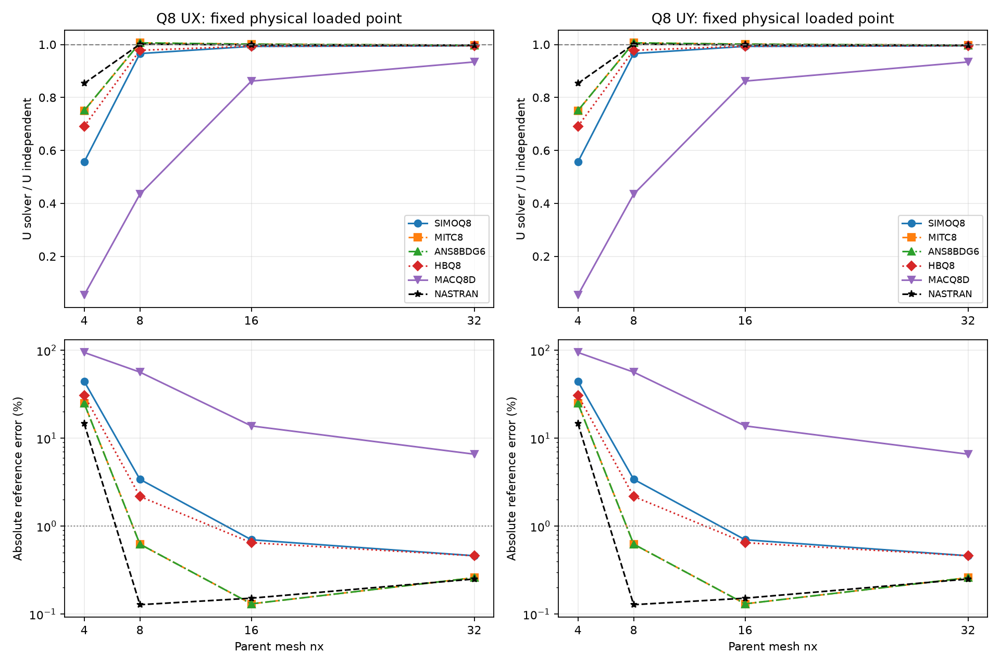
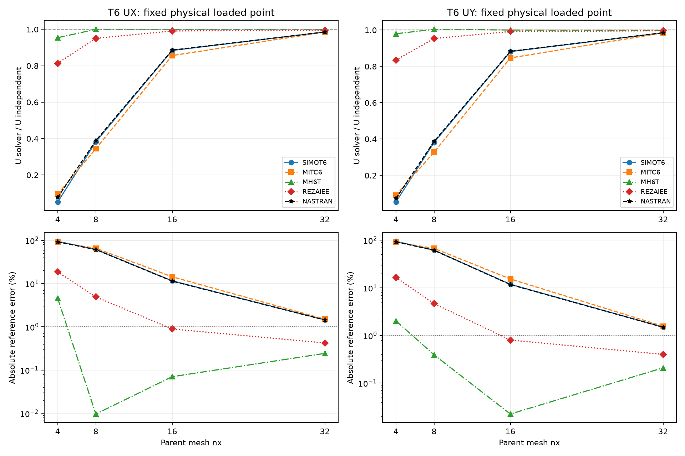

# CSI 2-007 — S2K-based quadratic thick convergence

20 October 2026. **Complete existing output set: 8 Nastran and 36 MYSTRAN runs, nx=4/8/16/32.** Native OP2 yields 88 signed fixed-location observations and 72 matched Nastran/MYSTRAN pairs. Readable output and completed input QA do not imply that every formulation meets the reference accuracy.

## Reference and physical model

Source engineering data: Example 2-007-thin.s2k supplied by the user. The new comparison deliberately uses **thick** PSHELL MID1=MID2=MID3=1, h=0.04 ft, transverse shear factor 5/6. Units kip and ft; E=68,250,000 kip/ft², G=26,250,000 kip/ft², nu=0.3. Radius 10 ft, pole opening half-angle 18°. Source Shell-Thin and the thick adaptation are distinguished; no thin/thick results are mixed.

The independent reference for the model with the opening is +0.0940 ft UX at (10,0,0), and −0.0940 ft UY at (0,10,0). The no-opening theoretical lower bound 0.0924 ft is not the reference here. CSI SAP2000 thick values at its 8×8 mesh are +0.0927/−0.0927 ft; thin values +0.0939/−0.0939 ft. Errors below use the independent reference, not SAP2000 parity.

Quarter-model loads are FX=+1 kip at (10,0,0), FY=−1 kip at (0,10,0), both basic CID=0. These reproduce the S2K loads (full hemisphere point loads are 2 kip with alternating signs). The older 50-force oblique-load DAT is not joined to these runs.

## Mesh, local restraints and observations

Each parent mesh spans azimuth 0–90° and elevation 0–72°. At nx8 all 81 original S2K corner coordinates, IDs and assigned local-axis angles are preserved. Q8 enriches each parent quad to CQUAD8. T6 splits each quad into two CTRIA6 triangles on a consistent lower-left to upper-right diagonal. All new quadratic midsides are interpolated in angular coordinates on the sphere, not at chord midpoints. These are new quadratic meshes derived from S2K engineering data, not literal copies of its linear element mesh.

Local axis1 is radial, local axis2 horizontal circumferential tangent, and local axis3 meridional. On each symmetry edge, node-specific CORD2R is the GRID CD and SPC26 restrains local U2/R3, including midsides. A single basic UZ restraint stabilizes the equatorial midpoint. AUTOSPC is explicitly off and no BAILOUT is used. No additional clamp or drilling restraint was added.

Native OUG translations are in GRID CD and are rotated to basic before extraction. At the Y-end observation, basic UY comes from local U1; local U2=0 is a restrained component and is not the physical observation. Geometry is asserted within 1e-10 ft at both targets; both signs/locations remain separate. T6 diagonal triangulation can produce different X/Y responses; no absolute-value averaging hides this difference.

| Family | Parent nx | Nodes | Elements | Winding |
|---|---|---|---|---|
| Q8 | 4 | 65 | 16 | outward |
| T6 | 4 | 81 | 32 | outward |
| Q8 | 8 | 225 | 64 | outward |
| T6 | 8 | 289 | 128 | outward |
| Q8 | 16 | 833 | 256 | outward |
| T6 | 16 | 1089 | 512 | outward |
| Q8 | 32 | 3201 | 1024 | outward |
| T6 | 32 | 4225 | 2048 | outward |

## Convergence against independent reference

Top panels: U_solver/U_independent with reference line 1. Bottom: 100×abs(U_solver−U_independent)/abs(U_independent), logarithmic error scale. The optional 1% line is a visual guide, not an official CSI acceptance criterion. Nastran has all four mesh levels. Distinct formulation curves remain visible even when values overlap.

## Finest mesh nx32

| Family | Solver/formulation | UX X-end (ft) | UY Y-end (ft) | Error X (%) | Error Y (%) |
|---|---|---|---|---|---|
| Q8 | NASTRAN | 0.0937644094 | -0.0937644094 | 0.25063 | 0.25063 |
| Q8 | SIMOQ8 | 0.0935665295 | -0.0935665295 | 0.46114 | 0.46114 |
| Q8 | MITC8 | 0.0937560722 | -0.0937560722 | 0.2595 | 0.2595 |
| Q8 | ANS8BDG6 | 0.0937560722 | -0.0937560722 | 0.2595 | 0.2595 |
| Q8 | HBQ8 | 0.0935666561 | -0.0935666561 | 0.461 | 0.461 |
| Q8 | MACQ8D | 0.0878034756 | -0.0878034756 | 6.592 | 6.592 |
| T6 | NASTRAN | 0.0926483274 | -0.092602469 | 1.4379 | 1.4867 |
| T6 | SIMOT6 | 0.0926355198 | -0.0925907269 | 1.4516 | 1.4992 |
| T6 | MITC6 | 0.0925932154 | -0.092529662 | 1.4966 | 1.5642 |
| T6 | MH6T | 0.0937714204 | -0.093803376 | 0.24317 | 0.20917 |
| T6 | REZAIEE | 0.0936017632 | -0.093623504 | 0.42366 | 0.40053 |

## Nastran mesh progression

| Family | nx | UX (ft) | UY (ft) | Error X (%) | Error Y (%) |
|---|---|---|---|---|---|
| Q8 | 4 | 0.0801852793 | -0.0801852793 | 14.697 | 14.697 |
| Q8 | 8 | 0.0941203013 | -0.0941202939 | 0.12798 | 0.12797 |
| Q8 | 16 | 0.093857348 | -0.0938573405 | 0.15176 | 0.15177 |
| Q8 | 32 | 0.0937644094 | -0.0937644094 | 0.25063 | 0.25063 |
| T6 | 4 | 0.00726902019 | -0.00682850648 | 92.267 | 92.736 |
| T6 | 8 | 0.0365754329 | -0.0363723263 | 61.09 | 61.306 |
| T6 | 16 | 0.0832760707 | -0.0829963237 | 11.408 | 11.706 |
| T6 | 32 | 0.0926483274 | -0.092602469 | 1.4379 | 1.4867 |

## Findings and limitations

- T6 Nastran error falls from 92.27–92.74% at nx4 to 61.09–61.31% at nx8, 11.41–11.71% at nx16, and 1.438–1.487% at nx32. The poor pilot result is retained; mesh refinement improves it substantially.
- Q8 Nastran at nx32 has about 0.251% error. Its error is not monotonic after nx8 because the measured response crosses the independent value. A small error at one coarse mesh is not proof of exact convergence.
- At nx32 Q8 SIMOQ8/HBQ8 have about 0.461% error, MITC8/ANS8BDG6 about 0.259%, and MACQ8D about 6.59%. MACQ8D improves with refinement but remains outside the 1% reporting guide.
- At nx32 T6 SIMOT6/MITC6 are about 1.45–1.56%; MH6T about 0.21–0.24%; REZAIEE about 0.40–0.42%. Both point observations are reported separately.
- The T6 pattern is consistent with strong coarse-mesh sensitivity. Membrane/bending locking and curved interpolation are possible causes, not established diagnoses from displacement curves alone. Nastran disagreement by itself does not identify a MYSTRAN kernel defect.

## Output and provenance audit

All 44 DAT hashes match the prepared inputs, and physical bulk fingerprints agree within each matched family/mesh. All 44 OP2 files have one subcase (1), finite displacements at every GRID and no missing observation. Maximum prescribed local-DOF residual is zero. No fatal or excessive-pivot message was found. Each Nastran F06 reports warning 324 (blank entries ignored); it is retained in the output audit. F06 is used for diagnostic status only, never for displacement extraction.

The input audit covers positive outward integration-point Jacobians, quadratic connectivity, spherical geometry, source-corner parity, MID3, load direction and local restraint frames. No kernel, load, restraint or deck was adjusted after seeing the results. Solver execution completion, input/output QA, and independent accuracy are separate conclusions.

## Detailed values by formulation and mesh

| Family | Formulation | nx | Point | Reference (ft) | Nastran (ft) | Nastran error (%) | MYSTRAN (ft) | MYSTRAN error (%) |
|---|---|---|---|---|---|---|---|---|
| Q8 | SIMOQ8 | 4 | UX | 0.094 | 0.0801852793 | 14.697 | 0.0523092411 | 44.352 |
| Q8 | SIMOQ8 | 4 | UY | -0.094 | -0.0801852793 | 14.697 | -0.0523092411 | 44.352 |
| Q8 | MITC8 | 4 | UX | 0.094 | 0.0801852793 | 14.697 | 0.0705261976 | 24.972 |
| Q8 | MITC8 | 4 | UY | -0.094 | -0.0801852793 | 14.697 | -0.0705261976 | 24.972 |
| Q8 | ANS8BDG6 | 4 | UX | 0.094 | 0.0801852793 | 14.697 | 0.0705504119 | 24.946 |
| Q8 | ANS8BDG6 | 4 | UY | -0.094 | -0.0801852793 | 14.697 | -0.0705504119 | 24.946 |
| Q8 | HBQ8 | 4 | UX | 0.094 | 0.0801852793 | 14.697 | 0.0649534687 | 30.901 |
| Q8 | HBQ8 | 4 | UY | -0.094 | -0.0801852793 | 14.697 | -0.0649534687 | 30.901 |
| Q8 | MACQ8D | 4 | UX | 0.094 | 0.0801852793 | 14.697 | 0.00504135713 | 94.637 |
| Q8 | MACQ8D | 4 | UY | -0.094 | -0.0801852793 | 14.697 | -0.00504135713 | 94.637 |
| T6 | SIMOT6 | 4 | UX | 0.094 | 0.00726902019 | 92.267 | 0.0048809424 | 94.808 |
| T6 | SIMOT6 | 4 | UY | -0.094 | -0.00682850648 | 92.736 | -0.00504207052 | 94.636 |
| T6 | MITC6 | 4 | UX | 0.094 | 0.00726902019 | 92.267 | 0.00893035345 | 90.5 |
| T6 | MITC6 | 4 | UY | -0.094 | -0.00682850648 | 92.736 | -0.00855988357 | 90.894 |
| T6 | MH6T | 4 | UX | 0.094 | 0.00726902019 | 92.267 | 0.0896985531 | 4.576 |
| T6 | MH6T | 4 | UY | -0.094 | -0.00682850648 | 92.736 | -0.0920927674 | 2.029 |
| T6 | REZAIEE | 4 | UX | 0.094 | 0.00726902019 | 92.267 | 0.0765010566 | 18.616 |
| T6 | REZAIEE | 4 | UY | -0.094 | -0.00682850648 | 92.736 | -0.0784458518 | 16.547 |
| Q8 | SIMOQ8 | 8 | UX | 0.094 | 0.0941203013 | 0.12798 | 0.0907902792 | 3.4146 |
| Q8 | SIMOQ8 | 8 | UY | -0.094 | -0.0941202939 | 0.12797 | -0.0907902792 | 3.4146 |
| Q8 | MITC8 | 8 | UX | 0.094 | 0.0941203013 | 0.12798 | 0.0945866033 | 0.62405 |
| Q8 | MITC8 | 8 | UY | -0.094 | -0.0941202939 | 0.12797 | -0.0945866033 | 0.62405 |
| Q8 | ANS8BDG6 | 8 | UX | 0.094 | 0.0941203013 | 0.12798 | 0.0945871472 | 0.62462 |
| Q8 | ANS8BDG6 | 8 | UY | -0.094 | -0.0941202939 | 0.12797 | -0.0945871472 | 0.62462 |
| Q8 | HBQ8 | 8 | UX | 0.094 | 0.0941203013 | 0.12798 | 0.0919502899 | 2.1805 |
| Q8 | HBQ8 | 8 | UY | -0.094 | -0.0941202939 | 0.12797 | -0.0919502899 | 2.1805 |
| Q8 | MACQ8D | 8 | UX | 0.094 | 0.0941203013 | 0.12798 | 0.0408617631 | 56.53 |
| Q8 | MACQ8D | 8 | UY | -0.094 | -0.0941202939 | 0.12797 | -0.0408617631 | 56.53 |
| T6 | SIMOT6 | 8 | UX | 0.094 | 0.0365754329 | 61.09 | 0.0359502882 | 61.755 |
| T6 | SIMOT6 | 8 | UY | -0.094 | -0.0363723263 | 61.306 | -0.035864573 | 61.846 |
| T6 | MITC6 | 8 | UX | 0.094 | 0.0365754329 | 61.09 | 0.0324172415 | 65.514 |
| T6 | MITC6 | 8 | UY | -0.094 | -0.0363723263 | 61.306 | -0.0308167133 | 67.216 |
| T6 | MH6T | 8 | UX | 0.094 | 0.0365754329 | 61.09 | 0.0940090641 | 0.0096427 |
| T6 | MH6T | 8 | UY | -0.094 | -0.0363723263 | 61.306 | -0.0943682864 | 0.39179 |
| T6 | REZAIEE | 8 | UX | 0.094 | 0.0365754329 | 61.09 | 0.0893820897 | 4.9127 |
| T6 | REZAIEE | 8 | UY | -0.094 | -0.0363723263 | 61.306 | -0.0896254852 | 4.6537 |
| Q8 | SIMOQ8 | 16 | UX | 0.094 | 0.093857348 | 0.15176 | 0.0933410749 | 0.70098 |
| Q8 | SIMOQ8 | 16 | UY | -0.094 | -0.0938573405 | 0.15177 | -0.0933410749 | 0.70098 |
| Q8 | MITC8 | 16 | UX | 0.094 | 0.093857348 | 0.15176 | 0.0941229835 | 0.13083 |
| Q8 | MITC8 | 16 | UY | -0.094 | -0.0938573405 | 0.15177 | -0.0941229835 | 0.13083 |
| Q8 | ANS8BDG6 | 16 | UX | 0.094 | 0.093857348 | 0.15176 | 0.094122991 | 0.13084 |
| Q8 | ANS8BDG6 | 16 | UY | -0.094 | -0.0938573405 | 0.15177 | -0.094122991 | 0.13084 |
| Q8 | HBQ8 | 16 | UX | 0.094 | 0.093857348 | 0.15176 | 0.0933900177 | 0.64892 |
| Q8 | HBQ8 | 16 | UY | -0.094 | -0.0938573405 | 0.15177 | -0.0933900177 | 0.64892 |
| Q8 | MACQ8D | 16 | UX | 0.094 | 0.093857348 | 0.15176 | 0.0810093731 | 13.82 |
| Q8 | MACQ8D | 16 | UY | -0.094 | -0.0938573405 | 0.15177 | -0.0810093731 | 13.82 |
| T6 | SIMOT6 | 16 | UX | 0.094 | 0.0832760707 | 11.408 | 0.0831145272 | 11.58 |
| T6 | SIMOT6 | 16 | UY | -0.094 | -0.0829963237 | 11.706 | -0.0828565359 | 11.855 |
| T6 | MITC6 | 16 | UX | 0.094 | 0.0832760707 | 11.408 | 0.0804931819 | 14.369 |
| T6 | MITC6 | 16 | UY | -0.094 | -0.0829963237 | 11.706 | -0.0795913488 | 15.328 |
| T6 | MH6T | 16 | UX | 0.094 | 0.0832760707 | 11.408 | 0.0939338803 | 0.07034 |
| T6 | MH6T | 16 | UY | -0.094 | -0.0829963237 | 11.706 | -0.0940210894 | 0.022436 |
| T6 | REZAIEE | 16 | UX | 0.094 | 0.0832760707 | 11.408 | 0.0931618065 | 0.8917 |
| T6 | REZAIEE | 16 | UY | -0.094 | -0.0829963237 | 11.706 | -0.0932477489 | 0.80027 |
| Q8 | SIMOQ8 | 32 | UX | 0.094 | 0.0937644094 | 0.25063 | 0.0935665295 | 0.46114 |
| Q8 | SIMOQ8 | 32 | UY | -0.094 | -0.0937644094 | 0.25063 | -0.0935665295 | 0.46114 |
| Q8 | MITC8 | 32 | UX | 0.094 | 0.0937644094 | 0.25063 | 0.0937560722 | 0.2595 |
| Q8 | MITC8 | 32 | UY | -0.094 | -0.0937644094 | 0.25063 | -0.0937560722 | 0.2595 |
| Q8 | ANS8BDG6 | 32 | UX | 0.094 | 0.0937644094 | 0.25063 | 0.0937560722 | 0.2595 |
| Q8 | ANS8BDG6 | 32 | UY | -0.094 | -0.0937644094 | 0.25063 | -0.0937560722 | 0.2595 |
| Q8 | HBQ8 | 32 | UX | 0.094 | 0.0937644094 | 0.25063 | 0.0935666561 | 0.461 |
| Q8 | HBQ8 | 32 | UY | -0.094 | -0.0937644094 | 0.25063 | -0.0935666561 | 0.461 |
| Q8 | MACQ8D | 32 | UX | 0.094 | 0.0937644094 | 0.25063 | 0.0878034756 | 6.592 |
| Q8 | MACQ8D | 32 | UY | -0.094 | -0.0937644094 | 0.25063 | -0.0878034756 | 6.592 |
| T6 | SIMOT6 | 32 | UX | 0.094 | 0.0926483274 | 1.4379 | 0.0926355198 | 1.4516 |
| T6 | SIMOT6 | 32 | UY | -0.094 | -0.092602469 | 1.4867 | -0.0925907269 | 1.4992 |
| T6 | MITC6 | 32 | UX | 0.094 | 0.0926483274 | 1.4379 | 0.0925932154 | 1.4966 |
| T6 | MITC6 | 32 | UY | -0.094 | -0.092602469 | 1.4867 | -0.092529662 | 1.5642 |
| T6 | MH6T | 32 | UX | 0.094 | 0.0926483274 | 1.4379 | 0.0937714204 | 0.24317 |
| T6 | MH6T | 32 | UY | -0.094 | -0.092602469 | 1.4867 | -0.093803376 | 0.20917 |
| T6 | REZAIEE | 32 | UX | 0.094 | 0.0926483274 | 1.4379 | 0.0936017632 | 0.42366 |
| T6 | REZAIEE | 32 | UY | -0.094 | -0.092602469 | 1.4867 | -0.093623504 | 0.40053 |

## Reference

[CSI Example 2-007](https://docs.csiamerica.com/manuals/csibridge/Verification/Analysis/Shells/Problem%202-007.pdf), with geometry, loads, joint axes and material cross-checked against the user-supplied S2K. The source S2K includes program/license metadata and is not redistributed. The input archive contains DAT only. OP2 and internal Python stay local.

## Input and historical diagnosis

[New tested Q8/T6 DAT archive](DAT/CSI_2_007_Q8_T6_DAT_ONLY_20261020.zip): 44 decks, 8 Nastran and 36 MYSTRAN, all represented by the current outputs. No solver outputs or Python are included. The [complete benchmark DAT archive](DAT/quadratic_shell_benchmark_DAT.zip) is also updated: 607 DAT across 14 cases. Its 2-007 section contains these same 44 tested Q8/T6 inputs; the 30 legacy oblique-load decks have been removed. Other cases retain identical DAT bytes.

Earlier 2-007 diagnostic curves used FORCE magnitude 50 and an oblique first load. They are superseded for independent CSI comparison and are not reused as new-run data. Historical evidence remains in version control; the new dataset is identified separately by this S2K-based thick model and its input archive.

[Benchmark index](README.md) · [All comparisons](comparison_all.md)
