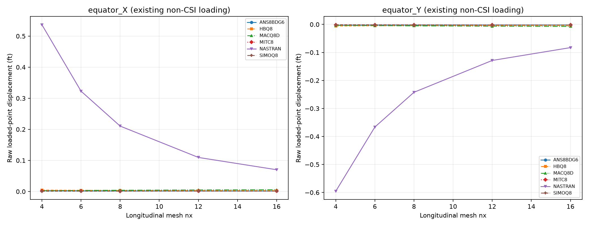

# CSI 2-007 — Hemispherical shell with edge loads

Updated 19 October 2026. Existing solver runs only; numerical results come from native OP2.

**Status: existing Q8 responses measured; DAT loading does not match CSI. No independent-reference accuracy claim. T6 2-007 input/output was not found in the verified production set.**

CSI uses radius 10 ft, thickness 0.04 ft, E=68,250,000 kip/ft², nu=0.3 and an 18° pole opening, with symmetry and radial alternating equatorial point loads of 1 kip on the quadrant. Its independent displacement is +0.0940 ft at (10,0,0), and −0.0940 ft at (0,10,0), in the load directions.

## Verified CSI reference

Reference clarified 20 October 2026 from the supplied CSI Example 2-007 pages. The reference for the **18° opening model is 0.0940 ft**. The value 0.0924 ft is a theoretical lower bound for the hemisphere **without** the opening; it is not the comparison target for this model.

| Shell option | Physical observable | Independent (ft) | CSI SAP2000 (ft) | Absolute SAP2000/reference error (%) |
|---|---|---:|---:|---:|
| Thin | UX at CSI joint 1, equatorial X end | +0.0940 | +0.0939 | 0.1064 |
| Thin | UY at CSI joint 9, equatorial Y end | −0.0940 | −0.0939 | 0.1064 |
| Thick | UX at CSI joint 1, equatorial X end | +0.0940 | +0.0927 | 1.3830 |
| Thick | UY at CSI joint 9, equatorial Y end | −0.0940 | −0.0927 | 1.3830 |

Errors in this table are recomputed as 100×abs(solver−reference)/abs(reference) from the printed displacements. CSI prints rounded signed differences of 0% for thin and −1% for thick. These SAP2000 values are published reference evidence, not outputs of the local Nastran/MYSTRAN runs. The smaller thick displacement is discussed by CSI as increased bending stiffness where shear deformation is small; it does not justify rescaling local solver results.

### Reference model and boundary conditions

- Radius 10 ft; thickness 0.04 ft; E=68,250,000 kip/ft²; nu=0.3; G=26,250,000 kip/ft². Opening half-angle 18° from the pole.
- Quarter hemisphere, original CSI mesh 8×8 area objects. Top opening and equatorial bottom edges are free apart from the stated stabilization restraint and point loads.
- Four full-model equatorial loads alternate inward/outward at 90° intervals, magnitude 2 kip. The quarter-model corner contribution is **1 kip**, giving FX=+1 kip at (10,0,0) and FY=−1 kip at (0,10,0) in the chosen basic axes.
- CSI joint-local axis 1 is radial from the sphere center; local axis 2 is horizontal and tangent to the sphere; the third axis completes the joint frame. Symmetry restrains **local U2 and R3** on both side edges. These are local components, not universal basic DOF numbers 2 and 6 at every point.
- One additional vertical translation restraint at the center of the equatorial bottom edge (CSI joint 5) stabilizes the model. Joint 1/5/9 are source-mesh labels; locate their physical coordinates when using a different quadratic mesh.

The CSI reference is now established. A matching load, symmetry frame, material/units, opening and fixed physical observation are still required before attaching reference errors to a local run. MID3 remains active for the intended thick comparison.

## Forensic finding

Existing DAT has basic FORCE CID=0, magnitude 50 at both points. At (10,0,0) its direction is (0.70710678,0.70710678,0), giving approximately (35.3553,35.3553,0) force components; at (0,10,0) it is (0,−1,0), giving (0,−50,0). Both magnitude and the first force direction differ from CSI. Scalar normalization cannot repair that physical mismatch. Additional symmetry/DOF parity must be verified before any corrected CSI run.

The observations below use exact geometry-selected equator points, CD=0, tolerance 1e-6 ft, not a maximum over arbitrary probes. Raw curves document solver response only. The old probe envelope is superseded. DAT is preserved unchanged; a corrected physical model would require a separate authorized rerun.

## Existing measured outputs

| nx | Solver/formulation | Physical point | GRID | UX or UY (ft) | CSI error |
|---|---|---|---|---|---|
| 4 | ANS8BDG6 | equator_X | 21 | 0.002399698 | — |
| 4 | ANS8BDG6 | equator_Y | 25 | -0.002781065 | — |
| 4 | HBQ8 | equator_X | 21 | 0.004580285 | — |
| 4 | HBQ8 | equator_Y | 25 | -0.005314924 | — |
| 4 | MACQ8D | equator_X | 21 | 0.002683991 | — |
| 4 | MACQ8D | equator_Y | 25 | -0.003127071 | — |
| 4 | MITC8 | equator_X | 21 | 0.001501415 | — |
| 4 | MITC8 | equator_Y | 25 | -0.001780118 | — |
| 4 | NASTRAN | equator_X | 21 | 0.5366054 | — |
| 4 | NASTRAN | equator_Y | 25 | -0.5955468 | — |
| 4 | SIMOQ8 | equator_X | 21 | 0.0009002474 | — |
| 4 | SIMOQ8 | equator_Y | 25 | -0.001143409 | — |
| 6 | ANS8BDG6 | equator_X | 43 | 0.00198326 | — |
| 6 | ANS8BDG6 | equator_Y | 49 | -0.002414595 | — |
| 6 | HBQ8 | equator_X | 43 | 0.003762207 | — |
| 6 | HBQ8 | equator_Y | 49 | -0.004482049 | — |
| 6 | MACQ8D | equator_X | 43 | 0.003443895 | — |
| 6 | MACQ8D | equator_Y | 49 | -0.004116552 | — |
| 6 | MITC8 | equator_X | 43 | 0.001294117 | — |
| 6 | MITC8 | equator_Y | 49 | -0.001638978 | — |
| 6 | NASTRAN | equator_X | 43 | 0.3228598 | — |
| 6 | NASTRAN | equator_Y | 49 | -0.3663245 | — |
| 6 | SIMOQ8 | equator_X | 43 | 0.001022905 | — |
| 6 | SIMOQ8 | equator_Y | 49 | -0.001359812 | — |
| 8 | ANS8BDG6 | equator_X | 73 | 0.001811155 | — |
| 8 | ANS8BDG6 | equator_Y | 81 | -0.002291732 | — |
| 8 | HBQ8 | equator_X | 73 | 0.003369879 | — |
| 8 | HBQ8 | equator_Y | 81 | -0.004103507 | — |
| 8 | MACQ8D | equator_X | 73 | 0.004125794 | — |
| 8 | MACQ8D | equator_Y | 81 | -0.004997212 | — |
| 8 | MITC8 | equator_X | 73 | 0.001261825 | — |
| 8 | MITC8 | equator_Y | 81 | -0.0016686 | — |
| 8 | NASTRAN | equator_X | 73 | 0.2104795 | — |
| 8 | NASTRAN | equator_Y | 81 | -0.2422509 | — |
| 8 | SIMOQ8 | equator_X | 73 | 0.001150616 | — |
| 8 | SIMOQ8 | equator_Y | 81 | -0.001564547 | — |
| 12 | ANS8BDG6 | equator_X | 157 | 0.001694588 | — |
| 12 | ANS8BDG6 | equator_Y | 169 | -0.002239815 | — |
| 12 | HBQ8 | equator_X | 157 | 0.002860556 | — |
| 12 | HBQ8 | equator_Y | 169 | -0.003598422 | — |
| 12 | MACQ8D | equator_X | 157 | 0.005136814 | — |
| 12 | MACQ8D | equator_Y | 169 | -0.00628259 | — |
| 12 | MITC8 | equator_X | 157 | 0.001342161 | — |
| 12 | MITC8 | equator_Y | 169 | -0.001835994 | — |
| 12 | NASTRAN | equator_X | 157 | 0.1096389 | — |
| 12 | NASTRAN | equator_Y | 169 | -0.1285962 | — |
| 12 | SIMOQ8 | equator_X | 157 | 0.001331889 | — |
| 12 | SIMOQ8 | equator_Y | 169 | -0.001840519 | — |
| 16 | ANS8BDG6 | equator_X | 273 | 0.00168148 | — |
| 16 | ANS8BDG6 | equator_Y | 289 | -0.002263876 | — |
| 16 | HBQ8 | equator_X | 273 | 0.002541279 | — |
| 16 | HBQ8 | equator_Y | 289 | -0.003264502 | — |
| 16 | MACQ8D | equator_X | 273 | 0.005798806 | — |
| 16 | MACQ8D | equator_Y | 289 | -0.007089869 | — |
| 16 | MITC8 | equator_X | 273 | 0.001440639 | — |
| 16 | MITC8 | equator_Y | 289 | -0.001987721 | — |
| 16 | NASTRAN | equator_X | 273 | 0.07007686 | — |
| 16 | NASTRAN | equator_Y | 289 | -0.08274896 | — |
| 16 | SIMOQ8 | equator_X | 273 | 0.00142134 | — |
| 16 | SIMOQ8 | equator_Y | 289 | -0.001975368 | — |

DAT physical signatures (GRID, elements, properties, materials, loads and SPC) match across the available solvers/formulations for each individual model. Diagnostic F06 scans found no fatal or excessive-pivot message in these re-exported runs.

## Source and reproducibility

[CSI Example 2-007](https://docs.csiamerica.com/manuals/csibridge/Verification/Analysis/Shells/Problem%202-007.pdf). Meshes were generated independently in Python, not exported from SAP2000 S2K. Original DAT and OP2 remain local. No stiffness, loads or constraints were changed for this publication update. Missing measurements are shown as —. Solver agreement alone does not establish independent accuracy.

[Benchmark index](README.md) · [All comparisons](comparison_all.md)
