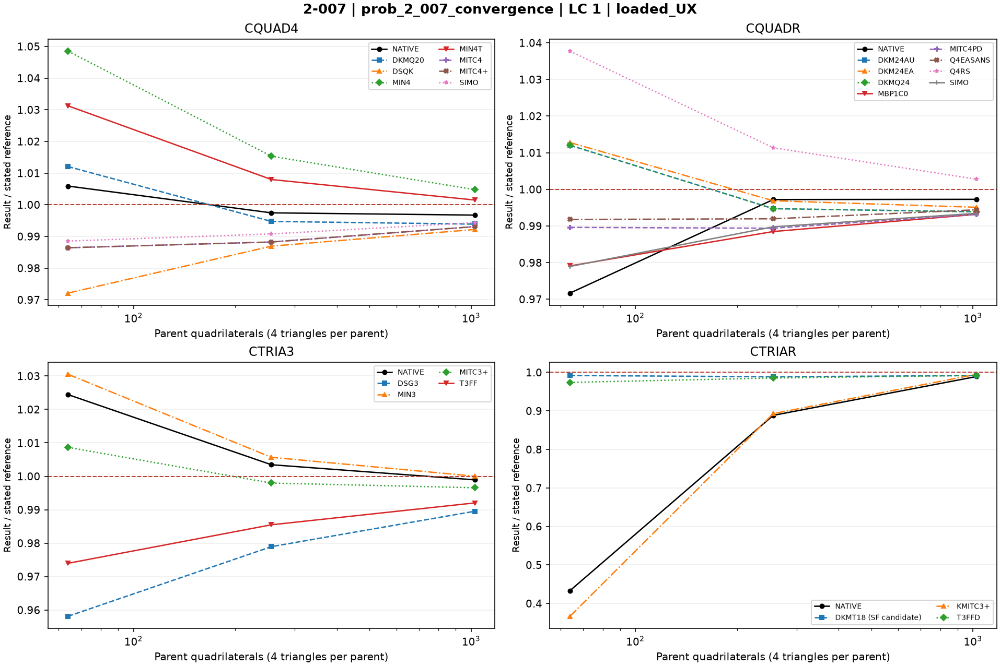
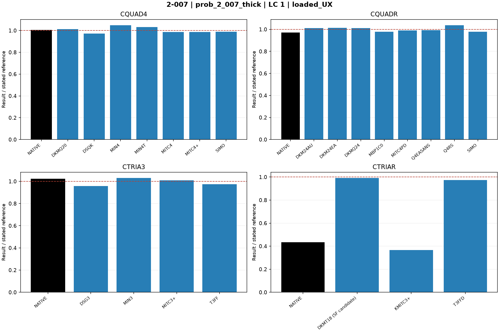

# Linear shells — 2-007: Hemispherical shell with opening

25 October 2026. Fresh native MYSTRAN and Nastran runs. CQUAD4, CQUADR, CTRIA3 and CTRIAR only.

[All linear comparisons](comparison_all_linear.md) · [Full CSV](comparison_all_linear.csv) · [Tested DAT](DAT/linear_shell_benchmark_DAT.zip) · [Linear publication QA](PUBLICATION_QA_linear.md)

Case IDs retain source-model filenames; actual element and formulation are given by their columns and deck selectors. Two-axis 2-002 tip observables use the two physical corner nodes.

NATIVE means the Nastran result for the corresponding element card: CQUAD4, CQUADR, CTRIA3 or CTRIAR. It does not mean the same proprietary interpolation as a MYSTRAN selector. Curves use independent/analytical references; published SAP2000 values are separate table columns. A completed solve is not a physical-accuracy pass. Zero references use absolute residuals; missing and failed output is never replaced by zero.

The tested source snapshot includes DKMT18 SF as an explicitly labelled candidate and corrected DSG3 local-z Kg. It is documented in [source provenance](data_linear/provenance_linear.json), with a reproducible element-local patch. This benchmark snapshot is not a declaration that SF passed every production-promotion gate. No shared eigensolver prototype is included.

## Model and comparison scope

Source 8x8 hemispherical quarter model with 18-degree hole. Independent loaded radial U=0.0940 ft. No artificial refinement or different hole-angle reference.

The additional n8,n16,n32 convergence series uses retained hemisphere geometry, nodal loads and local GRID CD frames. Loaded displacements are transformed to basic XYZ before comparison, including the negative-Y loaded boundary node.

## Extraction status

| Solver | Status | Metric rows |
|---|---|---:|
| MYSTRAN | MEASURED | 176 |
| NASTRAN | MEASURED | 32 |

## Figures

### prob_2_007_convergence · LC 1 · loaded_UX

### prob_2_007_convergence · LC 1 · loaded_UY

### prob_2_007_thick · LC 1 · loaded_UX

### prob_2_007_thick · LC 1 · loaded_UY

## Finest available mesh per named series

| Case / parent quads | Solver / formulation | LC | Quantity | Measured | Independent / analytical | CSI published | Unit | Error % primary | Absolute residual | Status |
|---|---|---:|---|---:|---:|---:|---|---:|---:|---|
| prob_2_007_convergence_n32 / 1024 | MYSTRAN CQUAD4_DKMQ20 | 1 | loaded_UX | 0.09342421 | 0.094 | 0.0927 | ft | 0.6125426 | 0.00057579 | MEASURED |
| prob_2_007_convergence_n32 / 1024 | MYSTRAN CQUAD4_DSQK | 1 | loaded_UX | 0.09326544 | 0.094 | 0.0927 | ft | 0.7814468 | 0.00073456 | MEASURED |
| prob_2_007_convergence_n32 / 1024 | MYSTRAN CQUAD4_MIN4 | 1 | loaded_UX | 0.09444891 | 0.094 | 0.0927 | ft | 0.4775638 | 0.00044891 | MEASURED |
| prob_2_007_convergence_n32 / 1024 | MYSTRAN CQUAD4_MIN4T | 1 | loaded_UX | 0.09414022 | 0.094 | 0.0927 | ft | 0.1491702 | 0.00014022 | MEASURED |
| prob_2_007_convergence_n32 / 1024 | MYSTRAN CQUAD4_MITC4 | 1 | loaded_UX | 0.09335134 | 0.094 | 0.0927 | ft | 0.6900638 | 0.00064866 | MEASURED |
| prob_2_007_convergence_n32 / 1024 | MYSTRAN CQUAD4_MITC4plus | 1 | loaded_UX | 0.09335134 | 0.094 | 0.0927 | ft | 0.6900638 | 0.00064866 | MEASURED |
| prob_2_007_convergence_n32 / 1024 | MYSTRAN CQUAD4_SIMO | 1 | loaded_UX | 0.0934677 | 0.094 | 0.0927 | ft | 0.5662766 | 0.0005323 | MEASURED |
| prob_2_007_convergence_n32 / 1024 | MYSTRAN CQUADR_DKM24AU | 1 | loaded_UX | 0.09342421 | 0.094 | 0.0927 | ft | 0.6125426 | 0.00057579 | MEASURED |
| prob_2_007_convergence_n32 / 1024 | MYSTRAN CQUADR_DKM24EA | 1 | loaded_UX | 0.09354003 | 0.094 | 0.0927 | ft | 0.4893298 | 0.00045997 | MEASURED |
| prob_2_007_convergence_n32 / 1024 | MYSTRAN CQUADR_DKMQ24 | 1 | loaded_UX | 0.09342421 | 0.094 | 0.0927 | ft | 0.6125426 | 0.00057579 | MEASURED |
| prob_2_007_convergence_n32 / 1024 | MYSTRAN CQUADR_MBP1C0 | 1 | loaded_UX | 0.09335853 | 0.094 | 0.0927 | ft | 0.6824149 | 0.00064147 | MEASURED |
| prob_2_007_convergence_n32 / 1024 | MYSTRAN CQUADR_MITC4PD | 1 | loaded_UX | 0.0933588 | 0.094 | 0.0927 | ft | 0.6821277 | 0.0006412 | MEASURED |
| prob_2_007_convergence_n32 / 1024 | MYSTRAN CQUADR_Q4EASANS | 1 | loaded_UX | 0.09347556 | 0.094 | 0.0927 | ft | 0.5579149 | 0.00052444 | MEASURED |
| prob_2_007_convergence_n32 / 1024 | MYSTRAN CQUADR_Q4RS | 1 | loaded_UX | 0.09426118 | 0.094 | 0.0927 | ft | 0.2778511 | 0.00026118 | MEASURED |
| prob_2_007_convergence_n32 / 1024 | MYSTRAN CQUADR_SIMO | 1 | loaded_UX | 0.09338495 | 0.094 | 0.0927 | ft | 0.6543085 | 0.00061505 | MEASURED |
| prob_2_007_convergence_n32 / 1024 | MYSTRAN CTRIA3_DSG3 | 1 | loaded_UX | 0.09301597 | 0.094 | 0.0927 | ft | 1.04684 | 0.00098403 | MEASURED |
| prob_2_007_convergence_n32 / 1024 | MYSTRAN CTRIA3_MIN3 | 1 | loaded_UX | 0.09400245 | 0.094 | 0.0927 | ft | 0.002606383 | 2.45e-06 | MEASURED |
| prob_2_007_convergence_n32 / 1024 | MYSTRAN CTRIA3_MITC3plus | 1 | loaded_UX | 0.09367761 | 0.094 | 0.0927 | ft | 0.3429681 | 0.00032239 | MEASURED |
| prob_2_007_convergence_n32 / 1024 | MYSTRAN CTRIA3_T3FF | 1 | loaded_UX | 0.09325048 | 0.094 | 0.0927 | ft | 0.7973617 | 0.00074952 | MEASURED |
| prob_2_007_convergence_n32 / 1024 | MYSTRAN CTRIAR_DKMT18 (SF candidate) | 1 | loaded_UX | 0.09323182 | 0.094 | 0.0927 | ft | 0.8172128 | 0.00076818 | MEASURED |
| prob_2_007_convergence_n32 / 1024 | MYSTRAN CTRIAR_KMITC3plus | 1 | loaded_UX | 0.09352753 | 0.094 | 0.0927 | ft | 0.5026277 | 0.00047247 | MEASURED |
| prob_2_007_convergence_n32 / 1024 | MYSTRAN CTRIAR_T3FFD | 1 | loaded_UX | 0.09325048 | 0.094 | 0.0927 | ft | 0.7973617 | 0.00074952 | MEASURED |
| prob_2_007_convergence_n32 / 1024 | NASTRAN CQUAD4_NATIVE | 1 | loaded_UX | 0.09369245 | 0.094 | 0.0927 | ft | 0.3271809 | 0.00030755 | MEASURED |
| prob_2_007_convergence_n32 / 1024 | NASTRAN CQUADR_NATIVE | 1 | loaded_UX | 0.09374436 | 0.094 | 0.0927 | ft | 0.2719574 | 0.00025564 | MEASURED |
| prob_2_007_convergence_n32 / 1024 | NASTRAN CTRIA3_NATIVE | 1 | loaded_UX | 0.09390018 | 0.094 | 0.0927 | ft | 0.1061915 | 9.982e-05 | MEASURED |
| prob_2_007_convergence_n32 / 1024 | NASTRAN CTRIAR_NATIVE | 1 | loaded_UX | 0.09298579 | 0.094 | 0.0927 | ft | 1.078947 | 0.00101421 | MEASURED |
| prob_2_007_convergence_n32 / 1024 | MYSTRAN CQUAD4_DKMQ20 | 1 | loaded_UY | -0.09342421 | -0.094 | -0.0927 | ft | 0.6125426 | 0.00057579 | MEASURED |
| prob_2_007_convergence_n32 / 1024 | MYSTRAN CQUAD4_DSQK | 1 | loaded_UY | -0.09326544 | -0.094 | -0.0927 | ft | 0.7814468 | 0.00073456 | MEASURED |
| prob_2_007_convergence_n32 / 1024 | MYSTRAN CQUAD4_MIN4 | 1 | loaded_UY | -0.09444891 | -0.094 | -0.0927 | ft | 0.4775638 | 0.00044891 | MEASURED |
| prob_2_007_convergence_n32 / 1024 | MYSTRAN CQUAD4_MIN4T | 1 | loaded_UY | -0.09414022 | -0.094 | -0.0927 | ft | 0.1491702 | 0.00014022 | MEASURED |
| prob_2_007_convergence_n32 / 1024 | MYSTRAN CQUAD4_MITC4 | 1 | loaded_UY | -0.09335134 | -0.094 | -0.0927 | ft | 0.6900638 | 0.00064866 | MEASURED |
| prob_2_007_convergence_n32 / 1024 | MYSTRAN CQUAD4_MITC4plus | 1 | loaded_UY | -0.09335134 | -0.094 | -0.0927 | ft | 0.6900638 | 0.00064866 | MEASURED |
| prob_2_007_convergence_n32 / 1024 | MYSTRAN CQUAD4_SIMO | 1 | loaded_UY | -0.0934677 | -0.094 | -0.0927 | ft | 0.5662766 | 0.0005323 | MEASURED |
| prob_2_007_convergence_n32 / 1024 | MYSTRAN CQUADR_DKM24AU | 1 | loaded_UY | -0.09342421 | -0.094 | -0.0927 | ft | 0.6125426 | 0.00057579 | MEASURED |
| prob_2_007_convergence_n32 / 1024 | MYSTRAN CQUADR_DKM24EA | 1 | loaded_UY | -0.09354003 | -0.094 | -0.0927 | ft | 0.4893298 | 0.00045997 | MEASURED |
| prob_2_007_convergence_n32 / 1024 | MYSTRAN CQUADR_DKMQ24 | 1 | loaded_UY | -0.09342421 | -0.094 | -0.0927 | ft | 0.6125426 | 0.00057579 | MEASURED |
| prob_2_007_convergence_n32 / 1024 | MYSTRAN CQUADR_MBP1C0 | 1 | loaded_UY | -0.09335853 | -0.094 | -0.0927 | ft | 0.6824149 | 0.00064147 | MEASURED |
| prob_2_007_convergence_n32 / 1024 | MYSTRAN CQUADR_MITC4PD | 1 | loaded_UY | -0.0933588 | -0.094 | -0.0927 | ft | 0.6821277 | 0.0006412 | MEASURED |
| prob_2_007_convergence_n32 / 1024 | MYSTRAN CQUADR_Q4EASANS | 1 | loaded_UY | -0.09347556 | -0.094 | -0.0927 | ft | 0.5579149 | 0.00052444 | MEASURED |
| prob_2_007_convergence_n32 / 1024 | MYSTRAN CQUADR_Q4RS | 1 | loaded_UY | -0.09426118 | -0.094 | -0.0927 | ft | 0.2778511 | 0.00026118 | MEASURED |
| prob_2_007_convergence_n32 / 1024 | MYSTRAN CQUADR_SIMO | 1 | loaded_UY | -0.09338495 | -0.094 | -0.0927 | ft | 0.6543085 | 0.00061505 | MEASURED |
| prob_2_007_convergence_n32 / 1024 | MYSTRAN CTRIA3_DSG3 | 1 | loaded_UY | -0.09301597 | -0.094 | -0.0927 | ft | 1.04684 | 0.00098403 | MEASURED |
| prob_2_007_convergence_n32 / 1024 | MYSTRAN CTRIA3_MIN3 | 1 | loaded_UY | -0.09400245 | -0.094 | -0.0927 | ft | 0.002606383 | 2.45e-06 | MEASURED |
| prob_2_007_convergence_n32 / 1024 | MYSTRAN CTRIA3_MITC3plus | 1 | loaded_UY | -0.09367761 | -0.094 | -0.0927 | ft | 0.3429681 | 0.00032239 | MEASURED |
| prob_2_007_convergence_n32 / 1024 | MYSTRAN CTRIA3_T3FF | 1 | loaded_UY | -0.09325048 | -0.094 | -0.0927 | ft | 0.7973617 | 0.00074952 | MEASURED |
| prob_2_007_convergence_n32 / 1024 | MYSTRAN CTRIAR_DKMT18 (SF candidate) | 1 | loaded_UY | -0.09323182 | -0.094 | -0.0927 | ft | 0.8172128 | 0.00076818 | MEASURED |
| prob_2_007_convergence_n32 / 1024 | MYSTRAN CTRIAR_KMITC3plus | 1 | loaded_UY | -0.09352753 | -0.094 | -0.0927 | ft | 0.5026277 | 0.00047247 | MEASURED |
| prob_2_007_convergence_n32 / 1024 | MYSTRAN CTRIAR_T3FFD | 1 | loaded_UY | -0.09325048 | -0.094 | -0.0927 | ft | 0.7973617 | 0.00074952 | MEASURED |
| prob_2_007_convergence_n32 / 1024 | NASTRAN CQUAD4_NATIVE | 1 | loaded_UY | -0.09369245 | -0.094 | -0.0927 | ft | 0.3271809 | 0.00030755 | MEASURED |
| prob_2_007_convergence_n32 / 1024 | NASTRAN CQUADR_NATIVE | 1 | loaded_UY | -0.09374436 | -0.094 | -0.0927 | ft | 0.2719574 | 0.00025564 | MEASURED |
| prob_2_007_convergence_n32 / 1024 | NASTRAN CTRIA3_NATIVE | 1 | loaded_UY | -0.09390018 | -0.094 | -0.0927 | ft | 0.1061915 | 9.982e-05 | MEASURED |
| prob_2_007_convergence_n32 / 1024 | NASTRAN CTRIAR_NATIVE | 1 | loaded_UY | -0.09298123 | -0.094 | -0.0927 | ft | 1.083798 | 0.00101877 | MEASURED |
| prob_2_007_thick_cquadr_simo / 64 | MYSTRAN CQUAD4_DKMQ20 | 1 | loaded_UX | 0.09513169 | 0.094 | 0.0927 | ft | 1.203926 | 0.00113169 | MEASURED |
| prob_2_007_thick_cquadr_simo / 64 | MYSTRAN CQUAD4_DSQK | 1 | loaded_UX | 0.09137792 | 0.094 | 0.0927 | ft | 2.789447 | 0.00262208 | MEASURED |
| prob_2_007_thick_cquadr_simo / 64 | MYSTRAN CQUAD4_MIN4 | 1 | loaded_UX | 0.09855813 | 0.094 | 0.0927 | ft | 4.849074 | 0.00455813 | MEASURED |
| prob_2_007_thick_cquadr_simo / 64 | MYSTRAN CQUAD4_MIN4T | 1 | loaded_UX | 0.09693465 | 0.094 | 0.0927 | ft | 3.121968 | 0.00293465 | MEASURED |
| prob_2_007_thick_cquadr_simo / 64 | MYSTRAN CQUAD4_MITC4 | 1 | loaded_UX | 0.09272317 | 0.094 | 0.0927 | ft | 1.35833 | 0.00127683 | MEASURED |
| prob_2_007_thick_cquadr_simo / 64 | MYSTRAN CQUAD4_MITC4plus | 1 | loaded_UX | 0.09272317 | 0.094 | 0.0927 | ft | 1.35833 | 0.00127683 | MEASURED |
| prob_2_007_thick_cquadr_simo / 64 | MYSTRAN CQUAD4_SIMO | 1 | loaded_UX | 0.09292198 | 0.094 | 0.0927 | ft | 1.14683 | 0.00107802 | MEASURED |
| prob_2_007_thick_cquadr_simo / 64 | MYSTRAN CQUADR_DKM24AU | 1 | loaded_UX | 0.09513169 | 0.094 | 0.0927 | ft | 1.203926 | 0.00113169 | MEASURED |
| prob_2_007_thick_cquadr_simo / 64 | MYSTRAN CQUADR_DKM24EA | 1 | loaded_UX | 0.0952008 | 0.094 | 0.0927 | ft | 1.277447 | 0.0012008 | MEASURED |
| prob_2_007_thick_cquadr_simo / 64 | MYSTRAN CQUADR_DKMQ24 | 1 | loaded_UX | 0.09513169 | 0.094 | 0.0927 | ft | 1.203926 | 0.00113169 | MEASURED |
| prob_2_007_thick_cquadr_simo / 64 | MYSTRAN CQUADR_MBP1C0 | 1 | loaded_UX | 0.09203652 | 0.094 | 0.0927 | ft | 2.088809 | 0.00196348 | MEASURED |
| prob_2_007_thick_cquadr_simo / 64 | MYSTRAN CQUADR_MITC4PD | 1 | loaded_UX | 0.09302388 | 0.094 | 0.0927 | ft | 1.038426 | 0.00097612 | MEASURED |
| prob_2_007_thick_cquadr_simo / 64 | MYSTRAN CQUADR_Q4EASANS | 1 | loaded_UX | 0.093228 | 0.094 | 0.0927 | ft | 0.8212766 | 0.000772 | MEASURED |
| prob_2_007_thick_cquadr_simo / 64 | MYSTRAN CQUADR_Q4RS | 1 | loaded_UX | 0.097546 | 0.094 | 0.0927 | ft | 3.77234 | 0.003546 | MEASURED |
| prob_2_007_thick_cquadr_simo / 64 | MYSTRAN CQUADR_SIMO | 1 | loaded_UX | 0.09202135 | 0.094 | 0.0927 | ft | 2.104947 | 0.00197865 | MEASURED |
| prob_2_007_thick_cquadr_simo / 64 | MYSTRAN CTRIA3_DSG3 | 1 | loaded_UX | 0.09006307 | 0.094 | 0.0927 | ft | 4.188223 | 0.00393693 | MEASURED |
| prob_2_007_thick_cquadr_simo / 64 | MYSTRAN CTRIA3_MIN3 | 1 | loaded_UX | 0.09686783 | 0.094 | 0.0927 | ft | 3.050883 | 0.00286783 | MEASURED |
| prob_2_007_thick_cquadr_simo / 64 | MYSTRAN CTRIA3_MITC3plus | 1 | loaded_UX | 0.09481228 | 0.094 | 0.0927 | ft | 0.8641277 | 0.00081228 | MEASURED |
| prob_2_007_thick_cquadr_simo / 64 | MYSTRAN CTRIA3_T3FF | 1 | loaded_UX | 0.09155309 | 0.094 | 0.0927 | ft | 2.603096 | 0.00244691 | MEASURED |
| prob_2_007_thick_cquadr_simo / 64 | MYSTRAN CTRIAR_DKMT18 (SF candidate) | 1 | loaded_UX | 0.09324194 | 0.094 | 0.0927 | ft | 0.8064468 | 0.00075806 | MEASURED |
| prob_2_007_thick_cquadr_simo / 64 | MYSTRAN CTRIAR_KMITC3plus | 1 | loaded_UX | 0.03447456 | 0.094 | 0.0927 | ft | 63.32494 | 0.05952544 | MEASURED |
| prob_2_007_thick_cquadr_simo / 64 | MYSTRAN CTRIAR_T3FFD | 1 | loaded_UX | 0.09155309 | 0.094 | 0.0927 | ft | 2.603096 | 0.00244691 | MEASURED |
| prob_2_007_thick_cquadr_simo / 64 | NASTRAN CQUAD4_NATIVE | 1 | loaded_UX | 0.09455377 | 0.094 | 0.0927 | ft | 0.589117 | 0.00055377 | MEASURED |
| prob_2_007_thick_cquadr_simo / 64 | NASTRAN CQUADR_NATIVE | 1 | loaded_UX | 0.09133856 | 0.094 | 0.0927 | ft | 2.831319 | 0.00266144 | MEASURED |
| prob_2_007_thick_cquadr_simo / 64 | NASTRAN CTRIA3_NATIVE | 1 | loaded_UX | 0.09629644 | 0.094 | 0.0927 | ft | 2.443021 | 0.00229644 | MEASURED |
| prob_2_007_thick_cquadr_simo / 64 | NASTRAN CTRIAR_NATIVE | 1 | loaded_UX | 0.0407251 | 0.094 | 0.0927 | ft | 56.67543 | 0.0532749 | MEASURED |
| prob_2_007_thick_cquadr_simo / 64 | MYSTRAN CQUAD4_DKMQ20 | 1 | loaded_UY | -0.09513169 | -0.094 | -0.0927 | ft | 1.203926 | 0.00113169 | MEASURED |
| prob_2_007_thick_cquadr_simo / 64 | MYSTRAN CQUAD4_DSQK | 1 | loaded_UY | -0.09137792 | -0.094 | -0.0927 | ft | 2.789447 | 0.00262208 | MEASURED |
| prob_2_007_thick_cquadr_simo / 64 | MYSTRAN CQUAD4_MIN4 | 1 | loaded_UY | -0.09855813 | -0.094 | -0.0927 | ft | 4.849074 | 0.00455813 | MEASURED |
| prob_2_007_thick_cquadr_simo / 64 | MYSTRAN CQUAD4_MIN4T | 1 | loaded_UY | -0.09693465 | -0.094 | -0.0927 | ft | 3.121968 | 0.00293465 | MEASURED |
| prob_2_007_thick_cquadr_simo / 64 | MYSTRAN CQUAD4_MITC4 | 1 | loaded_UY | -0.09272317 | -0.094 | -0.0927 | ft | 1.35833 | 0.00127683 | MEASURED |
| prob_2_007_thick_cquadr_simo / 64 | MYSTRAN CQUAD4_MITC4plus | 1 | loaded_UY | -0.09272317 | -0.094 | -0.0927 | ft | 1.35833 | 0.00127683 | MEASURED |
| prob_2_007_thick_cquadr_simo / 64 | MYSTRAN CQUAD4_SIMO | 1 | loaded_UY | -0.09292198 | -0.094 | -0.0927 | ft | 1.14683 | 0.00107802 | MEASURED |
| prob_2_007_thick_cquadr_simo / 64 | MYSTRAN CQUADR_DKM24AU | 1 | loaded_UY | -0.09513169 | -0.094 | -0.0927 | ft | 1.203926 | 0.00113169 | MEASURED |
| prob_2_007_thick_cquadr_simo / 64 | MYSTRAN CQUADR_DKM24EA | 1 | loaded_UY | -0.0952008 | -0.094 | -0.0927 | ft | 1.277447 | 0.0012008 | MEASURED |
| prob_2_007_thick_cquadr_simo / 64 | MYSTRAN CQUADR_DKMQ24 | 1 | loaded_UY | -0.09513169 | -0.094 | -0.0927 | ft | 1.203926 | 0.00113169 | MEASURED |
| prob_2_007_thick_cquadr_simo / 64 | MYSTRAN CQUADR_MBP1C0 | 1 | loaded_UY | -0.09203652 | -0.094 | -0.0927 | ft | 2.088809 | 0.00196348 | MEASURED |
| prob_2_007_thick_cquadr_simo / 64 | MYSTRAN CQUADR_MITC4PD | 1 | loaded_UY | -0.09302388 | -0.094 | -0.0927 | ft | 1.038426 | 0.00097612 | MEASURED |
| prob_2_007_thick_cquadr_simo / 64 | MYSTRAN CQUADR_Q4EASANS | 1 | loaded_UY | -0.093228 | -0.094 | -0.0927 | ft | 0.8212766 | 0.000772 | MEASURED |
| prob_2_007_thick_cquadr_simo / 64 | MYSTRAN CQUADR_Q4RS | 1 | loaded_UY | -0.097546 | -0.094 | -0.0927 | ft | 3.77234 | 0.003546 | MEASURED |
| prob_2_007_thick_cquadr_simo / 64 | MYSTRAN CQUADR_SIMO | 1 | loaded_UY | -0.09202135 | -0.094 | -0.0927 | ft | 2.104947 | 0.00197865 | MEASURED |
| prob_2_007_thick_cquadr_simo / 64 | MYSTRAN CTRIA3_DSG3 | 1 | loaded_UY | -0.09006307 | -0.094 | -0.0927 | ft | 4.188223 | 0.00393693 | MEASURED |
| prob_2_007_thick_cquadr_simo / 64 | MYSTRAN CTRIA3_MIN3 | 1 | loaded_UY | -0.09686783 | -0.094 | -0.0927 | ft | 3.050883 | 0.00286783 | MEASURED |
| prob_2_007_thick_cquadr_simo / 64 | MYSTRAN CTRIA3_MITC3plus | 1 | loaded_UY | -0.09481228 | -0.094 | -0.0927 | ft | 0.8641277 | 0.00081228 | MEASURED |
| prob_2_007_thick_cquadr_simo / 64 | MYSTRAN CTRIA3_T3FF | 1 | loaded_UY | -0.09155309 | -0.094 | -0.0927 | ft | 2.603096 | 0.00244691 | MEASURED |
| prob_2_007_thick_cquadr_simo / 64 | MYSTRAN CTRIAR_DKMT18 (SF candidate) | 1 | loaded_UY | -0.09324194 | -0.094 | -0.0927 | ft | 0.8064468 | 0.00075806 | MEASURED |
| prob_2_007_thick_cquadr_simo / 64 | MYSTRAN CTRIAR_KMITC3plus | 1 | loaded_UY | -0.03447456 | -0.094 | -0.0927 | ft | 63.32494 | 0.05952544 | MEASURED |
| prob_2_007_thick_cquadr_simo / 64 | MYSTRAN CTRIAR_T3FFD | 1 | loaded_UY | -0.09155309 | -0.094 | -0.0927 | ft | 2.603096 | 0.00244691 | MEASURED |
| prob_2_007_thick_cquadr_simo / 64 | NASTRAN CQUAD4_NATIVE | 1 | loaded_UY | -0.09455377 | -0.094 | -0.0927 | ft | 0.589117 | 0.00055377 | MEASURED |
| prob_2_007_thick_cquadr_simo / 64 | NASTRAN CQUADR_NATIVE | 1 | loaded_UY | -0.09133856 | -0.094 | -0.0927 | ft | 2.831319 | 0.00266144 | MEASURED |
| prob_2_007_thick_cquadr_simo / 64 | NASTRAN CTRIA3_NATIVE | 1 | loaded_UY | -0.09629644 | -0.094 | -0.0927 | ft | 2.443021 | 0.00229644 | MEASURED |
| prob_2_007_thick_cquadr_simo / 64 | NASTRAN CTRIAR_NATIVE | 1 | loaded_UY | -0.04061543 | -0.094 | -0.0927 | ft | 56.7921 | 0.05338457 | MEASURED |

All mesh rows, missing fields, hashes and run statuses remain in the CSV.
