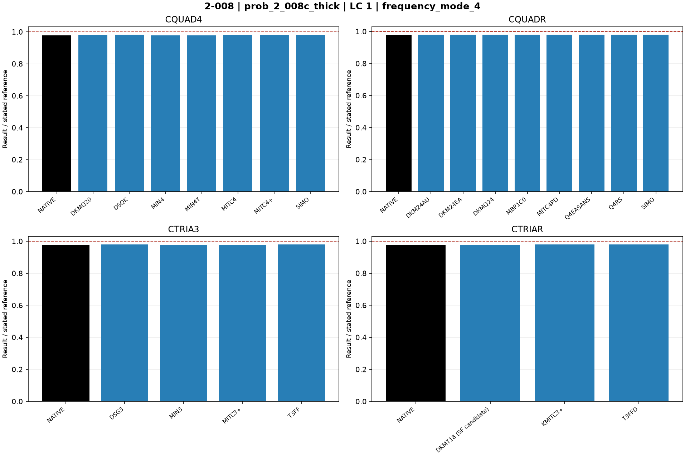
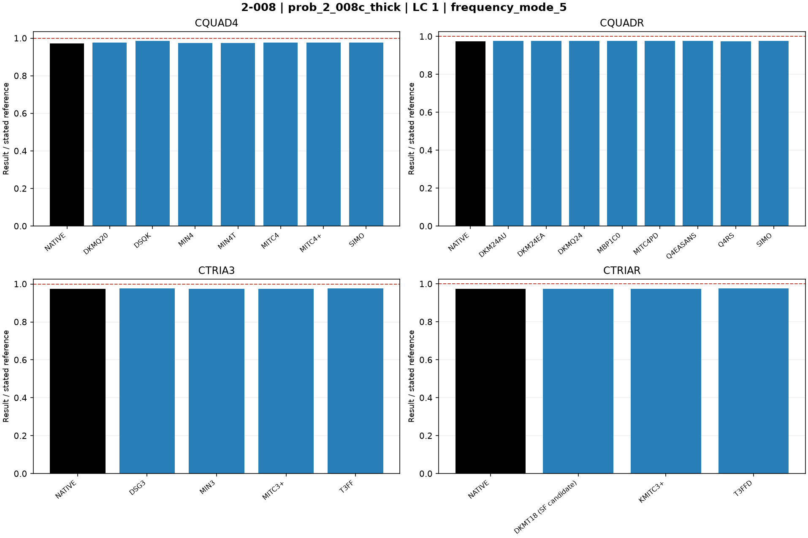

# Linear shells — 2-008: Plate vibration: Model C

25 October 2026. Fresh native MYSTRAN and Nastran runs. CQUAD4, CQUADR, CTRIA3 and CTRIAR only.

[All linear comparisons](comparison_all_linear.md) · [Full ZIP](comparison_all_linear.zip) · [Tested DAT](DAT/linear_shell_benchmark_DAT.zip) · [Linear publication QA](PUBLICATION_QA_linear.md)

Case IDs retain source-model filenames; actual element and formulation are given by their columns and deck selectors. Two-axis 2-002 tip observables use the two physical corner nodes.

NATIVE means the Nastran result for the corresponding element card: CQUAD4, CQUADR, CTRIA3 or CTRIAR. It does not mean the same proprietary interpolation as a MYSTRAN selector. Curves use independent/analytical references; published SAP2000 values are separate table columns. A completed solve is not a physical-accuracy pass. Zero references use absolute residuals; missing and failed output is never replaced by zero.

The tested source snapshot includes DKMT18 SF as an explicitly labelled candidate and corrected DSG3 local-z Kg. It is documented in [source provenance](data_linear/provenance_linear.json), with a reproducible element-local patch. This benchmark snapshot is not a declaration that SF passed every production-promotion gate. No shared eigensolver prototype is included.

## Model and comparison scope

Model C only: source single area auto-meshed 40x40, compared with supplied explicit 40x40 DAT. Added area mass 7.35e-7; independent periods 0.01723,0.00704,0.00281,0.00219,0.00193 s. Mode order retained.

## Extraction status

| Solver | Status | Metric rows |
|---|---|---:|
| MYSTRAN | MEASURED | 110 |
| NASTRAN | MEASURED | 20 |

## Figures

### prob_2_008c_thick · LC 1 · frequency_mode_1

### prob_2_008c_thick · LC 1 · frequency_mode_2

### prob_2_008c_thick · LC 1 · frequency_mode_3

### prob_2_008c_thick · LC 1 · frequency_mode_4

### prob_2_008c_thick · LC 1 · frequency_mode_5

## Finest available mesh per named series

| Case / parent quads | Solver / formulation | LC | Quantity | Measured | Independent / analytical | CSI published | Unit | Error % primary | Absolute residual | Status |
|---|---|---:|---|---:|---:|---:|---|---:|---:|---|
| prob_2_008c_thick / 1600 | MYSTRAN CQUAD4_DKMQ20 | 1 | frequency_mode_1 | 57.52656 | 58.03831 | 57.50431 | Hz | 0.8817371 | 0.5117453 | MEASURED |
| prob_2_008c_thick / 1600 | MYSTRAN CQUAD4_DSQK | 1 | frequency_mode_1 | 57.6068 | 58.03831 | 57.50431 | Hz | 0.7434836 | 0.4315053 | MEASURED |
| prob_2_008c_thick / 1600 | MYSTRAN CQUAD4_MIN4 | 1 | frequency_mode_1 | 57.51241 | 58.03831 | 57.50431 | Hz | 0.9061176 | 0.5258953 | MEASURED |
| prob_2_008c_thick / 1600 | MYSTRAN CQUAD4_MIN4T | 1 | frequency_mode_1 | 57.51061 | 58.03831 | 57.50431 | Hz | 0.909219 | 0.5276953 | MEASURED |
| prob_2_008c_thick / 1600 | MYSTRAN CQUAD4_MITC4 | 1 | frequency_mode_1 | 57.53451 | 58.03831 | 57.50431 | Hz | 0.8680393 | 0.5037953 | MEASURED |
| prob_2_008c_thick / 1600 | MYSTRAN CQUAD4_MITC4plus | 1 | frequency_mode_1 | 57.53451 | 58.03831 | 57.50431 | Hz | 0.8680393 | 0.5037953 | MEASURED |
| prob_2_008c_thick / 1600 | MYSTRAN CQUAD4_SIMO | 1 | frequency_mode_1 | 57.53451 | 58.03831 | 57.50431 | Hz | 0.8680393 | 0.5037953 | MEASURED |
| prob_2_008c_thick / 1600 | MYSTRAN CQUADR_DKM24AU | 1 | frequency_mode_1 | 57.52656 | 58.03831 | 57.50431 | Hz | 0.8817371 | 0.5117453 | MEASURED |
| prob_2_008c_thick / 1600 | MYSTRAN CQUADR_DKM24EA | 1 | frequency_mode_1 | 57.52656 | 58.03831 | 57.50431 | Hz | 0.8817371 | 0.5117453 | MEASURED |
| prob_2_008c_thick / 1600 | MYSTRAN CQUADR_DKMQ24 | 1 | frequency_mode_1 | 57.52656 | 58.03831 | 57.50431 | Hz | 0.8817371 | 0.5117453 | MEASURED |
| prob_2_008c_thick / 1600 | MYSTRAN CQUADR_MBP1C0 | 1 | frequency_mode_1 | 57.53451 | 58.03831 | 57.50431 | Hz | 0.8680393 | 0.5037953 | MEASURED |
| prob_2_008c_thick / 1600 | MYSTRAN CQUADR_MITC4PD | 1 | frequency_mode_1 | 57.53451 | 58.03831 | 57.50431 | Hz | 0.8680393 | 0.5037953 | MEASURED |
| prob_2_008c_thick / 1600 | MYSTRAN CQUADR_Q4EASANS | 1 | frequency_mode_1 | 57.53451 | 58.03831 | 57.50431 | Hz | 0.8680393 | 0.5037953 | MEASURED |
| prob_2_008c_thick / 1600 | MYSTRAN CQUADR_Q4RS | 1 | frequency_mode_1 | 57.51982 | 58.03831 | 57.50431 | Hz | 0.8933501 | 0.5184853 | MEASURED |
| prob_2_008c_thick / 1600 | MYSTRAN CQUADR_SIMO | 1 | frequency_mode_1 | 57.53451 | 58.03831 | 57.50431 | Hz | 0.8680393 | 0.5037953 | MEASURED |
| prob_2_008c_thick / 1600 | MYSTRAN CTRIA3_DSG3 | 1 | frequency_mode_1 | 57.53439 | 58.03831 | 57.50431 | Hz | 0.868246 | 0.5039153 | MEASURED |
| prob_2_008c_thick / 1600 | MYSTRAN CTRIA3_MIN3 | 1 | frequency_mode_1 | 57.51861 | 58.03831 | 57.50431 | Hz | 0.895435 | 0.5196953 | MEASURED |
| prob_2_008c_thick / 1600 | MYSTRAN CTRIA3_MITC3plus | 1 | frequency_mode_1 | 57.52056 | 58.03831 | 57.50431 | Hz | 0.8920751 | 0.5177453 | MEASURED |
| prob_2_008c_thick / 1600 | MYSTRAN CTRIA3_T3FF | 1 | frequency_mode_1 | 57.52922 | 58.03831 | 57.50431 | Hz | 0.8771539 | 0.5090853 | MEASURED |
| prob_2_008c_thick / 1600 | MYSTRAN CTRIAR_DKMT18 (SF candidate) | 1 | frequency_mode_1 | 57.50835 | 58.03831 | 57.50431 | Hz | 0.913113 | 0.5299553 | MEASURED |
| prob_2_008c_thick / 1600 | MYSTRAN CTRIAR_KMITC3plus | 1 | frequency_mode_1 | 57.52192 | 58.03831 | 57.50431 | Hz | 0.8897318 | 0.5163853 | MEASURED |
| prob_2_008c_thick / 1600 | MYSTRAN CTRIAR_T3FFD | 1 | frequency_mode_1 | 57.52922 | 58.03831 | 57.50431 | Hz | 0.8771539 | 0.5090853 | MEASURED |
| prob_2_008c_thick / 1600 | NASTRAN CQUAD4_NATIVE | 1 | frequency_mode_1 | 57.50774 | 58.03831 | 57.50431 | Hz | 0.914164 | 0.5305653 | MEASURED |
| prob_2_008c_thick / 1600 | NASTRAN CQUADR_NATIVE | 1 | frequency_mode_1 | 57.51088 | 58.03831 | 57.50431 | Hz | 0.9087538 | 0.5274253 | MEASURED |
| prob_2_008c_thick / 1600 | NASTRAN CTRIA3_NATIVE | 1 | frequency_mode_1 | 57.51802 | 58.03831 | 57.50431 | Hz | 0.8964515 | 0.5202853 | MEASURED |
| prob_2_008c_thick / 1600 | NASTRAN CTRIAR_NATIVE | 1 | frequency_mode_1 | 57.52041 | 58.03831 | 57.50431 | Hz | 0.8923336 | 0.5178953 | MEASURED |
| prob_2_008c_thick / 1600 | MYSTRAN CQUAD4_DKMQ20 | 1 | frequency_mode_2 | 139.6051 | 142.0455 | 140.4494 | Hz | 1.71801 | 2.440355 | MEASURED |
| prob_2_008c_thick / 1600 | MYSTRAN CQUAD4_DSQK | 1 | frequency_mode_2 | 140.7792 | 142.0455 | 140.4494 | Hz | 0.8914432 | 1.266255 | MEASURED |
| prob_2_008c_thick / 1600 | MYSTRAN CQUAD4_MIN4 | 1 | frequency_mode_2 | 139.3645 | 142.0455 | 140.4494 | Hz | 1.887392 | 2.680955 | MEASURED |
| prob_2_008c_thick / 1600 | MYSTRAN CQUAD4_MIN4T | 1 | frequency_mode_2 | 139.373 | 142.0455 | 140.4494 | Hz | 1.881408 | 2.672455 | MEASURED |
| prob_2_008c_thick / 1600 | MYSTRAN CQUAD4_MITC4 | 1 | frequency_mode_2 | 139.5671 | 142.0455 | 140.4494 | Hz | 1.744762 | 2.478355 | MEASURED |
| prob_2_008c_thick / 1600 | MYSTRAN CQUAD4_MITC4plus | 1 | frequency_mode_2 | 139.5671 | 142.0455 | 140.4494 | Hz | 1.744762 | 2.478355 | MEASURED |
| prob_2_008c_thick / 1600 | MYSTRAN CQUAD4_SIMO | 1 | frequency_mode_2 | 139.5671 | 142.0455 | 140.4494 | Hz | 1.744762 | 2.478355 | MEASURED |
| prob_2_008c_thick / 1600 | MYSTRAN CQUADR_DKM24AU | 1 | frequency_mode_2 | 139.6051 | 142.0455 | 140.4494 | Hz | 1.71801 | 2.440355 | MEASURED |
| prob_2_008c_thick / 1600 | MYSTRAN CQUADR_DKM24EA | 1 | frequency_mode_2 | 139.6051 | 142.0455 | 140.4494 | Hz | 1.71801 | 2.440355 | MEASURED |
| prob_2_008c_thick / 1600 | MYSTRAN CQUADR_DKMQ24 | 1 | frequency_mode_2 | 139.6051 | 142.0455 | 140.4494 | Hz | 1.71801 | 2.440355 | MEASURED |
| prob_2_008c_thick / 1600 | MYSTRAN CQUADR_MBP1C0 | 1 | frequency_mode_2 | 139.5671 | 142.0455 | 140.4494 | Hz | 1.744762 | 2.478355 | MEASURED |
| prob_2_008c_thick / 1600 | MYSTRAN CQUADR_MITC4PD | 1 | frequency_mode_2 | 139.5671 | 142.0455 | 140.4494 | Hz | 1.744762 | 2.478355 | MEASURED |
| prob_2_008c_thick / 1600 | MYSTRAN CQUADR_Q4EASANS | 1 | frequency_mode_2 | 139.5671 | 142.0455 | 140.4494 | Hz | 1.744762 | 2.478355 | MEASURED |
| prob_2_008c_thick / 1600 | MYSTRAN CQUADR_Q4RS | 1 | frequency_mode_2 | 139.3907 | 142.0455 | 140.4494 | Hz | 1.868947 | 2.654755 | MEASURED |
| prob_2_008c_thick / 1600 | MYSTRAN CQUADR_SIMO | 1 | frequency_mode_2 | 139.5671 | 142.0455 | 140.4494 | Hz | 1.744762 | 2.478355 | MEASURED |
| prob_2_008c_thick / 1600 | MYSTRAN CTRIA3_DSG3 | 1 | frequency_mode_2 | 139.6422 | 142.0455 | 140.4494 | Hz | 1.691891 | 2.403255 | MEASURED |
| prob_2_008c_thick / 1600 | MYSTRAN CTRIA3_MIN3 | 1 | frequency_mode_2 | 139.4231 | 142.0455 | 140.4494 | Hz | 1.846138 | 2.622355 | MEASURED |
| prob_2_008c_thick / 1600 | MYSTRAN CTRIA3_MITC3plus | 1 | frequency_mode_2 | 139.4231 | 142.0455 | 140.4494 | Hz | 1.846138 | 2.622355 | MEASURED |
| prob_2_008c_thick / 1600 | MYSTRAN CTRIA3_T3FF | 1 | frequency_mode_2 | 139.5802 | 142.0455 | 140.4494 | Hz | 1.735539 | 2.465255 | MEASURED |
| prob_2_008c_thick / 1600 | MYSTRAN CTRIAR_DKMT18 (SF candidate) | 1 | frequency_mode_2 | 139.4208 | 142.0455 | 140.4494 | Hz | 1.847757 | 2.624655 | MEASURED |
| prob_2_008c_thick / 1600 | MYSTRAN CTRIAR_KMITC3plus | 1 | frequency_mode_2 | 139.4081 | 142.0455 | 140.4494 | Hz | 1.856698 | 2.637355 | MEASURED |
| prob_2_008c_thick / 1600 | MYSTRAN CTRIAR_T3FFD | 1 | frequency_mode_2 | 139.5802 | 142.0455 | 140.4494 | Hz | 1.735539 | 2.465255 | MEASURED |
| prob_2_008c_thick / 1600 | NASTRAN CQUAD4_NATIVE | 1 | frequency_mode_2 | 139.3193 | 142.0455 | 140.4494 | Hz | 1.919213 | 2.726155 | MEASURED |
| prob_2_008c_thick / 1600 | NASTRAN CQUADR_NATIVE | 1 | frequency_mode_2 | 139.3538 | 142.0455 | 140.4494 | Hz | 1.894925 | 2.691655 | MEASURED |
| prob_2_008c_thick / 1600 | NASTRAN CTRIA3_NATIVE | 1 | frequency_mode_2 | 139.3996 | 142.0455 | 140.4494 | Hz | 1.862682 | 2.645855 | MEASURED |
| prob_2_008c_thick / 1600 | NASTRAN CTRIAR_NATIVE | 1 | frequency_mode_2 | 139.4266 | 142.0455 | 140.4494 | Hz | 1.843674 | 2.618855 | MEASURED |
| prob_2_008c_thick / 1600 | MYSTRAN CQUAD4_DKMQ20 | 1 | frequency_mode_3 | 351.0174 | 355.8719 | 350.8772 | Hz | 1.364111 | 4.854486 | MEASURED |
| prob_2_008c_thick / 1600 | MYSTRAN CQUAD4_DSQK | 1 | frequency_mode_3 | 352.1364 | 355.8719 | 350.8772 | Hz | 1.049672 | 3.735486 | MEASURED |
| prob_2_008c_thick / 1600 | MYSTRAN CQUAD4_MIN4 | 1 | frequency_mode_3 | 350.3685 | 355.8719 | 350.8772 | Hz | 1.546452 | 5.503386 | MEASURED |
| prob_2_008c_thick / 1600 | MYSTRAN CQUAD4_MIN4T | 1 | frequency_mode_3 | 350.2663 | 355.8719 | 350.8772 | Hz | 1.57517 | 5.605586 | MEASURED |
| prob_2_008c_thick / 1600 | MYSTRAN CQUAD4_MITC4 | 1 | frequency_mode_3 | 351.2683 | 355.8719 | 350.8772 | Hz | 1.293608 | 4.603586 | MEASURED |
| prob_2_008c_thick / 1600 | MYSTRAN CQUAD4_MITC4plus | 1 | frequency_mode_3 | 351.2683 | 355.8719 | 350.8772 | Hz | 1.293608 | 4.603586 | MEASURED |
| prob_2_008c_thick / 1600 | MYSTRAN CQUAD4_SIMO | 1 | frequency_mode_3 | 351.2683 | 355.8719 | 350.8772 | Hz | 1.293608 | 4.603586 | MEASURED |
| prob_2_008c_thick / 1600 | MYSTRAN CQUADR_DKM24AU | 1 | frequency_mode_3 | 351.0174 | 355.8719 | 350.8772 | Hz | 1.364111 | 4.854486 | MEASURED |
| prob_2_008c_thick / 1600 | MYSTRAN CQUADR_DKM24EA | 1 | frequency_mode_3 | 351.0174 | 355.8719 | 350.8772 | Hz | 1.364111 | 4.854486 | MEASURED |
| prob_2_008c_thick / 1600 | MYSTRAN CQUADR_DKMQ24 | 1 | frequency_mode_3 | 351.0174 | 355.8719 | 350.8772 | Hz | 1.364111 | 4.854486 | MEASURED |
| prob_2_008c_thick / 1600 | MYSTRAN CQUADR_MBP1C0 | 1 | frequency_mode_3 | 351.2683 | 355.8719 | 350.8772 | Hz | 1.293608 | 4.603586 | MEASURED |
| prob_2_008c_thick / 1600 | MYSTRAN CQUADR_MITC4PD | 1 | frequency_mode_3 | 351.2683 | 355.8719 | 350.8772 | Hz | 1.293608 | 4.603586 | MEASURED |
| prob_2_008c_thick / 1600 | MYSTRAN CQUADR_Q4EASANS | 1 | frequency_mode_3 | 351.2683 | 355.8719 | 350.8772 | Hz | 1.293608 | 4.603586 | MEASURED |
| prob_2_008c_thick / 1600 | MYSTRAN CQUADR_Q4RS | 1 | frequency_mode_3 | 350.9119 | 355.8719 | 350.8772 | Hz | 1.393756 | 4.959986 | MEASURED |
| prob_2_008c_thick / 1600 | MYSTRAN CQUADR_SIMO | 1 | frequency_mode_3 | 351.2683 | 355.8719 | 350.8772 | Hz | 1.293608 | 4.603586 | MEASURED |
| prob_2_008c_thick / 1600 | MYSTRAN CTRIA3_DSG3 | 1 | frequency_mode_3 | 351.0281 | 355.8719 | 350.8772 | Hz | 1.361104 | 4.843786 | MEASURED |
| prob_2_008c_thick / 1600 | MYSTRAN CTRIA3_MIN3 | 1 | frequency_mode_3 | 350.494 | 355.8719 | 350.8772 | Hz | 1.511186 | 5.377886 | MEASURED |
| prob_2_008c_thick / 1600 | MYSTRAN CTRIA3_MITC3plus | 1 | frequency_mode_3 | 350.5407 | 355.8719 | 350.8772 | Hz | 1.498063 | 5.331186 | MEASURED |
| prob_2_008c_thick / 1600 | MYSTRAN CTRIA3_T3FF | 1 | frequency_mode_3 | 350.9032 | 355.8719 | 350.8772 | Hz | 1.396201 | 4.968686 | MEASURED |
| prob_2_008c_thick / 1600 | MYSTRAN CTRIAR_DKMT18 (SF candidate) | 1 | frequency_mode_3 | 350.3703 | 355.8719 | 350.8772 | Hz | 1.545946 | 5.501586 | MEASURED |
| prob_2_008c_thick / 1600 | MYSTRAN CTRIAR_KMITC3plus | 1 | frequency_mode_3 | 350.7216 | 355.8719 | 350.8772 | Hz | 1.44723 | 5.150286 | MEASURED |
| prob_2_008c_thick / 1600 | MYSTRAN CTRIAR_T3FFD | 1 | frequency_mode_3 | 350.9032 | 355.8719 | 350.8772 | Hz | 1.396201 | 4.968686 | MEASURED |
| prob_2_008c_thick / 1600 | NASTRAN CQUAD4_NATIVE | 1 | frequency_mode_3 | 350.3233 | 355.8719 | 350.8772 | Hz | 1.559153 | 5.548586 | MEASURED |
| prob_2_008c_thick / 1600 | NASTRAN CQUADR_NATIVE | 1 | frequency_mode_3 | 350.3995 | 355.8719 | 350.8772 | Hz | 1.537741 | 5.472386 | MEASURED |
| prob_2_008c_thick / 1600 | NASTRAN CTRIA3_NATIVE | 1 | frequency_mode_3 | 350.4744 | 355.8719 | 350.8772 | Hz | 1.516694 | 5.397486 | MEASURED |
| prob_2_008c_thick / 1600 | NASTRAN CTRIAR_NATIVE | 1 | frequency_mode_3 | 350.5321 | 355.8719 | 350.8772 | Hz | 1.50048 | 5.339786 | MEASURED |
| prob_2_008c_thick / 1600 | MYSTRAN CQUAD4_DKMQ20 | 1 | frequency_mode_4 | 447.6958 | 456.621 | 448.4305 | Hz | 1.95462 | 8.925205 | MEASURED |
| prob_2_008c_thick / 1600 | MYSTRAN CQUAD4_DSQK | 1 | frequency_mode_4 | 448.809 | 456.621 | 448.4305 | Hz | 1.710829 | 7.812005 | MEASURED |
| prob_2_008c_thick / 1600 | MYSTRAN CQUAD4_MIN4 | 1 | frequency_mode_4 | 446.3748 | 456.621 | 448.4305 | Hz | 2.243919 | 10.2462 | MEASURED |
| prob_2_008c_thick / 1600 | MYSTRAN CQUAD4_MIN4T | 1 | frequency_mode_4 | 446.3567 | 456.621 | 448.4305 | Hz | 2.247883 | 10.2643 | MEASURED |
| prob_2_008c_thick / 1600 | MYSTRAN CQUAD4_MITC4 | 1 | frequency_mode_4 | 447.7452 | 456.621 | 448.4305 | Hz | 1.943801 | 8.875805 | MEASURED |
| prob_2_008c_thick / 1600 | MYSTRAN CQUAD4_MITC4plus | 1 | frequency_mode_4 | 447.7452 | 456.621 | 448.4305 | Hz | 1.943801 | 8.875805 | MEASURED |
| prob_2_008c_thick / 1600 | MYSTRAN CQUAD4_SIMO | 1 | frequency_mode_4 | 447.7452 | 456.621 | 448.4305 | Hz | 1.943801 | 8.875805 | MEASURED |
| prob_2_008c_thick / 1600 | MYSTRAN CQUADR_DKM24AU | 1 | frequency_mode_4 | 447.6958 | 456.621 | 448.4305 | Hz | 1.95462 | 8.925205 | MEASURED |
| prob_2_008c_thick / 1600 | MYSTRAN CQUADR_DKM24EA | 1 | frequency_mode_4 | 447.6958 | 456.621 | 448.4305 | Hz | 1.95462 | 8.925205 | MEASURED |
| prob_2_008c_thick / 1600 | MYSTRAN CQUADR_DKMQ24 | 1 | frequency_mode_4 | 447.6958 | 456.621 | 448.4305 | Hz | 1.95462 | 8.925205 | MEASURED |
| prob_2_008c_thick / 1600 | MYSTRAN CQUADR_MBP1C0 | 1 | frequency_mode_4 | 447.7452 | 456.621 | 448.4305 | Hz | 1.943801 | 8.875805 | MEASURED |
| prob_2_008c_thick / 1600 | MYSTRAN CQUADR_MITC4PD | 1 | frequency_mode_4 | 447.7452 | 456.621 | 448.4305 | Hz | 1.943801 | 8.875805 | MEASURED |
| prob_2_008c_thick / 1600 | MYSTRAN CQUADR_Q4EASANS | 1 | frequency_mode_4 | 447.7452 | 456.621 | 448.4305 | Hz | 1.943801 | 8.875805 | MEASURED |
| prob_2_008c_thick / 1600 | MYSTRAN CQUADR_Q4RS | 1 | frequency_mode_4 | 447.2374 | 456.621 | 448.4305 | Hz | 2.055009 | 9.383605 | MEASURED |
| prob_2_008c_thick / 1600 | MYSTRAN CQUADR_SIMO | 1 | frequency_mode_4 | 447.7452 | 456.621 | 448.4305 | Hz | 1.943801 | 8.875805 | MEASURED |
| prob_2_008c_thick / 1600 | MYSTRAN CTRIA3_DSG3 | 1 | frequency_mode_4 | 447.7244 | 456.621 | 448.4305 | Hz | 1.948356 | 8.896605 | MEASURED |
| prob_2_008c_thick / 1600 | MYSTRAN CTRIA3_MIN3 | 1 | frequency_mode_4 | 446.7608 | 456.621 | 448.4305 | Hz | 2.159385 | 9.860205 | MEASURED |
| prob_2_008c_thick / 1600 | MYSTRAN CTRIA3_MITC3plus | 1 | frequency_mode_4 | 446.7954 | 456.621 | 448.4305 | Hz | 2.151807 | 9.825605 | MEASURED |
| prob_2_008c_thick / 1600 | MYSTRAN CTRIA3_T3FF | 1 | frequency_mode_4 | 447.5462 | 456.621 | 448.4305 | Hz | 1.987382 | 9.074805 | MEASURED |
| prob_2_008c_thick / 1600 | MYSTRAN CTRIAR_DKMT18 (SF candidate) | 1 | frequency_mode_4 | 446.9561 | 456.621 | 448.4305 | Hz | 2.116614 | 9.664905 | MEASURED |
| prob_2_008c_thick / 1600 | MYSTRAN CTRIAR_KMITC3plus | 1 | frequency_mode_4 | 447.1729 | 456.621 | 448.4305 | Hz | 2.069135 | 9.448105 | MEASURED |
| prob_2_008c_thick / 1600 | MYSTRAN CTRIAR_T3FFD | 1 | frequency_mode_4 | 447.5462 | 456.621 | 448.4305 | Hz | 1.987382 | 9.074805 | MEASURED |
| prob_2_008c_thick / 1600 | NASTRAN CQUAD4_NATIVE | 1 | frequency_mode_4 | 446.1704 | 456.621 | 448.4305 | Hz | 2.288682 | 10.4506 | MEASURED |
| prob_2_008c_thick / 1600 | NASTRAN CQUADR_NATIVE | 1 | frequency_mode_4 | 446.276 | 456.621 | 448.4305 | Hz | 2.265556 | 10.345 | MEASURED |
| prob_2_008c_thick / 1600 | NASTRAN CTRIA3_NATIVE | 1 | frequency_mode_4 | 446.724 | 456.621 | 448.4305 | Hz | 2.167444 | 9.897005 | MEASURED |
| prob_2_008c_thick / 1600 | NASTRAN CTRIAR_NATIVE | 1 | frequency_mode_4 | 446.8035 | 456.621 | 448.4305 | Hz | 2.150034 | 9.817505 | MEASURED |
| prob_2_008c_thick / 1600 | MYSTRAN CQUAD4_DKMQ20 | 1 | frequency_mode_5 | 506.063 | 518.1347 | 507.6142 | Hz | 2.329841 | 12.07172 | MEASURED |
| prob_2_008c_thick / 1600 | MYSTRAN CQUAD4_DSQK | 1 | frequency_mode_5 | 510.8811 | 518.1347 | 507.6142 | Hz | 1.399948 | 7.253615 | MEASURED |
| prob_2_008c_thick / 1600 | MYSTRAN CQUAD4_MIN4 | 1 | frequency_mode_5 | 504.5299 | 518.1347 | 507.6142 | Hz | 2.625729 | 13.60482 | MEASURED |
| prob_2_008c_thick / 1600 | MYSTRAN CQUAD4_MIN4T | 1 | frequency_mode_5 | 504.4877 | 518.1347 | 507.6142 | Hz | 2.633874 | 13.64702 | MEASURED |
| prob_2_008c_thick / 1600 | MYSTRAN CQUAD4_MITC4 | 1 | frequency_mode_5 | 506.1302 | 518.1347 | 507.6142 | Hz | 2.316871 | 12.00452 | MEASURED |
| prob_2_008c_thick / 1600 | MYSTRAN CQUAD4_MITC4plus | 1 | frequency_mode_5 | 506.1302 | 518.1347 | 507.6142 | Hz | 2.316871 | 12.00452 | MEASURED |
| prob_2_008c_thick / 1600 | MYSTRAN CQUAD4_SIMO | 1 | frequency_mode_5 | 506.1302 | 518.1347 | 507.6142 | Hz | 2.316871 | 12.00452 | MEASURED |
| prob_2_008c_thick / 1600 | MYSTRAN CQUADR_DKM24AU | 1 | frequency_mode_5 | 506.063 | 518.1347 | 507.6142 | Hz | 2.329841 | 12.07172 | MEASURED |
| prob_2_008c_thick / 1600 | MYSTRAN CQUADR_DKM24EA | 1 | frequency_mode_5 | 506.063 | 518.1347 | 507.6142 | Hz | 2.329841 | 12.07172 | MEASURED |
| prob_2_008c_thick / 1600 | MYSTRAN CQUADR_DKMQ24 | 1 | frequency_mode_5 | 506.063 | 518.1347 | 507.6142 | Hz | 2.329841 | 12.07172 | MEASURED |
| prob_2_008c_thick / 1600 | MYSTRAN CQUADR_MBP1C0 | 1 | frequency_mode_5 | 506.1302 | 518.1347 | 507.6142 | Hz | 2.316871 | 12.00452 | MEASURED |
| prob_2_008c_thick / 1600 | MYSTRAN CQUADR_MITC4PD | 1 | frequency_mode_5 | 506.1302 | 518.1347 | 507.6142 | Hz | 2.316871 | 12.00452 | MEASURED |
| prob_2_008c_thick / 1600 | MYSTRAN CQUADR_Q4EASANS | 1 | frequency_mode_5 | 506.1302 | 518.1347 | 507.6142 | Hz | 2.316871 | 12.00452 | MEASURED |
| prob_2_008c_thick / 1600 | MYSTRAN CQUADR_Q4RS | 1 | frequency_mode_5 | 505.1647 | 518.1347 | 507.6142 | Hz | 2.503213 | 12.97002 | MEASURED |
| prob_2_008c_thick / 1600 | MYSTRAN CQUADR_SIMO | 1 | frequency_mode_5 | 506.1302 | 518.1347 | 507.6142 | Hz | 2.316871 | 12.00452 | MEASURED |
| prob_2_008c_thick / 1600 | MYSTRAN CTRIA3_DSG3 | 1 | frequency_mode_5 | 506.1792 | 518.1347 | 507.6142 | Hz | 2.307414 | 11.95552 | MEASURED |
| prob_2_008c_thick / 1600 | MYSTRAN CTRIA3_MIN3 | 1 | frequency_mode_5 | 504.8587 | 518.1347 | 507.6142 | Hz | 2.562271 | 13.27602 | MEASURED |
| prob_2_008c_thick / 1600 | MYSTRAN CTRIA3_MITC3plus | 1 | frequency_mode_5 | 504.9113 | 518.1347 | 507.6142 | Hz | 2.552119 | 13.22342 | MEASURED |
| prob_2_008c_thick / 1600 | MYSTRAN CTRIA3_T3FF | 1 | frequency_mode_5 | 505.84 | 518.1347 | 507.6142 | Hz | 2.37288 | 12.29472 | MEASURED |
| prob_2_008c_thick / 1600 | MYSTRAN CTRIAR_DKMT18 (SF candidate) | 1 | frequency_mode_5 | 504.7731 | 518.1347 | 507.6142 | Hz | 2.578792 | 13.36162 | MEASURED |
| prob_2_008c_thick / 1600 | MYSTRAN CTRIAR_KMITC3plus | 1 | frequency_mode_5 | 505.0839 | 518.1347 | 507.6142 | Hz | 2.518807 | 13.05082 | MEASURED |
| prob_2_008c_thick / 1600 | MYSTRAN CTRIAR_T3FFD | 1 | frequency_mode_5 | 505.84 | 518.1347 | 507.6142 | Hz | 2.37288 | 12.29472 | MEASURED |
| prob_2_008c_thick / 1600 | NASTRAN CQUAD4_NATIVE | 1 | frequency_mode_5 | 504.2258 | 518.1347 | 507.6142 | Hz | 2.684421 | 13.90892 | MEASURED |
| prob_2_008c_thick / 1600 | NASTRAN CQUADR_NATIVE | 1 | frequency_mode_5 | 504.4254 | 518.1347 | 507.6142 | Hz | 2.645898 | 13.70932 | MEASURED |
| prob_2_008c_thick / 1600 | NASTRAN CTRIA3_NATIVE | 1 | frequency_mode_5 | 504.7711 | 518.1347 | 507.6142 | Hz | 2.579178 | 13.36362 | MEASURED |
| prob_2_008c_thick / 1600 | NASTRAN CTRIAR_NATIVE | 1 | frequency_mode_5 | 504.922 | 518.1347 | 507.6142 | Hz | 2.550054 | 13.21272 | MEASURED |

All mesh rows, missing fields, hashes and run statuses remain in the CSV.
