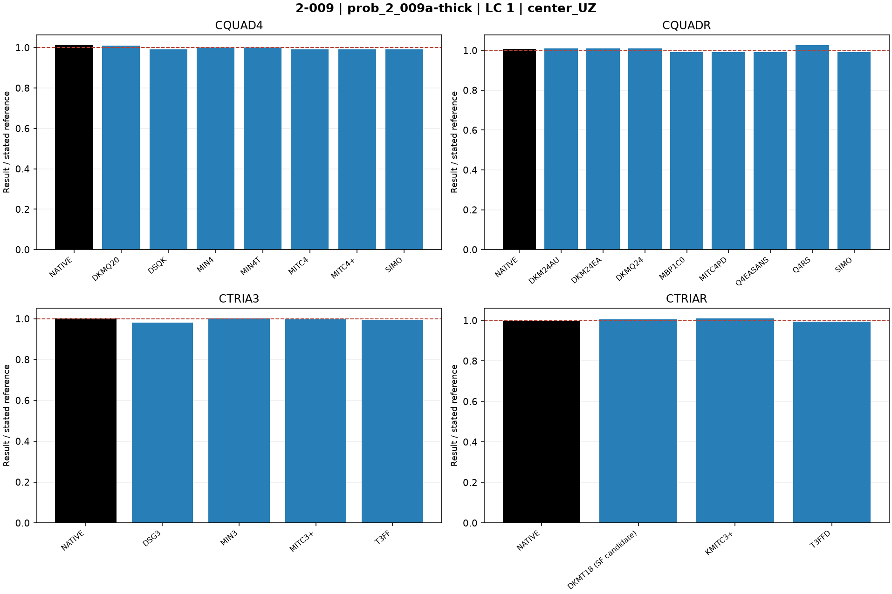
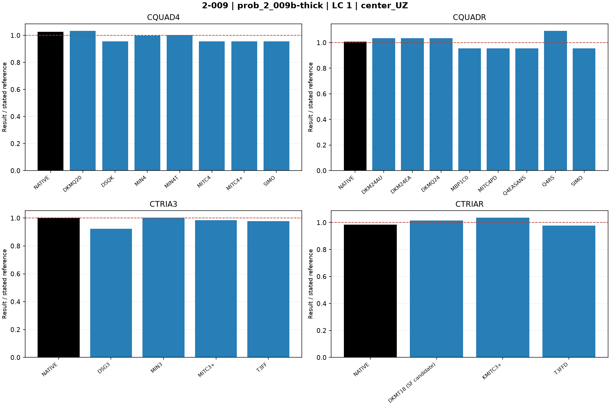

# Linear shells — 2-009: Plate on elastic foundation

27 October 2026 rebenchmark: all MYSTRAN entries were rerun using the rebuilt mixed-hybrid DSQK binary. Nastran entries retain previous outputs for unchanged decks. Default residual acceptance remains 1e-6. See [rebenchmark report](../Linear_Shell_Rebenchmark_20261027.md).

Historical baseline: 25 October 2026; MYSTRAN refreshed 27 October, Nastran retained. CQUAD4, CQUADR, CTRIA3 and CTRIAR only.

[All linear comparisons](comparison_all_linear.md) · [Full ZIP](comparison_all_linear.zip) · [Tested DAT](DAT/linear_shell_benchmark_DAT.zip) · [Linear publication QA](PUBLICATION_QA_linear.md)

Case IDs retain source-model filenames; actual element and formulation are given by their columns and deck selectors. Two-axis 2-002 tip observables use the two physical corner nodes.

NATIVE means the Nastran result for the corresponding element card: CQUAD4, CQUADR, CTRIA3 or CTRIAR. It does not mean the same proprietary interpolation as a MYSTRAN selector. Curves use independent/analytical references; published SAP2000 values are separate table columns. A completed solve is not a physical-accuracy pass. Zero references use absolute residuals; missing and failed output is never replaced by zero.

The tested source snapshot includes DKMT18 SF as an explicitly labelled candidate and corrected DSG3 local-z Kg. It is documented in [source provenance](data_linear/provenance_linear.json), with a reproducible element-local patch. This benchmark snapshot is not a declaration that SF passed every production-promotion gate. No shared eigensolver prototype is included.

## Model and comparison scope

A/B spring constants checked: 30 and 800 kip/ft^3, converted to 0.01736 and 0.462962962963 kip/in^3. Quad spring tributary areas 36/18/9 in^2; triangles redistribute to all vertices and centroids. Independent center UZ=-0.9205/-0.1782 in.

## Extraction status

| Solver | Status | Metric rows |
|---|---|---:|
| MYSTRAN | MEASURED | 44 |
| NASTRAN | MEASURED | 8 |

## Figures

### prob_2_009a-thick · LC 1 · center_UZ

### prob_2_009b-thick · LC 1 · center_UZ

## Finest available mesh per named series

| Case / parent quads | Solver / formulation | LC | Quantity | Measured | Independent / analytical | CSI published | Unit | Error % primary | Absolute residual | Status |
|---|---|---:|---|---:|---:|---:|---|---:|---:|---|
| prob_2_009a-thick / 2500 | MYSTRAN CQUAD4_DKMQ20 | 1 | center_UZ | -0.9305877 | -0.9205 | -0.925 | in | 1.095894 | 0.0100877 | MEASURED |
| prob_2_009a-thick / 2500 | MYSTRAN CQUAD4_DSQK | 1 | center_UZ | -0.9116292 | -0.9205 | -0.925 | in | 0.9636936 | 0.0088708 | MEASURED |
| prob_2_009a-thick / 2500 | MYSTRAN CQUAD4_MIN4 | 1 | center_UZ | -0.9206828 | -0.9205 | -0.925 | in | 0.01985877 | 0.0001828 | MEASURED |
| prob_2_009a-thick / 2500 | MYSTRAN CQUAD4_MIN4T | 1 | center_UZ | -0.9216996 | -0.9205 | -0.925 | in | 0.1303205 | 0.0011996 | MEASURED |
| prob_2_009a-thick / 2500 | MYSTRAN CQUAD4_MITC4 | 1 | center_UZ | -0.9117929 | -0.9205 | -0.925 | in | 0.9459098 | 0.0087071 | MEASURED |
| prob_2_009a-thick / 2500 | MYSTRAN CQUAD4_MITC4plus | 1 | center_UZ | -0.9117929 | -0.9205 | -0.925 | in | 0.9459098 | 0.0087071 | MEASURED |
| prob_2_009a-thick / 2500 | MYSTRAN CQUAD4_SIMO | 1 | center_UZ | -0.9117929 | -0.9205 | -0.925 | in | 0.9459098 | 0.0087071 | MEASURED |
| prob_2_009a-thick / 2500 | MYSTRAN CQUADR_DKM24AU | 1 | center_UZ | -0.9305877 | -0.9205 | -0.925 | in | 1.095894 | 0.0100877 | MEASURED |
| prob_2_009a-thick / 2500 | MYSTRAN CQUADR_DKM24EA | 1 | center_UZ | -0.9305877 | -0.9205 | -0.925 | in | 1.095894 | 0.0100877 | MEASURED |
| prob_2_009a-thick / 2500 | MYSTRAN CQUADR_DKMQ24 | 1 | center_UZ | -0.9305877 | -0.9205 | -0.925 | in | 1.095894 | 0.0100877 | MEASURED |
| prob_2_009a-thick / 2500 | MYSTRAN CQUADR_MBP1C0 | 1 | center_UZ | -0.9117929 | -0.9205 | -0.925 | in | 0.9459098 | 0.0087071 | MEASURED |
| prob_2_009a-thick / 2500 | MYSTRAN CQUADR_MITC4PD | 1 | center_UZ | -0.9117929 | -0.9205 | -0.925 | in | 0.9459098 | 0.0087071 | MEASURED |
| prob_2_009a-thick / 2500 | MYSTRAN CQUADR_Q4EASANS | 1 | center_UZ | -0.9117929 | -0.9205 | -0.925 | in | 0.9459098 | 0.0087071 | MEASURED |
| prob_2_009a-thick / 2500 | MYSTRAN CQUADR_Q4RS | 1 | center_UZ | -0.9452182 | -0.9205 | -0.925 | in | 2.685301 | 0.0247182 | MEASURED |
| prob_2_009a-thick / 2500 | MYSTRAN CQUADR_SIMO | 1 | center_UZ | -0.9117929 | -0.9205 | -0.925 | in | 0.9459098 | 0.0087071 | MEASURED |
| prob_2_009a-thick / 2500 | MYSTRAN CTRIA3_DSG3 | 1 | center_UZ | -0.90223 | -0.9205 | -0.925 | in | 1.984791 | 0.01827 | MEASURED |
| prob_2_009a-thick / 2500 | MYSTRAN CTRIA3_MIN3 | 1 | center_UZ | -0.9217162 | -0.9205 | -0.925 | in | 0.1321238 | 0.0012162 | MEASURED |
| prob_2_009a-thick / 2500 | MYSTRAN CTRIA3_MITC3plus | 1 | center_UZ | -0.9172647 | -0.9205 | -0.925 | in | 0.351472 | 0.0032353 | MEASURED |
| prob_2_009a-thick / 2500 | MYSTRAN CTRIA3_T3FF | 1 | center_UZ | -0.915413 | -0.9205 | -0.925 | in | 0.5526344 | 0.005087 | MEASURED |
| prob_2_009a-thick / 2500 | MYSTRAN CTRIAR_DKMT18 (SF candidate) | 1 | center_UZ | -0.9251764 | -0.9205 | -0.925 | in | 0.5080282 | 0.0046764 | MEASURED |
| prob_2_009a-thick / 2500 | MYSTRAN CTRIAR_KMITC3plus | 1 | center_UZ | -0.9299227 | -0.9205 | -0.925 | in | 1.02365 | 0.0094227 | MEASURED |
| prob_2_009a-thick / 2500 | MYSTRAN CTRIAR_T3FFD | 1 | center_UZ | -0.915413 | -0.9205 | -0.925 | in | 0.5526344 | 0.005087 | MEASURED |
| prob_2_009a-thick / 2500 | NASTRAN CQUAD4_NATIVE | 1 | center_UZ | -0.9320319 | -0.9205 | -0.925 | in | 1.252787 | 0.0115319 | MEASURED |
| prob_2_009a-thick / 2500 | NASTRAN CQUADR_NATIVE | 1 | center_UZ | -0.9268627 | -0.9205 | -0.925 | in | 0.6912222 | 0.0063627 | MEASURED |
| prob_2_009a-thick / 2500 | NASTRAN CTRIA3_NATIVE | 1 | center_UZ | -0.9213151 | -0.9205 | -0.925 | in | 0.0885497 | 0.0008151 | MEASURED |
| prob_2_009a-thick / 2500 | NASTRAN CTRIAR_NATIVE | 1 | center_UZ | -0.9167564 | -0.9205 | -0.925 | in | 0.406692 | 0.0037436 | MEASURED |
| prob_2_009b-thick / 2500 | MYSTRAN CQUAD4_DKMQ20 | 1 | center_UZ | -0.1842089 | -0.1782 | -0.1783 | in | 3.371998 | 0.0060089 | MEASURED |
| prob_2_009b-thick / 2500 | MYSTRAN CQUAD4_DSQK | 1 | center_UZ | -0.1701915 | -0.1782 | -0.1783 | in | 4.494108 | 0.0080085 | MEASURED |
| prob_2_009b-thick / 2500 | MYSTRAN CQUAD4_MIN4 | 1 | center_UZ | -0.17794 | -0.1782 | -0.1783 | in | 0.1459035 | 0.00026 | MEASURED |
| prob_2_009b-thick / 2500 | MYSTRAN CQUAD4_MIN4T | 1 | center_UZ | -0.1785044 | -0.1782 | -0.1783 | in | 0.1708193 | 0.0003044 | MEASURED |
| prob_2_009b-thick / 2500 | MYSTRAN CQUAD4_MITC4 | 1 | center_UZ | -0.1703154 | -0.1782 | -0.1783 | in | 4.424579 | 0.0078846 | MEASURED |
| prob_2_009b-thick / 2500 | MYSTRAN CQUAD4_MITC4plus | 1 | center_UZ | -0.1703154 | -0.1782 | -0.1783 | in | 4.424579 | 0.0078846 | MEASURED |
| prob_2_009b-thick / 2500 | MYSTRAN CQUAD4_SIMO | 1 | center_UZ | -0.1703154 | -0.1782 | -0.1783 | in | 4.424579 | 0.0078846 | MEASURED |
| prob_2_009b-thick / 2500 | MYSTRAN CQUADR_DKM24AU | 1 | center_UZ | -0.1842089 | -0.1782 | -0.1783 | in | 3.371998 | 0.0060089 | MEASURED |
| prob_2_009b-thick / 2500 | MYSTRAN CQUADR_DKM24EA | 1 | center_UZ | -0.1842089 | -0.1782 | -0.1783 | in | 3.371998 | 0.0060089 | MEASURED |
| prob_2_009b-thick / 2500 | MYSTRAN CQUADR_DKMQ24 | 1 | center_UZ | -0.1842089 | -0.1782 | -0.1783 | in | 3.371998 | 0.0060089 | MEASURED |
| prob_2_009b-thick / 2500 | MYSTRAN CQUADR_MBP1C0 | 1 | center_UZ | -0.1703154 | -0.1782 | -0.1783 | in | 4.424579 | 0.0078846 | MEASURED |
| prob_2_009b-thick / 2500 | MYSTRAN CQUADR_MITC4PD | 1 | center_UZ | -0.1703154 | -0.1782 | -0.1783 | in | 4.424579 | 0.0078846 | MEASURED |
| prob_2_009b-thick / 2500 | MYSTRAN CQUADR_Q4EASANS | 1 | center_UZ | -0.1703154 | -0.1782 | -0.1783 | in | 4.424579 | 0.0078846 | MEASURED |
| prob_2_009b-thick / 2500 | MYSTRAN CQUADR_Q4RS | 1 | center_UZ | -0.1946418 | -0.1782 | -0.1783 | in | 9.226599 | 0.0164418 | MEASURED |
| prob_2_009b-thick / 2500 | MYSTRAN CQUADR_SIMO | 1 | center_UZ | -0.1703154 | -0.1782 | -0.1783 | in | 4.424579 | 0.0078846 | MEASURED |
| prob_2_009b-thick / 2500 | MYSTRAN CTRIA3_DSG3 | 1 | center_UZ | -0.1647065 | -0.1782 | -0.1783 | in | 7.57211 | 0.0134935 | MEASURED |
| prob_2_009b-thick / 2500 | MYSTRAN CTRIA3_MIN3 | 1 | center_UZ | -0.1786016 | -0.1782 | -0.1783 | in | 0.2253648 | 0.0004016 | MEASURED |
| prob_2_009b-thick / 2500 | MYSTRAN CTRIA3_MITC3plus | 1 | center_UZ | -0.1755285 | -0.1782 | -0.1783 | in | 1.499158 | 0.0026715 | MEASURED |
| prob_2_009b-thick / 2500 | MYSTRAN CTRIA3_T3FF | 1 | center_UZ | -0.1741627 | -0.1782 | -0.1783 | in | 2.2656 | 0.0040373 | MEASURED |
| prob_2_009b-thick / 2500 | MYSTRAN CTRIAR_DKMT18 (SF candidate) | 1 | center_UZ | -0.1809075 | -0.1782 | -0.1783 | in | 1.51936 | 0.0027075 | MEASURED |
| prob_2_009b-thick / 2500 | MYSTRAN CTRIAR_KMITC3plus | 1 | center_UZ | -0.18473 | -0.1782 | -0.1783 | in | 3.664422 | 0.00653 | MEASURED |
| prob_2_009b-thick / 2500 | MYSTRAN CTRIAR_T3FFD | 1 | center_UZ | -0.1741627 | -0.1782 | -0.1783 | in | 2.2656 | 0.0040373 | MEASURED |
| prob_2_009b-thick / 2500 | NASTRAN CQUAD4_NATIVE | 1 | center_UZ | -0.1829762 | -0.1782 | -0.1783 | in | 2.680247 | 0.0047762 | MEASURED |
| prob_2_009b-thick / 2500 | NASTRAN CQUADR_NATIVE | 1 | center_UZ | -0.1797079 | -0.1782 | -0.1783 | in | 0.8461841 | 0.0015079 | MEASURED |
| prob_2_009b-thick / 2500 | NASTRAN CTRIA3_NATIVE | 1 | center_UZ | -0.17878 | -0.1782 | -0.1783 | in | 0.325477 | 0.00058 | MEASURED |
| prob_2_009b-thick / 2500 | NASTRAN CTRIAR_NATIVE | 1 | center_UZ | -0.1754165 | -0.1782 | -0.1783 | in | 1.562009 | 0.0027835 | MEASURED |

All mesh rows and status/provenance remain in the CSV.
