# Linear shells — 2-010: Cylinder under internal pressure

27 October 2026 rebenchmark: all MYSTRAN entries were rerun using the rebuilt mixed-hybrid DSQK binary. Nastran entries retain previous outputs for unchanged decks. Default residual acceptance remains 1e-6. See [rebenchmark report](../Linear_Shell_Rebenchmark_20261027.md).

Historical baseline: 25 October 2026; MYSTRAN refreshed 27 October, Nastran retained. CQUAD4, CQUADR, CTRIA3 and CTRIAR only.

[All linear comparisons](comparison_all_linear.md) · [Full ZIP](comparison_all_linear.zip) · [Tested DAT](DAT/linear_shell_benchmark_DAT.zip) · [Linear publication QA](PUBLICATION_QA_linear.md)

Case IDs retain source-model filenames; actual element and formulation are given by their columns and deck selectors. Two-axis 2-002 tip observables use the two physical corner nodes.

NATIVE means the Nastran result for the corresponding element card: CQUAD4, CQUADR, CTRIA3 or CTRIAR. It does not mean the same proprietary interpolation as a MYSTRAN selector. Curves use independent/analytical references; published SAP2000 values are separate table columns. A completed solve is not a physical-accuracy pass. Zero references use absolute residuals; missing and failed output is never replaced by zero.

The tested source snapshot includes DKMT18 SF as an explicitly labelled candidate and corrected DSG3 local-z Kg. It is documented in [source provenance](data_linear/provenance_linear.json), with a reproducible element-local patch. This benchmark snapshot is not a declaration that SF passed every production-promotion gate. No shared eigensolver prototype is included.

## Model and comparison scope

Supplied 6x12/12x24/24x48 geometry retained, but sparse original global supports replaced by PDF local U2 everywhere and U3 at base. Pressure=1 kip/in^2 outward. Exact source A/B meshes supplied as separate anchors. S2K exports omit pressure/restraints: PDF supplements explicitly recorded.

Exact S2K A geometry (8x16). Pressure and local constraints reconstructed from PDF because these assignment tables are absent from the S2K export.

Exact S2K B geometry (24x48). Pressure and local constraints reconstructed from PDF because these assignment tables are absent from the S2K export.

Reported principal-stress sample extrema remain explicitly labelled diagnostic envelopes. They are not an audited hoop sigma11 at a fixed point/face and must not be treated as that reference. SF pipe-stress regression remains open.

## Extraction status

| Solver | Status | Metric rows |
|---|---|---:|
| MYSTRAN | MEASURED | 440 |
| NASTRAN | MEASURED | 80 |

## Figures

### prob_2_010 · LC 1 · native_fiber_principal_max_max

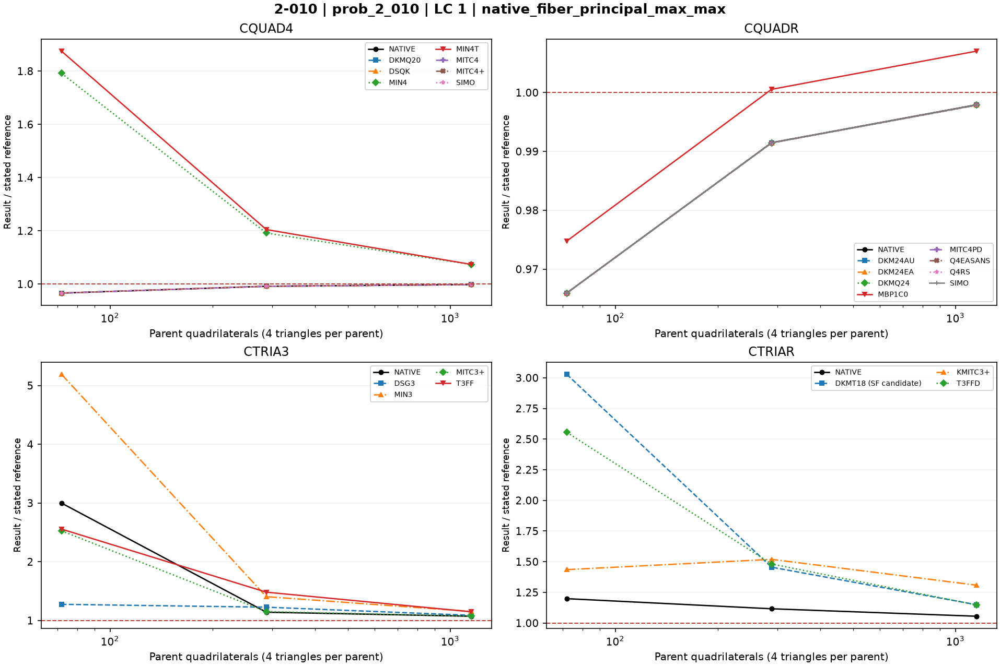

### prob_2_010 · LC 1 · native_fiber_principal_max_min

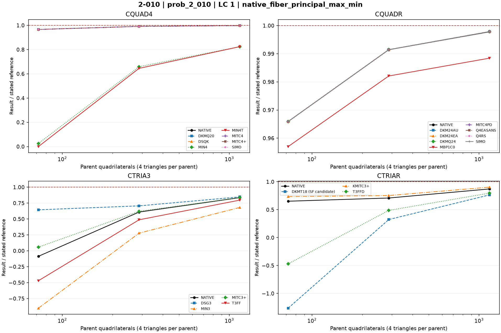

### prob_2_010 · LC 1 · top_mean_UZ

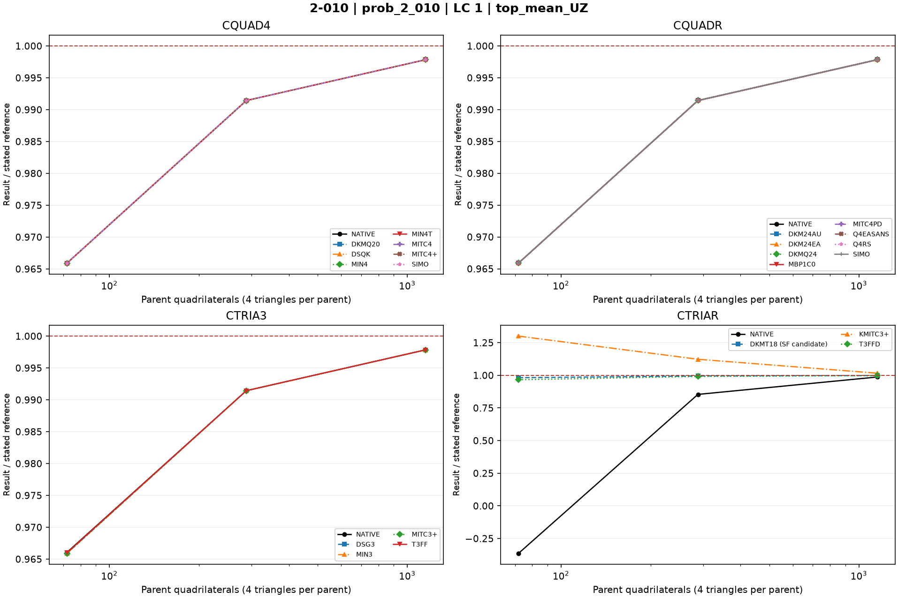

### prob_2_010 · LC 1 · top_mean_Ur

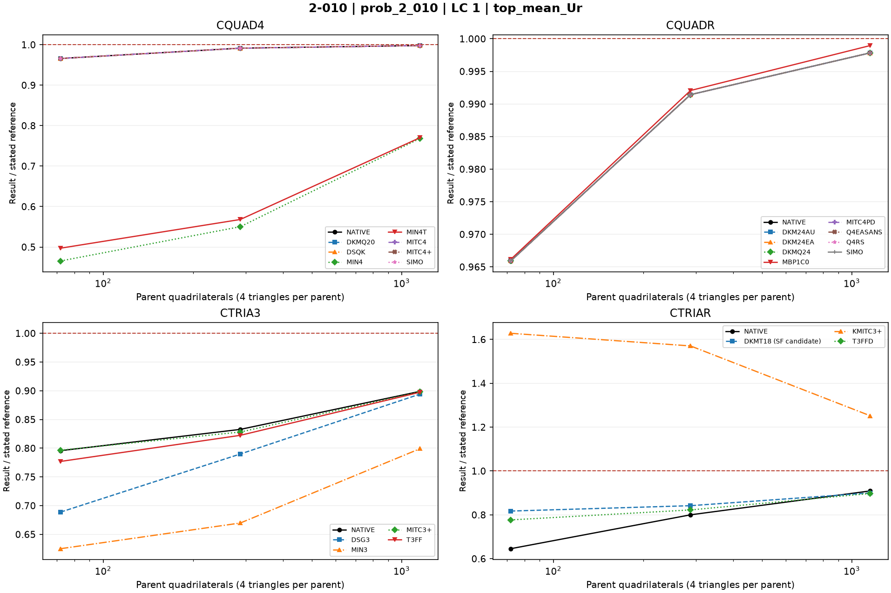

### s2k_2010a · LC 1 · native_fiber_principal_max_max

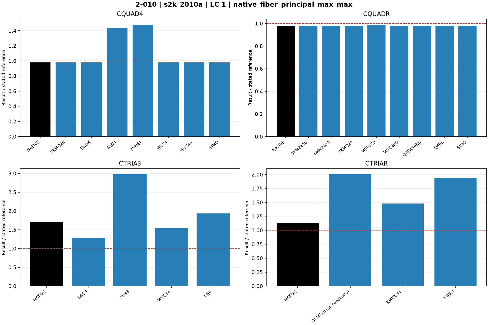

### s2k_2010a · LC 1 · native_fiber_principal_max_min

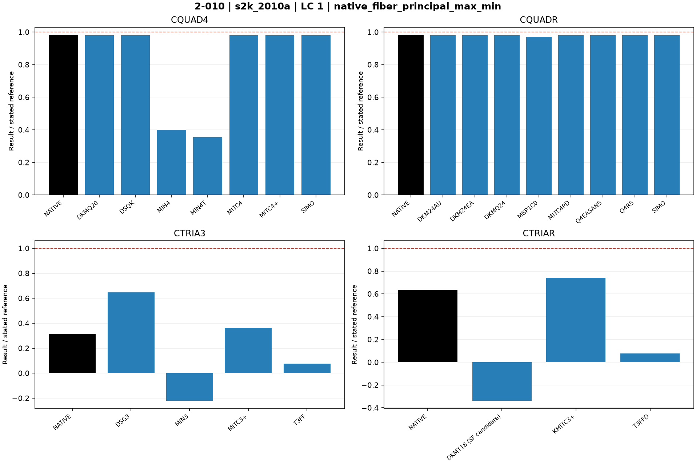

### s2k_2010a · LC 1 · top_mean_UZ

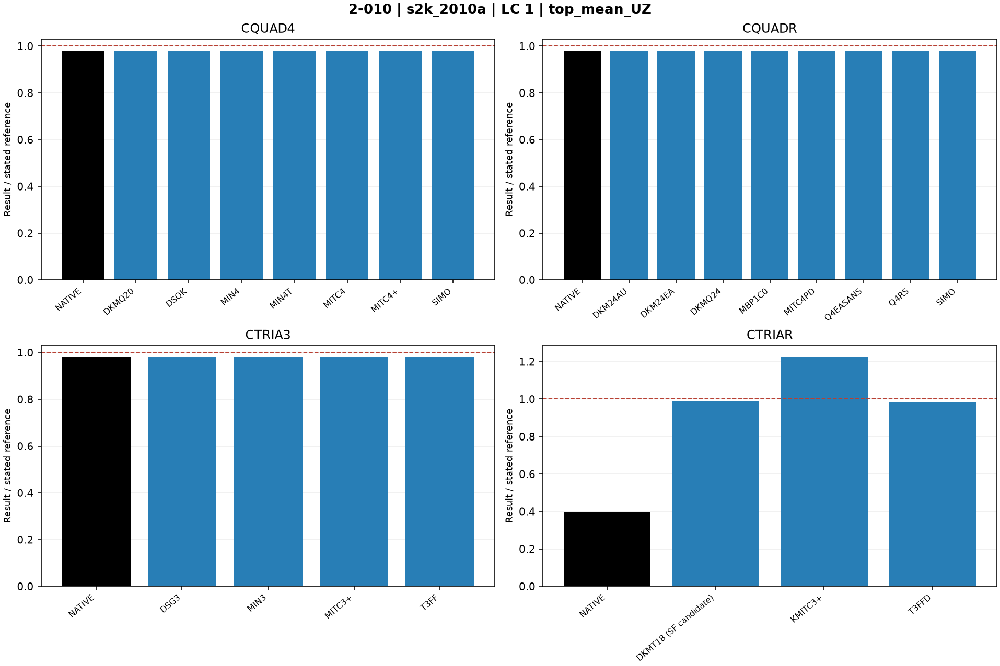

### s2k_2010a · LC 1 · top_mean_Ur

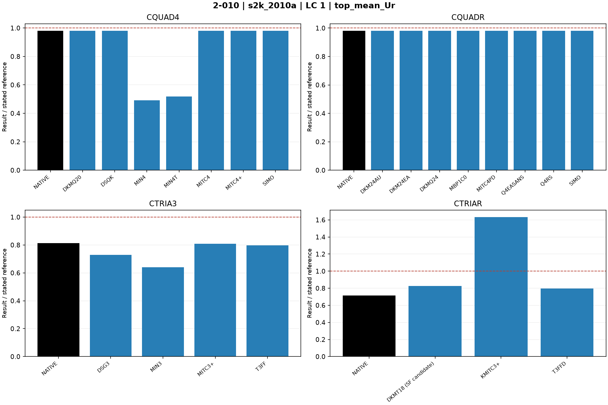

### s2k_2010b · LC 1 · native_fiber_principal_max_max

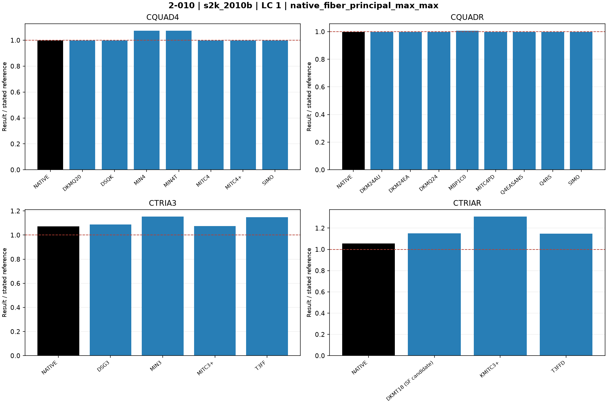

### s2k_2010b · LC 1 · native_fiber_principal_max_min

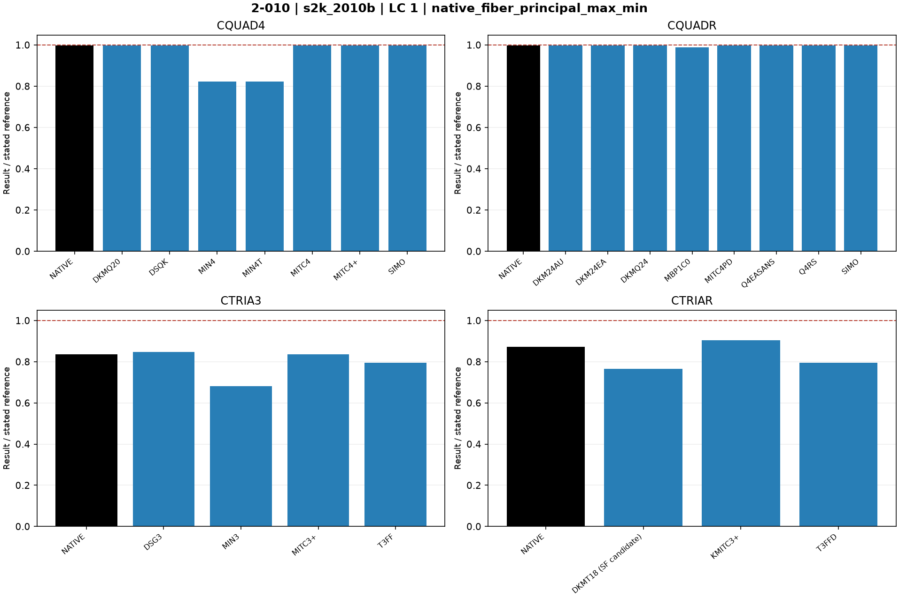

### s2k_2010b · LC 1 · top_mean_UZ

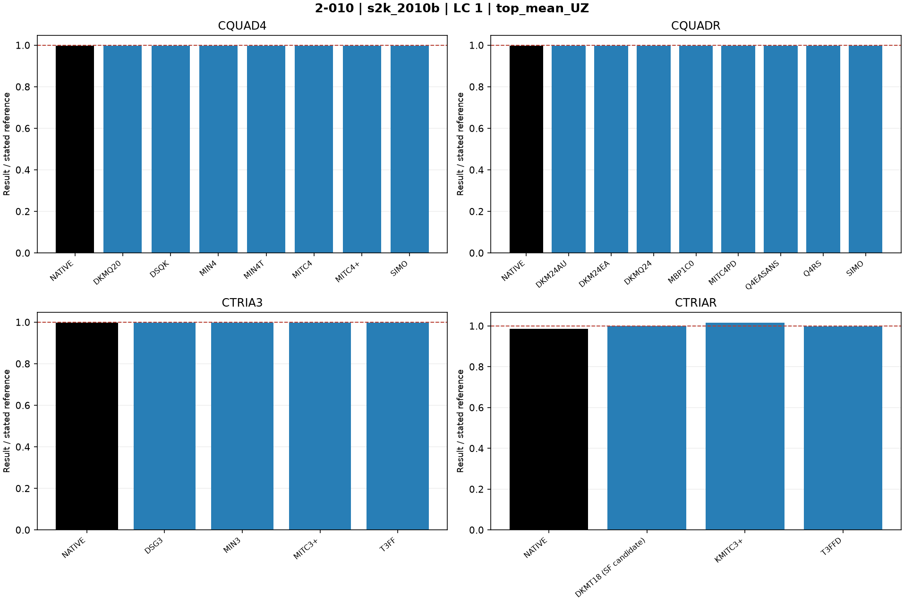

### s2k_2010b · LC 1 · top_mean_Ur

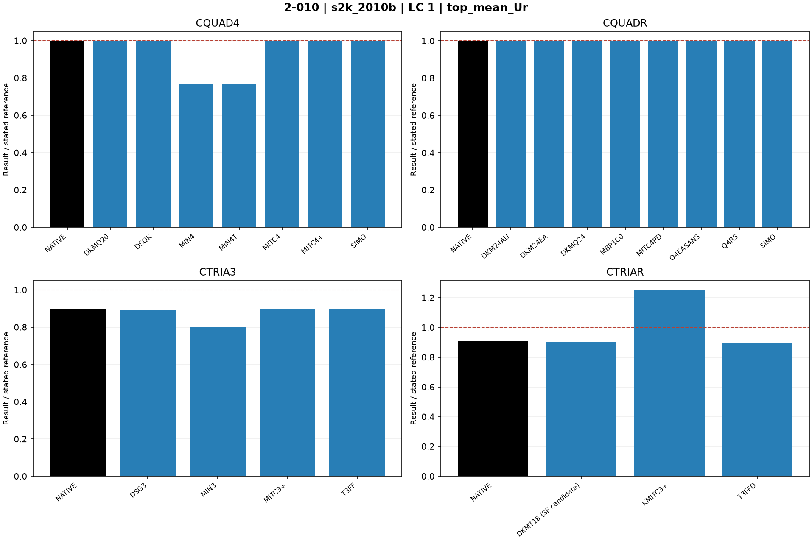

## Finest available mesh per named series

| Case / parent quads | Solver / formulation | LC | Quantity | Measured | Independent / analytical | CSI published | Unit | Error % primary | Absolute residual | Status |
|---|---|---:|---|---:|---:|---:|---|---:|---:|---|
| prob_2_010_24x48_cquadr_simo / 1152 | MYSTRAN CQUAD4_DKMQ20 | 1 | native_fiber_principal_max_max | 59.87161 | 60 | — | ksi | 0.2139804 | 0.1283882 | MEASURED |
| prob_2_010_24x48_cquadr_simo / 1152 | MYSTRAN CQUAD4_DSQK | 1 | native_fiber_principal_max_max | 59.87161 | 60 | — | ksi | 0.2139804 | 0.1283882 | MEASURED |
| prob_2_010_24x48_cquadr_simo / 1152 | MYSTRAN CQUAD4_MIN4 | 1 | native_fiber_principal_max_max | 64.40583 | 60 | — | ksi | 7.343046 | 4.405827 | MEASURED |
| prob_2_010_24x48_cquadr_simo / 1152 | MYSTRAN CQUAD4_MIN4T | 1 | native_fiber_principal_max_max | 64.42231 | 60 | — | ksi | 7.370514 | 4.422308 | MEASURED |
| prob_2_010_24x48_cquadr_simo / 1152 | MYSTRAN CQUAD4_MITC4 | 1 | native_fiber_principal_max_max | 59.87161 | 60 | — | ksi | 0.2139804 | 0.1283882 | MEASURED |
| prob_2_010_24x48_cquadr_simo / 1152 | MYSTRAN CQUAD4_MITC4plus | 1 | native_fiber_principal_max_max | 59.87161 | 60 | — | ksi | 0.2139804 | 0.1283882 | MEASURED |
| prob_2_010_24x48_cquadr_simo / 1152 | MYSTRAN CQUAD4_SIMO | 1 | native_fiber_principal_max_max | 59.87161 | 60 | — | ksi | 0.2139804 | 0.1283882 | MEASURED |
| prob_2_010_24x48_cquadr_simo / 1152 | MYSTRAN CQUADR_DKM24AU | 1 | native_fiber_principal_max_max | 59.87161 | 60 | — | ksi | 0.2139804 | 0.1283882 | MEASURED |
| prob_2_010_24x48_cquadr_simo / 1152 | MYSTRAN CQUADR_DKM24EA | 1 | native_fiber_principal_max_max | 59.87161 | 60 | — | ksi | 0.2139804 | 0.1283882 | MEASURED |
| prob_2_010_24x48_cquadr_simo / 1152 | MYSTRAN CQUADR_DKMQ24 | 1 | native_fiber_principal_max_max | 59.87161 | 60 | — | ksi | 0.2139804 | 0.1283882 | MEASURED |
| prob_2_010_24x48_cquadr_simo / 1152 | MYSTRAN CQUADR_MBP1C0 | 1 | native_fiber_principal_max_max | 60.42136 | 60 | — | ksi | 0.7022599 | 0.4213559 | MEASURED |
| prob_2_010_24x48_cquadr_simo / 1152 | MYSTRAN CQUADR_MITC4PD | 1 | native_fiber_principal_max_max | 59.87161 | 60 | — | ksi | 0.2139804 | 0.1283882 | MEASURED |
| prob_2_010_24x48_cquadr_simo / 1152 | MYSTRAN CQUADR_Q4EASANS | 1 | native_fiber_principal_max_max | 59.87161 | 60 | — | ksi | 0.2139804 | 0.1283882 | MEASURED |
| prob_2_010_24x48_cquadr_simo / 1152 | MYSTRAN CQUADR_Q4RS | 1 | native_fiber_principal_max_max | 59.87161 | 60 | — | ksi | 0.2139804 | 0.1283882 | MEASURED |
| prob_2_010_24x48_cquadr_simo / 1152 | MYSTRAN CQUADR_SIMO | 1 | native_fiber_principal_max_max | 59.87161 | 60 | — | ksi | 0.2139804 | 0.1283882 | MEASURED |
| prob_2_010_24x48_cquadr_simo / 1152 | MYSTRAN CTRIA3_DSG3 | 1 | native_fiber_principal_max_max | 65.2267 | 60 | — | ksi | 8.711167 | 5.2267 | MEASURED |
| prob_2_010_24x48_cquadr_simo / 1152 | MYSTRAN CTRIA3_MIN3 | 1 | native_fiber_principal_max_max | 69.2089 | 60 | — | ksi | 15.34817 | 9.2089 | MEASURED |
| prob_2_010_24x48_cquadr_simo / 1152 | MYSTRAN CTRIA3_MITC3plus | 1 | native_fiber_principal_max_max | 64.3949 | 60 | — | ksi | 7.324833 | 4.3949 | MEASURED |
| prob_2_010_24x48_cquadr_simo / 1152 | MYSTRAN CTRIA3_T3FF | 1 | native_fiber_principal_max_max | 68.8486 | 60 | — | ksi | 14.74767 | 8.8486 | MEASURED |
| prob_2_010_24x48_cquadr_simo / 1152 | MYSTRAN CTRIAR_DKMT18 (SF candidate) | 1 | native_fiber_principal_max_max | 68.9679 | 60 | — | ksi | 14.9465 | 8.9679 | MEASURED |
| prob_2_010_24x48_cquadr_simo / 1152 | MYSTRAN CTRIAR_KMITC3plus | 1 | native_fiber_principal_max_max | 78.5089 | 60 | — | ksi | 30.84817 | 18.5089 | MEASURED |
| prob_2_010_24x48_cquadr_simo / 1152 | MYSTRAN CTRIAR_T3FFD | 1 | native_fiber_principal_max_max | 68.8486 | 60 | — | ksi | 14.74767 | 8.8486 | MEASURED |
| prob_2_010_24x48_cquadr_simo / 1152 | NASTRAN CQUAD4_NATIVE | 1 | native_fiber_principal_max_max | 59.875 | 60 | — | ksi | 0.2083333 | 0.125 | MEASURED |
| prob_2_010_24x48_cquadr_simo / 1152 | NASTRAN CQUADR_NATIVE | 1 | native_fiber_principal_max_max | 59.87494 | 60 | — | ksi | 0.2084333 | 0.12506 | MEASURED |
| prob_2_010_24x48_cquadr_simo / 1152 | NASTRAN CTRIA3_NATIVE | 1 | native_fiber_principal_max_max | 64.28565 | 60 | — | ksi | 7.14275 | 4.28565 | MEASURED |
| prob_2_010_24x48_cquadr_simo / 1152 | NASTRAN CTRIAR_NATIVE | 1 | native_fiber_principal_max_max | 63.31053 | 60 | — | ksi | 5.517551 | 3.310531 | MEASURED |
| prob_2_010_24x48_cquadr_simo / 1152 | MYSTRAN CQUAD4_DKMQ20 | 1 | native_fiber_principal_max_min | 59.87146 | 60 | — | ksi | 0.2142309 | 0.1285385 | MEASURED |
| prob_2_010_24x48_cquadr_simo / 1152 | MYSTRAN CQUAD4_DSQK | 1 | native_fiber_principal_max_min | 59.87149 | 60 | — | ksi | 0.2141858 | 0.1285115 | MEASURED |
| prob_2_010_24x48_cquadr_simo / 1152 | MYSTRAN CQUAD4_MIN4 | 1 | native_fiber_principal_max_min | 49.42228 | 60 | — | ksi | 17.62954 | 10.57772 | MEASURED |
| prob_2_010_24x48_cquadr_simo / 1152 | MYSTRAN CQUAD4_MIN4T | 1 | native_fiber_principal_max_min | 49.42185 | 60 | — | ksi | 17.63024 | 10.57815 | MEASURED |
| prob_2_010_24x48_cquadr_simo / 1152 | MYSTRAN CQUAD4_MITC4 | 1 | native_fiber_principal_max_min | 59.87146 | 60 | — | ksi | 0.2142309 | 0.1285385 | MEASURED |
| prob_2_010_24x48_cquadr_simo / 1152 | MYSTRAN CQUAD4_MITC4plus | 1 | native_fiber_principal_max_min | 59.87146 | 60 | — | ksi | 0.2142309 | 0.1285385 | MEASURED |
| prob_2_010_24x48_cquadr_simo / 1152 | MYSTRAN CQUAD4_SIMO | 1 | native_fiber_principal_max_min | 59.87146 | 60 | — | ksi | 0.2142309 | 0.1285385 | MEASURED |
| prob_2_010_24x48_cquadr_simo / 1152 | MYSTRAN CQUADR_DKM24AU | 1 | native_fiber_principal_max_min | 59.87149 | 60 | — | ksi | 0.2141858 | 0.1285115 | MEASURED |
| prob_2_010_24x48_cquadr_simo / 1152 | MYSTRAN CQUADR_DKM24EA | 1 | native_fiber_principal_max_min | 59.87149 | 60 | — | ksi | 0.2141858 | 0.1285115 | MEASURED |
| prob_2_010_24x48_cquadr_simo / 1152 | MYSTRAN CQUADR_DKMQ24 | 1 | native_fiber_principal_max_min | 59.87149 | 60 | — | ksi | 0.2141858 | 0.1285115 | MEASURED |
| prob_2_010_24x48_cquadr_simo / 1152 | MYSTRAN CQUADR_MBP1C0 | 1 | native_fiber_principal_max_min | 59.30525 | 60 | — | ksi | 1.157912 | 0.694747 | MEASURED |
| prob_2_010_24x48_cquadr_simo / 1152 | MYSTRAN CQUADR_MITC4PD | 1 | native_fiber_principal_max_min | 59.87146 | 60 | — | ksi | 0.2142309 | 0.1285385 | MEASURED |
| prob_2_010_24x48_cquadr_simo / 1152 | MYSTRAN CQUADR_Q4EASANS | 1 | native_fiber_principal_max_min | 59.87149 | 60 | — | ksi | 0.2141858 | 0.1285115 | MEASURED |
| prob_2_010_24x48_cquadr_simo / 1152 | MYSTRAN CQUADR_Q4RS | 1 | native_fiber_principal_max_min | 59.87149 | 60 | — | ksi | 0.2141858 | 0.1285115 | MEASURED |
| prob_2_010_24x48_cquadr_simo / 1152 | MYSTRAN CQUADR_SIMO | 1 | native_fiber_principal_max_min | 59.87149 | 60 | — | ksi | 0.2141858 | 0.1285115 | MEASURED |
| prob_2_010_24x48_cquadr_simo / 1152 | MYSTRAN CTRIA3_DSG3 | 1 | native_fiber_principal_max_min | 50.8225 | 60 | — | ksi | 15.29583 | 9.1775 | MEASURED |
| prob_2_010_24x48_cquadr_simo / 1152 | MYSTRAN CTRIA3_MIN3 | 1 | native_fiber_principal_max_min | 40.8404 | 60 | — | ksi | 31.93267 | 19.1596 | MEASURED |
| prob_2_010_24x48_cquadr_simo / 1152 | MYSTRAN CTRIA3_MITC3plus | 1 | native_fiber_principal_max_min | 50.1944 | 60 | — | ksi | 16.34267 | 9.8056 | MEASURED |
| prob_2_010_24x48_cquadr_simo / 1152 | MYSTRAN CTRIA3_T3FF | 1 | native_fiber_principal_max_min | 47.7603 | 60 | — | ksi | 20.3995 | 12.2397 | MEASURED |
| prob_2_010_24x48_cquadr_simo / 1152 | MYSTRAN CTRIAR_DKMT18 (SF candidate) | 1 | native_fiber_principal_max_min | 45.8579 | 60 | — | ksi | 23.57017 | 14.1421 | MEASURED |
| prob_2_010_24x48_cquadr_simo / 1152 | MYSTRAN CTRIAR_KMITC3plus | 1 | native_fiber_principal_max_min | 54.19814 | 60 | — | ksi | 9.669759 | 5.801855 | MEASURED |
| prob_2_010_24x48_cquadr_simo / 1152 | MYSTRAN CTRIAR_T3FFD | 1 | native_fiber_principal_max_min | 47.7603 | 60 | — | ksi | 20.3995 | 12.2397 | MEASURED |
| prob_2_010_24x48_cquadr_simo / 1152 | NASTRAN CQUAD4_NATIVE | 1 | native_fiber_principal_max_min | 59.86636 | 60 | — | ksi | 0.2227333 | 0.13364 | MEASURED |
| prob_2_010_24x48_cquadr_simo / 1152 | NASTRAN CQUADR_NATIVE | 1 | native_fiber_principal_max_min | 59.8664 | 60 | — | ksi | 0.2226667 | 0.1336 | MEASURED |
| prob_2_010_24x48_cquadr_simo / 1152 | NASTRAN CTRIA3_NATIVE | 1 | native_fiber_principal_max_min | 50.11846 | 60 | — | ksi | 16.46923 | 9.88154 | MEASURED |
| prob_2_010_24x48_cquadr_simo / 1152 | NASTRAN CTRIAR_NATIVE | 1 | native_fiber_principal_max_min | 52.27881 | 60 | — | ksi | 12.86865 | 7.721189 | MEASURED |
| prob_2_010_24x48_cquadr_simo / 1152 | MYSTRAN CQUAD4_DKMQ20 | 1 | top_mean_UZ | -0.1238721 | -0.12414 | — | in | 0.2158047 | 0.0002679 | MEASURED |
| prob_2_010_24x48_cquadr_simo / 1152 | MYSTRAN CQUAD4_DSQK | 1 | top_mean_UZ | -0.1238721 | -0.12414 | — | in | 0.2158047 | 0.0002679 | MEASURED |
| prob_2_010_24x48_cquadr_simo / 1152 | MYSTRAN CQUAD4_MIN4 | 1 | top_mean_UZ | -0.1238721 | -0.12414 | — | in | 0.2158047 | 0.0002679 | MEASURED |
| prob_2_010_24x48_cquadr_simo / 1152 | MYSTRAN CQUAD4_MIN4T | 1 | top_mean_UZ | -0.1238721 | -0.12414 | — | in | 0.2158047 | 0.0002679 | MEASURED |
| prob_2_010_24x48_cquadr_simo / 1152 | MYSTRAN CQUAD4_MITC4 | 1 | top_mean_UZ | -0.1238721 | -0.12414 | — | in | 0.2158047 | 0.0002679 | MEASURED |
| prob_2_010_24x48_cquadr_simo / 1152 | MYSTRAN CQUAD4_MITC4plus | 1 | top_mean_UZ | -0.1238721 | -0.12414 | — | in | 0.2158047 | 0.0002679 | MEASURED |
| prob_2_010_24x48_cquadr_simo / 1152 | MYSTRAN CQUAD4_SIMO | 1 | top_mean_UZ | -0.1238721 | -0.12414 | — | in | 0.2158047 | 0.0002679 | MEASURED |
| prob_2_010_24x48_cquadr_simo / 1152 | MYSTRAN CQUADR_DKM24AU | 1 | top_mean_UZ | -0.1238721 | -0.12414 | — | in | 0.2158047 | 0.0002679 | MEASURED |
| prob_2_010_24x48_cquadr_simo / 1152 | MYSTRAN CQUADR_DKM24EA | 1 | top_mean_UZ | -0.1238721 | -0.12414 | — | in | 0.2158047 | 0.0002679 | MEASURED |
| prob_2_010_24x48_cquadr_simo / 1152 | MYSTRAN CQUADR_DKMQ24 | 1 | top_mean_UZ | -0.1238721 | -0.12414 | — | in | 0.2158047 | 0.0002679 | MEASURED |
| prob_2_010_24x48_cquadr_simo / 1152 | MYSTRAN CQUADR_MBP1C0 | 1 | top_mean_UZ | -0.123869 | -0.12414 | — | in | 0.2183019 | 0.000271 | MEASURED |
| prob_2_010_24x48_cquadr_simo / 1152 | MYSTRAN CQUADR_MITC4PD | 1 | top_mean_UZ | -0.1238721 | -0.12414 | — | in | 0.2158047 | 0.0002679 | MEASURED |
| prob_2_010_24x48_cquadr_simo / 1152 | MYSTRAN CQUADR_Q4EASANS | 1 | top_mean_UZ | -0.1238721 | -0.12414 | — | in | 0.2158047 | 0.0002679 | MEASURED |
| prob_2_010_24x48_cquadr_simo / 1152 | MYSTRAN CQUADR_Q4RS | 1 | top_mean_UZ | -0.1238721 | -0.12414 | — | in | 0.2158047 | 0.0002679 | MEASURED |
| prob_2_010_24x48_cquadr_simo / 1152 | MYSTRAN CQUADR_SIMO | 1 | top_mean_UZ | -0.1238721 | -0.12414 | — | in | 0.2158047 | 0.0002679 | MEASURED |
| prob_2_010_24x48_cquadr_simo / 1152 | MYSTRAN CTRIA3_DSG3 | 1 | top_mean_UZ | -0.1238721 | -0.12414 | — | in | 0.2158047 | 0.0002679 | MEASURED |
| prob_2_010_24x48_cquadr_simo / 1152 | MYSTRAN CTRIA3_MIN3 | 1 | top_mean_UZ | -0.1238721 | -0.12414 | — | in | 0.2158047 | 0.0002679 | MEASURED |
| prob_2_010_24x48_cquadr_simo / 1152 | MYSTRAN CTRIA3_MITC3plus | 1 | top_mean_UZ | -0.1238721 | -0.12414 | — | in | 0.2158047 | 0.0002679 | MEASURED |
| prob_2_010_24x48_cquadr_simo / 1152 | MYSTRAN CTRIA3_T3FF | 1 | top_mean_UZ | -0.1238722 | -0.12414 | — | in | 0.2157242 | 0.0002678 | MEASURED |
| prob_2_010_24x48_cquadr_simo / 1152 | MYSTRAN CTRIAR_DKMT18 (SF candidate) | 1 | top_mean_UZ | -0.1239746 | -0.12414 | — | in | 0.1332367 | 0.0001654 | MEASURED |
| prob_2_010_24x48_cquadr_simo / 1152 | MYSTRAN CTRIAR_KMITC3plus | 1 | top_mean_UZ | -0.126146 | -0.12414 | — | in | 1.615918 | 0.002006 | MEASURED |
| prob_2_010_24x48_cquadr_simo / 1152 | MYSTRAN CTRIAR_T3FFD | 1 | top_mean_UZ | -0.1238722 | -0.12414 | — | in | 0.2157242 | 0.0002678 | MEASURED |
| prob_2_010_24x48_cquadr_simo / 1152 | NASTRAN CQUAD4_NATIVE | 1 | top_mean_UZ | -0.1238722 | -0.12414 | — | in | 0.2157577 | 0.0002678417 | MEASURED |
| prob_2_010_24x48_cquadr_simo / 1152 | NASTRAN CQUADR_NATIVE | 1 | top_mean_UZ | -0.1238722 | -0.12414 | — | in | 0.2157645 | 0.00026785 | MEASURED |
| prob_2_010_24x48_cquadr_simo / 1152 | NASTRAN CTRIA3_NATIVE | 1 | top_mean_UZ | -0.1238726 | -0.12414 | — | in | 0.2153801 | 0.0002673729 | MEASURED |
| prob_2_010_24x48_cquadr_simo / 1152 | NASTRAN CTRIAR_NATIVE | 1 | top_mean_UZ | -0.1225022 | -0.12414 | — | in | 1.31932 | 0.001637804 | MEASURED |
| prob_2_010_24x48_cquadr_simo / 1152 | MYSTRAN CQUAD4_DKMQ20 | 1 | top_mean_Ur | 0.1238721 | 0.12414 | — | in | 0.2157712 | 0.0002678583 | MEASURED |
| prob_2_010_24x48_cquadr_simo / 1152 | MYSTRAN CQUAD4_DSQK | 1 | top_mean_Ur | 0.1238721 | 0.12414 | — | in | 0.2157712 | 0.0002678583 | MEASURED |
| prob_2_010_24x48_cquadr_simo / 1152 | MYSTRAN CQUAD4_MIN4 | 1 | top_mean_Ur | 0.09538403 | 0.12414 | — | in | 23.16415 | 0.02875597 | MEASURED |
| prob_2_010_24x48_cquadr_simo / 1152 | MYSTRAN CQUAD4_MIN4T | 1 | top_mean_Ur | 0.09561732 | 0.12414 | — | in | 22.97622 | 0.02852268 | MEASURED |
| prob_2_010_24x48_cquadr_simo / 1152 | MYSTRAN CQUAD4_MITC4 | 1 | top_mean_Ur | 0.1238721 | 0.12414 | — | in | 0.2157712 | 0.0002678583 | MEASURED |
| prob_2_010_24x48_cquadr_simo / 1152 | MYSTRAN CQUAD4_MITC4plus | 1 | top_mean_Ur | 0.1238721 | 0.12414 | — | in | 0.2157712 | 0.0002678583 | MEASURED |
| prob_2_010_24x48_cquadr_simo / 1152 | MYSTRAN CQUAD4_SIMO | 1 | top_mean_Ur | 0.1238721 | 0.12414 | — | in | 0.2157712 | 0.0002678583 | MEASURED |
| prob_2_010_24x48_cquadr_simo / 1152 | MYSTRAN CQUADR_DKM24AU | 1 | top_mean_Ur | 0.1238721 | 0.12414 | — | in | 0.2157712 | 0.0002678583 | MEASURED |
| prob_2_010_24x48_cquadr_simo / 1152 | MYSTRAN CQUADR_DKM24EA | 1 | top_mean_Ur | 0.1238721 | 0.12414 | — | in | 0.2157712 | 0.0002678583 | MEASURED |
| prob_2_010_24x48_cquadr_simo / 1152 | MYSTRAN CQUADR_DKMQ24 | 1 | top_mean_Ur | 0.1238721 | 0.12414 | — | in | 0.2157712 | 0.0002678583 | MEASURED |
| prob_2_010_24x48_cquadr_simo / 1152 | MYSTRAN CQUADR_MBP1C0 | 1 | top_mean_Ur | 0.1240111 | 0.12414 | — | in | 0.1038277 | 0.0001288917 | MEASURED |
| prob_2_010_24x48_cquadr_simo / 1152 | MYSTRAN CQUADR_MITC4PD | 1 | top_mean_Ur | 0.1238721 | 0.12414 | — | in | 0.2157712 | 0.0002678583 | MEASURED |
| prob_2_010_24x48_cquadr_simo / 1152 | MYSTRAN CQUADR_Q4EASANS | 1 | top_mean_Ur | 0.1238721 | 0.12414 | — | in | 0.2157712 | 0.0002678583 | MEASURED |
| prob_2_010_24x48_cquadr_simo / 1152 | MYSTRAN CQUADR_Q4RS | 1 | top_mean_Ur | 0.1238721 | 0.12414 | — | in | 0.2157712 | 0.0002678583 | MEASURED |
| prob_2_010_24x48_cquadr_simo / 1152 | MYSTRAN CQUADR_SIMO | 1 | top_mean_Ur | 0.1238721 | 0.12414 | — | in | 0.2157712 | 0.0002678583 | MEASURED |
| prob_2_010_24x48_cquadr_simo / 1152 | MYSTRAN CTRIA3_DSG3 | 1 | top_mean_Ur | 0.1110056 | 0.12414 | — | in | 10.58029 | 0.01313438 | MEASURED |
| prob_2_010_24x48_cquadr_simo / 1152 | MYSTRAN CTRIA3_MIN3 | 1 | top_mean_Ur | 0.09920682 | 0.12414 | — | in | 20.08473 | 0.02493318 | MEASURED |
| prob_2_010_24x48_cquadr_simo / 1152 | MYSTRAN CTRIA3_MITC3plus | 1 | top_mean_Ur | 0.1114872 | 0.12414 | — | in | 10.1924 | 0.01265284 | MEASURED |
| prob_2_010_24x48_cquadr_simo / 1152 | MYSTRAN CTRIA3_T3FF | 1 | top_mean_Ur | 0.1114021 | 0.12414 | — | in | 10.26088 | 0.01273786 | MEASURED |
| prob_2_010_24x48_cquadr_simo / 1152 | MYSTRAN CTRIAR_DKMT18 (SF candidate) | 1 | top_mean_Ur | 0.1117124 | 0.12414 | — | in | 10.01099 | 0.01242764 | MEASURED |
| prob_2_010_24x48_cquadr_simo / 1152 | MYSTRAN CTRIAR_KMITC3plus | 1 | top_mean_Ur | 0.1554106 | 0.12414 | — | in | 25.18977 | 0.03127057 | MEASURED |
| prob_2_010_24x48_cquadr_simo / 1152 | MYSTRAN CTRIAR_T3FFD | 1 | top_mean_Ur | 0.1114021 | 0.12414 | — | in | 10.26088 | 0.01273786 | MEASURED |
| prob_2_010_24x48_cquadr_simo / 1152 | NASTRAN CQUAD4_NATIVE | 1 | top_mean_Ur | 0.1238722 | 0.12414 | — | in | 0.215751 | 0.0002678333 | MEASURED |
| prob_2_010_24x48_cquadr_simo / 1152 | NASTRAN CQUADR_NATIVE | 1 | top_mean_Ur | 0.1238722 | 0.12414 | — | in | 0.2157628 | 0.0002678479 | MEASURED |
| prob_2_010_24x48_cquadr_simo / 1152 | NASTRAN CTRIA3_NATIVE | 1 | top_mean_Ur | 0.1115923 | 0.12414 | — | in | 10.10773 | 0.01254774 | MEASURED |
| prob_2_010_24x48_cquadr_simo / 1152 | NASTRAN CTRIAR_NATIVE | 1 | top_mean_Ur | 0.1128509 | 0.12414 | — | in | 9.093846 | 0.0112891 | MEASURED |
| s2k_2010a / 128 | MYSTRAN CQUAD4_DKMQ20 | 1 | native_fiber_principal_max_max | 58.84713 | 60 | — | ksi | 1.921444 | 1.152866 | MEASURED |
| s2k_2010a / 128 | MYSTRAN CQUAD4_DSQK | 1 | native_fiber_principal_max_max | 58.84713 | 60 | — | ksi | 1.921444 | 1.152866 | MEASURED |
| s2k_2010a / 128 | MYSTRAN CQUAD4_MIN4 | 1 | native_fiber_principal_max_max | 86.2741 | 60 | — | ksi | 43.79016 | 26.2741 | MEASURED |
| s2k_2010a / 128 | MYSTRAN CQUAD4_MIN4T | 1 | native_fiber_principal_max_max | 88.75795 | 60 | — | ksi | 47.92992 | 28.75795 | MEASURED |
| s2k_2010a / 128 | MYSTRAN CQUAD4_MITC4 | 1 | native_fiber_principal_max_max | 58.84713 | 60 | — | ksi | 1.921444 | 1.152866 | MEASURED |
| s2k_2010a / 128 | MYSTRAN CQUAD4_MITC4plus | 1 | native_fiber_principal_max_max | 58.84713 | 60 | — | ksi | 1.921444 | 1.152866 | MEASURED |
| s2k_2010a / 128 | MYSTRAN CQUAD4_SIMO | 1 | native_fiber_principal_max_max | 58.84713 | 60 | — | ksi | 1.921444 | 1.152866 | MEASURED |
| s2k_2010a / 128 | MYSTRAN CQUADR_DKM24AU | 1 | native_fiber_principal_max_max | 58.84713 | 60 | — | ksi | 1.921444 | 1.152866 | MEASURED |
| s2k_2010a / 128 | MYSTRAN CQUADR_DKM24EA | 1 | native_fiber_principal_max_max | 58.84713 | 60 | — | ksi | 1.921444 | 1.152866 | MEASURED |
| s2k_2010a / 128 | MYSTRAN CQUADR_DKMQ24 | 1 | native_fiber_principal_max_max | 58.84713 | 60 | — | ksi | 1.921444 | 1.152866 | MEASURED |
| s2k_2010a / 128 | MYSTRAN CQUADR_MBP1C0 | 1 | native_fiber_principal_max_max | 59.38691 | 60 | — | ksi | 1.021815 | 0.6130888 | MEASURED |
| s2k_2010a / 128 | MYSTRAN CQUADR_MITC4PD | 1 | native_fiber_principal_max_max | 58.84713 | 60 | — | ksi | 1.921444 | 1.152866 | MEASURED |
| s2k_2010a / 128 | MYSTRAN CQUADR_Q4EASANS | 1 | native_fiber_principal_max_max | 58.84713 | 60 | — | ksi | 1.921444 | 1.152866 | MEASURED |
| s2k_2010a / 128 | MYSTRAN CQUADR_Q4RS | 1 | native_fiber_principal_max_max | 58.84713 | 60 | — | ksi | 1.921444 | 1.152866 | MEASURED |
| s2k_2010a / 128 | MYSTRAN CQUADR_SIMO | 1 | native_fiber_principal_max_max | 58.84713 | 60 | — | ksi | 1.921444 | 1.152866 | MEASURED |
| s2k_2010a / 128 | MYSTRAN CTRIA3_DSG3 | 1 | native_fiber_principal_max_max | 77.138 | 60 | — | ksi | 28.56333 | 17.138 | MEASURED |
| s2k_2010a / 128 | MYSTRAN CTRIA3_MIN3 | 1 | native_fiber_principal_max_max | 178.717 | 60 | — | ksi | 197.8617 | 118.717 | MEASURED |
| s2k_2010a / 128 | MYSTRAN CTRIA3_MITC3plus | 1 | native_fiber_principal_max_max | 92.4874 | 60 | — | ksi | 54.14567 | 32.4874 | MEASURED |
| s2k_2010a / 128 | MYSTRAN CTRIA3_T3FF | 1 | native_fiber_principal_max_max | 116.082 | 60 | — | ksi | 93.47 | 56.082 | MEASURED |
| s2k_2010a / 128 | MYSTRAN CTRIAR_DKMT18 (SF candidate) | 1 | native_fiber_principal_max_max | 120.341 | 60 | — | ksi | 100.5683 | 60.341 | MEASURED |
| s2k_2010a / 128 | MYSTRAN CTRIAR_KMITC3plus | 1 | native_fiber_principal_max_max | 88.8803 | 60 | — | ksi | 48.13383 | 28.8803 | MEASURED |
| s2k_2010a / 128 | MYSTRAN CTRIAR_T3FFD | 1 | native_fiber_principal_max_max | 116.082 | 60 | — | ksi | 93.47 | 56.082 | MEASURED |
| s2k_2010a / 128 | NASTRAN CQUAD4_NATIVE | 1 | native_fiber_principal_max_max | 58.84719 | 60 | — | ksi | 1.92135 | 1.15281 | MEASURED |
| s2k_2010a / 128 | NASTRAN CQUADR_NATIVE | 1 | native_fiber_principal_max_max | 58.84719 | 60 | — | ksi | 1.92135 | 1.15281 | MEASURED |
| s2k_2010a / 128 | NASTRAN CTRIA3_NATIVE | 1 | native_fiber_principal_max_max | 102.8125 | 60 | — | ksi | 71.35417 | 42.8125 | MEASURED |
| s2k_2010a / 128 | NASTRAN CTRIAR_NATIVE | 1 | native_fiber_principal_max_max | 68.06975 | 60 | — | ksi | 13.44958 | 8.06975 | MEASURED |
| s2k_2010a / 128 | MYSTRAN CQUAD4_DKMQ20 | 1 | native_fiber_principal_max_min | 58.84713 | 60 | — | ksi | 1.921448 | 1.152869 | MEASURED |
| s2k_2010a / 128 | MYSTRAN CQUAD4_DSQK | 1 | native_fiber_principal_max_min | 58.84713 | 60 | — | ksi | 1.921448 | 1.152869 | MEASURED |
| s2k_2010a / 128 | MYSTRAN CQUAD4_MIN4 | 1 | native_fiber_principal_max_min | 24.02562 | 60 | — | ksi | 59.95731 | 35.97438 | MEASURED |
| s2k_2010a / 128 | MYSTRAN CQUAD4_MIN4T | 1 | native_fiber_principal_max_min | 21.36537 | 60 | — | ksi | 64.39105 | 38.63463 | MEASURED |
| s2k_2010a / 128 | MYSTRAN CQUAD4_MITC4 | 1 | native_fiber_principal_max_min | 58.84713 | 60 | — | ksi | 1.921448 | 1.152869 | MEASURED |
| s2k_2010a / 128 | MYSTRAN CQUAD4_MITC4plus | 1 | native_fiber_principal_max_min | 58.84713 | 60 | — | ksi | 1.921448 | 1.152869 | MEASURED |
| s2k_2010a / 128 | MYSTRAN CQUAD4_SIMO | 1 | native_fiber_principal_max_min | 58.84713 | 60 | — | ksi | 1.921448 | 1.152869 | MEASURED |
| s2k_2010a / 128 | MYSTRAN CQUADR_DKM24AU | 1 | native_fiber_principal_max_min | 58.84713 | 60 | — | ksi | 1.921448 | 1.152869 | MEASURED |
| s2k_2010a / 128 | MYSTRAN CQUADR_DKM24EA | 1 | native_fiber_principal_max_min | 58.84713 | 60 | — | ksi | 1.921448 | 1.152869 | MEASURED |
| s2k_2010a / 128 | MYSTRAN CQUADR_DKMQ24 | 1 | native_fiber_principal_max_min | 58.84713 | 60 | — | ksi | 1.921448 | 1.152869 | MEASURED |
| s2k_2010a / 128 | MYSTRAN CQUADR_MBP1C0 | 1 | native_fiber_principal_max_min | 58.29958 | 60 | — | ksi | 2.834035 | 1.700421 | MEASURED |
| s2k_2010a / 128 | MYSTRAN CQUADR_MITC4PD | 1 | native_fiber_principal_max_min | 58.84713 | 60 | — | ksi | 1.921448 | 1.152869 | MEASURED |
| s2k_2010a / 128 | MYSTRAN CQUADR_Q4EASANS | 1 | native_fiber_principal_max_min | 58.84713 | 60 | — | ksi | 1.921448 | 1.152869 | MEASURED |
| s2k_2010a / 128 | MYSTRAN CQUADR_Q4RS | 1 | native_fiber_principal_max_min | 58.84713 | 60 | — | ksi | 1.921448 | 1.152869 | MEASURED |
| s2k_2010a / 128 | MYSTRAN CQUADR_SIMO | 1 | native_fiber_principal_max_min | 58.84713 | 60 | — | ksi | 1.921448 | 1.152869 | MEASURED |
| s2k_2010a / 128 | MYSTRAN CTRIA3_DSG3 | 1 | native_fiber_principal_max_min | 38.8264 | 60 | — | ksi | 35.28933 | 21.1736 | MEASURED |
| s2k_2010a / 128 | MYSTRAN CTRIA3_MIN3 | 1 | native_fiber_principal_max_min | -13.2764 | 60 | — | ksi | 122.1273 | 73.2764 | MEASURED |
| s2k_2010a / 128 | MYSTRAN CTRIA3_MITC3plus | 1 | native_fiber_principal_max_min | 21.8079 | 60 | — | ksi | 63.6535 | 38.1921 | MEASURED |
| s2k_2010a / 128 | MYSTRAN CTRIA3_T3FF | 1 | native_fiber_principal_max_min | 4.56093 | 60 | — | ksi | 92.39845 | 55.43907 | MEASURED |
| s2k_2010a / 128 | MYSTRAN CTRIAR_DKMT18 (SF candidate) | 1 | native_fiber_principal_max_min | -20.339 | 60 | — | ksi | 133.8983 | 80.339 | MEASURED |
| s2k_2010a / 128 | MYSTRAN CTRIAR_KMITC3plus | 1 | native_fiber_principal_max_min | 44.40548 | 60 | — | ksi | 25.99086 | 15.59452 | MEASURED |
| s2k_2010a / 128 | MYSTRAN CTRIAR_T3FFD | 1 | native_fiber_principal_max_min | 4.56093 | 60 | — | ksi | 92.39845 | 55.43907 | MEASURED |
| s2k_2010a / 128 | NASTRAN CQUAD4_NATIVE | 1 | native_fiber_principal_max_min | 58.84706 | 60 | — | ksi | 1.921567 | 1.15294 | MEASURED |
| s2k_2010a / 128 | NASTRAN CQUADR_NATIVE | 1 | native_fiber_principal_max_min | 58.84706 | 60 | — | ksi | 1.921567 | 1.15294 | MEASURED |
| s2k_2010a / 128 | NASTRAN CTRIA3_NATIVE | 1 | native_fiber_principal_max_min | 18.89291 | 60 | — | ksi | 68.51182 | 41.10709 | MEASURED |
| s2k_2010a / 128 | NASTRAN CTRIAR_NATIVE | 1 | native_fiber_principal_max_min | 37.94538 | 60 | — | ksi | 36.7577 | 22.05462 | MEASURED |
| s2k_2010a / 128 | MYSTRAN CQUAD4_DKMQ20 | 1 | top_mean_UZ | -0.1217527 | -0.12414 | — | in | 1.923071 | 0.0023873 | MEASURED |
| s2k_2010a / 128 | MYSTRAN CQUAD4_DSQK | 1 | top_mean_UZ | -0.1217527 | -0.12414 | — | in | 1.923071 | 0.0023873 | MEASURED |
| s2k_2010a / 128 | MYSTRAN CQUAD4_MIN4 | 1 | top_mean_UZ | -0.1217527 | -0.12414 | — | in | 1.923071 | 0.0023873 | MEASURED |
| s2k_2010a / 128 | MYSTRAN CQUAD4_MIN4T | 1 | top_mean_UZ | -0.1217527 | -0.12414 | — | in | 1.923071 | 0.0023873 | MEASURED |
| s2k_2010a / 128 | MYSTRAN CQUAD4_MITC4 | 1 | top_mean_UZ | -0.1217527 | -0.12414 | — | in | 1.923071 | 0.0023873 | MEASURED |
| s2k_2010a / 128 | MYSTRAN CQUAD4_MITC4plus | 1 | top_mean_UZ | -0.1217527 | -0.12414 | — | in | 1.923071 | 0.0023873 | MEASURED |
| s2k_2010a / 128 | MYSTRAN CQUAD4_SIMO | 1 | top_mean_UZ | -0.1217527 | -0.12414 | — | in | 1.923071 | 0.0023873 | MEASURED |
| s2k_2010a / 128 | MYSTRAN CQUADR_DKM24AU | 1 | top_mean_UZ | -0.1217527 | -0.12414 | — | in | 1.923071 | 0.0023873 | MEASURED |
| s2k_2010a / 128 | MYSTRAN CQUADR_DKM24EA | 1 | top_mean_UZ | -0.1217527 | -0.12414 | — | in | 1.923071 | 0.0023873 | MEASURED |
| s2k_2010a / 128 | MYSTRAN CQUADR_DKMQ24 | 1 | top_mean_UZ | -0.1217527 | -0.12414 | — | in | 1.923071 | 0.0023873 | MEASURED |
| s2k_2010a / 128 | MYSTRAN CQUADR_MBP1C0 | 1 | top_mean_UZ | -0.1217496 | -0.12414 | — | in | 1.925568 | 0.0023904 | MEASURED |
| s2k_2010a / 128 | MYSTRAN CQUADR_MITC4PD | 1 | top_mean_UZ | -0.1217527 | -0.12414 | — | in | 1.923071 | 0.0023873 | MEASURED |
| s2k_2010a / 128 | MYSTRAN CQUADR_Q4EASANS | 1 | top_mean_UZ | -0.1217527 | -0.12414 | — | in | 1.923071 | 0.0023873 | MEASURED |
| s2k_2010a / 128 | MYSTRAN CQUADR_Q4RS | 1 | top_mean_UZ | -0.1217527 | -0.12414 | — | in | 1.923071 | 0.0023873 | MEASURED |
| s2k_2010a / 128 | MYSTRAN CQUADR_SIMO | 1 | top_mean_UZ | -0.1217527 | -0.12414 | — | in | 1.923071 | 0.0023873 | MEASURED |
| s2k_2010a / 128 | MYSTRAN CTRIA3_DSG3 | 1 | top_mean_UZ | -0.1217527 | -0.12414 | — | in | 1.923071 | 0.0023873 | MEASURED |
| s2k_2010a / 128 | MYSTRAN CTRIA3_MIN3 | 1 | top_mean_UZ | -0.1217527 | -0.12414 | — | in | 1.923071 | 0.0023873 | MEASURED |
| s2k_2010a / 128 | MYSTRAN CTRIA3_MITC3plus | 1 | top_mean_UZ | -0.1217527 | -0.12414 | — | in | 1.923071 | 0.0023873 | MEASURED |
| s2k_2010a / 128 | MYSTRAN CTRIA3_T3FF | 1 | top_mean_UZ | -0.1217561 | -0.12414 | — | in | 1.920332 | 0.0023839 | MEASURED |
| s2k_2010a / 128 | MYSTRAN CTRIAR_DKMT18 (SF candidate) | 1 | top_mean_UZ | -0.1227864 | -0.12414 | — | in | 1.090382 | 0.0013536 | MEASURED |
| s2k_2010a / 128 | MYSTRAN CTRIAR_KMITC3plus | 1 | top_mean_UZ | -0.1520033 | -0.12414 | — | in | 22.44506 | 0.0278633 | MEASURED |
| s2k_2010a / 128 | MYSTRAN CTRIAR_T3FFD | 1 | top_mean_UZ | -0.1217561 | -0.12414 | — | in | 1.920332 | 0.0023839 | MEASURED |
| s2k_2010a / 128 | NASTRAN CQUAD4_NATIVE | 1 | top_mean_UZ | -0.1217527 | -0.12414 | — | in | 1.923071 | 0.0023873 | MEASURED |
| s2k_2010a / 128 | NASTRAN CQUADR_NATIVE | 1 | top_mean_UZ | -0.1217527 | -0.12414 | — | in | 1.923091 | 0.002387325 | MEASURED |
| s2k_2010a / 128 | NASTRAN CTRIA3_NATIVE | 1 | top_mean_UZ | -0.1217527 | -0.12414 | — | in | 1.923091 | 0.002387325 | MEASURED |
| s2k_2010a / 128 | NASTRAN CTRIAR_NATIVE | 1 | top_mean_UZ | -0.04945483 | -0.12414 | — | in | 60.16205 | 0.07468517 | MEASURED |
| s2k_2010a / 128 | MYSTRAN CQUAD4_DKMQ20 | 1 | top_mean_Ur | 0.1217527 | 0.12414 | — | in | 1.923071 | 0.0023873 | MEASURED |
| s2k_2010a / 128 | MYSTRAN CQUAD4_DSQK | 1 | top_mean_Ur | 0.1217527 | 0.12414 | — | in | 1.923071 | 0.0023873 | MEASURED |
| s2k_2010a / 128 | MYSTRAN CQUAD4_MIN4 | 1 | top_mean_Ur | 0.06097453 | 0.12414 | — | in | 50.88245 | 0.06316547 | MEASURED |
| s2k_2010a / 128 | MYSTRAN CQUAD4_MIN4T | 1 | top_mean_Ur | 0.06432976 | 0.12414 | — | in | 48.17967 | 0.05981024 | MEASURED |
| s2k_2010a / 128 | MYSTRAN CQUAD4_MITC4 | 1 | top_mean_Ur | 0.1217527 | 0.12414 | — | in | 1.923071 | 0.0023873 | MEASURED |
| s2k_2010a / 128 | MYSTRAN CQUAD4_MITC4plus | 1 | top_mean_Ur | 0.1217527 | 0.12414 | — | in | 1.923071 | 0.0023873 | MEASURED |
| s2k_2010a / 128 | MYSTRAN CQUAD4_SIMO | 1 | top_mean_Ur | 0.1217527 | 0.12414 | — | in | 1.923071 | 0.0023873 | MEASURED |
| s2k_2010a / 128 | MYSTRAN CQUADR_DKM24AU | 1 | top_mean_Ur | 0.1217527 | 0.12414 | — | in | 1.923071 | 0.0023873 | MEASURED |
| s2k_2010a / 128 | MYSTRAN CQUADR_DKM24EA | 1 | top_mean_Ur | 0.1217527 | 0.12414 | — | in | 1.923071 | 0.0023873 | MEASURED |
| s2k_2010a / 128 | MYSTRAN CQUADR_DKMQ24 | 1 | top_mean_Ur | 0.1217527 | 0.12414 | — | in | 1.923071 | 0.0023873 | MEASURED |
| s2k_2010a / 128 | MYSTRAN CQUADR_MBP1C0 | 1 | top_mean_Ur | 0.1217989 | 0.12414 | — | in | 1.885855 | 0.0023411 | MEASURED |
| s2k_2010a / 128 | MYSTRAN CQUADR_MITC4PD | 1 | top_mean_Ur | 0.1217527 | 0.12414 | — | in | 1.923071 | 0.0023873 | MEASURED |
| s2k_2010a / 128 | MYSTRAN CQUADR_Q4EASANS | 1 | top_mean_Ur | 0.1217527 | 0.12414 | — | in | 1.923071 | 0.0023873 | MEASURED |
| s2k_2010a / 128 | MYSTRAN CQUADR_Q4RS | 1 | top_mean_Ur | 0.1217527 | 0.12414 | — | in | 1.923071 | 0.0023873 | MEASURED |
| s2k_2010a / 128 | MYSTRAN CQUADR_SIMO | 1 | top_mean_Ur | 0.1217527 | 0.12414 | — | in | 1.923071 | 0.0023873 | MEASURED |
| s2k_2010a / 128 | MYSTRAN CTRIA3_DSG3 | 1 | top_mean_Ur | 0.0905523 | 0.12414 | — | in | 27.05631 | 0.0335877 | MEASURED |
| s2k_2010a / 128 | MYSTRAN CTRIA3_MIN3 | 1 | top_mean_Ur | 0.07957882 | 0.12414 | — | in | 35.89591 | 0.04456118 | MEASURED |
| s2k_2010a / 128 | MYSTRAN CTRIA3_MITC3plus | 1 | top_mean_Ur | 0.1004168 | 0.12414 | — | in | 19.11004 | 0.0237232 | MEASURED |
| s2k_2010a / 128 | MYSTRAN CTRIA3_T3FF | 1 | top_mean_Ur | 0.09900243 | 0.12414 | — | in | 20.24937 | 0.02513757 | MEASURED |
| s2k_2010a / 128 | MYSTRAN CTRIAR_DKMT18 (SF candidate) | 1 | top_mean_Ur | 0.1027375 | 0.12414 | — | in | 17.24062 | 0.0214025 | MEASURED |
| s2k_2010a / 128 | MYSTRAN CTRIAR_KMITC3plus | 1 | top_mean_Ur | 0.2027137 | 0.12414 | — | in | 63.29443 | 0.0785737 | MEASURED |
| s2k_2010a / 128 | MYSTRAN CTRIAR_T3FFD | 1 | top_mean_Ur | 0.09900243 | 0.12414 | — | in | 20.24937 | 0.02513757 | MEASURED |
| s2k_2010a / 128 | NASTRAN CQUAD4_NATIVE | 1 | top_mean_Ur | 0.1217527 | 0.12414 | — | in | 1.923091 | 0.002387325 | MEASURED |
| s2k_2010a / 128 | NASTRAN CQUADR_NATIVE | 1 | top_mean_Ur | 0.1217527 | 0.12414 | — | in | 1.923071 | 0.0023873 | MEASURED |
| s2k_2010a / 128 | NASTRAN CTRIA3_NATIVE | 1 | top_mean_Ur | 0.1008714 | 0.12414 | — | in | 18.74382 | 0.02326858 | MEASURED |
| s2k_2010a / 128 | NASTRAN CTRIAR_NATIVE | 1 | top_mean_Ur | 0.08868703 | 0.12414 | — | in | 28.55886 | 0.03545297 | MEASURED |
| s2k_2010b / 1152 | MYSTRAN CQUAD4_DKMQ20 | 1 | native_fiber_principal_max_max | 59.8716 | 60 | — | ksi | 0.2139932 | 0.1283959 | MEASURED |
| s2k_2010b / 1152 | MYSTRAN CQUAD4_DSQK | 1 | native_fiber_principal_max_max | 59.8716 | 60 | — | ksi | 0.2139932 | 0.1283959 | MEASURED |
| s2k_2010b / 1152 | MYSTRAN CQUAD4_MIN4 | 1 | native_fiber_principal_max_max | 64.40768 | 60 | — | ksi | 7.346135 | 4.407681 | MEASURED |
| s2k_2010b / 1152 | MYSTRAN CQUAD4_MIN4T | 1 | native_fiber_principal_max_max | 64.42419 | 60 | — | ksi | 7.373643 | 4.424186 | MEASURED |
| s2k_2010b / 1152 | MYSTRAN CQUAD4_MITC4 | 1 | native_fiber_principal_max_max | 59.8716 | 60 | — | ksi | 0.2139932 | 0.1283959 | MEASURED |
| s2k_2010b / 1152 | MYSTRAN CQUAD4_MITC4plus | 1 | native_fiber_principal_max_max | 59.8716 | 60 | — | ksi | 0.2139932 | 0.1283959 | MEASURED |
| s2k_2010b / 1152 | MYSTRAN CQUAD4_SIMO | 1 | native_fiber_principal_max_max | 59.8716 | 60 | — | ksi | 0.2139932 | 0.1283959 | MEASURED |
| s2k_2010b / 1152 | MYSTRAN CQUADR_DKM24AU | 1 | native_fiber_principal_max_max | 59.8716 | 60 | — | ksi | 0.2139932 | 0.1283959 | MEASURED |
| s2k_2010b / 1152 | MYSTRAN CQUADR_DKM24EA | 1 | native_fiber_principal_max_max | 59.8716 | 60 | — | ksi | 0.2139932 | 0.1283959 | MEASURED |
| s2k_2010b / 1152 | MYSTRAN CQUADR_DKMQ24 | 1 | native_fiber_principal_max_max | 59.8716 | 60 | — | ksi | 0.2139932 | 0.1283959 | MEASURED |
| s2k_2010b / 1152 | MYSTRAN CQUADR_MBP1C0 | 1 | native_fiber_principal_max_max | 60.4213 | 60 | — | ksi | 0.7021703 | 0.4213022 | MEASURED |
| s2k_2010b / 1152 | MYSTRAN CQUADR_MITC4PD | 1 | native_fiber_principal_max_max | 59.8716 | 60 | — | ksi | 0.2139932 | 0.1283959 | MEASURED |
| s2k_2010b / 1152 | MYSTRAN CQUADR_Q4EASANS | 1 | native_fiber_principal_max_max | 59.8716 | 60 | — | ksi | 0.2139932 | 0.1283959 | MEASURED |
| s2k_2010b / 1152 | MYSTRAN CQUADR_Q4RS | 1 | native_fiber_principal_max_max | 59.8716 | 60 | — | ksi | 0.2139932 | 0.1283959 | MEASURED |
| s2k_2010b / 1152 | MYSTRAN CQUADR_SIMO | 1 | native_fiber_principal_max_max | 59.8716 | 60 | — | ksi | 0.2139932 | 0.1283959 | MEASURED |
| s2k_2010b / 1152 | MYSTRAN CTRIA3_DSG3 | 1 | native_fiber_principal_max_max | 65.2263 | 60 | — | ksi | 8.7105 | 5.2263 | MEASURED |
| s2k_2010b / 1152 | MYSTRAN CTRIA3_MIN3 | 1 | native_fiber_principal_max_max | 69.208 | 60 | — | ksi | 15.34667 | 9.208 | MEASURED |
| s2k_2010b / 1152 | MYSTRAN CTRIA3_MITC3plus | 1 | native_fiber_principal_max_max | 64.3945 | 60 | — | ksi | 7.324167 | 4.3945 | MEASURED |
| s2k_2010b / 1152 | MYSTRAN CTRIA3_T3FF | 1 | native_fiber_principal_max_max | 68.8481 | 60 | — | ksi | 14.74683 | 8.8481 | MEASURED |
| s2k_2010b / 1152 | MYSTRAN CTRIAR_DKMT18 (SF candidate) | 1 | native_fiber_principal_max_max | 68.9673 | 60 | — | ksi | 14.9455 | 8.9673 | MEASURED |
| s2k_2010b / 1152 | MYSTRAN CTRIAR_KMITC3plus | 1 | native_fiber_principal_max_max | 78.5085 | 60 | — | ksi | 30.8475 | 18.5085 | MEASURED |
| s2k_2010b / 1152 | MYSTRAN CTRIAR_T3FFD | 1 | native_fiber_principal_max_max | 68.8481 | 60 | — | ksi | 14.74683 | 8.8481 | MEASURED |
| s2k_2010b / 1152 | NASTRAN CQUAD4_NATIVE | 1 | native_fiber_principal_max_max | 59.875 | 60 | — | ksi | 0.2083333 | 0.125 | MEASURED |
| s2k_2010b / 1152 | NASTRAN CQUADR_NATIVE | 1 | native_fiber_principal_max_max | 59.87494 | 60 | — | ksi | 0.2084333 | 0.12506 | MEASURED |
| s2k_2010b / 1152 | NASTRAN CTRIA3_NATIVE | 1 | native_fiber_principal_max_max | 64.28417 | 60 | — | ksi | 7.140283 | 4.28417 | MEASURED |
| s2k_2010b / 1152 | NASTRAN CTRIAR_NATIVE | 1 | native_fiber_principal_max_max | 63.30894 | 60 | — | ksi | 5.514901 | 3.308941 | MEASURED |
| s2k_2010b / 1152 | MYSTRAN CQUAD4_DKMQ20 | 1 | native_fiber_principal_max_min | 59.87149 | 60 | — | ksi | 0.2141858 | 0.1285115 | MEASURED |
| s2k_2010b / 1152 | MYSTRAN CQUAD4_DSQK | 1 | native_fiber_principal_max_min | 59.87149 | 60 | — | ksi | 0.2141858 | 0.1285115 | MEASURED |
| s2k_2010b / 1152 | MYSTRAN CQUAD4_MIN4 | 1 | native_fiber_principal_max_min | 49.4227 | 60 | — | ksi | 17.62883 | 10.5773 | MEASURED |
| s2k_2010b / 1152 | MYSTRAN CQUAD4_MIN4T | 1 | native_fiber_principal_max_min | 49.42228 | 60 | — | ksi | 17.62954 | 10.57772 | MEASURED |
| s2k_2010b / 1152 | MYSTRAN CQUAD4_MITC4 | 1 | native_fiber_principal_max_min | 59.87149 | 60 | — | ksi | 0.2141858 | 0.1285115 | MEASURED |
| s2k_2010b / 1152 | MYSTRAN CQUAD4_MITC4plus | 1 | native_fiber_principal_max_min | 59.87149 | 60 | — | ksi | 0.2141858 | 0.1285115 | MEASURED |
| s2k_2010b / 1152 | MYSTRAN CQUAD4_SIMO | 1 | native_fiber_principal_max_min | 59.87149 | 60 | — | ksi | 0.2141858 | 0.1285115 | MEASURED |
| s2k_2010b / 1152 | MYSTRAN CQUADR_DKM24AU | 1 | native_fiber_principal_max_min | 59.87149 | 60 | — | ksi | 0.2141858 | 0.1285115 | MEASURED |
| s2k_2010b / 1152 | MYSTRAN CQUADR_DKM24EA | 1 | native_fiber_principal_max_min | 59.87149 | 60 | — | ksi | 0.2141858 | 0.1285115 | MEASURED |
| s2k_2010b / 1152 | MYSTRAN CQUADR_DKMQ24 | 1 | native_fiber_principal_max_min | 59.87149 | 60 | — | ksi | 0.2141858 | 0.1285115 | MEASURED |
| s2k_2010b / 1152 | MYSTRAN CQUADR_MBP1C0 | 1 | native_fiber_principal_max_min | 59.30525 | 60 | — | ksi | 1.157912 | 0.694747 | MEASURED |
| s2k_2010b / 1152 | MYSTRAN CQUADR_MITC4PD | 1 | native_fiber_principal_max_min | 59.87149 | 60 | — | ksi | 0.2141858 | 0.1285115 | MEASURED |
| s2k_2010b / 1152 | MYSTRAN CQUADR_Q4EASANS | 1 | native_fiber_principal_max_min | 59.87149 | 60 | — | ksi | 0.2141858 | 0.1285115 | MEASURED |
| s2k_2010b / 1152 | MYSTRAN CQUADR_Q4RS | 1 | native_fiber_principal_max_min | 59.87149 | 60 | — | ksi | 0.2141858 | 0.1285115 | MEASURED |
| s2k_2010b / 1152 | MYSTRAN CQUADR_SIMO | 1 | native_fiber_principal_max_min | 59.87149 | 60 | — | ksi | 0.2141858 | 0.1285115 | MEASURED |
| s2k_2010b / 1152 | MYSTRAN CTRIA3_DSG3 | 1 | native_fiber_principal_max_min | 50.8225 | 60 | — | ksi | 15.29583 | 9.1775 | MEASURED |
| s2k_2010b / 1152 | MYSTRAN CTRIA3_MIN3 | 1 | native_fiber_principal_max_min | 40.8404 | 60 | — | ksi | 31.93267 | 19.1596 | MEASURED |
| s2k_2010b / 1152 | MYSTRAN CTRIA3_MITC3plus | 1 | native_fiber_principal_max_min | 50.1944 | 60 | — | ksi | 16.34267 | 9.8056 | MEASURED |
| s2k_2010b / 1152 | MYSTRAN CTRIA3_T3FF | 1 | native_fiber_principal_max_min | 47.7605 | 60 | — | ksi | 20.39917 | 12.2395 | MEASURED |
| s2k_2010b / 1152 | MYSTRAN CTRIAR_DKMT18 (SF candidate) | 1 | native_fiber_principal_max_min | 45.858 | 60 | — | ksi | 23.57 | 14.142 | MEASURED |
| s2k_2010b / 1152 | MYSTRAN CTRIAR_KMITC3plus | 1 | native_fiber_principal_max_min | 54.19965 | 60 | — | ksi | 9.667251 | 5.800351 | MEASURED |
| s2k_2010b / 1152 | MYSTRAN CTRIAR_T3FFD | 1 | native_fiber_principal_max_min | 47.7605 | 60 | — | ksi | 20.39917 | 12.2395 | MEASURED |
| s2k_2010b / 1152 | NASTRAN CQUAD4_NATIVE | 1 | native_fiber_principal_max_min | 59.86636 | 60 | — | ksi | 0.2227333 | 0.13364 | MEASURED |
| s2k_2010b / 1152 | NASTRAN CQUADR_NATIVE | 1 | native_fiber_principal_max_min | 59.8664 | 60 | — | ksi | 0.2226667 | 0.1336 | MEASURED |
| s2k_2010b / 1152 | NASTRAN CTRIA3_NATIVE | 1 | native_fiber_principal_max_min | 50.11844 | 60 | — | ksi | 16.46927 | 9.88156 | MEASURED |
| s2k_2010b / 1152 | NASTRAN CTRIAR_NATIVE | 1 | native_fiber_principal_max_min | 52.27873 | 60 | — | ksi | 12.86878 | 7.721269 | MEASURED |
| s2k_2010b / 1152 | MYSTRAN CQUAD4_DKMQ20 | 1 | top_mean_UZ | -0.1238721 | -0.12414 | -0.12387 | in | 0.2158047 | 0.0002679 | MEASURED |
| s2k_2010b / 1152 | MYSTRAN CQUAD4_DSQK | 1 | top_mean_UZ | -0.1238721 | -0.12414 | -0.12387 | in | 0.2158047 | 0.0002679 | MEASURED |
| s2k_2010b / 1152 | MYSTRAN CQUAD4_MIN4 | 1 | top_mean_UZ | -0.1238721 | -0.12414 | -0.12387 | in | 0.2158047 | 0.0002679 | MEASURED |
| s2k_2010b / 1152 | MYSTRAN CQUAD4_MIN4T | 1 | top_mean_UZ | -0.1238721 | -0.12414 | -0.12387 | in | 0.2158047 | 0.0002679 | MEASURED |
| s2k_2010b / 1152 | MYSTRAN CQUAD4_MITC4 | 1 | top_mean_UZ | -0.1238721 | -0.12414 | -0.12387 | in | 0.2158047 | 0.0002679 | MEASURED |
| s2k_2010b / 1152 | MYSTRAN CQUAD4_MITC4plus | 1 | top_mean_UZ | -0.1238721 | -0.12414 | -0.12387 | in | 0.2158047 | 0.0002679 | MEASURED |
| s2k_2010b / 1152 | MYSTRAN CQUAD4_SIMO | 1 | top_mean_UZ | -0.1238721 | -0.12414 | -0.12387 | in | 0.2158047 | 0.0002679 | MEASURED |
| s2k_2010b / 1152 | MYSTRAN CQUADR_DKM24AU | 1 | top_mean_UZ | -0.1238721 | -0.12414 | -0.12387 | in | 0.2158047 | 0.0002679 | MEASURED |
| s2k_2010b / 1152 | MYSTRAN CQUADR_DKM24EA | 1 | top_mean_UZ | -0.1238721 | -0.12414 | -0.12387 | in | 0.2158047 | 0.0002679 | MEASURED |
| s2k_2010b / 1152 | MYSTRAN CQUADR_DKMQ24 | 1 | top_mean_UZ | -0.1238721 | -0.12414 | -0.12387 | in | 0.2158047 | 0.0002679 | MEASURED |
| s2k_2010b / 1152 | MYSTRAN CQUADR_MBP1C0 | 1 | top_mean_UZ | -0.123869 | -0.12414 | -0.12387 | in | 0.2183019 | 0.000271 | MEASURED |
| s2k_2010b / 1152 | MYSTRAN CQUADR_MITC4PD | 1 | top_mean_UZ | -0.1238721 | -0.12414 | -0.12387 | in | 0.2158047 | 0.0002679 | MEASURED |
| s2k_2010b / 1152 | MYSTRAN CQUADR_Q4EASANS | 1 | top_mean_UZ | -0.1238721 | -0.12414 | -0.12387 | in | 0.2158047 | 0.0002679 | MEASURED |
| s2k_2010b / 1152 | MYSTRAN CQUADR_Q4RS | 1 | top_mean_UZ | -0.1238721 | -0.12414 | -0.12387 | in | 0.2158047 | 0.0002679 | MEASURED |
| s2k_2010b / 1152 | MYSTRAN CQUADR_SIMO | 1 | top_mean_UZ | -0.1238721 | -0.12414 | -0.12387 | in | 0.2158047 | 0.0002679 | MEASURED |
| s2k_2010b / 1152 | MYSTRAN CTRIA3_DSG3 | 1 | top_mean_UZ | -0.1238721 | -0.12414 | -0.12387 | in | 0.2158047 | 0.0002679 | MEASURED |
| s2k_2010b / 1152 | MYSTRAN CTRIA3_MIN3 | 1 | top_mean_UZ | -0.1238721 | -0.12414 | -0.12387 | in | 0.2158047 | 0.0002679 | MEASURED |
| s2k_2010b / 1152 | MYSTRAN CTRIA3_MITC3plus | 1 | top_mean_UZ | -0.1238721 | -0.12414 | -0.12387 | in | 0.2158047 | 0.0002679 | MEASURED |
| s2k_2010b / 1152 | MYSTRAN CTRIA3_T3FF | 1 | top_mean_UZ | -0.1238722 | -0.12414 | -0.12387 | in | 0.2157242 | 0.0002678 | MEASURED |
| s2k_2010b / 1152 | MYSTRAN CTRIAR_DKMT18 (SF candidate) | 1 | top_mean_UZ | -0.1239746 | -0.12414 | -0.12387 | in | 0.1332367 | 0.0001654 | MEASURED |
| s2k_2010b / 1152 | MYSTRAN CTRIAR_KMITC3plus | 1 | top_mean_UZ | -0.1261459 | -0.12414 | -0.12387 | in | 1.615837 | 0.0020059 | MEASURED |
| s2k_2010b / 1152 | MYSTRAN CTRIAR_T3FFD | 1 | top_mean_UZ | -0.1238722 | -0.12414 | -0.12387 | in | 0.2157242 | 0.0002678 | MEASURED |
| s2k_2010b / 1152 | NASTRAN CQUAD4_NATIVE | 1 | top_mean_UZ | -0.1238722 | -0.12414 | -0.12387 | in | 0.2157443 | 0.000267825 | MEASURED |
| s2k_2010b / 1152 | NASTRAN CQUADR_NATIVE | 1 | top_mean_UZ | -0.1238722 | -0.12414 | -0.12387 | in | 0.215751 | 0.0002678333 | MEASURED |
| s2k_2010b / 1152 | NASTRAN CTRIA3_NATIVE | 1 | top_mean_UZ | -0.1238726 | -0.12414 | -0.12387 | in | 0.2154288 | 0.0002674333 | MEASURED |
| s2k_2010b / 1152 | NASTRAN CTRIAR_NATIVE | 1 | top_mean_UZ | -0.1225021 | -0.12414 | -0.12387 | in | 1.319371 | 0.001637867 | MEASURED |
| s2k_2010b / 1152 | MYSTRAN CQUAD4_DKMQ20 | 1 | top_mean_Ur | 0.1238721 | 0.12414 | 0.12387 | in | 0.2158047 | 0.0002679 | MEASURED |
| s2k_2010b / 1152 | MYSTRAN CQUAD4_DSQK | 1 | top_mean_Ur | 0.1238721 | 0.12414 | 0.12387 | in | 0.2158047 | 0.0002679 | MEASURED |
| s2k_2010b / 1152 | MYSTRAN CQUAD4_MIN4 | 1 | top_mean_Ur | 0.09538172 | 0.12414 | 0.12387 | in | 23.16601 | 0.02875828 | MEASURED |
| s2k_2010b / 1152 | MYSTRAN CQUAD4_MIN4T | 1 | top_mean_Ur | 0.09561503 | 0.12414 | 0.12387 | in | 22.97807 | 0.02852497 | MEASURED |
| s2k_2010b / 1152 | MYSTRAN CQUAD4_MITC4 | 1 | top_mean_Ur | 0.1238721 | 0.12414 | 0.12387 | in | 0.2158047 | 0.0002679 | MEASURED |
| s2k_2010b / 1152 | MYSTRAN CQUAD4_MITC4plus | 1 | top_mean_Ur | 0.1238721 | 0.12414 | 0.12387 | in | 0.2158047 | 0.0002679 | MEASURED |
| s2k_2010b / 1152 | MYSTRAN CQUAD4_SIMO | 1 | top_mean_Ur | 0.1238721 | 0.12414 | 0.12387 | in | 0.2158047 | 0.0002679 | MEASURED |
| s2k_2010b / 1152 | MYSTRAN CQUADR_DKM24AU | 1 | top_mean_Ur | 0.1238721 | 0.12414 | 0.12387 | in | 0.2158047 | 0.0002679 | MEASURED |
| s2k_2010b / 1152 | MYSTRAN CQUADR_DKM24EA | 1 | top_mean_Ur | 0.1238721 | 0.12414 | 0.12387 | in | 0.2158047 | 0.0002679 | MEASURED |
| s2k_2010b / 1152 | MYSTRAN CQUADR_DKMQ24 | 1 | top_mean_Ur | 0.1238721 | 0.12414 | 0.12387 | in | 0.2158047 | 0.0002679 | MEASURED |
| s2k_2010b / 1152 | MYSTRAN CQUADR_MBP1C0 | 1 | top_mean_Ur | 0.1240111 | 0.12414 | 0.12387 | in | 0.1038344 | 0.0001289 | MEASURED |
| s2k_2010b / 1152 | MYSTRAN CQUADR_MITC4PD | 1 | top_mean_Ur | 0.1238721 | 0.12414 | 0.12387 | in | 0.2158047 | 0.0002679 | MEASURED |
| s2k_2010b / 1152 | MYSTRAN CQUADR_Q4EASANS | 1 | top_mean_Ur | 0.1238721 | 0.12414 | 0.12387 | in | 0.2158047 | 0.0002679 | MEASURED |
| s2k_2010b / 1152 | MYSTRAN CQUADR_Q4RS | 1 | top_mean_Ur | 0.1238721 | 0.12414 | 0.12387 | in | 0.2158047 | 0.0002679 | MEASURED |
| s2k_2010b / 1152 | MYSTRAN CQUADR_SIMO | 1 | top_mean_Ur | 0.1238721 | 0.12414 | 0.12387 | in | 0.2158047 | 0.0002679 | MEASURED |
| s2k_2010b / 1152 | MYSTRAN CTRIA3_DSG3 | 1 | top_mean_Ur | 0.1110046 | 0.12414 | 0.12387 | in | 10.58112 | 0.0131354 | MEASURED |
| s2k_2010b / 1152 | MYSTRAN CTRIA3_MIN3 | 1 | top_mean_Ur | 0.09920485 | 0.12414 | 0.12387 | in | 20.08631 | 0.02493515 | MEASURED |
| s2k_2010b / 1152 | MYSTRAN CTRIA3_MITC3plus | 1 | top_mean_Ur | 0.1114862 | 0.12414 | 0.12387 | in | 10.19317 | 0.0126538 | MEASURED |
| s2k_2010b / 1152 | MYSTRAN CTRIA3_T3FF | 1 | top_mean_Ur | 0.1114012 | 0.12414 | 0.12387 | in | 10.26164 | 0.0127388 | MEASURED |
| s2k_2010b / 1152 | MYSTRAN CTRIAR_DKMT18 (SF candidate) | 1 | top_mean_Ur | 0.1117113 | 0.12414 | 0.12387 | in | 10.01184 | 0.0124287 | MEASURED |
| s2k_2010b / 1152 | MYSTRAN CTRIAR_KMITC3plus | 1 | top_mean_Ur | 0.1554102 | 0.12414 | 0.12387 | in | 25.18946 | 0.0312702 | MEASURED |
| s2k_2010b / 1152 | MYSTRAN CTRIAR_T3FFD | 1 | top_mean_Ur | 0.1114012 | 0.12414 | 0.12387 | in | 10.26164 | 0.0127388 | MEASURED |
| s2k_2010b / 1152 | NASTRAN CQUAD4_NATIVE | 1 | top_mean_Ur | 0.1238722 | 0.12414 | 0.12387 | in | 0.2157376 | 0.0002678167 | MEASURED |
| s2k_2010b / 1152 | NASTRAN CQUADR_NATIVE | 1 | top_mean_Ur | 0.1238722 | 0.12414 | 0.12387 | in | 0.2157443 | 0.000267825 | MEASURED |
| s2k_2010b / 1152 | NASTRAN CTRIA3_NATIVE | 1 | top_mean_Ur | 0.1115924 | 0.12414 | 0.12387 | in | 10.10766 | 0.01254765 | MEASURED |
| s2k_2010b / 1152 | NASTRAN CTRIAR_NATIVE | 1 | top_mean_Ur | 0.1128508 | 0.12414 | 0.12387 | in | 9.093953 | 0.01128923 | MEASURED |

All mesh rows and status/provenance remain in the CSV.
