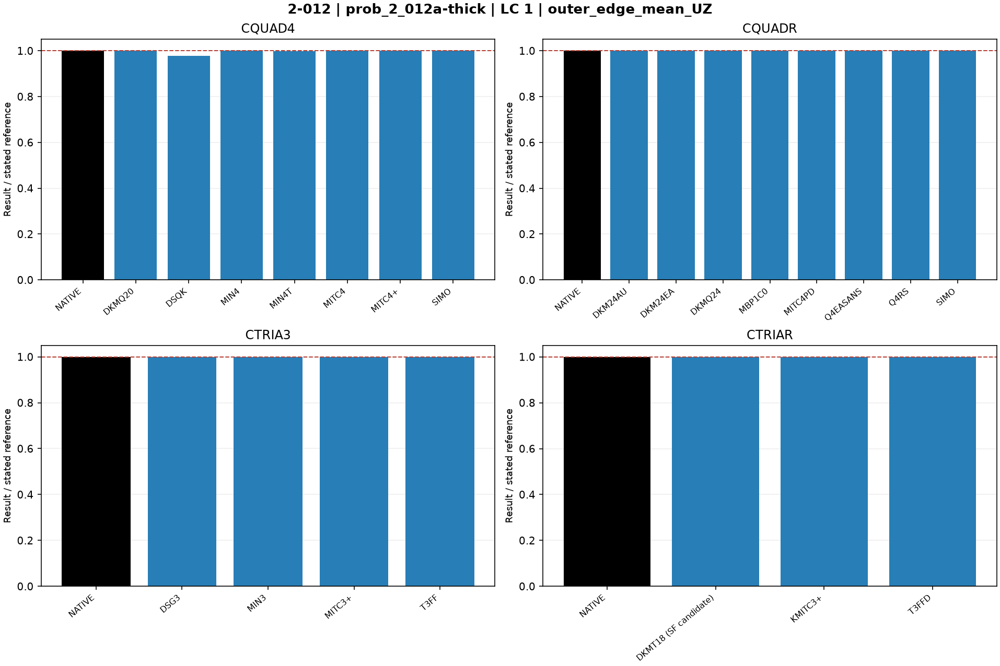
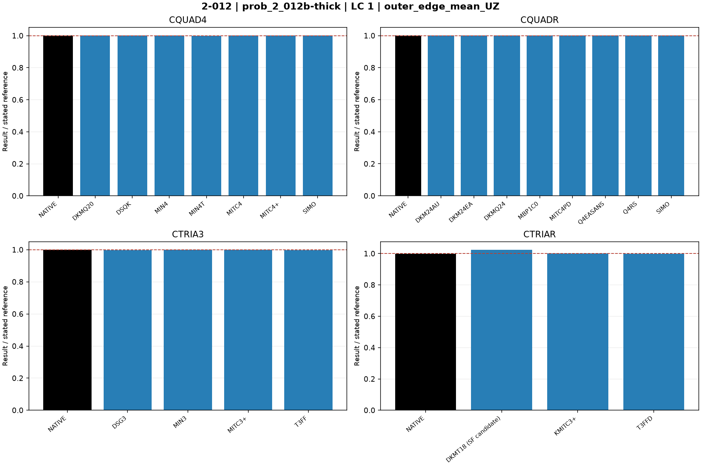

# Linear shells — 2-012: Thick annular plate

25 October 2026. Fresh native MYSTRAN and Nastran runs. CQUAD4, CQUADR, CTRIA3 and CTRIAR only.

[All linear comparisons](comparison_all_linear.md) · [Full CSV](comparison_all_linear.csv) · [Tested DAT](DAT/linear_shell_benchmark_DAT.zip) · [Linear publication QA](PUBLICATION_QA_linear.md)

Case IDs retain source-model filenames; actual element and formulation are given by their columns and deck selectors. Two-axis 2-002 tip observables use the two physical corner nodes.

NATIVE means the Nastran result for the corresponding element card: CQUAD4, CQUADR, CTRIA3 or CTRIAR. It does not mean the same proprietary interpolation as a MYSTRAN selector. Curves use independent/analytical references; published SAP2000 values are separate table columns. A completed solve is not a physical-accuracy pass. Zero references use absolute residuals; missing and failed output is never replaced by zero.

The tested source snapshot includes DKMT18 SF as an explicitly labelled candidate and corrected DSG3 local-z Kg. It is documented in [source provenance](data_linear/provenance_linear.json), with a reproducible element-local patch. This benchmark snapshot is not a declaration that SF passed every production-promotion gate. No shared eigensolver prototype is included.

## Model and comparison scope

Exact source 6x96 annulus. Consistent q=800 lb/in edge loads preserved. PSHELL TS/T corrected from 1 to 5/6 to match source shear multiplier 1. Independent UZ outer edge=-0.00534 in.

Exact source 6x96 annulus. S2K V13Mod=V23Mod=1000 was missing from DAT; PSHELL TS/T set to 1000*(5/6). Independent bending-only UZ=-0.00521 in; residual shear flexibility retained.

## Extraction status

| Solver | Status | Metric rows |
|---|---|---:|
| MYSTRAN | MEASURED | 44 |
| NASTRAN | MEASURED | 8 |

## Figures

### prob_2_012a-thick · LC 1 · outer_edge_mean_UZ

### prob_2_012b-thick · LC 1 · outer_edge_mean_UZ

## Finest available mesh per named series

| Case / parent quads | Solver / formulation | LC | Quantity | Measured | Independent / analytical | CSI published | Unit | Error % primary | Absolute residual | Status |
|---|---|---:|---|---:|---:|---:|---|---:|---:|---|
| prob_2_012a-thick / 576 | MYSTRAN CQUAD4_DKMQ20 | 1 | outer_edge_mean_UZ | -0.005339435 | -0.00534 | -0.00534 | in | 0.01058521 | 5.6525e-07 | MEASURED |
| prob_2_012a-thick / 576 | MYSTRAN CQUAD4_DSQK | 1 | outer_edge_mean_UZ | -0.005218344 | -0.00534 | -0.00534 | in | 2.278202 | 0.000121656 | MEASURED |
| prob_2_012a-thick / 576 | MYSTRAN CQUAD4_MIN4 | 1 | outer_edge_mean_UZ | -0.00533838 | -0.00534 | -0.00534 | in | 0.03033864 | 1.620083e-06 | MEASURED |
| prob_2_012a-thick / 576 | MYSTRAN CQUAD4_MIN4T | 1 | outer_edge_mean_UZ | -0.005336117 | -0.00534 | -0.00534 | in | 0.07272004 | 3.88325e-06 | MEASURED |
| prob_2_012a-thick / 576 | MYSTRAN CQUAD4_MITC4 | 1 | outer_edge_mean_UZ | -0.005342245 | -0.00534 | -0.00534 | in | 0.04203808 | 2.244833e-06 | MEASURED |
| prob_2_012a-thick / 576 | MYSTRAN CQUAD4_MITC4plus | 1 | outer_edge_mean_UZ | -0.005342245 | -0.00534 | -0.00534 | in | 0.04203808 | 2.244833e-06 | MEASURED |
| prob_2_012a-thick / 576 | MYSTRAN CQUAD4_SIMO | 1 | outer_edge_mean_UZ | -0.005342245 | -0.00534 | -0.00534 | in | 0.04203808 | 2.244833e-06 | MEASURED |
| prob_2_012a-thick / 576 | MYSTRAN CQUADR_DKM24AU | 1 | outer_edge_mean_UZ | -0.005339435 | -0.00534 | -0.00534 | in | 0.01058521 | 5.6525e-07 | MEASURED |
| prob_2_012a-thick / 576 | MYSTRAN CQUADR_DKM24EA | 1 | outer_edge_mean_UZ | -0.005339435 | -0.00534 | -0.00534 | in | 0.01058521 | 5.6525e-07 | MEASURED |
| prob_2_012a-thick / 576 | MYSTRAN CQUADR_DKMQ24 | 1 | outer_edge_mean_UZ | -0.005339435 | -0.00534 | -0.00534 | in | 0.01058521 | 5.6525e-07 | MEASURED |
| prob_2_012a-thick / 576 | MYSTRAN CQUADR_MBP1C0 | 1 | outer_edge_mean_UZ | -0.005342245 | -0.00534 | -0.00534 | in | 0.04203808 | 2.244833e-06 | MEASURED |
| prob_2_012a-thick / 576 | MYSTRAN CQUADR_MITC4PD | 1 | outer_edge_mean_UZ | -0.005342245 | -0.00534 | -0.00534 | in | 0.04203808 | 2.244833e-06 | MEASURED |
| prob_2_012a-thick / 576 | MYSTRAN CQUADR_Q4EASANS | 1 | outer_edge_mean_UZ | -0.005342245 | -0.00534 | -0.00534 | in | 0.04203808 | 2.244833e-06 | MEASURED |
| prob_2_012a-thick / 576 | MYSTRAN CQUADR_Q4RS | 1 | outer_edge_mean_UZ | -0.005344171 | -0.00534 | -0.00534 | in | 0.07810003 | 4.170542e-06 | MEASURED |
| prob_2_012a-thick / 576 | MYSTRAN CQUADR_SIMO | 1 | outer_edge_mean_UZ | -0.005342245 | -0.00534 | -0.00534 | in | 0.04203808 | 2.244833e-06 | MEASURED |
| prob_2_012a-thick / 576 | MYSTRAN CTRIA3_DSG3 | 1 | outer_edge_mean_UZ | -0.005335231 | -0.00534 | -0.00534 | in | 0.0893157 | 4.769458e-06 | MEASURED |
| prob_2_012a-thick / 576 | MYSTRAN CTRIA3_MIN3 | 1 | outer_edge_mean_UZ | -0.005336117 | -0.00534 | -0.00534 | in | 0.07272004 | 3.88325e-06 | MEASURED |
| prob_2_012a-thick / 576 | MYSTRAN CTRIA3_MITC3plus | 1 | outer_edge_mean_UZ | -0.005335805 | -0.00534 | -0.00534 | in | 0.07855961 | 4.195083e-06 | MEASURED |
| prob_2_012a-thick / 576 | MYSTRAN CTRIA3_T3FF | 1 | outer_edge_mean_UZ | -0.005335957 | -0.00534 | -0.00534 | in | 0.07572019 | 4.043458e-06 | MEASURED |
| prob_2_012a-thick / 576 | MYSTRAN CTRIAR_DKMT18 (SF candidate) | 1 | outer_edge_mean_UZ | -0.005335331 | -0.00534 | -0.00534 | in | 0.08743602 | 4.669083e-06 | MEASURED |
| prob_2_012a-thick / 576 | MYSTRAN CTRIAR_KMITC3plus | 1 | outer_edge_mean_UZ | -0.005336456 | -0.00534 | -0.00534 | in | 0.06637172 | 3.54425e-06 | MEASURED |
| prob_2_012a-thick / 576 | MYSTRAN CTRIAR_T3FFD | 1 | outer_edge_mean_UZ | -0.005335957 | -0.00534 | -0.00534 | in | 0.07572019 | 4.043458e-06 | MEASURED |
| prob_2_012a-thick / 576 | NASTRAN CQUAD4_NATIVE | 1 | outer_edge_mean_UZ | -0.005345211 | -0.00534 | -0.00534 | in | 0.0975872 | 5.211156e-06 | MEASURED |
| prob_2_012a-thick / 576 | NASTRAN CQUADR_NATIVE | 1 | outer_edge_mean_UZ | -0.005344573 | -0.00534 | -0.00534 | in | 0.08563963 | 4.573156e-06 | MEASURED |
| prob_2_012a-thick / 576 | NASTRAN CTRIA3_NATIVE | 1 | outer_edge_mean_UZ | -0.005335702 | -0.00534 | -0.00534 | in | 0.08049313 | 4.298333e-06 | MEASURED |
| prob_2_012a-thick / 576 | NASTRAN CTRIAR_NATIVE | 1 | outer_edge_mean_UZ | -0.00533543 | -0.00534 | -0.00534 | in | 0.08557623 | 4.569771e-06 | MEASURED |
| prob_2_012b-thick / 576 | MYSTRAN CQUAD4_DKMQ20 | 1 | outer_edge_mean_UZ | -0.005217022 | -0.00521 | -0.00521 | in | 0.1347729 | 7.021667e-06 | MEASURED |
| prob_2_012b-thick / 576 | MYSTRAN CQUAD4_DSQK | 1 | outer_edge_mean_UZ | -0.005217013 | -0.00521 | -0.00521 | in | 0.1346065 | 7.013e-06 | MEASURED |
| prob_2_012b-thick / 576 | MYSTRAN CQUAD4_MIN4 | 1 | outer_edge_mean_UZ | -0.005212143 | -0.00521 | -0.00521 | in | 0.04113324 | 2.143042e-06 | MEASURED |
| prob_2_012b-thick / 576 | MYSTRAN CQUAD4_MIN4T | 1 | outer_edge_mean_UZ | -0.005208273 | -0.00521 | -0.00521 | in | 0.03314939 | 1.727083e-06 | MEASURED |
| prob_2_012b-thick / 576 | MYSTRAN CQUAD4_MITC4 | 1 | outer_edge_mean_UZ | -0.005217023 | -0.00521 | -0.00521 | in | 0.1347985 | 7.023e-06 | MEASURED |
| prob_2_012b-thick / 576 | MYSTRAN CQUAD4_MITC4plus | 1 | outer_edge_mean_UZ | -0.005217023 | -0.00521 | -0.00521 | in | 0.1347985 | 7.023e-06 | MEASURED |
| prob_2_012b-thick / 576 | MYSTRAN CQUAD4_SIMO | 1 | outer_edge_mean_UZ | -0.005217023 | -0.00521 | -0.00521 | in | 0.1347985 | 7.023e-06 | MEASURED |
| prob_2_012b-thick / 576 | MYSTRAN CQUADR_DKM24AU | 1 | outer_edge_mean_UZ | -0.005217022 | -0.00521 | -0.00521 | in | 0.1347729 | 7.021667e-06 | MEASURED |
| prob_2_012b-thick / 576 | MYSTRAN CQUADR_DKM24EA | 1 | outer_edge_mean_UZ | -0.005217022 | -0.00521 | -0.00521 | in | 0.1347729 | 7.021667e-06 | MEASURED |
| prob_2_012b-thick / 576 | MYSTRAN CQUADR_DKMQ24 | 1 | outer_edge_mean_UZ | -0.005217022 | -0.00521 | -0.00521 | in | 0.1347729 | 7.021667e-06 | MEASURED |
| prob_2_012b-thick / 576 | MYSTRAN CQUADR_MBP1C0 | 1 | outer_edge_mean_UZ | -0.005217023 | -0.00521 | -0.00521 | in | 0.1347985 | 7.023e-06 | MEASURED |
| prob_2_012b-thick / 576 | MYSTRAN CQUADR_MITC4PD | 1 | outer_edge_mean_UZ | -0.005217023 | -0.00521 | -0.00521 | in | 0.1347985 | 7.023e-06 | MEASURED |
| prob_2_012b-thick / 576 | MYSTRAN CQUADR_Q4EASANS | 1 | outer_edge_mean_UZ | -0.005217023 | -0.00521 | -0.00521 | in | 0.1347985 | 7.023e-06 | MEASURED |
| prob_2_012b-thick / 576 | MYSTRAN CQUADR_Q4RS | 1 | outer_edge_mean_UZ | -0.005217025 | -0.00521 | -0.00521 | in | 0.1348353 | 7.024917e-06 | MEASURED |
| prob_2_012b-thick / 576 | MYSTRAN CQUADR_SIMO | 1 | outer_edge_mean_UZ | -0.005217023 | -0.00521 | -0.00521 | in | 0.1347985 | 7.023e-06 | MEASURED |
| prob_2_012b-thick / 576 | MYSTRAN CTRIA3_DSG3 | 1 | outer_edge_mean_UZ | -0.005201147 | -0.00521 | -0.00521 | in | 0.1699248 | 8.853083e-06 | MEASURED |
| prob_2_012b-thick / 576 | MYSTRAN CTRIA3_MIN3 | 1 | outer_edge_mean_UZ | -0.005208279 | -0.00521 | -0.00521 | in | 0.03303183 | 1.720958e-06 | MEASURED |
| prob_2_012b-thick / 576 | MYSTRAN CTRIA3_MITC3plus | 1 | outer_edge_mean_UZ | -0.005207857 | -0.00521 | -0.00521 | in | 0.04113564 | 2.143167e-06 | MEASURED |
| prob_2_012b-thick / 576 | MYSTRAN CTRIA3_T3FF | 1 | outer_edge_mean_UZ | -0.005201155 | -0.00521 | -0.00521 | in | 0.1697745 | 8.84525e-06 | MEASURED |
| prob_2_012b-thick / 576 | MYSTRAN CTRIAR_DKMT18 (SF candidate) | 1 | outer_edge_mean_UZ | -0.005335331 | -0.00521 | -0.00521 | in | 2.405584 | 0.0001253309 | MEASURED |
| prob_2_012b-thick / 576 | MYSTRAN CTRIAR_KMITC3plus | 1 | outer_edge_mean_UZ | -0.005209351 | -0.00521 | -0.00521 | in | 0.01246561 | 6.494583e-07 | MEASURED |
| prob_2_012b-thick / 576 | MYSTRAN CTRIAR_T3FFD | 1 | outer_edge_mean_UZ | -0.005201155 | -0.00521 | -0.00521 | in | 0.1697745 | 8.84525e-06 | MEASURED |
| prob_2_012b-thick / 576 | NASTRAN CQUAD4_NATIVE | 1 | outer_edge_mean_UZ | -0.005219988 | -0.00521 | -0.00521 | in | 0.1917069 | 9.987927e-06 | MEASURED |
| prob_2_012b-thick / 576 | NASTRAN CQUADR_NATIVE | 1 | outer_edge_mean_UZ | -0.00521935 | -0.00521 | -0.00521 | in | 0.1794542 | 9.349563e-06 | MEASURED |
| prob_2_012b-thick / 576 | NASTRAN CTRIA3_NATIVE | 1 | outer_edge_mean_UZ | -0.005207139 | -0.00521 | -0.00521 | in | 0.05491123 | 2.860875e-06 | MEASURED |
| prob_2_012b-thick / 576 | NASTRAN CTRIAR_NATIVE | 1 | outer_edge_mean_UZ | -0.005206853 | -0.00521 | -0.00521 | in | 0.06040067 | 3.146875e-06 | MEASURED |

All mesh rows, missing fields, hashes and run statuses remain in the CSV.
