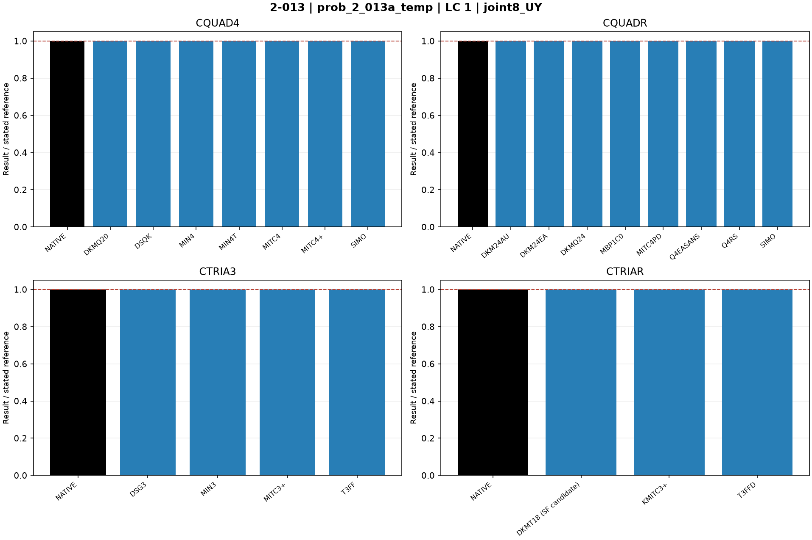
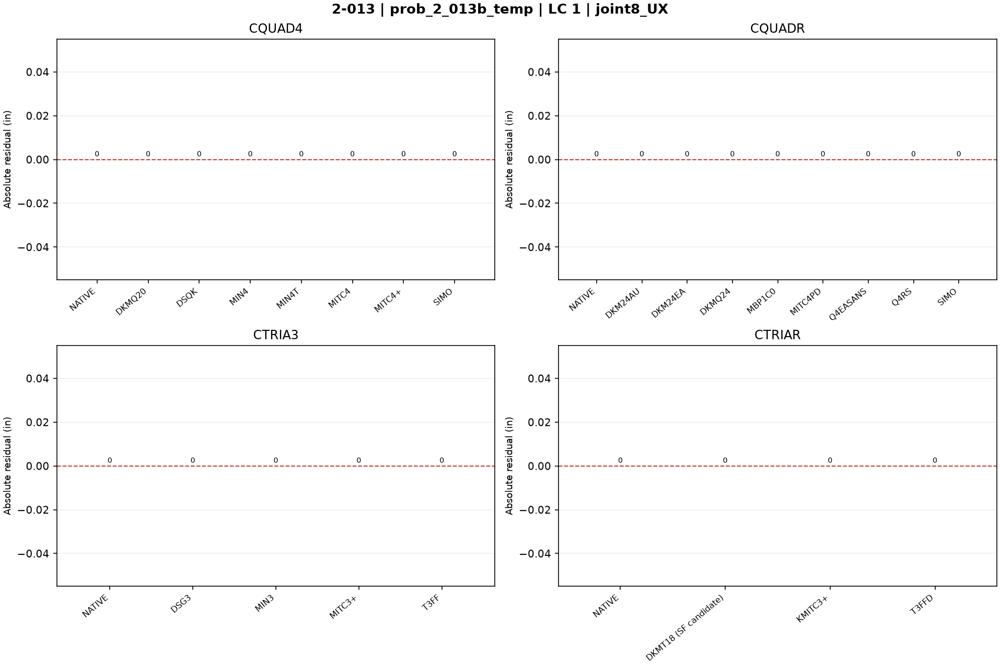
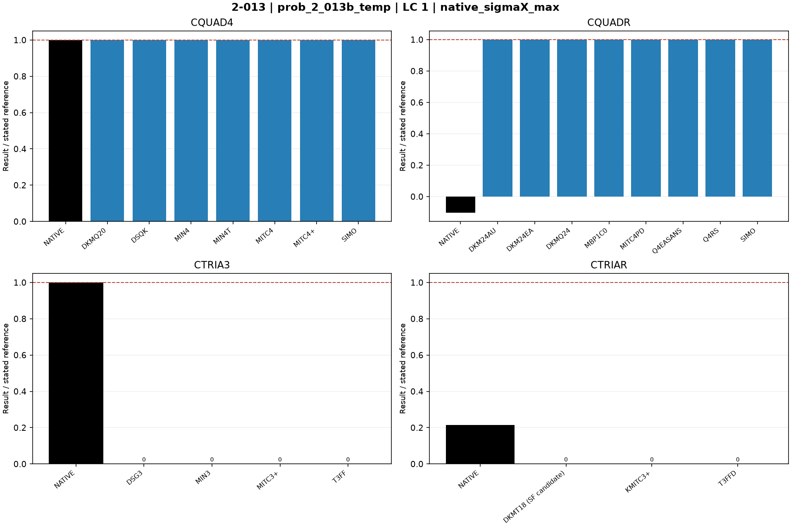
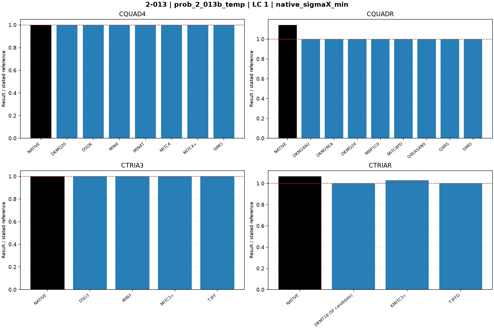
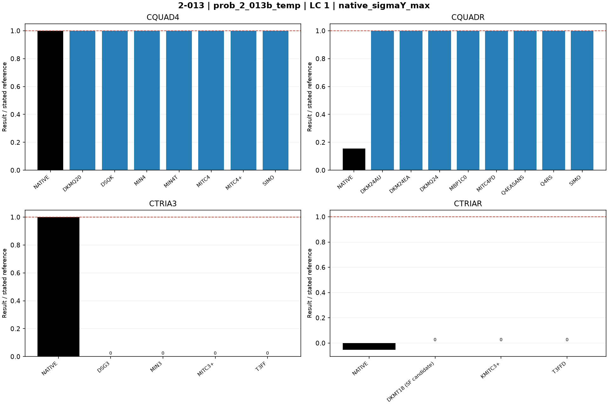
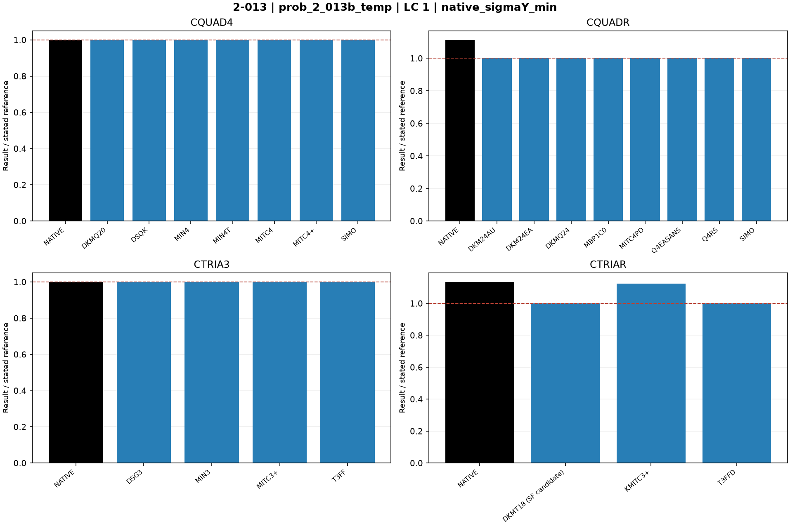

# Linear shells — 2-013: Uniform temperature

27 October 2026 rebenchmark: all MYSTRAN entries were rerun using the rebuilt mixed-hybrid DSQK binary. Nastran entries retain previous outputs for unchanged decks. Default residual acceptance remains 1e-6. See [rebenchmark report](../Linear_Shell_Rebenchmark_20261027.md).

Historical baseline: 25 October 2026; MYSTRAN refreshed 27 October, Nastran retained. CQUAD4, CQUADR, CTRIA3 and CTRIAR only.

[All linear comparisons](comparison_all_linear.md) · [Full ZIP](comparison_all_linear.zip) · [Tested DAT](DAT/linear_shell_benchmark_DAT.zip) · [Linear publication QA](PUBLICATION_QA_linear.md)

Case IDs retain source-model filenames; actual element and formulation are given by their columns and deck selectors. Two-axis 2-002 tip observables use the two physical corner nodes.

NATIVE means the Nastran result for the corresponding element card: CQUAD4, CQUADR, CTRIA3 or CTRIAR. It does not mean the same proprietary interpolation as a MYSTRAN selector. Curves use independent/analytical references; published SAP2000 values are separate table columns. A completed solve is not a physical-accuracy pass. Zero references use absolute residuals; missing and failed output is never replaced by zero.

The tested source snapshot includes DKMT18 SF as an explicitly labelled candidate and corrected DSG3 local-z Kg. It is documented in [source provenance](data_linear/provenance_linear.json), with a reproducible element-local patch. This benchmark snapshot is not a declaration that SF passed every production-promotion gate. No shared eigensolver prototype is included.

## Model and comparison scope

Uniform temperature increment 100 F, alpha=5.5e-6 /F. A free expansion UX8=0.000132 and UY8=0.000066 in. B restrained expansion sigmaXX=sigmaYY=-733.333333 psi; zero displacement uses absolute residual.

## Extraction status

| Solver | Status | Metric rows |
|---|---|---:|
| MYSTRAN | MEASURED | 176 |
| NASTRAN | MEASURED | 32 |

## Figures

### prob_2_013a_temp · LC 1 · joint8_UX

### prob_2_013a_temp · LC 1 · joint8_UY

### prob_2_013b_temp · LC 1 · joint8_UX

### prob_2_013b_temp · LC 1 · joint8_UY

### prob_2_013b_temp · LC 1 · native_sigmaX_max

### prob_2_013b_temp · LC 1 · native_sigmaX_min

### prob_2_013b_temp · LC 1 · native_sigmaY_max

### prob_2_013b_temp · LC 1 · native_sigmaY_min

## Finest available mesh per named series

| Case / parent quads | Solver / formulation | LC | Quantity | Measured | Independent / analytical | CSI published | Unit | Error % primary | Absolute residual | Status |
|---|---|---:|---|---:|---:|---:|---|---:|---:|---|
| prob_2_013a_temp_cquadr_simo / 5 | MYSTRAN CQUAD4_DKMQ20 | 1 | joint8_UX | 0.000132 | 0.000132 | 0.000132 | in | 0 | 0 | MEASURED |
| prob_2_013a_temp_cquadr_simo / 5 | MYSTRAN CQUAD4_DSQK | 1 | joint8_UX | 0.000132 | 0.000132 | 0.000132 | in | 0 | 0 | MEASURED |
| prob_2_013a_temp_cquadr_simo / 5 | MYSTRAN CQUAD4_MIN4 | 1 | joint8_UX | 0.000132 | 0.000132 | 0.000132 | in | 0 | 0 | MEASURED |
| prob_2_013a_temp_cquadr_simo / 5 | MYSTRAN CQUAD4_MIN4T | 1 | joint8_UX | 0.000132 | 0.000132 | 0.000132 | in | 0 | 0 | MEASURED |
| prob_2_013a_temp_cquadr_simo / 5 | MYSTRAN CQUAD4_MITC4 | 1 | joint8_UX | 0.000132 | 0.000132 | 0.000132 | in | 0 | 0 | MEASURED |
| prob_2_013a_temp_cquadr_simo / 5 | MYSTRAN CQUAD4_MITC4plus | 1 | joint8_UX | 0.000132 | 0.000132 | 0.000132 | in | 0 | 0 | MEASURED |
| prob_2_013a_temp_cquadr_simo / 5 | MYSTRAN CQUAD4_SIMO | 1 | joint8_UX | 0.000132 | 0.000132 | 0.000132 | in | 0 | 0 | MEASURED |
| prob_2_013a_temp_cquadr_simo / 5 | MYSTRAN CQUADR_DKM24AU | 1 | joint8_UX | 0.000132 | 0.000132 | 0.000132 | in | 0 | 0 | MEASURED |
| prob_2_013a_temp_cquadr_simo / 5 | MYSTRAN CQUADR_DKM24EA | 1 | joint8_UX | 0.000132 | 0.000132 | 0.000132 | in | 0 | 0 | MEASURED |
| prob_2_013a_temp_cquadr_simo / 5 | MYSTRAN CQUADR_DKMQ24 | 1 | joint8_UX | 0.000132 | 0.000132 | 0.000132 | in | 0 | 0 | MEASURED |
| prob_2_013a_temp_cquadr_simo / 5 | MYSTRAN CQUADR_MBP1C0 | 1 | joint8_UX | 0.000132 | 0.000132 | 0.000132 | in | 0 | 0 | MEASURED |
| prob_2_013a_temp_cquadr_simo / 5 | MYSTRAN CQUADR_MITC4PD | 1 | joint8_UX | 0.000132 | 0.000132 | 0.000132 | in | 0 | 0 | MEASURED |
| prob_2_013a_temp_cquadr_simo / 5 | MYSTRAN CQUADR_Q4EASANS | 1 | joint8_UX | 0.000132 | 0.000132 | 0.000132 | in | 0 | 0 | MEASURED |
| prob_2_013a_temp_cquadr_simo / 5 | MYSTRAN CQUADR_Q4RS | 1 | joint8_UX | 0.000132 | 0.000132 | 0.000132 | in | 0 | 0 | MEASURED |
| prob_2_013a_temp_cquadr_simo / 5 | MYSTRAN CQUADR_SIMO | 1 | joint8_UX | 0.000132 | 0.000132 | 0.000132 | in | 0 | 0 | MEASURED |
| prob_2_013a_temp_cquadr_simo / 5 | MYSTRAN CTRIA3_DSG3 | 1 | joint8_UX | 0.000132 | 0.000132 | 0.000132 | in | 0 | 0 | MEASURED |
| prob_2_013a_temp_cquadr_simo / 5 | MYSTRAN CTRIA3_MIN3 | 1 | joint8_UX | 0.000132 | 0.000132 | 0.000132 | in | 0 | 0 | MEASURED |
| prob_2_013a_temp_cquadr_simo / 5 | MYSTRAN CTRIA3_MITC3plus | 1 | joint8_UX | 0.000132 | 0.000132 | 0.000132 | in | 0 | 0 | MEASURED |
| prob_2_013a_temp_cquadr_simo / 5 | MYSTRAN CTRIA3_T3FF | 1 | joint8_UX | 0.000132 | 0.000132 | 0.000132 | in | 0 | 0 | MEASURED |
| prob_2_013a_temp_cquadr_simo / 5 | MYSTRAN CTRIAR_DKMT18 (SF candidate) | 1 | joint8_UX | 0.000132 | 0.000132 | 0.000132 | in | 0 | 0 | MEASURED |
| prob_2_013a_temp_cquadr_simo / 5 | MYSTRAN CTRIAR_KMITC3plus | 1 | joint8_UX | 0.000132 | 0.000132 | 0.000132 | in | 0 | 0 | MEASURED |
| prob_2_013a_temp_cquadr_simo / 5 | MYSTRAN CTRIAR_T3FFD | 1 | joint8_UX | 0.000132 | 0.000132 | 0.000132 | in | 0 | 0 | MEASURED |
| prob_2_013a_temp_cquadr_simo / 5 | NASTRAN CQUAD4_NATIVE | 1 | joint8_UX | 0.000132 | 0.000132 | 0.000132 | in | 0 | 0 | MEASURED |
| prob_2_013a_temp_cquadr_simo / 5 | NASTRAN CQUADR_NATIVE | 1 | joint8_UX | 0.000132 | 0.000132 | 0.000132 | in | 0 | 0 | MEASURED |
| prob_2_013a_temp_cquadr_simo / 5 | NASTRAN CTRIA3_NATIVE | 1 | joint8_UX | 0.000132 | 0.000132 | 0.000132 | in | 0 | 0 | MEASURED |
| prob_2_013a_temp_cquadr_simo / 5 | NASTRAN CTRIAR_NATIVE | 1 | joint8_UX | 0.000132 | 0.000132 | 0.000132 | in | 0 | 0 | MEASURED |
| prob_2_013a_temp_cquadr_simo / 5 | MYSTRAN CQUAD4_DKMQ20 | 1 | joint8_UY | 6.6e-05 | 6.6e-05 | 6.6e-05 | in | 0 | 0 | MEASURED |
| prob_2_013a_temp_cquadr_simo / 5 | MYSTRAN CQUAD4_DSQK | 1 | joint8_UY | 6.6e-05 | 6.6e-05 | 6.6e-05 | in | 0 | 0 | MEASURED |
| prob_2_013a_temp_cquadr_simo / 5 | MYSTRAN CQUAD4_MIN4 | 1 | joint8_UY | 6.6e-05 | 6.6e-05 | 6.6e-05 | in | 0 | 0 | MEASURED |
| prob_2_013a_temp_cquadr_simo / 5 | MYSTRAN CQUAD4_MIN4T | 1 | joint8_UY | 6.6e-05 | 6.6e-05 | 6.6e-05 | in | 0 | 0 | MEASURED |
| prob_2_013a_temp_cquadr_simo / 5 | MYSTRAN CQUAD4_MITC4 | 1 | joint8_UY | 6.6e-05 | 6.6e-05 | 6.6e-05 | in | 0 | 0 | MEASURED |
| prob_2_013a_temp_cquadr_simo / 5 | MYSTRAN CQUAD4_MITC4plus | 1 | joint8_UY | 6.6e-05 | 6.6e-05 | 6.6e-05 | in | 0 | 0 | MEASURED |
| prob_2_013a_temp_cquadr_simo / 5 | MYSTRAN CQUAD4_SIMO | 1 | joint8_UY | 6.6e-05 | 6.6e-05 | 6.6e-05 | in | 0 | 0 | MEASURED |
| prob_2_013a_temp_cquadr_simo / 5 | MYSTRAN CQUADR_DKM24AU | 1 | joint8_UY | 6.6e-05 | 6.6e-05 | 6.6e-05 | in | 0 | 0 | MEASURED |
| prob_2_013a_temp_cquadr_simo / 5 | MYSTRAN CQUADR_DKM24EA | 1 | joint8_UY | 6.6e-05 | 6.6e-05 | 6.6e-05 | in | 0 | 0 | MEASURED |
| prob_2_013a_temp_cquadr_simo / 5 | MYSTRAN CQUADR_DKMQ24 | 1 | joint8_UY | 6.6e-05 | 6.6e-05 | 6.6e-05 | in | 0 | 0 | MEASURED |
| prob_2_013a_temp_cquadr_simo / 5 | MYSTRAN CQUADR_MBP1C0 | 1 | joint8_UY | 6.6e-05 | 6.6e-05 | 6.6e-05 | in | 0 | 0 | MEASURED |
| prob_2_013a_temp_cquadr_simo / 5 | MYSTRAN CQUADR_MITC4PD | 1 | joint8_UY | 6.6e-05 | 6.6e-05 | 6.6e-05 | in | 0 | 0 | MEASURED |
| prob_2_013a_temp_cquadr_simo / 5 | MYSTRAN CQUADR_Q4EASANS | 1 | joint8_UY | 6.6e-05 | 6.6e-05 | 6.6e-05 | in | 0 | 0 | MEASURED |
| prob_2_013a_temp_cquadr_simo / 5 | MYSTRAN CQUADR_Q4RS | 1 | joint8_UY | 6.6e-05 | 6.6e-05 | 6.6e-05 | in | 0 | 0 | MEASURED |
| prob_2_013a_temp_cquadr_simo / 5 | MYSTRAN CQUADR_SIMO | 1 | joint8_UY | 6.6e-05 | 6.6e-05 | 6.6e-05 | in | 0 | 0 | MEASURED |
| prob_2_013a_temp_cquadr_simo / 5 | MYSTRAN CTRIA3_DSG3 | 1 | joint8_UY | 6.6e-05 | 6.6e-05 | 6.6e-05 | in | 0 | 0 | MEASURED |
| prob_2_013a_temp_cquadr_simo / 5 | MYSTRAN CTRIA3_MIN3 | 1 | joint8_UY | 6.6e-05 | 6.6e-05 | 6.6e-05 | in | 0 | 0 | MEASURED |
| prob_2_013a_temp_cquadr_simo / 5 | MYSTRAN CTRIA3_MITC3plus | 1 | joint8_UY | 6.6e-05 | 6.6e-05 | 6.6e-05 | in | 0 | 0 | MEASURED |
| prob_2_013a_temp_cquadr_simo / 5 | MYSTRAN CTRIA3_T3FF | 1 | joint8_UY | 6.6e-05 | 6.6e-05 | 6.6e-05 | in | 0 | 0 | MEASURED |
| prob_2_013a_temp_cquadr_simo / 5 | MYSTRAN CTRIAR_DKMT18 (SF candidate) | 1 | joint8_UY | 6.6e-05 | 6.6e-05 | 6.6e-05 | in | 0 | 0 | MEASURED |
| prob_2_013a_temp_cquadr_simo / 5 | MYSTRAN CTRIAR_KMITC3plus | 1 | joint8_UY | 6.6e-05 | 6.6e-05 | 6.6e-05 | in | 0 | 0 | MEASURED |
| prob_2_013a_temp_cquadr_simo / 5 | MYSTRAN CTRIAR_T3FFD | 1 | joint8_UY | 6.6e-05 | 6.6e-05 | 6.6e-05 | in | 0 | 0 | MEASURED |
| prob_2_013a_temp_cquadr_simo / 5 | NASTRAN CQUAD4_NATIVE | 1 | joint8_UY | 6.6e-05 | 6.6e-05 | 6.6e-05 | in | 0 | 0 | MEASURED |
| prob_2_013a_temp_cquadr_simo / 5 | NASTRAN CQUADR_NATIVE | 1 | joint8_UY | 6.6e-05 | 6.6e-05 | 6.6e-05 | in | 0 | 0 | MEASURED |
| prob_2_013a_temp_cquadr_simo / 5 | NASTRAN CTRIA3_NATIVE | 1 | joint8_UY | 6.6e-05 | 6.6e-05 | 6.6e-05 | in | 0 | 0 | MEASURED |
| prob_2_013a_temp_cquadr_simo / 5 | NASTRAN CTRIAR_NATIVE | 1 | joint8_UY | 6.6e-05 | 6.6e-05 | 6.6e-05 | in | 0 | 0 | MEASURED |
| prob_2_013b_temp_cquadr_simo / 5 | MYSTRAN CQUAD4_DKMQ20 | 1 | joint8_UX | 0 | 0 | 0 | in | — | 0 | MEASURED |
| prob_2_013b_temp_cquadr_simo / 5 | MYSTRAN CQUAD4_DSQK | 1 | joint8_UX | 0 | 0 | 0 | in | — | 0 | MEASURED |
| prob_2_013b_temp_cquadr_simo / 5 | MYSTRAN CQUAD4_MIN4 | 1 | joint8_UX | 0 | 0 | 0 | in | — | 0 | MEASURED |
| prob_2_013b_temp_cquadr_simo / 5 | MYSTRAN CQUAD4_MIN4T | 1 | joint8_UX | 0 | 0 | 0 | in | — | 0 | MEASURED |
| prob_2_013b_temp_cquadr_simo / 5 | MYSTRAN CQUAD4_MITC4 | 1 | joint8_UX | 0 | 0 | 0 | in | — | 0 | MEASURED |
| prob_2_013b_temp_cquadr_simo / 5 | MYSTRAN CQUAD4_MITC4plus | 1 | joint8_UX | 0 | 0 | 0 | in | — | 0 | MEASURED |
| prob_2_013b_temp_cquadr_simo / 5 | MYSTRAN CQUAD4_SIMO | 1 | joint8_UX | 0 | 0 | 0 | in | — | 0 | MEASURED |
| prob_2_013b_temp_cquadr_simo / 5 | MYSTRAN CQUADR_DKM24AU | 1 | joint8_UX | 0 | 0 | 0 | in | — | 0 | MEASURED |
| prob_2_013b_temp_cquadr_simo / 5 | MYSTRAN CQUADR_DKM24EA | 1 | joint8_UX | 0 | 0 | 0 | in | — | 0 | MEASURED |
| prob_2_013b_temp_cquadr_simo / 5 | MYSTRAN CQUADR_DKMQ24 | 1 | joint8_UX | 0 | 0 | 0 | in | — | 0 | MEASURED |
| prob_2_013b_temp_cquadr_simo / 5 | MYSTRAN CQUADR_MBP1C0 | 1 | joint8_UX | 0 | 0 | 0 | in | — | 0 | MEASURED |
| prob_2_013b_temp_cquadr_simo / 5 | MYSTRAN CQUADR_MITC4PD | 1 | joint8_UX | 0 | 0 | 0 | in | — | 0 | MEASURED |
| prob_2_013b_temp_cquadr_simo / 5 | MYSTRAN CQUADR_Q4EASANS | 1 | joint8_UX | 0 | 0 | 0 | in | — | 0 | MEASURED |
| prob_2_013b_temp_cquadr_simo / 5 | MYSTRAN CQUADR_Q4RS | 1 | joint8_UX | 0 | 0 | 0 | in | — | 0 | MEASURED |
| prob_2_013b_temp_cquadr_simo / 5 | MYSTRAN CQUADR_SIMO | 1 | joint8_UX | 0 | 0 | 0 | in | — | 0 | MEASURED |
| prob_2_013b_temp_cquadr_simo / 5 | MYSTRAN CTRIA3_DSG3 | 1 | joint8_UX | 0 | 0 | 0 | in | — | 0 | MEASURED |
| prob_2_013b_temp_cquadr_simo / 5 | MYSTRAN CTRIA3_MIN3 | 1 | joint8_UX | 0 | 0 | 0 | in | — | 0 | MEASURED |
| prob_2_013b_temp_cquadr_simo / 5 | MYSTRAN CTRIA3_MITC3plus | 1 | joint8_UX | 0 | 0 | 0 | in | — | 0 | MEASURED |
| prob_2_013b_temp_cquadr_simo / 5 | MYSTRAN CTRIA3_T3FF | 1 | joint8_UX | 0 | 0 | 0 | in | — | 0 | MEASURED |
| prob_2_013b_temp_cquadr_simo / 5 | MYSTRAN CTRIAR_DKMT18 (SF candidate) | 1 | joint8_UX | 0 | 0 | 0 | in | — | 0 | MEASURED |
| prob_2_013b_temp_cquadr_simo / 5 | MYSTRAN CTRIAR_KMITC3plus | 1 | joint8_UX | 0 | 0 | 0 | in | — | 0 | MEASURED |
| prob_2_013b_temp_cquadr_simo / 5 | MYSTRAN CTRIAR_T3FFD | 1 | joint8_UX | 0 | 0 | 0 | in | — | 0 | MEASURED |
| prob_2_013b_temp_cquadr_simo / 5 | NASTRAN CQUAD4_NATIVE | 1 | joint8_UX | 0 | 0 | 0 | in | — | 0 | MEASURED |
| prob_2_013b_temp_cquadr_simo / 5 | NASTRAN CQUADR_NATIVE | 1 | joint8_UX | 0 | 0 | 0 | in | — | 0 | MEASURED |
| prob_2_013b_temp_cquadr_simo / 5 | NASTRAN CTRIA3_NATIVE | 1 | joint8_UX | 0 | 0 | 0 | in | — | 0 | MEASURED |
| prob_2_013b_temp_cquadr_simo / 5 | NASTRAN CTRIAR_NATIVE | 1 | joint8_UX | 0 | 0 | 0 | in | — | 0 | MEASURED |
| prob_2_013b_temp_cquadr_simo / 5 | MYSTRAN CQUAD4_DKMQ20 | 1 | joint8_UY | 0 | 0 | 0 | in | — | 0 | MEASURED |
| prob_2_013b_temp_cquadr_simo / 5 | MYSTRAN CQUAD4_DSQK | 1 | joint8_UY | 0 | 0 | 0 | in | — | 0 | MEASURED |
| prob_2_013b_temp_cquadr_simo / 5 | MYSTRAN CQUAD4_MIN4 | 1 | joint8_UY | 0 | 0 | 0 | in | — | 0 | MEASURED |
| prob_2_013b_temp_cquadr_simo / 5 | MYSTRAN CQUAD4_MIN4T | 1 | joint8_UY | 0 | 0 | 0 | in | — | 0 | MEASURED |
| prob_2_013b_temp_cquadr_simo / 5 | MYSTRAN CQUAD4_MITC4 | 1 | joint8_UY | 0 | 0 | 0 | in | — | 0 | MEASURED |
| prob_2_013b_temp_cquadr_simo / 5 | MYSTRAN CQUAD4_MITC4plus | 1 | joint8_UY | 0 | 0 | 0 | in | — | 0 | MEASURED |
| prob_2_013b_temp_cquadr_simo / 5 | MYSTRAN CQUAD4_SIMO | 1 | joint8_UY | 0 | 0 | 0 | in | — | 0 | MEASURED |
| prob_2_013b_temp_cquadr_simo / 5 | MYSTRAN CQUADR_DKM24AU | 1 | joint8_UY | 0 | 0 | 0 | in | — | 0 | MEASURED |
| prob_2_013b_temp_cquadr_simo / 5 | MYSTRAN CQUADR_DKM24EA | 1 | joint8_UY | 0 | 0 | 0 | in | — | 0 | MEASURED |
| prob_2_013b_temp_cquadr_simo / 5 | MYSTRAN CQUADR_DKMQ24 | 1 | joint8_UY | 0 | 0 | 0 | in | — | 0 | MEASURED |
| prob_2_013b_temp_cquadr_simo / 5 | MYSTRAN CQUADR_MBP1C0 | 1 | joint8_UY | 0 | 0 | 0 | in | — | 0 | MEASURED |
| prob_2_013b_temp_cquadr_simo / 5 | MYSTRAN CQUADR_MITC4PD | 1 | joint8_UY | 0 | 0 | 0 | in | — | 0 | MEASURED |
| prob_2_013b_temp_cquadr_simo / 5 | MYSTRAN CQUADR_Q4EASANS | 1 | joint8_UY | 0 | 0 | 0 | in | — | 0 | MEASURED |
| prob_2_013b_temp_cquadr_simo / 5 | MYSTRAN CQUADR_Q4RS | 1 | joint8_UY | 0 | 0 | 0 | in | — | 0 | MEASURED |
| prob_2_013b_temp_cquadr_simo / 5 | MYSTRAN CQUADR_SIMO | 1 | joint8_UY | 0 | 0 | 0 | in | — | 0 | MEASURED |
| prob_2_013b_temp_cquadr_simo / 5 | MYSTRAN CTRIA3_DSG3 | 1 | joint8_UY | 0 | 0 | 0 | in | — | 0 | MEASURED |
| prob_2_013b_temp_cquadr_simo / 5 | MYSTRAN CTRIA3_MIN3 | 1 | joint8_UY | 0 | 0 | 0 | in | — | 0 | MEASURED |
| prob_2_013b_temp_cquadr_simo / 5 | MYSTRAN CTRIA3_MITC3plus | 1 | joint8_UY | 0 | 0 | 0 | in | — | 0 | MEASURED |
| prob_2_013b_temp_cquadr_simo / 5 | MYSTRAN CTRIA3_T3FF | 1 | joint8_UY | 0 | 0 | 0 | in | — | 0 | MEASURED |
| prob_2_013b_temp_cquadr_simo / 5 | MYSTRAN CTRIAR_DKMT18 (SF candidate) | 1 | joint8_UY | 0 | 0 | 0 | in | — | 0 | MEASURED |
| prob_2_013b_temp_cquadr_simo / 5 | MYSTRAN CTRIAR_KMITC3plus | 1 | joint8_UY | 0 | 0 | 0 | in | — | 0 | MEASURED |
| prob_2_013b_temp_cquadr_simo / 5 | MYSTRAN CTRIAR_T3FFD | 1 | joint8_UY | 0 | 0 | 0 | in | — | 0 | MEASURED |
| prob_2_013b_temp_cquadr_simo / 5 | NASTRAN CQUAD4_NATIVE | 1 | joint8_UY | 0 | 0 | 0 | in | — | 0 | MEASURED |
| prob_2_013b_temp_cquadr_simo / 5 | NASTRAN CQUADR_NATIVE | 1 | joint8_UY | 0 | 0 | 0 | in | — | 0 | MEASURED |
| prob_2_013b_temp_cquadr_simo / 5 | NASTRAN CTRIA3_NATIVE | 1 | joint8_UY | 0 | 0 | 0 | in | — | 0 | MEASURED |
| prob_2_013b_temp_cquadr_simo / 5 | NASTRAN CTRIAR_NATIVE | 1 | joint8_UY | 0 | 0 | 0 | in | — | 0 | MEASURED |
| prob_2_013b_temp_cquadr_simo / 5 | MYSTRAN CQUAD4_DKMQ20 | 1 | native_sigmaX_max | -733.333 | -733.3333 | -733.33 | psi | 4.54545e-05 | 0.000333333 | MEASURED |
| prob_2_013b_temp_cquadr_simo / 5 | MYSTRAN CQUAD4_DSQK | 1 | native_sigmaX_max | -733.333 | -733.3333 | -733.33 | psi | 4.54545e-05 | 0.000333333 | MEASURED |
| prob_2_013b_temp_cquadr_simo / 5 | MYSTRAN CQUAD4_MIN4 | 1 | native_sigmaX_max | -733.333 | -733.3333 | -733.33 | psi | 4.54545e-05 | 0.000333333 | MEASURED |
| prob_2_013b_temp_cquadr_simo / 5 | MYSTRAN CQUAD4_MIN4T | 1 | native_sigmaX_max | -733.333 | -733.3333 | -733.33 | psi | 4.54545e-05 | 0.000333333 | MEASURED |
| prob_2_013b_temp_cquadr_simo / 5 | MYSTRAN CQUAD4_MITC4 | 1 | native_sigmaX_max | -733.333 | -733.3333 | -733.33 | psi | 4.54545e-05 | 0.000333333 | MEASURED |
| prob_2_013b_temp_cquadr_simo / 5 | MYSTRAN CQUAD4_MITC4plus | 1 | native_sigmaX_max | -733.333 | -733.3333 | -733.33 | psi | 4.54545e-05 | 0.000333333 | MEASURED |
| prob_2_013b_temp_cquadr_simo / 5 | MYSTRAN CQUAD4_SIMO | 1 | native_sigmaX_max | -733.333 | -733.3333 | -733.33 | psi | 4.54545e-05 | 0.000333333 | MEASURED |
| prob_2_013b_temp_cquadr_simo / 5 | MYSTRAN CQUADR_DKM24AU | 1 | native_sigmaX_max | -733.333 | -733.3333 | -733.33 | psi | 4.54545e-05 | 0.000333333 | MEASURED |
| prob_2_013b_temp_cquadr_simo / 5 | MYSTRAN CQUADR_DKM24EA | 1 | native_sigmaX_max | -733.333 | -733.3333 | -733.33 | psi | 4.54545e-05 | 0.000333333 | MEASURED |
| prob_2_013b_temp_cquadr_simo / 5 | MYSTRAN CQUADR_DKMQ24 | 1 | native_sigmaX_max | -733.333 | -733.3333 | -733.33 | psi | 4.54545e-05 | 0.000333333 | MEASURED |
| prob_2_013b_temp_cquadr_simo / 5 | MYSTRAN CQUADR_MBP1C0 | 1 | native_sigmaX_max | -733.333 | -733.3333 | -733.33 | psi | 4.54545e-05 | 0.000333333 | MEASURED |
| prob_2_013b_temp_cquadr_simo / 5 | MYSTRAN CQUADR_MITC4PD | 1 | native_sigmaX_max | -733.333 | -733.3333 | -733.33 | psi | 4.54545e-05 | 0.000333333 | MEASURED |
| prob_2_013b_temp_cquadr_simo / 5 | MYSTRAN CQUADR_Q4EASANS | 1 | native_sigmaX_max | -733.333 | -733.3333 | -733.33 | psi | 4.54545e-05 | 0.000333333 | MEASURED |
| prob_2_013b_temp_cquadr_simo / 5 | MYSTRAN CQUADR_Q4RS | 1 | native_sigmaX_max | -733.333 | -733.3333 | -733.33 | psi | 4.54545e-05 | 0.000333333 | MEASURED |
| prob_2_013b_temp_cquadr_simo / 5 | MYSTRAN CQUADR_SIMO | 1 | native_sigmaX_max | -733.333 | -733.3333 | -733.33 | psi | 4.54545e-05 | 0.000333333 | MEASURED |
| prob_2_013b_temp_cquadr_simo / 5 | MYSTRAN CTRIA3_DSG3 | 1 | native_sigmaX_max | 0 | -733.3333 | -733.33 | psi | 100 | 733.3333 | MEASURED |
| prob_2_013b_temp_cquadr_simo / 5 | MYSTRAN CTRIA3_MIN3 | 1 | native_sigmaX_max | 0 | -733.3333 | -733.33 | psi | 100 | 733.3333 | MEASURED |
| prob_2_013b_temp_cquadr_simo / 5 | MYSTRAN CTRIA3_MITC3plus | 1 | native_sigmaX_max | 0 | -733.3333 | -733.33 | psi | 100 | 733.3333 | MEASURED |
| prob_2_013b_temp_cquadr_simo / 5 | MYSTRAN CTRIA3_T3FF | 1 | native_sigmaX_max | 0 | -733.3333 | -733.33 | psi | 100 | 733.3333 | MEASURED |
| prob_2_013b_temp_cquadr_simo / 5 | MYSTRAN CTRIAR_DKMT18 (SF candidate) | 1 | native_sigmaX_max | 0 | -733.3333 | -733.33 | psi | 100 | 733.3333 | MEASURED |
| prob_2_013b_temp_cquadr_simo / 5 | MYSTRAN CTRIAR_KMITC3plus | 1 | native_sigmaX_max | 0 | -733.3333 | -733.33 | psi | 100 | 733.3333 | MEASURED |
| prob_2_013b_temp_cquadr_simo / 5 | MYSTRAN CTRIAR_T3FFD | 1 | native_sigmaX_max | 0 | -733.3333 | -733.33 | psi | 100 | 733.3333 | MEASURED |
| prob_2_013b_temp_cquadr_simo / 5 | NASTRAN CQUAD4_NATIVE | 1 | native_sigmaX_max | -733.3333 | -733.3333 | -733.33 | psi | 4.545409e-06 | 3.3333e-05 | MEASURED |
| prob_2_013b_temp_cquadr_simo / 5 | NASTRAN CQUADR_NATIVE | 1 | native_sigmaX_max | 75.77628 | -733.3333 | -733.33 | psi | 110.3331 | 809.1096 | MEASURED |
| prob_2_013b_temp_cquadr_simo / 5 | NASTRAN CTRIA3_NATIVE | 1 | native_sigmaX_max | -733.3333 | -733.3333 | -733.33 | psi | 4.545409e-06 | 3.3333e-05 | MEASURED |
| prob_2_013b_temp_cquadr_simo / 5 | NASTRAN CTRIAR_NATIVE | 1 | native_sigmaX_max | -158.1432 | -733.3333 | -733.33 | psi | 78.43502 | 575.1901 | MEASURED |
| prob_2_013b_temp_cquadr_simo / 5 | MYSTRAN CQUAD4_DKMQ20 | 1 | native_sigmaX_min | -733.333 | -733.3333 | -733.33 | psi | 4.54545e-05 | 0.000333333 | MEASURED |
| prob_2_013b_temp_cquadr_simo / 5 | MYSTRAN CQUAD4_DSQK | 1 | native_sigmaX_min | -733.333 | -733.3333 | -733.33 | psi | 4.54545e-05 | 0.000333333 | MEASURED |
| prob_2_013b_temp_cquadr_simo / 5 | MYSTRAN CQUAD4_MIN4 | 1 | native_sigmaX_min | -733.333 | -733.3333 | -733.33 | psi | 4.54545e-05 | 0.000333333 | MEASURED |
| prob_2_013b_temp_cquadr_simo / 5 | MYSTRAN CQUAD4_MIN4T | 1 | native_sigmaX_min | -733.333 | -733.3333 | -733.33 | psi | 4.54545e-05 | 0.000333333 | MEASURED |
| prob_2_013b_temp_cquadr_simo / 5 | MYSTRAN CQUAD4_MITC4 | 1 | native_sigmaX_min | -733.333 | -733.3333 | -733.33 | psi | 4.54545e-05 | 0.000333333 | MEASURED |
| prob_2_013b_temp_cquadr_simo / 5 | MYSTRAN CQUAD4_MITC4plus | 1 | native_sigmaX_min | -733.333 | -733.3333 | -733.33 | psi | 4.54545e-05 | 0.000333333 | MEASURED |
| prob_2_013b_temp_cquadr_simo / 5 | MYSTRAN CQUAD4_SIMO | 1 | native_sigmaX_min | -733.333 | -733.3333 | -733.33 | psi | 4.54545e-05 | 0.000333333 | MEASURED |
| prob_2_013b_temp_cquadr_simo / 5 | MYSTRAN CQUADR_DKM24AU | 1 | native_sigmaX_min | -733.333 | -733.3333 | -733.33 | psi | 4.54545e-05 | 0.000333333 | MEASURED |
| prob_2_013b_temp_cquadr_simo / 5 | MYSTRAN CQUADR_DKM24EA | 1 | native_sigmaX_min | -733.333 | -733.3333 | -733.33 | psi | 4.54545e-05 | 0.000333333 | MEASURED |
| prob_2_013b_temp_cquadr_simo / 5 | MYSTRAN CQUADR_DKMQ24 | 1 | native_sigmaX_min | -733.333 | -733.3333 | -733.33 | psi | 4.54545e-05 | 0.000333333 | MEASURED |
| prob_2_013b_temp_cquadr_simo / 5 | MYSTRAN CQUADR_MBP1C0 | 1 | native_sigmaX_min | -733.333 | -733.3333 | -733.33 | psi | 4.54545e-05 | 0.000333333 | MEASURED |
| prob_2_013b_temp_cquadr_simo / 5 | MYSTRAN CQUADR_MITC4PD | 1 | native_sigmaX_min | -733.333 | -733.3333 | -733.33 | psi | 4.54545e-05 | 0.000333333 | MEASURED |
| prob_2_013b_temp_cquadr_simo / 5 | MYSTRAN CQUADR_Q4EASANS | 1 | native_sigmaX_min | -733.333 | -733.3333 | -733.33 | psi | 4.54545e-05 | 0.000333333 | MEASURED |
| prob_2_013b_temp_cquadr_simo / 5 | MYSTRAN CQUADR_Q4RS | 1 | native_sigmaX_min | -733.333 | -733.3333 | -733.33 | psi | 4.54545e-05 | 0.000333333 | MEASURED |
| prob_2_013b_temp_cquadr_simo / 5 | MYSTRAN CQUADR_SIMO | 1 | native_sigmaX_min | -733.333 | -733.3333 | -733.33 | psi | 4.54545e-05 | 0.000333333 | MEASURED |
| prob_2_013b_temp_cquadr_simo / 5 | MYSTRAN CTRIA3_DSG3 | 1 | native_sigmaX_min | -733.333 | -733.3333 | -733.33 | psi | 4.54545e-05 | 0.000333333 | MEASURED |
| prob_2_013b_temp_cquadr_simo / 5 | MYSTRAN CTRIA3_MIN3 | 1 | native_sigmaX_min | -733.333 | -733.3333 | -733.33 | psi | 4.54545e-05 | 0.000333333 | MEASURED |
| prob_2_013b_temp_cquadr_simo / 5 | MYSTRAN CTRIA3_MITC3plus | 1 | native_sigmaX_min | -733.333 | -733.3333 | -733.33 | psi | 4.54545e-05 | 0.000333333 | MEASURED |
| prob_2_013b_temp_cquadr_simo / 5 | MYSTRAN CTRIA3_T3FF | 1 | native_sigmaX_min | -733.333 | -733.3333 | -733.33 | psi | 4.54545e-05 | 0.000333333 | MEASURED |
| prob_2_013b_temp_cquadr_simo / 5 | MYSTRAN CTRIAR_DKMT18 (SF candidate) | 1 | native_sigmaX_min | -733.333 | -733.3333 | -733.33 | psi | 4.54545e-05 | 0.000333333 | MEASURED |
| prob_2_013b_temp_cquadr_simo / 5 | MYSTRAN CTRIAR_KMITC3plus | 1 | native_sigmaX_min | -754.71 | -733.3333 | -733.33 | psi | 2.915 | 21.37667 | MEASURED |
| prob_2_013b_temp_cquadr_simo / 5 | MYSTRAN CTRIAR_T3FFD | 1 | native_sigmaX_min | -733.333 | -733.3333 | -733.33 | psi | 4.54545e-05 | 0.000333333 | MEASURED |
| prob_2_013b_temp_cquadr_simo / 5 | NASTRAN CQUAD4_NATIVE | 1 | native_sigmaX_min | -733.3333 | -733.3333 | -733.33 | psi | 4.545409e-06 | 3.3333e-05 | MEASURED |
| prob_2_013b_temp_cquadr_simo / 5 | NASTRAN CQUADR_NATIVE | 1 | native_sigmaX_min | -837.8714 | -733.3333 | -733.33 | psi | 14.25519 | 104.5381 | MEASURED |
| prob_2_013b_temp_cquadr_simo / 5 | NASTRAN CTRIA3_NATIVE | 1 | native_sigmaX_min | -733.3333 | -733.3333 | -733.33 | psi | 4.545409e-06 | 3.3333e-05 | MEASURED |
| prob_2_013b_temp_cquadr_simo / 5 | NASTRAN CTRIAR_NATIVE | 1 | native_sigmaX_min | -782.0137 | -733.3333 | -733.33 | psi | 6.638232 | 48.68037 | MEASURED |
| prob_2_013b_temp_cquadr_simo / 5 | MYSTRAN CQUAD4_DKMQ20 | 1 | native_sigmaY_max | -733.333 | -733.3333 | -733.33 | psi | 4.54545e-05 | 0.000333333 | MEASURED |
| prob_2_013b_temp_cquadr_simo / 5 | MYSTRAN CQUAD4_DSQK | 1 | native_sigmaY_max | -733.333 | -733.3333 | -733.33 | psi | 4.54545e-05 | 0.000333333 | MEASURED |
| prob_2_013b_temp_cquadr_simo / 5 | MYSTRAN CQUAD4_MIN4 | 1 | native_sigmaY_max | -733.333 | -733.3333 | -733.33 | psi | 4.54545e-05 | 0.000333333 | MEASURED |
| prob_2_013b_temp_cquadr_simo / 5 | MYSTRAN CQUAD4_MIN4T | 1 | native_sigmaY_max | -733.333 | -733.3333 | -733.33 | psi | 4.54545e-05 | 0.000333333 | MEASURED |
| prob_2_013b_temp_cquadr_simo / 5 | MYSTRAN CQUAD4_MITC4 | 1 | native_sigmaY_max | -733.333 | -733.3333 | -733.33 | psi | 4.54545e-05 | 0.000333333 | MEASURED |
| prob_2_013b_temp_cquadr_simo / 5 | MYSTRAN CQUAD4_MITC4plus | 1 | native_sigmaY_max | -733.333 | -733.3333 | -733.33 | psi | 4.54545e-05 | 0.000333333 | MEASURED |
| prob_2_013b_temp_cquadr_simo / 5 | MYSTRAN CQUAD4_SIMO | 1 | native_sigmaY_max | -733.333 | -733.3333 | -733.33 | psi | 4.54545e-05 | 0.000333333 | MEASURED |
| prob_2_013b_temp_cquadr_simo / 5 | MYSTRAN CQUADR_DKM24AU | 1 | native_sigmaY_max | -733.333 | -733.3333 | -733.33 | psi | 4.54545e-05 | 0.000333333 | MEASURED |
| prob_2_013b_temp_cquadr_simo / 5 | MYSTRAN CQUADR_DKM24EA | 1 | native_sigmaY_max | -733.333 | -733.3333 | -733.33 | psi | 4.54545e-05 | 0.000333333 | MEASURED |
| prob_2_013b_temp_cquadr_simo / 5 | MYSTRAN CQUADR_DKMQ24 | 1 | native_sigmaY_max | -733.333 | -733.3333 | -733.33 | psi | 4.54545e-05 | 0.000333333 | MEASURED |
| prob_2_013b_temp_cquadr_simo / 5 | MYSTRAN CQUADR_MBP1C0 | 1 | native_sigmaY_max | -733.333 | -733.3333 | -733.33 | psi | 4.54545e-05 | 0.000333333 | MEASURED |
| prob_2_013b_temp_cquadr_simo / 5 | MYSTRAN CQUADR_MITC4PD | 1 | native_sigmaY_max | -733.333 | -733.3333 | -733.33 | psi | 4.54545e-05 | 0.000333333 | MEASURED |
| prob_2_013b_temp_cquadr_simo / 5 | MYSTRAN CQUADR_Q4EASANS | 1 | native_sigmaY_max | -733.333 | -733.3333 | -733.33 | psi | 4.54545e-05 | 0.000333333 | MEASURED |
| prob_2_013b_temp_cquadr_simo / 5 | MYSTRAN CQUADR_Q4RS | 1 | native_sigmaY_max | -733.333 | -733.3333 | -733.33 | psi | 4.54545e-05 | 0.000333333 | MEASURED |
| prob_2_013b_temp_cquadr_simo / 5 | MYSTRAN CQUADR_SIMO | 1 | native_sigmaY_max | -733.333 | -733.3333 | -733.33 | psi | 4.54545e-05 | 0.000333333 | MEASURED |
| prob_2_013b_temp_cquadr_simo / 5 | MYSTRAN CTRIA3_DSG3 | 1 | native_sigmaY_max | 0 | -733.3333 | -733.33 | psi | 100 | 733.3333 | MEASURED |
| prob_2_013b_temp_cquadr_simo / 5 | MYSTRAN CTRIA3_MIN3 | 1 | native_sigmaY_max | 0 | -733.3333 | -733.33 | psi | 100 | 733.3333 | MEASURED |
| prob_2_013b_temp_cquadr_simo / 5 | MYSTRAN CTRIA3_MITC3plus | 1 | native_sigmaY_max | 0 | -733.3333 | -733.33 | psi | 100 | 733.3333 | MEASURED |
| prob_2_013b_temp_cquadr_simo / 5 | MYSTRAN CTRIA3_T3FF | 1 | native_sigmaY_max | 0 | -733.3333 | -733.33 | psi | 100 | 733.3333 | MEASURED |
| prob_2_013b_temp_cquadr_simo / 5 | MYSTRAN CTRIAR_DKMT18 (SF candidate) | 1 | native_sigmaY_max | 0 | -733.3333 | -733.33 | psi | 100 | 733.3333 | MEASURED |
| prob_2_013b_temp_cquadr_simo / 5 | MYSTRAN CTRIAR_KMITC3plus | 1 | native_sigmaY_max | 0 | -733.3333 | -733.33 | psi | 100 | 733.3333 | MEASURED |
| prob_2_013b_temp_cquadr_simo / 5 | MYSTRAN CTRIAR_T3FFD | 1 | native_sigmaY_max | 0 | -733.3333 | -733.33 | psi | 100 | 733.3333 | MEASURED |
| prob_2_013b_temp_cquadr_simo / 5 | NASTRAN CQUAD4_NATIVE | 1 | native_sigmaY_max | -733.3333 | -733.3333 | -733.33 | psi | 4.545409e-06 | 3.3333e-05 | MEASURED |
| prob_2_013b_temp_cquadr_simo / 5 | NASTRAN CQUADR_NATIVE | 1 | native_sigmaY_max | -114.5928 | -733.3333 | -733.33 | psi | 84.37371 | 618.7405 | MEASURED |
| prob_2_013b_temp_cquadr_simo / 5 | NASTRAN CTRIA3_NATIVE | 1 | native_sigmaY_max | -733.3333 | -733.3333 | -733.33 | psi | 4.545409e-06 | 3.3333e-05 | MEASURED |
| prob_2_013b_temp_cquadr_simo / 5 | NASTRAN CTRIAR_NATIVE | 1 | native_sigmaY_max | 39.73024 | -733.3333 | -733.33 | psi | 105.4178 | 773.0636 | MEASURED |
| prob_2_013b_temp_cquadr_simo / 5 | MYSTRAN CQUAD4_DKMQ20 | 1 | native_sigmaY_min | -733.333 | -733.3333 | -733.33 | psi | 4.54545e-05 | 0.000333333 | MEASURED |
| prob_2_013b_temp_cquadr_simo / 5 | MYSTRAN CQUAD4_DSQK | 1 | native_sigmaY_min | -733.333 | -733.3333 | -733.33 | psi | 4.54545e-05 | 0.000333333 | MEASURED |
| prob_2_013b_temp_cquadr_simo / 5 | MYSTRAN CQUAD4_MIN4 | 1 | native_sigmaY_min | -733.333 | -733.3333 | -733.33 | psi | 4.54545e-05 | 0.000333333 | MEASURED |
| prob_2_013b_temp_cquadr_simo / 5 | MYSTRAN CQUAD4_MIN4T | 1 | native_sigmaY_min | -733.333 | -733.3333 | -733.33 | psi | 4.54545e-05 | 0.000333333 | MEASURED |
| prob_2_013b_temp_cquadr_simo / 5 | MYSTRAN CQUAD4_MITC4 | 1 | native_sigmaY_min | -733.333 | -733.3333 | -733.33 | psi | 4.54545e-05 | 0.000333333 | MEASURED |
| prob_2_013b_temp_cquadr_simo / 5 | MYSTRAN CQUAD4_MITC4plus | 1 | native_sigmaY_min | -733.333 | -733.3333 | -733.33 | psi | 4.54545e-05 | 0.000333333 | MEASURED |
| prob_2_013b_temp_cquadr_simo / 5 | MYSTRAN CQUAD4_SIMO | 1 | native_sigmaY_min | -733.333 | -733.3333 | -733.33 | psi | 4.54545e-05 | 0.000333333 | MEASURED |
| prob_2_013b_temp_cquadr_simo / 5 | MYSTRAN CQUADR_DKM24AU | 1 | native_sigmaY_min | -733.333 | -733.3333 | -733.33 | psi | 4.54545e-05 | 0.000333333 | MEASURED |
| prob_2_013b_temp_cquadr_simo / 5 | MYSTRAN CQUADR_DKM24EA | 1 | native_sigmaY_min | -733.333 | -733.3333 | -733.33 | psi | 4.54545e-05 | 0.000333333 | MEASURED |
| prob_2_013b_temp_cquadr_simo / 5 | MYSTRAN CQUADR_DKMQ24 | 1 | native_sigmaY_min | -733.333 | -733.3333 | -733.33 | psi | 4.54545e-05 | 0.000333333 | MEASURED |
| prob_2_013b_temp_cquadr_simo / 5 | MYSTRAN CQUADR_MBP1C0 | 1 | native_sigmaY_min | -733.333 | -733.3333 | -733.33 | psi | 4.54545e-05 | 0.000333333 | MEASURED |
| prob_2_013b_temp_cquadr_simo / 5 | MYSTRAN CQUADR_MITC4PD | 1 | native_sigmaY_min | -733.333 | -733.3333 | -733.33 | psi | 4.54545e-05 | 0.000333333 | MEASURED |
| prob_2_013b_temp_cquadr_simo / 5 | MYSTRAN CQUADR_Q4EASANS | 1 | native_sigmaY_min | -733.333 | -733.3333 | -733.33 | psi | 4.54545e-05 | 0.000333333 | MEASURED |
| prob_2_013b_temp_cquadr_simo / 5 | MYSTRAN CQUADR_Q4RS | 1 | native_sigmaY_min | -733.333 | -733.3333 | -733.33 | psi | 4.54545e-05 | 0.000333333 | MEASURED |
| prob_2_013b_temp_cquadr_simo / 5 | MYSTRAN CQUADR_SIMO | 1 | native_sigmaY_min | -733.333 | -733.3333 | -733.33 | psi | 4.54545e-05 | 0.000333333 | MEASURED |
| prob_2_013b_temp_cquadr_simo / 5 | MYSTRAN CTRIA3_DSG3 | 1 | native_sigmaY_min | -733.333 | -733.3333 | -733.33 | psi | 4.54545e-05 | 0.000333333 | MEASURED |
| prob_2_013b_temp_cquadr_simo / 5 | MYSTRAN CTRIA3_MIN3 | 1 | native_sigmaY_min | -733.333 | -733.3333 | -733.33 | psi | 4.54545e-05 | 0.000333333 | MEASURED |
| prob_2_013b_temp_cquadr_simo / 5 | MYSTRAN CTRIA3_MITC3plus | 1 | native_sigmaY_min | -733.333 | -733.3333 | -733.33 | psi | 4.54545e-05 | 0.000333333 | MEASURED |
| prob_2_013b_temp_cquadr_simo / 5 | MYSTRAN CTRIA3_T3FF | 1 | native_sigmaY_min | -733.333 | -733.3333 | -733.33 | psi | 4.54545e-05 | 0.000333333 | MEASURED |
| prob_2_013b_temp_cquadr_simo / 5 | MYSTRAN CTRIAR_DKMT18 (SF candidate) | 1 | native_sigmaY_min | -733.333 | -733.3333 | -733.33 | psi | 4.54545e-05 | 0.000333333 | MEASURED |
| prob_2_013b_temp_cquadr_simo / 5 | MYSTRAN CTRIAR_KMITC3plus | 1 | native_sigmaY_min | -823.367 | -733.3333 | -733.33 | psi | 12.27732 | 90.03367 | MEASURED |
| prob_2_013b_temp_cquadr_simo / 5 | MYSTRAN CTRIAR_T3FFD | 1 | native_sigmaY_min | -733.333 | -733.3333 | -733.33 | psi | 4.54545e-05 | 0.000333333 | MEASURED |
| prob_2_013b_temp_cquadr_simo / 5 | NASTRAN CQUAD4_NATIVE | 1 | native_sigmaY_min | -733.3333 | -733.3333 | -733.33 | psi | 4.545409e-06 | 3.3333e-05 | MEASURED |
| prob_2_013b_temp_cquadr_simo / 5 | NASTRAN CQUADR_NATIVE | 1 | native_sigmaY_min | -816.0551 | -733.3333 | -733.33 | psi | 11.28024 | 82.72177 | MEASURED |
| prob_2_013b_temp_cquadr_simo / 5 | NASTRAN CTRIA3_NATIVE | 1 | native_sigmaY_min | -733.3333 | -733.3333 | -733.33 | psi | 4.545409e-06 | 3.3333e-05 | MEASURED |
| prob_2_013b_temp_cquadr_simo / 5 | NASTRAN CTRIAR_NATIVE | 1 | native_sigmaY_min | -831.8172 | -733.3333 | -733.33 | psi | 13.42962 | 98.48387 | MEASURED |

All mesh rows and status/provenance remain in the CSV.
