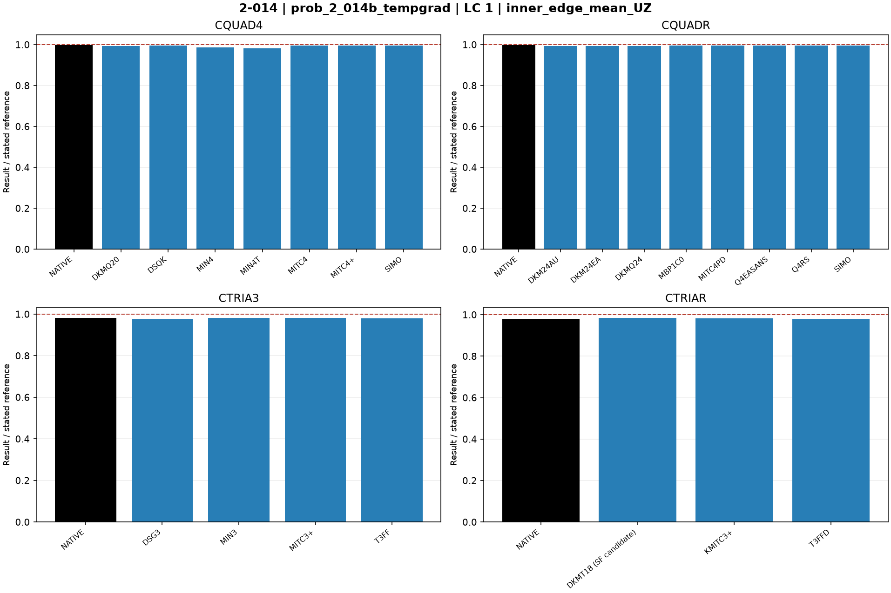

# Linear shells — 2-014: Through-thickness thermal gradient

27 October 2026 rebenchmark: all MYSTRAN entries were rerun using the rebuilt mixed-hybrid DSQK binary. Nastran entries retain previous outputs for unchanged decks. Default residual acceptance remains 1e-6. See [rebenchmark report](../Linear_Shell_Rebenchmark_20261027.md).

Historical baseline: 25 October 2026; MYSTRAN refreshed 27 October, Nastran retained. CQUAD4, CQUADR, CTRIA3 and CTRIAR only.

[All linear comparisons](comparison_all_linear.md) · [Full ZIP](comparison_all_linear.zip) · [Tested DAT](DAT/linear_shell_benchmark_DAT.zip) · [Linear publication QA](PUBLICATION_QA_linear.md)

Case IDs retain source-model filenames; actual element and formulation are given by their columns and deck selectors. Two-axis 2-002 tip observables use the two physical corner nodes.

NATIVE means the Nastran result for the corresponding element card: CQUAD4, CQUADR, CTRIA3 or CTRIAR. It does not mean the same proprietary interpolation as a MYSTRAN selector. Curves use independent/analytical references; published SAP2000 values are separate table columns. A completed solve is not a physical-accuracy pass. Zero references use absolute residuals; missing and failed output is never replaced by zero.

The tested source snapshot includes DKMT18 SF as an explicitly labelled candidate and corrected DSG3 local-z Kg. It is documented in [source provenance](data_linear/provenance_linear.json), with a reproducible element-local patch. This benchmark snapshot is not a declaration that SF passed every production-promotion gate. No shared eigensolver prototype is included.

## Model and comparison scope

28x32 graded Model B, thick source. Uploaded alpha=0 with 6.5e-6 incorrectly in TREF; corrected alpha=6.5e-6 /F and TREF=0. MID3=1 restored from S2K thick section. TEMPP1 gradient=-100 F/in, not total temperature difference. Independent inner UZ=0.01931 in, tangential rotation=0.00352 rad.

## Extraction status

| Solver | Status | Metric rows |
|---|---|---:|
| MYSTRAN | MEASURED | 44 |
| NASTRAN | MEASURED | 8 |

## Figures

### prob_2_014b_tempgrad · LC 1 · inner_edge_mean_UZ

### prob_2_014b_tempgrad · LC 1 · inner_edge_mean_tangent_rotation

## Finest available mesh per named series

| Case / parent quads | Solver / formulation | LC | Quantity | Measured | Independent / analytical | CSI published | Unit | Error % primary | Absolute residual | Status |
|---|---|---:|---|---:|---:|---:|---|---:|---:|---|
| prob_2_014b_tempgrad_cquadr_simo / 896 | MYSTRAN CQUAD4_DKMQ20 | 1 | inner_edge_mean_UZ | 0.0191846 | 0.01931 | 0.01902 | in | 0.6494045 | 0.0001254 | MEASURED |
| prob_2_014b_tempgrad_cquadr_simo / 896 | MYSTRAN CQUAD4_DSQK | 1 | inner_edge_mean_UZ | 0.01921166 | 0.01931 | 0.01902 | in | 0.5092698 | 9.834e-05 | MEASURED |
| prob_2_014b_tempgrad_cquadr_simo / 896 | MYSTRAN CQUAD4_MIN4 | 1 | inner_edge_mean_UZ | 0.01902983 | 0.01931 | 0.01902 | in | 1.450906 | 0.00028017 | MEASURED |
| prob_2_014b_tempgrad_cquadr_simo / 896 | MYSTRAN CQUAD4_MIN4T | 1 | inner_edge_mean_UZ | 0.01896548 | 0.01931 | 0.01902 | in | 1.784153 | 0.00034452 | MEASURED |
| prob_2_014b_tempgrad_cquadr_simo / 896 | MYSTRAN CQUAD4_MITC4 | 1 | inner_edge_mean_UZ | 0.01921166 | 0.01931 | 0.01902 | in | 0.5092698 | 9.834e-05 | MEASURED |
| prob_2_014b_tempgrad_cquadr_simo / 896 | MYSTRAN CQUAD4_MITC4plus | 1 | inner_edge_mean_UZ | 0.01921166 | 0.01931 | 0.01902 | in | 0.5092698 | 9.834e-05 | MEASURED |
| prob_2_014b_tempgrad_cquadr_simo / 896 | MYSTRAN CQUAD4_SIMO | 1 | inner_edge_mean_UZ | 0.01921166 | 0.01931 | 0.01902 | in | 0.5092698 | 9.834e-05 | MEASURED |
| prob_2_014b_tempgrad_cquadr_simo / 896 | MYSTRAN CQUADR_DKM24AU | 1 | inner_edge_mean_UZ | 0.0191846 | 0.01931 | 0.01902 | in | 0.6494045 | 0.0001254 | MEASURED |
| prob_2_014b_tempgrad_cquadr_simo / 896 | MYSTRAN CQUADR_DKM24EA | 1 | inner_edge_mean_UZ | 0.0191846 | 0.01931 | 0.01902 | in | 0.6494045 | 0.0001254 | MEASURED |
| prob_2_014b_tempgrad_cquadr_simo / 896 | MYSTRAN CQUADR_DKMQ24 | 1 | inner_edge_mean_UZ | 0.0191846 | 0.01931 | 0.01902 | in | 0.6494045 | 0.0001254 | MEASURED |
| prob_2_014b_tempgrad_cquadr_simo / 896 | MYSTRAN CQUADR_MBP1C0 | 1 | inner_edge_mean_UZ | 0.01921166 | 0.01931 | 0.01902 | in | 0.5092698 | 9.834e-05 | MEASURED |
| prob_2_014b_tempgrad_cquadr_simo / 896 | MYSTRAN CQUADR_MITC4PD | 1 | inner_edge_mean_UZ | 0.01921166 | 0.01931 | 0.01902 | in | 0.5092698 | 9.834e-05 | MEASURED |
| prob_2_014b_tempgrad_cquadr_simo / 896 | MYSTRAN CQUADR_Q4EASANS | 1 | inner_edge_mean_UZ | 0.01921166 | 0.01931 | 0.01902 | in | 0.5092698 | 9.834e-05 | MEASURED |
| prob_2_014b_tempgrad_cquadr_simo / 896 | MYSTRAN CQUADR_Q4RS | 1 | inner_edge_mean_UZ | 0.01921166 | 0.01931 | 0.01902 | in | 0.5092698 | 9.834e-05 | MEASURED |
| prob_2_014b_tempgrad_cquadr_simo / 896 | MYSTRAN CQUADR_SIMO | 1 | inner_edge_mean_UZ | 0.01921166 | 0.01931 | 0.01902 | in | 0.5092698 | 9.834e-05 | MEASURED |
| prob_2_014b_tempgrad_cquadr_simo / 896 | MYSTRAN CTRIA3_DSG3 | 1 | inner_edge_mean_UZ | 0.01889332 | 0.01931 | 0.01902 | in | 2.157846 | 0.00041668 | MEASURED |
| prob_2_014b_tempgrad_cquadr_simo / 896 | MYSTRAN CTRIA3_MIN3 | 1 | inner_edge_mean_UZ | 0.01896571 | 0.01931 | 0.01902 | in | 1.782962 | 0.00034429 | MEASURED |
| prob_2_014b_tempgrad_cquadr_simo / 896 | MYSTRAN CTRIA3_MITC3plus | 1 | inner_edge_mean_UZ | 0.01896263 | 0.01931 | 0.01902 | in | 1.798912 | 0.00034737 | MEASURED |
| prob_2_014b_tempgrad_cquadr_simo / 896 | MYSTRAN CTRIA3_T3FF | 1 | inner_edge_mean_UZ | 0.01892881 | 0.01931 | 0.01902 | in | 1.974055 | 0.00038119 | MEASURED |
| prob_2_014b_tempgrad_cquadr_simo / 896 | MYSTRAN CTRIAR_DKMT18 (SF candidate) | 1 | inner_edge_mean_UZ | 0.01901953 | 0.01931 | 0.01902 | in | 1.504247 | 0.00029047 | MEASURED |
| prob_2_014b_tempgrad_cquadr_simo / 896 | MYSTRAN CTRIAR_KMITC3plus | 1 | inner_edge_mean_UZ | 0.01896611 | 0.01931 | 0.01902 | in | 1.780891 | 0.00034389 | MEASURED |
| prob_2_014b_tempgrad_cquadr_simo / 896 | MYSTRAN CTRIAR_T3FFD | 1 | inner_edge_mean_UZ | 0.01892881 | 0.01931 | 0.01902 | in | 1.974055 | 0.00038119 | MEASURED |
| prob_2_014b_tempgrad_cquadr_simo / 896 | NASTRAN CQUAD4_NATIVE | 1 | inner_edge_mean_UZ | 0.01927617 | 0.01931 | 0.01902 | in | 0.1752071 | 3.38325e-05 | MEASURED |
| prob_2_014b_tempgrad_cquadr_simo / 896 | NASTRAN CQUADR_NATIVE | 1 | inner_edge_mean_UZ | 0.01927258 | 0.01931 | 0.01902 | in | 0.1937985 | 3.74225e-05 | MEASURED |
| prob_2_014b_tempgrad_cquadr_simo / 896 | NASTRAN CTRIA3_NATIVE | 1 | inner_edge_mean_UZ | 0.01894871 | 0.01931 | 0.01902 | in | 1.871012 | 0.0003612925 | MEASURED |
| prob_2_014b_tempgrad_cquadr_simo / 896 | NASTRAN CTRIAR_NATIVE | 1 | inner_edge_mean_UZ | 0.01894953 | 0.01931 | 0.01902 | in | 1.86674 | 0.0003604675 | MEASURED |
| prob_2_014b_tempgrad_cquadr_simo / 896 | MYSTRAN CQUAD4_DKMQ20 | 1 | inner_edge_mean_tangent_rotation | 0.003501417 | 0.00352 | 0.00347 | rad | 0.5279284 | 1.858308e-05 | MEASURED |
| prob_2_014b_tempgrad_cquadr_simo / 896 | MYSTRAN CQUAD4_DSQK | 1 | inner_edge_mean_tangent_rotation | 0.00350082 | 0.00352 | 0.00347 | rad | 0.5448843 | 1.917993e-05 | MEASURED |
| prob_2_014b_tempgrad_cquadr_simo / 896 | MYSTRAN CQUAD4_MIN4 | 1 | inner_edge_mean_tangent_rotation | 0.003498613 | 0.00352 | 0.00347 | rad | 0.6075713 | 2.138651e-05 | MEASURED |
| prob_2_014b_tempgrad_cquadr_simo / 896 | MYSTRAN CQUAD4_MIN4T | 1 | inner_edge_mean_tangent_rotation | 0.003491069 | 0.00352 | 0.00347 | rad | 0.8219014 | 2.893093e-05 | MEASURED |
| prob_2_014b_tempgrad_cquadr_simo / 896 | MYSTRAN CQUAD4_MITC4 | 1 | inner_edge_mean_tangent_rotation | 0.00350082 | 0.00352 | 0.00347 | rad | 0.5448843 | 1.917993e-05 | MEASURED |
| prob_2_014b_tempgrad_cquadr_simo / 896 | MYSTRAN CQUAD4_MITC4plus | 1 | inner_edge_mean_tangent_rotation | 0.00350082 | 0.00352 | 0.00347 | rad | 0.5448843 | 1.917993e-05 | MEASURED |
| prob_2_014b_tempgrad_cquadr_simo / 896 | MYSTRAN CQUAD4_SIMO | 1 | inner_edge_mean_tangent_rotation | 0.00350082 | 0.00352 | 0.00347 | rad | 0.5448843 | 1.917993e-05 | MEASURED |
| prob_2_014b_tempgrad_cquadr_simo / 896 | MYSTRAN CQUADR_DKM24AU | 1 | inner_edge_mean_tangent_rotation | 0.003501417 | 0.00352 | 0.00347 | rad | 0.5279284 | 1.858308e-05 | MEASURED |
| prob_2_014b_tempgrad_cquadr_simo / 896 | MYSTRAN CQUADR_DKM24EA | 1 | inner_edge_mean_tangent_rotation | 0.003501417 | 0.00352 | 0.00347 | rad | 0.5279284 | 1.858308e-05 | MEASURED |
| prob_2_014b_tempgrad_cquadr_simo / 896 | MYSTRAN CQUADR_DKMQ24 | 1 | inner_edge_mean_tangent_rotation | 0.003501417 | 0.00352 | 0.00347 | rad | 0.5279284 | 1.858308e-05 | MEASURED |
| prob_2_014b_tempgrad_cquadr_simo / 896 | MYSTRAN CQUADR_MBP1C0 | 1 | inner_edge_mean_tangent_rotation | 0.00350082 | 0.00352 | 0.00347 | rad | 0.5448843 | 1.917993e-05 | MEASURED |
| prob_2_014b_tempgrad_cquadr_simo / 896 | MYSTRAN CQUADR_MITC4PD | 1 | inner_edge_mean_tangent_rotation | 0.00350082 | 0.00352 | 0.00347 | rad | 0.5448843 | 1.917993e-05 | MEASURED |
| prob_2_014b_tempgrad_cquadr_simo / 896 | MYSTRAN CQUADR_Q4EASANS | 1 | inner_edge_mean_tangent_rotation | 0.00350082 | 0.00352 | 0.00347 | rad | 0.5448843 | 1.917993e-05 | MEASURED |
| prob_2_014b_tempgrad_cquadr_simo / 896 | MYSTRAN CQUADR_Q4RS | 1 | inner_edge_mean_tangent_rotation | 0.00350082 | 0.00352 | 0.00347 | rad | 0.5448843 | 1.917993e-05 | MEASURED |
| prob_2_014b_tempgrad_cquadr_simo / 896 | MYSTRAN CQUADR_SIMO | 1 | inner_edge_mean_tangent_rotation | 0.00350082 | 0.00352 | 0.00347 | rad | 0.5448843 | 1.917993e-05 | MEASURED |
| prob_2_014b_tempgrad_cquadr_simo / 896 | MYSTRAN CTRIA3_DSG3 | 1 | inner_edge_mean_tangent_rotation | 0.003484891 | 0.00352 | 0.00347 | rad | 0.9974214 | 3.510923e-05 | MEASURED |
| prob_2_014b_tempgrad_cquadr_simo / 896 | MYSTRAN CTRIA3_MIN3 | 1 | inner_edge_mean_tangent_rotation | 0.003491105 | 0.00352 | 0.00347 | rad | 0.8208702 | 2.889463e-05 | MEASURED |
| prob_2_014b_tempgrad_cquadr_simo / 896 | MYSTRAN CTRIA3_MITC3plus | 1 | inner_edge_mean_tangent_rotation | 0.003491959 | 0.00352 | 0.00347 | rad | 0.7966266 | 2.804126e-05 | MEASURED |
| prob_2_014b_tempgrad_cquadr_simo / 896 | MYSTRAN CTRIA3_T3FF | 1 | inner_edge_mean_tangent_rotation | 0.003486881 | 0.00352 | 0.00347 | rad | 0.9408906 | 3.311935e-05 | MEASURED |
| prob_2_014b_tempgrad_cquadr_simo / 896 | MYSTRAN CTRIAR_DKMT18 (SF candidate) | 1 | inner_edge_mean_tangent_rotation | 0.003494787 | 0.00352 | 0.00347 | rad | 0.7162736 | 2.521283e-05 | MEASURED |
| prob_2_014b_tempgrad_cquadr_simo / 896 | MYSTRAN CTRIAR_KMITC3plus | 1 | inner_edge_mean_tangent_rotation | 0.003492384 | 0.00352 | 0.00347 | rad | 0.7845386 | 2.761576e-05 | MEASURED |
| prob_2_014b_tempgrad_cquadr_simo / 896 | MYSTRAN CTRIAR_T3FFD | 1 | inner_edge_mean_tangent_rotation | 0.003486881 | 0.00352 | 0.00347 | rad | 0.9408906 | 3.311935e-05 | MEASURED |
| prob_2_014b_tempgrad_cquadr_simo / 896 | NASTRAN CQUAD4_NATIVE | 1 | inner_edge_mean_tangent_rotation | 0.003512631 | 0.00352 | 0.00347 | rad | 0.2093385 | 7.368717e-06 | MEASURED |
| prob_2_014b_tempgrad_cquadr_simo / 896 | NASTRAN CQUADR_NATIVE | 1 | inner_edge_mean_tangent_rotation | 0.003511919 | 0.00352 | 0.00347 | rad | 0.2295675 | 8.080777e-06 | MEASURED |
| prob_2_014b_tempgrad_cquadr_simo / 896 | NASTRAN CTRIA3_NATIVE | 1 | inner_edge_mean_tangent_rotation | 0.003490153 | 0.00352 | 0.00347 | rad | 0.8479176 | 2.98467e-05 | MEASURED |
| prob_2_014b_tempgrad_cquadr_simo / 896 | NASTRAN CTRIAR_NATIVE | 1 | inner_edge_mean_tangent_rotation | 0.003490246 | 0.00352 | 0.00347 | rad | 0.8452877 | 2.975413e-05 | MEASURED |

All mesh rows and status/provenance remain in the CSV.
