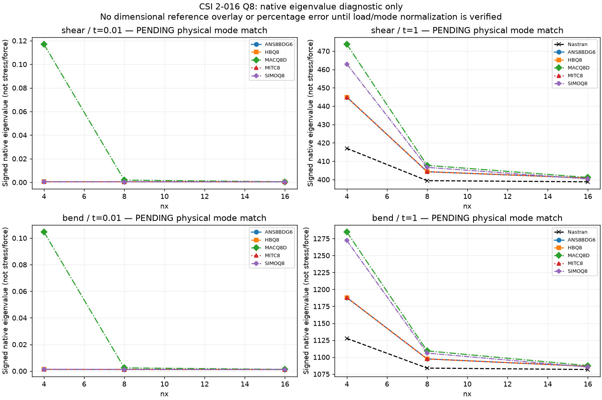
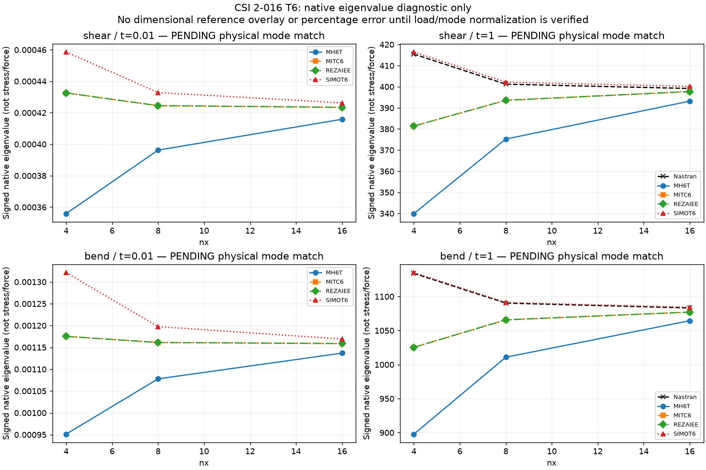

# CSI 2-016 — Buckling — raw eigenvalue diagnostic

Independent accuracy compares each solver with the same supplied CSI/analytical observable. Missing references and unverified normalization remain PENDING. Nastran–MYSTRAN differences are not accuracy metrics. Zero references use absolute residuals. Numerical data are retained locally; public tables embed the compared values.

Supplied shear/bend stress targets:t=1,425/1165ksi;t=.01,.0425/.1165ksi. PENDING: native signed eigenvalues are not dimensional stress/force without verified prestress load scaling and mode identity. No reference overlays or reference-error percentages are published for this diagnostic. Stored mode1 curves do not establish physical mode pairing.

Nastran t=.01 Q8/T6 bend/shear nx4/8/16 failedSYSTEM FATAL7340 nearzero-eigenvalue extraction; these are missing, notzero. Later trust-region/QOPEN messages do not prove disk capacity failure. NoBC/thickness change has been made to mask the failure.

| Family | Model | Solver | Formulation | Stored mode | Signed lambda | Status |
|---|---|---|---|---|---|---|
| Q8 | 2-016_prob_2_016_bend_nx16_ny16_t0.01_cquad8_thick | MYSTRAN | SIMOQ8 | mode_1 | 0.001171352 | PENDING normalization / physical mode |
| Q8 | 2-016_prob_2_016_bend_nx16_ny16_t0.01_cquad8_thick | MYSTRAN | SIMOQ8 | mode_2 | 0.0012406828 | PENDING normalization / physical mode |
| Q8 | 2-016_prob_2_016_bend_nx16_ny16_t0.01_cquad8_thick | MYSTRAN | SIMOQ8 | mode_3 | 0.0015681749 | PENDING normalization / physical mode |
| Q8 | 2-016_prob_2_016_bend_nx16_ny16_t0.01_cquad8_thick | MYSTRAN | SIMOQ8 | mode_4 | 0.0021573892 | PENDING normalization / physical mode |
| Q8 | 2-016_prob_2_016_bend_nx16_ny16_t0.01_cquad8_thick | MYSTRAN | SIMOQ8 | mode_5 | 0.0029165752 | PENDING normalization / physical mode |
| Q8 | 2-016_prob_2_016_bend_nx16_ny16_t0.01_cquad8_thick | MYSTRAN | SIMOQ8 | mode_6 | 0.0038583588 | PENDING normalization / physical mode |
| Q8 | 2-016_prob_2_016_bend_nx16_ny16_t0.01_cquad8_thick | MYSTRAN | MITC8 | mode_1 | 0.0011611341 | PENDING normalization / physical mode |
| Q8 | 2-016_prob_2_016_bend_nx16_ny16_t0.01_cquad8_thick | MYSTRAN | MITC8 | mode_2 | 0.0012331371 | PENDING normalization / physical mode |
| Q8 | 2-016_prob_2_016_bend_nx16_ny16_t0.01_cquad8_thick | MYSTRAN | MITC8 | mode_3 | 0.0015390338 | PENDING normalization / physical mode |
| Q8 | 2-016_prob_2_016_bend_nx16_ny16_t0.01_cquad8_thick | MYSTRAN | MITC8 | mode_4 | 0.0020837304 | PENDING normalization / physical mode |
| Q8 | 2-016_prob_2_016_bend_nx16_ny16_t0.01_cquad8_thick | MYSTRAN | MITC8 | mode_5 | 0.0027577453 | PENDING normalization / physical mode |
| Q8 | 2-016_prob_2_016_bend_nx16_ny16_t0.01_cquad8_thick | MYSTRAN | MITC8 | mode_6 | 0.0035546885 | PENDING normalization / physical mode |
| Q8 | 2-016_prob_2_016_bend_nx16_ny16_t0.01_cquad8_thick | MYSTRAN | ANS8BDG6 | mode_1 | 0.0011611341 | PENDING normalization / physical mode |
| Q8 | 2-016_prob_2_016_bend_nx16_ny16_t0.01_cquad8_thick | MYSTRAN | ANS8BDG6 | mode_2 | 0.0012331371 | PENDING normalization / physical mode |
| Q8 | 2-016_prob_2_016_bend_nx16_ny16_t0.01_cquad8_thick | MYSTRAN | ANS8BDG6 | mode_3 | 0.0015390338 | PENDING normalization / physical mode |
| Q8 | 2-016_prob_2_016_bend_nx16_ny16_t0.01_cquad8_thick | MYSTRAN | ANS8BDG6 | mode_4 | 0.0020837304 | PENDING normalization / physical mode |
| Q8 | 2-016_prob_2_016_bend_nx16_ny16_t0.01_cquad8_thick | MYSTRAN | ANS8BDG6 | mode_5 | 0.0027577453 | PENDING normalization / physical mode |
| Q8 | 2-016_prob_2_016_bend_nx16_ny16_t0.01_cquad8_thick | MYSTRAN | ANS8BDG6 | mode_6 | 0.0035546885 | PENDING normalization / physical mode |
| Q8 | 2-016_prob_2_016_bend_nx16_ny16_t0.01_cquad8_thick | MYSTRAN | HBQ8 | mode_1 | 0.0011611341 | PENDING normalization / physical mode |
| Q8 | 2-016_prob_2_016_bend_nx16_ny16_t0.01_cquad8_thick | MYSTRAN | HBQ8 | mode_2 | 0.0012331371 | PENDING normalization / physical mode |
| Q8 | 2-016_prob_2_016_bend_nx16_ny16_t0.01_cquad8_thick | MYSTRAN | HBQ8 | mode_3 | 0.0015390338 | PENDING normalization / physical mode |
| Q8 | 2-016_prob_2_016_bend_nx16_ny16_t0.01_cquad8_thick | MYSTRAN | HBQ8 | mode_4 | 0.0020837304 | PENDING normalization / physical mode |
| Q8 | 2-016_prob_2_016_bend_nx16_ny16_t0.01_cquad8_thick | MYSTRAN | HBQ8 | mode_5 | 0.0027577453 | PENDING normalization / physical mode |
| Q8 | 2-016_prob_2_016_bend_nx16_ny16_t0.01_cquad8_thick | MYSTRAN | HBQ8 | mode_6 | 0.0035546885 | PENDING normalization / physical mode |
| Q8 | 2-016_prob_2_016_bend_nx16_ny16_t0.01_cquad8_thick | MYSTRAN | MACQ8D | mode_1 | 0.0012567483 | PENDING normalization / physical mode |
| Q8 | 2-016_prob_2_016_bend_nx16_ny16_t0.01_cquad8_thick | MYSTRAN | MACQ8D | mode_2 | 0.0012685353 | PENDING normalization / physical mode |
| Q8 | 2-016_prob_2_016_bend_nx16_ny16_t0.01_cquad8_thick | MYSTRAN | MACQ8D | mode_3 | 0.0018871472 | PENDING normalization / physical mode |
| Q8 | 2-016_prob_2_016_bend_nx16_ny16_t0.01_cquad8_thick | MYSTRAN | MACQ8D | mode_4 | 0.0029075411 | PENDING normalization / physical mode |
| Q8 | 2-016_prob_2_016_bend_nx16_ny16_t0.01_cquad8_thick | MYSTRAN | MACQ8D | mode_5 | 0.0043699257 | PENDING normalization / physical mode |
| Q8 | 2-016_prob_2_016_bend_nx16_ny16_t0.01_cquad8_thick | MYSTRAN | MACQ8D | mode_6 | 0.0063643609 | PENDING normalization / physical mode |
| Q8 | 2-016_prob_2_016_bend_nx16_ny16_t1_cquad8_thick | MYSTRAN | SIMOQ8 | mode_1 | 1085.3893 | PENDING normalization / physical mode |
| Q8 | 2-016_prob_2_016_bend_nx16_ny16_t1_cquad8_thick | MYSTRAN | SIMOQ8 | mode_2 | 1177.5475 | PENDING normalization / physical mode |
| Q8 | 2-016_prob_2_016_bend_nx16_ny16_t1_cquad8_thick | MYSTRAN | SIMOQ8 | mode_3 | 1400.1061 | PENDING normalization / physical mode |
| Q8 | 2-016_prob_2_016_bend_nx16_ny16_t1_cquad8_thick | MYSTRAN | SIMOQ8 | mode_4 | 1818.575 | PENDING normalization / physical mode |
| Q8 | 2-016_prob_2_016_bend_nx16_ny16_t1_cquad8_thick | MYSTRAN | SIMOQ8 | mode_5 | 2275.1826 | PENDING normalization / physical mode |
| Q8 | 2-016_prob_2_016_bend_nx16_ny16_t1_cquad8_thick | MYSTRAN | SIMOQ8 | mode_6 | 2732.2104 | PENDING normalization / physical mode |
| Q8 | 2-016_prob_2_016_bend_nx16_ny16_t1_cquad8_thick | MYSTRAN | MITC8 | mode_1 | 1086.4799 | PENDING normalization / physical mode |
| Q8 | 2-016_prob_2_016_bend_nx16_ny16_t1_cquad8_thick | MYSTRAN | MITC8 | mode_2 | 1177.5442 | PENDING normalization / physical mode |
| Q8 | 2-016_prob_2_016_bend_nx16_ny16_t1_cquad8_thick | MYSTRAN | MITC8 | mode_3 | 1405.6617 | PENDING normalization / physical mode |
| Q8 | 2-016_prob_2_016_bend_nx16_ny16_t1_cquad8_thick | MYSTRAN | MITC8 | mode_4 | 1838.9584 | PENDING normalization / physical mode |
| Q8 | 2-016_prob_2_016_bend_nx16_ny16_t1_cquad8_thick | MYSTRAN | MITC8 | mode_5 | 2331.427 | PENDING normalization / physical mode |
| Q8 | 2-016_prob_2_016_bend_nx16_ny16_t1_cquad8_thick | MYSTRAN | MITC8 | mode_6 | 2855.3477 | PENDING normalization / physical mode |
| Q8 | 2-016_prob_2_016_bend_nx16_ny16_t1_cquad8_thick | MYSTRAN | ANS8BDG6 | mode_1 | 1086.4799 | PENDING normalization / physical mode |
| Q8 | 2-016_prob_2_016_bend_nx16_ny16_t1_cquad8_thick | MYSTRAN | ANS8BDG6 | mode_2 | 1177.5442 | PENDING normalization / physical mode |
| Q8 | 2-016_prob_2_016_bend_nx16_ny16_t1_cquad8_thick | MYSTRAN | ANS8BDG6 | mode_3 | 1405.6617 | PENDING normalization / physical mode |
| Q8 | 2-016_prob_2_016_bend_nx16_ny16_t1_cquad8_thick | MYSTRAN | ANS8BDG6 | mode_4 | 1838.9584 | PENDING normalization / physical mode |
| Q8 | 2-016_prob_2_016_bend_nx16_ny16_t1_cquad8_thick | MYSTRAN | ANS8BDG6 | mode_5 | 2331.427 | PENDING normalization / physical mode |
| Q8 | 2-016_prob_2_016_bend_nx16_ny16_t1_cquad8_thick | MYSTRAN | ANS8BDG6 | mode_6 | 2855.3477 | PENDING normalization / physical mode |
| Q8 | 2-016_prob_2_016_bend_nx16_ny16_t1_cquad8_thick | MYSTRAN | HBQ8 | mode_1 | 1086.4799 | PENDING normalization / physical mode |
| Q8 | 2-016_prob_2_016_bend_nx16_ny16_t1_cquad8_thick | MYSTRAN | HBQ8 | mode_2 | 1177.5442 | PENDING normalization / physical mode |
| Q8 | 2-016_prob_2_016_bend_nx16_ny16_t1_cquad8_thick | MYSTRAN | HBQ8 | mode_3 | 1405.6617 | PENDING normalization / physical mode |
| Q8 | 2-016_prob_2_016_bend_nx16_ny16_t1_cquad8_thick | MYSTRAN | HBQ8 | mode_4 | 1838.9584 | PENDING normalization / physical mode |
| Q8 | 2-016_prob_2_016_bend_nx16_ny16_t1_cquad8_thick | MYSTRAN | HBQ8 | mode_5 | 2331.427 | PENDING normalization / physical mode |
| Q8 | 2-016_prob_2_016_bend_nx16_ny16_t1_cquad8_thick | MYSTRAN | HBQ8 | mode_6 | 2855.3477 | PENDING normalization / physical mode |
| Q8 | 2-016_prob_2_016_bend_nx16_ny16_t1_cquad8_thick | MYSTRAN | MACQ8D | mode_1 | 1087.5488 | PENDING normalization / physical mode |
| Q8 | 2-016_prob_2_016_bend_nx16_ny16_t1_cquad8_thick | MYSTRAN | MACQ8D | mode_2 | 1178.3296 | PENDING normalization / physical mode |
| Q8 | 2-016_prob_2_016_bend_nx16_ny16_t1_cquad8_thick | MYSTRAN | MACQ8D | mode_3 | 1408.5621 | PENDING normalization / physical mode |
| Q8 | 2-016_prob_2_016_bend_nx16_ny16_t1_cquad8_thick | MYSTRAN | MACQ8D | mode_4 | 1845.7192 | PENDING normalization / physical mode |
| Q8 | 2-016_prob_2_016_bend_nx16_ny16_t1_cquad8_thick | MYSTRAN | MACQ8D | mode_5 | 2344.5371 | PENDING normalization / physical mode |
| Q8 | 2-016_prob_2_016_bend_nx16_ny16_t1_cquad8_thick | MYSTRAN | MACQ8D | mode_6 | 2877.4739 | PENDING normalization / physical mode |
| Q8 | 2-016_prob_2_016_bend_nx4_ny4_t0.01_cquad8_thick | MYSTRAN | SIMOQ8 | mode_1 | 0.0013712446 | PENDING normalization / physical mode |
| Q8 | 2-016_prob_2_016_bend_nx4_ny4_t0.01_cquad8_thick | MYSTRAN | SIMOQ8 | mode_2 | 0.0014310316 | PENDING normalization / physical mode |
| Q8 | 2-016_prob_2_016_bend_nx4_ny4_t0.01_cquad8_thick | MYSTRAN | SIMOQ8 | mode_3 | 0.0025687043 | PENDING normalization / physical mode |
| Q8 | 2-016_prob_2_016_bend_nx4_ny4_t0.01_cquad8_thick | MYSTRAN | SIMOQ8 | mode_4 | 0.0039628544 | PENDING normalization / physical mode |
| Q8 | 2-016_prob_2_016_bend_nx4_ny4_t0.01_cquad8_thick | MYSTRAN | SIMOQ8 | mode_5 | 0.011587979 | PENDING normalization / physical mode |
| Q8 | 2-016_prob_2_016_bend_nx4_ny4_t0.01_cquad8_thick | MYSTRAN | SIMOQ8 | mode_6 | 0.019279905 | PENDING normalization / physical mode |
| Q8 | 2-016_prob_2_016_bend_nx4_ny4_t0.01_cquad8_thick | MYSTRAN | MITC8 | mode_1 | 0.0012746963 | PENDING normalization / physical mode |
| Q8 | 2-016_prob_2_016_bend_nx4_ny4_t0.01_cquad8_thick | MYSTRAN | MITC8 | mode_2 | 0.0013765299 | PENDING normalization / physical mode |
| Q8 | 2-016_prob_2_016_bend_nx4_ny4_t0.01_cquad8_thick | MYSTRAN | MITC8 | mode_3 | 0.0020674218 | PENDING normalization / physical mode |
| Q8 | 2-016_prob_2_016_bend_nx4_ny4_t0.01_cquad8_thick | MYSTRAN | MITC8 | mode_4 | 0.0054923329 | PENDING normalization / physical mode |
| Q8 | 2-016_prob_2_016_bend_nx4_ny4_t0.01_cquad8_thick | MYSTRAN | MITC8 | mode_5 | 0.0058995676 | PENDING normalization / physical mode |
| Q8 | 2-016_prob_2_016_bend_nx4_ny4_t0.01_cquad8_thick | MYSTRAN | MITC8 | mode_6 | 0.010438612 | PENDING normalization / physical mode |
| Q8 | 2-016_prob_2_016_bend_nx4_ny4_t0.01_cquad8_thick | MYSTRAN | ANS8BDG6 | mode_1 | 0.0012746963 | PENDING normalization / physical mode |
| Q8 | 2-016_prob_2_016_bend_nx4_ny4_t0.01_cquad8_thick | MYSTRAN | ANS8BDG6 | mode_2 | 0.0013765299 | PENDING normalization / physical mode |
| Q8 | 2-016_prob_2_016_bend_nx4_ny4_t0.01_cquad8_thick | MYSTRAN | ANS8BDG6 | mode_3 | 0.0020674218 | PENDING normalization / physical mode |
| Q8 | 2-016_prob_2_016_bend_nx4_ny4_t0.01_cquad8_thick | MYSTRAN | ANS8BDG6 | mode_4 | 0.0054923329 | PENDING normalization / physical mode |
| Q8 | 2-016_prob_2_016_bend_nx4_ny4_t0.01_cquad8_thick | MYSTRAN | ANS8BDG6 | mode_5 | 0.0058995676 | PENDING normalization / physical mode |
| Q8 | 2-016_prob_2_016_bend_nx4_ny4_t0.01_cquad8_thick | MYSTRAN | ANS8BDG6 | mode_6 | 0.010438612 | PENDING normalization / physical mode |
| Q8 | 2-016_prob_2_016_bend_nx4_ny4_t0.01_cquad8_thick | MYSTRAN | HBQ8 | mode_1 | 0.0012746963 | PENDING normalization / physical mode |
| Q8 | 2-016_prob_2_016_bend_nx4_ny4_t0.01_cquad8_thick | MYSTRAN | HBQ8 | mode_2 | 0.0013765299 | PENDING normalization / physical mode |
| Q8 | 2-016_prob_2_016_bend_nx4_ny4_t0.01_cquad8_thick | MYSTRAN | HBQ8 | mode_3 | 0.0020674218 | PENDING normalization / physical mode |
| Q8 | 2-016_prob_2_016_bend_nx4_ny4_t0.01_cquad8_thick | MYSTRAN | HBQ8 | mode_4 | 0.0054923329 | PENDING normalization / physical mode |
| Q8 | 2-016_prob_2_016_bend_nx4_ny4_t0.01_cquad8_thick | MYSTRAN | HBQ8 | mode_5 | 0.0058995676 | PENDING normalization / physical mode |
| Q8 | 2-016_prob_2_016_bend_nx4_ny4_t0.01_cquad8_thick | MYSTRAN | HBQ8 | mode_6 | 0.010438612 | PENDING normalization / physical mode |
| Q8 | 2-016_prob_2_016_bend_nx4_ny4_t0.01_cquad8_thick | MYSTRAN | MACQ8D | mode_1 | 0.10459539 | PENDING normalization / physical mode |
| Q8 | 2-016_prob_2_016_bend_nx4_ny4_t0.01_cquad8_thick | MYSTRAN | MACQ8D | mode_2 | 0.60234123 | PENDING normalization / physical mode |
| Q8 | 2-016_prob_2_016_bend_nx4_ny4_t0.01_cquad8_thick | MYSTRAN | MACQ8D | mode_3 | 1.9852666 | PENDING normalization / physical mode |
| Q8 | 2-016_prob_2_016_bend_nx4_ny4_t0.01_cquad8_thick | MYSTRAN | MACQ8D | mode_4 | 3.6230905 | PENDING normalization / physical mode |
| Q8 | 2-016_prob_2_016_bend_nx4_ny4_t0.01_cquad8_thick | MYSTRAN | MACQ8D | mode_5 | 6.3188753 | PENDING normalization / physical mode |
| Q8 | 2-016_prob_2_016_bend_nx4_ny4_t0.01_cquad8_thick | MYSTRAN | MACQ8D | mode_6 | 25.957861 | PENDING normalization / physical mode |
| Q8 | 2-016_prob_2_016_bend_nx4_ny4_t1_cquad8_thick | MYSTRAN | SIMOQ8 | mode_1 | 1272.0983 | PENDING normalization / physical mode |
| Q8 | 2-016_prob_2_016_bend_nx4_ny4_t1_cquad8_thick | MYSTRAN | SIMOQ8 | mode_2 | 1284.0361 | PENDING normalization / physical mode |
| Q8 | 2-016_prob_2_016_bend_nx4_ny4_t1_cquad8_thick | MYSTRAN | SIMOQ8 | mode_3 | 1996.6233 | PENDING normalization / physical mode |
| Q8 | 2-016_prob_2_016_bend_nx4_ny4_t1_cquad8_thick | MYSTRAN | SIMOQ8 | mode_4 | 3054.8118 | PENDING normalization / physical mode |
| Q8 | 2-016_prob_2_016_bend_nx4_ny4_t1_cquad8_thick | MYSTRAN | SIMOQ8 | mode_5 | 6049.1621 | PENDING normalization / physical mode |
| Q8 | 2-016_prob_2_016_bend_nx4_ny4_t1_cquad8_thick | MYSTRAN | SIMOQ8 | mode_6 | 7110.4199 | PENDING normalization / physical mode |
| Q8 | 2-016_prob_2_016_bend_nx4_ny4_t1_cquad8_thick | MYSTRAN | MITC8 | mode_1 | 1187.9323 | PENDING normalization / physical mode |
| Q8 | 2-016_prob_2_016_bend_nx4_ny4_t1_cquad8_thick | MYSTRAN | MITC8 | mode_2 | 1218.6943 | PENDING normalization / physical mode |
| Q8 | 2-016_prob_2_016_bend_nx4_ny4_t1_cquad8_thick | MYSTRAN | MITC8 | mode_3 | 1700.3484 | PENDING normalization / physical mode |
| Q8 | 2-016_prob_2_016_bend_nx4_ny4_t1_cquad8_thick | MYSTRAN | MITC8 | mode_4 | 3144.7122 | PENDING normalization / physical mode |
| Q8 | 2-016_prob_2_016_bend_nx4_ny4_t1_cquad8_thick | MYSTRAN | MITC8 | mode_5 | 3994.2869 | PENDING normalization / physical mode |
| Q8 | 2-016_prob_2_016_bend_nx4_ny4_t1_cquad8_thick | MYSTRAN | MITC8 | mode_6 | 6508.272 | PENDING normalization / physical mode |
| Q8 | 2-016_prob_2_016_bend_nx4_ny4_t1_cquad8_thick | MYSTRAN | ANS8BDG6 | mode_1 | 1187.9323 | PENDING normalization / physical mode |
| Q8 | 2-016_prob_2_016_bend_nx4_ny4_t1_cquad8_thick | MYSTRAN | ANS8BDG6 | mode_2 | 1218.6943 | PENDING normalization / physical mode |
| Q8 | 2-016_prob_2_016_bend_nx4_ny4_t1_cquad8_thick | MYSTRAN | ANS8BDG6 | mode_3 | 1700.3484 | PENDING normalization / physical mode |
| Q8 | 2-016_prob_2_016_bend_nx4_ny4_t1_cquad8_thick | MYSTRAN | ANS8BDG6 | mode_4 | 3144.7122 | PENDING normalization / physical mode |
| Q8 | 2-016_prob_2_016_bend_nx4_ny4_t1_cquad8_thick | MYSTRAN | ANS8BDG6 | mode_5 | 3994.2869 | PENDING normalization / physical mode |
| Q8 | 2-016_prob_2_016_bend_nx4_ny4_t1_cquad8_thick | MYSTRAN | ANS8BDG6 | mode_6 | 6508.272 | PENDING normalization / physical mode |
| Q8 | 2-016_prob_2_016_bend_nx4_ny4_t1_cquad8_thick | MYSTRAN | HBQ8 | mode_1 | 1187.9323 | PENDING normalization / physical mode |
| Q8 | 2-016_prob_2_016_bend_nx4_ny4_t1_cquad8_thick | MYSTRAN | HBQ8 | mode_2 | 1218.6943 | PENDING normalization / physical mode |
| Q8 | 2-016_prob_2_016_bend_nx4_ny4_t1_cquad8_thick | MYSTRAN | HBQ8 | mode_3 | 1700.3484 | PENDING normalization / physical mode |
| Q8 | 2-016_prob_2_016_bend_nx4_ny4_t1_cquad8_thick | MYSTRAN | HBQ8 | mode_4 | 3144.7122 | PENDING normalization / physical mode |
| Q8 | 2-016_prob_2_016_bend_nx4_ny4_t1_cquad8_thick | MYSTRAN | HBQ8 | mode_5 | 3994.2869 | PENDING normalization / physical mode |
| Q8 | 2-016_prob_2_016_bend_nx4_ny4_t1_cquad8_thick | MYSTRAN | HBQ8 | mode_6 | 6508.272 | PENDING normalization / physical mode |
| Q8 | 2-016_prob_2_016_bend_nx4_ny4_t1_cquad8_thick | MYSTRAN | MACQ8D | mode_1 | 1284.7837 | PENDING normalization / physical mode |
| Q8 | 2-016_prob_2_016_bend_nx4_ny4_t1_cquad8_thick | MYSTRAN | MACQ8D | mode_2 | 1304.5839 | PENDING normalization / physical mode |
| Q8 | 2-016_prob_2_016_bend_nx4_ny4_t1_cquad8_thick | MYSTRAN | MACQ8D | mode_3 | 2107.8467 | PENDING normalization / physical mode |
| Q8 | 2-016_prob_2_016_bend_nx4_ny4_t1_cquad8_thick | MYSTRAN | MACQ8D | mode_4 | 3232.9514 | PENDING normalization / physical mode |
| Q8 | 2-016_prob_2_016_bend_nx4_ny4_t1_cquad8_thick | MYSTRAN | MACQ8D | mode_5 | 6388.501 | PENDING normalization / physical mode |
| Q8 | 2-016_prob_2_016_bend_nx4_ny4_t1_cquad8_thick | MYSTRAN | MACQ8D | mode_6 | 7109.9849 | PENDING normalization / physical mode |
| Q8 | 2-016_prob_2_016_bend_nx8_ny8_t0.01_cquad8_thick | MYSTRAN | SIMOQ8 | mode_1 | 0.0012053481 | PENDING normalization / physical mode |
| Q8 | 2-016_prob_2_016_bend_nx8_ny8_t0.01_cquad8_thick | MYSTRAN | SIMOQ8 | mode_2 | 0.0012627241 | PENDING normalization / physical mode |
| Q8 | 2-016_prob_2_016_bend_nx8_ny8_t0.01_cquad8_thick | MYSTRAN | SIMOQ8 | mode_3 | 0.0016764621 | PENDING normalization / physical mode |
| Q8 | 2-016_prob_2_016_bend_nx8_ny8_t0.01_cquad8_thick | MYSTRAN | SIMOQ8 | mode_4 | 0.0024578222 | PENDING normalization / physical mode |
| Q8 | 2-016_prob_2_016_bend_nx8_ny8_t0.01_cquad8_thick | MYSTRAN | SIMOQ8 | mode_5 | 0.0036175109 | PENDING normalization / physical mode |
| Q8 | 2-016_prob_2_016_bend_nx8_ny8_t0.01_cquad8_thick | MYSTRAN | SIMOQ8 | mode_6 | 0.0052178265 | PENDING normalization / physical mode |
| Q8 | 2-016_prob_2_016_bend_nx8_ny8_t0.01_cquad8_thick | MYSTRAN | MITC8 | mode_1 | 0.0011734247 | PENDING normalization / physical mode |
| Q8 | 2-016_prob_2_016_bend_nx8_ny8_t0.01_cquad8_thick | MYSTRAN | MITC8 | mode_2 | 0.0012336842 | PENDING normalization / physical mode |
| Q8 | 2-016_prob_2_016_bend_nx8_ny8_t0.01_cquad8_thick | MYSTRAN | MITC8 | mode_3 | 0.0015902792 | PENDING normalization / physical mode |
| Q8 | 2-016_prob_2_016_bend_nx8_ny8_t0.01_cquad8_thick | MYSTRAN | MITC8 | mode_4 | 0.002227966 | PENDING normalization / physical mode |
| Q8 | 2-016_prob_2_016_bend_nx8_ny8_t0.01_cquad8_thick | MYSTRAN | MITC8 | mode_5 | 0.0030730432 | PENDING normalization / physical mode |
| Q8 | 2-016_prob_2_016_bend_nx8_ny8_t0.01_cquad8_thick | MYSTRAN | MITC8 | mode_6 | 0.0041302796 | PENDING normalization / physical mode |
| Q8 | 2-016_prob_2_016_bend_nx8_ny8_t0.01_cquad8_thick | MYSTRAN | ANS8BDG6 | mode_1 | 0.0011734247 | PENDING normalization / physical mode |
| Q8 | 2-016_prob_2_016_bend_nx8_ny8_t0.01_cquad8_thick | MYSTRAN | ANS8BDG6 | mode_2 | 0.0012336842 | PENDING normalization / physical mode |
| Q8 | 2-016_prob_2_016_bend_nx8_ny8_t0.01_cquad8_thick | MYSTRAN | ANS8BDG6 | mode_3 | 0.0015902792 | PENDING normalization / physical mode |
| Q8 | 2-016_prob_2_016_bend_nx8_ny8_t0.01_cquad8_thick | MYSTRAN | ANS8BDG6 | mode_4 | 0.002227966 | PENDING normalization / physical mode |
| Q8 | 2-016_prob_2_016_bend_nx8_ny8_t0.01_cquad8_thick | MYSTRAN | ANS8BDG6 | mode_5 | 0.0030730432 | PENDING normalization / physical mode |
| Q8 | 2-016_prob_2_016_bend_nx8_ny8_t0.01_cquad8_thick | MYSTRAN | ANS8BDG6 | mode_6 | 0.0041302796 | PENDING normalization / physical mode |
| Q8 | 2-016_prob_2_016_bend_nx8_ny8_t0.01_cquad8_thick | MYSTRAN | HBQ8 | mode_1 | 0.0011734247 | PENDING normalization / physical mode |
| Q8 | 2-016_prob_2_016_bend_nx8_ny8_t0.01_cquad8_thick | MYSTRAN | HBQ8 | mode_2 | 0.0012336842 | PENDING normalization / physical mode |
| Q8 | 2-016_prob_2_016_bend_nx8_ny8_t0.01_cquad8_thick | MYSTRAN | HBQ8 | mode_3 | 0.0015902792 | PENDING normalization / physical mode |
| Q8 | 2-016_prob_2_016_bend_nx8_ny8_t0.01_cquad8_thick | MYSTRAN | HBQ8 | mode_4 | 0.002227966 | PENDING normalization / physical mode |
| Q8 | 2-016_prob_2_016_bend_nx8_ny8_t0.01_cquad8_thick | MYSTRAN | HBQ8 | mode_5 | 0.0030730432 | PENDING normalization / physical mode |
| Q8 | 2-016_prob_2_016_bend_nx8_ny8_t0.01_cquad8_thick | MYSTRAN | HBQ8 | mode_6 | 0.0041302796 | PENDING normalization / physical mode |
| Q8 | 2-016_prob_2_016_bend_nx8_ny8_t0.01_cquad8_thick | MYSTRAN | MACQ8D | mode_1 | 0.0023874128 | PENDING normalization / physical mode |
| Q8 | 2-016_prob_2_016_bend_nx8_ny8_t0.01_cquad8_thick | MYSTRAN | MACQ8D | mode_2 | 0.006562104 | PENDING normalization / physical mode |
| Q8 | 2-016_prob_2_016_bend_nx8_ny8_t0.01_cquad8_thick | MYSTRAN | MACQ8D | mode_3 | 0.016639587 | PENDING normalization / physical mode |
| Q8 | 2-016_prob_2_016_bend_nx8_ny8_t0.01_cquad8_thick | MYSTRAN | MACQ8D | mode_4 | 0.037124563 | PENDING normalization / physical mode |
| Q8 | 2-016_prob_2_016_bend_nx8_ny8_t0.01_cquad8_thick | MYSTRAN | MACQ8D | mode_5 | 0.075196557 | PENDING normalization / physical mode |
| Q8 | 2-016_prob_2_016_bend_nx8_ny8_t0.01_cquad8_thick | MYSTRAN | MACQ8D | mode_6 | 0.079550005 | PENDING normalization / physical mode |
| Q8 | 2-016_prob_2_016_bend_nx8_ny8_t1_cquad8_thick | MYSTRAN | SIMOQ8 | mode_1 | 1105.9921 | PENDING normalization / physical mode |
| Q8 | 2-016_prob_2_016_bend_nx8_ny8_t1_cquad8_thick | MYSTRAN | SIMOQ8 | mode_2 | 1194.1166 | PENDING normalization / physical mode |
| Q8 | 2-016_prob_2_016_bend_nx8_ny8_t1_cquad8_thick | MYSTRAN | SIMOQ8 | mode_3 | 1446.1704 | PENDING normalization / physical mode |
| Q8 | 2-016_prob_2_016_bend_nx8_ny8_t1_cquad8_thick | MYSTRAN | SIMOQ8 | mode_4 | 1927.8939 | PENDING normalization / physical mode |
| Q8 | 2-016_prob_2_016_bend_nx8_ny8_t1_cquad8_thick | MYSTRAN | SIMOQ8 | mode_5 | 2512.0779 | PENDING normalization / physical mode |
| Q8 | 2-016_prob_2_016_bend_nx8_ny8_t1_cquad8_thick | MYSTRAN | SIMOQ8 | mode_6 | 3182.3877 | PENDING normalization / physical mode |
| Q8 | 2-016_prob_2_016_bend_nx8_ny8_t1_cquad8_thick | MYSTRAN | MITC8 | mode_1 | 1097.4137 | PENDING normalization / physical mode |
| Q8 | 2-016_prob_2_016_bend_nx8_ny8_t1_cquad8_thick | MYSTRAN | MITC8 | mode_2 | 1187.0232 | PENDING normalization / physical mode |
| Q8 | 2-016_prob_2_016_bend_nx8_ny8_t1_cquad8_thick | MYSTRAN | MITC8 | mode_3 | 1424.3969 | PENDING normalization / physical mode |
| Q8 | 2-016_prob_2_016_bend_nx8_ny8_t1_cquad8_thick | MYSTRAN | MITC8 | mode_4 | 1880.5168 | PENDING normalization / physical mode |
| Q8 | 2-016_prob_2_016_bend_nx8_ny8_t1_cquad8_thick | MYSTRAN | MITC8 | mode_5 | 2425.7361 | PENDING normalization / physical mode |
| Q8 | 2-016_prob_2_016_bend_nx8_ny8_t1_cquad8_thick | MYSTRAN | MITC8 | mode_6 | 3051.8901 | PENDING normalization / physical mode |
| Q8 | 2-016_prob_2_016_bend_nx8_ny8_t1_cquad8_thick | MYSTRAN | ANS8BDG6 | mode_1 | 1097.4137 | PENDING normalization / physical mode |
| Q8 | 2-016_prob_2_016_bend_nx8_ny8_t1_cquad8_thick | MYSTRAN | ANS8BDG6 | mode_2 | 1187.0232 | PENDING normalization / physical mode |
| Q8 | 2-016_prob_2_016_bend_nx8_ny8_t1_cquad8_thick | MYSTRAN | ANS8BDG6 | mode_3 | 1424.3969 | PENDING normalization / physical mode |
| Q8 | 2-016_prob_2_016_bend_nx8_ny8_t1_cquad8_thick | MYSTRAN | ANS8BDG6 | mode_4 | 1880.5168 | PENDING normalization / physical mode |
| Q8 | 2-016_prob_2_016_bend_nx8_ny8_t1_cquad8_thick | MYSTRAN | ANS8BDG6 | mode_5 | 2425.7361 | PENDING normalization / physical mode |
| Q8 | 2-016_prob_2_016_bend_nx8_ny8_t1_cquad8_thick | MYSTRAN | ANS8BDG6 | mode_6 | 3051.8901 | PENDING normalization / physical mode |
| Q8 | 2-016_prob_2_016_bend_nx8_ny8_t1_cquad8_thick | MYSTRAN | HBQ8 | mode_1 | 1097.4137 | PENDING normalization / physical mode |
| Q8 | 2-016_prob_2_016_bend_nx8_ny8_t1_cquad8_thick | MYSTRAN | HBQ8 | mode_2 | 1187.0232 | PENDING normalization / physical mode |
| Q8 | 2-016_prob_2_016_bend_nx8_ny8_t1_cquad8_thick | MYSTRAN | HBQ8 | mode_3 | 1424.3969 | PENDING normalization / physical mode |
| Q8 | 2-016_prob_2_016_bend_nx8_ny8_t1_cquad8_thick | MYSTRAN | HBQ8 | mode_4 | 1880.5168 | PENDING normalization / physical mode |
| Q8 | 2-016_prob_2_016_bend_nx8_ny8_t1_cquad8_thick | MYSTRAN | HBQ8 | mode_5 | 2425.7361 | PENDING normalization / physical mode |
| Q8 | 2-016_prob_2_016_bend_nx8_ny8_t1_cquad8_thick | MYSTRAN | HBQ8 | mode_6 | 3051.8901 | PENDING normalization / physical mode |
| Q8 | 2-016_prob_2_016_bend_nx8_ny8_t1_cquad8_thick | MYSTRAN | MACQ8D | mode_1 | 1109.2523 | PENDING normalization / physical mode |
| Q8 | 2-016_prob_2_016_bend_nx8_ny8_t1_cquad8_thick | MYSTRAN | MACQ8D | mode_2 | 1195.8538 | PENDING normalization / physical mode |
| Q8 | 2-016_prob_2_016_bend_nx8_ny8_t1_cquad8_thick | MYSTRAN | MACQ8D | mode_3 | 1456.4354 | PENDING normalization / physical mode |
| Q8 | 2-016_prob_2_016_bend_nx8_ny8_t1_cquad8_thick | MYSTRAN | MACQ8D | mode_4 | 1954.3445 | PENDING normalization / physical mode |
| Q8 | 2-016_prob_2_016_bend_nx8_ny8_t1_cquad8_thick | MYSTRAN | MACQ8D | mode_5 | 2567.6702 | PENDING normalization / physical mode |
| Q8 | 2-016_prob_2_016_bend_nx8_ny8_t1_cquad8_thick | MYSTRAN | MACQ8D | mode_6 | 3289.3525 | PENDING normalization / physical mode |
| Q8 | 2-016_prob_2_016_shear_nx16_ny16_t0.01_cquad8_thick | MYSTRAN | SIMOQ8 | mode_1 | 0.00042744726 | PENDING normalization / physical mode |
| Q8 | 2-016_prob_2_016_shear_nx16_ny16_t0.01_cquad8_thick | MYSTRAN | SIMOQ8 | mode_2 | 0.00053157925 | PENDING normalization / physical mode |
| Q8 | 2-016_prob_2_016_shear_nx16_ny16_t0.01_cquad8_thick | MYSTRAN | SIMOQ8 | mode_3 | 0.0011612949 | PENDING normalization / physical mode |
| Q8 | 2-016_prob_2_016_shear_nx16_ny16_t0.01_cquad8_thick | MYSTRAN | SIMOQ8 | mode_4 | 0.0012551772 | PENDING normalization / physical mode |
| Q8 | 2-016_prob_2_016_shear_nx16_ny16_t0.01_cquad8_thick | MYSTRAN | SIMOQ8 | mode_5 | 0.0014426867 | PENDING normalization / physical mode |
| Q8 | 2-016_prob_2_016_shear_nx16_ny16_t0.01_cquad8_thick | MYSTRAN | SIMOQ8 | mode_6 | 0.001524988 | PENDING normalization / physical mode |
| Q8 | 2-016_prob_2_016_shear_nx16_ny16_t0.01_cquad8_thick | MYSTRAN | MITC8 | mode_1 | 0.00042423792 | PENDING normalization / physical mode |
| Q8 | 2-016_prob_2_016_shear_nx16_ny16_t0.01_cquad8_thick | MYSTRAN | MITC8 | mode_2 | 0.00052519282 | PENDING normalization / physical mode |
| Q8 | 2-016_prob_2_016_shear_nx16_ny16_t0.01_cquad8_thick | MYSTRAN | MITC8 | mode_3 | 0.0011319745 | PENDING normalization / physical mode |
| Q8 | 2-016_prob_2_016_shear_nx16_ny16_t0.01_cquad8_thick | MYSTRAN | MITC8 | mode_4 | 0.0012242681 | PENDING normalization / physical mode |
| Q8 | 2-016_prob_2_016_shear_nx16_ny16_t0.01_cquad8_thick | MYSTRAN | MITC8 | mode_5 | 0.0013999257 | PENDING normalization / physical mode |
| Q8 | 2-016_prob_2_016_shear_nx16_ny16_t0.01_cquad8_thick | MYSTRAN | MITC8 | mode_6 | 0.0014719536 | PENDING normalization / physical mode |
| Q8 | 2-016_prob_2_016_shear_nx16_ny16_t0.01_cquad8_thick | MYSTRAN | ANS8BDG6 | mode_1 | 0.00042423792 | PENDING normalization / physical mode |
| Q8 | 2-016_prob_2_016_shear_nx16_ny16_t0.01_cquad8_thick | MYSTRAN | ANS8BDG6 | mode_2 | 0.00052519282 | PENDING normalization / physical mode |
| Q8 | 2-016_prob_2_016_shear_nx16_ny16_t0.01_cquad8_thick | MYSTRAN | ANS8BDG6 | mode_3 | 0.0011319745 | PENDING normalization / physical mode |
| Q8 | 2-016_prob_2_016_shear_nx16_ny16_t0.01_cquad8_thick | MYSTRAN | ANS8BDG6 | mode_4 | 0.0012242681 | PENDING normalization / physical mode |
| Q8 | 2-016_prob_2_016_shear_nx16_ny16_t0.01_cquad8_thick | MYSTRAN | ANS8BDG6 | mode_5 | 0.0013999257 | PENDING normalization / physical mode |
| Q8 | 2-016_prob_2_016_shear_nx16_ny16_t0.01_cquad8_thick | MYSTRAN | ANS8BDG6 | mode_6 | 0.0014719536 | PENDING normalization / physical mode |
| Q8 | 2-016_prob_2_016_shear_nx16_ny16_t0.01_cquad8_thick | MYSTRAN | HBQ8 | mode_1 | 0.00042423792 | PENDING normalization / physical mode |
| Q8 | 2-016_prob_2_016_shear_nx16_ny16_t0.01_cquad8_thick | MYSTRAN | HBQ8 | mode_2 | 0.00052519282 | PENDING normalization / physical mode |
| Q8 | 2-016_prob_2_016_shear_nx16_ny16_t0.01_cquad8_thick | MYSTRAN | HBQ8 | mode_3 | 0.0011319745 | PENDING normalization / physical mode |
| Q8 | 2-016_prob_2_016_shear_nx16_ny16_t0.01_cquad8_thick | MYSTRAN | HBQ8 | mode_4 | 0.0012242681 | PENDING normalization / physical mode |
| Q8 | 2-016_prob_2_016_shear_nx16_ny16_t0.01_cquad8_thick | MYSTRAN | HBQ8 | mode_5 | 0.0013999257 | PENDING normalization / physical mode |
| Q8 | 2-016_prob_2_016_shear_nx16_ny16_t0.01_cquad8_thick | MYSTRAN | HBQ8 | mode_6 | 0.0014719536 | PENDING normalization / physical mode |
| Q8 | 2-016_prob_2_016_shear_nx16_ny16_t0.01_cquad8_thick | MYSTRAN | MACQ8D | mode_1 | 0.00046415479 | PENDING normalization / physical mode |
| Q8 | 2-016_prob_2_016_shear_nx16_ny16_t0.01_cquad8_thick | MYSTRAN | MACQ8D | mode_2 | 0.00057770341 | PENDING normalization / physical mode |
| Q8 | 2-016_prob_2_016_shear_nx16_ny16_t0.01_cquad8_thick | MYSTRAN | MACQ8D | mode_3 | 0.0016414457 | PENDING normalization / physical mode |
| Q8 | 2-016_prob_2_016_shear_nx16_ny16_t0.01_cquad8_thick | MYSTRAN | MACQ8D | mode_4 | 0.0019141518 | PENDING normalization / physical mode |
| Q8 | 2-016_prob_2_016_shear_nx16_ny16_t0.01_cquad8_thick | MYSTRAN | MACQ8D | mode_5 | 0.0019849904 | PENDING normalization / physical mode |
| Q8 | 2-016_prob_2_016_shear_nx16_ny16_t0.01_cquad8_thick | MYSTRAN | MACQ8D | mode_6 | 0.002014095 | PENDING normalization / physical mode |
| Q8 | 2-016_prob_2_016_shear_nx16_ny16_t1_cquad8_thick | MYSTRAN | SIMOQ8 | mode_1 | 400.33182 | PENDING normalization / physical mode |
| Q8 | 2-016_prob_2_016_shear_nx16_ny16_t1_cquad8_thick | MYSTRAN | SIMOQ8 | mode_2 | 499.74426 | PENDING normalization / physical mode |
| Q8 | 2-016_prob_2_016_shear_nx16_ny16_t1_cquad8_thick | MYSTRAN | SIMOQ8 | mode_3 | 1011.1015 | PENDING normalization / physical mode |
| Q8 | 2-016_prob_2_016_shear_nx16_ny16_t1_cquad8_thick | MYSTRAN | SIMOQ8 | mode_4 | 1083.7042 | PENDING normalization / physical mode |
| Q8 | 2-016_prob_2_016_shear_nx16_ny16_t1_cquad8_thick | MYSTRAN | SIMOQ8 | mode_5 | 1233.0244 | PENDING normalization / physical mode |
| Q8 | 2-016_prob_2_016_shear_nx16_ny16_t1_cquad8_thick | MYSTRAN | SIMOQ8 | mode_6 | 1308.1387 | PENDING normalization / physical mode |
| Q8 | 2-016_prob_2_016_shear_nx16_ny16_t1_cquad8_thick | MYSTRAN | MITC8 | mode_1 | 400.82028 | PENDING normalization / physical mode |
| Q8 | 2-016_prob_2_016_shear_nx16_ny16_t1_cquad8_thick | MYSTRAN | MITC8 | mode_2 | 500.39398 | PENDING normalization / physical mode |
| Q8 | 2-016_prob_2_016_shear_nx16_ny16_t1_cquad8_thick | MYSTRAN | MITC8 | mode_3 | 1018.9456 | PENDING normalization / physical mode |
| Q8 | 2-016_prob_2_016_shear_nx16_ny16_t1_cquad8_thick | MYSTRAN | MITC8 | mode_4 | 1093.625 | PENDING normalization / physical mode |
| Q8 | 2-016_prob_2_016_shear_nx16_ny16_t1_cquad8_thick | MYSTRAN | MITC8 | mode_5 | 1243.8702 | PENDING normalization / physical mode |
| Q8 | 2-016_prob_2_016_shear_nx16_ny16_t1_cquad8_thick | MYSTRAN | MITC8 | mode_6 | 1319.4789 | PENDING normalization / physical mode |
| Q8 | 2-016_prob_2_016_shear_nx16_ny16_t1_cquad8_thick | MYSTRAN | ANS8BDG6 | mode_1 | 400.82028 | PENDING normalization / physical mode |
| Q8 | 2-016_prob_2_016_shear_nx16_ny16_t1_cquad8_thick | MYSTRAN | ANS8BDG6 | mode_2 | 500.39398 | PENDING normalization / physical mode |
| Q8 | 2-016_prob_2_016_shear_nx16_ny16_t1_cquad8_thick | MYSTRAN | ANS8BDG6 | mode_3 | 1018.9456 | PENDING normalization / physical mode |
| Q8 | 2-016_prob_2_016_shear_nx16_ny16_t1_cquad8_thick | MYSTRAN | ANS8BDG6 | mode_4 | 1093.625 | PENDING normalization / physical mode |
| Q8 | 2-016_prob_2_016_shear_nx16_ny16_t1_cquad8_thick | MYSTRAN | ANS8BDG6 | mode_5 | 1243.8702 | PENDING normalization / physical mode |
| Q8 | 2-016_prob_2_016_shear_nx16_ny16_t1_cquad8_thick | MYSTRAN | ANS8BDG6 | mode_6 | 1319.4789 | PENDING normalization / physical mode |
| Q8 | 2-016_prob_2_016_shear_nx16_ny16_t1_cquad8_thick | MYSTRAN | HBQ8 | mode_1 | 400.82028 | PENDING normalization / physical mode |
| Q8 | 2-016_prob_2_016_shear_nx16_ny16_t1_cquad8_thick | MYSTRAN | HBQ8 | mode_2 | 500.39398 | PENDING normalization / physical mode |
| Q8 | 2-016_prob_2_016_shear_nx16_ny16_t1_cquad8_thick | MYSTRAN | HBQ8 | mode_3 | 1018.9456 | PENDING normalization / physical mode |
| Q8 | 2-016_prob_2_016_shear_nx16_ny16_t1_cquad8_thick | MYSTRAN | HBQ8 | mode_4 | 1093.625 | PENDING normalization / physical mode |
| Q8 | 2-016_prob_2_016_shear_nx16_ny16_t1_cquad8_thick | MYSTRAN | HBQ8 | mode_5 | 1243.8702 | PENDING normalization / physical mode |
| Q8 | 2-016_prob_2_016_shear_nx16_ny16_t1_cquad8_thick | MYSTRAN | HBQ8 | mode_6 | 1319.4789 | PENDING normalization / physical mode |
| Q8 | 2-016_prob_2_016_shear_nx16_ny16_t1_cquad8_thick | MYSTRAN | MACQ8D | mode_1 | 401.14456 | PENDING normalization / physical mode |
| Q8 | 2-016_prob_2_016_shear_nx16_ny16_t1_cquad8_thick | MYSTRAN | MACQ8D | mode_2 | 501.0239 | PENDING normalization / physical mode |
| Q8 | 2-016_prob_2_016_shear_nx16_ny16_t1_cquad8_thick | MYSTRAN | MACQ8D | mode_3 | 1021.6732 | PENDING normalization / physical mode |
| Q8 | 2-016_prob_2_016_shear_nx16_ny16_t1_cquad8_thick | MYSTRAN | MACQ8D | mode_4 | 1096.5637 | PENDING normalization / physical mode |
| Q8 | 2-016_prob_2_016_shear_nx16_ny16_t1_cquad8_thick | MYSTRAN | MACQ8D | mode_5 | 1247.8202 | PENDING normalization / physical mode |
| Q8 | 2-016_prob_2_016_shear_nx16_ny16_t1_cquad8_thick | MYSTRAN | MACQ8D | mode_6 | 1324.2599 | PENDING normalization / physical mode |
| Q8 | 2-016_prob_2_016_shear_nx4_ny4_t0.01_cquad8_thick | MYSTRAN | SIMOQ8 | mode_1 | 0.00050862081 | PENDING normalization / physical mode |
| Q8 | 2-016_prob_2_016_shear_nx4_ny4_t0.01_cquad8_thick | MYSTRAN | SIMOQ8 | mode_2 | 0.00068238098 | PENDING normalization / physical mode |
| Q8 | 2-016_prob_2_016_shear_nx4_ny4_t0.01_cquad8_thick | MYSTRAN | SIMOQ8 | mode_3 | 0.0025283357 | PENDING normalization / physical mode |
| Q8 | 2-016_prob_2_016_shear_nx4_ny4_t0.01_cquad8_thick | MYSTRAN | SIMOQ8 | mode_4 | 0.0034199005 | PENDING normalization / physical mode |
| Q8 | 2-016_prob_2_016_shear_nx4_ny4_t0.01_cquad8_thick | MYSTRAN | SIMOQ8 | mode_5 | 0.004020249 | PENDING normalization / physical mode |
| Q8 | 2-016_prob_2_016_shear_nx4_ny4_t0.01_cquad8_thick | MYSTRAN | SIMOQ8 | mode_6 | 0.0041947905 | PENDING normalization / physical mode |
| Q8 | 2-016_prob_2_016_shear_nx4_ny4_t0.01_cquad8_thick | MYSTRAN | MITC8 | mode_1 | 0.00051550515 | PENDING normalization / physical mode |
| Q8 | 2-016_prob_2_016_shear_nx4_ny4_t0.01_cquad8_thick | MYSTRAN | MITC8 | mode_2 | 0.00065312389 | PENDING normalization / physical mode |
| Q8 | 2-016_prob_2_016_shear_nx4_ny4_t0.01_cquad8_thick | MYSTRAN | MITC8 | mode_3 | 0.0027280545 | PENDING normalization / physical mode |
| Q8 | 2-016_prob_2_016_shear_nx4_ny4_t0.01_cquad8_thick | MYSTRAN | MITC8 | mode_4 | 0.0028678002 | PENDING normalization / physical mode |
| Q8 | 2-016_prob_2_016_shear_nx4_ny4_t0.01_cquad8_thick | MYSTRAN | MITC8 | mode_5 | 0.0028760338 | PENDING normalization / physical mode |
| Q8 | 2-016_prob_2_016_shear_nx4_ny4_t0.01_cquad8_thick | MYSTRAN | MITC8 | mode_6 | 0.003434703 | PENDING normalization / physical mode |
| Q8 | 2-016_prob_2_016_shear_nx4_ny4_t0.01_cquad8_thick | MYSTRAN | ANS8BDG6 | mode_1 | 0.00051550515 | PENDING normalization / physical mode |
| Q8 | 2-016_prob_2_016_shear_nx4_ny4_t0.01_cquad8_thick | MYSTRAN | ANS8BDG6 | mode_2 | 0.00065312389 | PENDING normalization / physical mode |
| Q8 | 2-016_prob_2_016_shear_nx4_ny4_t0.01_cquad8_thick | MYSTRAN | ANS8BDG6 | mode_3 | 0.0027280545 | PENDING normalization / physical mode |
| Q8 | 2-016_prob_2_016_shear_nx4_ny4_t0.01_cquad8_thick | MYSTRAN | ANS8BDG6 | mode_4 | 0.0028678002 | PENDING normalization / physical mode |
| Q8 | 2-016_prob_2_016_shear_nx4_ny4_t0.01_cquad8_thick | MYSTRAN | ANS8BDG6 | mode_5 | 0.0028760338 | PENDING normalization / physical mode |
| Q8 | 2-016_prob_2_016_shear_nx4_ny4_t0.01_cquad8_thick | MYSTRAN | ANS8BDG6 | mode_6 | 0.003434703 | PENDING normalization / physical mode |
| Q8 | 2-016_prob_2_016_shear_nx4_ny4_t0.01_cquad8_thick | MYSTRAN | HBQ8 | mode_1 | 0.00051550515 | PENDING normalization / physical mode |
| Q8 | 2-016_prob_2_016_shear_nx4_ny4_t0.01_cquad8_thick | MYSTRAN | HBQ8 | mode_2 | 0.00065312389 | PENDING normalization / physical mode |
| Q8 | 2-016_prob_2_016_shear_nx4_ny4_t0.01_cquad8_thick | MYSTRAN | HBQ8 | mode_3 | 0.0027280545 | PENDING normalization / physical mode |
| Q8 | 2-016_prob_2_016_shear_nx4_ny4_t0.01_cquad8_thick | MYSTRAN | HBQ8 | mode_4 | 0.0028678002 | PENDING normalization / physical mode |
| Q8 | 2-016_prob_2_016_shear_nx4_ny4_t0.01_cquad8_thick | MYSTRAN | HBQ8 | mode_5 | 0.0028760338 | PENDING normalization / physical mode |
| Q8 | 2-016_prob_2_016_shear_nx4_ny4_t0.01_cquad8_thick | MYSTRAN | HBQ8 | mode_6 | 0.003434703 | PENDING normalization / physical mode |
| Q8 | 2-016_prob_2_016_shear_nx4_ny4_t0.01_cquad8_thick | MYSTRAN | MACQ8D | mode_1 | 0.11700173 | PENDING normalization / physical mode |
| Q8 | 2-016_prob_2_016_shear_nx4_ny4_t0.01_cquad8_thick | MYSTRAN | MACQ8D | mode_2 | 0.12813343 | PENDING normalization / physical mode |
| Q8 | 2-016_prob_2_016_shear_nx4_ny4_t0.01_cquad8_thick | MYSTRAN | MACQ8D | mode_3 | 2.7416224 | PENDING normalization / physical mode |
| Q8 | 2-016_prob_2_016_shear_nx4_ny4_t0.01_cquad8_thick | MYSTRAN | MACQ8D | mode_4 | 2.8200424 | PENDING normalization / physical mode |
| Q8 | 2-016_prob_2_016_shear_nx4_ny4_t0.01_cquad8_thick | MYSTRAN | MACQ8D | mode_5 | 3.1669796 | PENDING normalization / physical mode |
| Q8 | 2-016_prob_2_016_shear_nx4_ny4_t0.01_cquad8_thick | MYSTRAN | MACQ8D | mode_6 | 3.4808328 | PENDING normalization / physical mode |
| Q8 | 2-016_prob_2_016_shear_nx4_ny4_t1_cquad8_thick | MYSTRAN | SIMOQ8 | mode_1 | 462.93008 | PENDING normalization / physical mode |
| Q8 | 2-016_prob_2_016_shear_nx4_ny4_t1_cquad8_thick | MYSTRAN | SIMOQ8 | mode_2 | 603.84552 | PENDING normalization / physical mode |
| Q8 | 2-016_prob_2_016_shear_nx4_ny4_t1_cquad8_thick | MYSTRAN | SIMOQ8 | mode_3 | 1729.1902 | PENDING normalization / physical mode |
| Q8 | 2-016_prob_2_016_shear_nx4_ny4_t1_cquad8_thick | MYSTRAN | SIMOQ8 | mode_4 | 2255.0674 | PENDING normalization / physical mode |
| Q8 | 2-016_prob_2_016_shear_nx4_ny4_t1_cquad8_thick | MYSTRAN | SIMOQ8 | mode_5 | 2407.292 | PENDING normalization / physical mode |
| Q8 | 2-016_prob_2_016_shear_nx4_ny4_t1_cquad8_thick | MYSTRAN | SIMOQ8 | mode_6 | 2547.8293 | PENDING normalization / physical mode |
| Q8 | 2-016_prob_2_016_shear_nx4_ny4_t1_cquad8_thick | MYSTRAN | MITC8 | mode_1 | 444.9191 | PENDING normalization / physical mode |
| Q8 | 2-016_prob_2_016_shear_nx4_ny4_t1_cquad8_thick | MYSTRAN | MITC8 | mode_2 | 560.69232 | PENDING normalization / physical mode |
| Q8 | 2-016_prob_2_016_shear_nx4_ny4_t1_cquad8_thick | MYSTRAN | MITC8 | mode_3 | 1622.3685 | PENDING normalization / physical mode |
| Q8 | 2-016_prob_2_016_shear_nx4_ny4_t1_cquad8_thick | MYSTRAN | MITC8 | mode_4 | 2041.7157 | PENDING normalization / physical mode |
| Q8 | 2-016_prob_2_016_shear_nx4_ny4_t1_cquad8_thick | MYSTRAN | MITC8 | mode_5 | 2138.251 | PENDING normalization / physical mode |
| Q8 | 2-016_prob_2_016_shear_nx4_ny4_t1_cquad8_thick | MYSTRAN | MITC8 | mode_6 | 2188.8933 | PENDING normalization / physical mode |
| Q8 | 2-016_prob_2_016_shear_nx4_ny4_t1_cquad8_thick | MYSTRAN | ANS8BDG6 | mode_1 | 444.9191 | PENDING normalization / physical mode |
| Q8 | 2-016_prob_2_016_shear_nx4_ny4_t1_cquad8_thick | MYSTRAN | ANS8BDG6 | mode_2 | 560.69232 | PENDING normalization / physical mode |
| Q8 | 2-016_prob_2_016_shear_nx4_ny4_t1_cquad8_thick | MYSTRAN | ANS8BDG6 | mode_3 | 1622.3685 | PENDING normalization / physical mode |
| Q8 | 2-016_prob_2_016_shear_nx4_ny4_t1_cquad8_thick | MYSTRAN | ANS8BDG6 | mode_4 | 2041.7157 | PENDING normalization / physical mode |
| Q8 | 2-016_prob_2_016_shear_nx4_ny4_t1_cquad8_thick | MYSTRAN | ANS8BDG6 | mode_5 | 2138.251 | PENDING normalization / physical mode |
| Q8 | 2-016_prob_2_016_shear_nx4_ny4_t1_cquad8_thick | MYSTRAN | ANS8BDG6 | mode_6 | 2188.8933 | PENDING normalization / physical mode |
| Q8 | 2-016_prob_2_016_shear_nx4_ny4_t1_cquad8_thick | MYSTRAN | HBQ8 | mode_1 | 444.9191 | PENDING normalization / physical mode |
| Q8 | 2-016_prob_2_016_shear_nx4_ny4_t1_cquad8_thick | MYSTRAN | HBQ8 | mode_2 | 560.69232 | PENDING normalization / physical mode |
| Q8 | 2-016_prob_2_016_shear_nx4_ny4_t1_cquad8_thick | MYSTRAN | HBQ8 | mode_3 | 1622.3685 | PENDING normalization / physical mode |
| Q8 | 2-016_prob_2_016_shear_nx4_ny4_t1_cquad8_thick | MYSTRAN | HBQ8 | mode_4 | 2041.7157 | PENDING normalization / physical mode |
| Q8 | 2-016_prob_2_016_shear_nx4_ny4_t1_cquad8_thick | MYSTRAN | HBQ8 | mode_5 | 2138.251 | PENDING normalization / physical mode |
| Q8 | 2-016_prob_2_016_shear_nx4_ny4_t1_cquad8_thick | MYSTRAN | HBQ8 | mode_6 | 2188.8933 | PENDING normalization / physical mode |
| Q8 | 2-016_prob_2_016_shear_nx4_ny4_t1_cquad8_thick | MYSTRAN | MACQ8D | mode_1 | 473.73001 | PENDING normalization / physical mode |
| Q8 | 2-016_prob_2_016_shear_nx4_ny4_t1_cquad8_thick | MYSTRAN | MACQ8D | mode_2 | 618.41406 | PENDING normalization / physical mode |
| Q8 | 2-016_prob_2_016_shear_nx4_ny4_t1_cquad8_thick | MYSTRAN | MACQ8D | mode_3 | 1928.2762 | PENDING normalization / physical mode |
| Q8 | 2-016_prob_2_016_shear_nx4_ny4_t1_cquad8_thick | MYSTRAN | MACQ8D | mode_4 | 2502.2317 | PENDING normalization / physical mode |
| Q8 | 2-016_prob_2_016_shear_nx4_ny4_t1_cquad8_thick | MYSTRAN | MACQ8D | mode_5 | 2572.7939 | PENDING normalization / physical mode |
| Q8 | 2-016_prob_2_016_shear_nx4_ny4_t1_cquad8_thick | MYSTRAN | MACQ8D | mode_6 | 2667.0637 | PENDING normalization / physical mode |
| Q8 | 2-016_prob_2_016_shear_nx8_ny8_t0.01_cquad8_thick | MYSTRAN | SIMOQ8 | mode_1 | 0.00043833003 | PENDING normalization / physical mode |
| Q8 | 2-016_prob_2_016_shear_nx8_ny8_t0.01_cquad8_thick | MYSTRAN | SIMOQ8 | mode_2 | 0.00055268902 | PENDING normalization / physical mode |
| Q8 | 2-016_prob_2_016_shear_nx8_ny8_t0.01_cquad8_thick | MYSTRAN | SIMOQ8 | mode_3 | 0.0012952039 | PENDING normalization / physical mode |
| Q8 | 2-016_prob_2_016_shear_nx8_ny8_t0.01_cquad8_thick | MYSTRAN | SIMOQ8 | mode_4 | 0.0014119591 | PENDING normalization / physical mode |
| Q8 | 2-016_prob_2_016_shear_nx8_ny8_t0.01_cquad8_thick | MYSTRAN | SIMOQ8 | mode_5 | 0.0016381651 | PENDING normalization / physical mode |
| Q8 | 2-016_prob_2_016_shear_nx8_ny8_t0.01_cquad8_thick | MYSTRAN | SIMOQ8 | mode_6 | 0.0017492552 | PENDING normalization / physical mode |
| Q8 | 2-016_prob_2_016_shear_nx8_ny8_t0.01_cquad8_thick | MYSTRAN | MITC8 | mode_1 | 0.00042974553 | PENDING normalization / physical mode |
| Q8 | 2-016_prob_2_016_shear_nx8_ny8_t0.01_cquad8_thick | MYSTRAN | MITC8 | mode_2 | 0.00053245586 | PENDING normalization / physical mode |
| Q8 | 2-016_prob_2_016_shear_nx8_ny8_t0.01_cquad8_thick | MYSTRAN | MITC8 | mode_3 | 0.001239537 | PENDING normalization / physical mode |
| Q8 | 2-016_prob_2_016_shear_nx8_ny8_t0.01_cquad8_thick | MYSTRAN | MITC8 | mode_4 | 0.0013756399 | PENDING normalization / physical mode |
| Q8 | 2-016_prob_2_016_shear_nx8_ny8_t0.01_cquad8_thick | MYSTRAN | MITC8 | mode_5 | 0.0015269032 | PENDING normalization / physical mode |
| Q8 | 2-016_prob_2_016_shear_nx8_ny8_t0.01_cquad8_thick | MYSTRAN | MITC8 | mode_6 | 0.0015913227 | PENDING normalization / physical mode |
| Q8 | 2-016_prob_2_016_shear_nx8_ny8_t0.01_cquad8_thick | MYSTRAN | ANS8BDG6 | mode_1 | 0.00042974553 | PENDING normalization / physical mode |
| Q8 | 2-016_prob_2_016_shear_nx8_ny8_t0.01_cquad8_thick | MYSTRAN | ANS8BDG6 | mode_2 | 0.00053245586 | PENDING normalization / physical mode |
| Q8 | 2-016_prob_2_016_shear_nx8_ny8_t0.01_cquad8_thick | MYSTRAN | ANS8BDG6 | mode_3 | 0.001239537 | PENDING normalization / physical mode |
| Q8 | 2-016_prob_2_016_shear_nx8_ny8_t0.01_cquad8_thick | MYSTRAN | ANS8BDG6 | mode_4 | 0.0013756399 | PENDING normalization / physical mode |
| Q8 | 2-016_prob_2_016_shear_nx8_ny8_t0.01_cquad8_thick | MYSTRAN | ANS8BDG6 | mode_5 | 0.0015269032 | PENDING normalization / physical mode |
| Q8 | 2-016_prob_2_016_shear_nx8_ny8_t0.01_cquad8_thick | MYSTRAN | ANS8BDG6 | mode_6 | 0.0015913227 | PENDING normalization / physical mode |
| Q8 | 2-016_prob_2_016_shear_nx8_ny8_t0.01_cquad8_thick | MYSTRAN | HBQ8 | mode_1 | 0.00042974553 | PENDING normalization / physical mode |
| Q8 | 2-016_prob_2_016_shear_nx8_ny8_t0.01_cquad8_thick | MYSTRAN | HBQ8 | mode_2 | 0.00053245586 | PENDING normalization / physical mode |
| Q8 | 2-016_prob_2_016_shear_nx8_ny8_t0.01_cquad8_thick | MYSTRAN | HBQ8 | mode_3 | 0.001239537 | PENDING normalization / physical mode |
| Q8 | 2-016_prob_2_016_shear_nx8_ny8_t0.01_cquad8_thick | MYSTRAN | HBQ8 | mode_4 | 0.0013756399 | PENDING normalization / physical mode |
| Q8 | 2-016_prob_2_016_shear_nx8_ny8_t0.01_cquad8_thick | MYSTRAN | HBQ8 | mode_5 | 0.0015269032 | PENDING normalization / physical mode |
| Q8 | 2-016_prob_2_016_shear_nx8_ny8_t0.01_cquad8_thick | MYSTRAN | HBQ8 | mode_6 | 0.0015913227 | PENDING normalization / physical mode |
| Q8 | 2-016_prob_2_016_shear_nx8_ny8_t0.01_cquad8_thick | MYSTRAN | MACQ8D | mode_1 | 0.0018407392 | PENDING normalization / physical mode |
| Q8 | 2-016_prob_2_016_shear_nx8_ny8_t0.01_cquad8_thick | MYSTRAN | MACQ8D | mode_2 | 0.0019369768 | PENDING normalization / physical mode |
| Q8 | 2-016_prob_2_016_shear_nx8_ny8_t0.01_cquad8_thick | MYSTRAN | MACQ8D | mode_3 | 0.021765655 | PENDING normalization / physical mode |
| Q8 | 2-016_prob_2_016_shear_nx8_ny8_t0.01_cquad8_thick | MYSTRAN | MACQ8D | mode_4 | 0.021829072 | PENDING normalization / physical mode |
| Q8 | 2-016_prob_2_016_shear_nx8_ny8_t0.01_cquad8_thick | MYSTRAN | MACQ8D | mode_5 | 0.02215462 | PENDING normalization / physical mode |
| Q8 | 2-016_prob_2_016_shear_nx8_ny8_t0.01_cquad8_thick | MYSTRAN | MACQ8D | mode_6 | 0.022340989 | PENDING normalization / physical mode |
| Q8 | 2-016_prob_2_016_shear_nx8_ny8_t1_cquad8_thick | MYSTRAN | SIMOQ8 | mode_1 | 406.62802 | PENDING normalization / physical mode |
| Q8 | 2-016_prob_2_016_shear_nx8_ny8_t1_cquad8_thick | MYSTRAN | SIMOQ8 | mode_2 | 508.37225 | PENDING normalization / physical mode |
| Q8 | 2-016_prob_2_016_shear_nx8_ny8_t1_cquad8_thick | MYSTRAN | SIMOQ8 | mode_3 | 1062.6464 | PENDING normalization / physical mode |
| Q8 | 2-016_prob_2_016_shear_nx8_ny8_t1_cquad8_thick | MYSTRAN | SIMOQ8 | mode_4 | 1145.5511 | PENDING normalization / physical mode |
| Q8 | 2-016_prob_2_016_shear_nx8_ny8_t1_cquad8_thick | MYSTRAN | SIMOQ8 | mode_5 | 1313.9463 | PENDING normalization / physical mode |
| Q8 | 2-016_prob_2_016_shear_nx8_ny8_t1_cquad8_thick | MYSTRAN | SIMOQ8 | mode_6 | 1394.2971 | PENDING normalization / physical mode |
| Q8 | 2-016_prob_2_016_shear_nx8_ny8_t1_cquad8_thick | MYSTRAN | MITC8 | mode_1 | 404.2673 | PENDING normalization / physical mode |
| Q8 | 2-016_prob_2_016_shear_nx8_ny8_t1_cquad8_thick | MYSTRAN | MITC8 | mode_2 | 503.21402 | PENDING normalization / physical mode |
| Q8 | 2-016_prob_2_016_shear_nx8_ny8_t1_cquad8_thick | MYSTRAN | MITC8 | mode_3 | 1041.8267 | PENDING normalization / physical mode |
| Q8 | 2-016_prob_2_016_shear_nx8_ny8_t1_cquad8_thick | MYSTRAN | MITC8 | mode_4 | 1121.9934 | PENDING normalization / physical mode |
| Q8 | 2-016_prob_2_016_shear_nx8_ny8_t1_cquad8_thick | MYSTRAN | MITC8 | mode_5 | 1283.9067 | PENDING normalization / physical mode |
| Q8 | 2-016_prob_2_016_shear_nx8_ny8_t1_cquad8_thick | MYSTRAN | MITC8 | mode_6 | 1356.5253 | PENDING normalization / physical mode |
| Q8 | 2-016_prob_2_016_shear_nx8_ny8_t1_cquad8_thick | MYSTRAN | ANS8BDG6 | mode_1 | 404.2673 | PENDING normalization / physical mode |
| Q8 | 2-016_prob_2_016_shear_nx8_ny8_t1_cquad8_thick | MYSTRAN | ANS8BDG6 | mode_2 | 503.21402 | PENDING normalization / physical mode |
| Q8 | 2-016_prob_2_016_shear_nx8_ny8_t1_cquad8_thick | MYSTRAN | ANS8BDG6 | mode_3 | 1041.8267 | PENDING normalization / physical mode |
| Q8 | 2-016_prob_2_016_shear_nx8_ny8_t1_cquad8_thick | MYSTRAN | ANS8BDG6 | mode_4 | 1121.9934 | PENDING normalization / physical mode |
| Q8 | 2-016_prob_2_016_shear_nx8_ny8_t1_cquad8_thick | MYSTRAN | ANS8BDG6 | mode_5 | 1283.9067 | PENDING normalization / physical mode |
| Q8 | 2-016_prob_2_016_shear_nx8_ny8_t1_cquad8_thick | MYSTRAN | ANS8BDG6 | mode_6 | 1356.5253 | PENDING normalization / physical mode |
| Q8 | 2-016_prob_2_016_shear_nx8_ny8_t1_cquad8_thick | MYSTRAN | HBQ8 | mode_1 | 404.2673 | PENDING normalization / physical mode |
| Q8 | 2-016_prob_2_016_shear_nx8_ny8_t1_cquad8_thick | MYSTRAN | HBQ8 | mode_2 | 503.21402 | PENDING normalization / physical mode |
| Q8 | 2-016_prob_2_016_shear_nx8_ny8_t1_cquad8_thick | MYSTRAN | HBQ8 | mode_3 | 1041.8267 | PENDING normalization / physical mode |
| Q8 | 2-016_prob_2_016_shear_nx8_ny8_t1_cquad8_thick | MYSTRAN | HBQ8 | mode_4 | 1121.9934 | PENDING normalization / physical mode |
| Q8 | 2-016_prob_2_016_shear_nx8_ny8_t1_cquad8_thick | MYSTRAN | HBQ8 | mode_5 | 1283.9067 | PENDING normalization / physical mode |
| Q8 | 2-016_prob_2_016_shear_nx8_ny8_t1_cquad8_thick | MYSTRAN | HBQ8 | mode_6 | 1356.5253 | PENDING normalization / physical mode |
| Q8 | 2-016_prob_2_016_shear_nx8_ny8_t1_cquad8_thick | MYSTRAN | MACQ8D | mode_1 | 407.7417 | PENDING normalization / physical mode |
| Q8 | 2-016_prob_2_016_shear_nx8_ny8_t1_cquad8_thick | MYSTRAN | MACQ8D | mode_2 | 510.19934 | PENDING normalization / physical mode |
| Q8 | 2-016_prob_2_016_shear_nx8_ny8_t1_cquad8_thick | MYSTRAN | MACQ8D | mode_3 | 1070.7351 | PENDING normalization / physical mode |
| Q8 | 2-016_prob_2_016_shear_nx8_ny8_t1_cquad8_thick | MYSTRAN | MACQ8D | mode_4 | 1153.0667 | PENDING normalization / physical mode |
| Q8 | 2-016_prob_2_016_shear_nx8_ny8_t1_cquad8_thick | MYSTRAN | MACQ8D | mode_5 | 1325.511 | PENDING normalization / physical mode |
| Q8 | 2-016_prob_2_016_shear_nx8_ny8_t1_cquad8_thick | MYSTRAN | MACQ8D | mode_6 | 1406.7095 | PENDING normalization / physical mode |
| Q8 | 2-016_prob_2_016_bend_nx16_ny16_t1_cquad8_thick | Nastran | NASTRAN_CQUAD8 | mode_1 | 1081.7607 | PENDING normalization / physical mode |
| Q8 | 2-016_prob_2_016_bend_nx16_ny16_t1_cquad8_thick | Nastran | NASTRAN_CQUAD8 | mode_2 | -1083.7607 | PENDING normalization / physical mode |
| Q8 | 2-016_prob_2_016_bend_nx16_ny16_t1_cquad8_thick | Nastran | NASTRAN_CQUAD8 | mode_3 | 1172.9846 | PENDING normalization / physical mode |
| Q8 | 2-016_prob_2_016_bend_nx16_ny16_t1_cquad8_thick | Nastran | NASTRAN_CQUAD8 | mode_4 | -1174.9846 | PENDING normalization / physical mode |
| Q8 | 2-016_prob_2_016_bend_nx16_ny16_t1_cquad8_thick | Nastran | NASTRAN_CQUAD8 | mode_5 | 1400.2417 | PENDING normalization / physical mode |
| Q8 | 2-016_prob_2_016_bend_nx16_ny16_t1_cquad8_thick | Nastran | NASTRAN_CQUAD8 | mode_6 | -1402.2417 | PENDING normalization / physical mode |
| Q8 | 2-016_prob_2_016_bend_nx4_ny4_t1_cquad8_thick | Nastran | NASTRAN_CQUAD8 | mode_1 | 1127.6694 | PENDING normalization / physical mode |
| Q8 | 2-016_prob_2_016_bend_nx4_ny4_t1_cquad8_thick | Nastran | NASTRAN_CQUAD8 | mode_2 | -1129.6694 | PENDING normalization / physical mode |
| Q8 | 2-016_prob_2_016_bend_nx4_ny4_t1_cquad8_thick | Nastran | NASTRAN_CQUAD8 | mode_3 | 1192.5067 | PENDING normalization / physical mode |
| Q8 | 2-016_prob_2_016_bend_nx4_ny4_t1_cquad8_thick | Nastran | NASTRAN_CQUAD8 | mode_4 | -1194.5067 | PENDING normalization / physical mode |
| Q8 | 2-016_prob_2_016_bend_nx4_ny4_t1_cquad8_thick | Nastran | NASTRAN_CQUAD8 | mode_5 | 1551.9904 | PENDING normalization / physical mode |
| Q8 | 2-016_prob_2_016_bend_nx4_ny4_t1_cquad8_thick | Nastran | NASTRAN_CQUAD8 | mode_6 | -1553.9904 | PENDING normalization / physical mode |
| Q8 | 2-016_prob_2_016_bend_nx8_ny8_t1_cquad8_thick | Nastran | NASTRAN_CQUAD8 | mode_1 | 1083.8448 | PENDING normalization / physical mode |
| Q8 | 2-016_prob_2_016_bend_nx8_ny8_t1_cquad8_thick | Nastran | NASTRAN_CQUAD8 | mode_2 | -1085.8448 | PENDING normalization / physical mode |
| Q8 | 2-016_prob_2_016_bend_nx8_ny8_t1_cquad8_thick | Nastran | NASTRAN_CQUAD8 | mode_3 | 1174.5494 | PENDING normalization / physical mode |
| Q8 | 2-016_prob_2_016_bend_nx8_ny8_t1_cquad8_thick | Nastran | NASTRAN_CQUAD8 | mode_4 | -1176.5494 | PENDING normalization / physical mode |
| Q8 | 2-016_prob_2_016_bend_nx8_ny8_t1_cquad8_thick | Nastran | NASTRAN_CQUAD8 | mode_5 | 1406.7698 | PENDING normalization / physical mode |
| Q8 | 2-016_prob_2_016_bend_nx8_ny8_t1_cquad8_thick | Nastran | NASTRAN_CQUAD8 | mode_6 | -1408.7698 | PENDING normalization / physical mode |
| Q8 | 2-016_prob_2_016_shear_nx16_ny16_t1_cquad8_thick | Nastran | NASTRAN_CQUAD8 | mode_1 | 398.76511 | PENDING normalization / physical mode |
| Q8 | 2-016_prob_2_016_shear_nx16_ny16_t1_cquad8_thick | Nastran | NASTRAN_CQUAD8 | mode_2 | -400.76511 | PENDING normalization / physical mode |
| Q8 | 2-016_prob_2_016_shear_nx16_ny16_t1_cquad8_thick | Nastran | NASTRAN_CQUAD8 | mode_3 | 498.85376 | PENDING normalization / physical mode |
| Q8 | 2-016_prob_2_016_shear_nx16_ny16_t1_cquad8_thick | Nastran | NASTRAN_CQUAD8 | mode_4 | -500.85376 | PENDING normalization / physical mode |
| Q8 | 2-016_prob_2_016_shear_nx16_ny16_t1_cquad8_thick | Nastran | NASTRAN_CQUAD8 | mode_5 | 1016.6612 | PENDING normalization / physical mode |
| Q8 | 2-016_prob_2_016_shear_nx16_ny16_t1_cquad8_thick | Nastran | NASTRAN_CQUAD8 | mode_6 | -1018.6612 | PENDING normalization / physical mode |
| Q8 | 2-016_prob_2_016_shear_nx4_ny4_t1_cquad8_thick | Nastran | NASTRAN_CQUAD8 | mode_1 | 417.00101 | PENDING normalization / physical mode |
| Q8 | 2-016_prob_2_016_shear_nx4_ny4_t1_cquad8_thick | Nastran | NASTRAN_CQUAD8 | mode_2 | -419.00101 | PENDING normalization / physical mode |
| Q8 | 2-016_prob_2_016_shear_nx4_ny4_t1_cquad8_thick | Nastran | NASTRAN_CQUAD8 | mode_3 | 528.87903 | PENDING normalization / physical mode |
| Q8 | 2-016_prob_2_016_shear_nx4_ny4_t1_cquad8_thick | Nastran | NASTRAN_CQUAD8 | mode_4 | -530.87903 | PENDING normalization / physical mode |
| Q8 | 2-016_prob_2_016_shear_nx4_ny4_t1_cquad8_thick | Nastran | NASTRAN_CQUAD8 | mode_5 | 1306.6699 | PENDING normalization / physical mode |
| Q8 | 2-016_prob_2_016_shear_nx4_ny4_t1_cquad8_thick | Nastran | NASTRAN_CQUAD8 | mode_6 | -1308.6699 | PENDING normalization / physical mode |
| Q8 | 2-016_prob_2_016_shear_nx8_ny8_t1_cquad8_thick | Nastran | NASTRAN_CQUAD8 | mode_1 | 399.37982 | PENDING normalization / physical mode |
| Q8 | 2-016_prob_2_016_shear_nx8_ny8_t1_cquad8_thick | Nastran | NASTRAN_CQUAD8 | mode_2 | -401.37982 | PENDING normalization / physical mode |
| Q8 | 2-016_prob_2_016_shear_nx8_ny8_t1_cquad8_thick | Nastran | NASTRAN_CQUAD8 | mode_3 | 500.04221 | PENDING normalization / physical mode |
| Q8 | 2-016_prob_2_016_shear_nx8_ny8_t1_cquad8_thick | Nastran | NASTRAN_CQUAD8 | mode_4 | -502.04221 | PENDING normalization / physical mode |
| Q8 | 2-016_prob_2_016_shear_nx8_ny8_t1_cquad8_thick | Nastran | NASTRAN_CQUAD8 | mode_5 | 1030.9476 | PENDING normalization / physical mode |
| Q8 | 2-016_prob_2_016_shear_nx8_ny8_t1_cquad8_thick | Nastran | NASTRAN_CQUAD8 | mode_6 | -1032.9476 | PENDING normalization / physical mode |
| T6 | 2-016_prob_2_016_bend_nx16_ny16_t0.01_ctria6_thick | MYSTRAN | SIMOT6 | mode_1 | 0.0011691592 | PENDING normalization / physical mode |
| T6 | 2-016_prob_2_016_bend_nx16_ny16_t0.01_ctria6_thick | MYSTRAN | SIMOT6 | mode_2 | 0.0012390395 | PENDING normalization / physical mode |
| T6 | 2-016_prob_2_016_bend_nx16_ny16_t0.01_ctria6_thick | MYSTRAN | SIMOT6 | mode_3 | 0.0015648274 | PENDING normalization / physical mode |
| T6 | 2-016_prob_2_016_bend_nx16_ny16_t0.01_ctria6_thick | MYSTRAN | SIMOT6 | mode_4 | 0.0021525878 | PENDING normalization / physical mode |
| T6 | 2-016_prob_2_016_bend_nx16_ny16_t0.01_ctria6_thick | MYSTRAN | SIMOT6 | mode_5 | 0.0029080571 | PENDING normalization / physical mode |
| T6 | 2-016_prob_2_016_bend_nx16_ny16_t0.01_ctria6_thick | MYSTRAN | SIMOT6 | mode_6 | 0.0038401182 | PENDING normalization / physical mode |
| T6 | 2-016_prob_2_016_bend_nx16_ny16_t0.01_ctria6_thick | MYSTRAN | MITC6 | mode_1 | 0.0011587389 | PENDING normalization / physical mode |
| T6 | 2-016_prob_2_016_bend_nx16_ny16_t0.01_ctria6_thick | MYSTRAN | MITC6 | mode_2 | 0.0012318065 | PENDING normalization / physical mode |
| T6 | 2-016_prob_2_016_bend_nx16_ny16_t0.01_ctria6_thick | MYSTRAN | MITC6 | mode_3 | 0.0015337826 | PENDING normalization / physical mode |
| T6 | 2-016_prob_2_016_bend_nx16_ny16_t0.01_ctria6_thick | MYSTRAN | MITC6 | mode_4 | 0.0020716577 | PENDING normalization / physical mode |
| T6 | 2-016_prob_2_016_bend_nx16_ny16_t0.01_ctria6_thick | MYSTRAN | MITC6 | mode_5 | 0.0027311572 | PENDING normalization / physical mode |
| T6 | 2-016_prob_2_016_bend_nx16_ny16_t0.01_ctria6_thick | MYSTRAN | MITC6 | mode_6 | 0.0035003943 | PENDING normalization / physical mode |
| T6 | 2-016_prob_2_016_bend_nx16_ny16_t0.01_ctria6_thick | MYSTRAN | MH6T | mode_1 | 0.001136783 | PENDING normalization / physical mode |
| T6 | 2-016_prob_2_016_bend_nx16_ny16_t0.01_ctria6_thick | MYSTRAN | MH6T | mode_2 | 0.0012196493 | PENDING normalization / physical mode |
| T6 | 2-016_prob_2_016_bend_nx16_ny16_t0.01_ctria6_thick | MYSTRAN | MH6T | mode_3 | 0.0014816124 | PENDING normalization / physical mode |
| T6 | 2-016_prob_2_016_bend_nx16_ny16_t0.01_ctria6_thick | MYSTRAN | MH6T | mode_4 | 0.0019606687 | PENDING normalization / physical mode |
| T6 | 2-016_prob_2_016_bend_nx16_ny16_t0.01_ctria6_thick | MYSTRAN | MH6T | mode_5 | 0.0025216935 | PENDING normalization / physical mode |
| T6 | 2-016_prob_2_016_bend_nx16_ny16_t0.01_ctria6_thick | MYSTRAN | MH6T | mode_6 | 0.0031410754 | PENDING normalization / physical mode |
| T6 | 2-016_prob_2_016_bend_nx16_ny16_t0.01_ctria6_thick | MYSTRAN | REZAIEE | mode_1 | 0.0011587389 | PENDING normalization / physical mode |
| T6 | 2-016_prob_2_016_bend_nx16_ny16_t0.01_ctria6_thick | MYSTRAN | REZAIEE | mode_2 | 0.0012318065 | PENDING normalization / physical mode |
| T6 | 2-016_prob_2_016_bend_nx16_ny16_t0.01_ctria6_thick | MYSTRAN | REZAIEE | mode_3 | 0.0015337826 | PENDING normalization / physical mode |
| T6 | 2-016_prob_2_016_bend_nx16_ny16_t0.01_ctria6_thick | MYSTRAN | REZAIEE | mode_4 | 0.0020716577 | PENDING normalization / physical mode |
| T6 | 2-016_prob_2_016_bend_nx16_ny16_t0.01_ctria6_thick | MYSTRAN | REZAIEE | mode_5 | 0.0027311572 | PENDING normalization / physical mode |
| T6 | 2-016_prob_2_016_bend_nx16_ny16_t0.01_ctria6_thick | MYSTRAN | REZAIEE | mode_6 | 0.0035003943 | PENDING normalization / physical mode |
| T6 | 2-016_prob_2_016_bend_nx16_ny16_t1_ctria6_thick | MYSTRAN | SIMOT6 | mode_1 | 1084.2147 | PENDING normalization / physical mode |
| T6 | 2-016_prob_2_016_bend_nx16_ny16_t1_ctria6_thick | MYSTRAN | SIMOT6 | mode_2 | 1175.2705 | PENDING normalization / physical mode |
| T6 | 2-016_prob_2_016_bend_nx16_ny16_t1_ctria6_thick | MYSTRAN | SIMOT6 | mode_3 | 1403.3138 | PENDING normalization / physical mode |
| T6 | 2-016_prob_2_016_bend_nx16_ny16_t1_ctria6_thick | MYSTRAN | SIMOT6 | mode_4 | 1836.3717 | PENDING normalization / physical mode |
| T6 | 2-016_prob_2_016_bend_nx16_ny16_t1_ctria6_thick | MYSTRAN | SIMOT6 | mode_5 | 2328.3584 | PENDING normalization / physical mode |
| T6 | 2-016_prob_2_016_bend_nx16_ny16_t1_ctria6_thick | MYSTRAN | SIMOT6 | mode_6 | 2850.7917 | PENDING normalization / physical mode |
| T6 | 2-016_prob_2_016_bend_nx16_ny16_t1_ctria6_thick | MYSTRAN | MITC6 | mode_1 | 1077.1804 | PENDING normalization / physical mode |
| T6 | 2-016_prob_2_016_bend_nx16_ny16_t1_ctria6_thick | MYSTRAN | MITC6 | mode_2 | 1170.9297 | PENDING normalization / physical mode |
| T6 | 2-016_prob_2_016_bend_nx16_ny16_t1_ctria6_thick | MYSTRAN | MITC6 | mode_3 | 1387.7617 | PENDING normalization / physical mode |
| T6 | 2-016_prob_2_016_bend_nx16_ny16_t1_ctria6_thick | MYSTRAN | MITC6 | mode_4 | 1805.1539 | PENDING normalization / physical mode |
| T6 | 2-016_prob_2_016_bend_nx16_ny16_t1_ctria6_thick | MYSTRAN | MITC6 | mode_5 | 2273.1709 | PENDING normalization / physical mode |
| T6 | 2-016_prob_2_016_bend_nx16_ny16_t1_ctria6_thick | MYSTRAN | MITC6 | mode_6 | 2763.0557 | PENDING normalization / physical mode |
| T6 | 2-016_prob_2_016_bend_nx16_ny16_t1_ctria6_thick | MYSTRAN | MH6T | mode_1 | 1064.4559 | PENDING normalization / physical mode |
| T6 | 2-016_prob_2_016_bend_nx16_ny16_t1_ctria6_thick | MYSTRAN | MH6T | mode_2 | 1165.1576 | PENDING normalization / physical mode |
| T6 | 2-016_prob_2_016_bend_nx16_ny16_t1_ctria6_thick | MYSTRAN | MH6T | mode_3 | 1355.5839 | PENDING normalization / physical mode |
| T6 | 2-016_prob_2_016_bend_nx16_ny16_t1_ctria6_thick | MYSTRAN | MH6T | mode_4 | 1738.2808 | PENDING normalization / physical mode |
| T6 | 2-016_prob_2_016_bend_nx16_ny16_t1_ctria6_thick | MYSTRAN | MH6T | mode_5 | 2154.2324 | PENDING normalization / physical mode |
| T6 | 2-016_prob_2_016_bend_nx16_ny16_t1_ctria6_thick | MYSTRAN | MH6T | mode_6 | 2574.6685 | PENDING normalization / physical mode |
| T6 | 2-016_prob_2_016_bend_nx16_ny16_t1_ctria6_thick | MYSTRAN | REZAIEE | mode_1 | 1077.1804 | PENDING normalization / physical mode |
| T6 | 2-016_prob_2_016_bend_nx16_ny16_t1_ctria6_thick | MYSTRAN | REZAIEE | mode_2 | 1170.9297 | PENDING normalization / physical mode |
| T6 | 2-016_prob_2_016_bend_nx16_ny16_t1_ctria6_thick | MYSTRAN | REZAIEE | mode_3 | 1387.7617 | PENDING normalization / physical mode |
| T6 | 2-016_prob_2_016_bend_nx16_ny16_t1_ctria6_thick | MYSTRAN | REZAIEE | mode_4 | 1805.1539 | PENDING normalization / physical mode |
| T6 | 2-016_prob_2_016_bend_nx16_ny16_t1_ctria6_thick | MYSTRAN | REZAIEE | mode_5 | 2273.1709 | PENDING normalization / physical mode |
| T6 | 2-016_prob_2_016_bend_nx16_ny16_t1_ctria6_thick | MYSTRAN | REZAIEE | mode_6 | 2763.0557 | PENDING normalization / physical mode |
| T6 | 2-016_prob_2_016_bend_nx16_ny16_t1_ctria6_thick | Nastran | CTRIA6 | mode_1 | 1083.214 | PENDING normalization / physical mode |
| T6 | 2-016_prob_2_016_bend_nx16_ny16_t1_ctria6_thick | Nastran | CTRIA6 | mode_2 | -1085.214 | PENDING normalization / physical mode |
| T6 | 2-016_prob_2_016_bend_nx16_ny16_t1_ctria6_thick | Nastran | CTRIA6 | mode_3 | 1174.2699 | PENDING normalization / physical mode |
| T6 | 2-016_prob_2_016_bend_nx16_ny16_t1_ctria6_thick | Nastran | CTRIA6 | mode_4 | -1176.2699 | PENDING normalization / physical mode |
| T6 | 2-016_prob_2_016_bend_nx16_ny16_t1_ctria6_thick | Nastran | CTRIA6 | mode_5 | 1402.3124 | PENDING normalization / physical mode |
| T6 | 2-016_prob_2_016_bend_nx16_ny16_t1_ctria6_thick | Nastran | CTRIA6 | mode_6 | -1404.3124 | PENDING normalization / physical mode |
| T6 | 2-016_prob_2_016_bend_nx4_ny4_t0.01_ctria6_thick | MYSTRAN | SIMOT6 | mode_1 | 0.0013214458 | PENDING normalization / physical mode |
| T6 | 2-016_prob_2_016_bend_nx4_ny4_t0.01_ctria6_thick | MYSTRAN | SIMOT6 | mode_2 | 0.0013420397 | PENDING normalization / physical mode |
| T6 | 2-016_prob_2_016_bend_nx4_ny4_t0.01_ctria6_thick | MYSTRAN | SIMOT6 | mode_3 | 0.0021155444 | PENDING normalization / physical mode |
| T6 | 2-016_prob_2_016_bend_nx4_ny4_t0.01_ctria6_thick | MYSTRAN | SIMOT6 | mode_4 | 0.0031606096 | PENDING normalization / physical mode |
| T6 | 2-016_prob_2_016_bend_nx4_ny4_t0.01_ctria6_thick | MYSTRAN | SIMOT6 | mode_5 | 0.0083856164 | PENDING normalization / physical mode |
| T6 | 2-016_prob_2_016_bend_nx4_ny4_t0.01_ctria6_thick | MYSTRAN | SIMOT6 | mode_6 | 0.0090136882 | PENDING normalization / physical mode |
| T6 | 2-016_prob_2_016_bend_nx4_ny4_t0.01_ctria6_thick | MYSTRAN | MITC6 | mode_1 | 0.0011752368 | PENDING normalization / physical mode |
| T6 | 2-016_prob_2_016_bend_nx4_ny4_t0.01_ctria6_thick | MYSTRAN | MITC6 | mode_2 | 0.0012335612 | PENDING normalization / physical mode |
| T6 | 2-016_prob_2_016_bend_nx4_ny4_t0.01_ctria6_thick | MYSTRAN | MITC6 | mode_3 | 0.0015527671 | PENDING normalization / physical mode |
| T6 | 2-016_prob_2_016_bend_nx4_ny4_t0.01_ctria6_thick | MYSTRAN | MITC6 | mode_4 | 0.0020152389 | PENDING normalization / physical mode |
| T6 | 2-016_prob_2_016_bend_nx4_ny4_t0.01_ctria6_thick | MYSTRAN | MITC6 | mode_5 | 0.0031249602 | PENDING normalization / physical mode |
| T6 | 2-016_prob_2_016_bend_nx4_ny4_t0.01_ctria6_thick | MYSTRAN | MITC6 | mode_6 | 0.0046367934 | PENDING normalization / physical mode |
| T6 | 2-016_prob_2_016_bend_nx4_ny4_t0.01_ctria6_thick | MYSTRAN | MH6T | mode_1 | 0.00095111481 | PENDING normalization / physical mode |
| T6 | 2-016_prob_2_016_bend_nx4_ny4_t0.01_ctria6_thick | MYSTRAN | MH6T | mode_2 | 0.0010778609 | PENDING normalization / physical mode |
| T6 | 2-016_prob_2_016_bend_nx4_ny4_t0.01_ctria6_thick | MYSTRAN | MH6T | mode_3 | 0.0011561108 | PENDING normalization / physical mode |
| T6 | 2-016_prob_2_016_bend_nx4_ny4_t0.01_ctria6_thick | MYSTRAN | MH6T | mode_4 | 0.0013541522 | PENDING normalization / physical mode |
| T6 | 2-016_prob_2_016_bend_nx4_ny4_t0.01_ctria6_thick | MYSTRAN | MH6T | mode_5 | 0.0021981462 | PENDING normalization / physical mode |
| T6 | 2-016_prob_2_016_bend_nx4_ny4_t0.01_ctria6_thick | MYSTRAN | MH6T | mode_6 | 0.003003194 | PENDING normalization / physical mode |
| T6 | 2-016_prob_2_016_bend_nx4_ny4_t0.01_ctria6_thick | MYSTRAN | REZAIEE | mode_1 | 0.0011752368 | PENDING normalization / physical mode |
| T6 | 2-016_prob_2_016_bend_nx4_ny4_t0.01_ctria6_thick | MYSTRAN | REZAIEE | mode_2 | 0.0012335612 | PENDING normalization / physical mode |
| T6 | 2-016_prob_2_016_bend_nx4_ny4_t0.01_ctria6_thick | MYSTRAN | REZAIEE | mode_3 | 0.0015527671 | PENDING normalization / physical mode |
| T6 | 2-016_prob_2_016_bend_nx4_ny4_t0.01_ctria6_thick | MYSTRAN | REZAIEE | mode_4 | 0.0020152389 | PENDING normalization / physical mode |
| T6 | 2-016_prob_2_016_bend_nx4_ny4_t0.01_ctria6_thick | MYSTRAN | REZAIEE | mode_5 | 0.0031249602 | PENDING normalization / physical mode |
| T6 | 2-016_prob_2_016_bend_nx4_ny4_t0.01_ctria6_thick | MYSTRAN | REZAIEE | mode_6 | 0.0046367934 | PENDING normalization / physical mode |
| T6 | 2-016_prob_2_016_bend_nx4_ny4_t1_ctria6_thick | MYSTRAN | SIMOT6 | mode_1 | 1135.2262 | PENDING normalization / physical mode |
| T6 | 2-016_prob_2_016_bend_nx4_ny4_t1_ctria6_thick | MYSTRAN | SIMOT6 | mode_2 | 1210.4382 | PENDING normalization / physical mode |
| T6 | 2-016_prob_2_016_bend_nx4_ny4_t1_ctria6_thick | MYSTRAN | SIMOT6 | mode_3 | 1543.6078 | PENDING normalization / physical mode |
| T6 | 2-016_prob_2_016_bend_nx4_ny4_t1_ctria6_thick | MYSTRAN | SIMOT6 | mode_4 | 2166.3887 | PENDING normalization / physical mode |
| T6 | 2-016_prob_2_016_bend_nx4_ny4_t1_ctria6_thick | MYSTRAN | SIMOT6 | mode_5 | 3153.322 | PENDING normalization / physical mode |
| T6 | 2-016_prob_2_016_bend_nx4_ny4_t1_ctria6_thick | MYSTRAN | SIMOT6 | mode_6 | 4338.8481 | PENDING normalization / physical mode |
| T6 | 2-016_prob_2_016_bend_nx4_ny4_t1_ctria6_thick | MYSTRAN | MITC6 | mode_1 | 1025.4104 | PENDING normalization / physical mode |
| T6 | 2-016_prob_2_016_bend_nx4_ny4_t1_ctria6_thick | MYSTRAN | MITC6 | mode_2 | 1140.6252 | PENDING normalization / physical mode |
| T6 | 2-016_prob_2_016_bend_nx4_ny4_t1_ctria6_thick | MYSTRAN | MITC6 | mode_3 | 1285.7777 | PENDING normalization / physical mode |
| T6 | 2-016_prob_2_016_bend_nx4_ny4_t1_ctria6_thick | MYSTRAN | MITC6 | mode_4 | 1736.5753 | PENDING normalization / physical mode |
| T6 | 2-016_prob_2_016_bend_nx4_ny4_t1_ctria6_thick | MYSTRAN | MITC6 | mode_5 | 2120.917 | PENDING normalization / physical mode |
| T6 | 2-016_prob_2_016_bend_nx4_ny4_t1_ctria6_thick | MYSTRAN | MITC6 | mode_6 | 2622.3574 | PENDING normalization / physical mode |
| T6 | 2-016_prob_2_016_bend_nx4_ny4_t1_ctria6_thick | MYSTRAN | MH6T | mode_1 | 897.80786 | PENDING normalization / physical mode |
| T6 | 2-016_prob_2_016_bend_nx4_ny4_t1_ctria6_thick | MYSTRAN | MH6T | mode_2 | 1033.4462 | PENDING normalization / physical mode |
| T6 | 2-016_prob_2_016_bend_nx4_ny4_t1_ctria6_thick | MYSTRAN | MH6T | mode_3 | 1076.6427 | PENDING normalization / physical mode |
| T6 | 2-016_prob_2_016_bend_nx4_ny4_t1_ctria6_thick | MYSTRAN | MH6T | mode_4 | 1248.8954 | PENDING normalization / physical mode |
| T6 | 2-016_prob_2_016_bend_nx4_ny4_t1_ctria6_thick | MYSTRAN | MH6T | mode_5 | 1878.0624 | PENDING normalization / physical mode |
| T6 | 2-016_prob_2_016_bend_nx4_ny4_t1_ctria6_thick | MYSTRAN | MH6T | mode_6 | 2315.2896 | PENDING normalization / physical mode |
| T6 | 2-016_prob_2_016_bend_nx4_ny4_t1_ctria6_thick | MYSTRAN | REZAIEE | mode_1 | 1025.4104 | PENDING normalization / physical mode |
| T6 | 2-016_prob_2_016_bend_nx4_ny4_t1_ctria6_thick | MYSTRAN | REZAIEE | mode_2 | 1140.6252 | PENDING normalization / physical mode |
| T6 | 2-016_prob_2_016_bend_nx4_ny4_t1_ctria6_thick | MYSTRAN | REZAIEE | mode_3 | 1285.7777 | PENDING normalization / physical mode |
| T6 | 2-016_prob_2_016_bend_nx4_ny4_t1_ctria6_thick | MYSTRAN | REZAIEE | mode_4 | 1736.5753 | PENDING normalization / physical mode |
| T6 | 2-016_prob_2_016_bend_nx4_ny4_t1_ctria6_thick | MYSTRAN | REZAIEE | mode_5 | 2120.917 | PENDING normalization / physical mode |
| T6 | 2-016_prob_2_016_bend_nx4_ny4_t1_ctria6_thick | MYSTRAN | REZAIEE | mode_6 | 2622.3574 | PENDING normalization / physical mode |
| T6 | 2-016_prob_2_016_bend_nx4_ny4_t1_ctria6_thick | Nastran | CTRIA6 | mode_1 | 1134.0216 | PENDING normalization / physical mode |
| T6 | 2-016_prob_2_016_bend_nx4_ny4_t1_ctria6_thick | Nastran | CTRIA6 | mode_2 | -1136.0216 | PENDING normalization / physical mode |
| T6 | 2-016_prob_2_016_bend_nx4_ny4_t1_ctria6_thick | Nastran | CTRIA6 | mode_3 | 1209.2196 | PENDING normalization / physical mode |
| T6 | 2-016_prob_2_016_bend_nx4_ny4_t1_ctria6_thick | Nastran | CTRIA6 | mode_4 | -1211.2196 | PENDING normalization / physical mode |
| T6 | 2-016_prob_2_016_bend_nx4_ny4_t1_ctria6_thick | Nastran | CTRIA6 | mode_5 | 1542.379 | PENDING normalization / physical mode |
| T6 | 2-016_prob_2_016_bend_nx4_ny4_t1_ctria6_thick | Nastran | CTRIA6 | mode_6 | -1544.379 | PENDING normalization / physical mode |
| T6 | 2-016_prob_2_016_bend_nx8_ny8_t0.01_ctria6_thick | MYSTRAN | SIMOT6 | mode_1 | 0.0011975445 | PENDING normalization / physical mode |
| T6 | 2-016_prob_2_016_bend_nx8_ny8_t0.01_ctria6_thick | MYSTRAN | SIMOT6 | mode_2 | 0.0012582989 | PENDING normalization / physical mode |
| T6 | 2-016_prob_2_016_bend_nx8_ny8_t0.01_ctria6_thick | MYSTRAN | SIMOT6 | mode_3 | 0.0016596409 | PENDING normalization / physical mode |
| T6 | 2-016_prob_2_016_bend_nx8_ny8_t0.01_ctria6_thick | MYSTRAN | SIMOT6 | mode_4 | 0.0024197996 | PENDING normalization / physical mode |
| T6 | 2-016_prob_2_016_bend_nx8_ny8_t0.01_ctria6_thick | MYSTRAN | SIMOT6 | mode_5 | 0.0035103785 | PENDING normalization / physical mode |
| T6 | 2-016_prob_2_016_bend_nx8_ny8_t0.01_ctria6_thick | MYSTRAN | SIMOT6 | mode_6 | 0.0049560363 | PENDING normalization / physical mode |
| T6 | 2-016_prob_2_016_bend_nx8_ny8_t0.01_ctria6_thick | MYSTRAN | MITC6 | mode_1 | 0.0011611339 | PENDING normalization / physical mode |
| T6 | 2-016_prob_2_016_bend_nx8_ny8_t0.01_ctria6_thick | MYSTRAN | MITC6 | mode_2 | 0.001231242 | PENDING normalization / physical mode |
| T6 | 2-016_prob_2_016_bend_nx8_ny8_t0.01_ctria6_thick | MYSTRAN | MITC6 | mode_3 | 0.0015391979 | PENDING normalization / physical mode |
| T6 | 2-016_prob_2_016_bend_nx8_ny8_t0.01_ctria6_thick | MYSTRAN | MITC6 | mode_4 | 0.0020849528 | PENDING normalization / physical mode |
| T6 | 2-016_prob_2_016_bend_nx8_ny8_t0.01_ctria6_thick | MYSTRAN | MITC6 | mode_5 | 0.0027652201 | PENDING normalization / physical mode |
| T6 | 2-016_prob_2_016_bend_nx8_ny8_t0.01_ctria6_thick | MYSTRAN | MITC6 | mode_6 | 0.003575223 | PENDING normalization / physical mode |
| T6 | 2-016_prob_2_016_bend_nx8_ny8_t0.01_ctria6_thick | MYSTRAN | MH6T | mode_1 | 0.0010779159 | PENDING normalization / physical mode |
| T6 | 2-016_prob_2_016_bend_nx8_ny8_t0.01_ctria6_thick | MYSTRAN | MH6T | mode_2 | 0.001182446 | PENDING normalization / physical mode |
| T6 | 2-016_prob_2_016_bend_nx8_ny8_t0.01_ctria6_thick | MYSTRAN | MH6T | mode_3 | 0.0013600145 | PENDING normalization / physical mode |
| T6 | 2-016_prob_2_016_bend_nx8_ny8_t0.01_ctria6_thick | MYSTRAN | MH6T | mode_4 | 0.0017324389 | PENDING normalization / physical mode |
| T6 | 2-016_prob_2_016_bend_nx8_ny8_t0.01_ctria6_thick | MYSTRAN | MH6T | mode_5 | 0.0021384063 | PENDING normalization / physical mode |
| T6 | 2-016_prob_2_016_bend_nx8_ny8_t0.01_ctria6_thick | MYSTRAN | MH6T | mode_6 | 0.0025463582 | PENDING normalization / physical mode |
| T6 | 2-016_prob_2_016_bend_nx8_ny8_t0.01_ctria6_thick | MYSTRAN | REZAIEE | mode_1 | 0.0011611339 | PENDING normalization / physical mode |
| T6 | 2-016_prob_2_016_bend_nx8_ny8_t0.01_ctria6_thick | MYSTRAN | REZAIEE | mode_2 | 0.001231242 | PENDING normalization / physical mode |
| T6 | 2-016_prob_2_016_bend_nx8_ny8_t0.01_ctria6_thick | MYSTRAN | REZAIEE | mode_3 | 0.0015391979 | PENDING normalization / physical mode |
| T6 | 2-016_prob_2_016_bend_nx8_ny8_t0.01_ctria6_thick | MYSTRAN | REZAIEE | mode_4 | 0.0020849528 | PENDING normalization / physical mode |
| T6 | 2-016_prob_2_016_bend_nx8_ny8_t0.01_ctria6_thick | MYSTRAN | REZAIEE | mode_5 | 0.0027652201 | PENDING normalization / physical mode |
| T6 | 2-016_prob_2_016_bend_nx8_ny8_t0.01_ctria6_thick | MYSTRAN | REZAIEE | mode_6 | 0.003575223 | PENDING normalization / physical mode |
| T6 | 2-016_prob_2_016_bend_nx8_ny8_t1_ctria6_thick | MYSTRAN | SIMOT6 | mode_1 | 1091.355 | PENDING normalization / physical mode |
| T6 | 2-016_prob_2_016_bend_nx8_ny8_t1_ctria6_thick | MYSTRAN | SIMOT6 | mode_2 | 1180.4744 | PENDING normalization / physical mode |
| T6 | 2-016_prob_2_016_bend_nx8_ny8_t1_ctria6_thick | MYSTRAN | SIMOT6 | mode_3 | 1418.8398 | PENDING normalization / physical mode |
| T6 | 2-016_prob_2_016_bend_nx8_ny8_t1_ctria6_thick | MYSTRAN | SIMOT6 | mode_4 | 1870.2617 | PENDING normalization / physical mode |
| T6 | 2-016_prob_2_016_bend_nx8_ny8_t1_ctria6_thick | MYSTRAN | SIMOT6 | mode_5 | 2395.4731 | PENDING normalization / physical mode |
| T6 | 2-016_prob_2_016_bend_nx8_ny8_t1_ctria6_thick | MYSTRAN | SIMOT6 | mode_6 | 2972.1692 | PENDING normalization / physical mode |
| T6 | 2-016_prob_2_016_bend_nx8_ny8_t1_ctria6_thick | MYSTRAN | MITC6 | mode_1 | 1065.7216 | PENDING normalization / physical mode |
| T6 | 2-016_prob_2_016_bend_nx8_ny8_t1_ctria6_thick | MYSTRAN | MITC6 | mode_2 | 1165.1398 | PENDING normalization / physical mode |
| T6 | 2-016_prob_2_016_bend_nx8_ny8_t1_ctria6_thick | MYSTRAN | MITC6 | mode_3 | 1359.639 | PENDING normalization / physical mode |
| T6 | 2-016_prob_2_016_bend_nx8_ny8_t1_ctria6_thick | MYSTRAN | MITC6 | mode_4 | 1750.5306 | PENDING normalization / physical mode |
| T6 | 2-016_prob_2_016_bend_nx8_ny8_t1_ctria6_thick | MYSTRAN | MITC6 | mode_5 | 2184.8291 | PENDING normalization / physical mode |
| T6 | 2-016_prob_2_016_bend_nx8_ny8_t1_ctria6_thick | MYSTRAN | MITC6 | mode_6 | 2637.9817 | PENDING normalization / physical mode |
| T6 | 2-016_prob_2_016_bend_nx8_ny8_t1_ctria6_thick | MYSTRAN | MH6T | mode_1 | 1010.8792 | PENDING normalization / physical mode |
| T6 | 2-016_prob_2_016_bend_nx8_ny8_t1_ctria6_thick | MYSTRAN | MH6T | mode_2 | 1131.597 | PENDING normalization / physical mode |
| T6 | 2-016_prob_2_016_bend_nx8_ny8_t1_ctria6_thick | MYSTRAN | MH6T | mode_3 | 1247.1672 | PENDING normalization / physical mode |
| T6 | 2-016_prob_2_016_bend_nx8_ny8_t1_ctria6_thick | MYSTRAN | MH6T | mode_4 | 1544.9614 | PENDING normalization / physical mode |
| T6 | 2-016_prob_2_016_bend_nx8_ny8_t1_ctria6_thick | MYSTRAN | MH6T | mode_5 | 1852.4929 | PENDING normalization / physical mode |
| T6 | 2-016_prob_2_016_bend_nx8_ny8_t1_ctria6_thick | MYSTRAN | MH6T | mode_6 | 2142.0793 | PENDING normalization / physical mode |
| T6 | 2-016_prob_2_016_bend_nx8_ny8_t1_ctria6_thick | MYSTRAN | REZAIEE | mode_1 | 1065.7216 | PENDING normalization / physical mode |
| T6 | 2-016_prob_2_016_bend_nx8_ny8_t1_ctria6_thick | MYSTRAN | REZAIEE | mode_2 | 1165.1398 | PENDING normalization / physical mode |
| T6 | 2-016_prob_2_016_bend_nx8_ny8_t1_ctria6_thick | MYSTRAN | REZAIEE | mode_3 | 1359.639 | PENDING normalization / physical mode |
| T6 | 2-016_prob_2_016_bend_nx8_ny8_t1_ctria6_thick | MYSTRAN | REZAIEE | mode_4 | 1750.5306 | PENDING normalization / physical mode |
| T6 | 2-016_prob_2_016_bend_nx8_ny8_t1_ctria6_thick | MYSTRAN | REZAIEE | mode_5 | 2184.8291 | PENDING normalization / physical mode |
| T6 | 2-016_prob_2_016_bend_nx8_ny8_t1_ctria6_thick | MYSTRAN | REZAIEE | mode_6 | 2637.9817 | PENDING normalization / physical mode |
| T6 | 2-016_prob_2_016_bend_nx8_ny8_t1_ctria6_thick | Nastran | CTRIA6 | mode_1 | 1090.3417 | PENDING normalization / physical mode |
| T6 | 2-016_prob_2_016_bend_nx8_ny8_t1_ctria6_thick | Nastran | CTRIA6 | mode_2 | -1092.3417 | PENDING normalization / physical mode |
| T6 | 2-016_prob_2_016_bend_nx8_ny8_t1_ctria6_thick | Nastran | CTRIA6 | mode_3 | 1179.4628 | PENDING normalization / physical mode |
| T6 | 2-016_prob_2_016_bend_nx8_ny8_t1_ctria6_thick | Nastran | CTRIA6 | mode_4 | -1181.4628 | PENDING normalization / physical mode |
| T6 | 2-016_prob_2_016_bend_nx8_ny8_t1_ctria6_thick | Nastran | CTRIA6 | mode_5 | 1417.8165 | PENDING normalization / physical mode |
| T6 | 2-016_prob_2_016_bend_nx8_ny8_t1_ctria6_thick | Nastran | CTRIA6 | mode_6 | -1419.8165 | PENDING normalization / physical mode |
| T6 | 2-016_prob_2_016_shear_nx16_ny16_t0.01_ctria6_thick | MYSTRAN | SIMOT6 | mode_1 | 0.00042628119 | PENDING normalization / physical mode |
| T6 | 2-016_prob_2_016_shear_nx16_ny16_t0.01_ctria6_thick | MYSTRAN | SIMOT6 | mode_2 | 0.00053003873 | PENDING normalization / physical mode |
| T6 | 2-016_prob_2_016_shear_nx16_ny16_t0.01_ctria6_thick | MYSTRAN | SIMOT6 | mode_3 | 0.0011561897 | PENDING normalization / physical mode |
| T6 | 2-016_prob_2_016_shear_nx16_ny16_t0.01_ctria6_thick | MYSTRAN | SIMOT6 | mode_4 | 0.0012484693 | PENDING normalization / physical mode |
| T6 | 2-016_prob_2_016_shear_nx16_ny16_t0.01_ctria6_thick | MYSTRAN | SIMOT6 | mode_5 | 0.0014443223 | PENDING normalization / physical mode |
| T6 | 2-016_prob_2_016_shear_nx16_ny16_t0.01_ctria6_thick | MYSTRAN | SIMOT6 | mode_6 | 0.0015274542 | PENDING normalization / physical mode |
| T6 | 2-016_prob_2_016_shear_nx16_ny16_t0.01_ctria6_thick | MYSTRAN | MITC6 | mode_1 | 0.00042342849 | PENDING normalization / physical mode |
| T6 | 2-016_prob_2_016_shear_nx16_ny16_t0.01_ctria6_thick | MYSTRAN | MITC6 | mode_2 | 0.00052435498 | PENDING normalization / physical mode |
| T6 | 2-016_prob_2_016_shear_nx16_ny16_t0.01_ctria6_thick | MYSTRAN | MITC6 | mode_3 | 0.0011258078 | PENDING normalization / physical mode |
| T6 | 2-016_prob_2_016_shear_nx16_ny16_t0.01_ctria6_thick | MYSTRAN | MITC6 | mode_4 | 0.0012159453 | PENDING normalization / physical mode |
| T6 | 2-016_prob_2_016_shear_nx16_ny16_t0.01_ctria6_thick | MYSTRAN | MITC6 | mode_5 | 0.001390057 | PENDING normalization / physical mode |
| T6 | 2-016_prob_2_016_shear_nx16_ny16_t0.01_ctria6_thick | MYSTRAN | MITC6 | mode_6 | 0.001463849 | PENDING normalization / physical mode |
| T6 | 2-016_prob_2_016_shear_nx16_ny16_t0.01_ctria6_thick | MYSTRAN | MH6T | mode_1 | 0.00041584775 | PENDING normalization / physical mode |
| T6 | 2-016_prob_2_016_shear_nx16_ny16_t0.01_ctria6_thick | MYSTRAN | MH6T | mode_2 | 0.00051280344 | PENDING normalization / physical mode |
| T6 | 2-016_prob_2_016_shear_nx16_ny16_t0.01_ctria6_thick | MYSTRAN | MH6T | mode_3 | 0.0010684291 | PENDING normalization / physical mode |
| T6 | 2-016_prob_2_016_shear_nx16_ny16_t0.01_ctria6_thick | MYSTRAN | MH6T | mode_4 | 0.0011494939 | PENDING normalization / physical mode |
| T6 | 2-016_prob_2_016_shear_nx16_ny16_t0.01_ctria6_thick | MYSTRAN | MH6T | mode_5 | 0.0013172467 | PENDING normalization / physical mode |
| T6 | 2-016_prob_2_016_shear_nx16_ny16_t0.01_ctria6_thick | MYSTRAN | MH6T | mode_6 | 0.0013841511 | PENDING normalization / physical mode |
| T6 | 2-016_prob_2_016_shear_nx16_ny16_t0.01_ctria6_thick | MYSTRAN | REZAIEE | mode_1 | 0.00042342849 | PENDING normalization / physical mode |
| T6 | 2-016_prob_2_016_shear_nx16_ny16_t0.01_ctria6_thick | MYSTRAN | REZAIEE | mode_2 | 0.00052435498 | PENDING normalization / physical mode |
| T6 | 2-016_prob_2_016_shear_nx16_ny16_t0.01_ctria6_thick | MYSTRAN | REZAIEE | mode_3 | 0.0011258078 | PENDING normalization / physical mode |
| T6 | 2-016_prob_2_016_shear_nx16_ny16_t0.01_ctria6_thick | MYSTRAN | REZAIEE | mode_4 | 0.0012159453 | PENDING normalization / physical mode |
| T6 | 2-016_prob_2_016_shear_nx16_ny16_t0.01_ctria6_thick | MYSTRAN | REZAIEE | mode_5 | 0.001390057 | PENDING normalization / physical mode |
| T6 | 2-016_prob_2_016_shear_nx16_ny16_t0.01_ctria6_thick | MYSTRAN | REZAIEE | mode_6 | 0.001463849 | PENDING normalization / physical mode |
| T6 | 2-016_prob_2_016_shear_nx16_ny16_t1_ctria6_thick | MYSTRAN | SIMOT6 | mode_1 | 400.17133 | PENDING normalization / physical mode |
| T6 | 2-016_prob_2_016_shear_nx16_ny16_t1_ctria6_thick | MYSTRAN | SIMOT6 | mode_2 | 500.13678 | PENDING normalization / physical mode |
| T6 | 2-016_prob_2_016_shear_nx16_ny16_t1_ctria6_thick | MYSTRAN | SIMOT6 | mode_3 | 1018.2 | PENDING normalization / physical mode |
| T6 | 2-016_prob_2_016_shear_nx16_ny16_t1_ctria6_thick | MYSTRAN | SIMOT6 | mode_4 | 1092.8601 | PENDING normalization / physical mode |
| T6 | 2-016_prob_2_016_shear_nx16_ny16_t1_ctria6_thick | MYSTRAN | SIMOT6 | mode_5 | 1242.0197 | PENDING normalization / physical mode |
| T6 | 2-016_prob_2_016_shear_nx16_ny16_t1_ctria6_thick | MYSTRAN | SIMOT6 | mode_6 | 1318.5493 | PENDING normalization / physical mode |
| T6 | 2-016_prob_2_016_shear_nx16_ny16_t1_ctria6_thick | MYSTRAN | MITC6 | mode_1 | 397.72784 | PENDING normalization / physical mode |
| T6 | 2-016_prob_2_016_shear_nx16_ny16_t1_ctria6_thick | MYSTRAN | MITC6 | mode_2 | 496.38892 | PENDING normalization / physical mode |
| T6 | 2-016_prob_2_016_shear_nx16_ny16_t1_ctria6_thick | MYSTRAN | MITC6 | mode_3 | 1001.3287 | PENDING normalization / physical mode |
| T6 | 2-016_prob_2_016_shear_nx16_ny16_t1_ctria6_thick | MYSTRAN | MITC6 | mode_4 | 1073.5018 | PENDING normalization / physical mode |
| T6 | 2-016_prob_2_016_shear_nx16_ny16_t1_ctria6_thick | MYSTRAN | MITC6 | mode_5 | 1221.0027 | PENDING normalization / physical mode |
| T6 | 2-016_prob_2_016_shear_nx16_ny16_t1_ctria6_thick | MYSTRAN | MITC6 | mode_6 | 1295.1411 | PENDING normalization / physical mode |
| T6 | 2-016_prob_2_016_shear_nx16_ny16_t1_ctria6_thick | MYSTRAN | MH6T | mode_1 | 393.18329 | PENDING normalization / physical mode |
| T6 | 2-016_prob_2_016_shear_nx16_ny16_t1_ctria6_thick | MYSTRAN | MH6T | mode_2 | 488.69852 | PENDING normalization / physical mode |
| T6 | 2-016_prob_2_016_shear_nx16_ny16_t1_ctria6_thick | MYSTRAN | MH6T | mode_3 | 966.59076 | PENDING normalization / physical mode |
| T6 | 2-016_prob_2_016_shear_nx16_ny16_t1_ctria6_thick | MYSTRAN | MH6T | mode_4 | 1033.8086 | PENDING normalization / physical mode |
| T6 | 2-016_prob_2_016_shear_nx16_ny16_t1_ctria6_thick | MYSTRAN | MH6T | mode_5 | 1177.2688 | PENDING normalization / physical mode |
| T6 | 2-016_prob_2_016_shear_nx16_ny16_t1_ctria6_thick | MYSTRAN | MH6T | mode_6 | 1246.381 | PENDING normalization / physical mode |
| T6 | 2-016_prob_2_016_shear_nx16_ny16_t1_ctria6_thick | MYSTRAN | REZAIEE | mode_1 | 397.72784 | PENDING normalization / physical mode |
| T6 | 2-016_prob_2_016_shear_nx16_ny16_t1_ctria6_thick | MYSTRAN | REZAIEE | mode_2 | 496.38892 | PENDING normalization / physical mode |
| T6 | 2-016_prob_2_016_shear_nx16_ny16_t1_ctria6_thick | MYSTRAN | REZAIEE | mode_3 | 1001.3287 | PENDING normalization / physical mode |
| T6 | 2-016_prob_2_016_shear_nx16_ny16_t1_ctria6_thick | MYSTRAN | REZAIEE | mode_4 | 1073.5018 | PENDING normalization / physical mode |
| T6 | 2-016_prob_2_016_shear_nx16_ny16_t1_ctria6_thick | MYSTRAN | REZAIEE | mode_5 | 1221.0027 | PENDING normalization / physical mode |
| T6 | 2-016_prob_2_016_shear_nx16_ny16_t1_ctria6_thick | MYSTRAN | REZAIEE | mode_6 | 1295.1411 | PENDING normalization / physical mode |
| T6 | 2-016_prob_2_016_shear_nx16_ny16_t1_ctria6_thick | Nastran | CTRIA6 | mode_1 | 399.17133 | PENDING normalization / physical mode |
| T6 | 2-016_prob_2_016_shear_nx16_ny16_t1_ctria6_thick | Nastran | CTRIA6 | mode_2 | -401.17133 | PENDING normalization / physical mode |
| T6 | 2-016_prob_2_016_shear_nx16_ny16_t1_ctria6_thick | Nastran | CTRIA6 | mode_3 | 499.13678 | PENDING normalization / physical mode |
| T6 | 2-016_prob_2_016_shear_nx16_ny16_t1_ctria6_thick | Nastran | CTRIA6 | mode_4 | -501.13678 | PENDING normalization / physical mode |
| T6 | 2-016_prob_2_016_shear_nx16_ny16_t1_ctria6_thick | Nastran | CTRIA6 | mode_5 | 1017.2 | PENDING normalization / physical mode |
| T6 | 2-016_prob_2_016_shear_nx16_ny16_t1_ctria6_thick | Nastran | CTRIA6 | mode_6 | -1019.2 | PENDING normalization / physical mode |
| T6 | 2-016_prob_2_016_shear_nx4_ny4_t0.01_ctria6_thick | MYSTRAN | SIMOT6 | mode_1 | 0.00045861286 | PENDING normalization / physical mode |
| T6 | 2-016_prob_2_016_shear_nx4_ny4_t0.01_ctria6_thick | MYSTRAN | SIMOT6 | mode_2 | 0.00062656379 | PENDING normalization / physical mode |
| T6 | 2-016_prob_2_016_shear_nx4_ny4_t0.01_ctria6_thick | MYSTRAN | SIMOT6 | mode_3 | 0.0015737668 | PENDING normalization / physical mode |
| T6 | 2-016_prob_2_016_shear_nx4_ny4_t0.01_ctria6_thick | MYSTRAN | SIMOT6 | mode_4 | 0.0017412786 | PENDING normalization / physical mode |
| T6 | 2-016_prob_2_016_shear_nx4_ny4_t0.01_ctria6_thick | MYSTRAN | SIMOT6 | mode_5 | 0.0033100925 | PENDING normalization / physical mode |
| T6 | 2-016_prob_2_016_shear_nx4_ny4_t0.01_ctria6_thick | MYSTRAN | SIMOT6 | mode_6 | 0.0033426604 | PENDING normalization / physical mode |
| T6 | 2-016_prob_2_016_shear_nx4_ny4_t0.01_ctria6_thick | MYSTRAN | MITC6 | mode_1 | 0.00043259127 | PENDING normalization / physical mode |
| T6 | 2-016_prob_2_016_shear_nx4_ny4_t0.01_ctria6_thick | MYSTRAN | MITC6 | mode_2 | 0.00053857407 | PENDING normalization / physical mode |
| T6 | 2-016_prob_2_016_shear_nx4_ny4_t0.01_ctria6_thick | MYSTRAN | MITC6 | mode_3 | 0.0011843599 | PENDING normalization / physical mode |
| T6 | 2-016_prob_2_016_shear_nx4_ny4_t0.01_ctria6_thick | MYSTRAN | MITC6 | mode_4 | 0.001387355 | PENDING normalization / physical mode |
| T6 | 2-016_prob_2_016_shear_nx4_ny4_t0.01_ctria6_thick | MYSTRAN | MITC6 | mode_5 | 0.0015194673 | PENDING normalization / physical mode |
| T6 | 2-016_prob_2_016_shear_nx4_ny4_t0.01_ctria6_thick | MYSTRAN | MITC6 | mode_6 | 0.0016416686 | PENDING normalization / physical mode |
| T6 | 2-016_prob_2_016_shear_nx4_ny4_t0.01_ctria6_thick | MYSTRAN | MH6T | mode_1 | 0.00035589765 | PENDING normalization / physical mode |
| T6 | 2-016_prob_2_016_shear_nx4_ny4_t0.01_ctria6_thick | MYSTRAN | MH6T | mode_2 | 0.0004199965 | PENDING normalization / physical mode |
| T6 | 2-016_prob_2_016_shear_nx4_ny4_t0.01_ctria6_thick | MYSTRAN | MH6T | mode_3 | 0.0008014093 | PENDING normalization / physical mode |
| T6 | 2-016_prob_2_016_shear_nx4_ny4_t0.01_ctria6_thick | MYSTRAN | MH6T | mode_4 | 0.00083609554 | PENDING normalization / physical mode |
| T6 | 2-016_prob_2_016_shear_nx4_ny4_t0.01_ctria6_thick | MYSTRAN | MH6T | mode_5 | 0.00096087932 | PENDING normalization / physical mode |
| T6 | 2-016_prob_2_016_shear_nx4_ny4_t0.01_ctria6_thick | MYSTRAN | MH6T | mode_6 | 0.0011116043 | PENDING normalization / physical mode |
| T6 | 2-016_prob_2_016_shear_nx4_ny4_t0.01_ctria6_thick | MYSTRAN | REZAIEE | mode_1 | 0.00043259127 | PENDING normalization / physical mode |
| T6 | 2-016_prob_2_016_shear_nx4_ny4_t0.01_ctria6_thick | MYSTRAN | REZAIEE | mode_2 | 0.00053857407 | PENDING normalization / physical mode |
| T6 | 2-016_prob_2_016_shear_nx4_ny4_t0.01_ctria6_thick | MYSTRAN | REZAIEE | mode_3 | 0.0011843599 | PENDING normalization / physical mode |
| T6 | 2-016_prob_2_016_shear_nx4_ny4_t0.01_ctria6_thick | MYSTRAN | REZAIEE | mode_4 | 0.001387355 | PENDING normalization / physical mode |
| T6 | 2-016_prob_2_016_shear_nx4_ny4_t0.01_ctria6_thick | MYSTRAN | REZAIEE | mode_5 | 0.0015194673 | PENDING normalization / physical mode |
| T6 | 2-016_prob_2_016_shear_nx4_ny4_t0.01_ctria6_thick | MYSTRAN | REZAIEE | mode_6 | 0.0016416686 | PENDING normalization / physical mode |
| T6 | 2-016_prob_2_016_shear_nx4_ny4_t1_ctria6_thick | MYSTRAN | SIMOT6 | mode_1 | 416.45404 | PENDING normalization / physical mode |
| T6 | 2-016_prob_2_016_shear_nx4_ny4_t1_ctria6_thick | MYSTRAN | SIMOT6 | mode_2 | 525.36768 | PENDING normalization / physical mode |
| T6 | 2-016_prob_2_016_shear_nx4_ny4_t1_ctria6_thick | MYSTRAN | SIMOT6 | mode_3 | 1141.9302 | PENDING normalization / physical mode |
| T6 | 2-016_prob_2_016_shear_nx4_ny4_t1_ctria6_thick | MYSTRAN | SIMOT6 | mode_4 | 1239.8466 | PENDING normalization / physical mode |
| T6 | 2-016_prob_2_016_shear_nx4_ny4_t1_ctria6_thick | MYSTRAN | SIMOT6 | mode_5 | 1498.8184 | PENDING normalization / physical mode |
| T6 | 2-016_prob_2_016_shear_nx4_ny4_t1_ctria6_thick | MYSTRAN | SIMOT6 | mode_6 | 1537.2957 | PENDING normalization / physical mode |
| T6 | 2-016_prob_2_016_shear_nx4_ny4_t1_ctria6_thick | MYSTRAN | MITC6 | mode_1 | 381.39029 | PENDING normalization / physical mode |
| T6 | 2-016_prob_2_016_shear_nx4_ny4_t1_ctria6_thick | MYSTRAN | MITC6 | mode_2 | 469.23776 | PENDING normalization / physical mode |
| T6 | 2-016_prob_2_016_shear_nx4_ny4_t1_ctria6_thick | MYSTRAN | MITC6 | mode_3 | 907.69757 | PENDING normalization / physical mode |
| T6 | 2-016_prob_2_016_shear_nx4_ny4_t1_ctria6_thick | MYSTRAN | MITC6 | mode_4 | 991.84082 | PENDING normalization / physical mode |
| T6 | 2-016_prob_2_016_shear_nx4_ny4_t1_ctria6_thick | MYSTRAN | MITC6 | mode_5 | 1095.8638 | PENDING normalization / physical mode |
| T6 | 2-016_prob_2_016_shear_nx4_ny4_t1_ctria6_thick | MYSTRAN | MITC6 | mode_6 | 1216.6895 | PENDING normalization / physical mode |
| T6 | 2-016_prob_2_016_shear_nx4_ny4_t1_ctria6_thick | MYSTRAN | MH6T | mode_1 | 339.9303 | PENDING normalization / physical mode |
| T6 | 2-016_prob_2_016_shear_nx4_ny4_t1_ctria6_thick | MYSTRAN | MH6T | mode_2 | 403.47412 | PENDING normalization / physical mode |
| T6 | 2-016_prob_2_016_shear_nx4_ny4_t1_ctria6_thick | MYSTRAN | MH6T | mode_3 | 740.52563 | PENDING normalization / physical mode |
| T6 | 2-016_prob_2_016_shear_nx4_ny4_t1_ctria6_thick | MYSTRAN | MH6T | mode_4 | 769.59845 | PENDING normalization / physical mode |
| T6 | 2-016_prob_2_016_shear_nx4_ny4_t1_ctria6_thick | MYSTRAN | MH6T | mode_5 | 880.84216 | PENDING normalization / physical mode |
| T6 | 2-016_prob_2_016_shear_nx4_ny4_t1_ctria6_thick | MYSTRAN | MH6T | mode_6 | 1020.5958 | PENDING normalization / physical mode |
| T6 | 2-016_prob_2_016_shear_nx4_ny4_t1_ctria6_thick | MYSTRAN | REZAIEE | mode_1 | 381.39029 | PENDING normalization / physical mode |
| T6 | 2-016_prob_2_016_shear_nx4_ny4_t1_ctria6_thick | MYSTRAN | REZAIEE | mode_2 | 469.23776 | PENDING normalization / physical mode |
| T6 | 2-016_prob_2_016_shear_nx4_ny4_t1_ctria6_thick | MYSTRAN | REZAIEE | mode_3 | 907.69757 | PENDING normalization / physical mode |
| T6 | 2-016_prob_2_016_shear_nx4_ny4_t1_ctria6_thick | MYSTRAN | REZAIEE | mode_4 | 991.84082 | PENDING normalization / physical mode |
| T6 | 2-016_prob_2_016_shear_nx4_ny4_t1_ctria6_thick | MYSTRAN | REZAIEE | mode_5 | 1095.8638 | PENDING normalization / physical mode |
| T6 | 2-016_prob_2_016_shear_nx4_ny4_t1_ctria6_thick | MYSTRAN | REZAIEE | mode_6 | 1216.6895 | PENDING normalization / physical mode |
| T6 | 2-016_prob_2_016_shear_nx4_ny4_t1_ctria6_thick | Nastran | CTRIA6 | mode_1 | 415.45404 | PENDING normalization / physical mode |
| T6 | 2-016_prob_2_016_shear_nx4_ny4_t1_ctria6_thick | Nastran | CTRIA6 | mode_2 | -417.45404 | PENDING normalization / physical mode |
| T6 | 2-016_prob_2_016_shear_nx4_ny4_t1_ctria6_thick | Nastran | CTRIA6 | mode_3 | 524.36768 | PENDING normalization / physical mode |
| T6 | 2-016_prob_2_016_shear_nx4_ny4_t1_ctria6_thick | Nastran | CTRIA6 | mode_4 | -526.36768 | PENDING normalization / physical mode |
| T6 | 2-016_prob_2_016_shear_nx4_ny4_t1_ctria6_thick | Nastran | CTRIA6 | mode_5 | 1140.9302 | PENDING normalization / physical mode |
| T6 | 2-016_prob_2_016_shear_nx4_ny4_t1_ctria6_thick | Nastran | CTRIA6 | mode_6 | -1142.9302 | PENDING normalization / physical mode |
| T6 | 2-016_prob_2_016_shear_nx8_ny8_t0.01_ctria6_thick | MYSTRAN | SIMOT6 | mode_1 | 0.00043283057 | PENDING normalization / physical mode |
| T6 | 2-016_prob_2_016_shear_nx8_ny8_t0.01_ctria6_thick | MYSTRAN | SIMOT6 | mode_2 | 0.00054708146 | PENDING normalization / physical mode |
| T6 | 2-016_prob_2_016_shear_nx8_ny8_t0.01_ctria6_thick | MYSTRAN | SIMOT6 | mode_3 | 0.0012625885 | PENDING normalization / physical mode |
| T6 | 2-016_prob_2_016_shear_nx8_ny8_t0.01_ctria6_thick | MYSTRAN | SIMOT6 | mode_4 | 0.0013721929 | PENDING normalization / physical mode |
| T6 | 2-016_prob_2_016_shear_nx8_ny8_t0.01_ctria6_thick | MYSTRAN | SIMOT6 | mode_5 | 0.0016242609 | PENDING normalization / physical mode |
| T6 | 2-016_prob_2_016_shear_nx8_ny8_t0.01_ctria6_thick | MYSTRAN | SIMOT6 | mode_6 | 0.001748221 | PENDING normalization / physical mode |
| T6 | 2-016_prob_2_016_shear_nx8_ny8_t0.01_ctria6_thick | MYSTRAN | MITC6 | mode_1 | 0.00042450801 | PENDING normalization / physical mode |
| T6 | 2-016_prob_2_016_shear_nx8_ny8_t0.01_ctria6_thick | MYSTRAN | MITC6 | mode_2 | 0.00052601827 | PENDING normalization / physical mode |
| T6 | 2-016_prob_2_016_shear_nx8_ny8_t0.01_ctria6_thick | MYSTRAN | MITC6 | mode_3 | 0.0011399727 | PENDING normalization / physical mode |
| T6 | 2-016_prob_2_016_shear_nx8_ny8_t0.01_ctria6_thick | MYSTRAN | MITC6 | mode_4 | 0.0012345136 | PENDING normalization / physical mode |
| T6 | 2-016_prob_2_016_shear_nx8_ny8_t0.01_ctria6_thick | MYSTRAN | MITC6 | mode_5 | 0.0014034313 | PENDING normalization / physical mode |
| T6 | 2-016_prob_2_016_shear_nx8_ny8_t0.01_ctria6_thick | MYSTRAN | MITC6 | mode_6 | 0.0014794748 | PENDING normalization / physical mode |
| T6 | 2-016_prob_2_016_shear_nx8_ny8_t0.01_ctria6_thick | MYSTRAN | MH6T | mode_1 | 0.00039625022 | PENDING normalization / physical mode |
| T6 | 2-016_prob_2_016_shear_nx8_ny8_t0.01_ctria6_thick | MYSTRAN | MH6T | mode_2 | 0.00048346521 | PENDING normalization / physical mode |
| T6 | 2-016_prob_2_016_shear_nx8_ny8_t0.01_ctria6_thick | MYSTRAN | MH6T | mode_3 | 0.00095933251 | PENDING normalization / physical mode |
| T6 | 2-016_prob_2_016_shear_nx8_ny8_t0.01_ctria6_thick | MYSTRAN | MH6T | mode_4 | 0.00102906 | PENDING normalization / physical mode |
| T6 | 2-016_prob_2_016_shear_nx8_ny8_t0.01_ctria6_thick | MYSTRAN | MH6T | mode_5 | 0.0011800943 | PENDING normalization / physical mode |
| T6 | 2-016_prob_2_016_shear_nx8_ny8_t0.01_ctria6_thick | MYSTRAN | MH6T | mode_6 | 0.001230746 | PENDING normalization / physical mode |
| T6 | 2-016_prob_2_016_shear_nx8_ny8_t0.01_ctria6_thick | MYSTRAN | REZAIEE | mode_1 | 0.00042450801 | PENDING normalization / physical mode |
| T6 | 2-016_prob_2_016_shear_nx8_ny8_t0.01_ctria6_thick | MYSTRAN | REZAIEE | mode_2 | 0.00052601827 | PENDING normalization / physical mode |
| T6 | 2-016_prob_2_016_shear_nx8_ny8_t0.01_ctria6_thick | MYSTRAN | REZAIEE | mode_3 | 0.0011399727 | PENDING normalization / physical mode |
| T6 | 2-016_prob_2_016_shear_nx8_ny8_t0.01_ctria6_thick | MYSTRAN | REZAIEE | mode_4 | 0.0012345136 | PENDING normalization / physical mode |
| T6 | 2-016_prob_2_016_shear_nx8_ny8_t0.01_ctria6_thick | MYSTRAN | REZAIEE | mode_5 | 0.0014034313 | PENDING normalization / physical mode |
| T6 | 2-016_prob_2_016_shear_nx8_ny8_t0.01_ctria6_thick | MYSTRAN | REZAIEE | mode_6 | 0.0014794748 | PENDING normalization / physical mode |
| T6 | 2-016_prob_2_016_shear_nx8_ny8_t1_ctria6_thick | MYSTRAN | SIMOT6 | mode_1 | 402.22046 | PENDING normalization / physical mode |
| T6 | 2-016_prob_2_016_shear_nx8_ny8_t1_ctria6_thick | MYSTRAN | SIMOT6 | mode_2 | 502.74066 | PENDING normalization / physical mode |
| T6 | 2-016_prob_2_016_shear_nx8_ny8_t1_ctria6_thick | MYSTRAN | SIMOT6 | mode_3 | 1031.1676 | PENDING normalization / physical mode |
| T6 | 2-016_prob_2_016_shear_nx8_ny8_t1_ctria6_thick | MYSTRAN | SIMOT6 | mode_4 | 1107.2799 | PENDING normalization / physical mode |
| T6 | 2-016_prob_2_016_shear_nx8_ny8_t1_ctria6_thick | MYSTRAN | SIMOT6 | mode_5 | 1263.4669 | PENDING normalization / physical mode |
| T6 | 2-016_prob_2_016_shear_nx8_ny8_t1_ctria6_thick | MYSTRAN | SIMOT6 | mode_6 | 1340.603 | PENDING normalization / physical mode |
| T6 | 2-016_prob_2_016_shear_nx8_ny8_t1_ctria6_thick | MYSTRAN | MITC6 | mode_1 | 393.57455 | PENDING normalization / physical mode |
| T6 | 2-016_prob_2_016_shear_nx8_ny8_t1_ctria6_thick | MYSTRAN | MITC6 | mode_2 | 488.7034 | PENDING normalization / physical mode |
| T6 | 2-016_prob_2_016_shear_nx8_ny8_t1_ctria6_thick | MYSTRAN | MITC6 | mode_3 | 970.95709 | PENDING normalization / physical mode |
| T6 | 2-016_prob_2_016_shear_nx8_ny8_t1_ctria6_thick | MYSTRAN | MITC6 | mode_4 | 1038.8274 | PENDING normalization / physical mode |
| T6 | 2-016_prob_2_016_shear_nx8_ny8_t1_ctria6_thick | MYSTRAN | MITC6 | mode_5 | 1186.6658 | PENDING normalization / physical mode |
| T6 | 2-016_prob_2_016_shear_nx8_ny8_t1_ctria6_thick | MYSTRAN | MITC6 | mode_6 | 1255.0615 | PENDING normalization / physical mode |
| T6 | 2-016_prob_2_016_shear_nx8_ny8_t1_ctria6_thick | MYSTRAN | MH6T | mode_1 | 375.23349 | PENDING normalization / physical mode |
| T6 | 2-016_prob_2_016_shear_nx8_ny8_t1_ctria6_thick | MYSTRAN | MH6T | mode_2 | 461.32263 | PENDING normalization / physical mode |
| T6 | 2-016_prob_2_016_shear_nx8_ny8_t1_ctria6_thick | MYSTRAN | MH6T | mode_3 | 872.9588 | PENDING normalization / physical mode |
| T6 | 2-016_prob_2_016_shear_nx8_ny8_t1_ctria6_thick | MYSTRAN | MH6T | mode_4 | 932.09241 | PENDING normalization / physical mode |
| T6 | 2-016_prob_2_016_shear_nx8_ny8_t1_ctria6_thick | MYSTRAN | MH6T | mode_5 | 1062.9287 | PENDING normalization / physical mode |
| T6 | 2-016_prob_2_016_shear_nx8_ny8_t1_ctria6_thick | MYSTRAN | MH6T | mode_6 | 1116.5656 | PENDING normalization / physical mode |
| T6 | 2-016_prob_2_016_shear_nx8_ny8_t1_ctria6_thick | MYSTRAN | REZAIEE | mode_1 | 393.57455 | PENDING normalization / physical mode |
| T6 | 2-016_prob_2_016_shear_nx8_ny8_t1_ctria6_thick | MYSTRAN | REZAIEE | mode_2 | 488.7034 | PENDING normalization / physical mode |
| T6 | 2-016_prob_2_016_shear_nx8_ny8_t1_ctria6_thick | MYSTRAN | REZAIEE | mode_3 | 970.95709 | PENDING normalization / physical mode |
| T6 | 2-016_prob_2_016_shear_nx8_ny8_t1_ctria6_thick | MYSTRAN | REZAIEE | mode_4 | 1038.8274 | PENDING normalization / physical mode |
| T6 | 2-016_prob_2_016_shear_nx8_ny8_t1_ctria6_thick | MYSTRAN | REZAIEE | mode_5 | 1186.6658 | PENDING normalization / physical mode |
| T6 | 2-016_prob_2_016_shear_nx8_ny8_t1_ctria6_thick | MYSTRAN | REZAIEE | mode_6 | 1255.0615 | PENDING normalization / physical mode |
| T6 | 2-016_prob_2_016_shear_nx8_ny8_t1_ctria6_thick | Nastran | CTRIA6 | mode_1 | 401.22046 | PENDING normalization / physical mode |
| T6 | 2-016_prob_2_016_shear_nx8_ny8_t1_ctria6_thick | Nastran | CTRIA6 | mode_2 | -403.22046 | PENDING normalization / physical mode |
| T6 | 2-016_prob_2_016_shear_nx8_ny8_t1_ctria6_thick | Nastran | CTRIA6 | mode_3 | 501.74066 | PENDING normalization / physical mode |
| T6 | 2-016_prob_2_016_shear_nx8_ny8_t1_ctria6_thick | Nastran | CTRIA6 | mode_4 | -503.74066 | PENDING normalization / physical mode |
| T6 | 2-016_prob_2_016_shear_nx8_ny8_t1_ctria6_thick | Nastran | CTRIA6 | mode_5 | 1030.1676 | PENDING normalization / physical mode |
| T6 | 2-016_prob_2_016_shear_nx8_ny8_t1_ctria6_thick | Nastran | CTRIA6 | mode_6 | -1032.1676 | PENDING normalization / physical mode |

## Figures

[Benchmark index](README.md) · [Audited input DAT archive](DAT/quadratic_shell_benchmark_DAT.zip)
