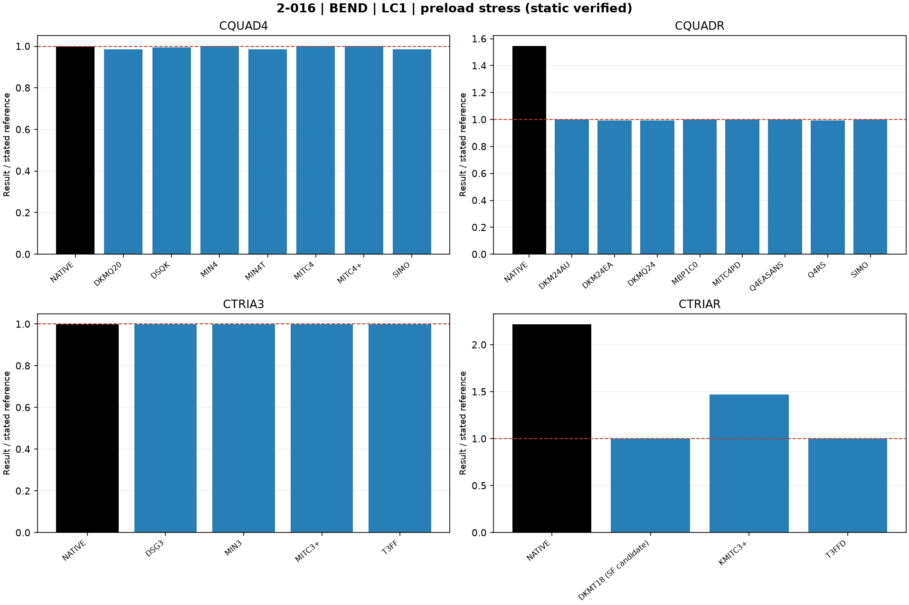
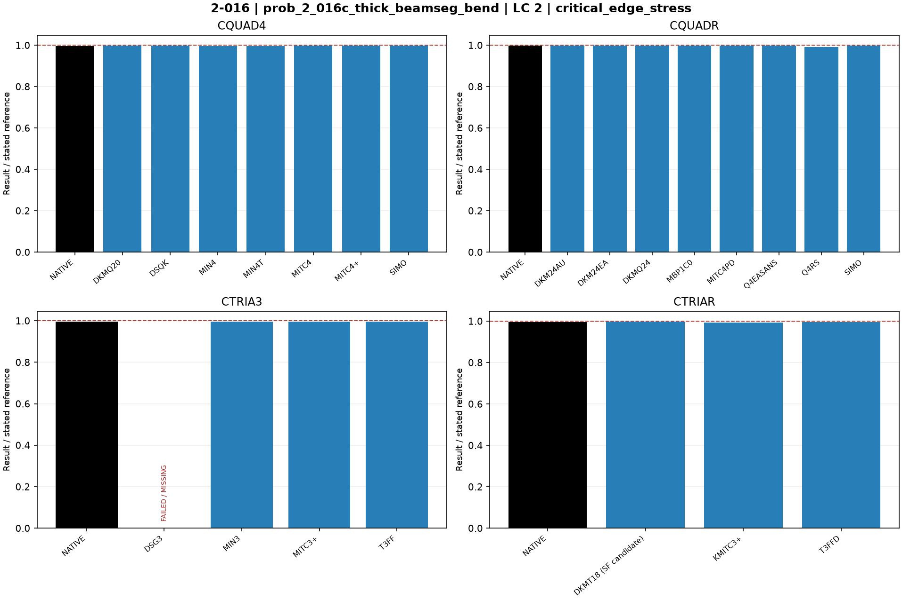
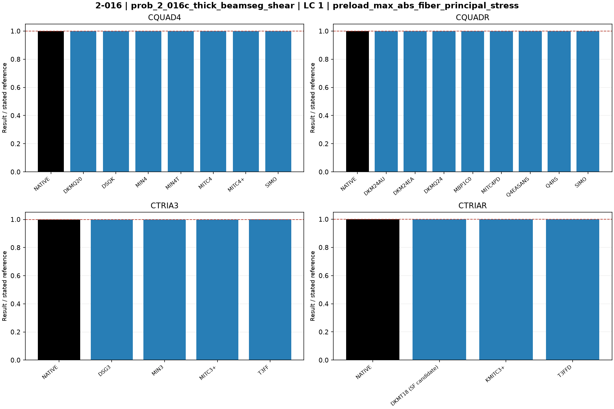
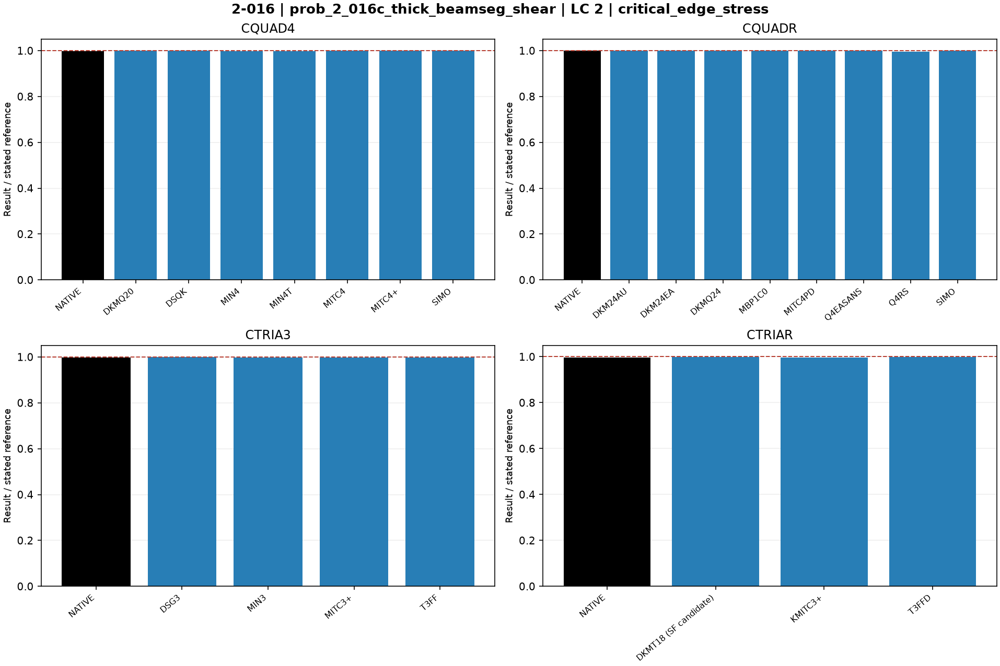

# Linear shells — 2-016: Plate out-of-plane buckling

25 October 2026. Fresh native MYSTRAN and Nastran runs. CQUAD4, CQUADR, CTRIA3 and CTRIAR only.

[All linear comparisons](comparison_all_linear.md) · [Full ZIP](comparison_all_linear.zip) · [Tested DAT](DAT/linear_shell_benchmark_DAT.zip) · [Linear publication QA](PUBLICATION_QA_linear.md)

Case IDs retain source-model filenames; actual element and formulation are given by their columns and deck selectors. Two-axis 2-002 tip observables use the two physical corner nodes.

NATIVE means the Nastran result for the corresponding element card: CQUAD4, CQUADR, CTRIA3 or CTRIAR. It does not mean the same proprietary interpolation as a MYSTRAN selector. Curves use independent/analytical references; published SAP2000 values are separate table columns. A completed solve is not a physical-accuracy pass. Zero references use absolute residuals; missing and failed output is never replaced by zero.

The tested source snapshot includes DKMT18 SF as an explicitly labelled candidate and corrected DSG3 local-z Kg. It is documented in [source provenance](data_linear/provenance_linear.json), with a reproducible element-local patch. This benchmark snapshot is not a declaration that SF passed every production-promotion gate. No shared eigensolver prototype is included.

## Model and comparison scope

Both original files contain both load cases. Split into shear and bending, each static-preload plus linked SOL105 buckling. Remove BAILOUT; convert dummy-beam global line tractions into exact linear-edge nodal forces. Source UX spring on y=0 cannot remove rigid rotation about node 1. Replace it by exact UY=0 at node 4, retain node-1 UX/UY pin and boundary UZ=0, and remove the artificial RZ anchor. These in-plane gauges are compatible with uniform shear and linear bending prestress. t=0.01 in despite filenames thick; compare critical stress to 0.0425/0.1165 ksi using sigma=lambda*qmax/t, qmax=1 kip/in.

MYSTRAN requests six eigenpairs with explicit `PARAM,ARP_TOL,1.0E-10`, default DARPACK and the unchanged physical-pencil residual limit 1e-6. No optional refinement/Jacobi solver changes are active. Nastran uses varying-load STATSUB=1; MYSTRAN uses STATSUB(PRELOAD)=1. 2-016 Nastran bounds the extraction to 0<lambda<0.01. Failed eigenpair acceptance remains SOLVER_ERROR, even if process return code is zero.

Model C is t=.01 in even if the deck name says thick. Critical applied edge stress is lambda*qmax/t, qmax=1 kip/in. Targets BEND=.1165 ksi and SHEAR=.0425 ksi. The corrected DSG3 BEND six-mode residual failure remains visible; one-mode diagnostics are not substituted.

## Extraction status

| Solver | Status | Metric rows |
|---|---|---:|
| MYSTRAN | MEASURED | 86 |
| MYSTRAN | SOLVER_ERROR | 2 |
| NASTRAN | MEASURED | 16 |

DSG3 LC1 preload is independently verified by a separate SOL101 run: 99.8876 ksi versus 100 ksi. It is displayed despite the parent SOL105 LC2 residual failure, which remains open. See the CSV notes and supplemental DAT.

## Figures

### prob_2_016c_thick_beamseg_bend · LC 1 · preload_max_abs_fiber_principal_stress

### prob_2_016c_thick_beamseg_bend · LC 2 · critical_edge_stress

### prob_2_016c_thick_beamseg_shear · LC 1 · preload_max_abs_fiber_principal_stress

### prob_2_016c_thick_beamseg_shear · LC 2 · critical_edge_stress

## Finest available mesh per named series

| Case / parent quads | Solver / formulation | LC | Quantity | Measured | Independent / analytical | CSI published | Unit | Error % primary | Absolute residual | Status |
|---|---|---:|---|---:|---:|---:|---|---:|---:|---|
| prob_2_016c_thick_beamseg_bend / 4096 | MYSTRAN CQUAD4_DKMQ20 | 2 | critical_edge_stress | 0.116282 | 0.1165 | 0.1162 | ksi | 0.1871245 | 0.000218 | MEASURED |
| prob_2_016c_thick_beamseg_bend / 4096 | MYSTRAN CQUAD4_DSQK | 2 | critical_edge_stress | 0.1163392 | 0.1165 | 0.1162 | ksi | 0.1380258 | 0.0001608 | MEASURED |
| prob_2_016c_thick_beamseg_bend / 4096 | MYSTRAN CQUAD4_MIN4 | 2 | critical_edge_stress | 0.1160517 | 0.1165 | 0.1162 | ksi | 0.3848069 | 0.0004483 | MEASURED |
| prob_2_016c_thick_beamseg_bend / 4096 | MYSTRAN CQUAD4_MIN4T | 2 | critical_edge_stress | 0.1160801 | 0.1165 | 0.1162 | ksi | 0.3604292 | 0.0004199 | MEASURED |
| prob_2_016c_thick_beamseg_bend / 4096 | MYSTRAN CQUAD4_MITC4 | 2 | critical_edge_stress | 0.1163392 | 0.1165 | 0.1162 | ksi | 0.1380258 | 0.0001608 | MEASURED |
| prob_2_016c_thick_beamseg_bend / 4096 | MYSTRAN CQUAD4_MITC4plus | 2 | critical_edge_stress | 0.1163392 | 0.1165 | 0.1162 | ksi | 0.1380258 | 0.0001608 | MEASURED |
| prob_2_016c_thick_beamseg_bend / 4096 | MYSTRAN CQUAD4_SIMO | 2 | critical_edge_stress | 0.1163308 | 0.1165 | 0.1162 | ksi | 0.1452361 | 0.0001692 | MEASURED |
| prob_2_016c_thick_beamseg_bend / 4096 | MYSTRAN CQUADR_DKM24AU | 2 | critical_edge_stress | 0.116282 | 0.1165 | 0.1162 | ksi | 0.1871245 | 0.000218 | MEASURED |
| prob_2_016c_thick_beamseg_bend / 4096 | MYSTRAN CQUADR_DKM24EA | 2 | critical_edge_stress | 0.1162736 | 0.1165 | 0.1162 | ksi | 0.1943348 | 0.0002264 | MEASURED |
| prob_2_016c_thick_beamseg_bend / 4096 | MYSTRAN CQUADR_DKMQ24 | 2 | critical_edge_stress | 0.116282 | 0.1165 | 0.1162 | ksi | 0.1871245 | 0.000218 | MEASURED |
| prob_2_016c_thick_beamseg_bend / 4096 | MYSTRAN CQUADR_MBP1C0 | 2 | critical_edge_stress | 0.1163308 | 0.1165 | 0.1162 | ksi | 0.1452361 | 0.0001692 | MEASURED |
| prob_2_016c_thick_beamseg_bend / 4096 | MYSTRAN CQUADR_MITC4PD | 2 | critical_edge_stress | 0.1163392 | 0.1165 | 0.1162 | ksi | 0.1380258 | 0.0001608 | MEASURED |
| prob_2_016c_thick_beamseg_bend / 4096 | MYSTRAN CQUADR_Q4EASANS | 2 | critical_edge_stress | 0.1163308 | 0.1165 | 0.1162 | ksi | 0.1452361 | 0.0001692 | MEASURED |
| prob_2_016c_thick_beamseg_bend / 4096 | MYSTRAN CQUADR_Q4RS | 2 | critical_edge_stress | 0.1155245 | 0.1165 | 0.1162 | ksi | 0.8373391 | 0.0009755 | MEASURED |
| prob_2_016c_thick_beamseg_bend / 4096 | MYSTRAN CQUADR_SIMO | 2 | critical_edge_stress | 0.1163308 | 0.1165 | 0.1162 | ksi | 0.1452361 | 0.0001692 | MEASURED |
| prob_2_016c_thick_beamseg_bend / 4096 | MYSTRAN CTRIA3_DSG3 | 2 | critical_edge_stress | — | 0.1165 | 0.1162 | ksi | — | — | SOLVER_ERROR |
| prob_2_016c_thick_beamseg_bend / 4096 | MYSTRAN CTRIA3_MIN3 | 2 | critical_edge_stress | 0.1159418 | 0.1165 | 0.1162 | ksi | 0.4791416 | 0.0005582 | MEASURED |
| prob_2_016c_thick_beamseg_bend / 4096 | MYSTRAN CTRIA3_MITC3plus | 2 | critical_edge_stress | 0.1160139 | 0.1165 | 0.1162 | ksi | 0.4172532 | 0.0004861 | MEASURED |
| prob_2_016c_thick_beamseg_bend / 4096 | MYSTRAN CTRIA3_T3FF | 2 | critical_edge_stress | 0.116052 | 0.1165 | 0.1162 | ksi | 0.3845494 | 0.000448 | MEASURED |
| prob_2_016c_thick_beamseg_bend / 4096 | MYSTRAN CTRIAR_DKMT18 (SF candidate) | 2 | critical_edge_stress | 0.1162455 | 0.1165 | 0.1162 | ksi | 0.2184549 | 0.0002545 | MEASURED |
| prob_2_016c_thick_beamseg_bend / 4096 | MYSTRAN CTRIAR_KMITC3plus | 2 | critical_edge_stress | 0.1157315 | 0.1165 | 0.1162 | ksi | 0.6596567 | 0.0007685 | MEASURED |
| prob_2_016c_thick_beamseg_bend / 4096 | MYSTRAN CTRIAR_T3FFD | 2 | critical_edge_stress | 0.1160519 | 0.1165 | 0.1162 | ksi | 0.3846352 | 0.0004481 | MEASURED |
| prob_2_016c_thick_beamseg_bend / 4096 | NASTRAN CQUAD4_NATIVE | 2 | critical_edge_stress | 0.1160796 | 0.1165 | 0.1162 | ksi | 0.3608584 | 0.0004204 | MEASURED |
| prob_2_016c_thick_beamseg_bend / 4096 | NASTRAN CQUADR_NATIVE | 2 | critical_edge_stress | 0.1161628 | 0.1165 | 0.1162 | ksi | 0.2894421 | 0.0003372 | MEASURED |
| prob_2_016c_thick_beamseg_bend / 4096 | NASTRAN CTRIA3_NATIVE | 2 | critical_edge_stress | 0.1159141 | 0.1165 | 0.1162 | ksi | 0.5029185 | 0.0005859 | MEASURED |
| prob_2_016c_thick_beamseg_bend / 4096 | NASTRAN CTRIAR_NATIVE | 2 | critical_edge_stress | 0.1160064 | 0.1165 | 0.1162 | ksi | 0.423691 | 0.0004936 | MEASURED |
| prob_2_016c_thick_beamseg_bend / 4096 | MYSTRAN CQUAD4_DKMQ20 | 1 | preload_max_abs_fiber_principal_stress | 98.43571 | 100 | — | ksi | 1.564295 | 1.564295 | MEASURED |
| prob_2_016c_thick_beamseg_bend / 4096 | MYSTRAN CQUAD4_DSQK | 1 | preload_max_abs_fiber_principal_stress | 99.41711 | 100 | — | ksi | 0.5828856 | 0.5828856 | MEASURED |
| prob_2_016c_thick_beamseg_bend / 4096 | MYSTRAN CQUAD4_MIN4 | 1 | preload_max_abs_fiber_principal_stress | 100.1556 | 100 | — | ksi | 0.1556248 | 0.1556248 | MEASURED |
| prob_2_016c_thick_beamseg_bend / 4096 | MYSTRAN CQUAD4_MIN4T | 1 | preload_max_abs_fiber_principal_stress | 98.44591 | 100 | — | ksi | 1.554095 | 1.554095 | MEASURED |
| prob_2_016c_thick_beamseg_bend / 4096 | MYSTRAN CQUAD4_MITC4 | 1 | preload_max_abs_fiber_principal_stress | 100.1456 | 100 | — | ksi | 0.1456245 | 0.1456245 | MEASURED |
| prob_2_016c_thick_beamseg_bend / 4096 | MYSTRAN CQUAD4_MITC4plus | 1 | preload_max_abs_fiber_principal_stress | 100.1456 | 100 | — | ksi | 0.1456245 | 0.1456245 | MEASURED |
| prob_2_016c_thick_beamseg_bend / 4096 | MYSTRAN CQUAD4_SIMO | 1 | preload_max_abs_fiber_principal_stress | 98.4375 | 100 | — | ksi | 1.5625 | 1.5625 | MEASURED |
| prob_2_016c_thick_beamseg_bend / 4096 | MYSTRAN CQUADR_DKM24AU | 1 | preload_max_abs_fiber_principal_stress | 100.1456 | 100 | — | ksi | 0.1456245 | 0.1456245 | MEASURED |
| prob_2_016c_thick_beamseg_bend / 4096 | MYSTRAN CQUADR_DKM24EA | 1 | preload_max_abs_fiber_principal_stress | 99.43001 | 100 | — | ksi | 0.5699856 | 0.5699856 | MEASURED |
| prob_2_016c_thick_beamseg_bend / 4096 | MYSTRAN CQUADR_DKMQ24 | 1 | preload_max_abs_fiber_principal_stress | 99.41721 | 100 | — | ksi | 0.5827857 | 0.5827857 | MEASURED |
| prob_2_016c_thick_beamseg_bend / 4096 | MYSTRAN CQUADR_MBP1C0 | 1 | preload_max_abs_fiber_principal_stress | 100 | 100 | — | ksi | 5.684342e-14 | 5.684342e-14 | MEASURED |
| prob_2_016c_thick_beamseg_bend / 4096 | MYSTRAN CQUADR_MITC4PD | 1 | preload_max_abs_fiber_principal_stress | 100.1456 | 100 | — | ksi | 0.1456245 | 0.1456245 | MEASURED |
| prob_2_016c_thick_beamseg_bend / 4096 | MYSTRAN CQUADR_Q4EASANS | 1 | preload_max_abs_fiber_principal_stress | 100 | 100 | — | ksi | 5.684342e-14 | 5.684342e-14 | MEASURED |
| prob_2_016c_thick_beamseg_bend / 4096 | MYSTRAN CQUADR_Q4RS | 1 | preload_max_abs_fiber_principal_stress | 99.41721 | 100 | — | ksi | 0.5827857 | 0.5827857 | MEASURED |
| prob_2_016c_thick_beamseg_bend / 4096 | MYSTRAN CQUADR_SIMO | 1 | preload_max_abs_fiber_principal_stress | 99.9999 | 100 | — | ksi | 0.0001 | 0.0001 | MEASURED |
| prob_2_016c_thick_beamseg_bend / 4096 | MYSTRAN CTRIA3_DSG3 | 1 | preload_max_abs_fiber_principal_stress | 99.8876 | 100 | — | ksi | 0.1124 | 0.1124 | MEASURED |
| prob_2_016c_thick_beamseg_bend / 4096 | MYSTRAN CTRIA3_MIN3 | 1 | preload_max_abs_fiber_principal_stress | 99.8875 | 100 | — | ksi | 0.1125 | 0.1125 | MEASURED |
| prob_2_016c_thick_beamseg_bend / 4096 | MYSTRAN CTRIA3_MITC3plus | 1 | preload_max_abs_fiber_principal_stress | 99.8876 | 100 | — | ksi | 0.1124 | 0.1124 | MEASURED |
| prob_2_016c_thick_beamseg_bend / 4096 | MYSTRAN CTRIA3_T3FF | 1 | preload_max_abs_fiber_principal_stress | 99.8872 | 100 | — | ksi | 0.1128 | 0.1128 | MEASURED |
| prob_2_016c_thick_beamseg_bend / 4096 | MYSTRAN CTRIAR_DKMT18 (SF candidate) | 1 | preload_max_abs_fiber_principal_stress | 99.8876 | 100 | — | ksi | 0.1124 | 0.1124 | MEASURED |
| prob_2_016c_thick_beamseg_bend / 4096 | MYSTRAN CTRIAR_KMITC3plus | 1 | preload_max_abs_fiber_principal_stress | 147.1633 | 100 | — | ksi | 47.16329 | 47.16329 | MEASURED |
| prob_2_016c_thick_beamseg_bend / 4096 | MYSTRAN CTRIAR_T3FFD | 1 | preload_max_abs_fiber_principal_stress | 99.8876 | 100 | — | ksi | 0.1124 | 0.1124 | MEASURED |
| prob_2_016c_thick_beamseg_bend / 4096 | NASTRAN CQUAD4_NATIVE | 1 | preload_max_abs_fiber_principal_stress | 100.0001 | 100 | — | ksi | 0.0001 | 0.0001 | MEASURED |
| prob_2_016c_thick_beamseg_bend / 4096 | NASTRAN CQUADR_NATIVE | 1 | preload_max_abs_fiber_principal_stress | 154.6438 | 100 | — | ksi | 54.64383 | 54.64383 | MEASURED |
| prob_2_016c_thick_beamseg_bend / 4096 | NASTRAN CTRIA3_NATIVE | 1 | preload_max_abs_fiber_principal_stress | 99.88761 | 100 | — | ksi | 0.11239 | 0.11239 | MEASURED |
| prob_2_016c_thick_beamseg_bend / 4096 | NASTRAN CTRIAR_NATIVE | 1 | preload_max_abs_fiber_principal_stress | 221.7748 | 100 | — | ksi | 121.7748 | 121.7748 | MEASURED |
| prob_2_016c_thick_beamseg_shear / 4096 | MYSTRAN CQUAD4_DKMQ20 | 2 | critical_edge_stress | 0.04249871 | 0.0425 | 0.0425 | ksi | 0.003035294 | 1.29e-06 | MEASURED |
| prob_2_016c_thick_beamseg_shear / 4096 | MYSTRAN CQUAD4_DSQK | 2 | critical_edge_stress | 0.04251738 | 0.0425 | 0.0425 | ksi | 0.04089412 | 1.738e-05 | MEASURED |
| prob_2_016c_thick_beamseg_shear / 4096 | MYSTRAN CQUAD4_MIN4 | 2 | critical_edge_stress | 0.04244203 | 0.0425 | 0.0425 | ksi | 0.1364 | 5.797e-05 | MEASURED |
| prob_2_016c_thick_beamseg_shear / 4096 | MYSTRAN CQUAD4_MIN4T | 2 | critical_edge_stress | 0.04245157 | 0.0425 | 0.0425 | ksi | 0.1139529 | 4.843e-05 | MEASURED |
| prob_2_016c_thick_beamseg_shear / 4096 | MYSTRAN CQUAD4_MITC4 | 2 | critical_edge_stress | 0.04251738 | 0.0425 | 0.0425 | ksi | 0.04089412 | 1.738e-05 | MEASURED |
| prob_2_016c_thick_beamseg_shear / 4096 | MYSTRAN CQUAD4_MITC4plus | 2 | critical_edge_stress | 0.04251738 | 0.0425 | 0.0425 | ksi | 0.04089412 | 1.738e-05 | MEASURED |
| prob_2_016c_thick_beamseg_shear / 4096 | MYSTRAN CQUAD4_SIMO | 2 | critical_edge_stress | 0.04251738 | 0.0425 | 0.0425 | ksi | 0.04089412 | 1.738e-05 | MEASURED |
| prob_2_016c_thick_beamseg_shear / 4096 | MYSTRAN CQUADR_DKM24AU | 2 | critical_edge_stress | 0.04249871 | 0.0425 | 0.0425 | ksi | 0.003035294 | 1.29e-06 | MEASURED |
| prob_2_016c_thick_beamseg_shear / 4096 | MYSTRAN CQUADR_DKM24EA | 2 | critical_edge_stress | 0.04249871 | 0.0425 | 0.0425 | ksi | 0.003035294 | 1.29e-06 | MEASURED |
| prob_2_016c_thick_beamseg_shear / 4096 | MYSTRAN CQUADR_DKMQ24 | 2 | critical_edge_stress | 0.04249871 | 0.0425 | 0.0425 | ksi | 0.003035294 | 1.29e-06 | MEASURED |
| prob_2_016c_thick_beamseg_shear / 4096 | MYSTRAN CQUADR_MBP1C0 | 2 | critical_edge_stress | 0.04251738 | 0.0425 | 0.0425 | ksi | 0.04089412 | 1.738e-05 | MEASURED |
| prob_2_016c_thick_beamseg_shear / 4096 | MYSTRAN CQUADR_MITC4PD | 2 | critical_edge_stress | 0.04251738 | 0.0425 | 0.0425 | ksi | 0.04089412 | 1.738e-05 | MEASURED |
| prob_2_016c_thick_beamseg_shear / 4096 | MYSTRAN CQUADR_Q4EASANS | 2 | critical_edge_stress | 0.04251738 | 0.0425 | 0.0425 | ksi | 0.04089412 | 1.738e-05 | MEASURED |
| prob_2_016c_thick_beamseg_shear / 4096 | MYSTRAN CQUADR_Q4RS | 2 | critical_edge_stress | 0.04227366 | 0.0425 | 0.0425 | ksi | 0.5325647 | 0.00022634 | MEASURED |
| prob_2_016c_thick_beamseg_shear / 4096 | MYSTRAN CQUADR_SIMO | 2 | critical_edge_stress | 0.04251738 | 0.0425 | 0.0425 | ksi | 0.04089412 | 1.738e-05 | MEASURED |
| prob_2_016c_thick_beamseg_shear / 4096 | MYSTRAN CTRIA3_DSG3 | 2 | critical_edge_stress | 0.04249066 | 0.0425 | 0.0425 | ksi | 0.02197647 | 9.34e-06 | MEASURED |
| prob_2_016c_thick_beamseg_shear / 4096 | MYSTRAN CTRIA3_MIN3 | 2 | critical_edge_stress | 0.04236545 | 0.0425 | 0.0425 | ksi | 0.3165882 | 0.00013455 | MEASURED |
| prob_2_016c_thick_beamseg_shear / 4096 | MYSTRAN CTRIA3_MITC3plus | 2 | critical_edge_stress | 0.04238845 | 0.0425 | 0.0425 | ksi | 0.2624706 | 0.00011155 | MEASURED |
| prob_2_016c_thick_beamseg_shear / 4096 | MYSTRAN CTRIA3_T3FF | 2 | critical_edge_stress | 0.04239737 | 0.0425 | 0.0425 | ksi | 0.2414824 | 0.00010263 | MEASURED |
| prob_2_016c_thick_beamseg_shear / 4096 | MYSTRAN CTRIAR_DKMT18 (SF candidate) | 2 | critical_edge_stress | 0.04245099 | 0.0425 | 0.0425 | ksi | 0.1153176 | 4.901e-05 | MEASURED |
| prob_2_016c_thick_beamseg_shear / 4096 | MYSTRAN CTRIAR_KMITC3plus | 2 | critical_edge_stress | 0.04230358 | 0.0425 | 0.0425 | ksi | 0.4621647 | 0.00019642 | MEASURED |
| prob_2_016c_thick_beamseg_shear / 4096 | MYSTRAN CTRIAR_T3FFD | 2 | critical_edge_stress | 0.04239737 | 0.0425 | 0.0425 | ksi | 0.2414824 | 0.00010263 | MEASURED |
| prob_2_016c_thick_beamseg_shear / 4096 | NASTRAN CQUAD4_NATIVE | 2 | critical_edge_stress | 0.04243525 | 0.0425 | 0.0425 | ksi | 0.1523529 | 6.475e-05 | MEASURED |
| prob_2_016c_thick_beamseg_shear / 4096 | NASTRAN CQUADR_NATIVE | 2 | critical_edge_stress | 0.04245865 | 0.0425 | 0.0425 | ksi | 0.09729412 | 4.135e-05 | MEASURED |
| prob_2_016c_thick_beamseg_shear / 4096 | NASTRAN CTRIA3_NATIVE | 2 | critical_edge_stress | 0.04236015 | 0.0425 | 0.0425 | ksi | 0.3290588 | 0.00013985 | MEASURED |
| prob_2_016c_thick_beamseg_shear / 4096 | NASTRAN CTRIAR_NATIVE | 2 | critical_edge_stress | 0.0423881 | 0.0425 | 0.0425 | ksi | 0.2632941 | 0.0001119 | MEASURED |
| prob_2_016c_thick_beamseg_shear / 4096 | MYSTRAN CQUAD4_DKMQ20 | 1 | preload_max_abs_fiber_principal_stress | 100 | 100 | — | ksi | 9.33278e-08 | 9.33278e-08 | MEASURED |
| prob_2_016c_thick_beamseg_shear / 4096 | MYSTRAN CQUAD4_DSQK | 1 | preload_max_abs_fiber_principal_stress | 100 | 100 | — | ksi | 6.11637e-08 | 6.11637e-08 | MEASURED |
| prob_2_016c_thick_beamseg_shear / 4096 | MYSTRAN CQUAD4_MIN4 | 1 | preload_max_abs_fiber_principal_stress | 100 | 100 | — | ksi | 3.08801e-07 | 3.08801e-07 | MEASURED |
| prob_2_016c_thick_beamseg_shear / 4096 | MYSTRAN CQUAD4_MIN4T | 1 | preload_max_abs_fiber_principal_stress | 100 | 100 | — | ksi | 4.011495e-07 | 4.011495e-07 | MEASURED |
| prob_2_016c_thick_beamseg_shear / 4096 | MYSTRAN CQUAD4_MITC4 | 1 | preload_max_abs_fiber_principal_stress | 100 | 100 | — | ksi | 3.99536e-08 | 3.99536e-08 | MEASURED |
| prob_2_016c_thick_beamseg_shear / 4096 | MYSTRAN CQUAD4_MITC4plus | 1 | preload_max_abs_fiber_principal_stress | 100 | 100 | — | ksi | 3.99536e-08 | 3.99536e-08 | MEASURED |
| prob_2_016c_thick_beamseg_shear / 4096 | MYSTRAN CQUAD4_SIMO | 1 | preload_max_abs_fiber_principal_stress | 100 | 100 | — | ksi | 1.315009e-07 | 1.315009e-07 | MEASURED |
| prob_2_016c_thick_beamseg_shear / 4096 | MYSTRAN CQUADR_DKM24AU | 1 | preload_max_abs_fiber_principal_stress | 100 | 100 | — | ksi | 7.236525e-08 | 7.236525e-08 | MEASURED |
| prob_2_016c_thick_beamseg_shear / 4096 | MYSTRAN CQUADR_DKM24EA | 1 | preload_max_abs_fiber_principal_stress | 100 | 100 | — | ksi | 1.074644e-07 | 1.074644e-07 | MEASURED |
| prob_2_016c_thick_beamseg_shear / 4096 | MYSTRAN CQUADR_DKMQ24 | 1 | preload_max_abs_fiber_principal_stress | 100 | 100 | — | ksi | 5.16046e-08 | 5.16046e-08 | MEASURED |
| prob_2_016c_thick_beamseg_shear / 4096 | MYSTRAN CQUADR_MBP1C0 | 1 | preload_max_abs_fiber_principal_stress | 100 | 100 | — | ksi | 1.055736e-07 | 1.055736e-07 | MEASURED |
| prob_2_016c_thick_beamseg_shear / 4096 | MYSTRAN CQUADR_MITC4PD | 1 | preload_max_abs_fiber_principal_stress | 100 | 100 | — | ksi | 6.33723e-08 | 6.33723e-08 | MEASURED |
| prob_2_016c_thick_beamseg_shear / 4096 | MYSTRAN CQUADR_Q4EASANS | 1 | preload_max_abs_fiber_principal_stress | 100 | 100 | — | ksi | 1.055736e-07 | 1.055736e-07 | MEASURED |
| prob_2_016c_thick_beamseg_shear / 4096 | MYSTRAN CQUADR_Q4RS | 1 | preload_max_abs_fiber_principal_stress | 100 | 100 | — | ksi | 2.995002e-08 | 2.995002e-08 | MEASURED |
| prob_2_016c_thick_beamseg_shear / 4096 | MYSTRAN CQUADR_SIMO | 1 | preload_max_abs_fiber_principal_stress | 100 | 100 | — | ksi | 4.765184e-08 | 4.765184e-08 | MEASURED |
| prob_2_016c_thick_beamseg_shear / 4096 | MYSTRAN CTRIA3_DSG3 | 1 | preload_max_abs_fiber_principal_stress | 100 | 100 | — | ksi | 4.77778e-07 | 4.77778e-07 | MEASURED |
| prob_2_016c_thick_beamseg_shear / 4096 | MYSTRAN CTRIA3_MIN3 | 1 | preload_max_abs_fiber_principal_stress | 100 | 100 | — | ksi | 6.13424e-08 | 6.13424e-08 | MEASURED |
| prob_2_016c_thick_beamseg_shear / 4096 | MYSTRAN CTRIA3_MITC3plus | 1 | preload_max_abs_fiber_principal_stress | 100 | 100 | — | ksi | 2.9874e-07 | 2.9874e-07 | MEASURED |
| prob_2_016c_thick_beamseg_shear / 4096 | MYSTRAN CTRIA3_T3FF | 1 | preload_max_abs_fiber_principal_stress | 100.1349 | 100 | — | ksi | 0.1349396 | 0.1349396 | MEASURED |
| prob_2_016c_thick_beamseg_shear / 4096 | MYSTRAN CTRIAR_DKMT18 (SF candidate) | 1 | preload_max_abs_fiber_principal_stress | 100 | 100 | — | ksi | 2.902299e-07 | 2.902299e-07 | MEASURED |
| prob_2_016c_thick_beamseg_shear / 4096 | MYSTRAN CTRIAR_KMITC3plus | 1 | preload_max_abs_fiber_principal_stress | 100 | 100 | — | ksi | 2.073296e-07 | 2.073296e-07 | MEASURED |
| prob_2_016c_thick_beamseg_shear / 4096 | MYSTRAN CTRIAR_T3FFD | 1 | preload_max_abs_fiber_principal_stress | 100 | 100 | — | ksi | 1.217308e-07 | 1.217308e-07 | MEASURED |
| prob_2_016c_thick_beamseg_shear / 4096 | NASTRAN CQUAD4_NATIVE | 1 | preload_max_abs_fiber_principal_stress | 100 | 100 | — | ksi | 1.196471e-07 | 1.196471e-07 | MEASURED |
| prob_2_016c_thick_beamseg_shear / 4096 | NASTRAN CQUADR_NATIVE | 1 | preload_max_abs_fiber_principal_stress | 100 | 100 | — | ksi | 4.226582e-08 | 4.226582e-08 | MEASURED |
| prob_2_016c_thick_beamseg_shear / 4096 | NASTRAN CTRIA3_NATIVE | 1 | preload_max_abs_fiber_principal_stress | 100 | 100 | — | ksi | 1.294317e-07 | 1.294317e-07 | MEASURED |
| prob_2_016c_thick_beamseg_shear / 4096 | NASTRAN CTRIAR_NATIVE | 1 | preload_max_abs_fiber_principal_stress | 100 | 100 | — | ksi | 9.530626e-08 | 9.530626e-08 | MEASURED |

All mesh rows, missing fields, hashes and run statuses remain in the CSV.
